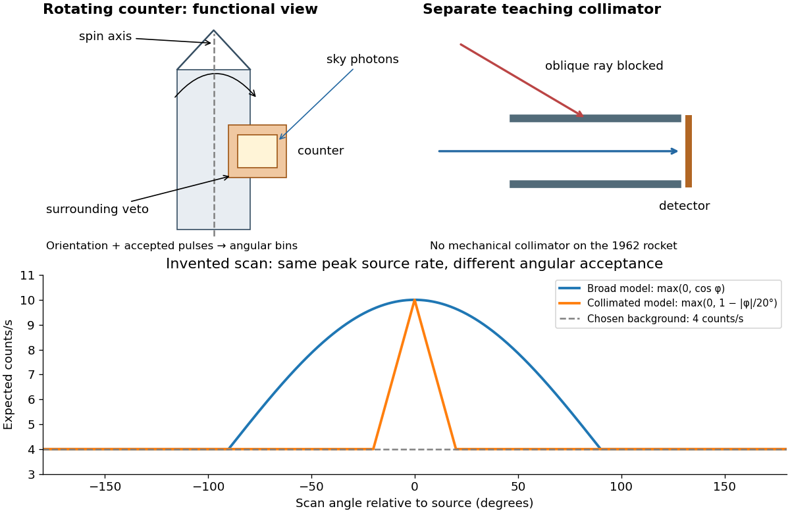

# 1962 rocket discovery of cosmic X-ray sources

↑ **Parent:** [X-ray astronomy](x-ray-astronomy.md)

In 1962, [Riccardo Giacconi](riccardo-giacconi.md) and colleagues flew three [Geiger counters](geiger-counter.md) to search for lunar [X-ray fluorescence](x-ray-fluorescence.md). Different [mica](mica.md) thicknesses tested penetration; lampblack blocked [ultraviolet](ultraviolet.md). Each counter sat in an [anticoincidence detector](anticoincidence-detector.md) using a [scintillation counter](scintillation-counter.md) to reject [cosmic rays](cosmic-ray.md). There was no mechanical [collimator](collimator.md). Rotation scanned the sky; optical sensors supplied orientation.[pp. 439–440, apparatus and readout](evidence-for-x-rays-from-sources-outside-the-solar-system-by-riccardo-giacconi-and-others.md)

Counts were sorted by [azimuth](azimuth.md); a faulty counter and tumbling descent data were excluded. A directional peak lay above a diffuse component. Window, altitude and angular responses tested [X-rays](x-ray.md) against [charged particles](charged-particle.md); the [Moon](moon.md)'s nondetection checked optical leakage. The authors argued for an origin outside the [Solar system](solar-system.md), while residual [cosmic ray](cosmic-ray.md) background was not directly measured and source size, position and [spectrum](spectrum-functional-analysis.md) remained assumption-dependent.[pp. 440–443, Figs. 1–4 and concluding limitations](evidence-for-x-rays-from-sources-outside-the-solar-system-by-riccardo-giacconi-and-others.md)

**[Figure 15](#image-rotation-encodes-direction-a-teaching-collimator-narrows-an-angular-response). Rotation encodes direction; a teaching collimator narrows an angular response**. Functional schematic and invented response curves. The 1962 rocket had no mechanical collimator; the separate collimator panel illustrates a possible angular filter. Curves are model expectations, not flight data.

A simple original [forward problem](forward-problem.md) makes the distinction precise. Let $\phi$ be the scan [azimuth](azimuth.md), let $g(\phi)$ be a dimensionless directional response with maximum one, let $F$ be a source's band-integrated [photon](photon.md) arrival rate per unit area, let $A_0$ be its on-axis [X-ray effective area](x-ray-effective-area.md), and let $b$ be a constant accepted background rate. The expected rate is

$$
r(\phi)=F A_0 g(\phi)+b.
$$

For a broad illustrative response $g(\phi)=\max(0,\cos\phi)$, the full width at half maximum is $120^\circ$: $\cos\phi=1/2$ at $\phi=\pm60^\circ$. For a one-dimensional ideal [collimator](collimator.md) model $g(\phi)=\max(0,1-|\phi|/\theta_c)$, the full width at half maximum is $\theta_c$. Choosing $\theta_c=20^\circ$ narrows the response sixfold without focusing any additional [photons](photon.md). These are teaching response functions, not reconstructions of the rocket's window transmission or geometry. A narrower scan peak can reflect the instrument response even when the source is unresolved.

**Table of contents**

- [Scorpius X-1](scorpius-x-1.md)

## ↑ Ancestors (6)

1. [X-ray astronomy](x-ray-astronomy.md)
2. [Observational astronomy](observational-astronomy.md)
3. [Astrophysics](astrophysics-split.md)
4. [Branches of physics](branches-of-physics.md)
5. [Physics](physics-split.md)
6. [Codex Wiki](split.md)
