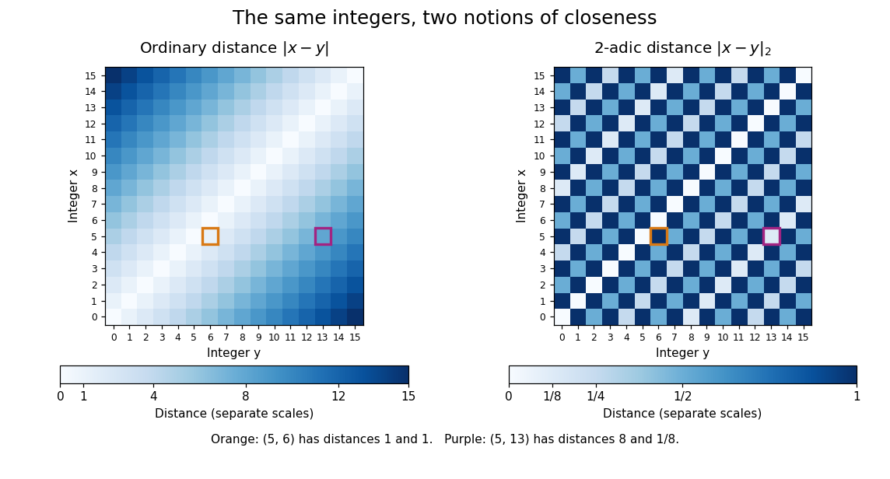

# 2-adic absolute value

↑ **Parent:** [p-adic absolute value](p-adic-absolute-value.md)

The 2-adic absolute value is the [p-adic absolute value](p-adic-absolute-value.md) for the [prime number](prime-number.md) $p=2$. It is defined on the [rational numbers](rational-number.md) by $|x|_2=2^{-v_2(x)}$ for $x\ne0$ and $|0|_2=0$, and extends to their [P-adic number](p-adic-number.md) completion $\mathbb Q_2$. For a nonzero [integer](integer.md), count factors of two until the remaining factor is odd; for a [rational number](rational-number.md), subtract the [denominator](denominator.md)'s count from the [numerator](numerator.md)'s count.

The associated [metric](metric.md) reverses a familiar comparison:

$$
d_2(5,13)=|5-13|_2=|-8|_2=\frac18,\qquad d_2(5,6)=|-1|_2=1.
$$

Although $13$ is eight units from $5$ on the ordinary [number line](number-line.md), it agrees with $5$ modulo $8$, whereas $6$ already disagrees modulo $2$. The [2-adic absolute value](2-adic-absolute-value.md) measures that agreement. The value $|3/8|_2=8$ also shows why this [Non-Archimedean absolute value](non-archimedean-absolute-value.md) must be distinguished from the ordinary [absolute value](absolute-value.md) $|3/8|=3/8$.

**[Figure 12](#image-ordinary-absolute-value-and-2-adic-absolute-value-give-different-distance-patterns-for-the-same-sixteen-integers). Ordinary absolute value and 2-adic absolute value give different distance patterns for the same sixteen integers**.

In the left panel, differences farther from the diagonal grow in ordinary [absolute value](absolute-value.md). In the right panel, nonzero even differences are closer than odd differences, and each further factor of two halves the [2-adic absolute value](2-adic-absolute-value.md). The highlighted pairs have opposite distance rankings. The repeated pattern is the nested [congruence class](congruence-class.md) structure of an [ultrametric space](ultrametric-space.md), visible without adding any new points.

## ↑ Ancestors (7)

1. [p-adic absolute value](p-adic-absolute-value.md)
2. [P-adic number](p-adic-number.md)
3. [Non-Archimedean analysis](non-archimedean-analysis.md)
4. [Arithmetic](arithmetic-split.md)
5. [Area of mathematics](area-of-mathematics.md)
6. [Mathematics](mathematics-split.md)
7. [Codex Wiki](split.md)

## ← Incoming links (7)

- [2-adic absolute value](2-adic-absolute-value.md)
- [p-adic absolute value](p-adic-absolute-value.md)
- [P-adic number](p-adic-number.md)
- [Solution](past-exam-of-the-mathematics-course-of-the-university-of-cambridge/2007/ib/paper-2/3h/solution.md)
- [Solution](past-exam-of-the-mathematics-course-of-the-university-of-cambridge/2009/iii/paper-28/1/iii/solution.md)
- [Ultrametric inequality](ultrametric-inequality.md)
- [Ultrametric space](ultrametric-space.md)
