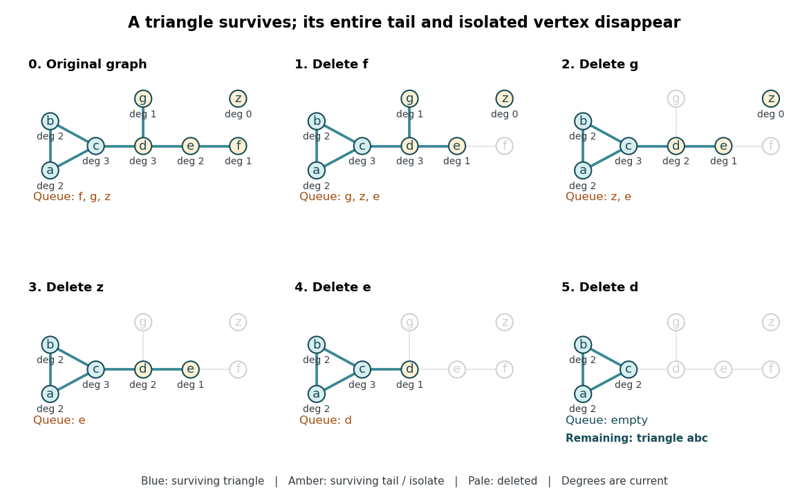

# 2-core of a graph

↑ **Parent:** [Graph theory](graph-theory-split.md)

The [2-core](2-core-of-a-graph.md) is what remains of a finite [simple graph](simple-graph.md) after repeatedly removing every [vertex](vertex-graph-theory.md) with fewer than two surviving [graph neighbours](neighbour-of-a-vertex.md). It strips away dangling [trees](tree-graph-theory-split.md) while keeping the part that can support itself under this local rule. Precisely, for an [undirected graph](undirected-graph.md) $G=(V,E)$, its [2-core](2-core-of-a-graph.md) is the unique maximum by [set inclusion](set-inclusion.md) [induced subgraph](induced-subgraph.md) $G[S]$ such that

$$
\deg_{G[S]}(v)\geq2\qquad\text{for every }v\in S.
$$

The empty [vertex set](vertex-set.md) is allowed: the condition is then vacuous, without needing to define the [minimum degree](minimum-degree-of-a-graph.md) of the empty [graph](graph-split.md). "Maximum by inclusion" means that $S$ contains every other [vertex set](vertex-set.md) satisfying the condition. It is stronger than merely saying that one chosen set cannot be enlarged: the [2-core](2-core-of-a-graph.md) simultaneously contains all possible qualifying [induced subgraphs](induced-subgraph.md). In this particular family, every inclusion-maximal qualifying set does equal that unique maximum; the [union](set-union.md) argument in [why the 2-core is unique](why-the-2-core-is-unique.md) explains why. [Batagelj and Zaveršnik, An O(m) Algorithm for Cores Decomposition of Networks, §2, definition of a core](an-o-m-algorithm-for-cores-decomposition-of-networks-by-vladimir-batagelj-and-matjaz-zaversnik.md)

For a complete worked example, let $ab$ denote the [edge](edge-of-a-graph.md) $\{a,b\}$ and take

$$
V=\{a,b,c,d,e,f,g,z\},\qquad E=\{ab,bc,ca,cd,de,ef,dg\}.
$$

The [triangle in a graph](triangle-in-a-graph.md) $abc$ has a branching tail attached at $c$, and $z$ is an [isolated vertex](isolated-vertex.md). In alphabetical order the initial [degrees of vertices](degree-graph-theory.md) are $(2,2,3,3,2,1,1,0)$. Deleting $f$ turns $e$ into a [leaf of a graph](leaf-of-a-graph.md); deleting $g$ leaves $d$ with [degree of a vertex](degree-graph-theory.md) two; deleting $z$ changes no other [degree of a vertex](degree-graph-theory.md). Now delete $e$, which makes $d$ a [leaf of a graph](leaf-of-a-graph.md), and finally delete $d$. Exactly the three [edges](edge-of-a-graph.md) of $abc$ remain: $C_2(G)=G[\{a,b,c\}]$.

**[Figure 1](#image-the-complete-leaf-pruning-for-the-2-core-trace-each-panel-recomputes-the-displayed-degrees-of-vertices-from-the-surviving-induced-subgraph-while-the-fifo-queue-determines-the-next-deletion). The complete leaf pruning for the 2-core trace: each panel recomputes the displayed degrees of vertices from the surviving induced subgraph, while the FIFO queue determines the next deletion**.

A [forest](forest.md) has empty [2-core](2-core-of-a-graph.md): every nonempty finite [forest](forest.md) has an [isolated vertex](isolated-vertex.md) or a [leaf of a graph](leaf-of-a-graph.md), so deletion cannot stop at a nonempty remainder. In particular, an isolated [edge](edge-of-a-graph.md), an [isolated vertex](isolated-vertex.md), a [path graph](path-graph.md), and the empty [graph](graph-split.md) all have empty [2-core](2-core-of-a-graph.md). Every [cycle graph](cycle-graph.md) is its own [2-core](2-core-of-a-graph.md). Two disjoint [triangles in a graph](triangle-in-a-graph.md) also form their own [2-core](2-core-of-a-graph.md), so a [2-core](2-core-of-a-graph.md) need not be a [connected graph](connected-graph.md); attaching a [tree](tree-graph-theory-split.md) to either triangle changes neither surviving triangle.

**Table of contents**

- [Leaf pruning for the 2-core](leaf-pruning-for-the-2-core.md)
- [Why the 2-core is unique](why-the-2-core-is-unique.md)
- [Bridges and connectivity in the 2-core](bridges-and-connectivity-in-the-2-core.md)
- [Graph kernel](graph-kernel.md)

## ↑ Ancestors (5)

1. [Graph theory](graph-theory-split.md)
2. [Foundations of mathematics](foundations-of-mathematics-split.md)
3. [Area of mathematics](area-of-mathematics.md)
4. [Mathematics](mathematics-split.md)
5. [Codex Wiki](split.md)
