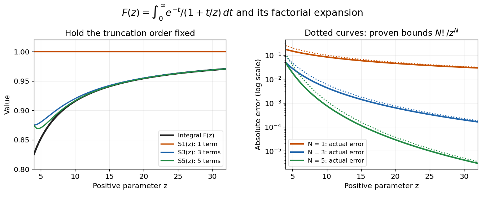

# A divergent factorial series can approximate a convergent integral

↑ **Parent:** [Asymptotic power series](asymptotic-power-series.md)

For real $z>0$, define

$$
F(z)=\int_0^\infty\frac{e^{-t}}{1+t/z}\,dt.
$$

The [integrand](integrand.md) is positive and at most $e^{-t}$, so $0<F(z)<1$ and the [improper integral](improper-integral.md) converges. Substituting $s=z+t$ also gives $F(z)=ze^zE_1(z)$ in terms of the [exponential integral](exponential-integral.md); the original representation makes positivity and the large-$z$ behavior transparent.

Apply the exact finite [geometric series](geometric-series.md) identity inside the [integral](integral-split.md), without assuming that an infinite [series](series-mathematics.md) can be integrated term by term:

$$
\frac1{1+t/z}
=\sum_{k=0}^{N-1}(-1)^k\frac{t^k}{z^k}
+(-1)^N\frac{t^N/z^N}{1+t/z}.
$$

The [Gamma integral](gamma-integral.md) gives $\int_0^\infty e^{-t}t^k\,dt=k!$. Therefore, with $N$ retained terms,

$$
F(z)=S_N(z)+R_N(z),\qquad
S_N(z)=\sum_{k=0}^{N-1}\frac{(-1)^kk!}{z^k},
$$

$$
R_N(z)=\frac{(-1)^N}{z^N}
\int_0^\infty\frac{e^{-t}t^N}{1+t/z}\,dt,
\qquad
\boxed{|R_N(z)|\leq\frac{N!}{z^N}}.
$$

This remainder formula proves the [asymptotic expansion](asymptotic-expansion-split.md) at every fixed order: $R_N=O(z^{-N})=o(z^{-N+1})$ as $z\to+\infty$. Its sign also gives alternating bounds: an odd $N$ overestimates $F(z)$, and an even $N$ underestimates it.

At $z=10$, an independent evaluation of the [integral](integral-split.md) gives $F(10)\approx0.9156333394$. Three retained terms give

$$
S_3(10)=1-0.1+0.02=0.92,
\qquad |F(10)-S_3(10)|<0.006.
$$

Five retained terms give $S_5(10)=0.9164$ with error bounded by $5!/10^5=0.0012$. The actual errors are about $0.004367$ and $0.000767$, respectively. The [error bound](error-bound.md) is conservative, but established without relying on the numerical integral evaluation.

**[Figure 1](#image-fixed-order-asymptotic-expansions-improve-as-the-parameter-grows). Fixed-order asymptotic expansions improve as the parameter grows**. Original calculations for $F(z)=\int_0^\infty e^{-t}/(1+t/z)\,dt$. Left: the integral and its one-, three- and five-term [partial sums](partial-sum.md). Right: their absolute errors, with dotted bounds $N!/z^N$. The independently justified bounds apply for every displayed positive $z$; the [asymptotic expansion](asymptotic-expansion-split.md) concerns the limit $z\to+\infty$.

Nevertheless, the formal infinite [series](series-mathematics.md) diverges at every fixed $z>0$. The magnitudes $T_k=k!/z^k$ satisfy $T_{k+1}/T_k=(k+1)/z$, so they eventually increase without bound. In particular, the terms fail the necessary zero-term condition for a convergent [series](series-mathematics.md). The finite remainder identity remains valid after convergence has failed; this is precisely what makes the example useful.

## ↑ Ancestors (6)

1. [Asymptotic power series](asymptotic-power-series.md)
2. [Asymptotic expansion](asymptotic-expansion-split.md)
3. [Analysis](analysis-split.md)
4. [Area of mathematics](area-of-mathematics.md)
5. [Mathematics](mathematics-split.md)
6. [Codex Wiki](split.md)

## ← Incoming links (2)

- [Asymptotic expansion](asymptotic-expansion-split.md)
- [Optimal truncation](optimal-truncation.md)
