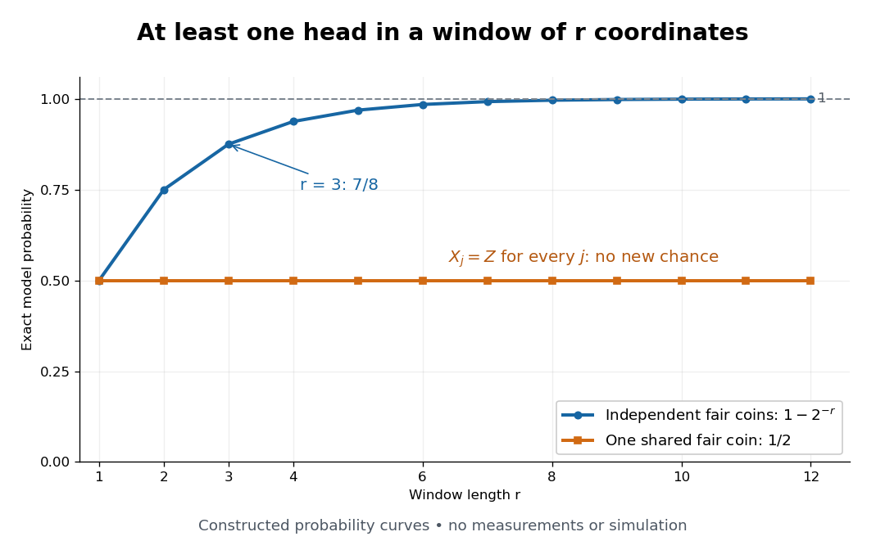

# A shared coin prevents a zero-one conclusion

↑ **Parent:** [Kolmogorov's zero–one law](kolmogorov-s-zero-one-law.md)

Let $Z$ have the fair [Bernoulli distribution](bernoulli-distribution.md) and set $X_j=Z$ for every $j$. Each coordinate has the same fair [probability distribution](probability-distribution-split.md) as in the independent model, but the coordinates are dependent: $\mathbb P(X_1=1,X_2=1)=1/2$, whereas the product of the marginal [probabilities](probability.md) is $1/4$. Every future [sigma-algebra](sigma-algebra.md) equals $\sigma(Z)$, so the [tail sigma-algebra](tail-sigma-algebra.md) also equals $\sigma(Z)$.

The [tail event](tail-event.md) of infinitely many heads is now exactly $\{Z=1\}$, with [probability](probability.md) $1/2$. For the finite-window [events](event.md) $B_{m,r}$ in [infinitely many heads as a tail event](infinitely-many-heads-as-a-tail-event.md),

$$
\begin{array}{c|cc}
&\text{independent fair coordinates}&\text{one shared fair coin}\\
\mathbb P(B_{m,r})&1-2^{-r}&1/2\\
\mathbb P(A)&1&1/2
\end{array}
$$

The [sample space](sample-space.md) can even be the same full [Cartesian product](cartesian-product.md) $\{0,1\}^{\mathbb N}$ in both models: the dependent [probability measure](probability-measure.md) assigns mass $1/2$ to each of the all-zero and all-one [sequences](sequence.md). Then $A$ is the same literal [tail event](tail-event.md) in both models. Only the [probability measure](probability-measure.md) and its [independence](independent-random-variables.md) properties change.

**[Figure 8](#image-more-independent-trials-increase-the-chance-of-a-head-repeated-copies-of-one-coin-do-not). More independent trials increase the chance of a head; repeated copies of one coin do not**. Exact constructed [probabilities](probability.md) for at least one head in a window of $r$ coordinates. The independent curve is $1-2^{-r}$ and tends to one; the shared-coin curve stays at $1/2$. These are calculations from the two specified [probability measures](probability-measure.md), not measurements or simulated frequencies.

## ↑ Ancestors (8)

1. [Kolmogorov's zero–one law](kolmogorov-s-zero-one-law.md)
2. [Tail sigma-algebra](tail-sigma-algebra.md)
3. [Independent sigma-algebras](independent-sigma-algebras.md)
4. [Probability theory](probability-theory-split.md)
5. [Probability and statistics](probability-and-statistics-split.md)
6. [Area of mathematics](area-of-mathematics.md)
7. [Mathematics](mathematics-split.md)
8. [Codex Wiki](split.md)
