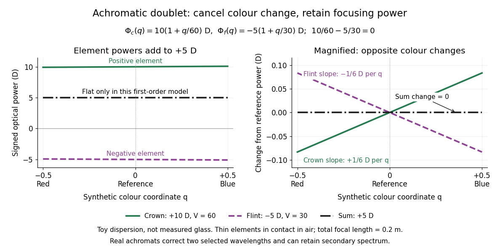

# Achromatic doublet power balance

↑ **Parent:** [Achromatic lens](achromatic-lens.md)

[Achromatic doublet power balance](achromatic-doublet-power-balance.md) chooses two signed [optical powers](optical-power.md) to meet two goals: obtain the required [focal length](focal-length.md) and cancel the primary F–C colour difference. Model two [thin lens](thin-lens.md) elements in contact in air, using the [paraxial approximation](paraxial-approximation.md). Let $i=c,f$ label the [crown glass](crown-glass-optics.md) and [flint glass](flint-glass.md) elements, and let $\Phi_{i,d}$ denote each element's [optical power](optical-power.md) at the reference d line. The [Abbe number](abbe-number.md) for each material is

$$
V_i=\frac{n_{i,d}-1}{n_{i,F}-n_{i,C}}.
$$

The subscripts label standard [spectral lines](spectral-line.md): blue F near $486.1\,\mathrm{nm}$, red C near $656.3\,\mathrm{nm}$, and reference d near $587.6\,\mathrm{nm}$. These are three specified [wavelengths](wavelength.md), not colour bands. A larger [Abbe number](abbe-number.md) means less relative [optical dispersion](dispersion-optics.md) between F and C. [SCHOTT, Optical Glass 2025, §1.1 and §10: Wavelength table](https://media.schott.com/api/public/content/b37dbd8fa7e64662b2d0ae523ae56238?download=true&v=97f67105).

For a fixed [thin lens](thin-lens.md) shape in air, write the [lensmaker's equation](lensmaker-s-equation.md) as $\Phi_i(\lambda)=K_i[n_i(\lambda)-1]$, with signed shape factor $K_i=1/R_{i,a}-1/R_{i,b}$. Subtracting its C value from its F value gives the primary [optical power](optical-power.md) difference

$$
\Delta\Phi_i=\Phi_{i,F}-\Phi_{i,C}=K_i(n_{i,F}-n_{i,C})=\frac{\Phi_{i,d}}{V_i}.
$$

The negative element has negative $\Delta\Phi_i$: its blue [optical power](optical-power.md) is more negative, not less negative. The contact rule for [optical power](optical-power.md) therefore gives

$$
\Phi_d=\Phi_{c,d}+\Phi_{f,d}=\frac{1}{f_d},\qquad \Delta\Phi_{\rm total}=\frac{\Phi_{c,d}}{V_c}+\frac{\Phi_{f,d}}{V_f}=0.
$$

This zero is equality of the total F and C [optical powers](optical-power.md), hence equality of their [focal lengths](focal-length.md) when the total [optical power](optical-power.md) is nonzero. The relation follows directly from the [lensmaker's equation](lensmaker-s-equation.md) and the [Abbe number](abbe-number.md); it is exact within the fixed-shape contact [thin lens](thin-lens.md) model. [Jeremy Tatum, University of Victoria, Geometric Optics §2.10, equations 2.10.8–2.10.11, authored text hosted by LibreTexts](https://phys.libretexts.org/Bookshelves/Optics/Geometric_Optics_(Tatum)/02:_Lens_and_Mirror_Calculations/2.10:_Designing_an_Achromatic_Doublet). Tatum uses a yellow D-line reference; here the [Abbe number](abbe-number.md) convention uses the d line consistently.

For a toy design, choose $V_c=60$, $V_f=30$, $\Phi_{c,d}=10\,\mathrm D$ and $\Phi_{f,d}=-5\,\mathrm D$. Then

$$
\Phi_d=(10-5)\,\mathrm D=5\,\mathrm D,\qquad f_d=\frac{1}{5\,\mathrm{m^{-1}}}=0.2\,\mathrm m,\qquad \Delta\Phi_{\rm total}=\left(\frac{10}{60}-\frac{5}{30}\right)\mathrm D=0.
$$

The positive element contributes $+1/6\,\mathrm D$ to the F–C difference and the negative element contributes $-1/6\,\mathrm D$. This retains the same reference [focal length](focal-length.md) as the single $5\,\mathrm D$, $V_d=60$ [thin lens](thin-lens.md) in [chromatic aberration](chromatic-aberration.md), while cancelling its primary colour split. The values are illustrative design parameters, not a catalogue [optical glass](optical-glass.md) pair.

Use the same synthetic colour coordinate $q=-1/2,0,+1/2$ and toy [optical dispersion](dispersion-optics.md) as in [chromatic aberration](chromatic-aberration.md). The two element [optical powers](optical-power.md) and their sum become

$$
\Phi_c(q)=10\left(1+\frac{q}{60}\right)\mathrm D,\qquad \Phi_f(q)=-5\left(1+\frac{q}{30}\right)\mathrm D,\qquad \Phi_{\rm total}(q)=\left(5+q\left[\frac{10}{60}-\frac{5}{30}\right]\right)\mathrm D=5\,\mathrm D.
$$

At the red endpoint, the element [optical powers](optical-power.md) are $9.916667\,\mathrm D$ and $-4.916667\,\mathrm D$; at the blue endpoint, they are $10.083333\,\mathrm D$ and $-5.083333\,\mathrm D$. Both sums are $5\,\mathrm D$. In this first-order toy model alone, the sum is constant for every $q$ and the [focal length](focal-length.md) remains $0.2\,\mathrm m$ throughout. Real material [optical dispersion](dispersion-optics.md) is not captured by these two straight slopes, so the flat line is not a claim that a real [achromatic doublet](achromatic-doublet.md) focuses all colours perfectly.

**[Figure 13](#image-achromatic-doublet-power-balance-opposite-colour-changes-preserve-5-mathrm-d-in-the-first-order-toy-model). Achromatic doublet power balance: opposite colour changes preserve $5\,\mathrm D$ in the first-order toy model**. The left panel shows each signed [optical power](optical-power.md) and their sum against synthetic colour coordinate $q$. The right panel magnifies their changes from the reference [optical powers](optical-power.md): equal and opposite slopes cancel. The [crown glass](crown-glass-optics.md) and [flint glass](flint-glass.md) labels denote toy elements with $V_c=60$ and $V_f=30$, not measured [optical glass](optical-glass.md). Only this linear toy [optical dispersion](dispersion-optics.md) makes the total exactly flat throughout the interval; a real [achromatic lens](achromatic-lens.md) can retain a [secondary spectrum](secondary-spectrum.md).

For specified nonzero reference [optical power](optical-power.md) $\Phi_d$ and distinct [Abbe numbers](abbe-number.md), solving the two balance equations gives

$$
\Phi_{c,d}=\frac{\Phi_d V_c}{V_c-V_f},\qquad \Phi_{f,d}=-\frac{\Phi_d V_f}{V_c-V_f}.
$$

Thus $\Phi_d>0$ and $V_c>V_f>0$ require positive [crown glass](crown-glass-optics.md) [optical power](optical-power.md) and negative [flint glass](flint-glass.md) [optical power](optical-power.md). If the two finite [Abbe numbers](abbe-number.md) were equal, cancellation would force zero total [optical power](optical-power.md). If they are close, the required element [optical powers](optical-power.md) become large compared with the total: cancelling primary colour can demand much stronger individual elements.

The contact assumption matters. For two [thin lens](thin-lens.md) elements separated by distance $s$ in air, the equivalent [optical power](optical-power.md) is $\Phi_c+\Phi_f-s\Phi_c\Phi_f$, evaluated at each [wavelength](wavelength.md); its colour change need not satisfy the contact balance. Finite thickness, departures from the [paraxial approximation](paraxial-approximation.md), and the [secondary spectrum](secondary-spectrum.md) also limit the simple prediction.[§J: Composite lenses](mit-2-71-and-2-710-optics-spring-2014-by-nicholas-x-fang/lecture-notes-on-geometrical-optics.md)

## ↑ Ancestors (8)

1. [Achromatic lens](achromatic-lens.md)
2. [Chromatic aberration](chromatic-aberration.md)
3. [Optical aberration](optical-aberration.md)
4. [Geometrical optics](geometrical-optics-split.md)
5. [Optics](optics-split.md)
6. [Branches of physics](branches-of-physics.md)
7. [Physics](physics-split.md)
8. [Codex Wiki](split.md)

## ← Incoming links (8)

- [Achromatic doublet](achromatic-doublet.md)
- [Achromatic doublet power balance](achromatic-doublet-power-balance.md)
- [Achromatic lens](achromatic-lens.md)
- [Chromatic aberration](chromatic-aberration.md)
- [Solution](past-exam-of-the-mathematics-course-of-the-university-of-cambridge/2017/iii/paper-338/1/c/iii/solution.md)
- [Solution](past-exam-of-the-mathematics-course-of-the-university-of-cambridge/2019/iii/paper-338/3/b/ii/solution.md)
- [Solution](past-exam-of-the-mathematics-course-of-the-university-of-cambridge/2019/iii/paper-338/3/b/iii/solution.md)
- [Secondary spectrum](secondary-spectrum.md)
