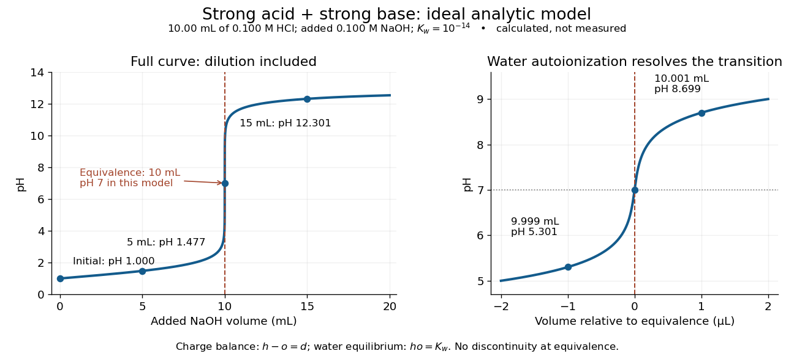
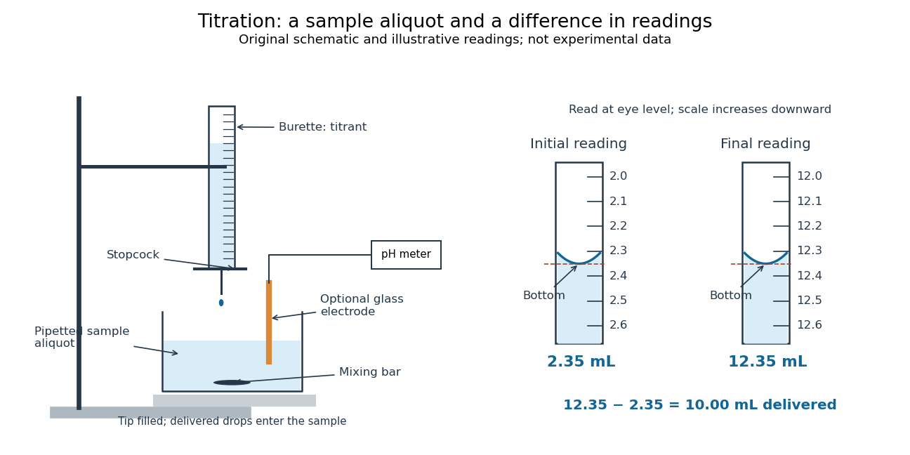

# Acid-base chemistry

↑ **Parent:** [Chemistry](chemistry.md)

[Acid-base chemistry](acid-base-chemistry.md) studies how [chemical acids](#acid-chemistry) and [chemical bases](#base-chemistry) exchange [protons](physics.md#proton) or [electron pairs](chemical-bond.md#electron-pair). Here the focus is transfer of [protons](physics.md#proton) in [water](chemical-substance.md#water): a [chemical acid](#acid-chemistry) donates a [proton](physics.md#proton), and a [chemical base](#base-chemistry) accepts it. The resulting [chemical equilibrium](chemical-potential.md#chemical-equilibrium) determines [pH](#ph), while a [buffer solution](#buffer-solution) can resist changes in [pH](#ph). This connects microscopic [chemical reactions](chemical-reaction.md) with a compact, measurable description of a [chemical solution](mixture.md#solution-chemistry).

The important distinction is between how much [chemical acid](#acid-chemistry) is present and how readily it transfers a [proton](physics.md#proton). A [weak acid](#weak-acid) and a [strong acid](#strong-acid) at the same total [concentration](mathematical-physics.md#concentration) need not have the same [pH](#ph). Conversely, two [buffer solutions](#buffer-solution) can have the same [pH](#ph) while containing very different total quantities of their [chemical acids](#acid-chemistry) and [chemical bases](#base-chemistry).

**Table of contents**

- [Carbon acid](#carbon-acid)
  - [Active methylene group](#active-methylene-group)
- [Lewis base](#lewis-base)
- [Hard and soft acids and bases](#hard-and-soft-acids-and-bases)
  - [Hard Lewis acid](#hard-lewis-acid)
- [Lewis acid](#lewis-acid)
  - [Aluminium tribromide](#aluminium-tribromide)
- [Lewis acid-base adduct](#lewis-acid-base-adduct)
  - [Frustrated Lewis pair](#frustrated-lewis-pair)
- [Deprotonation](#deprotonation)
- [Proton transfer](#proton-transfer)
  - [Proton relay](#proton-relay)
- [Isoelectric point](#isoelectric-point)
- [Acid (chemistry)](#acid-chemistry)
  - [Nitrous acid](#nitrous-acid)
  - [Strong acid](#strong-acid)
    - [Hydrochloric acid](#hydrochloric-acid)
  - [Weak acid](#weak-acid)
    - [Monoprotic acid](#monoprotic-acid)
    - [Weak acid dissociation fraction](#weak-acid-dissociation-fraction)
    - [Weak acid mass and charge balances](#weak-acid-mass-and-charge-balances)
      - [Analytical concentration](#analytical-concentration)
    - [Weak acid dissociation measurement](#weak-acid-dissociation-measurement)
      - [Glass electrode](#glass-electrode)
      - [Reference electrode](#reference-electrode)
        - [Standard hydrogen electrode](#standard-hydrogen-electrode)
        - [Silver sulfate reference electrode](#silver-sulfate-reference-electrode)
      - [Acid-base titration](#acid-base-titration)
        - [Equivalence point](#equivalence-point)
        - [Titration endpoint](#titration-endpoint)
          - [pH indicator](#ph-indicator)
            - [Bromothymol blue](#bromothymol-blue)
        - [Titration curve](#titration-curve)
          - [Potentiometric titration](#potentiometric-titration)
        - [Strong acid titration model](#strong-acid-titration-model)
        - [Acid-base titration measurement](#acid-base-titration-measurement)
        - [Titrant standardization](#titrant-standardization)
          - [Primary standard](#primary-standard)
            - [Primary standard inventory](#primary-standard-inventory)
            - [KHP standardization protocol](#khp-standardization-protocol)
          - [Titre](#titre)
          - [Titration blank](#titration-blank)
          - [Standardization endpoint and blank bias](#standardization-endpoint-and-blank-bias)
        - [Titrant](#titrant)
      - [Volumetric flask](#volumetric-flask)
      - [Pipette](#pipette)
        - [Aliquot](#aliquot)
        - [Volumetric pipette](#volumetric-pipette)
      - [Burette](#burette)
  - [Acid dissociation constant](#acid-dissociation-constant)
    - [pKa](#pka)
- [Base (chemistry)](#base-chemistry)
  - [DBU](#dbu)
  - [Conjugate base](#conjugate-base)
    - [Conjugate acid](#conjugate-acid)
    - [Conjugate acid-base pair](#conjugate-acid-base-pair)
    - [Base dissociation constant](#base-dissociation-constant)
  - [Strong base](#strong-base)
- [pH](#ph)
- [Buffer solution](#buffer-solution)
  - [Henderson-Hasselbalch equation](#henderson-hasselbalch-equation)
  - [Buffer capacity](#buffer-capacity)
    - [Buffer capacity of a monoprotic acid](#buffer-capacity-of-a-monoprotic-acid)
    - [Buffer capacity and concentration](#buffer-capacity-and-concentration)
    - [Finite titrant response of a buffer](#finite-titrant-response-of-a-buffer)
    - [Buffer capacity measurement](#buffer-capacity-measurement)
  - [Phosphate-buffered saline](#phosphate-buffered-saline)
  - [TAE buffer](#tae-buffer)
- [Neutralization](#neutralization)

## Carbon acid

↑ **Parent:** [Acid-base chemistry](acid-base-chemistry.md)

### Active methylene group

↑ **Parent:** [Carbon acid](#carbon-acid)

A methylene group whose hydrogens are made relatively acidic by adjacent electron-withdrawing groups, especially two carbonyl-derived groups.

## Lewis base

↑ **Parent:** [Acid-base chemistry](acid-base-chemistry.md)

A [Lewis base](#lewis-base) donates an [electron](physics.md#electron) pair to a [Lewis acid](#lewis-acid), forming a [coordinate covalent bond](covalent-bond.md#coordinate-covalent-bond) in an adduct.

## Hard and soft acids and bases

↑ **Parent:** [Acid-base chemistry](acid-base-chemistry.md)

A qualitative matching framework for Lewis acids and bases. Hard species favour interactions with compact, less polarizable partners, whereas soft species favour more polarizable partners. It is not an ordering based solely on atomic electronegativity.

### Hard Lewis acid

↑ **Parent:** [Hard and soft acids and bases](#hard-and-soft-acids-and-bases)

A [Lewis acid](#lewis-acid) whose acceptor interaction favours small, weakly polarizable donor atoms. High charge density favours hard character; Eu(III) typically favours [oxygen](chemical-substance.md#oxygen) and [nitrogen](chemical-substance.md#nitrogen) donors over a softer sulfur donor.

## Lewis acid

↑ **Parent:** [Acid-base chemistry](acid-base-chemistry.md)

### Aluminium tribromide

↑ **Parent:** [Lewis acid](#lewis-acid)

A Lewis acid that can polarize bromine and promote electrophilic aromatic bromination.

## Lewis acid-base adduct

↑ **Parent:** [Acid-base chemistry](acid-base-chemistry.md)

A [Lewis acid-base adduct](#lewis-acid-base-adduct) forms when an electron-pair donor binds an acceptor through a [coordinate covalent bond](covalent-bond.md#coordinate-covalent-bond). A ring [nitrogen](chemical-substance.md#nitrogen) can bind $\mathrm{GaCl_3}$ without displacement of a chlorine substituent from phosphorus.

### Frustrated Lewis pair

↑ **Parent:** [Lewis acid-base adduct](#lewis-acid-base-adduct)

A [Lewis acid](#lewis-acid) and [Lewis base](#lewis-base) whose direct neutralization is inhibited, allowing cooperative reaction with another [molecule](molecule.md).

## Deprotonation

↑ **Parent:** [Acid-base chemistry](acid-base-chemistry.md)

[Deprotonation](#deprotonation) removes a [proton](physics.md#proton) from a [chemical species](mathematical-biology.md#chemical-species), changing its [electric charge](electric-charge.md) by $-1$. It can expose a donor [lone pair](covalent-bond.md#lone-pair) or change donor charge without changing the metal [oxidation state](chemical-reaction.md#oxidation-state).

## Proton transfer

↑ **Parent:** [Acid-base chemistry](acid-base-chemistry.md)

Transfer of a hydrogen nucleus from a donor to an acceptor. Electron-pair bookkeeping distinguishes transfer of $\mathrm H^+$ from transfer of a [hydride](chemical-substance.md#hydride) equivalent.

### Proton relay

↑ **Parent:** [Proton transfer](#proton-transfer)

A [proton relay](#proton-relay) transfers a proton through a sequence of neighboring donors and acceptors, often including [water](chemical-substance.md#water). The full catalytic sequence must regenerate the relay groups; a static hydrogen-bond diagram does not determine its direction or timing.

## Isoelectric point

↑ **Parent:** [Acid-base chemistry](acid-base-chemistry.md)  
ⓦ [Wiki](https://en.wikipedia.org/wiki/Isoelectric_point)

The [isoelectric point](#isoelectric-point) is the [pH](#ph) at which a specified [molecule](molecule.md)'s mean net [electric charge](electric-charge.md) is zero. Different [protonation](chemical-reaction.md#protonation) states can still carry nonzero [electric charges](electric-charge.md); their contributions cancel in the average. For the two-step [glycine speciation model](chemical-substance.md#glycine-speciation-model), this gives $\mathrm{pI}=(\mathrm pK_{a1}+\mathrm pK_{a2})/2$. Additional ionizable [amino acid side chains](protein.md#amino-acid-side-chain) require their own [chemical equilibrium](chemical-potential.md#chemical-equilibrium) calculations; averaging every [pKa](#pka) is not a general rule. [§26.2, discussion following Figure 26.2: isoelectric points and the dissociations surrounding the neutral form](chemistry-bibliography.md#organic-chemistry-by-john-mcmurry)

Below its [isoelectric point](#isoelectric-point), free [glycine](protein.md#glycine) has positive mean [electric charge](electric-charge.md) and an [electric field](electric-field.md) drives it toward the negative [electrode](electrochemistry.md#electrode); above its [isoelectric point](#isoelectric-point), the mean [electric charge](electric-charge.md) is negative and the direction reverses. At its [isoelectric point](#isoelectric-point) the charge-driven contribution vanishes. [Diffusion](thermodynamics.md#diffusion) and bulk movement of the [chemical solution](mixture.md#solution-chemistry) can still move the sample. [Gel electrophoresis](biology.md#gel-electrophoresis) applies this charge dependence to separation, although [protein](protein.md) size, shape and interactions also affect migration. The [pKa](#pka) values of free [glycine](protein.md#glycine) do not determine a [protein](protein.md)'s [isoelectric point](#isoelectric-point): its free [N-terminus](protein.md#n-terminus), [C-terminus](protein.md#c-terminus) and ionizable [amino acid side chains](protein.md#amino-acid-side-chain) supply a different inventory. [§26.2, Figure 26.3 and accompanying electrophoresis discussion](chemistry-bibliography.md#organic-chemistry-by-john-mcmurry)

## Acid (chemistry)

↑ **Parent:** [Acid-base chemistry](acid-base-chemistry.md)  
ⓦ [Wiki](https://en.wikipedia.org/wiki/Acid)

A [chemical acid](#acid-chemistry) can donate a [proton](physics.md#proton), or accept an [electron pair](chemical-bond.md#electron-pair) to form a [covalent bond](covalent-bond.md). The [pH](#ph) and [buffer solution](#buffer-solution) examples below use the former meaning. See [IUPAC Gold Book, acid](https://goldbook.iupac.org/terms/view/A00071).

### Nitrous acid

↑ **Parent:** [Acid (chemistry)](#acid-chemistry)

[Nitrous acid](#nitrous-acid) is $\mathrm{HNO_2}$, the protonated counterpart of [nitrite](chemical-substance.md#nitrite). Its nominal [relative molecular mass](chemistry.md#relative-molecular-mass) is 47.

### Strong acid

↑ **Parent:** [Acid (chemistry)](#acid-chemistry)

In [water](chemical-substance.md#water), a [strong acid](#strong-acid) transfers its available [proton](physics.md#proton) essentially completely to [water](chemical-substance.md#water) under the dilute conditions considered here. For the [pH](#ph) example, each initial [chemical acid](#acid-chemistry) unit supplies one [hydronium](chemistry.md#hydronium) [ion](chemistry.md#ion). “Strong” describes this conversion, rather than a high [concentration](mathematical-physics.md#concentration). See [14.3 Relative Strengths of Acids and Bases](chemistry-bibliography.md#chemistry-2e-by-paul-flowers-and-others/14-3-relative-strengths-of-acids-and-bases).

#### Hydrochloric acid

↑ **Parent:** [Strong acid](#strong-acid)  
ⓦ [Wiki](https://en.wikipedia.org/wiki/Hydrochloric_acid)

[Hydrochloric acid](#hydrochloric-acid) is an aqueous [chemical solution](mixture.md#solution-chemistry) of [hydrogen chloride](electronegativity.md#hydrogen-chloride). The [glycine titration](chemical-substance.md#glycine-titration) model treats its dissociation into [hydronium](chemistry.md#hydronium) and [chloride](chemistry.md#chloride) as complete, retaining both [ions](chemistry.md#ion) in the [electric charge](electric-charge.md) balance.

### Weak acid

↑ **Parent:** [Acid (chemistry)](#acid-chemistry)

A [weak acid](#weak-acid) establishes a [chemical equilibrium](chemical-potential.md#chemical-equilibrium) between its proton-donating form and its [conjugate base](#conjugate-base) in [water](chemical-substance.md#water). For a neutral [monoprotic acid](#monoprotic-acid) $\mathrm{HA}$, the aqueous [chemical equation](chemical-reaction.md#chemical-equation) is

$$
\mathrm{HA(aq)}+\mathrm{H_2O(l)}\rightleftharpoons\mathrm{H_3O^+(aq)}+\mathrm{A^-(aq)}.
$$

[Water](chemical-substance.md#water) accepts a [proton](physics.md#proton) to become [hydronium](chemistry.md#hydronium); $\mathrm A^-$ is the [conjugate base](#conjugate-base). The double arrow denotes reversible exchange at [chemical equilibrium](chemical-potential.md#chemical-equilibrium), not equal populations. The [acid dissociation constant](#acid-dissociation-constant) and composition determine the [hydronium](chemistry.md#hydronium) [concentration](mathematical-physics.md#concentration); substituting total [chemical acid](#acid-chemistry) [concentration](mathematical-physics.md#concentration) into the [pH](#ph) formula is generally incorrect.

“Weak” describes the tendency to transfer a [proton](physics.md#proton) in a specified [solvent](mixture.md#solvent), rather than how much [chemical acid](#acid-chemistry) was dissolved. A [weak acid](#weak-acid) can be concentrated, and a [strong acid](#strong-acid) can be dilute. Even the same [weak acid](#weak-acid) can have a large [weak acid dissociation fraction](#weak-acid-dissociation-fraction) after sufficient [dilution](mixture.md#dilution), while its [acid dissociation constant](#acid-dissociation-constant) stays fixed at the same [temperature](temperature.md) and [standard state](chemical-potential.md#standard-state) conventions.[Chemistry 2e by Paul Flowers and others; §14.3, acid ionization and concentration-dependent percent ionization](chemistry-bibliography.md#chemistry-2e-by-paul-flowers-and-others/14-3-relative-strengths-of-acids-and-bases)

#### Monoprotic acid

↑ **Parent:** [Weak acid](#weak-acid)

A [monoprotic acid](#monoprotic-acid) supplies one [proton](physics.md#proton) per acid unit in the [acid-base chemistry](acid-base-chemistry.md) model under consideration. [Acetic acid](chemical-substance.md#acetic-acid) is an example. Several successive proton transfers require several [acid dissociation constants](#acid-dissociation-constant) and a larger set of [chemical species](mathematical-biology.md#chemical-species).

#### Weak acid dissociation fraction

↑ **Parent:** [Weak acid](#weak-acid)

For a [monoprotic acid](#monoprotic-acid) with [analytical concentration](#analytical-concentration) $C_T=[\mathrm{HA}]+[\mathrm A^-]$, define the [dimensionless](physics.md#dimensionless-quantity) [weak acid dissociation fraction](#weak-acid-dissociation-fraction)

$$
\alpha=\frac{[\mathrm A^-]}{C_T},\qquad 1-\alpha=\frac{[\mathrm{HA}]}{C_T}.
$$

This counts acid units in the [conjugate base](#conjugate-base) form. Identifying it with $[\mathrm H_3\mathrm O^+]/C_T$ additionally requires negligible [self-ionization of water](chemical-substance.md#self-ionization-of-water) and no other sources of [electric charge](electric-charge.md). In the ideal dilute [chemical solution](mixture.md#solution-chemistry) model, with $h=[\mathrm H_3\mathrm O^+]/c^\circ$, the [acid dissociation constant](#acid-dissociation-constant) gives $\alpha=K_a/(K_a+h)$. Thus lowering [hydronium](chemistry.md#hydronium) [thermodynamic activity](chemical-potential.md#thermodynamic-activity) favors the [conjugate base](#conjugate-base).

**[Figure 1](#weak-acid-dilution-equilibrium). Dilution increases the weak acid dissociation fraction while raising pH in a synthetic aqueous chemical equilibrium**.

The diagram uses stipulated [dimensionless](physics.md#dimensionless-quantity) [acid dissociation constant](#acid-dissociation-constant) $K_a=10^{-5}$ and [self-ionization of water](chemical-substance.md#self-ionization-of-water) ion product $K_w=10^{-14}$ at fixed [temperature](temperature.md); these are model inputs, not measurements of a named substance. It solves the [weak acid mass and charge balances](#weak-acid-mass-and-charge-balances). At $C_T=0.010\,\mathrm{mol\,L^{-1}}$, the calculated [weak acid dissociation fraction](#weak-acid-dissociation-fraction) is about $3.11\%$ and [pH](#ph) about $3.51$; at $C_T=10^{-4}\,\mathrm{mol\,L^{-1}}$, they are about $27.0\%$ and $4.57$. More acid units are dissociated as a fraction of the total, yet fewer [hydronium](chemistry.md#hydronium) [ions](chemistry.md#ion) occur per [volume](thermodynamics.md#volume-thermodynamics).

At extreme [dilution](mixture.md#dilution), [self-ionization of water](chemical-substance.md#self-ionization-of-water) makes $h$ approach $\sqrt{K_w}$, so [pH](#ph) approaches $7$ for the chosen model. The limiting [weak acid dissociation fraction](#weak-acid-dissociation-fraction) is $K_a/(K_a+\sqrt{K_w})\approx0.9901$, rather than exactly one. The calculation assumes pure added [water](chemical-substance.md#water), a neutral [monoprotic acid](#monoprotic-acid), and no competing [chemical reactions](chemical-reaction.md); actual contamination becomes increasingly important as $C_T$ falls.

#### Weak acid mass and charge balances

↑ **Parent:** [Weak acid](#weak-acid)

Consider only neutral $\mathrm{HA}$ added to pure [water](chemical-substance.md#water), at fixed [temperature](temperature.md), with ideal dilute [thermodynamic activities](chemical-potential.md#thermodynamic-activity), [water](chemical-substance.md#water) [thermodynamic activity](chemical-potential.md#thermodynamic-activity) approximated by one, and no added salts or other [chemical species](mathematical-biology.md#chemical-species). Normalize every [concentration](mathematical-physics.md#concentration) by $c^\circ=1\,\mathrm{mol\,L^{-1}}$:

$$
c=C_T/c^\circ,\qquad h=[\mathrm H_3\mathrm O^+]/c^\circ,\qquad x=[\mathrm A^-]/c^\circ,\qquad y=[\mathrm{HA}]/c^\circ,\qquad o=[\mathrm{OH}^-]/c^\circ.
$$

Conservation of acid units and zero net [electric charge](electric-charge.md), respectively, require

$$
x+y=c,\qquad h=x+o.
$$

The second equation balances positive [hydronium](chemistry.md#hydronium) against negative [conjugate base](#conjugate-base) and [hydroxide](chemistry.md#hydroxide). It would need all additional [ions](chemistry.md#ion) if salts or a [chemical base](#base-chemistry) were added. Together with [acid dissociation constant](#acid-dissociation-constant) $K_a=hx/y$ and the [self-ionization of water](chemical-substance.md#self-ionization-of-water) relation $K_w=ho$, these give

$$
x=\frac{K_ac}{K_a+h},\qquad y=\frac{hc}{K_a+h},\qquad o=\frac{K_w}{h},\qquad
h-\frac{K_w}{h}-\frac{K_ac}{K_a+h}=0.
$$

This is exact within the stated ideal model, including depletion and [self-ionization of water](chemical-substance.md#self-ionization-of-water). Multiplication by $h(K_a+h)$ yields the [cubic equation](polynomial.md#cubic-equation)

$$
h^3+K_ah^2-(K_w+K_ac)h-K_aK_w=0.
$$

For positive $K_a,K_w,c$, the unmultiplied left-hand side increases strictly from negative to positive values as $h$ increases from zero to infinity; its [derivative](calculus.md#derivative) is $1+K_w/h^2+K_ac/(K_a+h)^2>0$. There is therefore exactly one positive [root of a polynomial](polynomial.md#root-of-a-polynomial). A [bisection method](numerical-analysis.md#bisection-method) can find it without choosing an unphysical [root of a polynomial](polynomial.md#root-of-a-polynomial).

If $K_w/h^2\ll1$, neglect [hydroxide](chemistry.md#hydroxide), so $h\approx x$ and the [quadratic equation](polynomial.md#quadratic-equation) retaining acid depletion gives

$$
\frac{x^2}{c-x}=K_a,\qquad
x=\frac{\sqrt{K_a^2+4K_ac}-K_a}{2}
=\frac{2K_ac}{\sqrt{K_a^2+4K_ac}+K_a}.
$$

The last form avoids subtracting nearly equal numbers. If also $x/c\ll1$, neglect depletion to obtain

$$
h\approx x\approx\sqrt{K_ac},\qquad
[\mathrm H_3\mathrm O^+]\approx\sqrt{K_a c^\circ C_T}.
$$

Check both conditions after computing: $x/c$ measures the fraction lost from the initial undissociated [weak acid](#weak-acid) inventory, while $K_w/h^2$ measures the omitted [hydroxide](chemistry.md#hydroxide) contribution to [electric charge](electric-charge.md) balance. A $5\%$ depletion criterion is a chosen tolerance, not a universal boundary. Keeping depletion does not cure the neglect of [self-ionization of water](chemical-substance.md#self-ionization-of-water). These [weak acid mass and charge balances](#weak-acid-mass-and-charge-balances) also explain why the [square root](algebra.md#square-root) estimate cannot be extended to arbitrarily dilute [chemical solutions](mixture.md#solution-chemistry).

##### Analytical concentration

↑ **Parent:** [Weak acid mass and charge balances](#weak-acid-mass-and-charge-balances)

An [analytical concentration](#analytical-concentration) records the total conserved inventory of a specified component per [volume](thermodynamics.md#volume-thermodynamics) of [chemical solution](mixture.md#solution-chemistry), summed over its relevant [chemical species](mathematical-biology.md#chemical-species). Here $C_T=[\mathrm{HA}]+[\mathrm A^-]$; it is not generally the [chemical equilibrium](chemical-potential.md#chemical-equilibrium) [concentration](mathematical-physics.md#concentration) $[\mathrm{HA}]$ of the undissociated [weak acid](#weak-acid).

#### Weak acid dissociation measurement

↑ **Parent:** [Weak acid](#weak-acid)

A [pH](#ph) measurement becomes evidence for a [weak acid](#weak-acid) [chemical equilibrium](chemical-potential.md#chemical-equilibrium) when paired with a known [analytical concentration](#analytical-concentration) and a calibrated [glass electrode](#glass-electrode). For the pure-[weak acid](#weak-acid) model, measured [pH](#ph) estimates $h=10^{-\mathrm{pH}}$ only in the ideal [thermodynamic activity](chemical-potential.md#thermodynamic-activity) approximation. Then $o=K_w/h$, $x=h-o$, $y=c-x$, and $K_a=hx/y$. Require $0<x<c$; values outside that range signal inconsistent measurements or an inadequate model. Repeating this reconstruction across a [dilution](mixture.md#dilution) series tests whether one [acid dissociation constant](#acid-dissociation-constant) describes the data, rather than merely fitting one point.

The Analytical Sciences Digital Library's [Potentiometric Titration of an Unknown Weak Monoprotic Acid](chemistry-bibliography.md#analytical-electrochemistry-potentiometry/potentiometric-titration-of-an-unknown-weak-monoprotic-acid) provides a complementary [acid-base titration](#acid-base-titration) experiment. Its apparatus includes a [glass electrode](#glass-electrode) and meter, a stirring magnet, a [volumetric flask](#volumetric-flask), [pipettes](#pipette), and a [burette](#burette) containing standardized [sodium hydroxide](chemical-substance.md#sodium-hydroxide). Prepare an aqueous acid stock of known [analytical concentration](#analytical-concentration), transfer a measured portion, and stir gently with the [glass electrode](#glass-electrode) clear of the magnet. Record added [volume](thermodynamics.md#volume-thermodynamics) and stable [pH](#ph) after each addition; use a preliminary run to locate the steep region and smaller additions there on a fresh portion. The readout is the [pH](#ph) versus added [volume](thermodynamics.md#volume-thermodynamics) curve, not a visual count of dissociated [molecules](molecule.md).

Calibrate with fresh standard [buffer solutions](#buffer-solution) bracketing the [pH](#ph) range being interpreted. Use their assigned values at the actual [temperature](temperature.md); a pair near [pH](#ph) $4$ and $7$ can cover the midpoint of many [weak acid](#weak-acid) examples, but does not cover an entire alkaline endpoint region. Rinse between standards and samples to limit carryover, keep the sensing bulb and [reference electrode](#reference-electrode) junction immersed, and wait for a stable reading. These instrument practices are documented in [HI5221 & HI5222 Instruction Manual: pH and mV and ISE and Temperature Bench Meters by Hanna Instruments](chemistry-bibliography.md#hi5221-and-hi5222-instruction-manual-ph-and-mv-and-ise-and-temperature-bench-meters-by-hanna-instruments) (pp. 45–47, 49–50 and 73–74: calibration, measurement, rinsing and electrode conditioning).

Locate the [acid-base titration](#acid-base-titration) equivalence region from the steepest change of [pH](#ph) with added [volume](thermodynamics.md#volume-thermodynamics). For one-to-one [neutralization](#neutralization), standardized [sodium hydroxide](chemical-substance.md#sodium-hydroxide) [concentration](mathematical-physics.md#concentration) times equivalence [volume](thermodynamics.md#volume-thermodynamics) estimates the initial [amount of substance](physics.md#amount-of-substance) of acid. Half that [volume](thermodynamics.md#volume-thermodynamics) gives approximately equal $[\mathrm{HA}]$ and $[\mathrm A^-]$ only when subsequent [chemical equilibrium](chemical-potential.md#chemical-equilibrium) redistribution is small. The [Henderson-Hasselbalch equation](#henderson-hasselbalch-equation) then gives $\mathrm{pH}\approx\mathrm pK_a$. Unequal [activity coefficients](chemical-potential.md#activity-coefficient) or appreciable [hydronium](chemistry.md#hydronium) or [hydroxide](chemistry.md#hydroxide) inventories can shift this estimate. The full [chemical equilibrium](chemical-potential.md#chemical-equilibrium) curve supplies a stronger consistency check than its midpoint alone.

Useful controls for this model test are a fresh independently prepared acid portion, a [water](chemical-substance.md#water) blank, a check standard after measurement to detect instrument drift, and fixed recorded [temperature](temperature.md). A blank diagnoses contamination but should not be subtracted directly from [pH](#ph), which is a [logarithm](calculus.md#logarithm). Keep exposure to atmospheric [carbon dioxide](chemical-substance.md#carbon-dioxide) comparable, especially at high [dilution](mixture.md#dilution), and record any background salt that changes [ionic strength](mixture.md#ionic-strength). These are experimental-design controls suggested by the model's assumptions. The observed curve and its uncertainty determine whether the model is adequate; the diagrams here contain no experimental readouts. An aqueous [acid dissociation constant](#acid-dissociation-constant) cannot be inferred unchanged from a sample requiring a different [solvent](mixture.md#solvent) mixture, and a nearly neutral dilute sample makes the difference $h-K_w/h$ particularly sensitive to [pH](#ph) error.

##### Glass electrode

↑ **Parent:** [Weak acid dissociation measurement](#weak-acid-dissociation-measurement)

A [glass electrode](#glass-electrode) is an [electrode](electrochemistry.md#electrode) whose glass membrane responds to [hydrogen ion](chemistry.md#hydrogen-ion) [thermodynamic activity](chemical-potential.md#thermodynamic-activity). A meter measures its [electric potential difference](electric-field.md#electric-potential-difference) against a [reference electrode](#reference-electrode); calibration with standard [buffer solutions](#buffer-solution) converts this response to operational [pH](#ph).

##### Reference electrode

↑ **Parent:** [Weak acid dissociation measurement](#weak-acid-dissociation-measurement)

A [reference electrode](#reference-electrode) supplies the comparison [electric potential](electric-field.md#electric-potential) for the [glass electrode](#glass-electrode) measurement. A combination probe incorporates both [electrodes](electrochemistry.md#electrode); changes at its junction can contribute measurement error.

###### Standard hydrogen electrode

↑ **Parent:** [Reference electrode](#reference-electrode)

The conventional zero of standard electrode potentials, based on hydrogen oxidation/reduction at specified standard hydrogen fugacity and proton activity.

###### Silver sulfate reference electrode

↑ **Parent:** [Reference electrode](#reference-electrode)

A silver electrode in contact with silver sulfate and a solution of controlled sulfate activity. The reduction is $\mathrm{Ag_2SO_4+2e^-\rightleftharpoons2Ag+SO_4^{2-}}$.

##### Acid-base titration

↑ **Parent:** [Weak acid dissociation measurement](#weak-acid-dissociation-measurement)

An [acid-base titration](#acid-base-titration) adds measured quantities of a standardized [chemical acid](#acid-chemistry) or [chemical base](#base-chemistry) to determine an initially unknown acid or base inventory through [neutralization](#neutralization). Monitoring [pH](#ph) also constrains [chemical equilibrium](chemical-potential.md#chemical-equilibrium) parameters such as the [acid dissociation constant](#acid-dissociation-constant).

The added reagent is the [titrant](#titrant); a [pipette](#pipette) selects an [aliquot](#aliquot) of the sample and a [burette](#burette) measures the added [volume](thermodynamics.md#volume-thermodynamics). Known [stoichiometry](chemical-reaction.md#stoichiometry) converts this [volume](thermodynamics.md#volume-thermodynamics) into [amount of substance](physics.md#amount-of-substance). This separates two questions that a single [pH](#ph) reading cannot answer: how much [chemical acid](#acid-chemistry) is present, and how readily it donates a [proton](physics.md#proton). A large inventory of [weak acid](#weak-acid) can consume more [titrant](#titrant) than a small inventory of [strong acid](#strong-acid) despite having a higher initial [pH](#ph).

###### Equivalence point

↑ **Parent:** [Acid-base titration](#acid-base-titration)  
ⓦ [Wiki](https://en.wikipedia.org/wiki/Equivalence_point)

The [equivalence point](#equivalence-point) is the composition at which added [titrant](#titrant) and the initial sample inventory match the specified [chemical reaction](chemical-reaction.md)'s [stoichiometry](chemical-reaction.md#stoichiometry). It is a theoretical inventory condition; the [titration endpoint](#titration-endpoint) is an observed stopping criterion. For a [monoprotic acid](#monoprotic-acid) consuming one [hydroxide](chemistry.md#hydroxide) per acid unit, initial acid [molar concentration](mathematical-physics.md#molar-concentration) $c_A$, sample [volume](thermodynamics.md#volume-thermodynamics) $V_A$, and base [titrant](#titrant) [molar concentration](mathematical-physics.md#molar-concentration) $c_B$ give

$$
n_A=c_AV_A=c_BV_{\mathrm{eq}},\qquad V_{\mathrm{eq}}=\frac{c_AV_A}{c_B}.
$$

The proof is [amount of substance](physics.md#amount-of-substance) conservation with one-to-one [neutralization](#neutralization); a different [stoichiometry](chemical-reaction.md#stoichiometry) requires its coefficients. All [volumes](geometry-and-topology.md#volume) must use compatible units. Since $1\,\mathrm{mL}=10^{-3}\,\mathrm L$, $0.100\,\mathrm{mol\,L^{-1}}\times10.00\,\mathrm{mL}=0.001000\,\mathrm{mol}$, not $1\,\mathrm{mol}$.

An [equivalence point](#equivalence-point) does not prescribe [pH](#ph) $7$. A [weak acid](#weak-acid) titrated with a [strong base](#strong-base) leaves its [conjugate base](#conjugate-base), which reacts with [water](chemical-substance.md#water); the corresponding [chemical equilibrium](chemical-potential.md#chemical-equilibrium) can make the [chemical solution](mixture.md#solution-chemistry) alkaline. The neutral [strong acid](#strong-acid)/[strong base](#strong-base) case additionally depends on [temperature](temperature.md), through [self-ionization of water](chemical-substance.md#self-ionization-of-water).[Chemistry 2e, §14.7, Example 14.21(c), Example 14.22(b), and Figure 14.18: different equivalence-point pH values](chemistry-bibliography.md#chemistry-2e-by-paul-flowers-and-others/14-7-acid-base-titrations)

###### Titration endpoint

↑ **Parent:** [Acid-base titration](#acid-base-titration)

A [titration endpoint](#titration-endpoint) is the experimentally assigned point indicated by a specified signal: for example, a persistent color of a [pH indicator](#ph-indicator), or a feature extracted from a [potentiometric titration](#potentiometric-titration). An [equivalence point](#equivalence-point) is defined by [stoichiometry](chemical-reaction.md#stoichiometry); an endpoint estimates its location. State the signal rule and its repeatability. A fleeting local color where a drop enters an unmixed sample need not satisfy the rule for the mixed sample.

Define the endpoint offset $\Delta V=V_{\mathrm{end}}-V_{\mathrm{eq}}$. For one-to-one [neutralization](#neutralization), using the endpoint without correction gives inferred acid inventory $\widehat n_A=c_BV_{\mathrm{end}}$ and

$$
\frac{\widehat n_A-n_A}{n_A}=\frac{\Delta V}{V_{\mathrm{eq}}}.
$$

Thus an illustrative $0.05\,\mathrm{mL}$ overshoot at $V_{\mathrm{eq}}=10.00\,\mathrm{mL}$ overestimates the inventory by $0.5\%$. Repeatedly reaching the same color can reduce scatter while retaining this systematic offset. This example stipulates an offset; it is not a measured drop size.

###### pH indicator

↑ **Parent:** [Titration endpoint](#titration-endpoint)  
ⓦ [Wiki](https://en.wikipedia.org/wiki/pH_indicator)

A [pH indicator](#ph-indicator) changes color as its [protonation](chemical-reaction.md#protonation) distribution changes. In a simple [weak acid](#weak-acid)/[conjugate base](#conjugate-base) model, its two forms have different colors and their ratio depends on [pH](#ph) through the [acid dissociation constant](#acid-dissociation-constant). The visible transition spans a range of [pH](#ph); it is not a direct signal that the sample has reached an [equivalence point](#equivalence-point). An indicator is useful when its transition lies in a steep part of the [titration curve](#titration-curve), so a modest range of [pH](#ph) corresponds to a small added [volume](thermodynamics.md#volume-thermodynamics).[Chemistry 2e, §14.7, Acid-Base Indicators, Figures 14.19–14.21: indicator equilibrium, transition ranges, and selection](chemistry-bibliography.md#chemistry-2e-by-paul-flowers-and-others/14-7-acid-base-titrations)

###### Bromothymol blue

↑ **Parent:** [pH indicator](#ph-indicator)  
ⓦ [Wiki](https://en.wikipedia.org/wiki/Bromothymol_blue)

[Bromothymol blue](#bromothymol-blue) is a [pH indicator](#ph-indicator) used to assign a color-based [titration endpoint](#titration-endpoint) in the inspected [solubility product measurement by titration](chemical-reaction.md#solubility-product-measurement-by-titration).

###### Titration curve

↑ **Parent:** [Acid-base titration](#acid-base-titration)

A [titration curve](#titration-curve) plots a measured or calculated property against added [titrant](#titrant) [volume](thermodynamics.md#volume-thermodynamics) or [amount of substance](physics.md#amount-of-substance). In an [acid-base titration](#acid-base-titration), plotting [pH](#ph) exposes gradual changes and a steep endpoint region. A [potentiometric titration](#potentiometric-titration) uses an [electrode](electrochemistry.md#electrode) [electric potential difference](electric-field.md#electric-potential-difference); a calibrated [glass electrode](#glass-electrode) and [reference electrode](#reference-electrode) provide operational [pH](#ph). Finite additions bracket a transition rather than measuring a continuous curve. A [chemical equilibrium](chemical-potential.md#chemical-equilibrium) fit can estimate the [equivalence point](#equivalence-point); identifying the steepest sampled interval alone has a resolution set by the dose spacing and instrument response.

###### Potentiometric titration

↑ **Parent:** [Titration curve](#titration-curve)  
ⓦ [Wiki](https://en.wikipedia.org/wiki/Potentiometric_titration)

A [potentiometric titration](#potentiometric-titration) monitors an [electrode](electrochemistry.md#electrode) [electric potential difference](electric-field.md#electric-potential-difference) as [titrant](#titrant) is added. A calibrated [glass electrode](#glass-electrode) can report [pH](#ph) during an [acid-base titration](#acid-base-titration).

###### Strong acid titration model

↑ **Parent:** [Acid-base titration](#acid-base-titration)

Consider an original ideal model: $V_A=10.00\,\mathrm{mL}$ of [hydrochloric acid](#hydrochloric-acid) at $c_A=0.100\,\mathrm{mol\,L^{-1}}$, titrated with [sodium hydroxide](chemical-substance.md#sodium-hydroxide) at $c_B=0.100\,\mathrm{mol\,L^{-1}}$. Treat these numbers as exact model inputs. Assume complete [dissociation of an ionic compound](ionic-bonding.md#dissociation-of-an-ionic-compound), complete [strong acid](#strong-acid) ionization, additive [volumes](geometry-and-topology.md#volume), uniform mixing, and [activity coefficients](chemical-potential.md#activity-coefficient) equal to one. Use stipulated $K_w=10^{-14}$, approximately appropriate near $25\,{}^\circ\mathrm C$. These are calculated [pH](#ph) values, not measurements of these materials.

The [chemical equation](chemical-reaction.md#chemical-equation) for [neutralization](#neutralization) is

$$
\mathrm{H_3O^+}+\mathrm{OH^-}\longrightarrow2\mathrm{H_2O}.
$$

Initial acid inventory is $n_A=1.000\,\mathrm{mmol}$, so the [equivalence point](#equivalence-point) is $v=10.00\,\mathrm{mL}$. Added [water](chemical-substance.md#water) does not change this inventory. But the final [volume](thermodynamics.md#volume-thermodynamics) $V_A+v$, including the [titrant](#titrant), determines all [concentrations](mathematical-physics.md#concentration).

Keep [self-ionization of water](chemical-substance.md#self-ionization-of-water) even at the [equivalence point](#equivalence-point). With $c^\circ=1\,\mathrm{mol\,L^{-1}}$, define the [dimensionless](physics.md#dimensionless-quantity) acid excess $d$, [hydronium](chemistry.md#hydronium) level $h$, and [hydroxide](chemistry.md#hydroxide) level $o$ by

$$
d=\frac{c_AV_A-c_Bv}{c^\circ(V_A+v)},\qquad h=\frac{[\mathrm{H_3O^+}]}{c^\circ},\qquad o=\frac{[\mathrm{OH^-}]}{c^\circ}.
$$

The [sodium](chemical-substance.md#sodium) [cation](chemistry.md#cation) and [chloride](chemistry.md#chloride) [anion](chemistry.md#anion) inventories fix the [electric charge](electric-charge.md) balance $h-o=d$, while [chemical equilibrium](chemical-potential.md#chemical-equilibrium) gives $ho=K_w$. Eliminating $o$ yields a [quadratic equation](polynomial.md#quadratic-equation) $h^2-dh-K_w=0$ with exactly one positive [root](semisimple-lie-algebra.md#root-of-a-root-system). For stable calculation on either side, write

$$
s=\sqrt{d^2+4K_w},\qquad
h=\begin{cases}(d+s)/2,&d\geq0,\\2K_w/(s-d),&d<0,\end{cases}
\qquad o=\frac{K_w}{h},\qquad \mathrm{pH}=-\log_{10}h.
$$

The second expression follows by multiplying by $s-d$; it avoids subtracting two nearly equal large quantities on the alkaline side. A [logarithm](calculus.md#logarithm) acts on the [dimensionless](physics.md#dimensionless-quantity) $h$, as required by the [pH](#ph) definition.

**[Figure 2](#strong-acid-titration-water-equilibrium). An ideal strong acid titration curve stays smooth through its equivalence point because of self-ionization of water**. Original analytic model for $10.00\,\mathrm{mL}$ of $0.100\,\mathrm{mol\,L^{-1}}$ [hydrochloric acid](#hydrochloric-acid) and $0.100\,\mathrm{mol\,L^{-1}}$ [sodium hydroxide](chemical-substance.md#sodium-hydroxide), with $K_w=10^{-14}$. Both panels use the complete [electric charge](electric-charge.md) balance and ideal [chemical equilibrium](chemical-potential.md#chemical-equilibrium). The right panel resolves microlitre additions around the [equivalence point](#equivalence-point). The marked points are calculated, not measured.

At $v=5.00\,\mathrm{mL}$, the excess is $0.500\,\mathrm{mmol}$ in $15.00\,\mathrm{mL}$, giving $d=1/30$ and [pH](#ph) $1.477121\ldots$. At $v=15.00\,\mathrm{mL}$, excess [hydroxide](chemistry.md#hydroxide) is $0.500\,\mathrm{mmol}$ in $25.00\,\mathrm{mL}$, giving $d=-1/50$ and [pH](#ph) $12.301030\ldots$. Neglecting [dilution](mixture.md#dilution) would give the wrong values even far from the [equivalence point](#equivalence-point).

Exactly at $v=10.00\,\mathrm{mL}$, $d=0$ and $h=o=\sqrt{K_w}=10^{-7}$, giving [pH](#ph) $7$ in this model. At $9.999\,\mathrm{mL}$ and $10.001\,\mathrm{mL}$, the same smooth expression gives [pH](#ph) $5.300835\ldots$ and $8.699121\ldots$. The familiar excess-only formulas would predict zero [hydronium](chemistry.md#hydronium) or zero [hydroxide](chemistry.md#hydroxide) at the [equivalence point](#equivalence-point); retaining [self-ionization of water](chemical-substance.md#self-ionization-of-water) removes that failure. A steep curve is still continuous.

The sensitivity is especially revealing. Differentiating $h-K_w/h=d$ gives

$$
\frac{\mathrm d(\mathrm{pH})}{\mathrm d d}=-\frac{1}{\ln(10)\sqrt{d^2+4K_w}},\qquad
\left.\frac{\mathrm d d}{\mathrm d v}\right|_{v=V_A}=-\frac{c_A}{2c^\circ V_A}
$$

when $c_A=c_B$. At this model's [equivalence point](#equivalence-point), the [derivative](calculus.md#derivative) is about $1.086\times10^4$ [pH](#ph) units per millilitre. This is a local [derivative](calculus.md#derivative), not a linear prediction over a whole drop. Real endpoint accuracy also depends on dosing, mixing, [measurement uncertainty](physics.md#measurement-uncertainty), [temperature](temperature.md), extra reacting [chemical species](mathematical-biology.md#chemical-species), and nonideal [thermodynamic activities](chemical-potential.md#thermodynamic-activity).

###### Acid-base titration measurement

↑ **Parent:** [Acid-base titration](#acid-base-titration)

The institutional experiment The Potentiometric Titration of an Acid Mixture, from Massachusetts Institute of Technology's 5.310 Laboratory Chemistry, determines [hydrochloric acid](#hydrochloric-acid) and [phosphoric acid](chemical-substance.md#phosphoric-acid) inventories. Dried [potassium hydrogen phthalate](chemical-substance.md#potassium-hydrogen-phthalate) standardizes [sodium hydroxide](chemical-substance.md#sodium-hydroxide). A [volumetric pipette](#volumetric-pipette) selects an acid [aliquot](#aliquot), diluted with [water](chemical-substance.md#water) in a beaker. A [burette](#burette) feeds a stirred sample beside a [glass electrode](#glass-electrode); the apparatus isolates the sample from stirrer warming. The [burette](#burette) is conditioned with [titrant](#titrant) and its tip freed of bubbles. Stable [pH](#ph) and added [volume](thermodynamics.md#volume-thermodynamics) are recorded, with smaller additions near the transition. Controls include replicate standardizations, a consistent pale-pink [phenolphthalein](chemical-substance.md#phenolphthalein) endpoint, and a standard [buffer solution](#buffer-solution) check between sample runs. The readout supports inventory estimates through known [stoichiometry](chemical-reaction.md#stoichiometry); it does not directly count [molecules](molecule.md).[The Potentiometric Titration of an Acid Mixture, printed Titration-5–8, §IV.2 and Day \#2; Figure 3; standardization, aliquot, bubbles, stable readings, and buffer check](chemistry-bibliography.md#the-potentiometric-titration-of-an-acid-mixture-mit-5-310-laboratory-handout)

The same protocol requires drainage time for [burette](#burette) readings and warns that an undelivered hanging drop spoils the association between [volume](thermodynamics.md#volume-thermodynamics) and [pH](#ph). Its color-persistence wording differs between the main paragraph and footnote, so a reproducible [titration endpoint](#titration-endpoint) needs an explicitly chosen criterion. Its acid mixture is not the single-[strong acid](#strong-acid) ideal model above.[Printed Titration-6, main endpoint paragraph and footnote 6; Titration-8, hanging-drop warning](chemistry-bibliography.md#the-potentiometric-titration-of-an-acid-mixture-mit-5-310-laboratory-handout)

A distinct control appears in Process Measurement Procedures: Sulfuric Acid Emissions, §1.4.4.2: the [phenolphthalein](chemical-substance.md#phenolphthalein) standardization is repeated with [water](chemical-substance.md#water) replacing the acid, matching the sample [aliquot](#aliquot) and indicator quantity. The [volume](thermodynamics.md#volume-thermodynamics) needed for the same pink endpoint is subtracted from the sample reading.[Process Measurement Procedures: Sulfuric Acid Emissions, printed pp. 26–27, §1.4.4.2, indicator-blank paragraph, NOTE, and procedure steps 1–3](chemistry-bibliography.md#process-measurement-procedures-sulfuric-acid-emissions-by-r-maddalone-and-n-garner)

The independent bookkeeping for such a matched blank is $n_A=c_B(V_{\mathrm{sample}}-V_{\mathrm{blank}})$, assuming one-to-one [neutralization](#neutralization) and equal background consumption. A blank cannot correct an unmatched [chemical reaction](chemical-reaction.md) or guarantee exact coincidence of endpoint and [equivalence point](#equivalence-point). Subtracting [pH](#ph) readings would not give this inventory correction, because [pH](#ph) is a [logarithm](calculus.md#logarithm). Repeatability constrains scatter; an independently known check sample also tests systematic bias. [Carbon dioxide](chemical-substance.md#carbon-dioxide) uptake, incomplete mixing, [electrode](electrochemistry.md#electrode) drift, and uncertain [titrant](#titrant) [concentration](mathematical-physics.md#concentration) limit the inference.

###### Titrant standardization

↑ **Parent:** [Acid-base titration](#acid-base-titration)

[Titrant standardization](#titrant-standardization) determines the actual [titrant](#titrant) [concentration](mathematical-physics.md#concentration) by reaction with a known inventory, often a [primary standard](#primary-standard). It is distinct from calibrating the delivered [volume](thermodynamics.md#volume-thermodynamics) or a [glass electrode](#glass-electrode)'s response. For a known [monoprotic acid](#monoprotic-acid) inventory $n_s$ and a suitable blank-corrected endpoint,

$$
c_B=\frac{n_s}{V_{\mathrm{end}}-V_{\mathrm{blank}}}.
$$

An original illustrative standard of $0.980\,\mathrm{mmol}$ requiring $9.85\,\mathrm{mL}$, with matched blank $0.05\,\mathrm{mL}$, gives $c_B=0.100\,\mathrm{mol\,L^{-1}}$. The measured quantities here are stipulated examples. Independent [solution preparation and volumetric calibration](mixture.md#solution-preparation-and-volumetric-calibration) tests the [pipette](#pipette), [burette](#burette), and [volumetric flask](#volumetric-flask); [titrant standardization](#titrant-standardization) tests the reacting inventory per delivered [volume](thermodynamics.md#volume-thermodynamics).

The useful chain is known [mass](classical-mechanics.md#mass), known composition, known [amount of substance](physics.md#amount-of-substance), and then a measured [titre](#titre) through a specified [stoichiometry](chemical-reaction.md#stoichiometry). If each standard unit consumes $r$ units of [titrant](#titrant), the general inventory equation is $c_BV=r n_s$, where $V$ is the corrected [titre](#titre). The one-to-one formula above has $r=1$. A [titration endpoint](#titration-endpoint) supplies an observable stopping rule; whether it represents the [equivalence point](#equivalence-point) accurately remains a separate question. [Standardization endpoint and blank bias](#standardization-endpoint-and-blank-bias) makes the direction of the resulting error explicit.

###### Primary standard

↑ **Parent:** [Titrant standardization](#titrant-standardization)  
ⓦ [Wiki](https://en.wikipedia.org/wiki/Primary_standard)

A [primary standard](#primary-standard) supplies a reliably known reacting inventory from which a [titrant](#titrant) [concentration](mathematical-physics.md#concentration) can be determined.

The defining advantage is known high purity: the weighed portion can be assigned a known [amount of substance](physics.md#amount-of-substance). A [titrant](#titrant) whose [concentration](mathematical-physics.md#concentration) is established against that inventory is a secondary standard solution in IUPAC terminology.[IUPAC Compendium of Chemical Terminology, fifth edition (Gold Book) by International Union of Pure and Applied Chemistry; Gold Book, standard solution, S05924; definitions of primary standard and secondary standard solution; underlying source Orange Book, second edition, p. 48](chemistry-bibliography.md#iupac-compendium-of-chemical-terminology-fifth-edition-gold-book-by-international-union-of-pure-and-applied-chemistry/standard-solution)

An accurate balance determines total [mass](classical-mechanics.md#mass), including any unwanted [water](chemical-substance.md#water) or other material. To infer reacting inventory, one also needs known composition, stability during storage and weighing, complete transfer and dissolution, and a sufficiently complete [chemical reaction](chemical-reaction.md) of known [stoichiometry](chemical-reaction.md#stoichiometry). A finely resolved balance cannot establish these chemical facts. [Potassium hydrogen phthalate](chemical-substance.md#potassium-hydrogen-phthalate) is useful because a suitably prepared portion provides a known acid inventory for [sodium hydroxide](chemical-substance.md#sodium-hydroxide) [titrant standardization](#titrant-standardization); the [KHP standardization protocol](#khp-standardization-protocol) below shows how that claim is put into practice.

Preparation belongs to the particular material and method. For example, the MIT handout specifies drying [potassium hydrogen phthalate](chemical-substance.md#potassium-hydrogen-phthalate) at $110\,{}^\circ\mathrm C$ for $1.5$ hours or overnight, cooling in a desiccator, and weighing by difference; its footnote identifies removal of superficial moisture as the purpose. This is a condition of that [potassium hydrogen phthalate](chemical-substance.md#potassium-hydrogen-phthalate) procedure, not a universal instruction to heat every [primary standard](#primary-standard) in the same way.[Printed Titration-5, §IV.2 and footnote 5: drying, cooling, weighing by difference, and superficial moisture](chemistry-bibliography.md#the-potentiometric-titration-of-an-acid-mixture-mit-5-310-laboratory-handout)

###### Primary standard inventory

↑ **Parent:** [Primary standard](#primary-standard)

Let $m$ be the transferred sample [mass](classical-mechanics.md#mass), $p$ the known [mass fraction](mixture.md#mass-fraction) of the intended [chemical compound](chemical-substance.md#chemical-compound), and $M$ its [molar mass](chemistry.md#molar-mass). In a model with complete dissolution and chemically inactive impurities,

$$
n_s=\frac{mp}{M},\qquad c_B=\frac{rmp}{MV}.
$$

The purity fraction is [dimensionless](physics.md#dimensionless-quantity): $99.95\%$ would mean $p=0.9995$, not $99.95$. These equations assume that the impurity contributes no [titrant](#titrant) demand; an impurity that also reacts needs its own inventory equation. The value of $p$ must refer to the same preparation state as $m$, for example the specified dry material. A [mass fraction](mixture.md#mass-fraction) assigned before unaccounted uptake of [water](chemical-substance.md#water) cannot simply be used after it.

For an original worked example, stipulate pure [potassium hydrogen phthalate](chemical-substance.md#potassium-hydrogen-phthalate), abbreviated KHP, so $p=1$, a selected [mass](classical-mechanics.md#mass) $m=0.51055\,\mathrm g$, and rounded [molar mass](chemistry.md#molar-mass) $M=204.22\,\mathrm{g\,mol^{-1}}$. The NIST Chemistry WebBook lists formula $\mathrm{C_8H_5KO_4}$ and molecular weight $204.2212$, consistent with the rounded [molar mass](chemistry.md#molar-mass) used here.[NIST Chemistry WebBook, SRD 69, potassium hydrogen phthalate, CAS 877-24-7; Formula and Molecular weight fields](chemistry-bibliography.md#nist-chemistry-webbook-srd-69/potassium-hydrogen-phthalate) The selected [mass](classical-mechanics.md#mass), purity assumption and [volumes](geometry-and-topology.md#volume) in this example are chosen inputs, not measured results or a claim about a real batch's purity.

The acid-bearing [anion](chemistry.md#anion) of [potassium hydrogen phthalate](chemical-substance.md#potassium-hydrogen-phthalate) loses one [proton](physics.md#proton) to [hydroxide](chemistry.md#hydroxide). The net [chemical equation](chemical-reaction.md#chemical-equation) is

$$
\mathrm{HC_8H_4O_4^-}+\mathrm{OH^-}\longrightarrow\mathrm{C_8H_4O_4^{2-}}+\mathrm{H_2O}.
$$

Thus [sodium hydroxide](chemical-substance.md#sodium-hydroxide) has one-to-one [stoichiometry](chemical-reaction.md#stoichiometry) with [potassium hydrogen phthalate](chemical-substance.md#potassium-hydrogen-phthalate) in this [neutralization](#neutralization), giving

$$
n_s=\frac{0.51055\,\mathrm g}{204.22\,\mathrm{g\,mol^{-1}}}=0.002500\,\mathrm{mol}.
$$

Choose a delivered endpoint [titre](#titre) of $24.85\,\mathrm{mL}$ and matched [titration blank](#titration-blank) of $0.05\,\mathrm{mL}$. Then

$$
V=(24.85-0.05)\,\mathrm{mL}=0.02480\,\mathrm L,\qquad
c_B=\frac{0.002500\,\mathrm{mol}}{0.02480\,\mathrm L}
=0.1008064516\ldots\,\mathrm{mol\,L^{-1}}.
$$

The extra displayed digits show the arithmetic of the stipulated model; they do not establish experimental accuracy. A compact rounded result is $0.1008\,\mathrm{mol\,L^{-1}}$.

**[Figure 3](#image-a-primary-standard-connects-known-mass-to-amount-of-substance-corrected-titre-and-titrant-concentration). A primary standard connects known mass to amount of substance, corrected titre, and titrant concentration**. Original calculated inventory diagram for selected $0.51055\,\mathrm g$ [potassium hydrogen phthalate](chemical-substance.md#potassium-hydrogen-phthalate), stipulated $p=1$, rounded [molar mass](chemistry.md#molar-mass) $204.22\,\mathrm{g\,mol^{-1}}$, and one-to-one [sodium hydroxide](chemical-substance.md#sodium-hydroxide) [neutralization](#neutralization). The $24.85\,\mathrm{mL}$ endpoint and $0.05\,\mathrm{mL}$ matched [titration blank](#titration-blank) are chosen examples, not observations.

When the entire weighed portion is titrated, added [water](chemical-substance.md#water) changes [concentration](mathematical-physics.md#concentration) and the [pH](#ph) path but preserves the initial acid inventory. The dissolution [volume](thermodynamics.md#volume-thermodynamics) therefore does not appear in $n_s=mp/M$. If instead a [volumetric flask](#volumetric-flask) prepares a stock and a [volumetric pipette](#volumetric-pipette) selects an [aliquot](#aliquot), the selected inventory is $n_sV_a/V_f$ for homogeneous stock, with delivered [aliquot](#aliquot) [volume](thermodynamics.md#volume-thermodynamics) $V_a$ and final stock [volume](thermodynamics.md#volume-thermodynamics) $V_f$. The same bookkeeping explains why complete transfer matters even when the amount of dissolution [water](chemical-substance.md#water) is approximate.

###### KHP standardization protocol

↑ **Parent:** [Primary standard](#primary-standard)

Columbia University's institutional laboratory manual, Experiment 1, Glassware Calibration, Primary and Secondary Standards, and Manual Titrations, Part 3, specifies two weighed $0.2$–$0.3\,\mathrm g$ portions of [potassium hydrogen phthalate](chemical-substance.md#potassium-hydrogen-phthalate), transferred completely into separate $250\,\mathrm{mL}$ [Erlenmeyer flasks](chemistry.md#erlenmeyer-flask). Dissolve each in approximately $100\,\mathrm{mL}$ distilled [water](chemical-substance.md#water); any warmed sample cools to room [temperature](temperature.md) before titration. Add two or three drops of [phenolphthalein](chemical-substance.md#phenolphthalein). Rinse and condition a clamped [burette](#burette) with the diluted [sodium hydroxide](chemical-substance.md#sodium-hydroxide), then titrate while swirling to faint pink lasting about $20$ seconds. Calculate [concentration](mathematical-physics.md#concentration) from each portion's own [mass](classical-mechanics.md#mass) and delivered [titre](#titre); repeat if results scatter. Part 1 identifies a Mettler balance, and Part 2 includes paired weighings of exposed [sodium hydroxide](chemical-substance.md#sodium-hydroxide) and [potassium hydrogen phthalate](chemical-substance.md#potassium-hydrogen-phthalate). These are prescribed procedures, not reported measurements.[Experiment 1; Part 1, balance capacity note; Part 2, steps 1–3; Part 3, steps 1–6 and results table](chemistry-bibliography.md#glassware-calibration-primary-and-secondary-standards-and-manual-titrations-columbia-university-experiment-1)

The same manual directs keeping the diluted [sodium hydroxide](chemical-substance.md#sodium-hydroxide) covered and limiting air exposure after [titrant standardization](#titrant-standardization).[Experiment 1, Part 3, introductory paragraph and step 1](chemistry-bibliography.md#glassware-calibration-primary-and-secondary-standards-and-manual-titrations-columbia-university-experiment-1) The MIT handout explains the associated [carbon dioxide](chemical-substance.md#carbon-dioxide) problem: carbonate contamination of [sodium hydroxide](chemical-substance.md#sodium-hydroxide) is controlled during preparation, bottles are promptly capped, and atmospheric [carbon dioxide](chemical-substance.md#carbon-dioxide) makes the pink [phenolphthalein](chemical-substance.md#phenolphthalein) endpoint fade.[Printed Titration-5, §IV.1 and footnote 3; Titration-6, footnote 6](chemistry-bibliography.md#the-potentiometric-titration-of-an-acid-mixture-mit-5-310-laboratory-handout) Consequently, a standardized [concentration](mathematical-physics.md#concentration) applies to the stored [chemical solution](mixture.md#solution-chemistry) under its handling conditions; continued uptake of [carbon dioxide](chemical-substance.md#carbon-dioxide) can change the reacting inventory per delivered [volume](thermodynamics.md#volume-thermodynamics).

The color is the readout, and [stoichiometry](chemical-reaction.md#stoichiometry) supplies the inference. [Phenolphthalein](chemical-substance.md#phenolphthalein) indicates a [pH](#ph) range, so its first reproducible pale pink is an operational [titration endpoint](#titration-endpoint), rather than a direct observation of equal reacting inventories. A [potentiometric titration](#potentiometric-titration) can locate an endpoint from a [pH](#ph) versus [volume](thermodynamics.md#volume-thermodynamics) curve, but [glass electrode](#glass-electrode) calibration alone still does not determine [sodium hydroxide](chemical-substance.md#sodium-hydroxide) [concentration](mathematical-physics.md#concentration). Repeat portions test scatter; incomplete dissolution, an unmatched [titration blank](#titration-blank), or a shared endpoint error can bias all repeats together.

###### Titre

↑ **Parent:** [Titrant standardization](#titrant-standardization)

Here a [titre](#titre) means the delivered [titrant](#titrant) [volume](thermodynamics.md#volume-thermodynamics) needed to reach the specified [titration endpoint](#titration-endpoint), obtained from final minus initial [burette](#burette) readings. Report explicitly whether a quoted [titre](#titre) includes or excludes a [titration blank](#titration-blank). This volume convention is distinct from uses of titre to express a solution's reacting strength.

###### Titration blank

↑ **Parent:** [Titrant standardization](#titrant-standardization)

A [titration blank](#titration-blank) runs the background procedure without the intended reacting sample, matching relevant [water](chemical-substance.md#water), indicator quantity and [titration endpoint](#titration-endpoint) conditions. Its [titrant](#titrant) demand estimates a background contribution to subtract. The inspected EPA procedure uses such a [phenolphthalein](chemical-substance.md#phenolphthalein) blank; this is a distinct control, rather than an instruction present in Columbia's Part 3.[Printed pp. 26–27, §1.4.4.2, indicator-blank paragraph and steps 1–3: water replaces acid, indicator quantity matches, blank volume is subtracted](chemistry-bibliography.md#process-measurement-procedures-sulfuric-acid-emissions-by-r-maddalone-and-n-garner) A blank must match the relevant background to justify subtraction; it does not remove sample-specific side reactions or a mismatch between [titration endpoint](#titration-endpoint) and [equivalence point](#equivalence-point).

###### Standardization endpoint and blank bias

↑ **Parent:** [Titrant standardization](#titrant-standardization)

Hold the known [primary standard inventory](#primary-standard-inventory) fixed, and let $V$ be the correct blank-subtracted [titre](#titre). In the following model, any remaining endpoint offset has been removed from this reference. If a [titration endpoint](#titration-endpoint) overshoot adds $\delta V>0$, the inferred [titrant](#titrant) [concentration](mathematical-physics.md#concentration) is too small:

$$
c=\frac{n_s}{V},\qquad \widehat c=\frac{n_s}{V+\delta V},\qquad
\frac{\widehat c-c}{c}=-\frac{\delta V}{V+\delta V}.
$$

The denominator grows while the numerator stays fixed. For $\delta V\ll V$, the relative effect is approximately $-\delta V/V$, but the displayed fraction is exact for this additive model. An unremoved positive [titration blank](#titration-blank) $b$ has the same mathematical effect: replace $\delta V$ by $b$. If both remain, replace it by $\delta V+b$. This analogy concerns their effects on the denominator; it does not mean a blank measures endpoint overshoot.

For the chosen $24.80\,\mathrm{mL}$ reference [titre](#titre), an extra $0.05\,\mathrm{mL}$ gives $\widehat c=0.1006036217\ldots\,\mathrm{mol\,L^{-1}}$ and relative error $-0.05/24.85=-0.201207\ldots\%$. Leaving both a $0.05\,\mathrm{mL}$ blank and a $0.05\,\mathrm{mL}$ overshoot gives denominator $24.90\,\mathrm{mL}$ and relative error $-0.10/24.90=-0.401606\ldots\%$.

**[Figure 4](#image-endpoint-overshoot-and-an-unremoved-positive-titration-blank-both-lower-the-inferred-titrant-concentration). Endpoint overshoot and an unremoved positive titration blank both lower the inferred titrant concentration**. Original additive-error model, not measured data. The curves compare reference [titres](#titre) of $24.80\,\mathrm{mL}$ and $5.00\,\mathrm{mL}$. The table uses the selected $0.002500\,\mathrm{mol}$ inventory and $24.80\,\mathrm{mL}$ reference. Equal extra denominator [volumes](geometry-and-topology.md#volume) give equal bias, whether caused by overshoot or an unremoved blank.

For comparison, the same extra $0.05\,\mathrm{mL}$ on a $5.00\,\mathrm{mL}$ reference [titre](#titre) gives $-0.05/5.05=-0.990099\ldots\%$. The ratio of these error magnitudes is $24.85/5.05=4.920792\ldots$, while the small-error approximation would give $24.80/5.00=4.96$. A larger [titre](#titre) reduces the fractional effect of a fixed extra [volume](thermodynamics.md#volume-thermodynamics); it does not fix unknown purity, incomplete transfer, or an incorrect [stoichiometry](chemical-reaction.md#stoichiometry).

###### Titrant

↑ **Parent:** [Acid-base titration](#acid-base-titration)

A [titrant](#titrant) is the reagent added in measured quantities during a titration; its known [concentration](mathematical-physics.md#concentration) and delivered [volume](thermodynamics.md#volume-thermodynamics) determine the added [amount of substance](physics.md#amount-of-substance).

##### Volumetric flask

↑ **Parent:** [Weak acid dissociation measurement](#weak-acid-dissociation-measurement)

A [volumetric flask](#volumetric-flask) prepares a [chemical solution](mixture.md#solution-chemistry) at a specified total [volume](thermodynamics.md#volume-thermodynamics), using a calibration mark.

Its mark specifies contained [volume](thermodynamics.md#volume-thermodynamics) under its calibration conditions. In contrast, a [volumetric pipette](#volumetric-pipette) specifies a delivered portion. The narrow neck makes a small change of [volume](thermodynamics.md#volume-thermodynamics) visible as a larger change of liquid height. The final [chemical solution](mixture.md#solution-chemistry) [volume](thermodynamics.md#volume-thermodynamics) includes the [solute](mixture.md#solute); “dilute to $100\,\mathrm{mL}$” does not mean “add $100\,\mathrm{mL}$ of [water](chemical-substance.md#water)”.[Laboratory Experiment 1. Calibration of Volumetric Glassware, p. 1, distinction between contained and delivered volumes and flask calibration principle](chemistry-bibliography.md#calibration-of-volumetric-glassware-buffalo-state-laboratory-handout)

For an original [dilution](mixture.md#dilution) example, a fully transferred $10.00\,\mathrm{mL}$ [aliquot](#aliquot) of $0.100\,\mathrm{mol\,L^{-1}}$ acid contains $1.000\,\mathrm{mmol}$. Making the final total $100.0\,\mathrm{mL}$ gives [analytical concentration](#analytical-concentration) $0.0100\,\mathrm{mol\,L^{-1}}$. A subsequent $10.00\,\mathrm{mL}$ [aliquot](#aliquot) contains $0.1000\,\mathrm{mmol}$ and needs $1.000\,\mathrm{mL}$ of $0.100\,\mathrm{mol\,L^{-1}}$ base for one-to-one [neutralization](#neutralization). The entire diluted flask still needs $10.00\,\mathrm{mL}$ of that base: [dilution](mixture.md#dilution) preserves the selected inventory but sampling selects a fraction of it.

Overfilling lowers the intended [molar concentration](mathematical-physics.md#molar-concentration). Removing some well-mixed [chemical solution](mixture.md#solution-chemistry) to restore the mark also removes [solute](mixture.md#solute), so it does not recover the intended inventory. Full transfer, known final [volume](thermodynamics.md#volume-thermodynamics), and mixing are separate requirements.

##### Pipette

↑ **Parent:** [Weak acid dissociation measurement](#weak-acid-dissociation-measurement)

A [pipette](#pipette) transfers a measured portion of a [chemical solution](mixture.md#solution-chemistry).

For an [acid-base titration](#acid-base-titration), a [volumetric pipette](#volumetric-pipette) selects an [aliquot](#aliquot) whose [amount of substance](physics.md#amount-of-substance) is $n=cV$ from a homogeneous sample. The delivered [volume](thermodynamics.md#volume-thermodynamics) depends on the instrument's calibration and drainage convention; the residual liquid of a gravity-draining [volumetric pipette](#volumetric-pipette) is allowed for in that calibration. Its mark is read using the [liquid meniscus](mixture.md#meniscus-liquid-surface). A volume calibration alone does not establish that the sampled [chemical solution](mixture.md#solution-chemistry) has the intended [concentration](mathematical-physics.md#concentration).[Laboratory Experiment 1. Calibration of Volumetric Glassware, pp. 1–2, Calibrating 25 mL pipette: eye-level meniscus, gravity drainage, retained liquid](chemistry-bibliography.md#calibration-of-volumetric-glassware-buffalo-state-laboratory-handout)

###### Aliquot

↑ **Parent:** [Pipette](#pipette)

An [aliquot](#aliquot) is a measured portion taken from a larger sample. For a homogeneous [chemical solution](mixture.md#solution-chemistry), it contains the corresponding fraction of each conserved component inventory. Representative sampling requires mixing; knowing only the portion's [volume](thermodynamics.md#volume-thermodynamics) is insufficient if the sample is not homogeneous.

###### Volumetric pipette

↑ **Parent:** [Pipette](#pipette)

A [volumetric pipette](#volumetric-pipette) transfers one nominal [volume](thermodynamics.md#volume-thermodynamics) of [chemical solution](mixture.md#solution-chemistry) according to its marked calibration and drainage convention.

##### Burette

↑ **Parent:** [Weak acid dissociation measurement](#weak-acid-dissociation-measurement)

A [burette](#burette) delivers an adjustable measured [volume](thermodynamics.md#volume-thermodynamics) of a [chemical solution](mixture.md#solution-chemistry); the change in its reading gives the delivered [volume](thermodynamics.md#volume-thermodynamics) in an [acid-base titration](#acid-base-titration).

Its downward-increasing scale measures a change in reading, not the initial liquid inventory. For initial reading $R_i$ and final reading $R_f$ without refilling, the nominal delivered [volume](thermodynamics.md#volume-thermodynamics) is $v=R_f-R_i$. An illustrative $2.35\,\mathrm{mL}$ to $12.35\,\mathrm{mL}$ reading therefore represents $10.00\,\mathrm{mL}$. There is no requirement to start at zero. An air bubble disappearing from the tip uses part of the apparent delivery to fill the tip, and a hanging drop has not yet entered the sample; both break the intended volume account.

**[Figure 5](#titration-apparatus-and-burette-readings). A pipette selects the sample and a burette measures added titrant by two liquid meniscus readings**. Original schematic, not a photograph or experimental readout. The apparatus shows a clamped [burette](#burette), mixed sample, and optional [glass electrode](#glass-electrode) beside the stirring bar. Enlarged illustrative scale readings increase downward; the bottom of the curved [liquid meniscus](mixture.md#meniscus-liquid-surface) gives $R_i=2.35\,\mathrm{mL}$ and $R_f=12.35\,\mathrm{mL}$. Their difference is the added [volume](thermodynamics.md#volume-thermodynamics).

For transparent aqueous samples, read the bottom of the [liquid meniscus](mixture.md#meniscus-liquid-surface) at eye level; viewing from above or below shifts its apparent alignment. The mark is a comparison between a curved liquid surface and a scale, not a direct measure of [amount of substance](physics.md#amount-of-substance). Eye-level reading and the distinction between contained and delivered [volumes](geometry-and-topology.md#volume) are part of [solution preparation and volumetric calibration](mixture.md#solution-preparation-and-volumetric-calibration).[Laboratory Experiment 1. Calibration of Volumetric Glassware, p. 1, eye-level bottom-of-meniscus reading](chemistry-bibliography.md#calibration-of-volumetric-glassware-buffalo-state-laboratory-handout)

Both readings contribute [measurement uncertainty](physics.md#measurement-uncertainty). If each has independent [standard deviation](variance.md#standard-deviation) $\sigma_R$, their difference has [standard deviation](variance.md#standard-deviation) $\sqrt{2}\sigma_R$; a common additive reading offset cancels, while a scale-factor error remains. For the inventory $n=c_Bv$, uncertainty in [titrant](#titrant) [concentration](mathematical-physics.md#concentration) remains even with perfect readings. This is why repeat delivery, independent volume calibration, and [titrant standardization](#titrant-standardization) answer different questions.

### Acid dissociation constant

↑ **Parent:** [Acid (chemistry)](#acid-chemistry)  
ⓦ [Wiki](https://en.wikipedia.org/wiki/Acid_dissociation_constant)

The [acid dissociation constant](#acid-dissociation-constant) quantifies the [chemical equilibrium](chemical-potential.md#chemical-equilibrium) for loss of one [proton](physics.md#proton) from a [chemical acid](#acid-chemistry). In [water](chemical-substance.md#water), write the actual proton transfer as $\mathrm{HA}+\mathrm H_2\mathrm O\rightleftharpoons\mathrm H_3\mathrm O^++\mathrm A^-$. Its full [dimensionless](physics.md#dimensionless-quantity) [equilibrium constant](chemical-potential.md#equilibrium-constant) is

$$
K_{\mathrm{rxn}}=\frac{a_{\mathrm H_3\mathrm O^+}a_{\mathrm A^-}}{a_{\mathrm{HA}}a_{\mathrm H_2\mathrm O}}.
$$

The usual aqueous [acid dissociation constant](#acid-dissociation-constant) uses the [solvent](mixture.md#solvent) convention with [water](chemical-substance.md#water) [thermodynamic activity](chemical-potential.md#thermodynamic-activity) approximated by one:

$$
K_a=\frac{a_{\mathrm H^+}a_{\mathrm A^-}}{a_{\mathrm{HA}}},\qquad \mathrm pK_a=-\log_{10}K_a.
$$

Here hydrated [hydrogen ions](chemistry.md#hydrogen-ion) are understood; $\mathrm H^+$ is shorthand, not an isolated bare [proton](physics.md#proton) in the [chemical solution](mixture.md#solution-chemistry). All [thermodynamic activities](chemical-potential.md#thermodynamic-activity) and $K_a$ are [dimensionless quantities](physics.md#dimensionless-quantity), using consistent [standard states](chemical-potential.md#standard-state). If [water](chemical-substance.md#water) [thermodynamic activity](chemical-potential.md#thermodynamic-activity) differs appreciably from one, retain it in the full [equilibrium constant](chemical-potential.md#equilibrium-constant) instead of silently mixing conventions.

With [activity coefficients](chemical-potential.md#activity-coefficient) $\gamma_i$ and reference [concentration](mathematical-physics.md#concentration) $c^\circ=1\,\mathrm{mol\,L^{-1}}$, put $a_i=\gamma_i[i]/c^\circ$ for each [solute](mixture.md#solute). Then

$$
K_a=\frac{\gamma_{\mathrm H^+}\gamma_{\mathrm A^-}}{\gamma_{\mathrm{HA}}}
\frac{[\mathrm H^+][\mathrm A^-]}{c^\circ[\mathrm{HA}]}
\approx\frac{[\mathrm H^+][\mathrm A^-]}{c^\circ[\mathrm{HA}]}.
$$

The last expression is the dilute ideal [concentration](mathematical-physics.md#concentration) approximation, not the definition in a nonideal [chemical solution](mixture.md#solution-chemistry). Omitting $c^\circ$ instead produces a quotient with units of [concentration](mathematical-physics.md#concentration); its numerical value depends on the chosen units. Do not take a [logarithm](calculus.md#logarithm) of that dimensional quotient. Conditional [concentration](mathematical-physics.md#concentration) quotients can change with [ionic strength](mixture.md#ionic-strength) even at fixed [temperature](temperature.md), whereas the thermodynamic [acid dissociation constant](#acid-dissociation-constant) retains the [activity coefficient](chemical-potential.md#activity-coefficient) corrections. The [acid dissociation constant](chemistry-bibliography.md#iupac-compendium-of-chemical-terminology-fifth-edition-gold-book-by-international-union-of-pure-and-applied-chemistry/acid-dissociation-constant) entry distinguishes these conventions.

At the same [temperature](temperature.md), [solvent](mixture.md#solvent) and [standard states](chemical-potential.md#standard-state), a larger [acid dissociation constant](#acid-dissociation-constant), equivalently a smaller [pKa](#pka), indicates a stronger tendency to donate a [proton](physics.md#proton). It does not specify an [analytical concentration](#analytical-concentration), a [pH](#ph), or a [reaction rate](chemical-kinetics.md#reaction-rate). Composition and the [weak acid mass and charge balances](#weak-acid-mass-and-charge-balances) are needed to predict [pH](#ph); [chemical kinetics](chemical-kinetics.md) addresses how quickly the [chemical equilibrium](chemical-potential.md#chemical-equilibrium) is approached.

#### pKa

↑ **Parent:** [Acid dissociation constant](#acid-dissociation-constant)

The [pKa](#pka) is the negative base-ten [logarithm](calculus.md#logarithm) of the [dimensionless](physics.md#dimensionless-quantity) [acid dissociation constant](#acid-dissociation-constant). A lower [pKa](#pka) means a larger [acid dissociation constant](#acid-dissociation-constant) and a stronger tendency to donate a [proton](physics.md#proton) under the same [standard state](chemical-potential.md#standard-state), [solvent](mixture.md#solvent), and [temperature](temperature.md) conventions. The [Henderson-Hasselbalch equation](#henderson-hasselbalch-equation) places equal [weak acid](#weak-acid) and [conjugate base](#conjugate-base) [thermodynamic activities](chemical-potential.md#thermodynamic-activity) at [pH](#ph) equal to [pKa](#pka). See [Flowers et al., Chemistry 2e, the Henderson-Hasselbalch equation](https://openstax.org/books/chemistry-2e/pages/14-6-buffers).

## Base (chemistry)

↑ **Parent:** [Acid-base chemistry](acid-base-chemistry.md)  
ⓦ [Wiki](https://en.wikipedia.org/wiki/Base_(chemistry))

A [chemical base](#base-chemistry) can accept a [proton](physics.md#proton), using an available [electron pair](chemical-bond.md#electron-pair) to form a [covalent bond](covalent-bond.md); more generally it can donate an [electron pair](chemical-bond.md#electron-pair) to form a [covalent bond](covalent-bond.md) with another species. See [IUPAC Gold Book, base](https://goldbook.iupac.org/terms/view/B00601).

### DBU

↑ **Parent:** [Base (chemistry)](#base-chemistry)

A bicyclic amidine commonly used as a relatively non-nucleophilic organic [base](#base-chemistry). Its [conjugate acid](#conjugate-acid) is stabilized by charge delocalization.

### Conjugate base

↑ **Parent:** [Base (chemistry)](#base-chemistry)

A [conjugate base](#conjugate-base) is what remains after a [chemical acid](#acid-chemistry) donates one [proton](physics.md#proton). In the [conjugate acid-base pair](#conjugate-acid-base-pair) $\mathrm{HA}/\mathrm A^-$, $\mathrm{HA}$ is the [conjugate acid](#conjugate-acid) of $\mathrm A^-$; accepting a [proton](physics.md#proton) reverses the conversion. For example, [acetic acid](chemical-substance.md#acetic-acid) $\mathrm{CH_3COOH}$ loses a [proton](physics.md#proton) to give its [conjugate base](#conjugate-base) $\mathrm{CH_3COO^-}$. Partners differ by one [proton](physics.md#proton) and one unit of [electric charge](electric-charge.md); they need not always be neutral and negative. [Hydronium](chemistry.md#hydronium)/[water](chemical-substance.md#water) and [water](chemical-substance.md#water)/[hydroxide](chemistry.md#hydroxide) are also [conjugate acid-base pairs](#conjugate-acid-base-pair).

At a prescribed [pH](#ph), the ideal dilute [acid dissociation constant](#acid-dissociation-constant) determines the partition of a [monoprotic acid](#monoprotic-acid) inventory between its [chemical species](mathematical-biology.md#chemical-species):

$$
\alpha_{\mathrm A^-}=\frac{K_a}{K_a+10^{-\mathrm{pH}}},\qquad
\alpha_{\mathrm{HA}}=\frac{10^{-\mathrm{pH}}}{K_a+10^{-\mathrm{pH}}}.
$$

These [dimensionless](physics.md#dimensionless-quantity) fractions sum to one. They are the [weak acid dissociation fraction](#weak-acid-dissociation-fraction) and its complement when the only acid-bearing [chemical species](mathematical-biology.md#chemical-species) are $\mathrm{HA}$ and $\mathrm A^-$. Equal fractions occur at $\mathrm{pH}=\mathrm pK_a$ in this ideal approximation. For nonideal [chemical solutions](mixture.md#solution-chemistry), equality of [thermodynamic activities](chemical-potential.md#thermodynamic-activity) need not mean equality of [concentrations](mathematical-physics.md#concentration).

**[Figure 6](#weak-acid-equilibrium-species). A synthetic monoprotic acid partitions between conjugate acid and conjugate base as imposed pH changes**.

For stipulated [pKa](#pka) $5$, the [conjugate base](#conjugate-base) fractions at [pH](#ph) $4$, $5$ and $6$ are $1/11$, $1/2$ and $10/11$. Here an external reservoir sets [pH](#ph); its [ions](chemistry.md#ion) must supply the additional [electric charge](electric-charge.md) balance. The diagram omits those [ions](chemistry.md#ion) and [water](chemical-substance.md#water) populations. It does not represent three pure $\mathrm{HA}$ samples at identical [analytical concentration](#analytical-concentration) with freely chosen [pH](#ph). In the latter experiment, the [weak acid mass and charge balances](#weak-acid-mass-and-charge-balances) determine [pH](#ph) as well as the partition.

#### Conjugate acid

↑ **Parent:** [Conjugate base](#conjugate-base)

The [conjugate acid](#conjugate-acid) of a [chemical base](#base-chemistry) is the [chemical species](mathematical-biology.md#chemical-species) formed when it accepts one [proton](physics.md#proton). This is a relationship between partners, rather than a claim that the partner is a [strong acid](#strong-acid).

#### Conjugate acid-base pair

↑ **Parent:** [Conjugate base](#conjugate-base)

A [conjugate acid-base pair](#conjugate-acid-base-pair) consists of two [chemical species](mathematical-biology.md#chemical-species) related by transfer of one [proton](physics.md#proton). The [conjugate acid](#conjugate-acid) has one more [proton](physics.md#proton) and one more positive unit of [electric charge](electric-charge.md) than the [conjugate base](#conjugate-base).

#### Base dissociation constant

↑ **Parent:** [Conjugate base](#conjugate-base)

For the [conjugate base](#conjugate-base) $\mathrm A^-$ accepting a [proton](physics.md#proton) from [water](chemical-substance.md#water),

$$
\mathrm A^-+\mathrm H_2\mathrm O\rightleftharpoons\mathrm{HA}+\mathrm{OH}^-,\qquad
K_b=\frac{a_{\mathrm{HA}}a_{\mathrm{OH}^-}}{a_{\mathrm A^-}}.
$$

This [base dissociation constant](#base-dissociation-constant) uses the same [water](chemical-substance.md#water) [thermodynamic activity](chemical-potential.md#thermodynamic-activity) approximation and [standard state](chemical-potential.md#standard-state) conventions as the [acid dissociation constant](#acid-dissociation-constant). Multiplying the two relations cancels the partner [thermodynamic activities](chemical-potential.md#thermodynamic-activity):

$$
K_aK_b=a_{\mathrm H^+}a_{\mathrm{OH}^-}=K_w,\qquad
\mathrm pK_a+\mathrm pK_b=\mathrm pK_w,\qquad
\mathrm pK_b=-\log_{10}K_b,\quad \mathrm pK_w=-\log_{10}K_w.
$$

Here $K_w$ is the aqueous ion product associated with [self-ionization of water](chemical-substance.md#self-ionization-of-water). At fixed [temperature](temperature.md), a larger [acid dissociation constant](#acid-dissociation-constant) gives a smaller [base dissociation constant](#base-dissociation-constant) for its own [conjugate base](#conjugate-base); this reciprocal rule compares matching [conjugate acid-base pairs](#conjugate-acid-base-pair). A [weak acid](#weak-acid) does not necessarily have a [conjugate base](#conjugate-base) that reacts almost completely with [water](chemical-substance.md#water). For example, stipulated $K_a=10^{-5}$ and $K_w=10^{-14}$ give $K_b=10^{-9}$.[Chemistry 2e by Paul Flowers and others; §14.3, Relative Strengths of Conjugate Acid-Base Pairs, cancellation giving Ka Kb = Kw](chemistry-bibliography.md#chemistry-2e-by-paul-flowers-and-others/14-3-relative-strengths-of-acids-and-bases)

The value of $K_w$ changes with [temperature](temperature.md); $10^{-14}$ is the familiar approximate value near $25\,{}^\circ\mathrm C$, not a universal constant. If [water](chemical-substance.md#water) is retained explicitly in both full [equilibrium constants](chemical-potential.md#equilibrium-constant), their product instead equals $a_{\mathrm H_3\mathrm O^+}a_{\mathrm{OH}^-}/a_{\mathrm H_2\mathrm O}^2$, the full [equilibrium constant](chemical-potential.md#equilibrium-constant) for $2\mathrm H_2\mathrm O\rightleftharpoons\mathrm H_3\mathrm O^++\mathrm{OH}^-$. The [acid dissociation constant](#acid-dissociation-constant), [base dissociation constant](#base-dissociation-constant) and [self-ionization of water](chemical-substance.md#self-ionization-of-water) convention must agree.

### Strong base

↑ **Parent:** [Base (chemistry)](#base-chemistry)

In the aqueous model here, a [strong base](#strong-base) supplies [hydroxide](chemistry.md#hydroxide) essentially completely under the conditions considered. Strength and [concentration](mathematical-physics.md#concentration) are different properties.

## pH

↑ **Parent:** [Acid-base chemistry](acid-base-chemistry.md)  
ⓦ [Wiki](https://en.wikipedia.org/wiki/pH)

The [pH](#ph) of a [chemical solution](mixture.md#solution-chemistry) is the negative base-ten [logarithm](calculus.md#logarithm) of its [hydrogen ion](chemistry.md#hydrogen-ion) [thermodynamic activity](chemical-potential.md#thermodynamic-activity):

$$
\mathrm{pH}=-\log_{10}a_{\mathrm H^+},\qquad a_{\mathrm H^+}=10^{-\mathrm{pH}}.
$$

The [thermodynamic activity](chemical-potential.md#thermodynamic-activity) is a [dimensionless quantity](physics.md#dimensionless-quantity), so the [logarithm](calculus.md#logarithm) has a [dimensionless](physics.md#dimensionless-quantity) argument. The definition uses [thermodynamic activity](chemical-potential.md#thermodynamic-activity), rather than total [chemical acid](#acid-chemistry) [concentration](mathematical-physics.md#concentration). Single-[ion](chemistry.md#ion) [thermodynamic activities](chemical-potential.md#thermodynamic-activity) require a convention; practical [pH](#ph) measurements are tied to calibrated standards. See [IUPAC Gold Book, pH](https://goldbook.iupac.org/terms/view/P04524).

In a dilute ideal [chemical solution](mixture.md#solution-chemistry) in [water](chemical-substance.md#water), a useful approximation is

$$
a_{\mathrm H^+}\approx\frac{[\mathrm H^+]}{c^\circ},\qquad c^\circ=1\,\mathrm{mol\,L^{-1}},\qquad
\mathrm{pH}\approx-\log_{10}\!\left(\frac{[\mathrm H^+]}{1\,\mathrm{mol\,L^{-1}}}\right).
$$

Square brackets denote [concentration](mathematical-physics.md#concentration) in [moles](physics.md#mole-unit) per litre. In [water](chemical-substance.md#water), $[\mathrm H^+]$ is shorthand for the [hydronium](chemistry.md#hydronium) [concentration](mathematical-physics.md#concentration), often written $[\mathrm H_3\mathrm O^+]$; it does not describe isolated bare [protons](physics.md#proton). Departures from ideal behavior need [activity coefficients](chemical-potential.md#activity-coefficient). The [concentration](mathematical-physics.md#concentration) formula approximates the [thermodynamic activity](chemical-potential.md#thermodynamic-activity) definition.

For an ideal [strong acid](#strong-acid) supplying one [proton](physics.md#proton) per initial unit, stipulate a total [concentration](mathematical-physics.md#concentration) of $0.001\,\mathrm{mol\,L^{-1}}$ and negligible [self-ionization of water](chemical-substance.md#self-ionization-of-water). Then $[\mathrm H^+]\approx10^{-3}\,\mathrm{mol\,L^{-1}}$, so

$$
\mathrm{pH}\approx-\log_{10}(10^{-3})=3.
$$

Reducing that [concentration](mathematical-physics.md#concentration) tenfold by [dilution](mixture.md#dilution) gives $10^{-4}\,\mathrm{mol\,L^{-1}}$ and [pH](#ph) $4$, under the same assumptions. More generally, dividing the [hydrogen ion](chemistry.md#hydrogen-ion) [thermodynamic activity](chemical-potential.md#thermodynamic-activity) by ten raises [pH](#ph) by one. This is why the scale compresses an enormous range: equal steps of [pH](#ph) represent multiplicative changes, rather than equal differences in [concentration](mathematical-physics.md#concentration). These are model calculations, rather than measured samples.

**[Figure 7](#image-one-step-of-ph-represents-a-tenfold-change-in-hydrogen-ion-thermodynamic-activity). One step of pH represents a tenfold change in hydrogen ion thermodynamic activity**. The [logarithm](calculus.md#logarithm) makes equal spacing on the [pH](#ph) axis correspond to factors of ten on the [thermodynamic activity](chemical-potential.md#thermodynamic-activity) axis. The marked [strong acid](#strong-acid) example uses the dilute ideal [concentration](mathematical-physics.md#concentration) approximation and negligible [self-ionization of water](chemical-substance.md#self-ionization-of-water). The plotted interval is illustrative; it does not bound possible [pH](#ph) values.

Neutrality depends on [temperature](temperature.md). In the dilute ideal [water](chemical-substance.md#water) model, define the [dimensionless](physics.md#dimensionless-quantity) ion product $K_w=([\mathrm H^+]/c^\circ)([\mathrm{OH}^-]/c^\circ)$ and $\mathrm pK_w=-\log_{10}K_w$. Equal [hydronium](chemistry.md#hydronium) and [hydroxide](chemistry.md#hydroxide) [concentrations](mathematical-physics.md#concentration) imply

$$
\mathrm{pH}_{\mathrm{neutral}}=\frac{\mathrm pK_w}{2}.
$$

At $25\,{}^\circ\mathrm C$, the textbook approximation $K_w\approx10^{-14}$ gives neutral [pH](#ph) $7$. Since $K_w$ varies with [temperature](temperature.md), neutrality need not mean [pH](#ph) $7$. Nor is [pH](#ph) restricted to $0$–$14$: the activity definition permits negative [pH](#ph) when $a_{\mathrm H^+}>1$, and [pH](#ph) above $14$ when $a_{\mathrm H^+}<10^{-14}$. High [concentrations](mathematical-physics.md#concentration) can invalidate the dilute ideal approximation. See [Flowers et al., Chemistry 2e, pH and pOH](https://openstax.org/books/chemistry-2e/pages/14-2-ph-and-poh).

[S. P. L. Sørensen](chemistry.md#s-p-l-sorensen) introduced [pH](#ph) at the Carlsberg Laboratory in 1909, as recorded in the [Carlsberg Foundation historical timeline](https://carlsbergfondet.dk/en/about-the-foundation/our-history/timeline-of-the-foundation-s-history/).

## Buffer solution

↑ **Parent:** [Acid-base chemistry](acid-base-chemistry.md)  
ⓦ [Wiki](https://en.wikipedia.org/wiki/Buffer_solution)

A [buffer solution](#buffer-solution) contains appreciable quantities of a [weak acid](#weak-acid) and its [conjugate base](#conjugate-base), and resists changes in [pH](#ph) caused by small quantities of added [chemical acid](#acid-chemistry) or [chemical base](#base-chemistry). The [conjugate base](#conjugate-base) accepts added [protons](physics.md#proton); the [weak acid](#weak-acid) supplies [protons](physics.md#proton) when a [chemical base](#base-chemistry) consumes them. Consuming most of either partner undermines the buffering action. See [Flowers et al., Chemistry 2e, buffers](https://openstax.org/books/chemistry-2e/pages/14-6-buffers).

For a separate toy calculation, stipulate [pKa](#pka) $5$ for a [weak acid](#weak-acid) $\mathrm{HA}$; this is an input, not measured material data. Initially $1\,\mathrm L$ of [buffer solution](#buffer-solution) contains $0.10\,\mathrm{mol}$ of $\mathrm{HA}$ and $0.10\,\mathrm{mol}$ of its [conjugate base](#conjugate-base) $\mathrm A^-$. In the ideal [concentration](mathematical-physics.md#concentration) approximation, the [Henderson-Hasselbalch equation](#henderson-hasselbalch-equation) gives initial [pH](#ph) $5$. Add $0.010\,\mathrm{mol}$ of [hydroxide](chemistry.md#hydroxide) with negligible volume change. The dominant [neutralization](#neutralization) has one-to-one [stoichiometry](chemical-reaction.md#stoichiometry):

$$
\mathrm{HA}+\mathrm{OH}^-\longrightarrow\mathrm A^-+\mathrm H_2\mathrm O.
$$

Each [mole](physics.md#mole-unit) of consumed [hydroxide](chemistry.md#hydroxide) removes one [mole](physics.md#mole-unit) of [weak acid](#weak-acid) and forms one [mole](physics.md#mole-unit) of [conjugate base](#conjugate-base) and [water](chemical-substance.md#water). Thus the inventories after [neutralization](#neutralization) are

$$
n_{\mathrm{HA}}\approx(0.10-0.01)\,\mathrm{mol}=0.09\,\mathrm{mol},\qquad
n_{\mathrm A^-}\approx(0.10+0.01)\,\mathrm{mol}=0.11\,\mathrm{mol}.
$$

The shared volume cancels from the [concentration](mathematical-physics.md#concentration) ratio. The [Henderson-Hasselbalch equation](#henderson-hasselbalch-equation) therefore predicts

$$
\mathrm{pH}\approx5+\log_{10}\!\left(\frac{0.11}{0.09}\right)=5+\log_{10}\!\left(\frac{11}{9}\right)=5.0871501757\ldots.
$$

This small increase illustrates how conversion between abundant partners absorbs added [chemical base](#base-chemistry). The calculation neglects the tiny free [hydronium](chemistry.md#hydronium) and [hydroxide](chemistry.md#hydroxide) inventories, changes during re-establishment of [chemical equilibrium](chemical-potential.md#chemical-equilibrium), [self-ionization of water](chemical-substance.md#self-ionization-of-water), and [activity coefficient](chemical-potential.md#activity-coefficient) corrections. The displayed inventories approximate the final [chemical species](mathematical-biology.md#chemical-species) distribution; they are not an exact solution of all [chemical equilibrium](chemical-potential.md#chemical-equilibrium) conditions.

**[Figure 8](#image-added-hydroxide-transfers-a-finite-inventory-from-weak-acid-to-conjugate-base). Added hydroxide transfers a finite inventory from weak acid to conjugate base**. Toy [pKa](#pka) $5$, initial volume $1\,\mathrm L$, and negligible added volume. Bars show the dominant [neutralization](#neutralization) bookkeeping before and after adding $0.010\,\mathrm{mol}$ of [hydroxide](chemistry.md#hydroxide); the [pH](#ph) values use the ideal [concentration](mathematical-physics.md#concentration) approximation. The acid-plus-base inventory stays $0.20\,\mathrm{mol}$. Neither the bars nor the [pH](#ph) values are measured material data or exact speciation.

A [buffer solution](#buffer-solution) has a finite [buffer capacity](#buffer-capacity): its [weak acid](#weak-acid) inventory supplies protection against added [chemical base](#base-chemistry), and its [conjugate base](#conjugate-base) inventory supplies protection against added [chemical acid](#acid-chemistry). Here an addition approaching $0.10\,\mathrm{mol}$ of [hydroxide](chemistry.md#hydroxide) uses up the available $\mathrm{HA}$ in the dominant [stoichiometry](chemical-reaction.md#stoichiometry) calculation. Close to that limit, the neglected [chemical equilibrium](chemical-potential.md#chemical-equilibrium) contributions matter; once $\mathrm{HA}$ is exhausted, inserting a zero denominator into the [Henderson-Hasselbalch equation](#henderson-hasselbalch-equation) cannot predict the actual [pH](#ph). Excess [hydroxide](chemistry.md#hydroxide) and the remaining [chemical species](mathematical-biology.md#chemical-species) require a fresh [chemical equilibrium](chemical-potential.md#chemical-equilibrium) calculation. This is why a [buffer solution](#buffer-solution) stabilizes conditions for [chemical reactions](chemical-reaction.md) over a finite range of additions. See [Flowers et al., Chemistry 2e, buffer capacity and added base](https://openstax.org/books/chemistry-2e/pages/14-6-buffers).

For the pair $\mathrm{HA}/\mathrm A^-$, rearranging the [acid dissociation constant](#acid-dissociation-constant) gives the activity relation

$$
\mathrm{pH}=\mathrm pK_a+\log_{10}\!\left(\frac{a_{\mathrm A^-}}{a_{\mathrm{HA}}}\right).
$$

With [thermodynamic activity](chemical-potential.md#thermodynamic-activity) of [water](chemical-substance.md#water) approximated by one and ideal dilute [thermodynamic activities](chemical-potential.md#thermodynamic-activity) for both partners, this yields the familiar [Henderson-Hasselbalch equation](#henderson-hasselbalch-equation):

$$
\mathrm{pH}\approx\mathrm pK_a+\log_{10}\!\left(\frac{[\mathrm A^-]}{[\mathrm{HA}]}\right).
$$

The [concentrations](mathematical-physics.md#concentration) are at [chemical equilibrium](chemical-potential.md#chemical-equilibrium); using initial values requires negligible equilibration changes. Below, also neglect [self-ionization of water](chemical-substance.md#self-ionization-of-water) and competing [chemical reactions](chemical-reaction.md).

Stipulate $\mathrm pK_a=4.76$ for an illustrative [weak acid](#weak-acid), without identifying it with a measured substance. A [conjugate base](#conjugate-base) to [weak acid](#weak-acid) [concentration](mathematical-physics.md#concentration) ratio of two gives

$$
\mathrm{pH}\approx4.76+\log_{10}2=5.061029995\ldots\approx5.06103.
$$

Equal [concentrations](mathematical-physics.md#concentration) give a ratio of one, whose [logarithm](calculus.md#logarithm) is zero, hence [pH](#ph) $4.76$. Multiplying the ratio by ten raises [pH](#ph) by one: ratios $0.1$, $1$, and $10$ give [pH](#ph) values $3.76$, $4.76$, and $5.76$. The ratio controls the ideal prediction, while the absolute quantities control how much added [chemical acid](#acid-chemistry) or [chemical base](#base-chemistry) the [buffer solution](#buffer-solution) can accommodate.

**[Figure 9](#image-the-henderson-hasselbalch-equation-turns-a-tenfold-ratio-change-into-one-unit-of-ph). The Henderson-Hasselbalch equation turns a tenfold ratio change into one unit of pH**. The stipulated [weak acid](#weak-acid) has $\mathrm pK_a=4.76$. Points mark [conjugate base](#conjugate-base) to [weak acid](#weak-acid) [concentration](mathematical-physics.md#concentration) ratios $0.1$, $1$, $2$, and $10$. The curve uses ideal dilute [thermodynamic activities](chemical-potential.md#thermodynamic-activity), [chemical equilibrium](chemical-potential.md#chemical-equilibrium), and negligible [self-ionization of water](chemical-substance.md#self-ionization-of-water); it is a calculation, rather than measured data.

### Henderson-Hasselbalch equation

↑ **Parent:** [Buffer solution](#buffer-solution)  
ⓦ [Wiki](https://en.wikipedia.org/wiki/Henderson–Hasselbalch_equation)

The [Henderson-Hasselbalch equation](#henderson-hasselbalch-equation) estimates [buffer solution](#buffer-solution) [pH](#ph) using a [weak acid](#weak-acid)'s [acid dissociation constant](#acid-dissociation-constant) and the [conjugate base](#conjugate-base) to [weak acid](#weak-acid) [concentration](mathematical-physics.md#concentration) ratio.

Its activity form is an exact rearrangement of the chosen [chemical equilibrium](chemical-potential.md#chemical-equilibrium) relation. Write the acid dissociation step as $\mathrm{HA}\rightleftharpoons\mathrm H^++\mathrm A^-$, with hydrated [hydrogen ions](chemistry.md#hydrogen-ion) understood in [water](chemical-substance.md#water) and the [solvent](mixture.md#solvent) convention incorporated into the [acid dissociation constant](#acid-dissociation-constant). For consistent [standard states](chemical-potential.md#standard-state),

$$
K_a=\frac{a_{\mathrm H^+}a_{\mathrm A^-}}{a_{\mathrm{HA}}},\qquad
\mathrm pK_a=-\log_{10}K_a,\qquad
\mathrm{pH}=\mathrm pK_a+\log_{10}\!\left(\frac{a_{\mathrm A^-}}{a_{\mathrm{HA}}}\right).
$$

Here each $a_i$ is a [dimensionless](physics.md#dimensionless-quantity) [thermodynamic activity](chemical-potential.md#thermodynamic-activity) at [chemical equilibrium](chemical-potential.md#chemical-equilibrium). Exactness refers to this specified [acid dissociation constant](#acid-dissociation-constant) relation and the chosen single-[ion](chemistry.md#ion) [thermodynamic activity](chemical-potential.md#thermodynamic-activity) convention, not to identifying the ratio with quantities initially mixed. If [water](chemical-substance.md#water) is instead written explicitly as a [reactant](chemical-reaction.md#reactant), its [thermodynamic activity](chemical-potential.md#thermodynamic-activity) must be treated consistently. See [Hippler and Metcalfe, Using activities to correct the Henderson-Hasselbalch equation (2020), equations 3–4](https://eprints.whiterose.ac.uk/id/eprint/167121/1/BM_5_2020_Unterricht_Hippler_Metcalfe.pdf).

For a toy [weak acid](#weak-acid) with stipulated [pKa](#pka) $5$, use the ideal dilute [concentration](mathematical-physics.md#concentration) approximation and put $r=[\mathrm A^-]/[\mathrm{HA}]$. The [Henderson-Hasselbalch equation](#henderson-hasselbalch-equation) becomes $\mathrm{pH}\approx5+\log_{10}r$:

$$
r=0.1\ \Rightarrow\ \mathrm{pH}\approx4,\qquad
r=1\ \Rightarrow\ \mathrm{pH}\approx5,\qquad
r=10\ \Rightarrow\ \mathrm{pH}\approx6.
$$

More [conjugate base](#conjugate-base) relative to [weak acid](#weak-acid) means higher [pH](#ph). Each tenfold increase in the ratio contributes exactly one to the calculated [pH](#ph). The stipulated [pKa](#pka) is not a tabulated value for an identified substance.

**[Figure 10](#image-toy-pka-5-ratios-0-1-1-and-10-give-calculated-ph-4-5-and-6). Toy pKa $5$: ratios $0.1$, $1$, and $10$ give calculated pH $4$, $5$, and $6$**. Both panels show the same [Henderson-Hasselbalch equation](#henderson-hasselbalch-equation) in the ideal [concentration](mathematical-physics.md#concentration) approximation, with linear and [logarithmic scales](calculus.md#logarithmic-scale) for the [conjugate base](#conjugate-base) to [weak acid](#weak-acid) ratio. The [logarithmic scale](calculus.md#logarithmic-scale) turns the curve into a straight line. The plotted range is illustrative, rather than a guarantee of useful [buffer capacity](#buffer-capacity).

The distinction between [thermodynamic activity](chemical-potential.md#thermodynamic-activity) and [concentration](mathematical-physics.md#concentration) is explicit when $a_i=\gamma_i[i]/c^\circ$, where $\gamma_i$ is an [activity coefficient](chemical-potential.md#activity-coefficient) and $c^\circ$ is the reference [concentration](mathematical-physics.md#concentration):

$$
\mathrm{pH}=\mathrm pK_a+\log_{10}\!\left(\frac{[\mathrm A^-]}{[\mathrm{HA}]}\right)+\log_{10}\!\left(\frac{\gamma_{\mathrm A^-}}{\gamma_{\mathrm{HA}}}\right).
$$

Neglecting the final term gives the usual approximate [Henderson-Hasselbalch equation](#henderson-hasselbalch-equation). It is justified when the ratio of [activity coefficients](chemical-potential.md#activity-coefficient) is sufficiently close to one, as in a suitable dilute ideal approximation. [Ionic strength](mixture.md#ionic-strength), including contributions from other dissolved [ions](chemistry.md#ion), affects [activity coefficients](chemical-potential.md#activity-coefficient); a nominally dilute [weak acid](#weak-acid) alone does not establish that all corrections are small. The ratio must use [chemical equilibrium](chemical-potential.md#chemical-equilibrium) [concentrations](mathematical-physics.md#concentration). Replacing these by prepared amounts or post-[neutralization](#neutralization) inventories is a further approximation, suitable only when subsequent redistribution is small. See [Hippler and Metcalfe, concentration, activity, and analytical-concentration approximations](https://eprints.whiterose.ac.uk/id/eprint/167121/1/BM_5_2020_Unterricht_Hippler_Metcalfe.pdf).

The short derivation is to solve the [acid dissociation constant](#acid-dissociation-constant) relation for $a_{\mathrm H^+}$, take a negative base-ten [logarithm](calculus.md#logarithm), and use the definitions of [pH](#ph) and [pKa](#pka). Its useful beauty is that a [chemical equilibrium](chemical-potential.md#chemical-equilibrium) becomes a simple rule about a ratio: select a [weak acid](#weak-acid) with [pKa](#pka) near the desired [pH](#ph), then adjust the partner ratio. Scaling both partner [concentrations](mathematical-physics.md#concentration) equally leaves the ideal [pH](#ph) prediction unchanged, while changing [buffer capacity](#buffer-capacity). In practical [buffer solutions](#buffer-solution), [temperature](temperature.md), [ionic strength](mixture.md#ionic-strength), and the available inventories still matter.

### Buffer capacity

↑ **Parent:** [Buffer solution](#buffer-solution)

[Buffer capacity](#buffer-capacity) measures resistance to a change in [pH](#ph): how much additional [chemical acid](#acid-chemistry) or [chemical base](#base-chemistry) a [chemical solution](mixture.md#solution-chemistry) accommodates per small change in [pH](#ph). Its differential form is a local [derivative](calculus.md#derivative), rather than the total inventory available before a [buffer solution](#buffer-solution) is exhausted. Two [buffer solutions](#buffer-solution) can have identical [pH](#ph) and very different [buffer capacities](#buffer-capacity).

Choose a constant [volume](thermodynamics.md#volume-thermodynamics) $V$ and fixed [temperature](temperature.md). Let $n_B$ count added [moles](physics.md#mole-unit) of fully dissociated, monovalent [chemical base](#base-chemistry) supplying [hydroxide](chemistry.md#hydroxide), and $n_A$ added [moles](physics.md#mole-unit) of fully dissociated, monovalent [strong acid](#strong-acid) supplying [hydrogen ions](chemistry.md#hydrogen-ion). Neither addition supplies the [weak acid](#weak-acid) component itself. The signed addition is $b=(n_B-n_A)/V$, with units $\mathrm{mol\,L^{-1}}$, and

$$
\beta=\frac{\mathrm db}{\mathrm d\mathrm{pH}}=\frac1V\frac{\mathrm dn_B}{\mathrm d\mathrm{pH}}=-\frac1V\frac{\mathrm dn_A}{\mathrm d\mathrm{pH}}.
$$

The last two forms describe separate base-only and acid-only additions. The [buffer capacity](#buffer-capacity) is positive for the stable [chemical equilibrium](chemical-potential.md#chemical-equilibrium) model below and is reported in $\mathrm{mol\,L^{-1}}$ per unit of [pH](#ph). Since [pH](#ph) is [dimensionless](physics.md#dimensionless-quantity), the dimensional unit is just $\mathrm{mol\,L^{-1}}$; stating “per [pH](#ph)” makes the measurement convention clear. Here constant [volume](thermodynamics.md#volume-thermodynamics) is an idealization, realized approximately by small additions of concentrated reagent.

For a sufficiently small addition, $\Delta\mathrm{pH}\approx\Delta b/\beta$. A large [buffer capacity](#buffer-capacity) means a small local change of [pH](#ph) for a given addition. Over a finite interval, use the changing [buffer capacity](#buffer-capacity) instead:

$$
\Delta b=\int_{\mathrm{pH}_0}^{\mathrm{pH}_1}\beta(p)\,\mathrm dp.
$$

This [integral](integral.md) gives a finite dose in $\mathrm{mol\,L^{-1}}$; it need not equal the initial [buffer capacity](#buffer-capacity) times the eventual change in [pH](#ph).

#### Buffer capacity of a monoprotic acid

↑ **Parent:** [Buffer capacity](#buffer-capacity)

Assume an ideal dilute aqueous [chemical solution](mixture.md#solution-chemistry) with just one [monoprotic acid](#monoprotic-acid) pair $\mathrm{HA}/\mathrm A^-$, [self-ionization of water](chemical-substance.md#self-ionization-of-water), and other [ions](chemistry.md#ion) that balance [electric charge](electric-charge.md) without undergoing further [chemical reactions](chemical-reaction.md). Hold the [analytical concentration](#analytical-concentration) $C=[\mathrm{HA}]+[\mathrm A^-]$ constant. Keep the [acid dissociation constant](#acid-dissociation-constant) $K_a$ and the [self-ionization of water](chemical-substance.md#self-ionization-of-water) constant $K_w$ [dimensionless](physics.md#dimensionless-quantity), consistently with [pH](#ph):

$$
c^\circ=1\,\mathrm{mol\,L^{-1}},\qquad H=10^{-\mathrm{pH}}=\frac{[\mathrm H^+]}{c^\circ},\qquad K_w=\frac{[\mathrm H^+][\mathrm{OH}^-]}{(c^\circ)^2}.
$$

Thus $H$ denotes normalized [hydrogen ion](chemistry.md#hydrogen-ion) [concentration](mathematical-physics.md#concentration), not a dimensional [concentration](mathematical-physics.md#concentration). The [chemical equilibrium](chemical-potential.md#chemical-equilibrium) and conserved [analytical concentration](#analytical-concentration) give

$$
[\mathrm A^-]=\frac{C K_a}{K_a+H},\qquad [\mathrm{OH}^-]=\frac{c^\circ K_w}{H},\qquad [\mathrm H^+]=c^\circ H.
$$

Adding [chemical base](#base-chemistry) converts [weak acid](#weak-acid) to [conjugate base](#conjugate-base), increases free [hydroxide](chemistry.md#hydroxide), and decreases free [hydrogen ion](chemistry.md#hydrogen-ion) [concentration](mathematical-physics.md#concentration). Balancing [electric charge](electric-charge.md), including the added reagent's accompanying [ions](chemistry.md#ion), gives the signed dose relative to any initial [chemical equilibrium](chemical-potential.md#chemical-equilibrium) at $p_0$:

$$
b(p)-b(p_0)=Q(p)-Q(p_0),\qquad Q(p)=[\mathrm A^-]+[\mathrm{OH}^-]-[\mathrm H^+].
$$

Differentiate with respect to [pH](#ph), using $\mathrm dH/\mathrm dp=-(\ln10)H$. The result is

$$
\boxed{\beta=(\ln10)\left(\frac{C K_a H}{(K_a+H)^2}+c^\circ H+\frac{c^\circ K_w}{H}\right).}
$$

The first term is the [monoprotic acid](#monoprotic-acid) pair's contribution, $\beta_{\mathrm{pair}}$; the remaining terms are the free [hydrogen ion](chemistry.md#hydrogen-ion) and [hydroxide](chemistry.md#hydroxide) contributions, $\beta_{\mathrm{water}}$. Each has units $\mathrm{mol\,L^{-1}}$ per [pH](#ph). Equivalently, with dimensional $H_c=[\mathrm H^+]$, $K_{a,c}=c^\circ K_a$ and $K_{w,c}=(c^\circ)^2K_w$, the expression is $(\ln10)(C K_{a,c}H_c/(K_{a,c}+H_c)^2+H_c+K_{w,c}/H_c)$. Mixing the dimensional and [dimensionless](physics.md#dimensionless-quantity) conventions would give incorrect units.

For $r=K_a/H=10^{\mathrm{pH}-\mathrm pK_a}$,

$$
\beta_{\mathrm{pair}}=(\ln10)C\frac{r}{(1+r)^2}\leq\frac{\ln10}{4}C,
$$

because $(1+r)^2-4r=(1-r)^2\geq0$. Equality occurs at $r=1$: equal [weak acid](#weak-acid) and [conjugate base](#conjugate-base) [concentrations](mathematical-physics.md#concentration), or [pH](#ph) equal to [pKa](#pka). This is the exact maximum of the pair contribution in this model. The full [buffer capacity](#buffer-capacity) need not have its maximum there: free [hydrogen ions](chemistry.md#hydrogen-ion) and [hydroxide](chemistry.md#hydroxide) make it grow toward the acidic and alkaline extremes. When these contributions are small, the central peak lies close to [pKa](#pka).

#### Buffer capacity and concentration

↑ **Parent:** [Buffer capacity](#buffer-capacity)

Stipulate [pKa](#pka) $5$ and $K_w=10^{-14}$; these are model inputs, not measurements of an identified substance. At [pH](#ph) $5$ the pair contribution is $0.575646\ldots C$. For [analytical concentrations](#analytical-concentration) $C=0.010$ and $0.100\,\mathrm{mol\,L^{-1}}$, respectively, it is

$$
\beta_{\mathrm{pair}}=0.00575646\ldots\quad\text{and}\quad0.0575646\ldots\;\mathrm{mol\,L^{-1}\ per\ pH}.
$$

The free [hydrogen ion](chemistry.md#hydrogen-ion) and [hydroxide](chemistry.md#hydroxide) contribution is the same at this [pH](#ph), $\beta_{\mathrm{water}}=(\ln10)(10^{-5}+10^{-9})\,\mathrm{mol\,L^{-1}}=0.0000230282\ldots\,\mathrm{mol\,L^{-1}}$ per [pH](#ph). The full [buffer capacities](#buffer-capacity) are therefore approximately $0.00577949$ and $0.0575877\,\mathrm{mol\,L^{-1}}$ per [pH](#ph). Identical [pH](#ph) fixes the free [hydrogen ion](chemistry.md#hydrogen-ion) [thermodynamic activity](chemical-potential.md#thermodynamic-activity); it does not fix the inventory of [weak acid](#weak-acid) and [conjugate base](#conjugate-base) available for [neutralization](#neutralization).

**[Figure 11](#monoprotic-buffer-capacity-concentration). At fixed pKa, the pair contribution to buffer capacity scales with analytical concentration**. Ideal [monoprotic acid](#monoprotic-acid) model with stipulated [pKa](#pka) $5$ and $K_w=10^{-14}$. Left: the pair contribution for two [analytical concentrations](#analytical-concentration), with its maximum at [pH](#ph) equal to [pKa](#pka). Right: pair, free [hydrogen ion](chemistry.md#hydrogen-ion) and [hydroxide](chemistry.md#hydroxide), and total contributions for $C=0.010\,\mathrm{mol\,L^{-1}}$, on a [logarithmic scale](calculus.md#logarithmic-scale). Curves are calculated, not measured; the constant ideal [activity coefficient](chemical-potential.md#activity-coefficient) assumption limits their interpretation in real samples.

At one unit of [pH](#ph) on either side of [pKa](#pka), $r=10$ or $0.1$, giving $\beta_{\mathrm{pair}}/\beta_{\mathrm{pair,max}}=40/121\approx0.331$. The partners still form a [buffer solution](#buffer-solution), but its local resistance is only about one third of the maximum for that [analytical concentration](#analytical-concentration). At fixed [pH](#ph), the pair contribution scales exactly with $C$; the full [buffer capacity](#buffer-capacity) contains the additional $C$-independent [water](chemical-substance.md#water) contribution. Consequently, extreme [dilution](mixture.md#dilution) does not justify dropping [self-ionization of water](chemical-substance.md#self-ionization-of-water).

#### Finite titrant response of a buffer

↑ **Parent:** [Buffer capacity](#buffer-capacity)

Prepare the same ideal [monoprotic acid](#monoprotic-acid) model at initial [pH](#ph) $5$, with appropriate accompanying [ions](chemistry.md#ion) to balance [electric charge](electric-charge.md). To predict the new [pH](#ph) after a finite signed addition $\Delta b$, solve $Q(\mathrm{pH}_1)-Q(5)=\Delta b$ using the [chemical equilibrium](chemical-potential.md#chemical-equilibrium) expression above. For $\Delta b=0.002\,\mathrm{mol\,L^{-1}}$ of added [chemical base](#base-chemistry), the calculated final [pH](#ph) is $5.366798$ at $C=0.010\,\mathrm{mol\,L^{-1}}$, but $5.034749$ at $C=0.100\,\mathrm{mol\,L^{-1}}$. The initial local approximation gives changes of about $0.34605$ and $0.034730$, respectively; its accuracy decreases as the partner balance changes appreciably.

**[Figure 12](#buffer-finite-titrant-ph-response). Equal finite additions produce different changes of pH in dilute and concentrated buffer solutions**. Calculated constant-[volume](thermodynamics.md#volume-thermodynamics) [chemical equilibrium](chemical-potential.md#chemical-equilibrium) responses, initially at [pH](#ph) $5$, with stipulated [pKa](#pka) $5$ and $K_w=10^{-14}$. Positive dose means added [chemical base](#base-chemistry), negative dose added [strong acid](#strong-acid). The left panel includes exhaustion of the dilute sample's useful pair inventory; the right panel compares its finite response with the initial local [derivative](calculus.md#derivative) approximation. Free [hydrogen ions](chemistry.md#hydrogen-ion) and [hydroxide](chemistry.md#hydroxide) are included throughout.

For the dilute example, additions beyond approximately $0.005\,\mathrm{mol\,L^{-1}}$ in either direction exceed the initial inventory of one partner. The full [chemical equilibrium](chemical-potential.md#chemical-equilibrium) calculation still produces a finite [pH](#ph); an inventory-only [Henderson-Hasselbalch equation](#henderson-hasselbalch-equation) calculation would attempt to use a negative partner quantity. At $+0.006\,\mathrm{mol\,L^{-1}}$ the dilute example reaches [pH](#ph) $10.99564$, whereas the concentrated example reaches only $5.104698$. This demonstrates a finite operating range, not an abrupt cessation of all [buffer capacity](#buffer-capacity).

#### Buffer capacity measurement

↑ **Parent:** [Buffer capacity](#buffer-capacity)

A proposed modern measurement extends the [weak acid dissociation measurement](#weak-acid-dissociation-measurement) by estimating the local slope of an [acid-base titration](#acid-base-titration). Transfer a measured sample with a [pipette](#pipette) into a stirred vessel; clamp a combination [glass electrode](#glass-electrode)/[reference electrode](#reference-electrode) clear of the stirring magnet and place a [temperature](temperature.md) probe nearby. A calibrated [burette](#burette) delivers a [chemical base](#base-chemistry) of independently standardized [concentration](mathematical-physics.md#concentration) $c_T$, such as [sodium hydroxide](chemical-substance.md#sodium-hydroxide). Record the initial sample [volume](thermodynamics.md#volume-thermodynamics) $V_0$, cumulative delivered [volume](thermodynamics.md#volume-thermodynamics) $v$, stable [pH](#ph), and [temperature](temperature.md) after each small addition. Use a separate fresh portion for an acidward series. These are proposed measurement conditions, not reported experimental results.

For the instrument calibration, use fresh standard [buffer solutions](#buffer-solution) bracketing the measured [pH](#ph) range, with values appropriate to the actual [temperature](temperature.md). The Hanna manual specifies separate rinse and calibration portions, gentle stirring, and approximately $4\,\mathrm{cm}$ immersion of the probe tip. It calls for stable readings; the sensing bulb and [reference electrode](#reference-electrode) junction must remain immersed. Rinse between standards and samples and avoid carrying rinse [water](chemical-substance.md#water) into the measured portion.[pp. 45–47: calibration portions, bracketing standards, temperature and immersion; pp. 49–50 and 74–75: stable readings, rinsing, junction immersion and drift](chemistry-bibliography.md#hi5221-and-hi5222-instruction-manual-ph-and-mv-and-ise-and-temperature-bench-meters-by-hanna-instruments)

The readout pairs each added [amount of substance](physics.md#amount-of-substance) with the measured [pH](#ph). With negligible added [volume](thermodynamics.md#volume-thermodynamics), neighboring readings give the [finite difference](finite-difference.md) estimate

$$
\beta\approx\frac{c_T(v_{i+1}-v_i)}{V_0(\mathrm{pH}_{i+1}-\mathrm{pH}_i)},
$$

assigned to the interval's midpoint. High [buffer capacity](#buffer-capacity) appears as a small change of [pH](#ph) for a measured reagent dose. Choose increments small enough to resolve changing [buffer capacity](#buffer-capacity), but large enough that the change of [pH](#ph) exceeds measurement noise. Repeat with a fresh portion and different increment sizes; remeasure a standard afterward to check drift. A [water](chemical-substance.md#water) blank can reveal contamination, but its [pH](#ph) must not be subtracted from the sample [pH](#ph). These controls are proposed tests of the measurement and model assumptions.

If additions appreciably increase [volume](thermodynamics.md#volume-thermodynamics), even the [analytical concentration](#analytical-concentration) changes: $C(v)=C_0V_0/(V_0+v)$. Merely dividing the added [moles](physics.md#mole-unit) by the current [volume](thermodynamics.md#volume-thermodynamics) does not restore the constant-[volume](thermodynamics.md#volume-thermodynamics) [derivative](calculus.md#derivative). One alternative is explicitly to report a changing-volume convention. For $c(v)=c_Tv/(V_0+v)$, define

$$
\beta_V=\left|\frac{\mathrm dc}{\mathrm d\mathrm{pH}}\right|=\frac{c_TV_0}{(V_0+v)^2}\left|\frac{\mathrm dv}{\mathrm d\mathrm{pH}}\right|.
$$

This definition includes the reagent's changing [concentration](mathematical-physics.md#concentration) and differs from the constant-[volume](thermodynamics.md#volume-thermodynamics) [buffer capacity](#buffer-capacity) defined above.[§2, Definition of Dynamic Buffer Capacity, equations (1)–(3): reagent concentration in the combined volume and its derivative](chemistry-bibliography.md#dynamic-buffer-capacity-in-acid-base-systems-by-anna-m-michalowska-kaczmarczyk-and-tadeusz-michalowski)

To compare with the constant-[volume](thermodynamics.md#volume-thermodynamics) theory, fit the changing-[volume](thermodynamics.md#volume-thermodynamics) [chemical equilibrium](chemical-potential.md#chemical-equilibrium) model instead of treating the observed slope as $\beta$. In the same ideal [monoprotic acid](#monoprotic-acid) system, define $S_0=[\mathrm A^-]_0+[\mathrm{OH}^-]_0-[\mathrm H^+]_0$. For baseward additions, the [electric charge](electric-charge.md) balance at each reading is

$$
\frac{S_0V_0+c_Tv}{V_0+v}=\frac{C(v)K_a}{K_a+H}+c^\circ\left(\frac{K_w}{H}-H\right).
$$

Use a minus sign before $c_Tv$ for the corresponding acidward series. From the model parameters, evaluate the constant-[volume](thermodynamics.md#volume-thermodynamics) [buffer capacity](#buffer-capacity) at the chosen [analytical concentration](#analytical-concentration) and [pH](#ph). The fit also tests whether one [acid dissociation constant](#acid-dissociation-constant) describes the observations.

Limitations include incomplete mixing, slow [glass electrode](#glass-electrode) response, uncertain reagent [concentration](mathematical-physics.md#concentration), and changes in [temperature](temperature.md) or [ionic strength](mixture.md#ionic-strength). Dissolved atmospheric [carbon dioxide](chemical-substance.md#carbon-dioxide) introduces an additional [chemical acid](#acid-chemistry) system; comparable exposure and freshly prepared samples help distinguish it from the intended [monoprotic acid](#monoprotic-acid) response. Additional reacting [chemical species](mathematical-biology.md#chemical-species) and nonideal [activity coefficients](chemical-potential.md#activity-coefficient) invalidate the simple formula. Especially when [pH](#ph) increments are tiny, measurement noise can dominate the inferred [derivative](calculus.md#derivative); reporting the dose, [pH](#ph) interval, [volume](thermodynamics.md#volume-thermodynamics) convention, and repeatability is part of reporting a meaningful [buffer capacity](#buffer-capacity).

### Phosphate-buffered saline

↑ **Parent:** [Buffer solution](#buffer-solution)

### TAE buffer

↑ **Parent:** [Buffer solution](#buffer-solution)

A [buffer solution](#buffer-solution) used as a running medium in [DNA](polymer.md#deoxyribonucleic-acid) [gel electrophoresis](biology.md#gel-electrophoresis); it maintains [pH](#ph) while allowing [electric current](electric-charge.md#electric-current) through the apparatus.

## Neutralization

↑ **Parent:** [Acid-base chemistry](acid-base-chemistry.md)  
ⓦ [Wiki](https://en.wikipedia.org/wiki/Neutralization_(chemistry))

A [neutralization](#neutralization) is a [chemical reaction](chemical-reaction.md) between a [chemical acid](#acid-chemistry) and a [chemical base](#base-chemistry). In the [buffer solution](#buffer-solution) example, [hydroxide](chemistry.md#hydroxide) takes a [proton](physics.md#proton) from the [weak acid](#weak-acid) to form [water](chemical-substance.md#water) and the [conjugate base](#conjugate-base). The [stoichiometry](chemical-reaction.md#stoichiometry) updates the partner inventories before the approximate [chemical equilibrium](chemical-potential.md#chemical-equilibrium) calculation. The name does not require the resulting [pH](#ph) to be $7$.

## ↑ Ancestors (2)

1. [Chemistry](chemistry.md)
2. [Codex Wiki](README.md)

## ← Incoming links (8)

- [Acid-base chemistry](acid-base-chemistry.md)
- [Glycine titration](chemical-substance.md#glycine-titration)
- [Hydrogen ion](chemistry.md#hydrogen-ion)
- [Lewis structure](covalent-bond.md#lewis-structure)
- [Lone pair](covalent-bond.md#lone-pair)
- [Monoprotic acid](#monoprotic-acid)
- [Solution](past-exam-of-the-chemistry-b-course-of-the-university-of-cambridge/2025/paper-2.md#b8/a/ii/solution)
- [Redox](chemical-reaction.md#redox)
