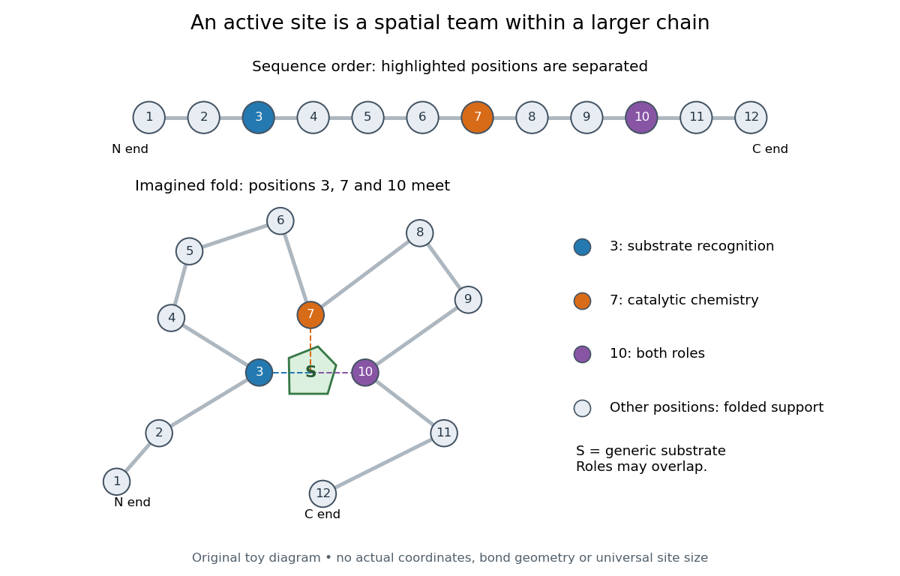

# Active site

↑ **Parent:** [Enzyme](enzyme.md)  
ⓦ [Wiki](https://en.wikipedia.org/wiki/Active_site)

An [active site](active-site.md) is the region of an [enzyme](enzyme.md) where a [substrate](substrate-biochemistry.md) binds and undergoes a [chemical reaction](chemical-reaction.md). In a [protein](protein.md) [enzyme](enzyme.md), it includes the [amino acid residues](amino-acid-residue.md) that contact the [substrate](substrate-biochemistry.md) and those that directly assist [catalysis](catalysis.md). These roles can overlap: an [amino acid side chain](amino-acid-side-chain.md) can both orient a [substrate](substrate-biochemistry.md) and participate in chemistry. The [active site](active-site.md) occupies only part of the folded [protein](protein.md); the remaining [amino acid residues](amino-acid-residue.md) help establish its [protein structure](protein-structure.md), stability and movement. An [active site](active-site.md) need not be a consecutive stretch of [protein primary structure](protein-primary-structure.md): [protein folding](protein-folding.md) can bring distant [amino acid residues](amino-acid-residue.md) together. A [ribozyme](ribozyme.md) instead supplies an [RNA](ribonucleic-acid.md) [active site](active-site.md). See [Alberts et al., Molecular Biology of the Cell, Protein Function: binding sites and catalytic sites](https://www.ncbi.nlm.nih.gov/books/NBK26911/).

Binding and [catalysis](catalysis.md) answer different questions. A [protein binding site](protein-binding-site.md) recognizes shape and chemistry through such interactions as [hydrogen bonds](hydrogen-bond.md), [electrostatics](electrostatics.md) and the [hydrophobic effect](hydrophobic-effect.md). At an [active site](active-site.md), appropriate positioning also helps a [substrate](substrate-biochemistry.md) reach the [transition state](transition-state.md) of a [chemical reaction](chemical-reaction.md). Some [amino acid side chains](amino-acid-side-chain.md) transfer a [proton](proton.md); others participate transiently in a [covalent bond](covalent-bond.md). The [enzyme-substrate complex](enzyme-substrate-complex.md) is the associated [enzyme](enzyme.md) and [substrate](substrate-biochemistry.md), before conversion to a [reaction product](product-chemistry.md). Merely accumulating this complex does not establish rapid [catalysis](catalysis.md): stabilizing the bound [substrate](substrate-biochemistry.md) without sufficiently stabilizing the [transition state](transition-state.md) can leave a large barrier. The important complementarity is chemical as well as geometric. See [Geoffrey M. Cooper, The Cell, The Central Role of Enzymes as Biological Catalysts: substrate binding and transition-state stabilization](https://www.ncbi.nlm.nih.gov/books/NBK9921/).

**[Figure 60](#image-distant-amino-acid-residues-can-cooperate-at-an-active-site). Distant amino acid residues can cooperate at an active site**. Original twelve-residue [polypeptide chain](polypeptide.md) cartoon, with the same order and eleven connections in both drawings. Positions 3, 7 and 10 approach a generic [substrate](substrate-biochemistry.md) after an imagined fold. Blue means recognition, orange means catalytic chemistry, and purple means both; these assignments are invented for explanation. Dashed contacts represent cooperation, not specified [hydrogen bonds](hydrogen-bond.md) or actual atomic coordinates. The other nine positions support the imagined [protein structure](protein-structure.md); three highlighted positions are not a universal [active site](active-site.md) size.

The cartoon makes a useful experimental distinction. Changing a contacting [amino acid residue](amino-acid-residue.md) might weaken [substrate](substrate-biochemistry.md) binding, change the [reaction rate](reaction-rate.md), or do both. Changing a distant [amino acid residue](amino-acid-residue.md) can also disrupt the [active site](active-site.md) by changing [protein folding](protein-folding.md). Therefore a loss of activity after a [mutation](mutation.md) alone does not locate a catalytic group: compare binding, [protein structure](protein-structure.md) and [enzyme kinetics](enzyme-kinetics.md) as well. This is an interpretation guide, not a report of a particular [mutation](mutation.md) experiment.

A concrete example is [hexokinase](hexokinase.md): it transfers the terminal [phosphate](phosphate.md) group of [ATP](adenosine-triphosphate.md) to the $6$-position [hydroxyl group](hydroxy-group.md) of a [sugar](sugar.md) such as [glucose](glucose.md). Specificity need not mean only one acceptable [substrate](substrate-biochemistry.md): the [hexokinase](hexokinase.md) reaction class includes several possible acceptor [sugars](sugar.md). Which are used, and at what [reaction rates](reaction-rate.md), depends on the particular [enzyme](enzyme.md) and conditions. See [Swiss Institute of Bioinformatics, ENZYME entry EC 2.7.1.1: hexokinase reaction and acceptor range](https://enzyme.expasy.org/EC/2.7.1.1).

Bennett and Steitz compared [yeast](yeast.md) [hexokinase](hexokinase.md) A crystallized with [glucose](glucose.md) against [hexokinase](hexokinase.md) B crystallized without [glucose](glucose.md). [X-rays](x-ray.md) scattered by the crystals supplied [diffraction](diffraction.md) measurements from which the authors reconstructed [protein structure](protein-structure.md); comparing coordinates located movement, rather than measuring a [reaction rate](reaction-rate.md). The [glucose](glucose.md)-containing cleft was narrower: one lobe was rotated by about $12^\circ$ relative to the other, with some [protein backbone](protein-backbone.md) displacements reaching $8\,\mathrm{\mathring A}$. This makes the [active site](active-site.md) a moving arrangement of interacting groups, rather than a permanent hole. See [William S. Bennett Jr. and Thomas A. Steitz, Glucose-induced conformational change in yeast hexokinase, PNAS 75 (1978), 4848–4852](https://pmc.ncbi.nlm.nih.gov/articles/PMC336218/).

The structural comparison has two explicit limitations: different forms of [hexokinase](hexokinase.md) and different crystal environments were compared, and static coordinates do not record the order of binding and movement. Closure is consistent with [induced fit](induced-fit.md), but those structures alone cannot exclude [conformational selection](conformational-selection.md). The solution experiment under [induced fit](induced-fit.md) addresses whether compaction also occurs outside a crystal.

**Table of contents**

- [Induced fit](induced-fit.md)
- [Enzyme-substrate complex](enzyme-substrate-complex.md)
- [Conformational selection](conformational-selection.md)

## ↑ Ancestors (3)

1. [Enzyme](enzyme.md)
2. [Biology](biology-split.md)
3. [Codex Wiki](split.md)

## ← Incoming links (14)

- [Active site](active-site.md)
- [Catalytic selectivity](catalytic-selectivity.md)
- [Enzyme](enzyme.md)
- [Induced fit](induced-fit.md)
- [Lysozyme](lysozyme.md)
- [Protein](protein.md)
- [Protein binding site](protein-binding-site.md)
- [Protein folding](protein-folding.md)
- [Protein tertiary structure](protein-tertiary-structure.md)
- [Ribonuclease A refolding experiment](ribonuclease-a-refolding-experiment.md)
- [Ribonucleic acid](ribonucleic-acid.md)
- [Ribosome](ribosome.md)
- [Ribozyme](ribozyme.md)
- [Trans-autophosphorylation](trans-autophosphorylation.md)
