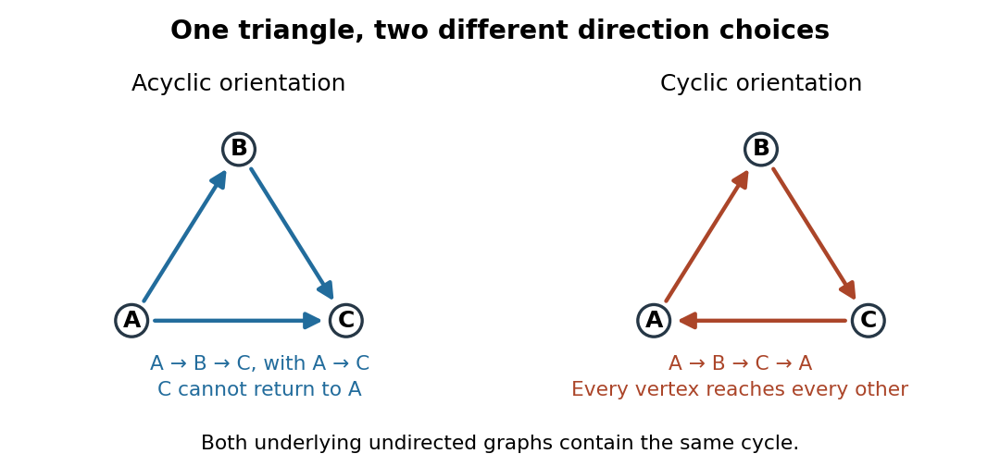

# Acyclic orientation

↑ **Parent:** [Orientation of a graph](orientation-of-a-graph.md)  
ⓦ [Wiki](https://en.wikipedia.org/wiki/Acyclic_orientation)

An [acyclic orientation](acyclic-orientation.md) is an [orientation of a graph](orientation-of-a-graph.md) whose resulting [directed graph](directed-graph.md) has no [directed cycle](directed-cycle.md), hence is a [Directed acyclic graph](directed-acyclic-graph.md). A [directed cycle](directed-cycle.md) must follow every arrow around its closed route. A [cycle in a graph](cycle-in-a-graph.md) in the [skeleton of a directed graph](skeleton-of-a-directed-graph.md) only requires the corresponding undirected [edges](edge-of-a-graph.md); their arrows need not agree around the route.

For the same [triangle in a graph](triangle-in-a-graph.md) with [vertex set](vertex-set.md) $\{A,B,C\}$ and [edges](edge-of-a-graph.md) $AB,BC,AC$, compare

$$
D_1:\ A\to B,\ B\to C,\ A\to C,
\qquad
D_2:\ A\to B,\ B\to C,\ C\to A.
$$

Both have an undirected [cycle in a graph](cycle-in-a-graph.md) in their [skeleton of a directed graph](skeleton-of-a-directed-graph.md). Only $D_2$ has a [directed cycle](directed-cycle.md). In $D_1$, $C$ has no outgoing [directed edge](directed-edge.md), so a route cannot continue from $C$ back to $A$.

**[Figure 5](#image-the-same-triangle-in-a-graph-with-an-acyclic-orientation-and-an-orientation-of-a-graph-containing-a-directed-cycle). The same triangle in a graph with an acyclic orientation and an orientation of a graph containing a directed cycle**.

Thus an [acyclic orientation](acyclic-orientation.md) does not require its underlying [undirected graph](undirected-graph.md) to be a [forest](forest.md). Every [orientation of a graph](orientation-of-a-graph.md) of a [forest](forest.md) is acyclic, because a [directed cycle](directed-cycle.md) would give an undirected [cycle in a graph](cycle-in-a-graph.md). Conversely, every finite [simple graph](simple-graph.md), including one with many [cycles in a graph](cycle-in-a-graph.md), admits at least one [acyclic orientation](acyclic-orientation.md) by the following ordering construction. On this [triangle in a graph](triangle-in-a-graph.md), six of the eight [orientations of a graph](orientation-of-a-graph.md) are acyclic; the other two follow the [directed cycle](directed-cycle.md) in opposite senses.

**Table of contents**

- [Order-induced acyclic orientation](order-induced-acyclic-orientation.md)

## ↑ Ancestors (6)

1. [Orientation of a graph](orientation-of-a-graph.md)
2. [Graph theory](graph-theory-split.md)
3. [Foundations of mathematics](foundations-of-mathematics-split.md)
4. [Area of mathematics](area-of-mathematics.md)
5. [Mathematics](mathematics-split.md)
6. [Codex Wiki](split.md)

## ← Incoming links (4)

- [Acyclic orientation](acyclic-orientation.md)
- [Order-induced acyclic orientation](order-induced-acyclic-orientation.md)
- [Orientation of a graph](orientation-of-a-graph.md)
- [Strong orientation](strong-orientation.md)
