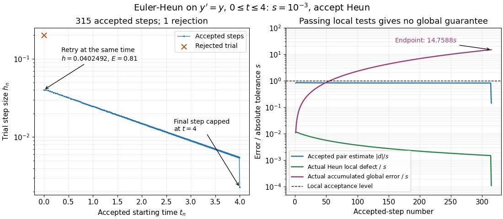

# Adaptive Euler-Heun integration of exponential growth

↑ **Parent:** [Euler-Heun embedded pair](euler-heun-embedded-pair.md)

Continue the [initial value problem](initial-value-problem.md) $y'=y$, $y(0)=1$, to $t=4$ using the [Euler-Heun embedded pair](euler-heun-embedded-pair.md). Choose [absolute and relative error tolerances](absolute-and-relative-error-tolerances.md) ${\rm atol}=10^{-3}$ and ${\rm rtol}=0$, so the scalar scale is $s=10^{-3}$ throughout. This intentionally absolute-only test makes the local and accumulated errors directly comparable. Start with $h=0.2$, accept the [Heun's method](heun-s-method.md) endpoint precisely when $E=|d|/s\leq1$, and after every trial use the capped [adaptive step-size controller](adaptive-step-size-controller.md)

$$
h_{\rm next}=h\min\left(2,\max\left(0.2,0.9E^{-1/2}\right)\right).
$$

For $E=0$ use the growth factor two. Cap every trial at $4-t_n$; on rejection retain the old time and state. These choices specify an original computation, rather than a claim about the defaults of a particular software solver.

The initial trial has $E=20$ and is rejected. Retrying from $(0,1)$ with $h=0.9(0.2)/\sqrt{20}\approx0.0402492236$ gives $E=0.81$ and is accepted. The run takes 315 accepted steps and one rejected trial. Increasing [exponential growth](exponential-growth.md) makes the [local error estimator](local-error-estimator.md) $|d|=|y_n|h^2/2$ grow at a fixed $h$, so subsequent steps shrink roughly like $|y_n|^{-1/2}$. The final step is additionally shortened to land at $t=4$.

**[Figure 1](#image-computed-euler-heun-step-sizes-and-errors-every-accepted-local-estimate-passes-but-accumulated-global-error-exceeds-the-absolute-tolerance). Computed Euler-Heun step sizes and errors: every accepted local estimate passes, but accumulated global error exceeds the absolute tolerance**.

The right panel plots errors against the accepted-step number, all divided by the same $s$. The actual Heun local defect uses the restarted exact endpoint $y_ne^{h_n}$, while actual [global error](global-discretization-error.md) uses $e^{t_{n+1}}$. All accepted $E$ are at most one, and the actual Heun local defects here are even smaller, at most about $0.01143s$. Nevertheless the endpoint is $y_N\approx54.5833912205$, versus $e^4\approx54.5981500331$, with [absolute error](absolute-error.md) about $0.0147588=14.7588s$. Passing local tests therefore does not certify the original trajectory's [global error](global-discretization-error.md).

This failure of a global guarantee has an exact explanation for this example. Put $R(h)=1+h+h^2/2$ and $g_n=e^{t_n}-y_n$. Then

$$
g_{n+1}=e^{h_n}g_n+y_n\left(e^{h_n}-R(h_n)\right).
$$

Each new local defect is added to the previous error amplified by $e^{h_n}$. Iterating this identity, rather than merely inspecting $E$, accounts for accumulation. The [variable-step global ODE error bound](variable-step-global-ode-error-bound.md) describes the corresponding mechanism for more general [ordinary differential equations](ordinary-differential-equation.md).

Repeating with ${\rm atol}=10^{-2}$ gives 98 accepted steps, one rejection and endpoint [absolute error](absolute-error.md) about $0.153252$; with ${\rm atol}=10^{-4}$ it gives 1001 accepted steps, two rejections and endpoint [absolute error](absolute-error.md) about $0.00145642$. Accuracy improves on this smooth problem, but the endpoint error remains about fifteen times the requested local scale. A different [initial value problem](initial-value-problem.md) can amplify or damp defects differently.

## ↑ Ancestors (9)

1. [Euler-Heun embedded pair](euler-heun-embedded-pair.md)
2. [Embedded Runge-Kutta pair](embedded-runge-kutta-pair.md)
3. [Local error estimator](local-error-estimator.md)
4. [Error control for ODE solvers](error-control-for-ode-solvers-split.md)
5. [Numerical analysis](numerical-analysis-split.md)
6. [Analysis](analysis-split.md)
7. [Area of mathematics](area-of-mathematics.md)
8. [Mathematics](mathematics-split.md)
9. [Codex Wiki](split.md)

## ← Incoming links (1)

- [Error control for ODE solvers](error-control-for-ode-solvers-split.md)
