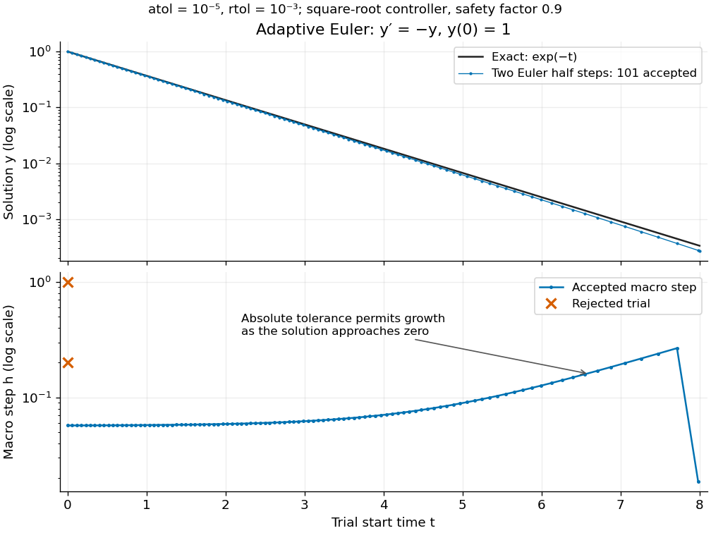
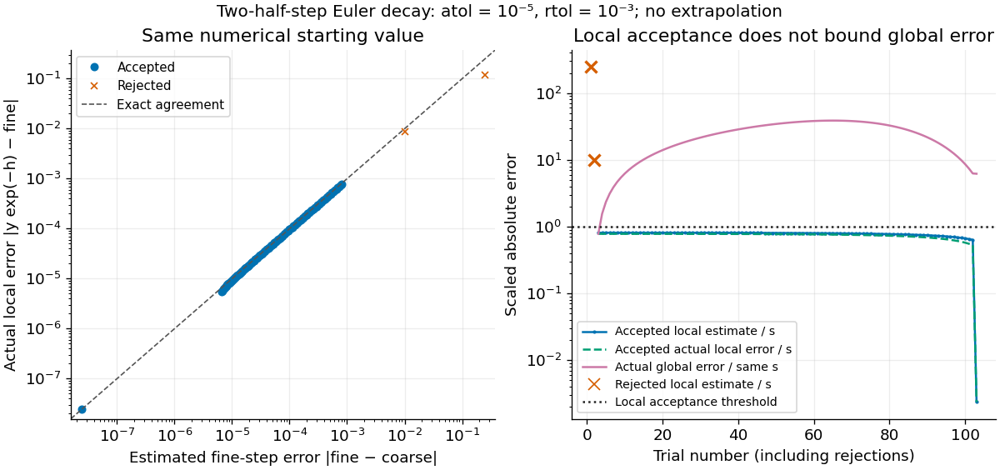

# Adaptive Euler step doubling for exponential decay

↑ **Parent:** [Error control for ODE solvers](error-control-for-ode-solvers-split.md)

Consider the nonstiff scalar [initial value problem](initial-value-problem.md) $y'=-y$, $y(0)=1$, on $0\leq t\leq8$. Its exact solution is the [exponential decay](exponential-decay.md) $y(t)=e^{-t}$. Use [step-doubling error estimation](step-doubling-error-estimation.md) with the [explicit Euler method](euler-method.md): from the same numerical starting value $y_n$, form one coarse step $C_n$ and two half steps giving $F_n$:

$$
C_n=(1-h_n)y_n,\qquad F_n=(1-h_n/2)^2y_n,\qquad \widehat e_n=F_n-C_n=\frac{h_n^2y_n}{4}.
$$

Accept $y_{n+1}=F_n$ when the [absolute and relative error tolerances](absolute-and-relative-error-tolerances.md) test $E_n=|\widehat e_n|/s_n\leq1$ passes, with $s_n=10^{-5}+10^{-3}\max(|y_n|,|F_n|)$. There is no [Richardson extrapolation](richardson-extrapolation.md) in the accepted value. Both approximations have [order of a numerical method](order-of-a-numerical-method.md) one, while this [local error estimator](local-error-estimator.md) has step exponent $r=2$. Consequently the [adaptive step-size controller](adaptive-step-size-controller.md) uses a [square root](square-root.md), not a cube root:

$$
q_n=\min\!\left(5,\max\!\left(0.2,0.9E_n^{-1/2}\right)\right),\qquad h_{\rm next}=q_nh_n.
$$

Start with $h_0=1$. A rejected trial retains both $t_n$ and $y_n$, caps $q_n$ at one, and retries. A zero estimate uses $q_n=5$. Before every trial, cap $h_n$ at $8-t_n$. Stop with a failure if [floating-point arithmetic](floating-point-arithmetic-split.md) gives $t_n+h_n=t_n$, or after 100000 trials. These rules specify the example completely; they are not a prescription for every [ordinary differential equation](ordinary-differential-equation.md) solver.

**[Figure 2](#image-adaptive-two-half-step-euler-decay-exact-and-numerical-trajectories-accepted-step-sizes-and-rejected-trials). Adaptive two-half-step Euler decay: exact and numerical trajectories, accepted step sizes and rejected trials**.

The first two trials, $h=1$ and $h=0.2$, have $E\approx247.525$ and $E\approx9.90099$ and are rejected. The next trial has $h\approx0.0572049$ and $E\approx0.81$ and is accepted. For positive decreasing numerical values, $s_n=10^{-5}+10^{-3}y_n$, so the [local error estimator](local-error-estimator.md) gives

$$
E_n=\frac{h_n^2}{4(10^{-3}+10^{-5}/y_n)}.
$$

When the relative term dominates, this suggests nearly constant accepted steps, approximately $2(0.9)\sqrt{10^{-3}}$. When $y_n$ falls below the crossover size $10^{-5}/10^{-3}=0.01$, the absolute term increasingly permits longer steps. The sharp final decrease in $h$ only lands on $t=8$; it does not indicate a sudden loss of smoothness.

The actual signed local defect from the same numerical input is

$$
\ell_n=y_ne^{-h_n}-F_n=y_n\left(\frac{h_n^2}{4}-\frac{h_n^3}{6}+O(h_n^4)\right).
$$

Here $O$ is [Big O notation](big-o-notation.md), obtained from [Taylor's theorem](taylor-s-theorem.md) for the [exponential function](exponential-function.md). Thus $\widehat e_n$ agrees with the leading term as $h_n\to0$, but is not identical to $\ell_n$. At $h=1$, $y_n=1$, the estimate is $0.25$ while the actual local defect is $e^{-1}-1/4\approx0.117879$. Their closeness improves for the smaller accepted steps. Had we added $\widehat e_n$ using [Richardson extrapolation](richardson-extrapolation.md), the accepted formula would instead be $y_n(1-h_n+h_n^2/2)$, of [order of a numerical method](order-of-a-numerical-method.md) two; the same raw difference would still scale as $h_n^2$ and would not estimate that improved value's leading $h_n^3$ defect.

**[Figure 3](#image-estimated-versus-actual-local-euler-defects-rejected-trials-and-actual-accumulated-global-error-scaled-by-the-local-tolerance). Estimated versus actual local Euler defects, rejected trials, and actual accumulated global error scaled by the local tolerance**.

The [global error](global-discretization-error.md) $g_n=y_n-e^{-t_n}$ obeys an exact [recurrence relation](recurrence-relation.md) involving the actual local defects:

$$
g_{n+1}=e^{-h_n}g_n-\ell_n,\qquad g_0=0.
$$

Each previous [global error](global-discretization-error.md) contracts, yet the local defects keep adding. In the plotted run, 101 steps are accepted and two trials are rejected. Every accepted $E_n$ is at most approximately $0.81$, while the largest $|g_{n+1}|/s_n$ is approximately $38.6927$. At $t=8$, the numerical value is approximately $0.00027184218$, compared with the exact $e^{-8}\approx0.00033546263$, giving [absolute error](absolute-error.md) approximately $6.36204\times10^{-5}$. The right-hand plot deliberately scales actual [global error](global-discretization-error.md) by the same $s_n$ used for local acceptance; it is not a new [global error](global-discretization-error.md) tolerance test.

Tightening both [absolute and relative error tolerances](absolute-and-relative-error-tolerances.md) by a factor ten gives 315 accepted steps and endpoint [absolute error](absolute-error.md) approximately $2.14922\times10^{-5}$; tightening both by a factor one hundred gives 991 accepted steps and endpoint [absolute error](absolute-error.md) approximately $6.94171\times10^{-6}$. This is a convergence comparison for this particular [initial value problem](initial-value-problem.md). The endpoint error decreases by about a factor three per tenfold tightening, rather than by ten: a first-order [Euler method](euler-method.md) accumulates defects across many steps, while its [local error estimator](local-error-estimator.md) varies quadratically with $h$. A [variable-step global ODE error bound](variable-step-global-ode-error-bound.md) needs propagation information as well as accepted local tests.

The [absolute stability](linear-stability-domain.md) boundary remains a separate constraint. On the [Dahlquist test equation](dahlquist-test-equation.md) $y'=-\lambda y$ with $\lambda>0$, the accepted two-half-step formula has [stability function](stability-function.md) $R(-\lambda h)=(1-\lambda h/2)^2$. It strictly damps perturbations only for $0<\lambda h<4$. Its [local error estimator](local-error-estimator.md) is $\lambda^2h^2y_n/4$, which can pass an absolute-tolerance test at tiny $y_n$ even outside this damping interval. In a [stiff two-mode linear system](stiff-two-mode-linear-system.md), a fast mode can therefore constrain the step long after its visible amplitude has become small. An [adaptive step-size controller](adaptive-step-size-controller.md) does not turn an [explicit Euler method](euler-method.md) into an [A-stable](a-stability.md) method. Official solver documentation likewise distinguishes explicit [Runge-Kutta methods](runge-kutta-method-split.md) for nonstiff problems from implicit [Runge-Kutta methods](runge-kutta-method-split.md) and [backward differentiation formulas](backward-differentiation-formula.md) for [stiff equations](stiff-equation.md).[solve\_ivp, method parameter: explicit versus implicit methods and stiffness](scipy-1-16-2-documentation/scipy-integrate-solve-ivp.md)

## ↑ Ancestors (6)

1. [Error control for ODE solvers](error-control-for-ode-solvers-split.md)
2. [Numerical analysis](numerical-analysis-split.md)
3. [Analysis](analysis-split.md)
4. [Area of mathematics](area-of-mathematics.md)
5. [Mathematics](mathematics-split.md)
6. [Codex Wiki](split.md)
