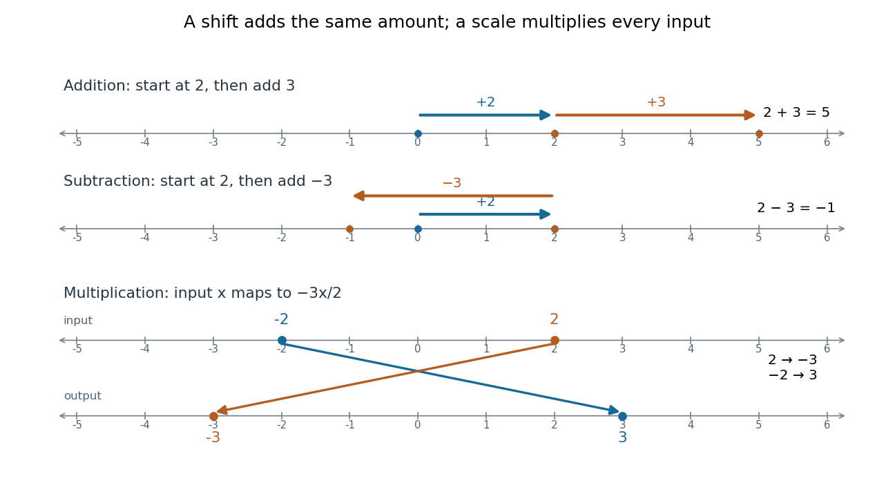

# Addition

↑ **Parent:** [Arithmetic](arithmetic-split.md)  
ⓦ [Wiki](https://en.wikipedia.org/wiki/Addition)

Addition combines two [numbers](number.md) into their [sum](sum.md). For [natural numbers](natural-number.md), joining disjoint collections of sizes $a,b$ gives a collection of size $a+b$. On a [number line](number-line.md), adding $b$ shifts a starting position by $b$: rightward when $b>0$ and leftward when $b<0$.

Starting at $2$ and adding $3$ reaches $5$. Starting there and adding $-3$ returns to $2$, because $3+(-3)=0$. [Additive inverses](additive-inverse.md) turn this return move into an algebraic rule. With [real numbers](real-number.md), [addition](addition.md) is [commutative](commutativity.md) and [associative](associative-property.md): exchanging two shifts or grouping several shifts differently leaves the final position unchanged.

**[Figure 4](#image-addition-shifts-positions-on-a-number-line-while-a-negative-multiplication-factor-changes-both-scale-and-direction). Addition shifts positions on a number line, while a negative multiplication factor changes both scale and direction**.

The bottom panel applies $x\mapsto-3x/2$. Input $2$ becomes $-3$, and input $-2$ becomes $3$. [Multiplication](multiplication.md) by a negative [real number](real-number.md) rescales distances from zero and reverses direction, giving a [reflection in mathematics](reflection-mathematics.md) as well as a scale change. This is a different operation from shifting every input by one fixed amount.

**Table of contents**

- [Additive inverse](additive-inverse.md)
- [Summation](summation.md)
  - [Finite sum](finite-sum.md)
  - [Faulhaber's formula](faulhaber-s-formula.md)
    - [Faulhaber polynomial](faulhaber-polynomial.md)
  - [Euler-Maclaurin formula](euler-maclaurin-formula.md)
  - [Prime-valued sum](prime-valued-sum.md)
  - [Telescoping sum](telescoping-sum.md)
    - [Meromorphic telescoping cancellation](meromorphic-telescoping-cancellation.md)
    - [Partial fraction telescoping](partial-fraction-telescoping.md)
    - [Boundary limits of telescoping series](boundary-limits-of-telescoping-series.md)
  - [Sum](sum.md)
    - [Empty sum](empty-sum.md)
    - [Weighted arithmetic mean](weighted-arithmetic-mean.md)
      - [Density-weighted mean](density-weighted-mean.md)
      - [Pooled-mean compatibility under rounding](pooled-mean-compatibility-under-rounding.md)
      - [Combining means of groups](combining-means-of-groups.md)
      - [Weighted mean minimizes squared deviations](weighted-mean-minimizes-squared-deviations.md)
      - [Arithmetic mean](arithmetic-mean.md)
        - [Harmonic mean](harmonic-mean.md)
          - [Weighted harmonic mean](weighted-harmonic-mean.md)
    - [Prefix sum](prefix-sum.md)
      - [Suffix sum](suffix-sum.md)
      - [Prefix scan](prefix-scan.md)
- [Carry (arithmetic)](carry-arithmetic.md)

## ↑ Ancestors (4)

1. [Arithmetic](arithmetic-split.md)
2. [Area of mathematics](area-of-mathematics.md)
3. [Mathematics](mathematics-split.md)
4. [Codex Wiki](split.md)

## ← Incoming links (161)

- [Abelian lattice-ordered group](abelian-lattice-ordered-group.md)
- [Abstract syntax tree](abstract-syntax-tree.md)
- [Abstract syntax tree precedence example](abstract-syntax-tree-precedence-example.md)
- [Abstraction function](abstraction-function.md)
- [Addition](addition.md)
- [Addition modulo an integer](addition-modulo-an-integer.md)
- [Additive function bounded on an interval is linear](additive-function-bounded-on-an-interval-is-linear.md)
- [Additive identity](additive-identity.md)
- [Arbitrary-precision arithmetic](arbitrary-precision-arithmetic.md)
- [Arithmetic](arithmetic-split.md)
- [Arithmetic circuit](arithmetic-circuit.md)
- [Array multiset](array-multiset.md)
- [Associative property](associative-property.md)
- [Automorphism](automorphism.md)
- [Binary array sum by recursion](binary-array-sum-by-recursion.md)
- [Binary operation](binary-operation.md)
- [Boolean matrix multiplication](boolean-matrix-multiplication.md)
- [Carry (arithmetic)](carry-arithmetic.md)
- [Cauchy's functional equation](cauchy-s-functional-equation.md)
- [Cayley table](cayley-table.md)
- [Chinese remainder theorem](chinese-remainder-theorem.md)
- [Closure under a binary operation](closure-under-a-binary-operation.md)
- [Common subexpression elimination](common-subexpression-elimination.md)
- [Compilation arithmetic example](compilation-arithmetic-example.md)
- [Complex number](complex-number.md)
- [Congruence modulo an ideal](congruence-modulo-an-ideal.md)
- [Constant folding](constant-folding.md)
- [Constant-time distinct-size counter](constant-time-distinct-size-counter.md)
- [Continuous function](continuous-function.md)
- [Correct operations through an abstraction function](correct-operations-through-an-abstraction-function.md)
- [Cyclic group](cyclic-group.md)
- [Cyclic group of order four and Klein four-group](cyclic-group-of-order-four-and-klein-four-group.md)
- [Degree of a polynomial](degree-of-a-polynomial.md)
- [Discontinuous additive function](discontinuous-additive-function.md)
- [Divide-and-conquer product ledger](divide-and-conquer-product-ledger.md)
- [Empty sum](empty-sum.md)
- [Endomorphism](endomorphism.md)
- [Endomorphism of a finite cyclic group](endomorphism-of-a-finite-cyclic-group.md)
- [Exclusive or](exclusive-or.md)
- [Field with four elements](field-with-four-elements.md)
- [Finitary relation](finitary-relation.md)
- [Finite additive group](finite-additive-group.md)
- [Finite field](finite-field.md)
- [Finite fields as roots of a Frobenius polynomial](finite-fields-as-roots-of-a-frobenius-polynomial.md)
- [Finite group](finite-group.md)
- [Finite probability pushforward](finite-probability-pushforward.md)
- [Floating-point addition](floating-point-addition.md)
- [Floating-point arithmetic](floating-point-arithmetic-split.md)
- [Free monoid](free-monoid.md)
- [Fundamental theorem of arithmetic](fundamental-theorem-of-arithmetic.md)
- [Gaussian binomial coefficient](gaussian-binomial-coefficient.md)
- [Gaussian elimination](gaussian-elimination.md)
- [Geometric mean](geometric-mean.md)
- [Group](group-split.md)
- [Group automorphism](group-automorphism.md)
- [Group isomorphism](group-isomorphism.md)
- [Homogeneous linear differential equation](homogeneous-linear-differential-equation.md)
- [Horner's method](horner-s-method.md)
- [Hyperoperation](hyperoperation.md)
- [Identity element](identity-element.md)
- [Independence of the Abelian group axioms](independence-of-the-abelian-group-axioms.md)
- [Instruction selection](instruction-selection.md)
- [Integer](integer-split.md)
- [Integer arithmetic](integer-arithmetic.md)
- [Interpreter arithmetic trace](interpreter-arithmetic-trace.md)
- [Interval arithmetic operations](interval-arithmetic-operations.md)
- [Karatsuba carry handling](karatsuba-carry-handling.md)
- [Karatsuba digit-operation cost](karatsuba-digit-operation-cost.md)
- [Karatsuba multiplication](karatsuba-multiplication.md)
- [Karatsuba practical crossover](karatsuba-practical-crossover.md)
- [Karatsuba three-product identity](karatsuba-three-product-identity.md)
- [Kummer's theorem](kummer-s-theorem.md)
- [Linear Boolean function](linear-boolean-function.md)
- [Linearity of expectation](linearity-of-expectation.md)
- [LU factorization and solve costs](lu-factorization-and-solve-costs.md)
- [Machine epsilon](machine-epsilon.md)
- [Matrix-chain cost model](matrix-chain-cost-model.md)
- [Matrix ring](matrix-ring.md)
- [Memoization arithmetic and stack costs](memoization-arithmetic-and-stack-costs.md)
- [Memoized Fibonacci evaluation](memoized-fibonacci-evaluation.md)
- [Min strategy](min-strategy.md)
- [Modular-addition quantum oracle](modular-addition-quantum-oracle.md)
- [Modular arithmetic](modular-arithmetic-split.md)
- [Modular congruence](modular-congruence.md)
- [Monoid](monoid.md)
- [Multiplication](multiplication.md)
- [Multiplicative group of a finite field](multiplicative-group-of-a-finite-field.md)
- [Number line](number-line.md)
- [p-adic integer](p-adic-integer.md)
- [P-adic number](p-adic-number.md)
- [Partial fraction telescoping](partial-fraction-telescoping.md)
- [Solution](past-exam-of-the-algebra-analysis-and-differential-equations-1-course-of-the-university-of-oxford/2004/algebra/3/i/solution.md)
- [Solution](past-exam-of-the-algebra-analysis-and-differential-equations-1-course-of-the-university-of-oxford/2004/algebra/3/iv/solution.md)
- [Solution](past-exam-of-the-computer-science-course-of-the-university-of-oxford/2015/compilers/3/a/solution.md)
- [Solution](past-exam-of-the-computer-science-course-of-the-university-of-oxford/2015/compilers/3/d/solution.md)
- [Solution](past-exam-of-the-computer-science-course-of-the-university-of-oxford/2015/computer-networks/1/f/solution.md)
- [Solution](past-exam-of-the-history-of-mathematics-course-of-the-university-of-oxford/2023/5/solution.md)
- [Solution](past-exam-of-the-history-of-mathematics-course-of-the-university-of-oxford/2023/6/solution.md)
- [Solution](past-exam-of-the-history-of-mathematics-course-of-the-university-of-oxford/2023/9/solution.md)
- [Solution](past-exam-of-the-logic-and-set-theory-course-of-the-university-of-oxford/2007/a/3/ii/solution.md)
- [Solution](past-exam-of-the-logic-and-set-theory-course-of-the-university-of-oxford/2007/b/5/i/solution.md)
- [Solution](past-exam-of-the-logic-and-set-theory-course-of-the-university-of-oxford/2007/b/5/iv/solution.md)
- [Solution](past-exam-of-the-logic-and-set-theory-course-of-the-university-of-oxford/2007/b/5/v/solution.md)
- [Solution](past-exam-of-the-logic-and-set-theory-course-of-the-university-of-oxford/2007/b/7/vi/solution.md)
- [Solution](past-exam-of-the-logic-and-set-theory-course-of-the-university-of-oxford/2007/b/8/b/solution.md)
- [Solution](past-exam-of-the-logic-and-set-theory-course-of-the-university-of-oxford/2007/b/8/c/solution.md)
- [Solution](past-exam-of-the-mathematics-course-of-the-university-of-cambridge/2002/ia/paper-1/8d/solution.md)
- [Solution](past-exam-of-the-mathematics-course-of-the-university-of-cambridge/2004/iii/paper-6/1/solution.md)
- [Solution](past-exam-of-the-mathematics-course-of-the-university-of-cambridge/2016/iii/paper-120/4/solution.md)
- [Solution](past-exam-of-the-mathematics-course-of-the-university-of-cambridge/2022/ii/paper-2/18h/a/solution.md)
- [Solution](past-exam-of-the-mathematics-course-of-the-university-of-cambridge/2023/iii/paper-202/1/e/solution.md)
- [Solution](past-exam-of-the-mathematics-course-of-the-university-of-oxford/2021/prelims/mathematics-i/6/b/i/solution.md)
- [Solution](past-exam-of-the-mathematics-course-of-the-university-of-oxford/2021/prelims/mathematics-i/6/b/iii/solution.md)
- [Solution](past-exam-of-the-mathematics-course-of-the-university-of-oxford/2021/prelims/mathematics-i/7/b/iii/solution.md)
- [Solution](past-exam-of-the-options-ii-course-of-the-university-of-oxford/2005/b/2/solution.md)
- [Solution](past-exam-of-the-psychology-and-primary-education-course-of-the-university-of-oxford/2022/6/solution.md)
- [Solution](past-exam-of-the-rings-and-modules-course-of-the-university-of-oxford/2021/1/b/ii/solution.md)
- [Solution](past-exam-of-the-rings-and-modules-course-of-the-university-of-oxford/2021/2/b/solution.md)
- [Solution](past-exam-of-the-rings-and-modules-course-of-the-university-of-oxford/2021/2/c/solution.md)
- [Solution](past-exam-of-the-year-1-of-the-computer-science-course-of-the-university-of-oxford/2013/functional-programming-design-and-analysis-of-algorithms/1/c/solution.md)
- [Solution](past-exam-of-the-year-1-of-the-computer-science-course-of-the-university-of-oxford/2014/functional-programming-design-and-analysis-of-algorithms/1/a/solution.md)
- [Solution](past-exam-of-the-year-1-of-the-computer-science-course-of-the-university-of-oxford/2014/functional-programming-design-and-analysis-of-algorithms/1/b/solution.md)
- [Solution](past-exam-of-the-year-1-of-the-computer-science-course-of-the-university-of-oxford/2014/functional-programming-design-and-analysis-of-algorithms/1/d/solution.md)
- [Solution](past-exam-of-the-year-1-of-the-computer-science-course-of-the-university-of-oxford/2014/functional-programming-design-and-analysis-of-algorithms/1/e/solution.md)
- [Solution](past-exam-of-the-year-1-of-the-computer-science-course-of-the-university-of-oxford/2015/digital-systems-linear-algebra-introduction-to-formal-proof/5/b/solution.md)
- [Solution](past-exam-of-the-year-1-of-the-computer-science-course-of-the-university-of-oxford/2015/digital-systems-linear-algebra-introduction-to-formal-proof/6/d/solution.md)
- [Solution](past-exam-of-the-year-1-of-the-computer-science-course-of-the-university-of-oxford/2021/imperative-programming-resit/3/c/solution.md)
- [Solution](past-exam-of-the-year-1-of-the-computer-science-course-of-the-university-of-oxford/2021/imperative-programming-resit/3/d/solution.md)
- [Solution](past-exam-of-the-year-1-of-the-computer-science-course-of-the-university-of-oxford/2021/imperative-programming-resit/7/c/solution.md)
- [Solution](past-exam-of-the-year-1-of-the-computer-science-course-of-the-university-of-oxford/2021/imperative-programming/6/f/solution.md)
- [Solution](past-exam-of-the-year-1-of-the-computer-science-course-of-the-university-of-oxford/2022/discrete-mathematics-continuous-mathematics-and-probability-resit/3/a/solution.md)
- [Polar form of a complex number](polar-form-of-a-complex-number.md)
- [Polynomial identity testing](polynomial-identity-testing.md)
- [Positional notation](positional-notation.md)
- [Power-map group action obstruction](power-map-group-action-obstruction.md)
- [Prefix scan](prefix-scan.md)
- [Prime field](prime-field.md)
- [Primitive recursive pairing function](primitive-recursive-pairing-function.md)
- [Quotient set](quotient-set.md)
- [Rational homogeneity of an additive function](rational-homogeneity-of-an-additive-function.md)
- [Rational-linear map](rational-linear-map.md)
- [Recursion theorem on the natural numbers](recursion-theorem-on-the-natural-numbers.md)
- [Residue class](residue-class.md)
- [Ring](ring.md)
- [Rng (algebra)](rng-algebra.md)
- [Semigroup](semigroup.md)
- [Sliding-window algorithm](sliding-window-algorithm.md)
- [Spreadsheet cell reference](spreadsheet-cell-reference.md)
- [Spreadsheet formula](spreadsheet-formula.md)
- [Square-free integer](square-free-integer.md)
- [Stability of a supremum under uniform perturbations](stability-of-a-supremum-under-uniform-perturbations.md)
- [Subadditivity of the base-p digit sum](subadditivity-of-the-base-p-digit-sum.md)
- [Sum](sum.md)
- [Summation](summation.md)
- [Summation loop verification](summation-loop-verification.md)
- [Tiny-pivot roundoff in Gaussian elimination](tiny-pivot-roundoff-in-gaussian-elimination.md)
- [Topological group](topological-group-split.md)
- [Tridiagonal solve costs](tridiagonal-solve-costs.md)
- [Unit roundoff](unit-roundoff.md)
- [Weakly linear partial function](weakly-linear-partial-function.md)
- [Weierstrass approximation theorem](weierstrass-approximation-theorem.md)
