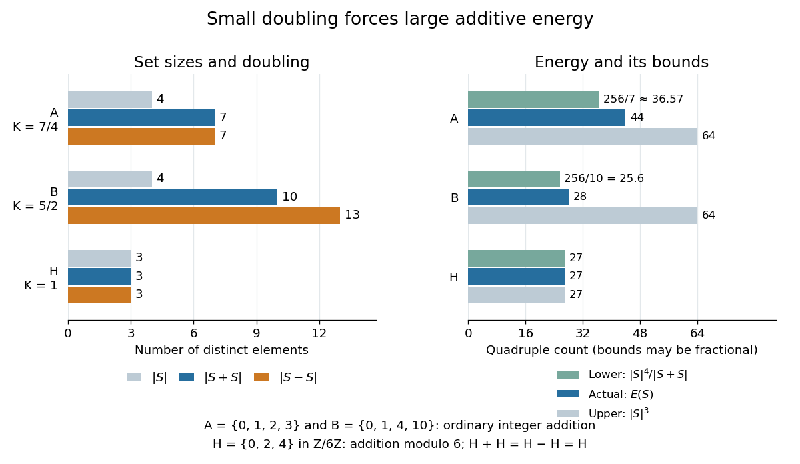

# Additive energy

↑ **Parent:** [Additive combinatorics](additive-combinatorics-split.md)  
ⓦ [Wiki](https://en.wikipedia.org/wiki/Additive_energy)

The [additive energy](additive-energy.md) of a [finite set](finite-set.md) $S\subseteq G$ in an [abelian group](abelian-group.md) $G$ counts [additive quadruples](additive-quadruple.md), with order and repeated members allowed:

$$
E(S)=\bigl|\{(a,b,c,d)\in S^4:a+b=c+d\}\bigr|
=\sum_{s\in G}r_{S+S}(s)^2.
$$

At a fixed sum $s$, independently choosing two of its $r_{S+S}(s)$ [ordered pairs](ordered-pair.md) gives $r_{S+S}(s)^2$ [additive quadruples](additive-quadruple.md). Thus [additive energy](additive-energy.md) weights heavily represented sums more strongly than the [cardinality](cardinality.md) of the [sumset](sumset.md) does.

For $A=\{0,1,2,3\}$ and $B=\{0,1,4,10\}$, the [sumset representation functions](sumset-representation-function.md) give

$$
\begin{aligned}
E(A)&=1^2+2^2+3^2+4^2+3^2+2^2+1^2=44,\\
E(B)&=4\cdot1^2+6\cdot2^2=28.
\end{aligned}
$$

The [arithmetic progression](arithmetic-progression.md) has additional coincidences such as $0+3=1+2$. The [set](set-split.md) $B$ still has coincidences forced by [commutativity](commutativity.md), including $0+1=1+0$, so its [additive energy](additive-energy.md) is not merely the sixteen identical-pair comparisons.

The same [additive energy](additive-energy.md) can be counted using the [difference set](difference-set.md). Define $r_{S-S}(t)=|\{(a,b)\in S\times S:a-b=t\}|$. The identity $a+b=c+d$ is equivalent to $a-c=d-b$, and the coordinate rearrangement $(a,b,c,d)\mapsto(a,c,d,b)$ is a [bijection](bijection.md). Consequently

$$
E(S)=\sum_{t\in G}r_{S-S}(t)^2.
$$

For $A$, the difference counts from $-3$ through $3$ are again $1,2,3,4,3,2,1$. For $B$, the zero difference has four representations and each of the twelve nonzero differences has one, giving $4^2+12\cdot1^2=28$. The [sumset representation functions](sumset-representation-function.md) for sums and differences can look different while their squared totals agree.

For every nonempty [finite set](finite-set.md) $S\subseteq G$ in an [abelian group](abelian-group.md) $G$,

$$
\frac{|S|^4}{|S+S|}\leq E(S)\leq |S|^3.
$$

The lower bound follows from the [Cauchy-Schwarz inequality](cauchy-schwarz-inequality.md) and the total [sumset representation function](sumset-representation-function.md) count:

$$
|S|^4=\left(\sum_{s\in S+S}r_{S+S}(s)\right)^2
\leq |S+S|\sum_{s\in S+S}r_{S+S}(s)^2.
$$

For the upper bound, any three members $a,b,c$ determine at most one fourth member $d=a+b-c$ of an [additive quadruple](additive-quadruple.md). See [Yufei Zhao's MIT lecture 25, pages 1-3, for representation counts and the energy bounds](https://ocw.mit.edu/courses/18-225-graph-theory-and-additive-combinatorics-fall-2023/MlYhHsq_tOU_transcript.pdf).

In the two [integer](integer.md) examples, the lower bounds are $256/7$ and $256/10$, and the upper bound is $64$. For the [subgroup](subgroup.md) $H=\{0,2,4\}$ of $\mathbb Z/6\mathbb Z$, each element of $H$ has three sum representations, so $E(H)=3\cdot3^2=27$ and both bounds are equalities.

**[Figure 2](#image-sumset-and-difference-set-sizes-alongside-additive-energy-and-its-bounds-including-a-cyclic-subgroup). Sumset and difference-set sizes alongside additive energy and its bounds, including a cyclic subgroup**.

For nonempty $S$, dividing [additive energy](additive-energy.md) by $|S|^3$ gives a relative measure between $1/K(S)$ and one. Small [doubling constant](doubling-constant.md) therefore forces relatively large [additive energy](additive-energy.md). A converse requires care: the [Balog-Szemerédi-Gowers theorem](balog-szemeredi-gowers-theorem.md) extracts a large [subset](subset.md) with small [doubling constant](doubling-constant.md), rather than asserting that all of $S$ has small [doubling constant](doubling-constant.md).

**Table of contents**

- [Additive energy controls three-term progression mixing](additive-energy-controls-three-term-progression-mixing.md)
- [Additive energy of a frequency graph](additive-energy-of-a-frequency-graph.md)
  - [Derivative correlations force additive frequency energy](derivative-correlations-force-additive-frequency-energy.md)
    - [Squared derivative correlations force frequency-graph energy](squared-derivative-correlations-force-frequency-graph-energy.md)
- [Polynomial progression in a high-energy fourfold difference set](polynomial-progression-in-a-high-energy-fourfold-difference-set.md)
- [Popular sum](popular-sum.md)
- [Additive quadruple](additive-quadruple.md)
- [Balog-Szemerédi-Gowers theorem](balog-szemeredi-gowers-theorem.md)
  - [Graph form of the Balog-Szemerédi-Gowers theorem](graph-form-of-the-balog-szemeredi-gowers-theorem.md)
    - [Four-step path lemma for a dense bipartite graph](four-step-path-lemma-for-a-dense-bipartite-graph.md)
  - [Small-difference-set form of the Balog-Szemerédi-Gowers theorem](small-difference-set-form-of-the-balog-szemeredi-gowers-theorem.md)

## ↑ Ancestors (5)

1. [Additive combinatorics](additive-combinatorics-split.md)
2. [Combinatorics](combinatorics-split.md)
3. [Area of mathematics](area-of-mathematics.md)
4. [Mathematics](mathematics-split.md)
5. [Codex Wiki](split.md)

## ← Incoming links (20)

- [Additive combinatorics](additive-combinatorics-split.md)
- [Additive energy](additive-energy.md)
- [Additive energy controls three-term progression mixing](additive-energy-controls-three-term-progression-mixing.md)
- [Additive energy of a frequency graph](additive-energy-of-a-frequency-graph.md)
- [Doubling constant](doubling-constant.md)
- [Graph form of the Balog-Szemerédi-Gowers theorem](graph-form-of-the-balog-szemeredi-gowers-theorem.md)
- [High-energy Roth theorem](high-energy-roth-theorem.md)
- [Solution](past-exam-of-the-mathematics-course-of-the-university-of-cambridge/2001/iii/paper-76/4/i/solution.md)
- [Solution](past-exam-of-the-mathematics-course-of-the-university-of-cambridge/2001/iii/paper-76/4/iii/solution.md)
- [Solution](past-exam-of-the-mathematics-course-of-the-university-of-cambridge/2006/iii/paper-13/3/i/solution.md)
- [Solution](past-exam-of-the-mathematics-course-of-the-university-of-cambridge/2008/iii/paper-16/2/i/solution.md)
- [Solution](past-exam-of-the-mathematics-course-of-the-university-of-cambridge/2013/iii/paper-11/1/solution.md)
- [Solution](past-exam-of-the-mathematics-course-of-the-university-of-cambridge/2014/iii/paper-79/1/ii/solution.md)
- [Solution](past-exam-of-the-mathematics-course-of-the-university-of-cambridge/2014/iii/paper-79/3/solution.md)
- [Solution](past-exam-of-the-mathematics-course-of-the-university-of-cambridge/2022/iii/paper-129/3/ii/solution.md)
- [Solution](past-exam-of-the-mathematics-course-of-the-university-of-cambridge/2022/iii/paper-129/4/iv/solution.md)
- [Solution](past-exam-of-the-mathematics-course-of-the-university-of-cambridge/2024/iii/paper-129/4/iii/solution.md)
- [Solution](past-exam-of-the-mathematics-course-of-the-university-of-cambridge/2025/iii/paper-129/1/c/solution.md)
- [Popular sum](popular-sum.md)
- [Sumset representation function](sumset-representation-function.md)
