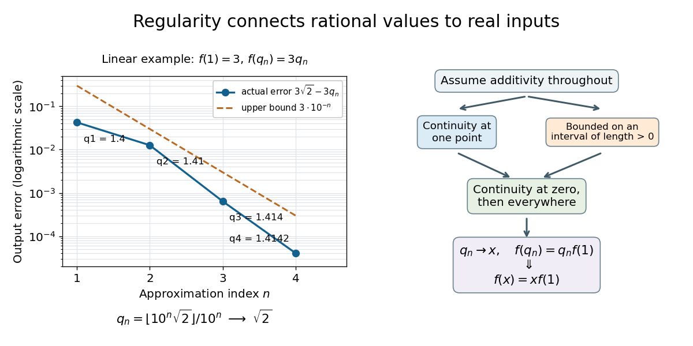

# Additive function continuous at one point is linear

↑ **Parent:** [Additive function](additive-function.md)

A real [additive function](additive-function.md) $f:\mathbb R\to\mathbb R$ that is [continuous](continuous-function.md) at one point $x_0$ is [continuous](continuous-function.md) everywhere and has form $f(x)=xf(1)$. Indeed $f(0)=0$, and $f(h)=f(x_0+h)-f(x_0)\to0$ as $h\to0$. Then $f(x+h)-f(x)=f(h)\to0$ for every $x$. Additivity gives $f(q)=qf(1)$ for every [rational number](rational-number.md); continuity and the [density of the rational numbers](density-of-the-rational-numbers.md) extend this identity to every real argument.

The step from the [rational numbers](rational-number.md) to the [real numbers](real-number.md) can be made explicit. Put $c=f(1)$. For an arbitrary [real number](real-number.md) $x$, the [density of the rational numbers](density-of-the-rational-numbers.md) supplies a [sequence](sequence.md) of [rational numbers](rational-number.md) $q_n\to x$. Because [continuity](continuous-function.md) at the original point already implied [continuity](continuous-function.md) everywhere,

$$
f(x)=\lim_{n\to\infty}f(q_n)=\lim_{n\to\infty}cq_n=cx.
$$

This is where [continuity](continuous-function.md) enters: knowing all the rational values alone does not justify the first equality.

For an original numerical example, use the [floor function](floor-function.md) to define the rational lower approximants $q_n=\lfloor10^n\sqrt2\rfloor/10^n$. They obey $0\leq\sqrt2-q_n<10^{-n}$. When $f(1)=3$ and $f$ is [continuous](continuous-function.md) at one point, [rational homogeneity of an additive function](rational-homogeneity-of-an-additive-function.md) and the preceding argument give

$$
\begin{array}{c|c|c}
n&q_n&f(q_n)\\\hline
1&1.4&4.2\\
2&1.41&4.23\\
3&1.414&4.242\\
4&1.4142&4.2426
\end{array}
\qquad
f(\sqrt2)=3\sqrt2,
\qquad
0\leq3\sqrt2-f(q_n)<3\cdot10^{-n}.
$$

The error bound here follows from the resulting [linear map](linear-map.md), rather than from a quantitative bound on the initially assumed [continuity](continuous-function.md).

**[Figure 3](#image-continuity-connects-exact-rational-values-to-an-irrational-limit-either-one-point-continuity-or-boundedness-on-an-interval-forces-f-x-xf-1). Continuity connects exact rational values to an irrational limit; either one-point continuity or boundedness on an interval forces f(x)=xf(1)**

## ↑ Ancestors (7)

1. [Additive function](additive-function.md)
2. [Cauchy's functional equation](cauchy-s-functional-equation.md)
3. [Functional equation](functional-equation.md)
4. [Analysis](analysis-split.md)
5. [Area of mathematics](area-of-mathematics.md)
6. [Mathematics](mathematics-split.md)
7. [Codex Wiki](split.md)

## ← Incoming links (4)

- [Additive function bounded on an interval is linear](additive-function-bounded-on-an-interval-is-linear.md)
- [Continuous exponential functional equation](continuous-exponential-functional-equation.md)
- [Discontinuous additive function](discontinuous-additive-function.md)
- [Solution](past-exam-of-the-mathematics-course-of-the-university-of-cambridge/2004/ia/paper-1/11f/solution.md)
