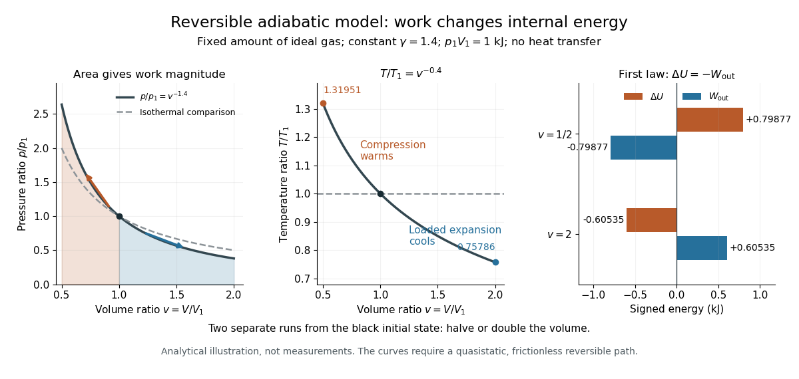

# Adiabatic compression

↑ **Parent:** [Adiabatic process](adiabatic-process.md)

[Adiabatic compression](adiabatic-compression.md) decreases the [volume](volume-thermodynamics.md) of a sample without [heat transfer](heat-transfer.md) across its boundary. For the fixed-composition [ideal gas](ideal-gas.md) and endpoint assumptions in [adiabatic process](adiabatic-process.md), compression [work](work.md) increases [internal energy](internal-energy.md); positive [heat capacity at constant volume](heat-capacity-at-constant-volume.md) then means a higher final [temperature](temperature.md). The effect comes from supplied [work](work.md), even though no [heat](heat.md) enters. The amount of [temperature](temperature.md) increase depends on the [work](work.md) actually delivered to the [gas](gas.md), not on the [adiabatic process](adiabatic-process.md) condition alone.

The [reversible ideal-gas adiabat](reversible-ideal-gas-adiabat.md) supplies a particularly useful quantitative benchmark. Assume a fixed [amount of substance](amount-of-substance.md) $n$, a [quasistatic process](quasistatic-process.md), negligible [friction](friction.md), only [pressure](pressure.md)-[volume](volume-thermodynamics.md) [work](work.md), and constant [heat capacity ratio](heat-capacity-ratio.md) $\gamma=C_p/C_V>1$. Here $C_p$ and $C_V$ are the whole sample's [heat capacity at constant pressure](heat-capacity-at-constant-pressure.md) and [heat capacity at constant volume](heat-capacity-at-constant-volume.md). With $R$ the [molar gas constant](molar-gas-constant.md), [Mayer's relation](mayer-s-relation.md) gives $C_V=nR/(\gamma-1)$. The proof outline is $C_V\,dT=-p\,dV$ from the [first law of thermodynamics](first-law-of-thermodynamics.md), followed by $p=nRT/V$ from the [ideal gas law](ideal-gas-law.md) and integration. The result is

$$
pV^\gamma=\text{constant},\qquad TV^{\gamma-1}=\text{constant}.
$$

These finite power laws belong to this reversible, constant-$\gamma$ [ideal gas](ideal-gas.md) model. If [heat capacity ratio](heat-capacity-ratio.md) varies, use the integral relation in [heat capacity ratio](heat-capacity-ratio.md); if the compression is irreversible, use the actual [work](work.md) balance, as in [irreversible adiabatic piston compression](irreversible-adiabatic-piston-compression.md). A short stroke by itself justifies neither power law. [Ling, Moebs and Sanny, University Physics Volume 2, §3.6: quasi-static ideal-gas adiabat](https://openstax.org/books/university-physics-volume-2/pages/3-6-adiabatic-processes-for-an-ideal-gas)

Writing $r=V_1/V_2>1$ for the compression ratio, the reversible model predicts

$$
\frac{T_2}{T_1}=r^{\gamma-1},\qquad
\frac{p_2}{p_1}=r^\gamma,\qquad
W_{\rm in}=-W_{\rm out}=C_V(T_2-T_1)
=\frac{p_1V_1}{\gamma-1}\left(r^{\gamma-1}-1\right).
$$

All [temperatures](temperature.md) in these ratios are absolute. The larger [pressure](pressure.md) rise than in an [isothermal compression](isothermal-compression.md), where $p_2/p_1=r$, explains the greater local stiffness described by [isentropic compressibility](isentropic-compressibility.md).

For an original stipulated example, set $\gamma=7/5$, $p_1V_1=nRT_1=1\,\mathrm{kJ}$ and $r=2$. Then $T_2/T_1=2^{0.4}\simeq1.31951$ and $p_2/p_1=2^{1.4}\simeq2.63902$. The input [work](work.md) and [internal energy](internal-energy.md) increase are both $0.79877\,\mathrm{kJ}$, while $Q_{\rm in}=0$. No initial [temperature](temperature.md) or apparatus performance is implied by the chosen [energy](energy.md) scale. Independent integration gives the signed outward [work](work.md)

$$
W_{\rm out}=\int_{V_1}^{V_2}p\,dV
=\frac{p_2V_2-p_1V_1}{1-\gamma},
$$

which is negative during compression and agrees with $-\Delta U$. This [integral](integral.md) uses equilibrium gas [pressure](pressure.md) only because the path is reversible.

**[Figure 58](#image-reversible-adiabatic-compression-and-adiabatic-expansion-temperature-changes-balance-signed-work). Reversible adiabatic compression and adiabatic expansion: temperature changes balance signed work**. Original analytical [ideal gas](ideal-gas.md) model with constant $\gamma=1.4$ and common initial state $p_1V_1=1\,\mathrm{kJ}$. The two runs go from $V_1$ separately to $V_1/2$ and $2V_1$; they are not a compression followed by its reversal. Shaded [pressure](pressure.md)-[volume](volume-thermodynamics.md) areas give [work](work.md) magnitudes, with signs supplied by the direction of motion. The dashed [isothermal process](isothermal-process.md) lines are comparisons, not additional [adiabatic processes](adiabatic-process.md). The right panel displays $\Delta U=-W_{\rm out}$ for each run. No curves are measured data.

In the sensor experiment of [adiabatic process](adiabatic-process.md), compare the [pressure](pressure.md)-[volume](volume-thermodynamics.md) [integral](integral.md) with $C_V\Delta T$ as an [energy](energy.md) check only when internal [pressure](pressure.md) is sufficiently uniform and piston dynamics permit that boundary-[work](work.md) estimate. Account for [friction](friction.md) separately before comparing it with hand input [work](work.md). PASCO's manual supplies a compression procedure and an illustrative logarithmic-slope result $1.39$, compared with the model value $1.40$ for a diatomic [gas](gas.md); that is its sample result, not new measurements here. [PASCO scientific, guide 012-05110D, pp. 5–6: work comparison and sample fitted exponent](https://cdn.pasco.com/product_document/Adiabatic-Gas-Law-Apparatus-TD-8565-Manual.pdf)

## ↑ Ancestors (7)

1. [Adiabatic process](adiabatic-process.md)
2. [First law of thermodynamics](first-law-of-thermodynamics.md)
3. [Thermodynamics](thermodynamics-split.md)
4. [Statistical physics](statistical-physics-split.md)
5. [Branches of physics](branches-of-physics.md)
6. [Physics](physics-split.md)
7. [Codex Wiki](split.md)

## ← Incoming links (10)

- [Adiabatic compression](adiabatic-compression.md)
- [Adiabatic process](adiabatic-process.md)
- [Carnot cycle](carnot-cycle.md)
- [Compressibility](compressibility.md)
- [Ideal gas law](ideal-gas-law.md)
- [Isentropic compressibility](isentropic-compressibility.md)
- [Isothermal compressibility](isothermal-compressibility.md)
- [Isothermal compression](isothermal-compression.md)
- [Isothermal gas syringe experiment](isothermal-gas-syringe-experiment.md)
- [Solution](past-exam-of-the-mathematics-course-of-the-university-of-cambridge/2017/ii/paper-3/34d/a/solution.md)
