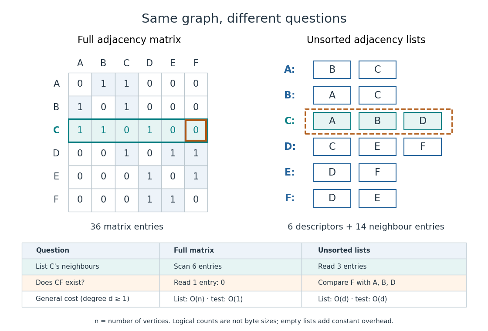

# Adjacency list storage and query costs

↑ **Parent:** [Adjacency list](adjacency-list.md)

Write $n=|V|$ and $m=|E|$. Suppose each [vertex](vertex-graph-theory.md) identifier, list descriptor, link and optional [edge](edge-of-a-graph.md) weight occupies a constant number of [machine words](machine-word.md), and indexed [array](array-data-structure.md) access and identifier comparison take constant time. There are $n$ list descriptors and $m$ directed, or $2m$ undirected, neighbour entries. Hence [adjacency lists](adjacency-list.md) use $O(n+m)$ [machine words](machine-word.md) in [Big O notation](big-o-notation.md). A full [adjacency matrix](adjacency-matrix.md) has $n^2$ entries, regardless of $m$. These are counts under a storage model, not fixed byte sizes.[Recitation 19, The Adjacency List and The Adjacency Matrix: directed and undirected entry totals, linear list storage, and quadratic full-matrix storage](recitation-19-graph-representations-and-traversals-cornell-course-page.md)

Our undirected example has six list descriptors and fourteen neighbour entries, versus thirty-six full [adjacency matrix](adjacency-matrix.md) entries. The numbers $20$ and $36$ count different kinds of logical items: they do not prove a particular byte saving. A [linked list](linked-list.md) also needs links; an [array](array-data-structure.md) may have unused capacity. Storing only half of a [symmetric matrix](symmetric-matrix.md) changes its exact count while leaving quadratic growth. If identifiers or weights require growing numbers of [machine words](machine-word.md), their size must be included in the [space complexity](space-complexity.md).

**[Figure 2](#image-adjacency-matrix-storage-and-queries-compared-with-adjacency-lists-on-the-same-six-vertex-graph). Adjacency matrix storage and queries compared with adjacency lists on the same six-vertex graph**.

An unsorted [adjacency list](adjacency-list.md) answers "does the [edge](edge-of-a-graph.md) $u\to v$ exist?" by [linear search](linear-search.md) through $\mathrm{Adj}[u]$. In the worst case it inspects all $d$ entries, giving $O(1+d)$ time, or $O(d)$ for $d\geq1$. Even if $v$ is absent, an uninspected entry could still contain it, so arbitrary lists require the whole scan. On our example, looking for $CF$ in $C$'s list compares $F$ with $A,B,D$ and fails after three comparisons. A full [adjacency matrix](adjacency-matrix.md) instead answers from its single $C,F$ entry in $O(1)$ time.[Recitation 19, The Adjacency List: edge-membership question; The Adjacency Matrix: constant-time edge-existence query](recitation-19-graph-representations-and-traversals-cornell-course-page.md)

Different promises change the query. A [sorted array](sorted-array.md) of neighbour identifiers permits [binary search](binary-search.md) in $O(\log(d+1))$ time, but maintaining order after insertion may require shifting entries. A per-[vertex](vertex-graph-theory.md) [hash table](hash-table.md) permits expected constant-time membership under the hashing and load assumptions of that [data structure](data-structure-split.md); it does not give that guarantee to an arbitrary [adjacency list](adjacency-list.md). A stored list length can likewise make a [vertex degree](degree-graph-theory.md) query constant-time even though [neighbour enumeration](neighbour-enumeration.md) still has to visit its entries.

The advantage grows with scale. For a [graph path](path-in-a-graph.md) on $n\geq2$ [vertices](vertex-graph-theory.md), $m=n-1$, so there are $2n-2$ undirected neighbour entries and $n$ descriptors, versus $n^2$ full [adjacency matrix](adjacency-matrix.md) entries. Such a family is a [sparse graph](sparse-graph.md) with $m=O(n)$. For a [complete graph](complete-graph.md), $m=n(n-1)/2$, so the undirected neighbour entries already number $n(n-1)$: the [adjacency list](adjacency-list.md) advantage in growth rate disappears. Choose by the workload: following existing [edges](edge-of-a-graph.md) favours [adjacency lists](adjacency-list.md); many arbitrary pair-membership queries can favour a full [adjacency matrix](adjacency-matrix.md). The representation organizes the same [graph](graph-split.md) for different questions.

## ↑ Ancestors (4)

1. [Adjacency list](adjacency-list.md)
2. [Data structure](data-structure-split.md)
3. [Computer science](computer-science-split.md)
4. [Codex Wiki](split.md)
