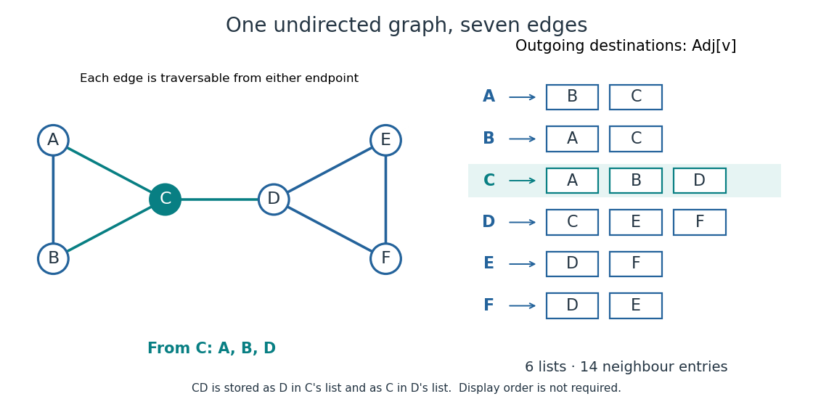

# Adjacency list

↑ **Parent:** [Data structure](data-structure-split.md)  
ⓦ [Wiki](https://en.wikipedia.org/wiki/Adjacency_list)

An [adjacency list](adjacency-list.md) represents a [graph](graph-split.md) by keeping, for each [vertex](vertex-graph-theory.md) $v$, a collection $\mathrm{Adj}[v]$ of the [vertices](vertex-graph-theory.md) reached by its outgoing [edges](edge-of-a-graph.md). An [array](array-data-structure.md) indexed by [vertex](vertex-graph-theory.md) identifiers can locate each collection; the collection itself may use a [linked list](linked-list.md) or an [array](array-data-structure.md). In an [undirected graph](undirected-graph.md), each nonloop [edge](edge-of-a-graph.md) supplies an entry at both endpoints.[Graph.java, class documentation and fields: vertex-indexed adjacency collections; addEdge: entries at both endpoints](algorithms-4th-edition-by-robert-sedgewick-and-others/graph-java.md)

For a worked example, take the [simple graph](simple-graph.md)

$$
V=\{A,B,C,D,E,F\},\qquad E=\{AB,AC,BC,CD,DE,DF,EF\},
$$

where $AB$ denotes the [unordered pair](unordered-pair.md) $\{A,B\}$. Its [adjacency lists](adjacency-list.md), displayed in label order, are

$$
\begin{aligned}
\mathrm{Adj}[A]&=(B,C), & \mathrm{Adj}[B]&=(A,C), & \mathrm{Adj}[C]&=(A,B,D),\\
\mathrm{Adj}[D]&=(C,E,F), & \mathrm{Adj}[E]&=(D,F), & \mathrm{Adj}[F]&=(D,E).
\end{aligned}
$$

Thus $C$ has three [neighbours](neighbour-of-a-vertex.md), although the [graph](graph-split.md) has six [vertices](vertex-graph-theory.md). Its list contains exactly the destinations available for a single step from $C$; no slots are reserved there for $C,E,F$. The fourteen neighbour entries represent seven [edges](edge-of-a-graph.md), with $CD$ appearing as $D$ in $C$'s list and as $C$ in $D$'s list. The label order makes the example easy to read; an [adjacency list](adjacency-list.md) need not be sorted.

**[Figure 1](#image-seven-undirected-edges-and-their-fourteen-adjacency-list-entries). Seven undirected edges and their fourteen adjacency list entries**.

The useful idea is to store existing connections explicitly. [Neighbour enumeration](neighbour-enumeration.md) can then follow exactly the possible next steps, which is what [breadth-first search](breadth-first-search.md) and [depth-first search](depth-first-search.md) need. In a [sparse graph](sparse-graph.md), most pairs of [vertices](vertex-graph-theory.md) have no [edge](edge-of-a-graph.md); [adjacency lists](adjacency-list.md) avoid reserving a separate [adjacency matrix](adjacency-matrix.md) entry for every such absence. Whether this saves work depends on the question: [neighbour enumeration](neighbour-enumeration.md) and testing one proposed [edge](edge-of-a-graph.md) have different costs.

**Table of contents**

- [Adjacency list edge conventions](adjacency-list-edge-conventions.md)
- [Neighbour enumeration](neighbour-enumeration.md)
- [Adjacency list storage and query costs](adjacency-list-storage-and-query-costs.md)

## ↑ Ancestors (3)

1. [Data structure](data-structure-split.md)
2. [Computer science](computer-science-split.md)
3. [Codex Wiki](split.md)

## ← Incoming links (19)

- [Adjacency list](adjacency-list.md)
- [Adjacency list edge conventions](adjacency-list-edge-conventions.md)
- [Adjacency list storage and query costs](adjacency-list-storage-and-query-costs.md)
- [Bipartite graph](bipartite-graph-split.md)
- [Breadth-first search](breadth-first-search.md)
- [Cached cell value](cached-cell-value.md)
- [Call stack](call-stack.md)
- [Conditional expectations algorithm cost](conditional-expectations-algorithm-cost.md)
- [Cut vertex](cut-vertex.md)
- [Depth-first search](depth-first-search.md)
- [DFS lowpoint](dfs-lowpoint.md)
- [Dijkstra algorithm](dijkstra-algorithm.md)
- [Hierholzer's algorithm](hierholzer-s-algorithm.md)
- [Kahn's algorithm](kahn-s-algorithm.md)
- [Leaf pruning for the 2-core](leaf-pruning-for-the-2-core.md)
- [Machine word](machine-word.md)
- [Neighbour enumeration](neighbour-enumeration.md)
- [Perfect elimination ordering](perfect-elimination-ordering.md)
- [Sparse graph](sparse-graph.md)
