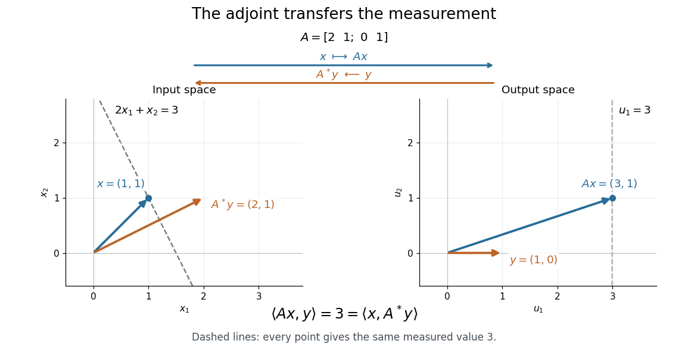

# Adjoint operator

↑ **Parent:** [Riesz representation theorem](riesz-representation-theorem.md)  
ⓦ [Wiki](https://en.wikipedia.org/wiki/Adjoint_operator)

For a [bounded linear operator](continuous-linear-operator.md) $T:H\to K$ between real or complex [Hilbert spaces](hilbert-space-split.md), its adjoint is the unique [bounded linear operator](continuous-linear-operator.md) $T^*:K\to H$ satisfying

$$
\langle Tx,y\rangle_K=\langle x,T^*y\rangle_H\qquad(x\in H,\ y\in K).
$$

The [inner product](inner-product.md) here is linear in its first argument. The [adjoint operator](adjoint-operator.md) transfers an output measurement back to the input: measuring $Tx$ against the [vector](vector.md) $y$ gives exactly the same scalar as measuring $x$ against $T^*y$. It depends on both [inner products](inner-product.md).

**[Figure 3](#image-the-adjoint-transfers-a-measurement-direction-while-preserving-its-measured-value). The adjoint transfers a measurement direction while preserving its measured value**.

In this real example,

$$
A=\begin{pmatrix}2&1\\0&1\end{pmatrix},\quad x=\begin{pmatrix}1\\1\end{pmatrix},\quad y=\begin{pmatrix}1\\0\end{pmatrix},\quad Ax=\begin{pmatrix}3\\1\end{pmatrix},\quad A^*y=\begin{pmatrix}2\\1\end{pmatrix}.
$$

Both [inner products](inner-product.md) equal $3$. The dashed lines collect all [vectors](vector.md) giving that same measurement: the output line $u_1=3$ becomes the input line $2x_1+x_2=3$. The [adjoint operator](adjoint-operator.md) therefore moves the direction that describes the measurement. It generally differs from the [inverse matrix](matrix-inverse.md): here $A^{-1}y=(1/2,0)^{\mathrm T}$.

For an explicitly complex example, use the standard [inner product](inner-product.md) $\langle u,v\rangle=\sum_j u_j\overline{v_j}$ on $\mathbb C^2$. In the standard [orthonormal basis](orthonormal-basis.md), the [adjoint operator](adjoint-operator.md) is represented by the [conjugate transpose](conjugate-transpose.md):

$$
T=\begin{pmatrix}1&i\\2&1-i\end{pmatrix},\qquad T^*=\begin{pmatrix}1&2\\-i&1+i\end{pmatrix}.
$$

For $x=(1+i,2)^{\mathrm T}$ and $y=(1,i)^{\mathrm T}$, direct [matrix multiplication](matrix-multiplication.md) gives

$$
Tx=\begin{pmatrix}1+3i\\4\end{pmatrix},\qquad T^*y=\begin{pmatrix}1+2i\\-1\end{pmatrix},
$$

and hence

$$
\langle Tx,y\rangle=(1+3i)+4(-i)=1-i,\qquad \langle x,T^*y\rangle=(1+i)(1-2i)-2=1-i.
$$

The [complex conjugate](complex-conjugate.md) is essential to this agreement.

Existence follows from the [Riesz representation theorem](riesz-representation-theorem.md): for fixed $y$, the bounded [linear functional](linear-functional.md) $x\mapsto\langle Tx,y\rangle$ has a unique representing [vector](vector.md) $T^*y$. The resulting [adjoint operator](adjoint-operator.md) has the same [operator norm](operator-norm.md) as $T$, and

$$
\|T^*\|=\|T\|,\qquad \|T^*T\|=\|T\|^2.
$$

MIT's lecture 18 develops the representation argument and the [conjugate transpose](conjugate-transpose.md) example.[Rodriguez, notes by Andrew Lin, MIT 18.102, lecture 18, Theorem 185 and Example 186, 2021](https://ocw.mit.edu/courses/18-102-introduction-to-functional-analysis-spring-2021/7f23bfc43ee2e1efd238a5384e5b9d51_MIT18_102s21_lec18.pdf)

This transfer explains the [normal equation for a linear inverse problem](normal-equation-for-a-linear-inverse-problem.md): a [least-squares solution](least-squares-solution-of-a-linear-inverse-problem.md) has residual $Tx-b$ [orthogonal](orthogonal-vectors.md) to every attainable direction $Th$, so $\langle h,T^*(Tx-b)\rangle=0$ for every $h$, equivalently $T^*Tx=T^*b$. An output residual becomes an input condition through the same [adjoint operator](adjoint-operator.md). All identities in this section concern [bounded operators](continuous-linear-operator.md) defined on the whole source [Hilbert space](hilbert-space-split.md); for a [densely defined operator](densely-defined-operator.md) that is not bounded, use the [adjoint of a densely defined operator](adjoint-of-a-densely-defined-operator.md) and check its [operator domain](operator-domain.md).

**Table of contents**

- [Adjoint in weighted coordinates](adjoint-in-weighted-coordinates.md)
- [Adjoint of a densely defined operator](adjoint-of-a-densely-defined-operator.md)
- [Adjoint of a commutator](adjoint-of-a-commutator.md)
- [Symmetric operator](symmetric-operator.md)
  - [Two-endpoint symmetric derivative has whole complex spectrum](two-endpoint-symmetric-derivative-has-whole-complex-spectrum.md)
- [Image-kernel orthogonality for an adjoint](image-kernel-orthogonality-for-an-adjoint.md)
- [Invertibility from lower bounds on an operator and its adjoint](invertibility-from-lower-bounds-on-an-operator-and-its-adjoint.md)
- [Hermitian conjugation](hermitian-conjugation.md)
- [Formal adjoint](formal-adjoint.md)
  - [Boundary terms exclude formal adjoint eigenvectors](boundary-terms-exclude-formal-adjoint-eigenvectors.md)
  - [Adjoint reciprocity for a weighted Helmholtz operator](adjoint-reciprocity-for-a-weighted-helmholtz-operator.md)
  - [Complete boundary-jet condition for formal adjoints](complete-boundary-jet-condition-for-formal-adjoints.md)
- [Hermitian operator](hermitian-operator.md)
  - [Hermitian quadratic form](hermitian-quadratic-form.md)
  - [Hermitian part of a matrix](hermitian-part-of-a-matrix.md)
  - [Determinant of Hermitian congruence](determinant-of-hermitian-congruence.md)
  - [Positive operator](positive-operator.md)
    - [Positive definite symmetric operator](positive-definite-symmetric-operator.md)
      - [Quadratic variational principle for a symmetric positive operator](quadratic-variational-principle-for-a-symmetric-positive-operator.md)
        - [Symmetric part determines a real quadratic functional](symmetric-part-determines-a-real-quadratic-functional.md)
      - [Uniformly positive definite symmetric operator](uniformly-positive-definite-symmetric-operator.md)
    - [Positive contraction](positive-contraction.md)
    - [Support of a positive operator](support-of-a-positive-operator.md)
    - [Positive square root of an operator](positive-square-root-of-an-operator.md)
  - [Positive-negative decomposition of a Hermitian operator](positive-negative-decomposition-of-a-hermitian-operator.md)
    - [Negative part of a Hermitian operator](negative-part-of-a-hermitian-operator.md)
    - [Positive part of a Hermitian operator](positive-part-of-a-hermitian-operator.md)
  - [Löwner order](lowner-order.md)
    - [Operator monotonicity of the square root](operator-monotonicity-of-the-square-root.md)
- [Adjoint criterion for an invariant orthogonal complement](adjoint-criterion-for-an-invariant-orthogonal-complement.md)
- [Normal operator](normal-operator.md)
  - [Normal spectrum equals approximate point spectrum](normal-spectrum-equals-approximate-point-spectrum.md)
  - [Spectral theorem](spectral-theorem.md)
    - [Spectral theorem for normal operators](spectral-theorem-for-normal-operators.md)
      - [Finite commuting normal operators have joint spectral projections](finite-commuting-normal-operators-have-joint-spectral-projections.md)
      - [Spectral matrix functional calculus](spectral-matrix-functional-calculus.md)
      - [Spectral theorem for normal operators on a separable Hilbert space](spectral-theorem-for-normal-operators-on-a-separable-hilbert-space.md)
        - [Weyl-von Neumann theorem](weyl-von-neumann-theorem.md)
          - [Classification of separable self-adjoint operators modulo compacts](classification-of-separable-self-adjoint-operators-modulo-compacts.md)
        - [Projection-valued measure](projection-valued-measure.md)
          - [Cyclic multiplication model for a normal operator](cyclic-multiplication-model-for-a-normal-operator.md)
          - [Scalar-measure construction of a projection-valued measure](scalar-measure-construction-of-a-projection-valued-measure.md)
          - [Spectral theorem for a commutative operator algebra](spectral-theorem-for-a-commutative-operator-algebra.md)
            - [Full support of a faithful spectral measure](full-support-of-a-faithful-spectral-measure.md)
          - [Spectral projector](spectral-projector.md)
        - [Spectral measure of a normal operator](spectral-measure-of-a-normal-operator.md)
          - [Spectral projection gives a reducing subspace](spectral-projection-gives-a-reducing-subspace.md)
          - [Scalar spectral measure](scalar-spectral-measure.md)
            - [Weak convergence of scalar spectral measures](weak-convergence-of-scalar-spectral-measures.md)
          - [Stone formula](stone-formula.md)

## ↑ Ancestors (7)

1. [Riesz representation theorem](riesz-representation-theorem.md)
2. [Hilbert space](hilbert-space-split.md)
3. [Functional analysis](functional-analysis-split.md)
4. [Analysis](analysis-split.md)
5. [Area of mathematics](area-of-mathematics.md)
6. [Mathematics](mathematics-split.md)
7. [Codex Wiki](split.md)

## ← Incoming links (77)

- [Adjoint eigenfunction](adjoint-eigenfunction.md)
- [Adjoint in weighted coordinates](adjoint-in-weighted-coordinates.md)
- [Adjoint operator](adjoint-operator.md)
- [Adjoint source-to-far-field operator](adjoint-source-to-far-field-operator.md)
- [Complementarity from two directed subspace angles](complementarity-from-two-directed-subspace-angles.md)
- [Densely defined operator](densely-defined-operator.md)
- [Discrete isotropic total variation](discrete-isotropic-total-variation.md)
- [Double commutant theorem for star-algebras](double-commutant-theorem-for-star-algebras.md)
- [Formal adjoint of the worldsheet conformal Killing operator](formal-adjoint-of-the-worldsheet-conformal-killing-operator.md)
- [Formal transpose of a differential operator](formal-transpose-of-a-differential-operator.md)
- [Gradient superpotential Hamiltonian in supersymmetric quantum mechanics](gradient-superpotential-hamiltonian-in-supersymmetric-quantum-mechanics.md)
- [Hermitian conjugation](hermitian-conjugation.md)
- [Hermitian operator](hermitian-operator.md)
- [Image-kernel orthogonality for an adjoint](image-kernel-orthogonality-for-an-adjoint.md)
- [Kinetic-energy inner product](kinetic-energy-inner-product.md)
- [Left shift operator](left-shift-operator.md)
- [Nonnegativity of the Hodge Laplacian](nonnegativity-of-the-hodge-laplacian.md)
- [Normal equation for coercive Tikhonov regularization](normal-equation-for-coercive-tikhonov-regularization.md)
- [Operator norm duality](operator-norm-duality.md)
- [Solution](past-exam-of-the-mathematics-course-of-the-university-of-cambridge/2002/ib/paper-2/17f/solution.md)
- [Solution](past-exam-of-the-mathematics-course-of-the-university-of-cambridge/2003/ib/paper-3/19g/b/solution.md)
- [Solution](past-exam-of-the-mathematics-course-of-the-university-of-cambridge/2007/iii/paper-15/5/a/solution.md)
- [Solution](past-exam-of-the-mathematics-course-of-the-university-of-cambridge/2009/iii/paper-42/1/solution.md)
- [Solution](past-exam-of-the-mathematics-course-of-the-university-of-cambridge/2010/iii/paper-7/2/b/solution.md)
- [Solution](past-exam-of-the-mathematics-course-of-the-university-of-cambridge/2010/iii/paper-7/4/c/solution.md)
- [Solution](past-exam-of-the-mathematics-course-of-the-university-of-cambridge/2010/iii/paper-7/4/d/solution.md)
- [Solution](past-exam-of-the-mathematics-course-of-the-university-of-cambridge/2010/iii/paper-70/4/c/solution.md)
- [Solution](past-exam-of-the-mathematics-course-of-the-university-of-cambridge/2012/iii/paper-7/3/b/solution.md)
- [Solution](past-exam-of-the-mathematics-course-of-the-university-of-cambridge/2012/iii/paper-7/3/c/solution.md)
- [Solution](past-exam-of-the-mathematics-course-of-the-university-of-cambridge/2012/iii/paper-7/3/f/solution.md)
- [Solution](past-exam-of-the-mathematics-course-of-the-university-of-cambridge/2012/iii/paper-78/4/c/i/solution.md)
- [Solution](past-exam-of-the-mathematics-course-of-the-university-of-cambridge/2013/iii/paper-36/3/c/solution.md)
- [Solution](past-exam-of-the-mathematics-course-of-the-university-of-cambridge/2013/iii/paper-36/4/a/solution.md)
- [Solution](past-exam-of-the-mathematics-course-of-the-university-of-cambridge/2013/iii/paper-9/1/b/solution.md)
- [Solution](past-exam-of-the-mathematics-course-of-the-university-of-cambridge/2014/iii/paper-68/2/solution.md)
- [Solution](past-exam-of-the-mathematics-course-of-the-university-of-cambridge/2015/ii/paper-4/19g/solution.md)
- [Solution](past-exam-of-the-mathematics-course-of-the-university-of-cambridge/2015/iii/paper-17/5/solution.md)
- [Solution](past-exam-of-the-mathematics-course-of-the-university-of-cambridge/2015/iii/paper-7/1/solution.md)
- [Solution](past-exam-of-the-mathematics-course-of-the-university-of-cambridge/2015/iii/paper-76/3/a/solution.md)
- [Solution](past-exam-of-the-mathematics-course-of-the-university-of-cambridge/2016/ib/paper-2/17b/d/solution.md)
- [Solution](past-exam-of-the-mathematics-course-of-the-university-of-cambridge/2016/ib/paper-3/10f/ii/solution.md)
- [Solution](past-exam-of-the-mathematics-course-of-the-university-of-cambridge/2016/ib/paper-4/10f/a/solution.md)
- [Solution](past-exam-of-the-mathematics-course-of-the-university-of-cambridge/2016/ib/paper-4/10f/b/solution.md)
- [Solution](past-exam-of-the-mathematics-course-of-the-university-of-cambridge/2016/iii/paper-102/2/solution.md)
- [Solution](past-exam-of-the-mathematics-course-of-the-university-of-cambridge/2016/iii/paper-111/4/i/solution.md)
- [Solution](past-exam-of-the-mathematics-course-of-the-university-of-cambridge/2016/iii/paper-326/1/ii/solution.md)
- [Solution](past-exam-of-the-mathematics-course-of-the-university-of-cambridge/2016/iii/paper-326/3/ii/solution.md)
- [Solution](past-exam-of-the-mathematics-course-of-the-university-of-cambridge/2016/iii/paper-331/4/a/solution.md)
- [Solution](past-exam-of-the-mathematics-course-of-the-university-of-cambridge/2016/iii/paper-335/2/b/solution.md)
- [Solution](past-exam-of-the-mathematics-course-of-the-university-of-cambridge/2017/iii/paper-326/4/5/solution.md)
- [Solution](past-exam-of-the-mathematics-course-of-the-university-of-cambridge/2017/iii/paper-340/5/a/solution.md)
- [Solution](past-exam-of-the-mathematics-course-of-the-university-of-cambridge/2017/iii/paper-340/5/b/solution.md)
- [Solution](past-exam-of-the-mathematics-course-of-the-university-of-cambridge/2018/iii/paper-326/1/1/2/e/solution.md)
- [Solution](past-exam-of-the-mathematics-course-of-the-university-of-cambridge/2018/iii/paper-335/3/ii/solution.md)
- [Solution](past-exam-of-the-mathematics-course-of-the-university-of-cambridge/2018/iii/paper-340/5/c/solution.md)
- [Solution](past-exam-of-the-mathematics-course-of-the-university-of-cambridge/2019/ib/paper-4/10f/solution.md)
- [Solution](past-exam-of-the-mathematics-course-of-the-university-of-cambridge/2019/ii/paper-4/23h/b/solution.md)
- [Solution](past-exam-of-the-mathematics-course-of-the-university-of-cambridge/2019/iii/paper-350/3/b/solution.md)
- [Solution](past-exam-of-the-mathematics-course-of-the-university-of-cambridge/2020/ii/paper-1/34a/solution.md)
- [Solution](past-exam-of-the-mathematics-course-of-the-university-of-cambridge/2021/ii/paper-4/22h/a/solution.md)
- [Solution](past-exam-of-the-mathematics-course-of-the-university-of-cambridge/2022/ib/paper-1/8f/a/i/solution.md)
- [Solution](past-exam-of-the-mathematics-course-of-the-university-of-cambridge/2023/iii/paper-335/3/iii/solution.md)
- [Solution](past-exam-of-the-mathematics-course-of-the-university-of-cambridge/2025/ii/paper-4/22i/a/solution.md)
- [Solution](past-exam-of-the-mathematics-course-of-the-university-of-cambridge/2025/iii/paper-106/3/c/solution.md)
- [Solution](past-exam-of-the-mathematics-course-of-the-university-of-cambridge/2025/iii/paper-335/2/ii/solution.md)
- [Poisson data fidelity](poisson-data-fidelity.md)
- [Positive-definite operator](positive-definite-operator.md)
- [Self-adjoint operator](self-adjoint-operator.md)
- [Sobolev duality](sobolev-duality.md)
- [Source-condition certification of a penalty-minimizing solution](source-condition-certification-of-a-penalty-minimizing-solution.md)
- [Source condition for quadratic regularization](source-condition-for-quadratic-regularization.md)
- [Star-subalgebra](star-subalgebra.md)
- [Strict dual certificate for basis pursuit](strict-dual-certificate-for-basis-pursuit.md)
- [Symmetric operator](symmetric-operator.md)
- [Tikhonov regularization](tikhonov-regularization.md)
- [Transpose of a linear map](transpose-of-a-linear-map.md)
- [Unbounded self-adjoint operator](unbounded-self-adjoint-operator.md)
