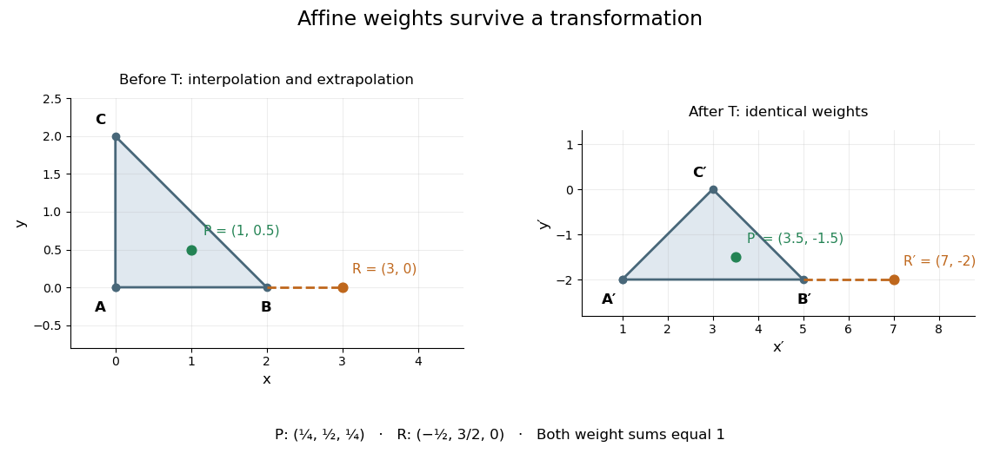

# Affine combination

↑ **Parent:** [Affine space](affine-space.md)  
ⓦ [Wiki](https://en.wikipedia.org/wiki/Affine_combination)

An [affine combination](affine-combination.md) is a weighted point $P=\sum_{i=0}^k\lambda_iP_i$ with $\sum_{i=0}^k\lambda_i=1$. The coefficients can be negative. The sum is meaningful in an [affine space](affine-space.md) without selecting a preferred origin: relative to any point $O$, it means $P=O+\sum_i\lambda_i(P_i-O)$. [Affine maps](affine-map.md) preserve these weighted points. [§2.4, Lemma 2.4.1, pp. 23–24; §2.7, Definition 2.7.1, p. 37](curves-and-surfaces-in-geometric-modeling-theory-and-algorithms-by-jean-gallier.md)

For an original example in the [Euclidean plane](euclidean-plane.md), take $A=(0,0)$, $B=(2,0)$ and $C=(0,2)$. Then $P=\tfrac14 A+\tfrac12 B+\tfrac14 C=(1,\tfrac12)$ lies inside their [triangle](triangle.md). Its coefficients are nonnegative, making it a [convex combination](convex-combination.md). In contrast, $R=-\tfrac12 A+\tfrac32 B=(3,0)$ is beyond $B$: it is an [affine combination](affine-combination.md) but not a [convex combination](convex-combination.md) of these three points. Negative weights allow [extrapolation](extrapolation.md), rather than only [interpolation](interpolation-split.md) inside the [convex hull](convex-hull.md).

For the [affine map](affine-map.md) $T(x,y)=(2x+y+1,y-2)$, the same weights produce $T(P)=(\tfrac72,-\tfrac32)$ from $T(A),T(B),T(C)$, and produce $T(R)=(7,-2)$ from $T(A),T(B)$. Thus one can compute a weighted point before transforming the vertices or afterwards, obtaining exactly the same point.

**[Figure 6](#image-positive-and-signed-affine-weights-before-and-after-a-transformation). Positive and signed affine weights before and after a transformation**. The green point has weights $(1/4,1/2,1/4)$ and stays inside the transformed [triangle](triangle.md). The orange point has weights $(-1/2,3/2,0)$ and lies beyond the corresponding edge endpoint. These are original coordinate examples; the same weights are used in both panels.

This is useful whenever an object is built from weighted control points: its construction commutes with an [affine map](affine-map.md), so transforming the control points transforms the constructed object as well. The [sum](sum.md) of the weights is the essential condition; no assumption about [lengths](length.md) or [angles](angle.md) is needed.

**Table of contents**

- [Affine combinations are independent of the chosen origin](affine-combinations-are-independent-of-the-chosen-origin.md)

## ↑ Ancestors (6)

1. [Affine space](affine-space.md)
2. [Affine geometry](affine-geometry.md)
3. [Geometry and topology](geometry-and-topology-split.md)
4. [Area of mathematics](area-of-mathematics.md)
5. [Mathematics](mathematics-split.md)
6. [Codex Wiki](split.md)

## ← Incoming links (10)

- [Affine combination](affine-combination.md)
- [Affine map](affine-map.md)
- [Control-point influence on a curve](control-point-influence-on-a-curve.md)
- [Extrapolation](extrapolation.md)
- [Jensen's inequality](jensen-s-inequality.md)
- [Solution](past-exam-of-the-mathematics-course-of-the-university-of-cambridge/2001/iii/paper-56/2/solution.md)
- [Solution](past-exam-of-the-mathematics-course-of-the-university-of-cambridge/2005/iii/paper-43/4/solution.md)
- [Solution](past-exam-of-the-mathematics-course-of-the-university-of-cambridge/2006/iii/paper-66/6/b/solution.md)
- [Solution](past-exam-of-the-mathematics-course-of-the-year-1-of-the-natural-sciences-course-of-the-university-of-cambridge/2006/paper-1/5/d/solution.md)
- [Symmetry depends on preserved structure](symmetry-depends-on-preserved-structure.md)
