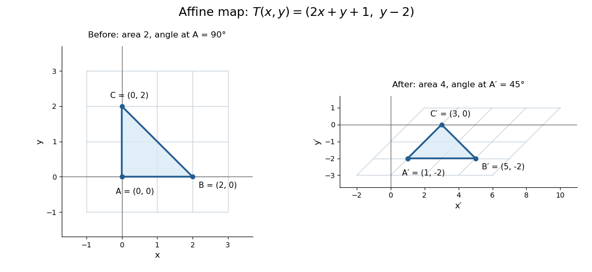

# Affine map

↑ **Parent:** [Affine space](affine-space.md)

An [affine map](affine-map.md) combines a [linear map](linear-map.md) with a [translation](translation-geometry.md). After choosing coordinate origins, it has the form $T:\mathbb R^p\to\mathbb R^q$, $T(x)=Mx+b$, where the $q\times p$ [matrix](matrix.md) $M$ is its [linear part of an affine map](linear-part-of-an-affine-map.md) and $b$ is a fixed [vector](vector.md). Equivalently, it preserves every [affine combination](affine-combination.md). [§2.7, Definition 2.7.1 and linear-map construction, pp. 37–38](curves-and-surfaces-in-geometric-modeling-theory-and-algorithms-by-jean-gallier.md)

An original planar example is

$$
T(x,y)=(2x+y+1,y-2),\qquad M=\begin{pmatrix}2&1\\0&1\end{pmatrix},\qquad b=\begin{pmatrix}1\\-2\end{pmatrix}.
$$

It stretches horizontally, applies a [shear mapping](shear-mapping.md), and then translates. The vertices $A=(0,0)$, $B=(2,0)$ and $C=(0,2)$ become $A'=(1,-2)$, $B'=(5,-2)$ and $C'=(3,0)$. A [square grid](square-grid.md) becomes a grid of [parallelograms](parallelogram.md); straight edges and their weighted points still fit together.

**[Figure 7](#image-an-affine-map-preserves-straightness-while-changing-lengths-and-angles). An affine map preserves straightness while changing lengths and angles**. An original [triangle](triangle.md) and finite window of a [square grid](square-grid.md), followed by their images under $T(x,y)=(2x+y+1,y-2)$. The right-hand grid is the transformed left-hand grid. Equal axis scales make the altered [lengths](length.md) and [angles](angle.md) visible.

This map is not a [linear map](linear-map.md) with respect to the displayed origins, because $T(0,0)=(1,-2)$ rather than zero. It also is not a [Euclidean similarity](euclidean-similarity.md): $AB$ has [length](length.md) $2$ and $A'B'$ has [length](length.md) $4$, while the right [angle](angle.md) at $A$ becomes $45^\circ$. Its [determinant](determinant.md) is $2$, so it doubles planar [area](surface-area.md). These metric changes explain why [affine geometry](affine-geometry.md) studies straightness, incidence and weighted points rather than treating every transformation as an [isometry](isometry.md).

The linear part is an [invertible matrix](invertible-matrix.md), giving the concise inverse **$T^{-1}(u,v)=((u-v-3)/2,v+2)$**. More generally an [affine map](affine-map.md) is [bijective](bijection.md) exactly when its [linear part of an affine map](linear-part-of-an-affine-map.md) is [bijective](bijection.md). Between equal finite-dimensional spaces, this means an [invertible matrix](invertible-matrix.md); the [translation](translation-geometry.md) cannot repair a loss of [rank of a linear map](rank-of-a-linear-map.md).

**Table of contents**

- [Affine maps preserve affine combinations](affine-maps-preserve-affine-combinations.md)
- [Affine maps can collapse lines](affine-maps-can-collapse-lines.md)
- [Euclidean similarity](euclidean-similarity.md)
- [Linear part of an affine map](linear-part-of-an-affine-map.md)

## ↑ Ancestors (6)

1. [Affine space](affine-space.md)
2. [Affine geometry](affine-geometry.md)
3. [Geometry and topology](geometry-and-topology-split.md)
4. [Area of mathematics](area-of-mathematics.md)
5. [Mathematics](mathematics-split.md)
6. [Codex Wiki](split.md)

## ← Incoming links (38)

- [Affine combination](affine-combination.md)
- [Affine equivariance of a geometric basis](affine-equivariance-of-a-geometric-basis.md)
- [Affine group](affine-group.md)
- [Affine image of a circle](affine-image-of-a-circle.md)
- [Affine map](affine-map.md)
- [Affine maps can collapse lines](affine-maps-can-collapse-lines.md)
- [Bézier curve](bezier-curve.md)
- [Brouwer fixed-point theorem](brouwer-fixed-point-theorem.md)
- [Chaikin subdivision](chaikin-subdivision.md)
- [Closest point on a plane](closest-point-on-a-plane.md)
- [Constant function](constant-function.md)
- [Control-point influence on a curve](control-point-influence-on-a-curve.md)
- [De Casteljau's algorithm](de-casteljau-s-algorithm.md)
- [Ellipse](ellipse.md)
- [Fixed point of a finite Euclidean isometry group](fixed-point-of-a-finite-euclidean-isometry-group.md)
- [General conical surface](general-conical-surface.md)
- [Integral of an affine function over a simplex](integral-of-an-affine-function-over-a-simplex.md)
- [Linear part of an affine map](linear-part-of-an-affine-map.md)
- [Multilayer perceptron](multilayer-perceptron.md)
- [Solution](past-exam-of-the-chemistry-course-of-the-year-4-of-the-natural-sciences-course-of-the-university-of-cambridge/2022/paper-3/section-f/47/d/solution.md)
- [Solution](past-exam-of-the-mathematics-course-of-the-university-of-cambridge/2001/iii/paper-31/1/solution.md)
- [Solution](past-exam-of-the-mathematics-course-of-the-university-of-cambridge/2001/iii/paper-53/1/c/solution.md)
- [Solution](past-exam-of-the-mathematics-course-of-the-university-of-cambridge/2001/iii/paper-56/2/solution.md)
- [Solution](past-exam-of-the-mathematics-course-of-the-university-of-cambridge/2002/iii/paper-59/3/solution.md)
- [Solution](past-exam-of-the-mathematics-course-of-the-university-of-cambridge/2005/iii/paper-66/4/iv/solution.md)
- [Solution](past-exam-of-the-mathematics-course-of-the-university-of-cambridge/2006/iii/paper-66/1/solution.md)
- [Solution](past-exam-of-the-mathematics-course-of-the-university-of-cambridge/2006/iii/paper-66/5/a/solution.md)
- [Solution](past-exam-of-the-mathematics-course-of-the-university-of-cambridge/2006/iii/paper-66/5/f/solution.md)
- [Solution](past-exam-of-the-mathematics-course-of-the-university-of-cambridge/2007/iii/paper-49/3/solution.md)
- [Solution](past-exam-of-the-mathematics-course-of-the-university-of-cambridge/2007/iii/paper-88/2/i/solution.md)
- [Solution](past-exam-of-the-mathematics-course-of-the-university-of-cambridge/2008/ii/paper-1/3g/solution.md)
- [Solution](past-exam-of-the-mathematics-course-of-the-year-1-of-the-natural-sciences-course-of-the-university-of-cambridge/2006/paper-2/11/b/solution.md)
- [Quadrature node](quadrature-node.md)
- [Second derivatives under a two-variable coordinate change](second-derivatives-under-a-two-variable-coordinate-change.md)
- [Square grid](square-grid.md)
- [Symmetry depends on preserved structure](symmetry-depends-on-preserved-structure.md)
- [Vector graphics](vector-graphics.md)
- [Zonotope](zonotope.md)
