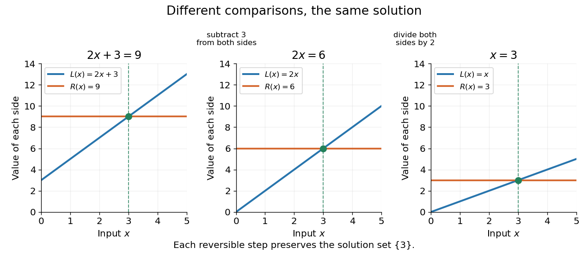
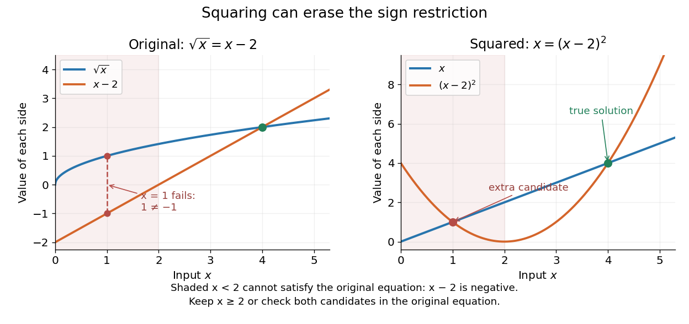
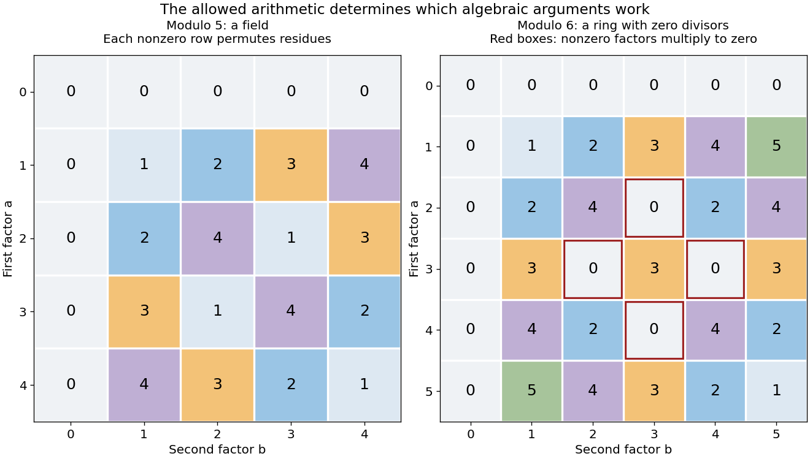
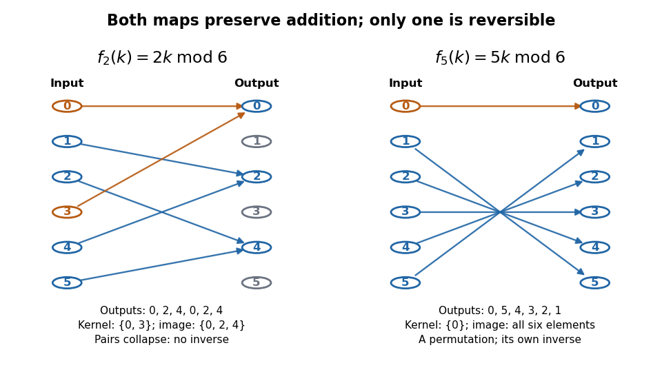
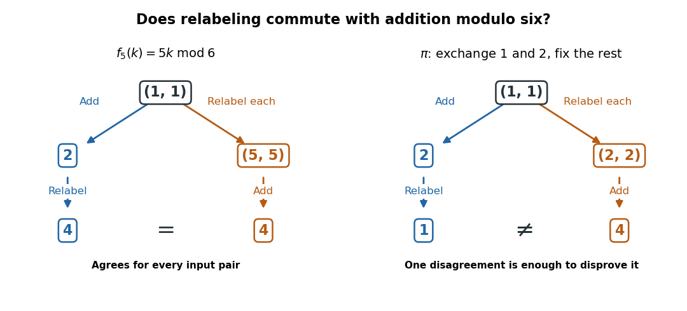
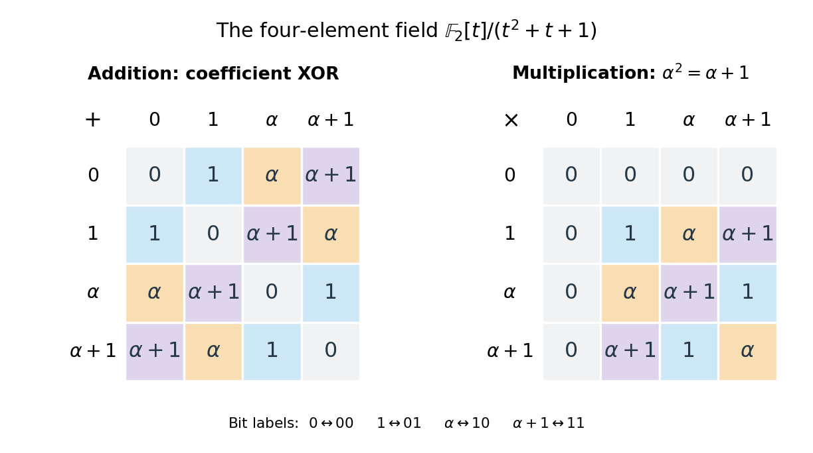
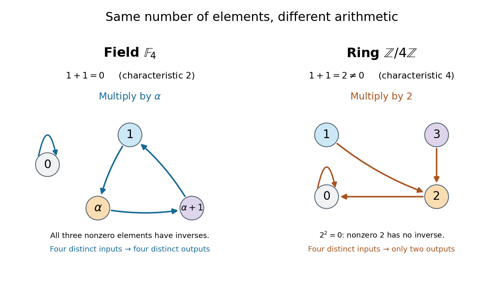

# Algebra

↑ **Parent:** [Area of mathematics](mathematics.md#area-of-mathematics)  
ⓦ [Wiki](https://en.wikipedia.org/wiki/Algebra)

Algebra studies [equations](#equation), [algebraic operations](algebraic-operation.md), and the structures that make their rules work. Its elementary side expresses unknown quantities through [variables](mathematics.md#variable-mathematics) and transforms [mathematical expressions](#expression-mathematics); its structural side asks which arguments apply to whole families of [groups](group.md), [rings](commutative-algebra.md#ring), [fields](#field), and [vector spaces](vector-space.md). The useful step is identifying exactly which properties a calculation needs, so that it can be reused in a new setting.

For example, the [polynomial equation](polynomial.md#polynomial-equation) $x^2-3x+2=0$ over the [real numbers](arithmetic.md#real-number) factors as $(x-1)(x-2)=0$, giving roots $1$ and $2$. The [distributive property](algebraic-operation.md#distributive-property) justifies the factorization, while the absence of [zero divisors](mathematics.md#zero-divisor) justifies concluding that one factor must vanish. Over the [finite field](#finite-field) $\mathbb F_2$, the same integer coefficients reduce to $x^2+x=x(x+1)$, with roots $0$ and $1$. The symbols alone do not specify the arithmetic: the coefficient [field](#field) is part of the problem.

In a [ring](commutative-algebra.md#ring) with [zero divisors](mathematics.md#zero-divisor), a familiar step can fail. Modulo $8$, all four residue classes $1,3,5,7$ satisfy $x^2=1$. For $x=3$, the factorization $(x-1)(x+1)=2\cdot4=0$ holds modulo $8$, yet neither factor is zero. This is why the [field](#field) hypothesis is useful when reasoning about [roots of a polynomial](polynomial.md#root-of-a-polynomial), and why solving an [equation](#equation) over the [integers](integer.md), over the [real numbers](arithmetic.md#real-number), or in [modular arithmetic](modular-arithmetic.md) can give different answers.

The structure is also useful beyond scalar arithmetic. [Matrix multiplication](vector-space.md#matrix-multiplication) composes [linear maps](vector-space.md#linear-map), and multiplication in a [group](group.md) can compose [symmetries](physics.md#symmetry-physics). These operations need not be [commutative](algebraic-operation.md#commutativity), but [associativity](algebraic-operation.md#associative-property) still permits a product of three transformations to be regrouped. A theorem depending only on [associativity](algebraic-operation.md#associative-property), an [identity element](algebraic-operation.md#identity-element), and [inverse elements](algebraic-operation.md#inverse-element) can apply to many different [groups](group.md) at once. A [homomorphism](#homomorphism) identifies which operations survive when one structure is mapped to another.

Historically, al-Khwārizmī's treatise organizes equations involving squares, unknown quantities, and numbers. Frederic Rosen's 1831 English translation includes the calculation now written $x^2+10x=39$ and geometric explanations for [completing the square](polynomial.md#completing-the-square). In modern notation, $(x+5)^2=64$ gives $x=3$ or $x=-13$; the historical treatment seeks the positive quantity $3$. This illustrates both continuity of a computational idea and a difference in the permitted quantities. [Al-Khwārizmī, Compendium on calculating by completion and reduction, Rosen's 1831 translation, pp. 5–11](https://en.wikisource.org/wiki/The_Compendious_Book_on_Calculation_by_Completion_and_Balancing/Compendium_on_calculating_by_completion_and_reduction)

**Table of contents**

- [Substitution (algebra)](#substitution-algebra)
- [Abstract algebra](#abstract-algebra)
- [Factorization](#factorization)
- [Rationalizing a denominator](#rationalizing-a-denominator)
- [Equation](#equation)
  - [Nonlinear equation](#nonlinear-equation)
  - [Unknown](#unknown)
  - [Implicit equation](#implicit-equation)
  - [System of equations](#system-of-equations)
  - [Equivalent equations](#equivalent-equations)
  - [Extraneous solution](#extraneous-solution)
  - [Identity (mathematics)](#identity-mathematics)
- [Expression (mathematics)](#expression-mathematics)
  - [Closed-form expression](#closed-form-expression)
- [Algebraic K-theory](#algebraic-k-theory)
  - [Milnor square](#milnor-square)
  - [K1 of a ring](#k1-of-a-ring)
  - [K0 of a ring](#k0-of-a-ring)
- [Algebraic structure](#algebraic-structure)
  - [Vertex operator algebra](#vertex-operator-algebra)
  - [Incline](#incline)
  - [Homomorphism](#homomorphism)
- [Derivation (differential algebra)](#derivation-differential-algebra)
- [Normed algebra](#normed-algebra)
  - [Dimension bound for a commutative Euclidean normed algebra](#dimension-bound-for-a-commutative-euclidean-normed-algebra)
  - [Automatic real bilinearity from a multiplicative norm](#automatic-real-bilinearity-from-a-multiplicative-norm)
  - [Normed division algebra](#normed-division-algebra)
- [Semigroup algebra](#semigroup-algebra)
- [Semiring](#semiring)
- [Isomorphism theorems](#isomorphism-theorems)
- [Bernoulli's inequality](#bernoulli-s-inequality)
- [Algebraic operation](algebraic-operation.md)
  - [Binary operation](algebraic-operation.md#binary-operation)
- [Diagonal dominance](#diagonal-dominance)
  - [Lie theory](lie-theory.md)
  - [Irreducibly diagonally dominant matrix](#irreducibly-diagonally-dominant-matrix)
- [Algebra over a field](algebra-over-a-field.md)
  - [Poisson algebra](algebra-over-a-field.md#poisson-algebra)
  - [Algebra isomorphism](algebra-over-a-field.md#algebra-isomorphism)
  - [Division algebra](algebra-over-a-field.md#division-algebra)
  - [Subalgebra](algebra-over-a-field.md#subalgebra)
  - [Algebra homomorphism over a field](algebra-over-a-field.md#algebra-homomorphism-over-a-field)
  - [Structure constant](algebra-over-a-field.md#structure-constant)
  - [Finitely generated algebra](algebra-over-a-field.md#finitely-generated-algebra)
  - [Clifford algebra](algebra-over-a-field.md#clifford-algebra)
  - [Hopf algebra](algebra-over-a-field.md#hopf-algebra)
  - [Associative algebra](associative-algebra.md)
- [Quiver](#quiver)
  - [Kronecker quiver](#kronecker-quiver)
  - [Acyclic quiver](#acyclic-quiver)
  - [Subspace quiver](#subspace-quiver)
  - [Kronecker quiver with one arrow](#kronecker-quiver-with-one-arrow)
  - [Quiver with r loops](#quiver-with-r-loops)
  - [Sink of a quiver](#sink-of-a-quiver)
  - [Representation of a quiver](#representation-of-a-quiver)
  - [Path algebra](#path-algebra)
- [Morphism](#morphism)
  - [Identity morphism](#identity-morphism)
  - [Endomorphism](#endomorphism)
  - [Automorphism](#automorphism)
  - [Isomorphism](#isomorphism)
- [Field](#field)
  - [Field axioms](#field-axioms)
  - [Multiplicative group of a field](#multiplicative-group-of-a-field)
  - [Hilbertian field](#hilbertian-field)
  - [Ci field](#ci-field)
  - [Formally real field](#formally-real-field)
  - [Valuation](#valuation)
  - [Algebraically closed field](#algebraically-closed-field)
  - [Prime field](#prime-field)
  - [Subfield](#subfield)
  - [Characteristic of a field](#characteristic-of-a-field)
  - [Perfect field](#perfect-field)
- [Algebraic number theory](algebraic-number-theory.md)
  - [Elliptic unit](algebraic-number-theory.md#elliptic-unit)
  - [Hecke character](algebraic-number-theory.md#hecke-character)
  - [Kummer-Dedekind theorem](algebraic-number-theory.md#kummer-dedekind-theorem)
  - [Leopoldt conjecture](algebraic-number-theory.md#leopoldt-conjecture)
  - [Iwasawa theory](algebraic-number-theory.md#iwasawa-theory)
  - [Weak approximation for number fields](algebraic-number-theory.md#weak-approximation-for-number-fields)
  - [Algebraic norm](algebraic-number-theory.md#algebraic-norm)
  - [Hermite–Minkowski theorem](algebraic-number-theory.md#hermite-minkowski-theorem)
  - [Number field](algebraic-number-theory.md#number-field)
  - [Algebraic integer](algebraic-number-theory.md#algebraic-integer)
  - [Splitting of prime ideals in Galois extensions](algebraic-number-theory.md#splitting-of-prime-ideals-in-galois-extensions)
  - [Discriminant of a biquadratic field](algebraic-number-theory.md#discriminant-of-a-biquadratic-field)
  - [Algebraic integer module criterion](algebraic-number-theory.md#algebraic-integer-module-criterion)
  - [Integral basis](algebraic-number-theory.md#integral-basis)
  - [Cubic field of discriminant minus 307](algebraic-number-theory.md#cubic-field-of-discriminant-minus-307)
  - [Field norm](algebraic-number-theory.md#field-norm)
  - [Minkowski embedding of a number field](algebraic-number-theory.md#minkowski-embedding-of-a-number-field)
  - [Kronecker theorem on algebraic integers in the unit disk](algebraic-number-theory.md#kronecker-theorem-on-algebraic-integers-in-the-unit-disk)
  - [Minkowski's theorem](algebraic-number-theory.md#minkowski-s-theorem)
  - [Mahler measure](algebraic-number-theory.md#mahler-measure)
  - [Place of a number field](algebraic-number-theory.md#place-of-a-number-field)
  - [Height function](algebraic-number-theory.md#height-function)
  - [Product formula](algebraic-number-theory.md#product-formula)
  - [Dirichlet's unit theorem](algebraic-number-theory.md#dirichlet-s-unit-theorem)
  - [Class field theory](algebraic-number-theory.md#class-field-theory)
  - [Dirichlet character](algebraic-number-theory.md#dirichlet-character)
  - [Dirichlet density](algebraic-number-theory.md#dirichlet-density)
  - [Field trace](algebraic-number-theory.md#field-trace)
  - [Ideal norm](algebraic-number-theory.md#ideal-norm)
  - [Ideal class group](algebraic-number-theory.md#ideal-class-group)
  - [Unique factorization of ideals in a number field](algebraic-number-theory.md#unique-factorization-of-ideals-in-a-number-field)
  - [Dedekind zeta function](algebraic-number-theory.md#dedekind-zeta-function)
- [Coding theory](coding-theory.md)
  - [Morse code](coding-theory.md#morse-code)
  - [Error detection and correction](coding-theory.md#error-detection-and-correction)
  - [Channel coding](coding-theory.md#channel-coding)
  - [Code encoding](coding-theory.md#code-encoding)
  - [Gilbert–Varshamov bound](coding-theory.md#gilbert-varshamov-bound)
  - [Codeword](coding-theory.md#codeword)
  - [Cipher](coding-theory.md#cipher)
  - [Block code](coding-theory.md#block-code)
  - [One-time pad](coding-theory.md#one-time-pad)
  - [Secret sharing](coding-theory.md#secret-sharing)
  - [Discrete memoryless channel](coding-theory.md#discrete-memoryless-channel)
  - [Noisy-channel coding theorem](coding-theory.md#noisy-channel-coding-theorem)
  - [Linear-feedback shift register](coding-theory.md#linear-feedback-shift-register)
  - [Linear code](coding-theory.md#linear-code)
  - [Cyclic code](coding-theory.md#cyclic-code)
  - [Parity extension](coding-theory.md#parity-extension)
  - [Hamming bound](coding-theory.md#hamming-bound)
  - [Rabin cryptosystem](coding-theory.md#rabin-cryptosystem)
  - [Discrete logarithm problem](coding-theory.md#discrete-logarithm-problem)
  - [Diffie-Hellman key exchange](coding-theory.md#diffie-hellman-key-exchange)
  - [Unique decodability](coding-theory.md#unique-decodability)
  - [Binary symmetric channel](coding-theory.md#binary-symmetric-channel)
  - [Maximum a posteriori decoding](coding-theory.md#maximum-a-posteriori-decoding)
  - [Maximum-likelihood decoding](coding-theory.md#maximum-likelihood-decoding)
  - [Minimum-distance decoding](coding-theory.md#minimum-distance-decoding)
- [Galois theory](galois-theory.md)
  - [Inverse Galois problem](galois-theory.md#inverse-galois-problem)
  - [Compact Galois module](galois-theory.md#compact-galois-module)
  - [Solvable field extension](galois-theory.md#solvable-field-extension)
  - [Radical extension](galois-theory.md#radical-extension)
  - [Absolute Galois group](galois-theory.md#absolute-galois-group)
  - [Galois closure of a field extension](galois-theory.md#galois-closure-of-a-field-extension)
  - [Fundamental theorem of Galois theory](galois-theory.md#fundamental-theorem-of-galois-theory)
  - [Kummer theory](galois-theory.md#kummer-theory)
  - [Galois cohomology](galois-theory.md#galois-cohomology)
  - [Frobenius endomorphism](galois-theory.md#frobenius-endomorphism)
  - [Formal derivative](galois-theory.md#formal-derivative)
  - [Separable polynomial](galois-theory.md#separable-polynomial)
  - [Automorphism-count divisibility theorem](galois-theory.md#automorphism-count-divisibility-theorem)
  - [Coprime-degree descent for powers](galois-theory.md#coprime-degree-descent-for-powers)
  - [Algebraic element](galois-theory.md#algebraic-element)
  - [Primitive element of a field extension](galois-theory.md#primitive-element-of-a-field-extension)
  - [Primitive element theorem](galois-theory.md#primitive-element-theorem)
  - [Finite separable simple extension implications](galois-theory.md#finite-separable-simple-extension-implications)
  - [Biquadratic extension](galois-theory.md#biquadratic-extension)
  - [Transitive subgroups of the symmetric group on four points](galois-theory.md#transitive-subgroups-of-the-symmetric-group-on-four-points)
  - [Dihedral Galois action on four radical roots](galois-theory.md#dihedral-galois-action-on-four-radical-roots)
  - [Galois group of an irreducible even quartic](galois-theory.md#galois-group-of-an-irreducible-even-quartic)
  - [Field homomorphism](galois-theory.md#field-homomorphism)
  - [Tower law for field extensions](galois-theory.md#tower-law-for-field-extensions)
  - [Splitting field](galois-theory.md#splitting-field)
  - [Normal extension](galois-theory.md#normal-extension)
  - [Separable extension](galois-theory.md#separable-extension)
  - [Purely inseparable extension](galois-theory.md#purely-inseparable-extension)
  - [Field automorphism](galois-theory.md#field-automorphism)
  - [Finite Galois extension](galois-theory.md#finite-galois-extension)
  - [Roots of unity in a finite field](galois-theory.md#roots-of-unity-in-a-finite-field)
  - [Kummer extension of rational function fields](galois-theory.md#kummer-extension-of-rational-function-fields)
  - [Galois group of a polynomial](galois-theory.md#galois-group-of-a-polynomial)
  - [Irreducible factors after Frobenius substitution](galois-theory.md#irreducible-factors-after-frobenius-substitution)
  - [Frobenius cycle type](galois-theory.md#frobenius-cycle-type)
  - [Dedekind factorization cycle test](galois-theory.md#dedekind-factorization-cycle-test)
  - [Cyclotomic polynomial](galois-theory.md#cyclotomic-polynomial)
  - [Constructible number](galois-theory.md#constructible-number)
  - [Fixed field](galois-theory.md#fixed-field)
  - [Artin fixed-field theorem](galois-theory.md#artin-fixed-field-theorem)
  - [Galois correspondence](galois-theory.md#galois-correspondence)
  - [Polynomial discriminant](galois-theory.md#polynomial-discriminant)
  - [Resolvent (Galois theory)](galois-theory.md#resolvent-galois-theory)
  - [Solvability by radicals](galois-theory.md#solvability-by-radicals)
  - [Galois group of an irreducible cubic](galois-theory.md#galois-group-of-an-irreducible-cubic)
  - [Characteristic-two cubic resolvent](galois-theory.md#characteristic-two-cubic-resolvent)
  - [Artin–Schreier theory](galois-theory.md#artin-schreier-theory)
- [Linear algebra](linear-algebra.md)
  - [Gauss-Jordan elimination](linear-algebra.md#gauss-jordan-elimination)
  - [Hyperbolic pair](linear-algebra.md#hyperbolic-pair)
  - [Cartesian basis](linear-algebra.md#cartesian-basis)
  - [Bilinear form](bilinear-form.md)
  - [Sesquilinear form](linear-algebra.md#sesquilinear-form)
  - [Vector space](vector-space.md)
  - [Singular value decomposition](linear-algebra.md#singular-value-decomposition)
  - [Low-rank approximation](linear-algebra.md#low-rank-approximation)
  - [Unimodular matrix](linear-algebra.md#unimodular-matrix)
  - [Householder transformation](linear-algebra.md#householder-transformation)
  - [Change of basis](linear-algebra.md#change-of-basis)
  - [Circulant matrix](linear-algebra.md#circulant-matrix)
  - [Invertible matrix](linear-algebra.md#invertible-matrix)
  - [Kernel of a linear map](kernel-of-a-linear-map.md)
  - [Cokernel](linear-algebra.md#cokernel)
  - [Dual space](dual-space.md)
  - [Rank of a matrix with affine columns](linear-algebra.md#rank-of-a-matrix-with-affine-columns)
  - [Rank-one matrix update](linear-algebra.md#rank-one-matrix-update)
  - [Matrix determinant lemma](linear-algebra.md#matrix-determinant-lemma)
  - [Permanent (mathematics)](linear-algebra.md#permanent-mathematics)
  - [Matrix inverse](matrix-inverse.md)
  - [Matrix similarity](linear-algebra.md#matrix-similarity)
  - [Matrix trace](linear-algebra.md#matrix-trace)
  - [Operator theory](linear-operator-theory.md)
  - [Multilinear algebra](multilinear-algebra.md)
  - [System of linear equations](linear-algebra.md#system-of-linear-equations)
  - [Symmetric and antisymmetric parts of a matrix](linear-algebra.md#symmetric-and-antisymmetric-parts-of-a-matrix)
  - [Symmetric matrix](linear-algebra.md#symmetric-matrix)
  - [Axis-angle decomposition](linear-algebra.md#axis-angle-decomposition)
  - [Reflection (mathematics)](linear-algebra.md#reflection-mathematics)
  - [Rotation matrix](linear-algebra.md#rotation-matrix)
  - [Cartesian coordinate system](linear-algebra.md#cartesian-coordinate-system)
  - [Matrix geometric series](linear-algebra.md#matrix-geometric-series)
  - [Adjugate matrix](linear-algebra.md#adjugate-matrix)
  - [Matrix equivalence](linear-algebra.md#matrix-equivalence)
  - [Block upper triangular matrix](linear-algebra.md#block-upper-triangular-matrix)
  - [Sylvester equation](linear-algebra.md#sylvester-equation)
  - [Rank inequality for a composition](linear-algebra.md#rank-inequality-for-a-composition)
  - [Schur complement](linear-algebra.md#schur-complement)
  - [Product of symmetric matrices](linear-algebra.md#product-of-symmetric-matrices)
  - [Inner product](inner-product.md)
  - [Quadratic form](quadratic-form.md)
  - [Schur product theorem](linear-algebra.md#schur-product-theorem)
  - [Orthogonal group](linear-algebra.md#orthogonal-group)
  - [Tensor product of linear maps](linear-algebra.md#tensor-product-of-linear-maps)
  - [Trace-duality bound](linear-algebra.md#trace-duality-bound)
  - [Diagonal matrix](linear-algebra.md#diagonal-matrix)
  - [Triangular matrix](linear-algebra.md#triangular-matrix)
  - [Axis-angle representation](linear-algebra.md#axis-angle-representation)
- [Polynomial](polynomial.md)
  - [Polynomial vector space](polynomial.md#polynomial-vector-space)
  - [Gauss-Lucas theorem](polynomial.md#gauss-lucas-theorem)
  - [Pointwise order on real polynomials](polynomial.md#pointwise-order-on-real-polynomials)
  - [Zero polynomial](polynomial.md#zero-polynomial)
  - [Coefficient of a polynomial](polynomial.md#coefficient-of-a-polynomial)
  - [Quintic polynomial](polynomial.md#quintic-polynomial)
  - [Constant polynomial](polynomial.md#constant-polynomial)
  - [Polynomial composition](polynomial.md#polynomial-composition)
  - [Linear polynomial](polynomial.md#linear-polynomial)
  - [Polynomial greatest common divisor](polynomial.md#polynomial-greatest-common-divisor)
  - [Fibonacci polynomial](polynomial.md#fibonacci-polynomial)
  - [Polynomial multiplication](polynomial.md#polynomial-multiplication)
  - [Sophie Germain identity](polynomial.md#sophie-germain-identity)
  - [Factorization of polynomials](polynomial.md#factorization-of-polynomials)
  - [Polynomial evaluation](polynomial.md#polynomial-evaluation)
  - [Indeterminate](polynomial.md#indeterminate)
  - [Additive polynomial](polynomial.md#additive-polynomial)
  - [Hasse derivative](polynomial.md#hasse-derivative)
  - [Quartic polynomial](polynomial.md#quartic-polynomial)
  - [Reciprocal polynomial](polynomial.md#reciprocal-polynomial)
  - [Horner's method](polynomial.md#horner-s-method)
  - [Fixed-degree polynomial limit](polynomial.md#fixed-degree-polynomial-limit)
  - [Quadratic polynomial](polynomial.md#quadratic-polynomial)
  - [Polynomial identity](polynomial.md#polynomial-identity)
  - [Coprime polynomials](polynomial.md#coprime-polynomials)
  - [Symmetric polynomial](polynomial.md#symmetric-polynomial)
  - [Descartes' rule of signs](polynomial.md#descartes-rule-of-signs)
  - [Even part of a polynomial](polynomial.md#even-part-of-a-polynomial)
  - [Leading coefficient of a polynomial](polynomial.md#leading-coefficient-of-a-polynomial)
  - [Polynomial factor](polynomial.md#polynomial-factor)
  - [Coefficient extraction](polynomial.md#coefficient-extraction)
  - [Nonnegative polynomial](polynomial.md#nonnegative-polynomial)
  - [Polynomial function](polynomial.md#polynomial-function)
  - [Vector space of univariate polynomials](polynomial.md#vector-space-of-univariate-polynomials)
  - [Vieta's formulas](polynomial.md#vieta-s-formulas)
  - [Completing the square](polynomial.md#completing-the-square)
  - [Monomial](polynomial.md#monomial)
  - [Laurent polynomial](polynomial.md#laurent-polynomial)
  - [Polynomial equation](polynomial.md#polynomial-equation)
  - [Monic polynomial](polynomial.md#monic-polynomial)
  - [Multivariate polynomial](polynomial.md#multivariate-polynomial)
  - [Zero of a function](polynomial.md#zero-of-a-function)
  - [Multilinear polynomial](polynomial.md#multilinear-polynomial)
  - [Resultant](polynomial.md#resultant)
  - [Elementary symmetric polynomial](polynomial.md#elementary-symmetric-polynomial)
  - [Irreducible polynomial](polynomial.md#irreducible-polynomial)
  - [Polynomial division](polynomial.md#polynomial-division)
  - [Degree of a polynomial](polynomial.md#degree-of-a-polynomial)
  - [Polynomial length](polynomial.md#polynomial-length)
  - [Quadratic function](polynomial.md#quadratic-function)
  - [Discriminant](polynomial.md#discriminant)
  - [Cubic polynomial](polynomial.md#cubic-polynomial)
  - [Univariate polynomial](polynomial.md#univariate-polynomial)
- [Representation theory](representation-theory.md)
  - [Representation ring of a compact group](representation-theory.md#representation-ring-of-a-compact-group)
  - [Subrepresentation](representation-theory.md#subrepresentation)
  - [Group representation](representation-theory.md#group-representation)
  - [Maschke's theorem](representation-theory.md#maschke-s-theorem)
  - [Modular representation theory](modular-representation-theory.md)
  - [Complex representation](representation-theory.md#complex-representation)
  - [Real representation](representation-theory.md#real-representation)
  - [Representation theory of SU(2)](representation-theory.md#representation-theory-of-su-2)
  - [Character of an exterior square](representation-theory.md#character-of-an-exterior-square)
  - [Character of an exterior cube](representation-theory.md#character-of-an-exterior-cube)
  - [Averaging over a finite group](representation-theory.md#averaging-over-a-finite-group)
  - [Unitary representation](representation-theory.md#unitary-representation)
  - [Class function](representation-theory.md#class-function)
  - [Character orthogonality](representation-theory.md#character-orthogonality)
  - [Character table](representation-theory.md#character-table)
  - [Character theory](representation-theory.md#character-theory)
  - [Burnside's lemma](representation-theory.md#burnside-s-lemma)
  - [Permutation representation](representation-theory.md#permutation-representation)
  - [Representation theory of the symmetric group](representation-theory-of-the-symmetric-group.md)
  - [Intertwining operator](representation-theory.md#intertwining-operator)
  - [Schur's lemma](representation-theory.md#schur-s-lemma)
  - [Dual representation](representation-theory.md#dual-representation)
  - [Induced representation](representation-theory.md#induced-representation)
  - [Irreducible representation](representation-theory.md#irreducible-representation)
  - [Infinite dihedral group](representation-theory.md#infinite-dihedral-group)
  - [One-dimensional character](representation-theory.md#one-dimensional-character)
  - [Finite quotient representation](representation-theory.md#finite-quotient-representation)
  - [Indecomposable representation](representation-theory.md#indecomposable-representation)
- [Square root](#square-root)
  - [Square root of an integer](#square-root-of-an-integer)
  - [Integer square root](#integer-square-root)
  - [Square root of one minus z squared](#square-root-of-one-minus-z-squared)
  - [Rationalization of a square-root difference](#rationalization-of-a-square-root-difference)
- [Algebraic number](#algebraic-number)
  - [Field of algebraic numbers](#field-of-algebraic-numbers)
  - [Quadratic irrational number](#quadratic-irrational-number)
  - [Golden ratio](#golden-ratio)
  - [Countability of algebraic numbers](#countability-of-algebraic-numbers)
- [Bézout's identity](#bezout-s-identity)
  - [Bézout coefficient](#bezout-coefficient)
- [Eigenfunction expansion](#eigenfunction-expansion)
- [Field extension](#field-extension)
  - [Simple field extension](#simple-field-extension)
  - [Conjugate element (field theory)](#conjugate-element-field-theory)
  - [Multiquadratic field](#multiquadratic-field)
  - [Algebraic extension](#algebraic-extension)
  - [Degree of a field extension](#degree-of-a-field-extension)
  - [Algebraic independence](#algebraic-independence)
  - [Adjoining a root of an irreducible polynomial](#adjoining-a-root-of-an-irreducible-polynomial)
  - [Tower law](#tower-law)
  - [Field compositum](#field-compositum)
  - [Algebraic closure](#algebraic-closure)
  - [Intermediate field](#intermediate-field)
  - [Quadratic extension](#quadratic-extension)
  - [Transitivity of algebraic extensions](#transitivity-of-algebraic-extensions)
- [Finite field](#finite-field)
  - [Finite fields as roots of a Frobenius polynomial](#finite-fields-as-roots-of-a-frobenius-polynomial)
  - [Finite field cardinality is a prime power](#finite-field-cardinality-is-a-prime-power)
  - [Multiplicative self-maps of a finite field](#multiplicative-self-maps-of-a-finite-field)
  - [Field with two elements](#field-with-two-elements)
  - [Cyclotomic class of a finite field](#cyclotomic-class-of-a-finite-field)
  - [Field with nine elements](#field-with-nine-elements)
  - [Field with four elements](#field-with-four-elements)
  - [Polynomial characterization of a finite field](#polynomial-characterization-of-a-finite-field)
  - [Finite field extension](#finite-field-extension)
  - [Multiplicative group of a finite field](#multiplicative-group-of-a-finite-field)
- [Injective function](#injective-function)
  - [Real-number pairing by separated digits](#real-number-pairing-by-separated-digits)
  - [Coherent coinfinite injections into omega](#coherent-coinfinite-injections-into-omega)
- [Two-to-one function](#two-to-one-function)
- [Irrational number](#irrational-number)
  - [Irrationality of the square root of two](#irrationality-of-the-square-root-of-two)
  - [Density of the irrational numbers](#density-of-the-irrational-numbers)
- [Linear recurrence relation](#linear-recurrence-relation)
  - [Nonconsecutive initial values for a linear recurrence](#nonconsecutive-initial-values-for-a-linear-recurrence)
  - [First-order linear recurrence](#first-order-linear-recurrence)
  - [Linear recurrence matrix](#linear-recurrence-matrix)
  - [Lucas sequence](#lucas-sequence)
  - [Characteristic polynomial of a linear recurrence](#characteristic-polynomial-of-a-linear-recurrence)
  - [Kitamasa algorithm](#kitamasa-algorithm)
  - [Discrete Wronskian](#discrete-wronskian)
  - [Inhomogeneous linear recurrence](#inhomogeneous-linear-recurrence)
  - [Variable-coefficient affine recurrence](#variable-coefficient-affine-recurrence)
  - [Characteristic equation of a linear recurrence](#characteristic-equation-of-a-linear-recurrence)
  - [Ordinary generating function of a recurrence](#ordinary-generating-function-of-a-recurrence)
  - [Affine recurrence](#affine-recurrence)
- [Linearization](#linearization)
  - [Linear order](#linear-order)
  - [Linearization of a dynamical system](#linearization-of-a-dynamical-system)
- [Minimal number of generators](#minimal-number-of-generators)
  - [Initial-form lower bound for ideal generators](#initial-form-lower-bound-for-ideal-generators)
- [Nilpotent polynomial](#nilpotent-polynomial)
- [Noetherian ring](#noetherian-ring)
  - [Strict descent of powers of a nonzero proper ideal in a Noetherian domain](#strict-descent-of-powers-of-a-nonzero-proper-ideal-in-a-noetherian-domain)
  - [Homomorphic images of Noetherian rings are Noetherian](#homomorphic-images-of-noetherian-rings-are-noetherian)
  - [Cohen-Macaulay ring](#cohen-macaulay-ring)
  - [Surjective endomorphism of a Noetherian ring is an automorphism](#surjective-endomorphism-of-a-noetherian-ring-is-an-automorphism)
  - [Noetherian module](#noetherian-module)
  - [Noetherian local ring](#noetherian-local-ring)
  - [Ascending chain condition](#ascending-chain-condition)
  - [Noetherianity from finite additive rank](#noetherianity-from-finite-additive-rank)
  - [Hilbert basis theorem](#hilbert-basis-theorem)
  - [Noetherianity of a quadratic integer order](#noetherianity-of-a-quadratic-integer-order)
  - [Constant-plus-ideal non-Noetherian subring](#constant-plus-ideal-non-noetherian-subring)
  - [Artinian ring](#artinian-ring)
- [Pauli matrices](#pauli-matrices)
  - [Pauli operator basis](#pauli-operator-basis)
  - [Pauli multiplication identity](#pauli-multiplication-identity)
  - [Pauli-matrix spectral projectors](#pauli-matrix-spectral-projectors)
  - [Hermitian two-by-two matrix in the Pauli basis](#hermitian-two-by-two-matrix-in-the-pauli-basis)
  - [Exponential of a Pauli vector](#exponential-of-a-pauli-vector)
  - [Generalized Pauli matrix](#generalized-pauli-matrix)
  - [Pauli matrix multiplication law](#pauli-matrix-multiplication-law)
- [Gell-Mann matrices](#gell-mann-matrices)
- [Polynomial interpolation error](#polynomial-interpolation-error)
  - [Derivative interpolation error from Rolle points](#derivative-interpolation-error-from-rolle-points)
  - [Hermite interpolation](#hermite-interpolation)
- [RSA cryptosystem](#rsa-cryptosystem)
  - [RSA inversion problem](#rsa-inversion-problem)
  - [RSA cycling attack](#rsa-cycling-attack)
  - [RSA related-message attack](#rsa-related-message-attack)
  - [Homomorphism attack](#homomorphism-attack)
  - [Common-modulus RSA attack](#common-modulus-rsa-attack)
  - [RSA private exponent reveals the factorization](#rsa-private-exponent-reveals-the-factorization)
  - [Complementary RSA fixed points](#complementary-rsa-fixed-points)
- [Root of unity](#root-of-unity)
  - [Roots-of-unity filter](#roots-of-unity-filter)
  - [Square root of unity](#square-root-of-unity)
  - [Square-power rigidity of a finite nonzero spectrum](#square-power-rigidity-of-a-finite-nonzero-spectrum)
  - [Root of unity over a finite field](#root-of-unity-over-a-finite-field)
  - [Ramanujan sum](#ramanujan-sum)
  - [Primitive root of unity](#primitive-root-of-unity)
  - [Orthogonality of roots of unity](#orthogonality-of-roots-of-unity)
  - [Root-of-unity filter](#root-of-unity-filter)
- [Smith normal form](#smith-normal-form)
  - [Smith normal form supplies a kernel basis](#smith-normal-form-supplies-a-kernel-basis)
  - [Determinantal divisor](#determinantal-divisor)
- [Star-shaped set](#star-shaped-set)
  - [Star-shaped domain](#star-shaped-domain)
- [Surjective function](#surjective-function)
- [Transcendental number](#transcendental-number)
  - [Hermite theorem on the transcendence of e](#hermite-theorem-on-the-transcendence-of-e)
  - [Liouville number](#liouville-number)
- [Unique factorization domain](#unique-factorization-domain)
  - [Failure of unique factorization in the ring of integers generated by square root of minus five](#failure-of-unique-factorization-in-the-ring-of-integers-generated-by-square-root-of-minus-five)
  - [Coprime elements of a unique factorization domain](#coprime-elements-of-a-unique-factorization-domain)
  - [Unique factorization in an integral domain](#unique-factorization-in-an-integral-domain)
  - [Minimal-prime criterion for a Noetherian unique factorization domain](#minimal-prime-criterion-for-a-noetherian-unique-factorization-domain)
  - [Height-one prime in a unique factorization domain](#height-one-prime-in-a-unique-factorization-domain)
  - [Nagata criterion for unique factorization domains](#nagata-criterion-for-unique-factorization-domains)
- [Unit in a ring](#unit-in-a-ring)
  - [One minus a nilpotent element is a unit](#one-minus-a-nilpotent-element-is-a-unit)
  - [Nonunit](#nonunit)
  - [Unit group](#unit-group)
- [Fundamental theorem of algebra](#fundamental-theorem-of-algebra)
  - [Brownian recurrence proof of the fundamental theorem of algebra](#brownian-recurrence-proof-of-the-fundamental-theorem-of-algebra)
  - [Brownian proof of the fundamental theorem of algebra](#brownian-proof-of-the-fundamental-theorem-of-algebra)
- [Group theory](group-theory.md)
  - [Second isomorphism theorem for groups](group-theory.md#second-isomorphism-theorem-for-groups)
  - [Transfer (group theory)](group-theory.md#transfer-group-theory)
  - [Prüfer rank](group-theory.md#prufer-rank)
  - [Maximal condition on subgroups](group-theory.md#maximal-condition-on-subgroups)
  - [Group](group.md)
  - [First isomorphism theorem](group-theory.md#first-isomorphism-theorem)
  - [Direct product of groups](group-theory.md#direct-product-of-groups)
  - [Metacyclic group](group-theory.md#metacyclic-group)
  - [Commutator subgroup](group-theory.md#commutator-subgroup)
  - [Center of a group](group-theory.md#center-of-a-group)
  - [Conjugate subgroup](group-theory.md#conjugate-subgroup)
  - [Group action](group-action.md)
  - [Coset](group-theory.md#coset)
  - [Lagrange's theorem](group-theory.md#lagrange-s-theorem)
  - [Group embedding](group-theory.md#group-embedding)
  - [Generalized dihedral group](group-theory.md#generalized-dihedral-group)
  - [Order of a group element](group-theory.md#order-of-a-group-element)
  - [Quotient group](group-theory.md#quotient-group)
  - [General linear group](group-theory.md#general-linear-group)
  - [Special linear group](group-theory.md#special-linear-group)
  - [Group homomorphism](group-theory.md#group-homomorphism)
  - [Automorphism group](group-theory.md#automorphism-group)
  - [Group cohomology](group-cohomology.md)
  - [Group homology](group-theory.md#group-homology)
  - [Finite group theory](finite-group-theory.md)
  - [Residually finite group](group-theory.md#residually-finite-group)
  - [Hopfian group](group-theory.md#hopfian-group)
  - [Torsion element](group-theory.md#torsion-element)
  - [Free abelian group](group-theory.md#free-abelian-group)
  - [Normal subgroup](group-theory.md#normal-subgroup)
  - [Dedekind group](group-theory.md#dedekind-group)
  - [Projective linear group](group-theory.md#projective-linear-group)
  - [Semidirect product](group-theory.md#semidirect-product)
  - [Virtually cyclic group](group-theory.md#virtually-cyclic-group)
  - [Solvable group](group-theory.md#solvable-group)
  - [Exponential growth of a group](group-theory.md#exponential-growth-of-a-group)
  - [Exponent of a finite group](group-theory.md#exponent-of-a-finite-group)
  - [Order of an element of a finite group](group-theory.md#order-of-an-element-of-a-finite-group)
  - [Order (group theory)](group-theory.md#order-group-theory)
- [Homogeneous polynomial](#homogeneous-polynomial)
  - [Monomial containment in an ideal of coordinate powers](#monomial-containment-in-an-ideal-of-coordinate-powers)
- [Commutative algebra](commutative-algebra.md)
  - [Norm for a finite free ring extension](commutative-algebra.md#norm-for-a-finite-free-ring-extension)
  - [Finite-type integer algebra](commutative-algebra.md#finite-type-integer-algebra)
  - [Algebraic differential operator ring](commutative-algebra.md#algebraic-differential-operator-ring)
  - [Algebra over a commutative ring](commutative-algebra.md#algebra-over-a-commutative-ring)
  - [Ring extension](commutative-algebra.md#ring-extension)
  - [Localization of a ring](commutative-algebra.md#localization-of-a-ring)
  - [Integral element](commutative-algebra.md#integral-element)
  - [Krull dimension](commutative-algebra.md#krull-dimension)
  - [Polynomial ring](commutative-algebra.md#polynomial-ring)
  - [Maximal ideal](commutative-algebra.md#maximal-ideal)
  - [Local ring](commutative-algebra.md#local-ring)
  - [Dedekind domain](commutative-algebra.md#dedekind-domain)
  - [Ring](commutative-algebra.md#ring)
  - [Integral domain](commutative-algebra.md#integral-domain)
  - [Ring product decomposition by an idempotent](commutative-algebra.md#ring-product-decomposition-by-an-idempotent)
  - [Fiber product of rings](commutative-algebra.md#fiber-product-of-rings)
  - [Unit modulo a prime power](commutative-algebra.md#unit-modulo-a-prime-power)
  - [Nilpotent element modulo a prime power](commutative-algebra.md#nilpotent-element-modulo-a-prime-power)
  - [Reduction map on unit groups](commutative-algebra.md#reduction-map-on-unit-groups)
  - [Polynomial content](commutative-algebra.md#polynomial-content)
  - [Eisenstein criterion](commutative-algebra.md#eisenstein-criterion)
  - [Odd-valuation obstruction to a rational-function square](commutative-algebra.md#odd-valuation-obstruction-to-a-rational-function-square)
  - [Module theory](module-theory.md)
  - [Prime ideal](commutative-algebra.md#prime-ideal)
  - [Boolean ring](commutative-algebra.md#boolean-ring)
  - [Coefficientwise quotient of a polynomial ring](commutative-algebra.md#coefficientwise-quotient-of-a-polynomial-ring)
  - [Irreducible real polynomial](commutative-algebra.md#irreducible-real-polynomial)
  - [Kummer irreducibility criterion](commutative-algebra.md#kummer-irreducibility-criterion)
- [Homological algebra](homological-algebra.md)
  - [Derived category of sheaves](homological-algebra.md#derived-category-of-sheaves)
  - [Left derived functor](homological-algebra.md#left-derived-functor)
  - [Injective resolution](homological-algebra.md#injective-resolution)
  - [Right derived functor](homological-algebra.md#right-derived-functor)
  - [Spectral sequence](homological-algebra.md#spectral-sequence)
  - [Tor functor](homological-algebra.md#tor-functor)
  - [Cochain complex](homological-algebra.md#cochain-complex)
  - [Hom functor](homological-algebra.md#hom-functor)
  - [Projective resolution](homological-algebra.md#projective-resolution)
- [Noncommutative algebra](noncommutative-algebra.md)
  - [Semiprime ring](noncommutative-algebra.md#semiprime-ring)
  - [Goldie ring](noncommutative-algebra.md#goldie-ring)
  - [Regular element of a ring](noncommutative-algebra.md#regular-element-of-a-ring)
  - [Semi-local ring](noncommutative-algebra.md#semi-local-ring)
  - [Generalized Weyl algebra](noncommutative-algebra.md#generalized-weyl-algebra)
  - [Noncommutative Krull dimension](noncommutative-algebra.md#noncommutative-krull-dimension)
  - [Noncommutative domain](noncommutative-algebra.md#noncommutative-domain)
  - [Quantum plane](noncommutative-algebra.md#quantum-plane)
  - [Right Artinian ring](noncommutative-algebra.md#right-artinian-ring)
  - [Left Noetherian ring](noncommutative-algebra.md#left-noetherian-ring)
  - [Right Noetherian ring](noncommutative-algebra.md#right-noetherian-ring)
  - [Weyl algebra](noncommutative-algebra.md#weyl-algebra)
  - [Primitive ring](noncommutative-algebra.md#primitive-ring)
  - [Morita equivalence](noncommutative-algebra.md#morita-equivalence)
  - [Jacobson radical](noncommutative-algebra.md#jacobson-radical)
  - [Injective module](noncommutative-algebra.md#injective-module)
  - [Ore condition](noncommutative-algebra.md#ore-condition)
  - [Prime ideal of a noncommutative ring](noncommutative-algebra.md#prime-ideal-of-a-noncommutative-ring)
- [Tensor product of fields](#tensor-product-of-fields)
- [Algebraic notation](#algebraic-notation)

## Substitution (algebra)

↑ **Parent:** [Algebra](algebra.md)

A substitution replaces a [variable](mathematics.md#variable-mathematics) or subexpression by another [expression](#expression-mathematics). In an [equation](#equation) or [differential equation](differential-equation.md), introducing a new [variable](mathematics.md#variable-mathematics) can expose a simpler form; any division or inverse transformation must retain its domain restrictions and separately check discarded branches.

## Abstract algebra

↑ **Parent:** [Algebra](algebra.md)

The study of [algebraic structures](#algebraic-structure) such as [groups](group.md), [rings](commutative-algebra.md#ring) and [fields](#field) through their operations and laws.

## Factorization

↑ **Parent:** [Algebra](algebra.md)

Factorization expresses an object as a product of simpler factors. [Integer factorization](number-theory.md#integer-factorization) decomposes an [integer](integer.md); [polynomial factorization](polynomial.md#factorization-of-polynomials) decomposes a [polynomial](polynomial.md). The permitted factors depend on the ambient algebraic structure.

## Rationalizing a denominator

↑ **Parent:** [Algebra](algebra.md)

Multiplying numerator and denominator of a [fraction](number-theory.md#fraction) by the same nonzero expression can remove a [square root](#square-root) from the denominator. For instance,

$$
\frac1{\sqrt a+b}=\frac{\sqrt a-b}{a-b^2}
$$

when $a\geq0$ and both denominators are nonzero. This uses the difference-of-squares identity $(\sqrt a+b)(\sqrt a-b)=a-b^2$. If $a=b^2$, the original expression may still be defined even though the rationalized quotient is not, so that case must be handled separately. The related [rationalization of a square-root difference](#rationalization-of-a-square-root-difference) applies the same multiplication to a numerator.

## Equation

↑ **Parent:** [Algebra](algebra.md)  
ⓦ [Wiki](https://en.wikipedia.org/wiki/Equation)

An [equation](#equation) asserts that two [mathematical expressions](#expression-mathematics) have the same value. Solving it means finding all allowed assignments to its [variables](mathematics.md#variable-mathematics) that make that assertion true. It converts a relationship into a constraint: a measurement, a geometric intersection, or an [equilibrium](dynamical-systems.md#equilibrium-point-of-a-dynamical-system) model can leave an unknown value to determine.

The allowed values matter. The [equation](#equation) $2x=1$ has [solution set](set.md#solution-set) $\{1/2\}$ over the [rational numbers](number-theory.md#rational-number), but the [empty set](set.md#empty-set) over the [integers](integer.md). Over the [real numbers](arithmetic.md#real-number), $x^2=1$ has two solutions, $-1$ and $1$. A [mathematical identity](#identity-mathematics), such as $(x+1)^2=x^2+2x+1$, holds for every permitted real $x$. The familiar equality sign therefore does not by itself say whether one is checking a particular value, solving for an unknown, or stating an identity.

For a worked [linear equation](linear-algebra.md#linear-equation) over the [real numbers](arithmetic.md#real-number),

$$
2x+3=9
\quad\Longleftrightarrow\quad
2x=6
\quad\Longleftrightarrow\quad
x=3.
$$

The first step subtracts three from both sides; the second divides both sides by the nonzero number two. Reversing the steps recovers the original [equation](#equation), so these are [equivalent equations](#equivalent-equations) with the same [solution set](set.md#solution-set) $\{3\}$. Checking the value gives $2\cdot3+3=9$. The role of reversible operations and the classification by [solution sets](set.md#solution-set) are described in [College Algebra 2e, §2.2: Solving Linear Equations in One Variable](https://openstax.org/books/college-algebra-2e/pages/2-2-linear-equations-in-one-variable).

**[Figure 1](#image-reversible-operations-change-the-graphs-of-the-two-sides-but-preserve-the-intersection-s-input-value-x-3). Reversible operations change the graphs of the two sides but preserve the intersection's input value $x=3$**.

When the two sides define real-valued [functions](function.md) $f$ and $g$ on a common [domain of a function](function.md#domain-of-a-function), solutions are exactly the input values at which their [function graphs](function.md#graph-of-a-function) intersect. Equivalently, they are the [zeros of a function](polynomial.md#zero-of-a-function) $f-g$. This gives a useful connection between symbolic [algebra](algebra.md) and geometry: rearranging an [equation](#equation) can simplify the comparison without changing the inputs where equality holds.

Not every operation is reversible on every [domain of a function](function.md#domain-of-a-function). Dividing $x(x-1)=0$ by $x$ gives $x-1=0$ only after restricting to $x\ne0$; it loses the solution $x=0$ if that restriction is forgotten. Squaring both sides can instead introduce an [extraneous solution](#extraneous-solution), because distinct [real numbers](arithmetic.md#real-number) can have the same square. The source [equation](#equation), its [domain of a function](function.md#domain-of-a-function), and the direction of each implication should travel together.

### Nonlinear equation

↑ **Parent:** [Equation](#equation)

An [equation](#equation) which is not a [linear equation](linear-algebra.md#linear-equation) in the specified [unknowns](#unknown).

### Unknown

↑ **Parent:** [Equation](#equation)

A [variable](mathematics.md#variable-mathematics) whose value is sought subject to an [equation](#equation) or other constraint.

### Implicit equation

↑ **Parent:** [Equation](#equation)

An [implicit equation](#implicit-equation) specifies a relation between variables without isolating a designated output as an explicit [function](function.md) of the inputs. For example, $x^2+y^2=1$ specifies a [circle](topology.md#circle). On $-1<x<1$, it determines the two real branches $y=\pm\sqrt{1-x^2}$, each an [implicit function](function.md#implicit-function) when one branch is selected. The [implicit function theorem](multivariable-calculus.md#implicit-function-theorem) gives local conditions for a unique differentiable branch; [implicit differentiation](multivariable-calculus.md#implicit-differentiation) computes its [derivative](calculus.md#derivative) without first solving explicitly.

### System of equations

↑ **Parent:** [Equation](#equation)  
ⓦ [Wiki](https://en.wikipedia.org/wiki/System_of_equations)

A [system of equations](#system-of-equations) requires one choice of unknowns to satisfy several [equations](#equation) at once. Its solution set is the intersection of the solution sets of the individual [equations](#equation). For example, $x^2+y^2=1$ and $y=(x-1)^2$ ask for intersections of a [unit circle](complex-analysis.md#complex-unit-circle) and a [parabola](euclidean-geometry.md#parabola). A [linear system](linear-algebra.md#system-of-linear-equations) is the special case in which every [equation](#equation) is linear in the unknowns.

### Equivalent equations

↑ **Parent:** [Equation](#equation)

Two [equations](#equation) are equivalent on a specified [domain of a function](function.md#domain-of-a-function) if they have the same [solution set](set.md#solution-set). Adding the same defined [mathematical expression](#expression-mathematics) to both sides is reversible. Multiplying or dividing both sides by a [mathematical expression](#expression-mathematics) is reversible only where that expression is nonzero and invertible in the arithmetic being used. In a [field](#field), every nonzero scalar is invertible; a general [ring](commutative-algebra.md#ring) needs an additional check.

For example, $x^2=1$ and $(x-1)(x+1)=0$ are [equivalent equations](#equivalent-equations) over the [real numbers](arithmetic.md#real-number), by the [distributive property](algebraic-operation.md#distributive-property). Concluding $x=1$ or $x=-1$ additionally uses the absence of [zero divisors](mathematics.md#zero-divisor). The modular example in [algebra](algebra.md) shows why that extra inference can fail in a [ring](commutative-algebra.md#ring) with [zero divisors](mathematics.md#zero-divisor).

### Extraneous solution

↑ **Parent:** [Equation](#equation)

An [extraneous solution](#extraneous-solution) satisfies a transformed [equation](#equation) but fails the original [equation](#equation) or its restrictions. The term describes a candidate generated during the calculation, rather than a true solution that can be kept in the final [solution set](set.md#solution-set).

Consider the real [equation](#equation)

$$
\sqrt{x}=x-2.
$$

The [square root](#square-root) requires $x\geq0$. Because the [square root](#square-root) is nonnegative, any solution must also have $x-2\geq0$, so $x\geq2$. Squaring gives

$$
x=(x-2)^2
\quad\Longleftrightarrow\quad
x^2-5x+4=0
\quad\Longleftrightarrow\quad
(x-1)(x-4)=0.
$$

The squared [equation](#equation) has candidates $x=1$ and $x=4$. At $x=4$, the original equality is $2=2$. At $x=1$, it is $1=-1$, which fails: this candidate is an [extraneous solution](#extraneous-solution). Thus the original [solution set](set.md#solution-set) is exactly $\{4\}$.

**[Figure 2](#image-squaring-removes-a-sign-distinction-and-creates-a-second-intersection-at-x-1-which-fails-the-original-equation). Squaring removes a sign distinction and creates a second intersection at $x=1$, which fails the original equation**.

On the restricted [domain of a function](function.md#domain-of-a-function) $x\geq2$, both original sides are nonnegative, so squaring is reversible there and the two [equations](#equation) are equivalent. Retaining the sign restriction or checking every candidate in the original [equation](#equation) achieves the same final [solution set](set.md#solution-set). The general need to check candidates after raising both sides to a power is explained in [College Algebra 2e, §2.6: Solving Radical Equations](https://openstax.org/books/college-algebra-2e/pages/2-6-other-types-of-equations).

### Identity (mathematics)

↑ **Parent:** [Equation](#equation)  
ⓦ [Wiki](https://en.wikipedia.org/wiki/Identity_(mathematics))

A [mathematical identity](#identity-mathematics) is an [equation](#equation) that holds for every assignment in a specified [domain of a function](function.md#domain-of-a-function). For example, the [distributive property](algebraic-operation.md#distributive-property) gives $(x+1)^2=x^2+2x+1$ for every [real number](arithmetic.md#real-number) $x$. An identity can replace one [mathematical expression](#expression-mathematics) by another without imposing a new restriction on that domain.

The domain remains essential. The equality $(x^2-1)/(x-1)=x+1$ holds for every real $x\ne1$, but its left side is undefined at $x=1$. Cancelling a factor does not retrospectively define the original [mathematical expression](#expression-mathematics) at the excluded input. An identity is different from an [identity element](algebraic-operation.md#identity-element) of an [algebraic operation](algebraic-operation.md) or an [identity function](function.md#identity-function), which are separate concepts despite sharing a name.

## Expression (mathematics)

↑ **Parent:** [Algebra](algebra.md)  
ⓦ [Wiki](https://en.wikipedia.org/wiki/Expression_(mathematics))

A [mathematical expression](#expression-mathematics) combines symbols according to formation rules, such as $2x+1$, $(x+1)^2$, or $\sqrt{x}$. With values for its [variables](mathematics.md#variable-mathematics) and meanings for its [algebraic operations](algebraic-operation.md), it can be evaluated. An [equation](#equation) relates two [mathematical expressions](#expression-mathematics); an expression alone need not assert anything.

For example, $2x+3$ evaluates to seven at $x=2$ and nine at $x=3$. Neither value solves anything until a condition is imposed: the [equation](#equation) $2x+3=9$ selects $x=3$ from the [real numbers](arithmetic.md#real-number). This distinction is useful when moving from a formula to a question about which inputs satisfy it. Evaluation by replacing the [variables](mathematics.md#variable-mathematics) with assigned values is described in [College Algebra 2e, §1.1: Evaluating Algebraic Expressions](https://openstax.org/books/college-algebra-2e/pages/1-1-real-numbers-algebra-essentials).

Different written [mathematical expressions](#expression-mathematics) can have the same value for every input in a common [domain of a function](function.md#domain-of-a-function). The [distributive property](algebraic-operation.md#distributive-property) expands $(x+1)^2$ to $x^2+2x+1$, while factorizing reverses that change of form. The [mathematical identity](#identity-mathematics) between them lets one choose the form suited to the next task: the factored form exposes a [multiple root](polynomial.md#multiple-root) at $x=-1$, and the expanded form exposes its [coefficients](vector-space.md#coefficient). Simplifying should preserve values on the stated domain, rather than silently enlarging it.

### Closed-form expression

↑ **Parent:** [Expression (mathematics)](#expression-mathematics)

A [mathematical expression](#expression-mathematics) given by a finite combination of specified operations and standard [functions](function.md), rather than an unevaluated [recurrence relation](sequence-and-series.md#recurrence-relation) or an unbounded procedure. Which [functions](function.md) are admitted is part of the convention. For example, the [sum](arithmetic.md#sum) of the first $n$ [positive integers](integer.md#positive-integer) has the [closed-form expression](#closed-form-expression) $n(n+1)/2$.

## Algebraic K-theory

↑ **Parent:** [Algebra](algebra.md)

[Algebraic K-theory](#algebraic-k-theory) studies invariants built from [projective modules](module-theory.md#projective-module) and their automorphisms over [rings](commutative-algebra.md#ring). Its lowest [groups](group.md) record the additive projective-module classes and stable invertible [matrices](vector-space.md#matrix), respectively. It differs from [Topological K-theory](algebraic-topology.md#topological-k-theory), although vector-bundle clutching and module patching have parallel forms.

### Milnor square

↑ **Parent:** [Algebraic K-theory](#algebraic-k-theory)

A cartesian square of unital [rings](commutative-algebra.md#ring) $A=A_1\times_{A_0}A_2$ is a [Milnor square](#milnor-square) when at least one map $A_i\to A_0$ is surjective. [Finitely generated projective modules](module-theory.md#finite-projective-module) over $A$ can then be assembled from [projective modules](module-theory.md#projective-module) over the two upper [rings](commutative-algebra.md#ring) together with an [isomorphism](#isomorphism) of their reductions over $A_0$.

#### Cyclotomic Milnor square

↑ **Parent:** [Milnor square](#milnor-square)

Evaluation of the cyclic generator at $1$ and at a primitive $p$th root gives the displayed [pullback](category.md#pullback-category-theory). The maps to the common [field](#field) reduce integers modulo $p$ and set $\zeta_p=1$. If a representative [polynomial](polynomial.md) for the second component has value $c$ at one, adding an integer multiple of $\Phi_p$ adjusts that value by a multiple of $p$ without changing the second component. This proves surjectivity onto compatible pairs.

#### Mayer-Vietoris sequence in algebraic K-theory

↑ **Parent:** [Milnor square](#milnor-square)

The diagonal maps are [extension of scalars](module-theory.md#extension-of-scalars); the maps to $A_0$ are differences. The connecting map sends $g$ to the difference of its patched [free module](module-theory.md#free-module) and the corresponding free $A$-module. Elementary lifting and common free stabilization prove exactness at every internal term. The displayed fragment does not assert injectivity at its first term or surjectivity at its last.

#### Milnor patching of projective modules

↑ **Parent:** [Milnor square](#milnor-square)

A compatible triple $(P_1,P_2,\phi)$ patches to $\{(x_1,x_2):\phi(\bar x_1)=\bar x_2\}$. It is finitely generated projective and recovers $P_i$ after [extension of scalars](module-theory.md#extension-of-scalars). For [free modules](module-theory.md#free-module) glued by $g$, the block identity $\operatorname{diag}(g,g^{-1})\in E_\infty(A_0)$ lifts through the surjective side and makes the [direct sum](vector-space.md#direct-sum) with inverse gluing free. Complements reduce general projective triples to that free case. Conversely an [idempotent](commutative-algebra.md#idempotent) over $A$ is exactly a compatible pair of [idempotents](commutative-algebra.md#idempotent) over its two factors.

### K1 of a ring

↑ **Parent:** [Algebraic K-theory](#algebraic-k-theory)

Stable invertible [matrices](vector-space.md#matrix), with stabilization $g\mapsto\operatorname{diag}(g,1)$, form the [stable general linear group](#stable-general-linear-group). Its elementary subgroup is its [commutator subgroup](group-theory.md#commutator-subgroup), and the displayed quotient is its [abelianization](group-theory.md#abelianization). [Elementary matrices](numerical-linear-algebra.md#elementary-matrix) lift along any surjective [ring](commutative-algebra.md#ring) map, even when arbitrary invertible [matrices](vector-space.md#matrix) do not lift. Over a [field](#field), [determinant](multilinear-algebra.md#determinant) identifies $K_1$ with its multiplicative unit [group](group.md).

#### Stable general linear group

↑ **Parent:** [K1 of a ring](#k1-of-a-ring)

The union of finite invertible [matrices](vector-space.md#matrix) under $g\mapsto\operatorname{diag}(g,1)$. Every element and relation occurs in a finite [matrix](vector-space.md#matrix) size; adding identity blocks permits comparisons between different sizes without changing the stable class.

##### Stable elementary subgroup

↑ **Parent:** [Stable general linear group](#stable-general-linear-group)

The subgroup generated by elementary [transvections](vector-space.md#transvection) in finite [matrix](vector-space.md#matrix) sizes, with identity stabilization. A third distinct index expresses each [transvection](vector-space.md#transvection) as a commutator; stable block identities show that this subgroup is normal and that its quotient in the [stable general linear group](#stable-general-linear-group) is abelian. Thus it is precisely the [commutator subgroup](group-theory.md#commutator-subgroup).

### K0 of a ring

↑ **Parent:** [Algebraic K-theory](#algebraic-k-theory)

The [Grothendieck group](algebraic-topology.md#grothendieck-group) of finitely generated projective right $A$-modules under [direct sum](vector-space.md#direct-sum). An element is a formal difference $[P]-[Q]$. Equality of two positive classes means $P\oplus T\cong Q\oplus T$ for some projective $T$; adding a complement of $T$ converts this into an [isomorphism](#isomorphism) after a common finite free summand. This stabilization criterion is essential in patching arguments.

## Algebraic structure

↑ **Parent:** [Algebra](algebra.md)  
ⓦ [Wiki](https://en.wikipedia.org/wiki/Algebraic_structure)

An algebraic structure is a [set](set.md) equipped with specified [algebraic operations](algebraic-operation.md) satisfying selected axioms. An operation's domain is part of the structure: a [binary operation](algebraic-operation.md#binary-operation) on $S$ takes two elements of $S$ and produces another element of $S$. [Groups](group.md) specify one such operation, [rings](commutative-algebra.md#ring) specify addition and multiplication, and [vector spaces](vector-space.md) specify vector addition and scalar multiplication by a separate [field](#field).

Different choices of operations can give the same underlying [set](set.md) different structures. The [integers](integer.md) form a [group](group.md) under addition, since every integer has an additive inverse. They do not form a [group](group.md) under multiplication: for example, $2$ has no multiplicative inverse among the [integers](integer.md). Even the nonzero [integers](integer.md) fail that inverse requirement. In contrast, nonzero [rational numbers](number-theory.md#rational-number) form a [group](group.md) under multiplication.

Finite multiplication tables make such distinctions visible. Arithmetic modulo $5$ gives a [field](#field); arithmetic modulo $6$ gives a [commutative ring](commutative-algebra.md#commutative-ring) with [zero divisors](mathematics.md#zero-divisor). In the former, multiplying by any nonzero element permutes all residue classes. In the latter, multiplying by $2$ reaches only $0,2,4$, and $2\cdot3=0$ even though both factors are nonzero.

**[Figure 3](#image-multiplication-tables-distinguish-a-prime-field-from-a-ring-with-zero-divisors). Multiplication tables distinguish a prime field from a ring with zero divisors**.

The goal is to extract reusable properties rather than memorize isolated tables. A [homomorphism](#homomorphism) preserves the specified operations, and an [isomorphism](#isomorphism) shows that two structures have identical operation patterns after relabeling.

### Vertex operator algebra

↑ **Parent:** [Algebraic structure](#algebraic-structure)  
ⓦ [Wiki](https://en.wikipedia.org/wiki/Vertex_operator_algebra)

A [vertex operator algebra](#vertex-operator-algebra) is an integer-graded [vector space](vector-space.md) equipped with a state-field correspondence $a\mapsto Y(a,z)$, a vacuum, translation operator and conformal vector satisfying vacuum, translation, locality and compatibility axioms. It packages the local [operator product expansions](bosonic-string-theory.md#operator-product-expansion) of a chiral [conformal field theory](string-theory.md#conformal-field-theory). A [string vertex operator](bosonic-string-theory.md#string-vertex-operator) is an individual state insertion, rather than this complete [algebraic structure](#algebraic-structure).

### Incline

↑ **Parent:** [Algebraic structure](#algebraic-structure)

An incline has two associative commutative operations $+$ and multiplication, with multiplication distributing over addition, idempotent addition and absorption $x+xy=x$. Neither operation is required here to have an identity. Its natural order is $x\le y\iff x+y=y$, making addition a [join](set.md#least-upper-bound-in-a-partially-ordered-set). Multiplication is [order-preserving](set.md#order-preserving-function), and products lie below both factors. A finitely generated incline is well-quasi-ordered by its reversed natural order, via the [reverse-inclusion well-quasi-ordering of monomial ideals](commutative-algebra.md#reverse-inclusion-well-quasi-ordering-of-monomial-ideals) applied to exponent supports.

#### Finitely generated incline is well-quasi-ordered by reverse absorption

↑ **Parent:** [Incline](#incline)

Expand every term in finitely many generators as a finite nonempty sum of [monomials](polynomial.md#monomial), and associate its exponent support with the upward-closed [subset](set.md#subset) of $\mathbb N^r$ that it generates. The [reverse-inclusion well-quasi-ordering of monomial ideals](commutative-algebra.md#reverse-inclusion-well-quasi-ordering-of-monomial-ideals) supplies an earlier support upset containing a later one. Every later [monomial](polynomial.md#monomial) is then a multiple of an earlier [monomial](polynomial.md#monomial), hence is absorbed by it under $a+ab=a$. The earlier sum absorbs the later sum. Thus every infinite term [sequence](sequence-and-series.md#sequence) has an earlier element preceding a later one in the reverse natural order. Reflexivity, antisymmetry and transitivity follow directly from commutative idempotent addition.

### Homomorphism

↑ **Parent:** [Algebraic structure](#algebraic-structure)  
ⓦ [Wiki](https://en.wikipedia.org/wiki/Homomorphism)

A homomorphism is a map between [algebraic structures](#algebraic-structure) preserving their specified operations. For a single [binary operation](algebraic-operation.md#binary-operation), this means $f(a\ast b)=f(a)\star f(b)$, where the source and target may use different operation symbols. A [group homomorphism](group-theory.md#group-homomorphism) preserves the group operation; a [ring homomorphism](commutative-algebra.md#ring-homomorphism) preserves addition and multiplication, with the identity convention specified; a [module homomorphism](module-theory.md#module-homomorphism) preserves addition and scalar multiplication.

Reduction modulo $5$ is a [ring homomorphism](commutative-algebra.md#ring-homomorphism) $\mathbb Z\to\mathbb Z/5\mathbb Z$: adding or multiplying first and then reducing gives the same residue as reducing first and then operating. For example, $12\cdot14=168\equiv3\pmod5$, while the reduced operands give $2\cdot4=8\equiv3\pmod5$. This lets a complicated integer calculation be projected into simpler finite arithmetic. It also explains why a [polynomial equation](polynomial.md#polynomial-equation) over the [integers](integer.md) imposes necessary [modular arithmetic](modular-arithmetic.md) conditions on any integer solution.

A homomorphism can lose information: $0$ and $5$ have the same image under that reduction. An [isomorphism](#isomorphism) loses none of the structure because it has an operation-preserving inverse. Preservation of the operation, rather than preservation of arbitrary labels or sizes, is the essential condition.

#### Kernel (algebra)

↑ **Parent:** [Homomorphism](#homomorphism)  
ⓦ [Wiki](https://en.wikipedia.org/wiki/Kernel_(algebra))

A [kernel](#kernel-algebra) records the information lost by a [homomorphism](#homomorphism). For a [group homomorphism](group-theory.md#group-homomorphism) it is the [preimage](set-theory.md#preimage) of the [identity element](algebraic-operation.md#identity-element), giving the [kernel of a group homomorphism](group-theory.md#kernel-of-a-group-homomorphism); for a [ring homomorphism](commutative-algebra.md#ring-homomorphism) or [linear map](vector-space.md#linear-map) it is the preimage of zero, giving the [kernel of a ring homomorphism](commutative-algebra.md#kernel-of-a-ring-homomorphism) or [kernel of a linear map](kernel-of-a-linear-map.md). More generally, the relation $a\sim b\iff f(a)=f(b)$ records which inputs the homomorphism identifies. In the group case, its [equivalence classes](set-theory.md#equivalence-class) are [cosets](group-theory.md#coset) of the [group kernel](group-theory.md#kernel-of-a-group-homomorphism), as explained by [fibres of a group homomorphism are cosets of its kernel](group-theory.md#fibres-of-a-group-homomorphism-are-cosets-of-its-kernel).

## Derivation (differential algebra)

↑ **Parent:** [Algebra](algebra.md)  
ⓦ [Wiki](https://en.wikipedia.org/wiki/Derivation_(differential_algebra))

An algebraic derivation of an [algebra over a field](algebra-over-a-field.md) is a [linear map](vector-space.md#linear-map) satisfying the [Leibniz rule](calculus.md#leibniz-rule) for its multiplication: $D(xy)=D(x)y+xD(y)$. This definition makes sense even when the multiplication is not associative. A [derivation of an algebra](associative-algebra.md#derivation-of-an-algebra) uses an associative product; a [derivation of a Lie algebra](lie-algebra.md#derivation-of-a-lie-algebra) uses the [Lie bracket](lie-algebra.md#lie-bracket) as its product.

## Normed algebra

↑ **Parent:** [Algebra](algebra.md)

A normed algebra is an [algebra over a field](algebra-over-a-field.md) with a [norm](normed-vector-space.md#norm) satisfying $\|ab\|\le\|a\|\|b\|$. Its completion is a [Banach algebra](banach-algebra.md), since multiplication extends continuously. Completeness is additional structure, rather than part of the definition of a normed algebra.

### Dimension bound for a commutative Euclidean normed algebra

↑ **Parent:** [Normed algebra](#normed-algebra)

A finite-dimensional [commutative](algebraic-operation.md#commutativity) real algebra with a Euclidean multiplicative [norm](normed-vector-space.md#norm) has dimension at most two. [Automatic real bilinearity from a multiplicative norm](#automatic-real-bilinearity-from-a-multiplicative-norm) supplies bilinearity if it was not part of the initial description. On its [unit sphere](topology.md#unit-sphere), squaring has derivative $v\mapsto2xv$, injective because there are no [zero divisors](mathematics.md#zero-divisor). The only equal squares are antipodal pairs, so the map induces an injective [immersion](differential-geometry.md#immersion) $\mathbb{RP}^{n-1}\to S^{n-1}$. [Compactness](topology.md#compact-space) and the [inverse function theorem](multivariable-calculus.md#inverse-function-theorem) make it a [diffeomorphism](geometry-and-topology.md#diffeomorphism) when $n\geq2$. For $n\geq3$, the [fundamental groups](algebraic-topology.md#fundamental-group) $\mathbb Z/2$ and zero contradict this. The real and complex number algebras attain dimensions one and two.

### Automatic real bilinearity from a multiplicative norm

↑ **Parent:** [Normed algebra](#normed-algebra)

Suppose a [ring](commutative-algebra.md#ring) has an underlying real [normed vector space](normed-vector-space.md) and its norm is multiplicative, without initially assuming real bilinearity of multiplication. For fixed $x$, distributivity makes $y\mapsto xy$ additive, while $\|xy-xz\|=\|x\|\|y-z\|$ makes it continuous. Additivity gives rational scalar compatibility, and continuity extends it to every real scalar. Apply the same argument in the other variable to obtain a [bilinear map](multilinear-algebra.md#bilinear-map). The norm identity also excludes nonzero [zero divisors](mathematics.md#zero-divisor).

### Normed division algebra

↑ **Parent:** [Normed algebra](#normed-algebra)

A normed division algebra is a nonzero unital [normed algebra](#normed-algebra) in which every nonzero element has a two-sided multiplicative inverse. The complex [Gelfand-Mazur theorem](banach-algebra.md#gelfand-mazur-theorem) forces such an algebra to be $\mathbb C$, even when completeness is not initially assumed: embed it in its [Banach algebra](banach-algebra.md) completion and use [nonemptiness of the Banach-algebra spectrum](banach-algebra.md#nonemptiness-of-the-banach-algebra-spectrum).

## Semigroup algebra

↑ **Parent:** [Algebra](algebra.md)

For an additive [semigroup](algebraic-operation.md#semigroup) $D$ with identity zero, the semigroup algebra $k[D]$ has a $k$-basis of formal symbols $t^q$, $q\in D$, and multiplication $t^qt^{q'}=t^{q+q'}$. For $D=\mathbb Z[1/2]_{\ge0}$ it is the [integral domain](commutative-algebra.md#integral-domain) $\bigcup_{h\ge0}k[t^{1/2^h}]$. Its positive-exponent [ideal](commutative-algebra.md#ideal) is a nonzero [idempotent ideal](commutative-algebra.md#idempotent-ideal), and the strictly ascending chain $(t)\subsetneq(t^{1/2})\subsetneq\cdots$ shows that the algebra is not a [Noetherian ring](#noetherian-ring).

## Semiring

↑ **Parent:** [Algebra](algebra.md)

A semiring has a [commutative monoid](algebraic-operation.md#commutative-monoid) operation $(S,+,0)$ and a [monoid](algebraic-operation.md#monoid) operation $(S,\cdot,1)$, with multiplication distributing over addition on both sides and $0$ absorbing multiplication. Additive inverses are not required. The [natural numbers](arithmetic.md#natural-number) with their usual addition and multiplication are a basic example. Regarding multiplication as composition yields a one-object [category](category.md) with [commutative-monoid enrichment](category-theory.md#commutative-monoid-enrichment).

## Isomorphism theorems

↑ **Parent:** [Algebra](algebra.md)  
ⓦ [Wiki](https://en.wikipedia.org/wiki/Isomorphism_theorems)

The [isomorphism theorems](#isomorphism-theorems) relate [homomorphisms](#homomorphism), their kernels and images, and quotient constructions in [algebra](algebra.md). For [groups](group.md), the [first isomorphism theorem](group-theory.md#first-isomorphism-theorem) identifies a homomorphism's image with the [quotient group](group-theory.md#quotient-group) by its [group kernel](group-theory.md#kernel-of-a-group-homomorphism). Analogous statements include the [first isomorphism theorem for rings](commutative-algebra.md#first-isomorphism-theorem-for-rings) and the [First isomorphism theorem for vector spaces](vector-space.md#first-isomorphism-theorem-for-vector-spaces): identifying precisely the inputs with the same output preserves the remaining algebraic structure.

<h2 id="bernoulli-s-inequality">Bernoulli's inequality</h2>

↑ **Parent:** [Algebra](algebra.md)  
ⓦ [Wiki](https://en.wikipedia.org/wiki/Bernoulli's_inequality)

Bernoulli's inequality states that $(1+x)^r\geq1+rx$ for every integer $r\geq0$ and real $x\geq-1$. In particular, $(1-x)^r\geq1-rx$ for $0\leq x\leq1$.

## Algebraic operation

↑ **Parent:** [Algebra](algebra.md)

[This section is present in another page, follow this link to view it.](algebraic-operation.md)

## Diagonal dominance

↑ **Parent:** [Algebra](algebra.md)

A matrix is strictly diagonally dominant when $|a_{ii}|>\sum_{j\ne i}|a_{ij}|$ in every row.

## Algebra over a field

↑ **Parent:** [Algebra](algebra.md)

[This section is present in another page, follow this link to view it.](algebra-over-a-field.md)

### Lie theory

↑ **Parent:** [Diagonal dominance](#diagonal-dominance)

[This section is present in another page, follow this link to view it.](lie-theory.md)

### Irreducibly diagonally dominant matrix

↑ **Parent:** [Diagonal dominance](#diagonal-dominance)

A complex square [matrix](vector-space.md#matrix) is irreducibly diagonally dominant when every row satisfies $|a_{ii}|\geq\sum_{j\ne i}|a_{ij}|$, at least one row is strict, and its nonzero off-diagonal entries define a [strongly connected directed graph](graph-theory.md#strong-connectivity). Such a [matrix](vector-space.md#matrix) is nonsingular. For if $Az=0$, choose a component of maximum modulus. The row inequality forces every out-neighbour to have that same modulus, unless the maximum is zero. Connectivity propagates this modulus to a strict row, where the row inequality is impossible. Thus the maximum is zero and $z=0$. This extends nonsingularity of a [strictly diagonally dominant matrix](vector-space.md#strictly-diagonally-dominant-matrix) to many finite difference matrices with strict dominance only near a boundary.

## Quiver

↑ **Parent:** [Algebra](algebra.md)  
ⓦ [Wiki](https://en.wikipedia.org/wiki/Quiver_(mathematics))

A quiver is a directed multigraph, allowing loops and multiple arrows.

### Kronecker quiver

↑ **Parent:** [Quiver](#quiver)

The Kronecker quiver has two vertices and two parallel arrows from the first to the second. For a representation with arrows $I,N$, an [endomorphism](#endomorphism) consists of the same matrix at both vertices and must commute with $N$. If $N$ is a single [Nilpotent Jordan block](linear-operator-theory.md#nilpotent-jordan-block), this centralizer is $k[N]$, yielding an indecomposable non-brick when the block size exceeds one.

### Acyclic quiver

↑ **Parent:** [Quiver](#quiver)

An [acyclic quiver](#acyclic-quiver) has no oriented cycle. For a finite [quiver](#quiver), this is equivalent to finite-dimensionality of its [path algebra](#path-algebra): paths have bounded length without cycles, while powers of a cycle are infinitely many distinct basis elements.

### Subspace quiver

↑ **Parent:** [Quiver](#quiver)

This [quiver](#quiver) has $r$ source vertices, each with one arrow to a common sink. Its [path algebra](#path-algebra) has the vertex [idempotents](commutative-algebra.md#idempotent) and the arrows as basis. After extracting source kernels from a representation, its remaining arrows identify the source spaces with subspaces of the sink.

#### Four-subspace quiver

↑ **Parent:** [Subspace quiver](#subspace-quiver)

The [four-subspace quiver](#four-subspace-quiver) has four sources with arrows into one sink. Four one-dimensional sources mapped to the lines $ke_1$, $ke_2$, $k(e_1+e_2)$ and $k(\lambda e_1+e_2)$ in $k^2$ give a [brick module](module-theory.md#brick-module) for every $\lambda$. Preserving the first three lines forces scalar endomorphisms. Its [Tits form of a quiver](#tits-form-of-a-quiver) is zero, so the [Ringel form](#ringel-form) gives one-dimensional self-extensions.

#### Three-subspace quiver

↑ **Parent:** [Subspace quiver](#subspace-quiver)

The [subspace quiver](#subspace-quiver) with three sources reduces to the problem of three subspaces in one vector space. The [three-subspace decomposition](#three-subspace-decomposition) gives eleven indecomposables with vertex dimensions at most one, and one [exceptional indecomposable of the three-subspace quiver](#exceptional-indecomposable-of-the-three-subspace-quiver).

##### Three-subspace decomposition

↑ **Parent:** [Three-subspace quiver](#three-subspace-quiver)

Every triple of subspaces is a direct sum of one-dimensional membership blocks and two-dimensional three-line blocks. Split off the triple intersection, then the pairwise intersections using projections killing the third subspace. Next split complements to $U_i\cap(U_j+U_\ell)$, using projections killing the other two subspaces. The remaining subspaces are pairwise disjoint and each lies in the sum of the other two. Their sum is $U_1\oplus U_2$, with $U_3$ the graph of an isomorphism $U_1\to U_2$. A graph basis splits this into two-dimensional blocks. A complement to the total span supplies zero-membership blocks. This elementary argument classifies the [three-subspace quiver](#three-subspace-quiver).

###### Exceptional indecomposable of the three-subspace quiver

↑ **Parent:** [Three-subspace decomposition](#three-subspace-decomposition)

Take sources $k,k,k$, sink $k^2$, and arrows sending $1$ to $e_1,e_2,e_1+e_2$. An endomorphism preserving these three lines must be scalar, so the representation has [endomorphism ring](module-theory.md#endomorphism-ring) $k$ and is a [brick module](module-theory.md#brick-module). It is the only indecomposable of the [three-subspace quiver](#three-subspace-quiver) with a two-dimensional sink.

### Kronecker quiver with one arrow

↑ **Parent:** [Quiver](#quiver)

The [quiver](#quiver) has two vertices and one arrow. Splitting a representation's kernel, image and complementary target decomposes it into source-only and sink-only simples and copies of the identity $k\to k$. These are its three indecomposables. Fixed-dimension isomorphism classes are [rank orbits of a matrix under left-right multiplication](vector-space.md#rank-orbit-of-a-matrix-under-left-right-multiplication).

### Quiver with r loops

↑ **Parent:** [Quiver](#quiver)

This [quiver](#quiver) has one vertex and $r$ loops. Paths are words in the loops, so its [path algebra](#path-algebra) is a [free associative algebra](associative-algebra.md#free-associative-algebra). A representation assigns an arbitrary endomorphism to each loop.

#### Quiver with one loop

↑ **Parent:** [Quiver with r loops](#quiver-with-r-loops)

Its [path algebra](#path-algebra) is $k[t]$. Finite-dimensional representations are vector spaces with a single endomorphism. Thus oriented cycles can give an infinite-dimensional algebra even when the representations studied are finite-dimensional.

### Sink of a quiver

↑ **Parent:** [Quiver](#quiver)

A vertex of a [quiver](#quiver) is a sink when no arrow has that vertex as its source. Dually, a source is a vertex at which no arrow ends.

### Representation of a quiver

↑ **Parent:** [Quiver](#quiver)

A representation of a quiver over a field assigns a vector space to each vertex and a linear map to each arrow. A morphism is a compatible family of vertexwise linear maps.

#### Interval representations of an equioriented three-vertex quiver

↑ **Parent:** [Representation of a quiver](#representation-of-a-quiver)

For $1\to2\to3$, $I[a,b]$ has $k$ on the interval of vertices $a,\ldots,b$, zero elsewhere and identity maps along its internal arrows. These six representations are exactly the indecomposables. To decompose $V_1\xrightarrow fV_2\xrightarrow gV_3$, split $\operatorname{im}f\cap\ker g$, its complements inside each of $\operatorname{im}f$ and $\ker g$, and a complement to their sum. Lift the image basis through $f$ and transport the complementary nonkernel basis through $g$. This yields interval blocks directly, without the [Gabriel theorem](#gabriel-s-theorem).

##### Rank classification of a two-step linear map

↑ **Parent:** [Interval representations of an equioriented three-vertex quiver](#interval-representations-of-an-equioriented-three-vertex-quiver)

For fixed dimensions $(d_1,d_2,d_3)$, a pair $V_1\xrightarrow fV_2\xrightarrow gV_3$ is classified up to vertexwise change of basis by its three ranks $r,s,t$. The multiplicities of its [interval representations of an equioriented three-vertex quiver](#interval-representations-of-an-equioriented-three-vertex-quiver) are $m_{13}=t$, $m_{12}=r-t$, $m_{23}=s-t$, $m_{11}=d_1-r$, $m_{22}=d_2-r-s+t$ and $m_{33}=d_3-s$. Nonnegativity is precisely the existence condition. For dimensions $(2,2,2)$ there are ten orbits, of which $(2,2,2)$ is open; its boundary has nine orbits. The two cases $(1,1,0)$ and $(1,1,1)$ show why the individual arrow ranks are insufficient.

#### Quiver representation space

↑ **Parent:** [Representation of a quiver](#representation-of-a-quiver)

At fixed dimension vector, $\operatorname{Rep}_Q(\mathbf n)=\prod_{\rho:i\to j}\operatorname{Hom}_k(k^{n_i},k^{n_j})$ is an irreducible [affine space](geometry-and-topology.md#affine-space) of dimension $\sum_\rho n_{s(\rho)}n_{t(\rho)}$. Its points are arrow-matrix collections, and its base-change orbits are isomorphism classes.

##### Base change action on quiver representations

↑ **Parent:** [Quiver representation space](#quiver-representation-space)

The group $\operatorname{GL}(\mathbf n)=\prod_i\operatorname{GL}_{n_i}(k)$ acts by $(g\cdot f)_\rho=g_{t(\rho)}f_\rho g_{s(\rho)}^{-1}$. Inverse entries are regular on a [general linear group](group-theory.md#general-linear-group), so this is an [algebraic group action](algebraic-variety.md#algebraic-group-action). Its stabilizer is the [automorphism group of a quiver representation](#automorphism-group-of-a-quiver-representation).

###### Normal space to a quiver orbit

↑ **Parent:** [Base change action on quiver representations](#base-change-action-on-quiver-representations)

The infinitesimal [base change action on quiver representations](#base-change-action-on-quiver-representations) is $\xi_x(u)_\rho=u_{t(\rho)}x_\rho-x_\rho u_{s(\rho)}$. Its image is the [Zariski tangent space](algebraic-geometry.md#zariski-tangent-space) to the orbit, because the stabilizer is a smooth open subset of the [endomorphism ring](module-theory.md#endomorphism-ring). The [extension complex of quiver representations](homological-algebra.md#extension-complex-of-quiver-representations) identifies the quotient of the ambient tangent space by this image with $\operatorname{Ext}^1_Q(X,X)$. Consequently [rigid quiver representations have open orbits](#rigid-quiver-representations-have-open-orbits).

###### Acyclic quiver representations degenerate to zero

↑ **Parent:** [Base change action on quiver representations](#base-change-action-on-quiver-representations)

Choose integer vertex weights increasing along every arrow of a finite acyclic [quiver](#quiver). Acting at vertex $i$ by $t^{w_i}I$ multiplies each arrow by a positive power of $t$. At $t=0$ all arrows vanish. Thus every orbit closure contains the origin of the [quiver representation space](#quiver-representation-space).

###### Projective base change group of a quiver

↑ **Parent:** [Base change action on quiver representations](#base-change-action-on-quiver-representations)

For a nonzero dimension vector, quotient $\prod_i\operatorname{GL}_{n_i}(k)$ by the common scalar subgroup $(\lambda I_{n_i})_i$. It acts trivially, so the quotient acts algebraically on the [quiver representation space](#quiver-representation-space). This is one scalar quotient, rather than a product of the individual projective general linear groups. At dimension vector zero the action is trivial.

#### Automorphism group of a quiver representation

↑ **Parent:** [Representation of a quiver](#representation-of-a-quiver)

This is $\operatorname{End}_Q(X)^\times$, a connected [linear algebraic group](lie-theory.md#linear-algebraic-group) by the [units of a finite-dimensional algebra](associative-algebra.md#units-of-a-finite-dimensional-algebra) argument. It is the stabilizer under base change. For $X=\bigoplus_aM_a^{\oplus m_a}$, reduction modulo the radical gives quotient $\prod_a\operatorname{GL}_{m_a}(k)$.

##### Levi decomposition of a quiver automorphism group

↑ **Parent:** [Automorphism group of a quiver representation](#automorphism-group-of-a-quiver-representation)

Fixing a [Krull-Schmidt decomposition](module-theory.md#krull-schmidt-decomposition) embeds $L=\prod_a\operatorname{GL}_{m_a}(k)$ by its actions on multiplicity spaces. This splits reduction modulo the [Jacobson radical](noncommutative-algebra.md#jacobson-radical). Hence $\operatorname{Aut}_Q(X)=(1+J(\operatorname{End}_Q(X)))\rtimes L$, with a closed normal unipotent first factor. The explicit section works in every characteristic.

#### Rigid quiver representation

↑ **Parent:** [Representation of a quiver](#representation-of-a-quiver)

A finite-dimensional [quiver representation](#representation-of-a-quiver) is rigid when $\operatorname{Ext}^1_Q(X,X)=0$. Its [extension complex of quiver representations](homological-algebra.md#extension-complex-of-quiver-representations) then has surjective differential. Equivalently, it has an open orbit under base change. Rigidity constrains arrow ranks and path identities.

##### Rigid quiver representations have open orbits

↑ **Parent:** [Rigid quiver representation](#rigid-quiver-representation)

The stabilizer is the [automorphism group of a quiver representation](#automorphism-group-of-a-quiver-representation), an open set in its endomorphism algebra. Thus $\dim\mathcal O_X=\sum_i n_i^2-\dim\operatorname{End}_Q(X)$. The [Ringel form](#ringel-form) gives orbit codimension $\dim\operatorname{Ext}^1_Q(X,X)$. Since orbits are locally closed and the representation space is irreducible, rigidity is equivalent to an open dense orbit.

###### Path identities in a rigid quiver representation

↑ **Parent:** [Rigid quiver representations have open orbits](#rigid-quiver-representations-have-open-orbits)

A base-change invariant polynomial identity holding on a rigid representation holds on its dense orbit and hence throughout the representation space. A path through nonzero vertex spaces cannot vanish identically there: assign every involved arrow a rank-one map carrying a chosen source vector to the chosen target vector. This works for repeated arrows. Consequently a nonzero path image in a rigid representation cannot be killed by an outgoing arrow into a nonzero vertex space.

#### Ringel form

↑ **Parent:** [Representation of a quiver](#representation-of-a-quiver)

This bilinear form is $\langle\mathbf n,\mathbf m\rangle_Q=\sum_i n_im_i-\sum_{\rho:i\to j}n_im_j$. The [standard projective resolution of a quiver representation](homological-algebra.md#standard-projective-resolution-of-a-quiver-representation) gives its value as $\dim\operatorname{Hom}_Q(X,Y)-\dim\operatorname{Ext}^1_Q(X,Y)$ for the dimension vectors of $X,Y$. Its diagonal is the [Tits form of a quiver](#tits-form-of-a-quiver).

##### Tits form of a quiver

↑ **Parent:** [Ringel form](#ringel-form)

The quadratic form is $q_Q(\mathbf n)=\langle\mathbf n,\mathbf n\rangle_Q=\sum_i n_i^2-\sum_{\rho:i\to j}n_in_j$. It depends on the underlying graph rather than its orientation. For a representation it equals $\dim\operatorname{End}_Q(X)-\dim\operatorname{Ext}^1_Q(X,X)$. Its positive definiteness forces indecomposables to be rigid [brick modules](module-theory.md#brick-module), using the [Ringel lemma on bricks](module-theory.md#ringel-lemma-on-bricks).

###### Positive root of a quiver

↑ **Parent:** [Tits form of a quiver](#tits-form-of-a-quiver)

In the positive definite case this is a nonnegative integer vector with $q_Q(\mathbf n)=1$, so it is nonzero. The [positive definite Tits form indecomposable classification](#positive-definite-tits-form-indecomposable-classification) gives one indecomposable isomorphism class per positive root.

###### Positive roots of type A

↑ **Parent:** [Positive root of a quiver](#positive-root-of-a-quiver)

For the chain, with $n_0=n_{m+1}=0$, the quadratic form is $\tfrac12\sum_{i=0}^m(n_{i+1}-n_i)^2$. Its value is one precisely for interval vectors: one $+1$ difference followed by one $-1$, all other differences zero. Thus there are $m(m+1)/2$ positive roots, independently of orientation.

###### Positive definite Tits form indecomposable classification

↑ **Parent:** [Positive root of a quiver](#positive-root-of-a-quiver)

The [Ringel lemma on bricks](module-theory.md#ringel-lemma-on-bricks) makes every indecomposable a [brick module](module-theory.md#brick-module); positive definiteness and the [Ringel form](#ringel-form) then force $q_Q=1$ and rigidity. Conversely, a maximal-orbit representation at a positive root cannot split: nonzero cross extensions increase orbit dimension, while vanishing cross extensions make the quadratic form of a split sum at least two. Open dense orbits give uniqueness. A compact bound on the integer roots gives finite representation type.

#### Dimension vector of a quiver representation

↑ **Parent:** [Representation of a quiver](#representation-of-a-quiver)

The dimension vector of a finite-dimensional [quiver representation](#representation-of-a-quiver) is $(\dim_kX_i)_{i\in Q_0}$. [Direct sums](vector-space.md#direct-sum) add dimension vectors. Fixing the vector gives an [affine space](geometry-and-topology.md#affine-space) of possible arrow matrices, the [quiver representation space](#quiver-representation-space).

#### Quiver representation morphism

↑ **Parent:** [Representation of a quiver](#representation-of-a-quiver)

For [quiver representations](#representation-of-a-quiver) $X=(X_i,f_\rho)$ and $Y=(Y_i,g_\rho)$, a morphism consists of maps $h_i:X_i\to Y_i$ satisfying $h_{t(\rho)}f_\rho=g_\rho h_{s(\rho)}$ for every arrow. Composition is vertexwise. These families are the kernel of the [extension complex of quiver representations](homological-algebra.md#extension-complex-of-quiver-representations).

##### Quiver representation isomorphism

↑ **Parent:** [Quiver representation morphism](#quiver-representation-morphism)

A [quiver representation morphism](#quiver-representation-morphism) is an isomorphism exactly when all its vertex maps are invertible. Choosing bases turns this into the [base change action on quiver representations](#base-change-action-on-quiver-representations), whose orbits coincide with isomorphism classes.

#### Finite representation type of a quiver

↑ **Parent:** [Representation of a quiver](#representation-of-a-quiver)

A [quiver](#quiver) has finite representation type over a [field](#field) when it has only finitely many [isomorphism classes](#isomorphism) of indecomposable finite-dimensional [representations](#representation-of-a-quiver).

<h5 id="gabriel-s-theorem">Gabriel's theorem</h5>

↑ **Parent:** [Finite representation type of a quiver](#finite-representation-type-of-a-quiver)  
ⓦ [Wiki](https://en.wikipedia.org/wiki/Gabriel's_theorem)

A connected quiver has finite representation type exactly when its underlying unoriented graph is a Dynkin diagram of type $A$, $D$, or $E$. In that case, dimension vectors give a bijection from indecomposable representations to positive roots.

<h5 id="bernstein-gelfand-ponomarev-reflection-functor">Bernstein–Gelfand–Ponomarev reflection functor</h5>

↑ **Parent:** [Finite representation type of a quiver](#finite-representation-type-of-a-quiver)

At a sink $i$, the Bernstein–Gelfand–Ponomarev reflection functor reverses every arrow into $i$ and replaces the vector space at $i$ by the kernel of the sum of its incoming maps. Away from the simple representation supported at $i$, reflection at the resulting source is an inverse functor.

### Path algebra

↑ **Parent:** [Quiver](#quiver)  
ⓦ [Wiki](https://en.wikipedia.org/wiki/Path_algebra)

The path algebra $kQ$ has the directed paths in a quiver $Q$ as a basis; multiplication concatenates composable paths and is zero otherwise. Representations of $Q$ are naturally modules over $kQ$.

#### Closed-path corner of a path algebra is a domain

↑ **Parent:** [Path algebra](#path-algebra)

Closed paths at vertex $i$ form a [basis](vector-space.md#basis) of $e_ikQe_i$. For nonzero finite linear combinations $f,g$, take their largest path lengths $a,b$. In the length-$a+b$ part of $fg$, a concatenated path has a unique cut into lengths $a,b$. Thus a product of nonzero top-degree coefficients cannot cancel, and $fg\ne0$. The corner is a [noncommutative domain](noncommutative-algebra.md#noncommutative-domain) and has no [idempotents](commutative-algebra.md#idempotent) except zero and its identity $e_i$. This argument works with oriented cycles and proves indecomposability of the [vertex projective module of a path algebra](#vertex-projective-module-of-a-path-algebra) without falsely assuming that its endomorphism ring is local.

#### Vertex projective module of a path algebra

↑ **Parent:** [Path algebra](#path-algebra)

The [vertex projective module of a path algebra](#vertex-projective-module-of-a-path-algebra) $P(i)=kQe_i$ has at vertex $j$ the span of paths from $i$ to $j$. Each arrow appends itself to such paths. It is a [projective module](module-theory.md#projective-module) because it is a summand of the free module $kQ$. Its [endomorphism ring](module-theory.md#endomorphism-ring) is $(e_ikQe_i)^{\mathrm{op}}$, acting by right multiplication. The [closed-path corner of a path algebra is a domain](#closed-path-corner-of-a-path-algebra-is-a-domain), so this ring has no nontrivial [idempotents](commutative-algebra.md#idempotent) and $P(i)$ is indecomposable. Directed cycles may make these projectives infinite-dimensional.

##### Evaluation isomorphism for a vertex projective

↑ **Parent:** [Vertex projective module of a path algebra](#vertex-projective-module-of-a-path-algebra)

Evaluation at $e_i$ identifies a [module homomorphism](module-theory.md#module-homomorphism) $h:kQe_i\to X$ with $h(e_i)\in e_iX$. Given $x\in e_iX$, the inverse sends $p$ to $px$. The isomorphism is natural and shows that [Hom functor](homological-algebra.md#hom-functor) evaluation on a vertex projective is exact.

#### Path-algebra module equivalence

↑ **Parent:** [Path algebra](#path-algebra)

For a [quiver](#quiver) with finitely many vertices, send a [representation of a quiver](#representation-of-a-quiver) $(X_i,f_\rho)$ to $\bigoplus_iX_i$. Vertex [idempotents](commutative-algebra.md#idempotent) act as projections, and paths act as composites of the arrow maps. Conversely, a unital [module](module-theory.md#module-mathematics) $M$ gives vertex spaces $e_iM$ and arrow maps $x\mapsto\rho x$. Compatible vertex maps are exactly [module homomorphisms](module-theory.md#module-homomorphism). These constructions give inverse equivalences of [categories](category.md).

#### Arrow ideal of a path algebra

↑ **Parent:** [Path algebra](#path-algebra)

This two-sided ideal is spanned by paths of positive length; its $m$th power is spanned by paths of length at least $m$. The quotient is a product of copies of the ground field indexed by vertices. For a finite acyclic [quiver](#quiver), the ideal is nilpotent and equals the [Jacobson radical](noncommutative-algebra.md#jacobson-radical). A loop shows that the equality can fail in general.

## Morphism

↑ **Parent:** [Algebra](algebra.md)  
ⓦ [Wiki](https://en.wikipedia.org/wiki/Morphism)

A morphism is a map between objects that preserves the structure under consideration. Its precise compatibility conditions depend on the category of objects.

### Identity morphism

↑ **Parent:** [Morphism](#morphism)

The identity morphism on an object $A$ is the neutral element for [composition in a category](category.md#composition-in-a-category): $f1_A=f$ and $1_Ag=g$ whenever the composites are defined.

### Endomorphism

↑ **Parent:** [Morphism](#morphism)  
ⓦ [Wiki](https://en.wikipedia.org/wiki/Endomorphism)

An [endomorphism](#endomorphism) is a [morphism](#morphism) $f:X\to X$: its source and target are the same object, with the same specified structure. For a [group](group.md) it is an operation-preserving [group homomorphism](group-theory.md#group-homomorphism) back into that [group](group.md); for a [vector space](vector-space.md) it is a [linear endomorphism](#linear-endomorphism); for a [ring](commutative-algebra.md#ring) it is a [ring endomorphism](commutative-algebra.md#ring-endomorphism). A self-map must satisfy the chosen compatibility conditions to qualify. The notation $\operatorname{End}_{\mathcal C}(X)$ records the [category](category.md) $\mathcal C$ in which these conditions are imposed. See [Riehl, Category Theory in Context, Definition 1.1.10 and the following paragraph](https://emilyriehl.github.io/files/context.pdf).

An [endomorphism](#endomorphism) can lose information or miss part of its target. On the additive [integers](integer.md), $d(k)=2k$ preserves [addition](arithmetic.md#addition) and is [injective](#injective-function), but is not [surjective](#surjective-function): no [integer](integer.md) maps to $1$. On the [vector space](vector-space.md) $\mathbb R^2$ over the [real numbers](arithmetic.md#real-number), the [linear endomorphism](#linear-endomorphism) $P(x,y)=(x,0)$ loses the second coordinate, so it is neither [injective](#injective-function) nor [surjective](#surjective-function). Neither is an [automorphism](#automorphism). The same doubling rule becomes a [group isomorphism](#group-isomorphism) when its target is the additive [even integers](integer.md#even-number), as explained under [isomorphism](#isomorphism).

The [finite cyclic group](group.md#finite-cyclic-group) $C_6=\mathbb Z/6\mathbb Z$ offers a small example of information loss that can be drawn completely. With [addition](arithmetic.md#addition) in [modular arithmetic](modular-arithmetic.md), the [endomorphism](#endomorphism) $f_2(k)=2k\pmod6$ sends the inputs $0,1,2,3,4,5$ to $0,2,4,0,2,4$. Its [image of a group homomorphism](group-theory.md#image-of-a-group-homomorphism) is $\{0,2,4\}$ and its [kernel of a group homomorphism](group-theory.md#kernel-of-a-group-homomorphism) is $\{0,3\}$. Each reached output has two inputs; the other three outputs are missed.

**[Figure 4](#image-two-endomorphisms-of-the-additive-cyclic-group-modulo-six). Two endomorphisms of the additive cyclic group modulo six**. [Source](cyclic-group-endomorphism-maps.py). Every arrow maps an input to its output, rather than taking one step of repeated [addition](arithmetic.md#addition). The [endomorphism](#endomorphism) $f_2(k)=2k\pmod6$ collapses pairs; the [group automorphism](#group-automorphism) $f_5(k)=5k\pmod6$ is a [bijection](function.md#bijection). Orange marks the [kernel of a group homomorphism](group-theory.md#kernel-of-a-group-homomorphism) in each panel.

For an [endomorphism](#endomorphism) of a [group](group.md) or [ring](commutative-algebra.md#ring) with a finite underlying [set](set.md), [injectivity](#injective-function) is equivalent to [surjectivity](#surjective-function) by counting; either condition makes it an [automorphism](#automorphism). The additive [integers](integer.md) example shows why the finiteness assumption matters. A [linear endomorphism](#linear-endomorphism) of a finite-dimensional [vector space](vector-space.md) also has equivalent [injectivity](#injective-function) and [surjectivity](#surjective-function), this time by the [rank-nullity theorem](kernel-of-a-linear-map.md#rank-nullity-theorem) even when its underlying [set](set.md) is infinite.

Self-maps can be iterated without changing the object: $f^2=f\circ f$, $f^3=f\circ f\circ f$, and so on. [Composition in a category](category.md#composition-in-a-category) and the [identity morphism](#identity-morphism) make the [endomorphisms](#endomorphism) of a fixed object in a [locally small category](category.md#locally-small-category) into a [monoid](algebraic-operation.md#monoid). This packages repeated compatible operations, including irreversible ones, into a single structure.

The general language has a documented historical milestone in the 1945 paper of [Samuel Eilenberg](mathematics.md#samuel-eilenberg) and [Saunders Mac Lane](mathematics.md#saunders-mac-lane). They defined [categories](category.md) of objects and compatible maps, and distinguished maps admitting inverses within that [category](category.md). Their examples included [groups](group.md), [vector spaces](vector-space.md), and [topological spaces](topology.md#topological-space). This gave a common framework for compatible self-maps and their invertible cases. See [Eilenberg and Mac Lane, General Theory of Natural Equivalences, pp. 234 and 237–239](https://people.math.osu.edu/cogdell.1/6112-Eilenberg%26MacLane-www.pdf).

#### Endomorphism of a finite cyclic group

↑ **Parent:** [Endomorphism](#endomorphism)

Every [endomorphism](#endomorphism) of the additive [finite cyclic group](group.md#finite-cyclic-group) $C_n=\mathbb Z/n\mathbb Z$, for a positive [integer](integer.md) $n$, has the form $f_a(k)=ak\pmod n$, determined by $a=f_a(1)$. This is the self-map case of [homomorphism from a finite cyclic group](group.md#homomorphism-from-a-finite-cyclic-group): repeated [addition](arithmetic.md#addition) forces the value at every element. Conversely, each choice of $a$ respects [addition](arithmetic.md#addition) and gives a well-defined map on [congruence classes](modular-arithmetic.md#congruence-class).

Let $d=\gcd(n,a)$, the [greatest common divisor](divisibility.md#greatest-common-divisor). The [image of a group homomorphism](group-theory.md#image-of-a-group-homomorphism) is the [cyclic subgroup](group.md#cyclic-subgroup) generated by $a$, with size $n/d$ by [order of an element of a finite cyclic group](group.md#order-of-an-element-of-a-finite-cyclic-group). The [kernel of a group homomorphism](group-theory.md#kernel-of-a-group-homomorphism) is

$$
\ker f_a=\{0,n/d,2n/d,\ldots,(d-1)n/d\},\qquad |\ker f_a|=d.
$$

Indeed, $ak=0\pmod n$ is equivalent to $n/d$ dividing $k$, after cancelling $d$ and using [coprimality](divisibility.md#coprime-integers). Consequently $f_a$ is a [group automorphism](#group-automorphism) exactly when $a$ and $n$ are [coprime](divisibility.md#coprime-integers). In that case a [modular inverse](number-theory.md#modular-multiplicative-inverse) $b$ of $a$ gives $f_a^{-1}=f_b$. This connects reversible self-maps directly to the [generators of a finite cyclic group](group.md#generators-of-a-finite-cyclic-group).[Chapter 3, Automorphisms of cyclic groups](mathematics-bibliography.md#group-theory-v4-01-by-james-s-milne)

#### Linear endomorphism

↑ **Parent:** [Endomorphism](#endomorphism)

A linear endomorphism is a [linear map](vector-space.md#linear-map) from a [vector space](vector-space.md) to itself. In a finite-dimensional [basis](vector-space.md#basis) it is represented by a square [matrix](vector-space.md#matrix). It need not be invertible; an invertible linear endomorphism is an [automorphism](#automorphism) of the vector space.

##### Stabilization of images of powers of a linear map

↑ **Parent:** [Linear endomorphism](#linear-endomorphism)

For a [linear endomorphism](#linear-endomorphism) $h$ of an $n$-dimensional [vector space](vector-space.md), the [images of a linear map](vector-space.md#image-of-a-linear-map) formed by its powers decrease and stabilize by exponent $n$. Indeed, $h^{m+k}v=h^m(h^kv)$ proves inclusion. If equality occurs at one step, applying $h$ to both sides proves equality at the next step, and induction gives equality forever after. Before stabilization, every inclusion is strict and lowers [dimension](vector-space.md#dimension-vector-space) by at least one. Starting at [dimension](vector-space.md#dimension-vector-space) $n$ allows at most $n$ such decreases.

By the [rank-nullity theorem](kernel-of-a-linear-map.md#rank-nullity-theorem), the increasing [null spaces](kernel-of-a-linear-map.md) of the same powers stabilize at the same time. This gives a short proof of the [finite-dimensional Fitting decomposition](module-theory.md#finite-dimensional-fitting-decomposition).

#### Singular endomorphism has a nonzero two-sided annihilator

↑ **Parent:** [Endomorphism](#endomorphism)

Let $T$ be a singular [endomorphism](#endomorphism) of a finite-dimensional [vector space](vector-space.md). Choose $0\ne u\in\ker T$ and a nonzero [linear functional](dual-space.md#linear-functional) $\lambda$ vanishing on $\operatorname{im}T$, possible because that [image of a linear map](vector-space.md#image-of-a-linear-map) is proper. Then $S(x)=\lambda(x)u$ is a nonzero rank-one [endomorphism](#endomorphism) with $TS=ST=0$.

### Automorphism

↑ **Parent:** [Morphism](#morphism)  
ⓦ [Wiki](https://en.wikipedia.org/wiki/Automorphism)

An [automorphism](#automorphism) is an [isomorphism](#isomorphism) $f:X\to X$: a structure-preserving self-map that can be undone by another structure-preserving self-map. Equivalently, it is an invertible [endomorphism](#endomorphism). Its inverse satisfies

$$
f^{-1}\circ f=f\circ f^{-1}=1_X,
$$

where $1_X$ is the [identity morphism](#identity-morphism). Both maps must be [morphisms](#morphism) in the chosen [category](category.md). For ordinary [groups](group.md), [rings](commutative-algebra.md#ring), and [vector spaces](vector-space.md) over a fixed [field](#field), a [bijective](function.md#bijection) [morphism](#morphism) automatically has a compatible inverse. For [topological spaces](topology.md#topological-space), an [automorphism](#automorphism) is a [homeomorphism](topology.md#homeomorphism) from the space to itself: a [continuous](calculus.md#continuous-function) [bijection](function.md#bijection) needs a [continuous](calculus.md#continuous-function) inverse as well. See [Riehl, Category Theory in Context, Definition 1.1.10 and Example 1.1.11](https://emilyriehl.github.io/files/context.pdf).

For example, $T(x,y)=(x+y,y)$ is an [automorphism](#automorphism) of the [vector space](vector-space.md) $\mathbb R^2$ over the [real numbers](arithmetic.md#real-number), with inverse $T^{-1}(u,v)=(u-v,v)$. Both are [linear maps](vector-space.md#linear-map). The [linear endomorphism](#linear-endomorphism) $P(x,y)=(x,0)$ from [endomorphism](#endomorphism) preserves [addition](arithmetic.md#addition) and [scalar multiplication](vector-space.md#scalar-multiplication) too, but discards a coordinate and cannot be undone. Preserving the structure and preserving enough information for reversal are separate requirements.

The [automorphisms](#automorphism) of a fixed object in a [locally small category](category.md#locally-small-category) form a [group](group.md) under [composition in a category](category.md#composition-in-a-category): the [identity morphism](#identity-morphism) is the [identity element](algebraic-operation.md#identity-element), and the [inverse element](algebraic-operation.md#inverse-element) of a composite reverses the order of its factors. This makes reversible internal changes calculable. For a [group](group.md), the resulting [automorphism group](group-theory.md#automorphism-group) records which relabelings preserve all products; the examples in [group automorphism](#group-automorphism) show how restrictive that condition can be.

#### Group automorphism

↑ **Parent:** [Automorphism](#automorphism)

A [group automorphism](#group-automorphism) is a [bijective](function.md#bijection) [group homomorphism](group-theory.md#group-homomorphism) $\alpha:G\to G$. It preserves the [group operation](group.md#group-operation), the [identity element](algebraic-operation.md#identity-element), and [inverse elements](algebraic-operation.md#inverse-element); its inverse is another [group homomorphism](group-theory.md#group-homomorphism). Thus it is a [group isomorphism](#group-isomorphism) with identical source and target. These maps form the [automorphism group](group-theory.md#automorphism-group) $\operatorname{Aut}(G)$ under [function composition](function.md#function-composition).[Chapter 3, Automorphisms of groups](mathematics-bibliography.md#group-theory-v4-01-by-james-s-milne)

For the additive [finite cyclic group](group.md#finite-cyclic-group) $C_6$, take $f_5(k)=5k\pmod6$. Its output list on $0,1,2,3,4,5$ is $0,5,4,3,2,1$, a [permutation](combinatorics.md#permutation) of all six elements. It preserves [addition](arithmetic.md#addition) because $5(a+b)=5a+5b\pmod6$, and applying it twice gives $25k=k\pmod6$. Hence it is a [group automorphism](#group-automorphism) and its own [inverse function](function.md#inverse-function). Compare the collapsing $f_2$ in the figure under [endomorphism](#endomorphism). The general criterion under [endomorphism of a finite cyclic group](#endomorphism-of-a-finite-cyclic-group) says exactly when such a map is reversible: its multiplier must be [coprime](divisibility.md#coprime-integers) to the size of the [finite cyclic group](group.md#finite-cyclic-group).

A [permutation](combinatorics.md#permutation) need not be a [group automorphism](#group-automorphism), even if it fixes the [identity element](algebraic-operation.md#identity-element). Let $\pi$ exchange $1$ and $2$ in $C_6$ and fix $0,3,4,5$. It is a [bijection](function.md#bijection), and $\pi(0)=0$, but

$$
\pi(1+1)=\pi(2)=1,\qquad \pi(1)+\pi(1)=2+2=4\pmod6.
$$

Thus it fails to preserve [addition](arithmetic.md#addition) and is not even a [group homomorphism](group-theory.md#group-homomorphism). Reversibility alone does not preserve the [group operation](group.md#group-operation).

**[Figure 5](#image-addition-before-or-after-relabeling-agreement-and-disagreement-modulo-six). Addition before or after relabeling: agreement and disagreement modulo six**. [Source](addition-preserving-versus-arbitrary-relabeling.py). Each panel follows the same input pair $(1,1)$ along two routes: add then relabel, or relabel each entry then add. All [addition](arithmetic.md#addition) is modulo six. The routes agree for the [group automorphism](#group-automorphism) $f_5$; for the [permutation](combinatorics.md#permutation) exchanging $1$ and $2$, this single disagreement disproves preservation of [addition](arithmetic.md#addition).

A [group automorphism](#group-automorphism) carries each [cyclic subgroup](group.md#cyclic-subgroup) onto the [cyclic subgroup](group.md#cyclic-subgroup) generated by the image of its defining element, preserving the [order of a group element](group-theory.md#order-of-a-group-element). In particular, it carries a [generator of a group](group.md#generator-of-a-group) to another [generator of a group](group.md#generator-of-a-group). For $C_6$, the existing calculation of [generators of a finite cyclic group](group.md#generators-of-a-finite-cyclic-group) leaves only the images $1$ and $5$ for $1$, so its [automorphism group](group-theory.md#automorphism-group) consists exactly of the [identity function](function.md#identity-function) and $f_5$. This turns the problem of compatible relabeling into a much smaller choice than enumerating arbitrary [permutations](combinatorics.md#permutation).

##### Characteristic subgroup

↑ **Parent:** [Group automorphism](#group-automorphism)  
ⓦ [Wiki](https://en.wikipedia.org/wiki/Characteristic_subgroup)

A subgroup is characteristic when every automorphism of the ambient group maps it to itself. A uniquely determined subgroup of a given order or structural type is characteristic.

###### Characteristically simple group

↑ **Parent:** [Characteristic subgroup](#characteristic-subgroup)

A nontrivial group with no proper nontrivial characteristic subgroup. A minimal nontrivial normal subgroup of a finite group has this property: every characteristic subgroup of it is normal in the ambient group.

### Isomorphism

↑ **Parent:** [Morphism](#morphism)  
ⓦ [Wiki](https://en.wikipedia.org/wiki/Isomorphism)

An isomorphism is a [morphism](#morphism) with a two-sided inverse that is also a [morphism](#morphism). Two objects are isomorphic when such a map exists between them. For [groups](group.md), [rings](commutative-algebra.md#ring), and [vector spaces](vector-space.md), a bijective structure-preserving map has a structure-preserving inverse; in other settings the inverse condition needs separate attention, as for a [homeomorphism](topology.md#homeomorphism) between [topological spaces](topology.md#topological-space).

For example, $f(k)=2k$ is a [group isomorphism](#group-isomorphism) from the additive [integers](integer.md) to the additive [even integers](integer.md#even-number). It is [bijective](function.md#bijection) onto that target, satisfies $f(a+b)=f(a)+f(b)$, and has inverse $2k\mapsto k$. The two groups have the same addition pattern even though they are different [sets](set.md). It is not a [ring isomorphism](#ring-isomorphism) for their inherited multiplications, since $f(ab)=2ab$ while $f(a)f(b)=4ab$.

#### Group isomorphism

↑ **Parent:** [Isomorphism](#isomorphism)  
ⓦ [Wiki](https://en.wikipedia.org/wiki/Group_isomorphism)

A [group isomorphism](#group-isomorphism) is a [bijective](function.md#bijection) [group homomorphism](group-theory.md#group-homomorphism) $\varphi:G\to H$. It matches the entire [group operation](group.md#group-operation): $\varphi(ab)=\varphi(a)\varphi(b)$, with each product taken in its own [group](group.md). Its inverse is automatically a [group homomorphism](group-theory.md#group-homomorphism). A [group automorphism](#group-automorphism) is the special case $H=G$.[Definition 1.20](mathematics-bibliography.md#group-theory-v4-01-by-james-s-milne)

The target is part of the claim. The doubling example under [isomorphism](#isomorphism) is a [group isomorphism](#group-isomorphism) $d:\mathbb Z\to2\mathbb Z$, between the additive [integers](integer.md) and the additive [even integers](integer.md#even-number). Exactly the same rule $d(k)=2k$, declared as $d:\mathbb Z\to\mathbb Z$, is an [injective](#injective-function) [endomorphism](#endomorphism) that misses $1$ and every other [odd integer](integer.md#odd-integer), so is not a [group automorphism](#group-automorphism). Changing the declared target changes [surjectivity](#surjective-function), even though it does not change the formula or its compatibility with [addition](arithmetic.md#addition).

An [isomorphism](#isomorphism) lets a calculation in one model solve the same problem in another. The example under [group](group.md) identifies [addition](arithmetic.md#addition) modulo four with [function composition](function.md#function-composition) of [rotations](riemannian-geometry.md#rotation-mathematics) of a [square](euclidean-geometry.md#square) via $k\mapsto r^k$. Through this [group isomorphism](#group-isomorphism), adding exponents corresponds exactly to composing motions. More generally, a [group isomorphism](#group-isomorphism) preserves [order of a group element](group-theory.md#order-of-a-group-element), carries [subgroups](group.md#subgroup) to [subgroups](group.md#subgroup), and carries a [generating set of a group](group.md#generating-set-of-a-group) to a [generating set of a group](group.md#generating-set-of-a-group). Having equally many elements is insufficient: the [permutation](combinatorics.md#permutation) in [group automorphism](#group-automorphism) already fails compatibility on two inputs.

Why does the inverse preserve the [group operation](group.md#group-operation)? Write $u=\varphi(a)$ and $v=\varphi(b)$, possible because of [surjectivity](#surjective-function). Then

$$
\varphi^{-1}(uv)=\varphi^{-1}(\varphi(a)\varphi(b))=\varphi^{-1}(\varphi(ab))=ab=\varphi^{-1}(u)\varphi^{-1}(v).
$$

This proves the inverse condition directly. Analogous calculations work for each operation of a [ring](commutative-algebra.md#ring) and for [addition](arithmetic.md#addition) and [scalar multiplication](vector-space.md#scalar-multiplication) in a [vector space](vector-space.md). The argument relies on preserving those operations; it supplies no general continuity claim for the inverse of a [continuous](calculus.md#continuous-function) [bijection](function.md#bijection) between [topological spaces](topology.md#topological-space).

#### Ring isomorphism

↑ **Parent:** [Isomorphism](#isomorphism)

A ring isomorphism is a bijective [ring homomorphism](commutative-algebra.md#ring-homomorphism). It preserves all ring operations and has a ring-homomorphic inverse.

## Field

↑ **Parent:** [Algebra](algebra.md)  
ⓦ [Wiki](https://en.wikipedia.org/wiki/Field_(mathematics))

A field is a [commutative ring](commutative-algebra.md#commutative-ring) with $0\ne1$ in which every nonzero element has a multiplicative inverse. Examples include the [rational numbers](number-theory.md#rational-number), [real numbers](arithmetic.md#real-number), and [complex numbers](complex-analysis.md#complex-number). The [integers](integer.md) are a [ring](commutative-algebra.md#ring) but not a field: dividing $1$ by $2$ leaves them. For a [prime number](prime-number.md) $p$, the [prime field](#prime-field) $\mathbb F_p=\mathbb Z/p\mathbb Z$ is a finite example, because every nonzero residue is [coprime](divisibility.md#coprime-integers) to $p$ and hence has a [modular inverse](number-theory.md#modular-multiplicative-inverse).

In $\mathbb F_5$, the nonzero inverse pairs are $1^{-1}=1$, $2^{-1}=3$, $3^{-1}=2$, and $4^{-1}=4$. Thus $2x=3$ has solution $x=3\cdot3=4$ in this field; the [real number](arithmetic.md#real-number) solution would be $3/2$. Dividing by a nonzero coefficient is valid in both settings, but it means division according to the chosen field's operations.

A field has no [zero divisors](mathematics.md#zero-divisor): if $ab=0$ and $a\ne0$, multiplying by $a^{-1}$ gives $b=0$. This short argument supports [polynomial](polynomial.md) factorization arguments and pivot division in [Gaussian elimination](numerical-linear-algebra.md#gaussian-elimination). It does not hold in every [commutative ring](commutative-algebra.md#commutative-ring): modulo $6$, the nonzero residues $2$ and $3$ multiply to zero. The distinction is visible in the figure under [algebraic structure](#algebraic-structure).

### Field axioms

↑ **Parent:** [Field](#field)

The [field axioms](#field-axioms) specify an abelian additive group, an abelian multiplicative group of nonzero elements, and distributivity of multiplication over addition. The identity elements are distinct.

### Multiplicative group of a field

↑ **Parent:** [Field](#field)

For a [field](#field) $K$, the nonzero elements form an [abelian group](group.md#abelian-group) under multiplication, called its [multiplicative group](#multiplicative-group-of-a-field). Products of nonzero elements are nonzero because a [field](#field) has no nonzero [zero divisors](mathematics.md#zero-divisor); multiplication is associative and commutative, the identity is $1$, and every nonzero element has an inverse. Thus every finite [subgroup](group.md#subgroup) of $K^\times$ is a [finite abelian group](group.md#finite-abelian-group). The [finite subgroup of a field multiplicative group is cyclic](group-theory.md#finite-subgroup-of-a-field-multiplicative-group-is-cyclic) theorem uses the [root bound for a polynomial](polynomial.md#lagrange-root-bound-over-a-field) to prove a stronger restriction on such subgroups.

### Hilbertian field

↑ **Parent:** [Field](#field)

A [field](#field) $K$ is Hilbertian if each finite family of [polynomials](polynomial.md) irreducible over $K(T)$ and separable in its root variable remains irreducible of the same degree at infinitely many $T=a\in K$, after any finitely many prescribed bad parameter values are excluded. Equivalently, every finite separable extension of $K(T)$ has infinitely many unramified $K$-rational places whose residue extension retains its full degree.

<h4 id="hilbert-s-irreducibility-theorem">Hilbert's irreducibility theorem</h4>

↑ **Parent:** [Hilbertian field](#hilbertian-field)  
ⓦ [Wiki](https://en.wikipedia.org/wiki/Hilbert's_irreducibility_theorem)

The rational numbers, and every [number field](algebraic-number-theory.md#number-field), are [Hilbertian fields](#hilbertian-field). The classical integral form supplies infinitely many integral specializations avoiding a prescribed finite exceptional set. The theorem preserves irreducibility, rather than asserting that every specialization works: $X^2-T$ becomes reducible at square parameters.

##### Galois-preserving Hilbert specialization

↑ **Parent:** [Hilbert's irreducibility theorem](#hilbert-s-irreducibility-theorem)

For a [Finite Galois extension](galois-theory.md#finite-galois-extension) $E/K(T)$, take a primitive element and exclude all ramification and denominator problems. A [Hilbert subset](#hilbert-subset) keeping its minimal [polynomial](polynomial.md) irreducible has residue degree $[E:K(T)]$. The residue group is an unramified decomposition subgroup of the generic [Galois group](galois-theory.md#galois-group) with the same order, so it is the whole group. This specializes a regular Galois realization over $K(T)$ to realizations over $K$ when $K$ is [Hilbertian](#hilbertian-field).

#### Hilbert subset

↑ **Parent:** [Hilbertian field](#hilbertian-field)

For a finite family of irreducible separable [polynomials](polynomial.md) $f_i(T,X)$ and a nonzero exclusion [polynomial](polynomial.md) $h(T)$, this is the set of parameters $a\in K$ with $h(a)\ne0$ for which every specialization remains irreducible of its original degree. A [Hilbertian field](#hilbertian-field) has infinitely many points in each such set. Denominators, leading coefficients and discriminants can be included in $h$.

### Ci field

↑ **Parent:** [Field](#field)

A field is $C_i$ if every [homogeneous polynomial](#homogeneous-polynomial) of degree $d\ge1$ in more than $d^i$ variables has a nonzero zero. Algebraically closed fields are $C_0$, [finite fields](#finite-field) are $C_1$, and the [Lang-Nagata theorem for Ci fields](#lang-nagata-theorem-for-ci-fields) controls function-[field extensions](#field-extension).

#### Lang-Nagata theorem for Ci fields

↑ **Parent:** [Ci field](#ci-field)

A finitely generated [field extension](#field-extension) of transcendence degree $s$ of a $C_i$ field is $C_{i+s}$. In particular a function field of a curve over a [C1 field](#c1-field) is $C_2$. The theorem includes stability under finite algebraic extensions when $s=0$.

#### C2 field

↑ **Parent:** [Ci field](#ci-field)

A $C_2$ field is a [Ci field](#ci-field) with the bound $N>d^2$. Function fields of curves over [finite fields](#finite-field) are examples. The extra-variable construction in [surjectivity of reduced norms over C2 fields](#surjectivity-of-reduced-norms-over-c2-fields) makes this polynomial-solvability property useful for [division algebras](algebra-over-a-field.md#division-algebra).

##### Surjectivity of reduced norms over C2 fields

↑ **Parent:** [C2 field](#c2-field)

For a [central division algebra](algebra-over-a-field.md#central-division-algebra) $D$ of degree $d$ over a [C2 field](#c2-field), the form $\operatorname{Nrd}(X)-aT^d$ has degree $d$ in $d^2+1$ variables. Its nontrivial zero must have $T\ne0$, because the [reduced norm](associative-algebra.md#reduced-norm) of a [division algebra](algebra-over-a-field.md#division-algebra) is anisotropic. Dividing $X$ by $T$ gives norm $a$. Zero is the norm of zero.

#### C1 field

↑ **Parent:** [Ci field](#ci-field)

A $C_1$ field is a [Ci field](#ci-field) with the bound $N>d$. The [Chevalley-Warning theorem](combinatorics.md#chevalley-warning-theorem) gives finite-field examples; the [Tsen theorem](#tsen-theorem) gives function fields of curves over algebraically closed fields. A $C_1$ field has trivial [Brauer group](associative-algebra.md#brauer-group).

##### Trivial Brauer group of a C1 field

↑ **Parent:** [C1 field](#c1-field)

A [central division algebra](algebra-over-a-field.md#central-division-algebra) of degree $d>1$ has an anisotropic [reduced norm](associative-algebra.md#reduced-norm) of degree $d$ in $d^2>d$ variables. That contradicts the [C1 field](#c1-field) property. Thus only degree one is possible, and every [central simple algebra](associative-algebra.md#central-simple-algebra) is split.

##### Finite extension stability of C1 fields

↑ **Parent:** [C1 field](#c1-field)

For a degree-$m$ extension $L/K$, substitute a $K$-basis of $L$ into a homogeneous degree-$d$ polynomial in $N>d$ variables over $L$, then take its [field norm](algebraic-number-theory.md#field-norm). The resulting degree-$md$ polynomial has $mN>md$ variables over $K$. A nonzero zero over a [C1 field](#c1-field) gives a nonzero zero of the original form because the norm of a field element vanishes only at zero. Separability is unnecessary.

##### Tsen theorem

↑ **Parent:** [C1 field](#c1-field)

The function field of a curve over an [algebraically closed field](#algebraically-closed-field) is a [C1 field](#c1-field). Consequently its [Brauer group](associative-algebra.md#brauer-group) is zero. This is the input for [cyclic splitting by extension of constants](#cyclic-splitting-by-extension-of-constants) over a finite constant field.

###### Cyclic splitting by extension of constants

↑ **Parent:** [Tsen theorem](#tsen-theorem)

For the function field $K$ of a curve over a finite full constant field $k$, extend constants to $\overline k$. The resulting curve function field is $C_1$ by the [Tsen theorem](#tsen-theorem), so every [central simple algebra](associative-algebra.md#central-simple-algebra) splits there. The finite collection of coefficients of a splitting isomorphism descends to some finite constant extension $k^{\prime}/k$. Regularity makes $Kk^{\prime}/K$ cyclic, giving a finite cyclic splitting field.

### Formally real field

↑ **Parent:** [Field](#field)  
ⓦ [Wiki](https://en.wikipedia.org/wiki/Formally_real_field)

A [field](#field) is formally real when $-1$ is not a finite sum of squares. The [Artin-Schreier ordering criterion](#artin-schreier-ordering-criterion) says this is equivalent to the existence of an ordering compatible with the field operations. Such a field has characteristic zero and embeds into a [real closed field](#real-closed-field).

#### Artin-Schreier ordering criterion

↑ **Parent:** [Formally real field](#formally-real-field)

A [field](#field) can be ordered compatibly with addition and multiplication if and only if it is a [formally real field](#formally-real-field). This ordering criterion concerns real algebra, and is different from [Artin–Schreier theory](galois-theory.md#artin-schreier-theory) of cyclic extensions in positive characteristic.

#### Real closed field

↑ **Parent:** [Formally real field](#formally-real-field)  
ⓦ [Wiki](https://en.wikipedia.org/wiki/Real_closed_field)

A real closed field is a [formally real field](#formally-real-field) with no proper formally real algebraic extension. Equivalently every positive element in its unique compatible order is a square and every odd-degree polynomial has a root. Its positive cone is definable in the field language as the nonzero squares. The [Theory of real closed fields](model-theory.md#theory-of-real-closed-fields) is model-complete.

##### Real closure

↑ **Parent:** [Real closed field](#real-closed-field)

A real closure of an ordered [field](#field) $K$ is a real closed algebraic extension whose order extends the chosen order of $K$. Existence is the [real closure theorem](#real-closure-theorem); uniqueness holds up to ordered field isomorphism over $K$. A different ordering of a formally real field can produce a different ordered real closure.

###### Real closure theorem

↑ **Parent:** [Real closure](#real-closure)

Every ordered [field](#field) has an ordered algebraic [real closure](#real-closure). Combined with the [Artin-Schreier ordering criterion](#artin-schreier-ordering-criterion), every [formally real field](#formally-real-field) embeds into a [real closed field](#real-closed-field). This is one embedding direction in the [model companion](model-theory.md#model-companion) relation between their theories.

### Valuation

↑ **Parent:** [Field](#field)  
ⓦ [Wiki](https://en.wikipedia.org/wiki/Valuation_(algebra))

A valuation assigns sizes to elements of a [field](#field) in a way compatible with multiplication and addition. In additive notation, $v(xy)=v(x)+v(y)$ and $v(x+y)\geq\min\{v(x),v(y)\}$.

#### Valuation equivalence

↑ **Parent:** [Valuation](#valuation)

Two additive [valuations](#valuation) are equivalent when they have the same [valuation ring](commutative-algebra.md#valuation-ring). Their ordered value-group images then identify compatibly with the [valuations](#valuation); for nontrivial real-valued rank-one [valuations](#valuation) this is multiplication by a positive constant.

#### Rank-one valuation

↑ **Parent:** [Valuation](#valuation)

A nontrivial additive [valuation](#valuation) has rank one when its ordered value group is Archimedean and therefore embeds order-preservingly in $\mathbb R$. Exponentiating a real-valued representative gives a [Non-Archimedean absolute value](non-archimedean-analysis.md#non-archimedean-absolute-value); changing the embedding rescales the valuation positively. Higher-rank ordered value groups cannot be represented by real-valued [absolute values on a field](non-archimedean-analysis.md#absolute-value-algebra).

#### Weighted Gauss valuation

↑ **Parent:** [Valuation](#valuation)

For a [polynomial](polynomial.md) over a [discretely valued field](commutative-algebra.md#discretely-valued-field) and a rational weight $t$, this coefficient-minimum function is multiplicative. Scale the variable by an element of [valuation](#valuation) $t$ in a valued extension and reduce the initial terms; nonzero residue polynomials have nonzero product. For a monic [polynomial](polynomial.md) factored into roots, $w_t(f)=\sum_r\min(t,v(r))$. Its supporting lines determine the lower [Newton polygon](non-archimedean-analysis.md#newton-polygon), giving the [Newton polygon root valuation theorem](non-archimedean-analysis.md#newton-polygon-root-valuation-theorem) and its multiplicities.

#### Non-Archimedean valuation

↑ **Parent:** [Valuation](#valuation)  
ⓦ [Wiki](https://en.wikipedia.org/wiki/Non-Archimedean_valuation)

A non-Archimedean valuation satisfies the strong triangle inequality

$$
v(x+y)\geq\min\{v(x),v(y)\}.
$$

In multiplicative absolute-value notation this becomes $|x+y|\leq\max\{|x|,|y|\}$.

##### Classification of nontrivial valuations on the rational numbers

↑ **Parent:** [Non-Archimedean valuation](#non-archimedean-valuation)

An additive nontrivial [valuation](#valuation) on the rational field is equivalent to exactly one [P-adic valuation](number-theory.md#p-adic-valuation). Integers have nonnegative values; some prime must have positive value, and [Bézout's identity](#bezout-s-identity) prevents two distinct primes from doing so. Unique factorization then gives the formula, with $c>0$ in the real-valued case. The trivial [valuation](#valuation) is a separate possibility if admitted by the definition.

### Algebraically closed field

↑ **Parent:** [Field](#field)  
ⓦ [Wiki](https://en.wikipedia.org/wiki/Algebraically_closed_field)

A field is algebraically closed when every nonconstant [polynomial](polynomial.md) over it has a root in it, equivalently when every such polynomial splits into linear factors.

### Prime field

↑ **Parent:** [Field](#field)

The [prime field](#prime-field) of a [field](#field) $K$ is its smallest [subfield](#subfield): the [arithmetic](arithmetic.md) forced upon us by the [identity element](algebraic-operation.md#identity-element) $1_K$. Every [subfield](#subfield) must contain $1_K$, its repeated sums, their [additive inverses](arithmetic.md#additive-inverse), and the [multiplicative inverses](arithmetic.md#multiplicative-inverse) of nonzero results. In [characteristic zero](#characteristic-zero) these operations produce a copy of the [rational numbers](number-theory.md#rational-number) $\mathbb Q$. In positive [characteristic of a field](#characteristic-of-a-field) $p$, they produce a copy of $\mathbb F_p=\mathbb Z/p\mathbb Z$, with [addition](arithmetic.md#addition) and [multiplication](arithmetic.md#multiplication) given by [modular arithmetic](modular-arithmetic.md).

For example, inside the [field with four elements](#field-with-four-elements), repeated [addition](arithmetic.md#addition) of $1$ gives $0,1,0,1,\ldots$. Thus its [prime field](#prime-field) is $\{0,1\}$, and the other two elements cannot be reached by repeatedly adding $1$. This is why a [finite field](#finite-field) need not consist entirely of ordinary [integer](integer.md) residues: a larger [finite field](#finite-field) extends the [arithmetic](arithmetic.md) of its [prime field](#prime-field) with additional elements.

The positive [characteristic of a field](#characteristic-of-a-field) must be a [prime number](prime-number.md). If its least vanishing multiple of $1_K$ were $rs$ with $1<r,s<rs$, then $(r1_K)(s1_K)=0$ would exhibit [zero divisors](mathematics.md#zero-divisor). The absence of [zero divisors](mathematics.md#zero-divisor) rules this out. The [prime field](#prime-field) supplies the [scalars](vector-space.md#scalar) when viewing $K$ as a [vector space](vector-space.md); its [basis](vector-space.md#basis) then explains the possible sizes of a [finite field](#finite-field).

### Subfield

↑ **Parent:** [Field](#field)  
ⓦ [Wiki](https://en.wikipedia.org/wiki/Subfield)

A subfield of a [field](#field) $K$ is a subset containing the additive and multiplicative identities and closed under addition, subtraction, multiplication, and inversion of nonzero elements. It is itself a field under the operations inherited from $K$.

### Characteristic of a field

↑ **Parent:** [Field](#field)

The characteristic of a [field](#field) $F$ is the least positive integer $n$ for which $n\cdot1_F=0$, or zero if no such integer exists.

#### Characteristic three

↑ **Parent:** [Characteristic of a field](#characteristic-of-a-field)

A [field](#field) has characteristic three when $1+1+1=0$. The binomial identity then becomes $(a+b)^3=a^3+b^3$, and $X^3-1=(X-1)^3$. Thus a [cyclic shift operator](quantum-fourier-transform.md#cyclic-shift-operator) on three coordinates has a repeated-root [minimal polynomial](linear-operator-theory.md#minimal-polynomial) in this characteristic and cannot be diagonalizable.

#### Characteristic two

↑ **Parent:** [Characteristic of a field](#characteristic-of-a-field)

In a [field](#field) of characteristic two, $1+1=0$. The usual splitting of a [tensor product](multilinear-algebra.md#tensor-product) into its [symmetric square](multilinear-algebra.md#symmetric-square) and [exterior square](multilinear-algebra.md#exterior-square) by $(I\pm\tau)/2$ is unavailable.

#### Characteristic zero

↑ **Parent:** [Characteristic of a field](#characteristic-of-a-field)

A [field](#field) has characteristic zero when no positive integer multiple of its identity vanishes. Equivalently, its [prime field](#prime-field) is isomorphic to $\mathbb Q$. Every [irreducible polynomial](polynomial.md#irreducible-polynomial) over such a field is a [separable polynomial](galois-theory.md#separable-polynomial).

### Perfect field

↑ **Parent:** [Field](#field)  
ⓦ [Wiki](https://en.wikipedia.org/wiki/Perfect_field)

A field is perfect when every algebraic extension is separable. In positive characteristic $p$, this is equivalent to surjectivity of the [Frobenius endomorphism](galois-theory.md#frobenius-endomorphism) $x\mapsto x^p$; every [finite field](#finite-field) is perfect.

## Algebraic number theory

↑ **Parent:** [Algebra](algebra.md)

[This section is present in another page, follow this link to view it.](algebraic-number-theory.md)

## Coding theory

↑ **Parent:** [Algebra](algebra.md)

[This section is present in another page, follow this link to view it.](coding-theory.md)

## Galois theory

↑ **Parent:** [Algebra](algebra.md)

[This section is present in another page, follow this link to view it.](galois-theory.md)

## Linear algebra

↑ **Parent:** [Algebra](algebra.md)

[This section is present in another page, follow this link to view it.](linear-algebra.md)

## Polynomial

↑ **Parent:** [Algebra](algebra.md)

[This section is present in another page, follow this link to view it.](polynomial.md)

## Representation theory

↑ **Parent:** [Algebra](algebra.md)

[This section is present in another page, follow this link to view it.](representation-theory.md)

## Square root

↑ **Parent:** [Algebra](algebra.md)  
ⓦ [Wiki](https://en.wikipedia.org/wiki/Square_root)

A square root of an element $x$ is an element $y$ such that $y^2=x$. The notation $\sqrt{x}$ denotes the nonnegative square root when $x$ is a [nonnegative real number](arithmetic.md#real-number).

### Square root of an integer

↑ **Parent:** [Square root](#square-root)

### Integer square root

↑ **Parent:** [Square root](#square-root)

For a [nonnegative integer](arithmetic.md#natural-number) $n$, its [integer square root](#integer-square-root) is the unique [nonnegative integer](arithmetic.md#natural-number) $r$ satisfying $r^2\le n<(r+1)^2$, equivalently $r=\lfloor\sqrt n\rfloor$. Testing $r^2=n$ decides whether $n$ is a [perfect square](integer.md#square-number) using exact [integer arithmetic](arithmetic.md#integer-arithmetic).

### Square root of one minus z squared

↑ **Parent:** [Square root](#square-root)

On $\mathbb C\setminus(({-\infty},-1]\cup[1,\infty))$, choose the [holomorphic](holomorphic-function.md) branch $f(z)=\sqrt{1-z}\sqrt{1+z}$, taking each factor's principal [square root](#square-root). This gives $f(x)>0$ for $-1<x<1$. Across the [branch cuts](analysis.md#branch-cut), its limits are $f(x+i0)=-i\sqrt{x^2-1}$ and $f(x-i0)=+i\sqrt{x^2-1}$ for $x>1$, and $f(x+i0)=+i\sqrt{x^2-1}$ and $f(x-i0)=-i\sqrt{x^2-1}$ for $x<-1$. The endpoints are [branch points](complex-analysis.md#branch-point); analytic continuation around a single endpoint changes the square-root sign.

### Rationalization of a square-root difference

↑ **Parent:** [Square root](#square-root)

For $u,v\ge0$ with $u+v>0$, multiplication by the sum of the [square roots](#square-root) gives

$$
\sqrt u-\sqrt v=\frac{u-v}{\sqrt u+\sqrt v}.
$$

This identity exposes small differences hidden by cancellation. For example, $\sqrt{n^2+n}-n=1/(\sqrt{1+1/n}+1)\to1/2$. It also converts normalized square-root increments into terms comparable with the [harmonic series](sequence-and-series.md#harmonic-series).

## Algebraic number

↑ **Parent:** [Algebra](algebra.md)  
ⓦ [Wiki](https://en.wikipedia.org/wiki/Algebraic_number)

### Field of algebraic numbers

↑ **Parent:** [Algebraic number](#algebraic-number)

The complex [algebraic numbers](#algebraic-number) form a [field](#field), the [algebraic closure](#algebraic-closure) of $\mathbb Q$ inside $\mathbb C$. To see closure under the field operations, if $\alpha,\beta$ are [algebraic numbers](#algebraic-number), the [tower law](#tower-law) makes $\mathbb Q(\alpha,\beta)$ a finite-dimensional [field extension](#field-extension) of $\mathbb Q$. Every element of this extension is an [algebraic element](galois-theory.md#algebraic-element), because its successive powers are [linearly dependent](vector-space.md#linear-dependence). In particular it contains $\alpha\pm\beta$, $\alpha\beta$ and $\alpha/\beta$ when $\beta\ne0$.

It is an infinite-degree [algebraic extension](#algebraic-extension). A primitive $p$th [root of unity](#root-of-unity) has [minimal polynomial of an algebraic element](galois-theory.md#minimal-polynomial-of-an-algebraic-element) $1+X+\cdots+X^{p-1}$ of degree $p-1$ for every prime $p$, so the degrees of its finite subextensions are unbounded. Finally a complex root of a [polynomial](polynomial.md) whose coefficients are [algebraic numbers](#algebraic-number) is itself algebraic over their finite-degree coefficient field and hence over $\mathbb Q$, again by the [tower law](#tower-law). Thus every such [polynomial](polynomial.md) splits in this [field](#field), establishing the [algebraic closure](#algebraic-closure) assertion.

### Quadratic irrational number

↑ **Parent:** [Algebraic number](#algebraic-number)  
ⓦ [Wiki](https://en.wikipedia.org/wiki/Quadratic_irrational_number)

A quadratic irrational number is a real irrational root of a quadratic polynomial with integer coefficients.

#### Integer norm lower bound for rational approximation to a quadratic irrational

↑ **Parent:** [Quadratic irrational number](#quadratic-irrational-number)

For a positive nonsquare integer $D$ and positive integers $a,q$, the integer $Dq^2-a^2$ is nonzero. Therefore $|\sqrt D-a/q|=|Dq^2-a^2|/(q^2(\sqrt D+a/q))$. If $a/q\leq\sqrt D+1$, the denominator factor is at most $2\sqrt D+1$; otherwise the approximation error already exceeds one. This proves that a quadratic irrational of this form is a [badly approximable number](diophantine-approximation.md#badly-approximable-number). For $D=2$, splitting instead at $a/q=2$ gives the strict bound $|\sqrt2-a/q|>1/(4q^2)$.

// Target: analytic-number-theory.bigb

### Golden ratio

↑ **Parent:** [Algebraic number](#algebraic-number)  
ⓦ [Wiki](https://en.wikipedia.org/wiki/Golden_ratio)

The golden ratio is the positive number

$$
\varphi=\frac{1+\sqrt5}{2},
$$

which satisfies $\varphi^2=\varphi+1$ and $1/\varphi=\varphi-1$.

### Countability of algebraic numbers

↑ **Parent:** [Algebraic number](#algebraic-number)

Integer polynomials form a countable set and each has finitely many roots, so the algebraic numbers are countable.

<h2 id="bezout-s-identity">Bézout's identity</h2>

↑ **Parent:** [Algebra](algebra.md)  
ⓦ [Wiki](https://en.wikipedia.org/wiki/Bézout's_identity)

For [integers](integer.md) $a,b$ not both zero, there are [integers](integer.md) $x,y$ such that $ax+by=\gcd(a,b)$. The [extended Euclidean algorithm](number-theory.md#extended-euclidean-algorithm) constructs them. For example, $4\cdot252-5\cdot198=18$ and $7\cdot5-2\cdot17=1$; the second identity also gives the [modular inverse](number-theory.md#modular-multiplicative-inverse) of $5$ modulo $17$.

The identity converts a [greatest common divisor](divisibility.md#greatest-common-divisor) into a solvability certificate. The [linear Diophantine equation](number-theory.md#linear-diophantine-equation) $ax+by=c$ is solvable in [integers](integer.md) precisely when $\gcd(a,b)$ divides $c$. Every common [divisor](divisibility.md#divisor) divides any integer [linear combination](vector-space.md#linear-combination); conversely, multiplying a Bézout identity by $c/\gcd(a,b)$ constructs a solution when that quotient is integral. The coefficients generally are not unique, as the description of [all solutions of a linear Diophantine equation](number-theory.md#all-solutions-of-a-linear-diophantine-equation) makes explicit.

<h3 id="bezout-coefficient">Bézout coefficient</h3>

↑ **Parent:** [Bézout's identity](#bezout-s-identity)

Bézout coefficients for [integers](integer.md) $a,b$ are [integers](integer.md) $x,y$ satisfying [Bézout's identity](#bezout-s-identity) $ax+by=\gcd(a,b)$. The [extended Euclidean algorithm](number-theory.md#extended-euclidean-algorithm) computes one pair. They need not be unique: both $(x,y)=(7,-2)$ and $(-10,3)$ work for $(a,b)=(5,17)$, since $35-34=1$ and $-50+51=1$.

## Eigenfunction expansion

↑ **Parent:** [Algebra](algebra.md)  
ⓦ [Wiki](https://en.wikipedia.org/wiki/Eigenfunction_expansion)

## Field extension

↑ **Parent:** [Algebra](algebra.md)  
ⓦ [Wiki](https://en.wikipedia.org/wiki/Field_extension)

### Simple field extension

↑ **Parent:** [Field extension](#field-extension)

A [simple field extension](#simple-field-extension) is a [field extension](#field-extension) generated by one element: $F(\alpha)$ is the smallest [subfield](#subfield) of an ambient field containing $F$ and $\alpha$. Its elements are rational expressions in $\alpha$ with coefficients in $F$ and nonzero denominators. If $\alpha$ is algebraic, its [minimal polynomial](linear-operator-theory.md#minimal-polynomial) $m_\alpha$ identifies $F(\alpha)\cong F[t]/(m_\alpha)$, so $[F(\alpha):F]=\deg m_\alpha$. The classes of $1,t,\ldots,t^{d-1}$ give a basis when $d=\deg m_\alpha$.

In particular, $\alpha^2\in F$ but $\alpha\notin F$ implies $[F(\alpha):F]=2$. Conversely, in characteristic different from two, any degree-two extension is of this form: for $\beta\notin F$, express $\beta^2=a+b\beta$ in the basis $1,\beta$, then $\alpha=\beta-b/2$ has $\alpha^2=a+b^2/4\in F$ and generates the same extension. The restriction on the characteristic makes division by two possible.

#### Power basis

↑ **Parent:** [Simple field extension](#simple-field-extension)

If $K(\alpha)/K$ is a simple algebraic [field extension](#field-extension) of degree $n$, the displayed powers form a [basis](vector-space.md#basis). The minimal polynomial of $\alpha$ reduces every higher power to a [linear combination](vector-space.md#linear-combination) of them, while a nontrivial linear relation among the first $n$ powers would give a polynomial of degree below the minimal polynomial vanishing at $\alpha$. If $\alpha$ is an [algebraic integer](algebraic-number-theory.md#algebraic-integer) over the rational numbers, this is a basis of the order $\mathbb Z[\alpha]$ as a free abelian group; it need not be an [integral basis](algebraic-number-theory.md#integral-basis) of the whole [ring of integers](algebraic-number-theory.md#ring-of-integers).

### Conjugate element (field theory)

↑ **Parent:** [Field extension](#field-extension)  
ⓦ [Wiki](https://en.wikipedia.org/wiki/Conjugate_element_(field_theory))

The [algebraic conjugates](#conjugate-element-field-theory) of an [algebraic element](galois-theory.md#algebraic-element) over a [field](#field) $K$ are the [polynomial roots](polynomial.md#root-of-a-polynomial) of its [algebraic minimal polynomial](galois-theory.md#minimal-polynomial-of-an-algebraic-element) over $K$ in an [algebraic closure](#algebraic-closure).

The [algebraic conjugates](#conjugate-element-field-theory) of an [algebraic number](#algebraic-number) are the [polynomial roots](polynomial.md#root-of-a-polynomial) of its [algebraic minimal polynomial](galois-theory.md#minimal-polynomial-of-an-algebraic-element), equivalently its images under [field embeddings](galois-theory.md#field-embedding) of its [number field](algebraic-number-theory.md#number-field) into an [algebraic closure](#algebraic-closure).

### Multiquadratic field

↑ **Parent:** [Field extension](#field-extension)

A [field extension](#field-extension) obtained by adjoining finitely many square roots in characteristic different from two. If the classes of $a_1,\ldots,a_r$ are independent in $K^\times/(K^\times)^2$, the extension has degree $2^r$ and [Galois group](galois-theory.md#galois-group) $(\mathbb Z/2\mathbb Z)^r$: each square root's sign can be changed independently. The products of distinct square roots form a basis over $K$.

#### Quadratic subfields of a multiquadratic extension

↑ **Parent:** [Multiquadratic field](#multiquadratic-field)

In characteristic different from two, a field generated by finitely many nonzero square roots is the splitting field of a collection of separable quadratic polynomials. Its [Galois group](galois-theory.md#galois-group) embeds into the sign-vector group $(\mathbb Z/2)^n$. Every index-two subgroup is the kernel of a nontrivial sign character. Coordinate sign characters span the dual of this subgroup of $(\mathbb Z/2)^n$, by extending a linear functional to the ambient vector space. A product of the corresponding roots transforms by that character and generates precisely the quadratic fixed field.

### Algebraic extension

↑ **Parent:** [Field extension](#field-extension)  
ⓦ [Wiki](https://en.wikipedia.org/wiki/Algebraic_extension)

A [field extension](#field-extension) $L/K$ is algebraic if every element of $L$ is an [algebraic element](galois-theory.md#algebraic-element) over $K$. Every [finite field extension](#finite-field-extension) is algebraic, but algebraic extensions can have infinite degree.

### Degree of a field extension

↑ **Parent:** [Field extension](#field-extension)  
ⓦ [Wiki](https://en.wikipedia.org/wiki/Degree_of_a_field_extension)

The degree $[L:K]$ of a field extension is the [dimension of a vector space](vector-space.md#dimension-vector-space) $L$ over $K$.

### Algebraic independence

↑ **Parent:** [Field extension](#field-extension)  
ⓦ [Wiki](https://en.wikipedia.org/wiki/Algebraic_independence)

Algebraic independence means the absence of a nonzero polynomial relation over the base [field](#field). It extends the distinction between algebraic and transcendental elements to finite tuples.

#### Algebraically independent real sequence

↑ **Parent:** [Algebraic independence](#algebraic-independence)

There is a sequence of [real numbers](arithmetic.md#real-number) for which every finite initial segment consists of [algebraically independent elements](#algebraically-independent-elements) over the rationals. Given an independent initial segment, specialize each nonzero integer polynomial in one extra variable at those values. At least one coefficient remains nonzero, so each resulting polynomial has finitely many roots. There are countably many such polynomials by [countability of integer polynomial rings](cardinal-number.md#countability-of-integer-polynomial-rings). Choosing the next real outside the countable union of their roots continues the construction. Clearing denominators makes independence over the integers equivalent to independence over the rationals.

#### Transcendence basis

↑ **Parent:** [Algebraic independence](#algebraic-independence)

A transcendence basis of a [field extension](#field-extension) $L/k$ is an algebraically independent set $T$ such that $L/k(T)$ is algebraic. Its cardinality is the [transcendence degree](#transcendence-degree). For finitely generated extensions it is finite, and the remaining algebraic extension is finite.

##### Existence of transcendence bases

↑ **Parent:** [Transcendence basis](#transcendence-basis)

Apply [Zorn's lemma](set-theory.md#zorn-s-lemma) to subsets of a [field extension](#field-extension) with [algebraic independence](#algebraic-independence), ordered by inclusion. The union of a chain is independent because any polynomial relation involves only finitely many distinct elements, all of which lie in one member of the chain. A maximal independent set $B$ is a [transcendence basis](#transcendence-basis): if any element were transcendental over $K(B)$, adjoining it would preserve independence, by clearing denominators, contradicting maximality. Tuple entries must be distinct in the set-based independence definition; otherwise the nonzero polynomial $X_1-X_2$ vanishes on a repeated pair and excludes every nonempty set.

##### Separating transcendence basis

↑ **Parent:** [Transcendence basis](#transcendence-basis)

A [transcendence basis](#transcendence-basis) $T$ for $L/k$ is separating if $L/k(T)$ is a [separable field extension](galois-theory.md#separable-extension). In this case the $dt$, $t\in T$, form a basis of the [Kähler differentials](locally-ringed-space.md#kahler-differential). In characteristic zero every transcendence basis is separating. In positive characteristic the condition on the chosen basis is essential.

###### Differentials detect algebraic independence in characteristic zero

↑ **Parent:** [Separating transcendence basis](#separating-transcendence-basis)

For a finitely generated [field extension](#field-extension) $L/k$ in characteristic zero, a tuple $t_i$ is algebraically independent exactly when its differentials $dt_i$ are linearly independent in the [Kähler differentials](locally-ringed-space.md#kahler-differential). A relation of minimum total degree gives a nontrivial differential relation; an independent tuple extends to a [transcendence basis](#transcendence-basis). In positive characteristic, derivatives of nonconstant relations can vanish identically.

##### Transcendence degree

↑ **Parent:** [Transcendence basis](#transcendence-basis)

The transcendence degree is the cardinality of a [transcendence basis](#transcendence-basis). It counts independent transcendental parameters. In a finitely generated separably generated [field extension](#field-extension), it equals the dimension of the [Kähler differentials](locally-ringed-space.md#kahler-differential) as a vector space over the extension field.

#### Algebraically independent elements

↑ **Parent:** [Algebraic independence](#algebraic-independence)

Elements $x_1,\ldots,x_n$ of a field extension of $K$ are algebraically independent over $K$ when no nonzero polynomial in $K[X_1,\ldots,X_n]$ vanishes at $(x_1,\ldots,x_n)$.

##### Rational function field

↑ **Parent:** [Algebraically independent elements](#algebraically-independent-elements)  
ⓦ [Wiki](https://en.wikipedia.org/wiki/Rational_function_field)

The rational function field $K(x_1,\ldots,x_n)$ is the field of fractions of $K[x_1,\ldots,x_n]$ when the variables are algebraically independent over $K$.

###### Fixed field of inversion in a rational function field

↑ **Parent:** [Rational function field](#rational-function-field)

Let $t$ be transcendental over a field $k$ and let $\tau$ be the [field automorphism](galois-theory.md#field-automorphism) sending $t$ to $1/t$. The rational function $u=t+1/t$ is fixed, and $t$ satisfies $X^2-uX+1=0$. Thus the extension over $k(u)$ has degree at most two. It is not one because the nontrivial automorphism $\tau$ fixes $k(u)$. The [fixed field](galois-theory.md#fixed-field) of $\tau$ also has index two by the fixed-field theorem, so it equals $k(u)$.

No nonconstant [polynomial](polynomial.md) in $k[t]$ is fixed by inversion. For a polynomial of positive degree, substitution of $1/t$ creates negative powers, whereas the original has positive powers. Uniqueness of the coefficients of a [Laurent polynomial](polynomial.md#laurent-polynomial) rules out equality. Consequently this fixed field cannot have a generator that is a polynomial in the original variable, even though it has the simple rational-function generator above. The statement is valid in characteristic two as well: $t$ and $1/t$ remain distinct transcendental rational functions.

### Adjoining a root of an irreducible polynomial

↑ **Parent:** [Field extension](#field-extension)

If $f\in k[X]$ is irreducible, then $(f)$ is a maximal ideal and

$$
k[X]/(f)
$$

is a field extension of $k$. The class $\alpha=X+(f)$ is a root of $f$, so this quotient adjoins a root of $f$ to the base field.

### Tower law

↑ **Parent:** [Field extension](#field-extension)

For finite extensions $K\subseteq L\subseteq M$,

$$
[M:K]=[M:L][L:K].
$$

### Field compositum

↑ **Parent:** [Field extension](#field-extension)

Inside a common overfield, the compositum $L_1L_2$ is the smallest field containing both $L_1$ and $L_2$.

The multiplication image of the [tensor product of fields](#tensor-product-of-fields) in a common overfield generates the compositum as a field. For algebraic extensions that image is already a field; in general it need not be. The compositum is therefore distinct from the tensor product algebra.

#### Linear disjointness

↑ **Parent:** [Field compositum](#field-compositum)  
ⓦ [Wiki](https://en.wikipedia.org/wiki/Linear_disjointness)

More generally, two field extensions inside a common overfield are [linearly disjoint field extensions](#linear-disjointness) when the multiplication map from their [tensor product of fields](#tensor-product-of-fields) into that overfield is injective. The following basis criterion is the finite-degree case.

Finite extensions $L_1/K$ and $L_2/K$ are linearly disjoint when products of basis elements form a basis of their compositum. In particular,

$$
[L_1L_2:K]=[L_1:K][L_2:K].
$$

Extensions of coprime finite degrees are linearly disjoint.

### Algebraic closure

↑ **Parent:** [Field extension](#field-extension)  
ⓦ [Wiki](https://en.wikipedia.org/wiki/Algebraic_closure)

An algebraic closure of a field $K$ is an algebraic extension $\overline K/K$ for which $\overline K$ is algebraically closed.

### Intermediate field

↑ **Parent:** [Field extension](#field-extension)  
ⓦ [Wiki](https://en.wikipedia.org/wiki/Intermediate_field)

For a field extension $L/K$, an intermediate field is a field $M$ satisfying $K\subseteq M\subseteq L$.

### Quadratic extension

↑ **Parent:** [Field extension](#field-extension)  
ⓦ [Wiki](https://en.wikipedia.org/wiki/Quadratic_extension)

A quadratic extension is a field extension of degree two. It is normal because the other root of the minimal polynomial $T^2+bT+c$ of any non-base-field element is $-b-\alpha$ and lies in the same extension.

#### Quadratic extensions from square classes

↑ **Parent:** [Quadratic extension](#quadratic-extension)

For a field of characteristic different from two, adjoining a square root of a nonsquare gives every [quadratic extension](#quadratic-extension). If two such extensions are isomorphic over $K$, write $\sqrt a=x+y\sqrt b$; the vanishing of its cross coefficient forces $x=0$, giving $a/b=y^2$. This explains why one subtracts the identity class when counting extensions from the [square-class group](galois-theory.md#square-class-group-of-a-field).

##### Quadratic extensions of an odd-residue-characteristic local field

↑ **Parent:** [Quadratic extensions from square classes](#quadratic-extensions-from-square-classes)

For a [p-adic field](non-archimedean-analysis.md#p-adic-field) with odd residue characteristic, the square map is an isomorphism on $1+\mathfrak m_K$ by [Hensel lemma](non-archimedean-analysis.md#hensel-s-lemma). The parity of the valuation and the square class of the residue unit therefore determine the [square-class group of a field](galois-theory.md#square-class-group-of-a-field). Its three nontrivial classes give the three [quadratic extensions](#quadratic-extension): one unramified extension and two totally ramified extensions.

### Transitivity of algebraic extensions

↑ **Parent:** [Field extension](#field-extension)

If $L/K$ and $K/F$ are algebraic field extensions, then $L/F$ is algebraic. In particular, an element algebraic over an algebraic extension of $F$ is algebraic over $F$.

This is a closure property of [algebraic extensions](#algebraic-extension), not an alternative name for an extension.

## Finite field

↑ **Parent:** [Algebra](algebra.md)  
ⓦ [Wiki](https://en.wikipedia.org/wiki/Finite_field)

A [finite field](#finite-field) is a [field](#field) with finitely many elements: [addition](arithmetic.md#addition), [subtraction](arithmetic.md#subtraction), [multiplication](arithmetic.md#multiplication), and [division](arithmetic.md#division-mathematics) by a nonzero element all stay inside a finite collection. Write $\mathbb F_q$, or $\operatorname{GF}(q)$, for a [finite field](#finite-field) with $q$ elements. The subscript counts elements; it does not prescribe [modular arithmetic](modular-arithmetic.md) modulo $q$. The [field with four elements](#field-with-four-elements) is the smallest example where that distinction matters.

Every [finite field](#finite-field) has size $q=p^n$, where $p$ is a [prime number](prime-number.md) and $n$ is a positive [integer](integer.md). To see the counting mechanism, use its [prime field](#prime-field) $\mathbb F_p$: the [finite field](#finite-field) is a [finite-dimensional vector space](vector-space.md#finite-dimensional-vector-space) over $\mathbb F_p$. For a [basis](vector-space.md#basis) $e_1,\ldots,e_n$, every element has exactly one expression

$$
c_1e_1+\cdots+c_ne_n,\qquad c_i\in\mathbb F_p.
$$

Each [coefficient](vector-space.md#coefficient) has $p$ choices, so there are $p^n$ expressions. Here $p$ is the [characteristic of a field](#characteristic-of-a-field) and $n$ is the [dimension of a vector space](vector-space.md#dimension-vector-space). Thus sizes $4,8,9,16,25$ are possible, whereas $6,10,12$ are not [prime powers](prime-number.md#prime-power) and cannot be [finite field](#finite-field) sizes.

Conversely, every [prime power](prime-number.md#prime-power) occurs, and any two [finite fields](#finite-field) of the same size admit a [field isomorphism](galois-theory.md#field-isomorphism). These are classification statements, beyond the counting argument. See Conrad's Theorems 1.5, 2.2, and 2.7.[Keith Conrad, Finite Fields, sections 1–2](https://kconrad.math.uconn.edu/blurbs/galoistheory/finitefields.pdf) Uniqueness means the [arithmetic](arithmetic.md) agrees after relabeling; it does not choose a [basis](vector-space.md#basis), an [irreducible polynomial](polynomial.md#irreducible-polynomial) for a [quotient ring](commutative-algebra.md#quotient-ring) representation, or a particular [field isomorphism](galois-theory.md#field-isomorphism). Even for the [field with four elements](#field-with-four-elements), exchanging $\alpha$ and $\alpha+1$ preserves the [arithmetic](arithmetic.md).

The appeal for [coding theory](coding-theory.md) is exact, finite [arithmetic](arithmetic.md) with reliable [division](arithmetic.md#division-mathematics): [polynomial interpolation](interpolation.md#polynomial-interpolation) and [linear algebra](linear-algebra.md) work over a finite alphabet. A [Reed-Solomon code](coding-theory.md#reed-solomon-error-correction) represents messages by [polynomials](polynomial.md) and adds redundancy by evaluating them at several distinct [finite field](#finite-field) elements. Forney's MIT notes develop this [arithmetic](arithmetic.md) as preparation for such [error-correcting codes](coding-theory.md#error-correcting-code).[G. David Forney Jr., Introduction to finite fields, 2005](https://ocw.mit.edu/courses/6-451-principles-of-digital-communication-ii-spring-2005/8921c013c1d7802bb197572c52442b97_chap7.pdf) In [cryptography](computer-science.md#cryptography), [finite fields](#finite-field) likewise supply exact [arithmetic](arithmetic.md) on finitely many symbols, with operations that can be implemented using [bits](information-theory.md#bit).

Historically, Évariste Galois published work on [finite fields](#finite-field) beyond [prime fields](#prime-field) in 1830, constructing them by adjoining elements satisfying [irreducible polynomials](polynomial.md#irreducible-polynomial) over [prime fields](#prime-field). Conrad's historical account also records E. H. Moore's 1893 terminology, from which the name [Galois field](#finite-field) and notation $\operatorname{GF}(q)$ descend.[Keith Conrad, Finite Fields, section 5: History](https://kconrad.math.uconn.edu/math5211s13/handouts/finitefield.pdf)

### Finite fields as roots of a Frobenius polynomial

↑ **Parent:** [Finite field](#finite-field)

In a [splitting field](galois-theory.md#splitting-field) of $x^{p^n}-x$ over a [prime field](#prime-field), the [polynomial roots](polynomial.md#root-of-a-polynomial) form a [field](#field). Frobenius identities close the [polynomial roots](polynomial.md#root-of-a-polynomial) under [addition](arithmetic.md#addition) and [multiplication](arithmetic.md#multiplication), and nonzero [polynomial roots](polynomial.md#root-of-a-polynomial) have inverses which are again [polynomial roots](polynomial.md#root-of-a-polynomial). The [derivative](calculus.md#derivative) is minus one, so the [polynomial](polynomial.md) has exactly $p^n$ distinct [polynomial roots](polynomial.md#root-of-a-polynomial). This constructs a [field](#field) of every prime-power order.

### Finite field cardinality is a prime power

↑ **Parent:** [Finite field](#finite-field)

A [finite field](#finite-field) has positive [characteristic](#characteristic-of-a-field), because its repeated sums of $1$ cannot all be distinct. By the [characteristic of an integral domain](commutative-algebra.md#characteristic-of-an-integral-domain) theorem, this is a [prime number](prime-number.md) $p$. Its multiples of $1$ form a copy of the [prime field](#prime-field) $\mathbb F_p$: a nonzero multiple $a1$ has inverse $b1$, where the [Bezout identity](#bezout-s-identity) $ab+cp=1$ supplies $b$.

View $F$ as a [vector space](vector-space.md) over this [prime field](#prime-field). Repeatedly extend a [linearly independent set](vector-space.md#linear-independence) until it is maximal; the procedure terminates because $F$ is finite. Maximality makes it a [basis](vector-space.md#basis). If the [dimension](vector-space.md#dimension-vector-space) is $d$, unique coordinates give exactly $p^d$ elements. Thus **the cardinality is a power of a single prime**, rather than an arbitrary composite integer.

### Multiplicative self-maps of a finite field

↑ **Parent:** [Finite field](#finite-field)

For a [finite field](#finite-field) with $q$ elements, exactly $q+1$ [functions](function.md) from the field to itself preserve multiplication, without requiring additivity or preservation of the identity. They are the constant-zero map, the constant-one map, and the $q-1$ power maps $x\mapsto x^k$ for $1\le k\le q-1$.

To prove completeness, $f(1)^2=f(1)$ forces $f(1)\in\{0,1\}$ because a field has no [zero divisors](mathematics.md#zero-divisor). The zero choice forces the constant-zero map. For $f(1)=1$, nonzero elements must map to nonzero elements, and the restriction is a [group homomorphism](group-theory.md#group-homomorphism) of the cyclic [multiplicative group of a finite field](#multiplicative-group-of-a-finite-field). Its generator has $q-1$ possible images, giving the $q-1$ power maps on nonzero elements. Setting $f(0)=0$ extends each. The only further possibility is $f(0)=1$, which forces every value to be one. For $q=5$, this gives six maps. These are generally not [field homomorphisms](galois-theory.md#field-homomorphism), because preservation of addition was never required.

### Field with two elements

↑ **Parent:** [Finite field](#finite-field)

### Cyclotomic class of a finite field

↑ **Parent:** [Finite field](#finite-field)

The [cosets](group-theory.md#coset) of the index-$m$ [subgroup](group.md#subgroup) of the [multiplicative group of a finite field](#multiplicative-group-of-a-finite-field) are its cyclotomic classes of index $m$. For a [character](representation-theory.md#character-of-a-representation) with $\chi(\gamma)=\zeta_m$, their indicators are $\mathbf1_{C_j}(x)=m^{-1}\sum_{h=0}^{m-1}\zeta_m^{-jh}\chi^h(x)$, with every [character](representation-theory.md#character-of-a-representation) extended by zero at zero. [Jacobi sums of finite-field characters](group.md#jacobi-sum-of-finite-field-characters) imply $|C_i\cap(t+C_j)|=q/m^2+O_m(\sqrt q)$ uniformly for $t\ne0$.

#### Cyclotomic pattern extension by a second-moment bound

↑ **Parent:** [Cyclotomic class of a finite field](#cyclotomic-class-of-a-finite-field)

Fix finitely many prescribed cyclotomic classes for pairwise differences. Such patterns are realized in every sufficiently large compatible [finite field](#finite-field). For $r$ already chosen coordinates, let $M(a)$ count extensions with prescribed classes for $x-a_i$. Averaging over all $a\in\mathbb F_q^r$ gives $\mathbb EM=q/m^r+O(1)$ and, from the uniform two-class intersection estimate, $\operatorname{Var}M=O_{m,r}(q^{3/2})$. The [Chebyshev inequality](probability-inequality.md#chebyshev-s-inequality) makes the fraction with $M<q/(2m^r)$ tend to zero. Inductively each fixed pattern on $r$ coordinates occupies a positive proportion of all tuples, so some positive proportion have many extensions. This proves the pattern-existence claim without an unproved greedy-extension assumption.

### Field with nine elements

↑ **Parent:** [Finite field](#finite-field)

The [finite field](#finite-field) $\mathbb F_9$ can be represented as $\mathbb F_3[X]/(X^2+1)$, since the quadratic has no root modulo three. Its elements are $a+b\beta$ for $a,b\in\mathbb F_3$, with $\beta^2=-1$. Multiplication reduces to $(a+b\beta)(c+d\beta)=(ac-bd)+(ad+bc)\beta$ modulo three.

### Field with four elements

↑ **Parent:** [Finite field](#finite-field)

Build this [finite field](#finite-field) by taking a [quotient ring](commutative-algebra.md#quotient-ring) of a [polynomial ring](commutative-algebra.md#polynomial-ring):

$$
\mathbb F_4=\mathbb F_2[t]/(t^2+t+1),\qquad \alpha=[t].
$$

The [polynomial](polynomial.md) $f(t)=t^2+t+1$ has $f(0)=f(1)=1$ in the [prime field](#prime-field) $\mathbb F_2$. A [polynomial](polynomial.md) of [polynomial degree](polynomial.md#degree-of-a-polynomial) two is an [irreducible polynomial](polynomial.md#irreducible-polynomial) exactly when it has no [polynomial root](polynomial.md#root-of-a-polynomial) in the [coefficient](vector-space.md#coefficient) [field](#field). Thus the [quotient by an irreducible polynomial is a field](polynomial.md#quotient-by-an-irreducible-polynomial-is-a-field) construction applies. Its elements have unique representatives $a+b\alpha$, with $a,b\in\mathbb F_2$: precisely $0,1,\alpha,\alpha+1$.

The defining relation is $\alpha^2+\alpha+1=0$. Since this [finite field](#finite-field) has [characteristic two](#characteristic-two), every element equals its [additive inverse](arithmetic.md#additive-inverse), and the relation becomes $\alpha^2=\alpha+1$. [Addition](arithmetic.md#addition) acts separately on the two [coefficients](vector-space.md#coefficient):

$$
(a+b\alpha)+(c+d\alpha)=(a+c)+(b+d)\alpha.
$$

All [coefficient](vector-space.md#coefficient) calculations use [modular arithmetic](modular-arithmetic.md) modulo two. For example, $(\alpha+1)+\alpha=1$ and $(\alpha+1)+(\alpha+1)=0$. Encoding $a+b\alpha$ as the pair of [bits](information-theory.md#bit) $(b,a)$ gives $0\leftrightarrow00$, $1\leftrightarrow01$, $\alpha\leftrightarrow10$, and $\alpha+1\leftrightarrow11$; [addition](arithmetic.md#addition) is [bitwise exclusive or](theoretical-computer-science.md#exclusive-or). These are coordinates in the [basis](vector-space.md#basis) $1,\alpha$, so the label $10$ does not make $\alpha$ the element $1+1$.

For [multiplication](arithmetic.md#multiplication), expand using the [distributive property](algebraic-operation.md#distributive-property) and replace every $\alpha^2$ by $\alpha+1$:

$$
(a+b\alpha)(c+d\alpha)=(ac+bd)+(ad+bc+bd)\alpha.
$$

For example, $\alpha(\alpha+1)=\alpha^2+\alpha=1$, while $(\alpha+1)^2=\alpha^2+1=\alpha$. The following complete tables are computed from the [coefficient](vector-space.md#coefficient) rules. Colors identify results, rather than their numerical sizes. Every row of the [addition](arithmetic.md#addition) table lists all four elements, and every nonzero row of the [multiplication](arithmetic.md#multiplication) table does too: adding an element, or multiplying by a nonzero element, can be undone.

**[Figure 6](#image-computed-addition-and-multiplication-tables-for-the-field-with-four-elements). Computed addition and multiplication tables for the field with four elements**.

The nonzero [multiplicative inverses](arithmetic.md#multiplicative-inverse) are $1^{-1}=1$, $\alpha^{-1}=\alpha+1$, and $(\alpha+1)^{-1}=\alpha$. Consequently the [equation](#equation) $\alpha x=\alpha+1$ has the unique solution $x=(\alpha+1)^2=\alpha$. Repeated [multiplication](arithmetic.md#multiplication) gives $\alpha^0=1$, $\alpha^1=\alpha$, $\alpha^2=\alpha+1$, and $\alpha^3=1$. They cycle through every element of the [multiplicative group of a finite field](#multiplicative-group-of-a-finite-field).

Compare the [ring](commutative-algebra.md#ring) $\mathbb Z/4\mathbb Z$, also with four elements. Its [addition](arithmetic.md#addition) satisfies $1+1=2\ne0$, and its [multiplication](arithmetic.md#multiplication) satisfies $2^2=0$. Thus $2$ is a [zero divisor](mathematics.md#zero-divisor), with no [multiplicative inverse](arithmetic.md#multiplicative-inverse), and this [ring](commutative-algebra.md#ring) is not a [field](#field). Multiplying by $2$ collapses different inputs to the same output: both $0$ and $2$ give $0$, while both $1$ and $3$ give $2$. In the [field with four elements](#field-with-four-elements), multiplying by $\alpha$ instead rotates the three nonzero elements, preserving their distinctness. The figure makes visible why counting four elements alone does not specify their [arithmetic](arithmetic.md).

**[Figure 7](#image-four-elements-with-different-arithmetic-a-field-and-integers-modulo-four). Four elements with different arithmetic: a field and integers modulo four**.

### Polynomial characterization of a finite field

↑ **Parent:** [Finite field](#finite-field)

In a splitting field over $\mathbb F_q$, the polynomial $X^{q^n}-X$ has $q^n$ distinct roots because its derivative is $-1$. Its roots are closed under addition, multiplication, additive inverses, and nonzero inverses, so they form the field $\mathbb F_{q^n}$. The splitting field consequently has degree $n$ over $\mathbb F_q$.

#### Irreducible factors of a finite-field Frobenius polynomial

↑ **Parent:** [Polynomial characterization of a finite field](#polynomial-characterization-of-a-finite-field)

Every monic irreducible polynomial over $\mathbb F_q$ whose degree divides $n$ divides $X^{q^n}-X$. In particular, if $f$ has degree $n$ and $\alpha$ is one of its roots, then $\mathbb F_q(\alpha)$ has $q^n$ elements, so $\alpha^{q^n}=\alpha$ and the minimal polynomial $f$ divides $X^{q^n}-X$.

##### Number of monic irreducible polynomials over a finite field

↑ **Parent:** [Irreducible factors of a finite-field Frobenius polynomial](#irreducible-factors-of-a-finite-field-frobenius-polynomial)

Let $N_q(n)$ be the number of [monic](polynomial.md#monic-polynomial) [irreducible polynomials](polynomial.md#irreducible-polynomial) of [polynomial degree](polynomial.md#degree-of-a-polynomial) $n$ over $\mathbb F_q$. Factoring $X^{q^n}-X$ into all such polynomials whose degrees divide $n$ gives

$$
q^n=\sum_{d\mid n}dN_q(d).
$$

The [Möbius inversion formula](arithmetic-function.md#mobius-inversion-formula) therefore gives

$$
N_q(n)=\frac1n\sum_{d\mid n}\mu(d)q^{n/d}.
$$

### Finite field extension

↑ **Parent:** [Finite field](#finite-field)

Every degree-$n$ extension of $\mathbb F_q$ is isomorphic to $\mathbb F_{q^n}$.

#### Quadratic finite-field norm and trace surjectivity

↑ **Parent:** [Finite field extension](#finite-field-extension)

For $\mathbb F_{q^2}/\mathbb F_q$, the [field norm](algebraic-number-theory.md#field-norm) maps the nonzero elements onto $\mathbb F_q^*$: the [multiplicative group of a finite field is cyclic](#multiplicative-group-of-a-finite-field-is-cyclic), and the power $q+1$ has image of order $q-1$. The [field trace](algebraic-number-theory.md#field-trace) is also onto. Indeed it is an $\mathbb F_q$-linear map into $\mathbb F_q$, and is not zero because its polynomial $X+X^q$ has degree $q$ and cannot vanish at all $q^2$ field elements. Consequently $a\mapsto\operatorname{Tr}(ac)$ is onto whenever $c\ne0$.

#### Finite-field Frobenius automorphism

↑ **Parent:** [Finite field extension](#finite-field-extension)

The map $x\mapsto x^q$ is an automorphism of $\mathbb F_{q^n}$ fixing $\mathbb F_q$. Its powers are all the $\mathbb F_q$-automorphisms, and its order is $n$.

##### Frobenius conjugate

↑ **Parent:** [Finite-field Frobenius automorphism](#finite-field-frobenius-automorphism)

Over $\mathbb F_q$, the roots of the [minimal polynomial](linear-operator-theory.md#minimal-polynomial) of $\alpha\in\mathbb F_{q^n}$ are its distinct iterates $\alpha,\alpha^q,\alpha^{q^2},\ldots$ under the [finite-field Frobenius automorphism](#finite-field-frobenius-automorphism).

##### Galois group of a finite field extension

↑ **Parent:** [Finite-field Frobenius automorphism](#finite-field-frobenius-automorphism)

Every [finite field extension](#finite-field-extension) is a [Galois extension](galois-theory.md#finite-galois-extension), and

$$
\operatorname{Gal}(\mathbb F_{q^n}/\mathbb F_q)
=\langle x\mapsto x^q\rangle\cong C_n.
$$

### Multiplicative group of a finite field

↑ **Parent:** [Finite field](#finite-field)

The [multiplicative group of a finite field](#multiplicative-group-of-a-finite-field) $\mathbb F_q$ is the [group](group.md) $\mathbb F_q^\times$ of its $q-1$ nonzero elements under [multiplication](arithmetic.md#multiplication). Zero is excluded because it has no [multiplicative inverse](arithmetic.md#multiplicative-inverse). In the [field with four elements](#field-with-four-elements), these elements are $1,\alpha,\alpha+1$, obtained by repeated [multiplication](arithmetic.md#multiplication) by $\alpha$: they form a [cyclic group](group.md#cyclic-group) of [group order](group.md#order-of-a-finite-group) three. Its [addition](arithmetic.md#addition) behaves differently: every nonzero element added to itself gives zero. Keeping the two operations distinct prevents confusing the size of the [finite field](#finite-field) with the [group order](group.md#order-of-a-finite-group) of its [multiplicative group of a finite field](#multiplicative-group-of-a-finite-field).

#### Primitive element of a finite field

↑ **Parent:** [Multiplicative group of a finite field](#multiplicative-group-of-a-finite-field)

A primitive element of $\mathbb F_q$ generates its multiplicative group. This implies $\mathbb F_q=\mathbb F_p(\alpha)$, but an element generating the [field extension](#field-extension) need not generate the multiplicative group. For instance $u\in\mathbb F_3[u]/(u^2+1)$ generates the quadratic extension but has order four, whereas $1+u$ has order eight and is multiplicatively primitive.

##### Primitive polynomial over a finite field

↑ **Parent:** [Primitive element of a finite field](#primitive-element-of-a-finite-field)

A [monic polynomial](polynomial.md#monic-polynomial) of degree $m$ over $\mathbb F_q$ that is an [irreducible polynomial](polynomial.md#irreducible-polynomial) is primitive in the finite-field sense when one of its roots generates the [multiplicative group of a finite field](#multiplicative-group-of-a-finite-field) $\mathbb F_{q^m}^{\times}$. All its roots are Frobenius conjugates and then have the same order $q^m-1$. This notion differs from a [primitive polynomial](commutative-algebra.md#primitive-polynomial) over an integral domain, which concerns the common divisor of its coefficients. Primitive finite-field [polynomials](polynomial.md) provide explicit [field](#field) representations and [primitive cyclic Reed-Solomon codes](coding-theory.md#primitive-cyclic-reed-solomon-code) or [BCH codes](coding-theory.md#bch-code).

#### Quartic residue

↑ **Parent:** [Multiplicative group of a finite field](#multiplicative-group-of-a-finite-field)

A nonzero element $a$ of a [finite field](#finite-field) is a quartic residue when $a=b^4$ for some nonzero $b$. If $q\equiv1\pmod4$, the [multiplicative group of a finite field](#multiplicative-group-of-a-finite-field) is cyclic of order divisible by four, so the [quartic residues](#quartic-residue) form a subgroup of index four; equivalently $a^{(q-1)/4}=1$.

#### Multiplicative group of a finite field is cyclic

↑ **Parent:** [Multiplicative group of a finite field](#multiplicative-group-of-a-finite-field)

The nonzero elements of every finite field form a cyclic group. For a field with $q$ elements, combine elements realizing each prime-power factor of the group exponent to obtain an element of exponent order; the root bound for $X^m-1$ then forces that order to be $q-1$.

##### Finite multiplicative subgroup of a field is cyclic

↑ **Parent:** [Multiplicative group of a finite field is cyclic](#multiplicative-group-of-a-finite-field-is-cyclic)

Every finite [subgroup](group.md#subgroup) $H$ of the multiplicative group of a [field](#field) is [cyclic](group.md#cyclic-group). If $m$ is the exponent of $H$, commutativity lets one combine elements whose orders realize the prime-power factors of $m$, producing an element of order $m$. Every element of $H$ is a root of $X^m-1$, so the [Lagrange root bound over a field](polynomial.md#lagrange-root-bound-over-a-field) gives $|H|\leq m$. Since $m\leq|H|$, equality holds and that element generates $H$.

##### Power roots in a finite field

↑ **Parent:** [Multiplicative group of a finite field is cyclic](#multiplicative-group-of-a-finite-field-is-cyclic)

In a finite field with $q$ elements, the equation $x^k=1$ has exactly $\gcd(k,q-1)$ solutions. Indeed, after choosing a generator $g$ of the multiplicative group, $x=g^j$ is a solution exactly when $(q-1)\mid kj$.

##### Index-two square-class argument for three related residues

↑ **Parent:** [Multiplicative group of a finite field is cyclic](#multiplicative-group-of-a-finite-field-is-cyclic)

For odd $p$, the nonzero squares form an index-two subgroup of $\mathbb F_p^\times$. Given nonzero $a,b$, either $a$ or $b$ is a square, or both occupy the nontrivial coset and $ab$ is a square. Taking $a=2$ and $b=3$ shows that one of $2,3,6$ is a square, apart from the immediate zero case $p=3$.

## Injective function

↑ **Parent:** [Algebra](algebra.md)  
ⓦ [Wiki](https://en.wikipedia.org/wiki/Injective_function)

### Real-number pairing by separated digits

↑ **Parent:** [Injective function](#injective-function)

Map each real into $(0,1)$ by a fixed [bijection](function.md#bijection), choose its canonical [binary expansion](arithmetic.md#binary-expansion), and alternate the two bit sequences as ternary digits $0$ and $2$. If two such outputs first differ at position $k$, the leading difference has size $2\cdot3^{-k}$ and the remaining tail has size at most $3^{-k}$, so they are unequal. This gives an explicit [injection](#injective-function) pairing two reals. Iteration encodes every fixed finite real tuple without invoking ambiguous decimal expansions.

#### Coding of real sequences by ternary digits

↑ **Parent:** [Real-number pairing by separated digits](#real-number-pairing-by-separated-digits)

Map each real into $(0,1)$, choose its canonical [binary expansion](arithmetic.md#binary-expansion), and flatten the resulting countable array of bits using a [bijection](function.md#bijection) $j:\mathbb N^2\to\mathbb N$. Interpret these bits as ternary digits zero and one. At a first differing position, the leading difference exceeds the sum of all possible tail differences, so this is an [injection](#injective-function) from real sequences to a bounded real interval. The bijection $j(n,k)=(n+k-2)(n+k-1)/2+n$ lists successive finite diagonals.

### Coherent coinfinite injections into omega

↑ **Parent:** [Injective function](#injective-function)

There are [injections](#injective-function) $e_\alpha:\alpha\to\omega$ for $\alpha<\omega_1$, each with coinfinite range, with $e_\alpha\upharpoonright\beta$ equal to $e_\beta$ outside a [finite set](set.md#finite-set). At countable limits, extend partial [functions](function.md) along a cofinal sequence, repair finitely many collisions, and reserve a fresh omitted natural number at each step. The reserved sequence makes the union coinfinite and permits all later successor steps.

## Two-to-one function

↑ **Parent:** [Algebra](algebra.md)

A function is two-to-one when every element of its image has exactly two preimages.

## Irrational number

↑ **Parent:** [Algebra](algebra.md)  
ⓦ [Wiki](https://en.wikipedia.org/wiki/Irrational_number)

### Irrationality of the square root of two

↑ **Parent:** [Irrational number](#irrational-number)

If $\sqrt2=p/q$ in lowest terms, then $p^2=2q^2$ makes $p$ even. Substituting $p=2r$ then makes $q$ even, contradicting that the integers are coprime. More quantitatively, $|2q^2-p^2|\geq1$ for every nonzero integer $q$, and factoring the difference of squares gives $|\sqrt2-p/q|\geq1/(4q^2)$. To verify the constant, for $p/q\in[1,2]$ the other factor $\sqrt2+p/q$ is less than four; outside this interval the approximation error is at least $\sqrt2-1>1/4$.

### Density of the irrational numbers

↑ **Parent:** [Irrational number](#irrational-number)

Every nonempty open real interval contains an [irrational number](#irrational-number). Choose a [rational number](number-theory.md#rational-number) $q$ strictly inside the interval using [density of the rational numbers](number-theory.md#density-of-the-rational-numbers); then $q+\sqrt2/N$ remains inside for sufficiently large positive [integers](integer.md) $N$ and is irrational. Thus the irrational numbers form a [dense subset](topology.md#dense-set) of the real line. Together with rational density, this gives approaching [sequences](sequence-and-series.md#sequence) of both types at every real point, useful for testing [continuity](calculus.md#continuous-function) of functions defined differently on the two sets.

## Linear recurrence relation

↑ **Parent:** [Algebra](algebra.md)  
ⓦ [Wiki](https://en.wikipedia.org/wiki/Linear_recurrence_relation)

### Nonconsecutive initial values for a linear recurrence

↑ **Parent:** [Linear recurrence relation](#linear-recurrence-relation)

A second-order [linear recurrence relation](#linear-recurrence-relation) normally uses two consecutive [initial conditions](differential-equation.md#initial-condition), but two specified nonconsecutive values may also determine a unique solution of the [linear recurrence relation](#linear-recurrence-relation). For two independent homogeneous solutions of the [linear recurrence relation](#linear-recurrence-relation) $v_n,w_n$, the coefficients in $u_n=u_n^{\mathrm p}+Av_n+Bw_n$ are determined by $u_j,u_k$ exactly when $v_jw_k-v_kw_j\ne0$. Otherwise the data can be inconsistent or can leave freedom. A nonconsecutive subscript is therefore not by itself evidence of an error.

For a [repeated characteristic root of a linear recurrence](#repeated-characteristic-root-of-a-linear-recurrence) $r\ne0$, use $v_n=r^n$, $w_n=nr^n$. The determinant is $(k-j)r^{j+k}\ne0$ for distinct $j,k$, so any such pair of prescribed values determines the two coefficients.

### First-order linear recurrence

↑ **Parent:** [Linear recurrence relation](#linear-recurrence-relation)

For $b\ne1$, subtract the equilibrium $u_*=a/(1-b)$ to get $u_{k+1}-u_*=b(u_k-u_*)$. Hence $u_k=u_*+b^k(u_0-u_*)$. For $b=1$, the solution is $u_k=u_0+ka$. The exceptional factor $0^0$ in a formula with $b=0,k=0$ is avoided by retaining the given initial value.

### Linear recurrence matrix

↑ **Parent:** [Linear recurrence relation](#linear-recurrence-relation)

A linear recurrence matrix advances a vector of quantities by a fixed [linear map](vector-space.md#linear-map): $v_{n+1}=Mv_n$, hence $v_n=M^n v_0$. It can encode several simultaneous [linear recurrences](#linear-recurrence-relation) and need not satisfy the normalization required of a [Markov chain](markov-chain.md) [transition matrix](markov-chain.md#stochastic-matrix).

### Lucas sequence

↑ **Parent:** [Linear recurrence relation](#linear-recurrence-relation)

#### Lucas V-sequence

↑ **Parent:** [Lucas sequence](#lucas-sequence)

#### Lucas U-sequence

↑ **Parent:** [Lucas sequence](#lucas-sequence)

#### Fast doubling for Lucas sequences

↑ **Parent:** [Lucas sequence](#lucas-sequence)

### Characteristic polynomial of a linear recurrence

↑ **Parent:** [Linear recurrence relation](#linear-recurrence-relation)

### Kitamasa algorithm

↑ **Parent:** [Linear recurrence relation](#linear-recurrence-relation)

The Kitamasa algorithm evaluates a term of an order-$d$ [linear recurrence](#linear-recurrence-relation) by reducing powers of $x$ modulo its [characteristic polynomial of a linear recurrence](#characteristic-polynomial-of-a-linear-recurrence). If the [recurrence relation](sequence-and-series.md#recurrence-relation) is $a_{n+d}=\sum_{j=0}^{d-1}c_j a_{n+j}$, reduce $x^N$ modulo $x^d-\sum_{j=0}^{d-1}c_jx^j$ by [exponentiation by squaring](number-theory.md#exponentiation-by-squaring); the resulting coefficients give $a_N$ as a [linear combination](vector-space.md#linear-combination) of $a_0,\ldots,a_{d-1}$. Straightforward [polynomial multiplication](polynomial.md#polynomial-multiplication) gives $O(d^2\log N)$ [arithmetic operations](numerical-analysis.md#arithmetic-operation).

### Discrete Wronskian

↑ **Parent:** [Linear recurrence relation](#linear-recurrence-relation)

For two solutions of the [linear recurrence relation](#linear-recurrence-relation) $x_{n+2}+b_nx_{n+1}+c_nx_n=0$, their discrete [Wronskian](linear-ordinary-differential-equation.md#wronskian) obeys $W_{n+1}=c_nW_n$. Substitute the recurrence into $p_{n+1}q_{n+2}-p_{n+2}q_{n+1}$: the $b_n$ terms cancel and the remaining expression is $c_n(p_nq_{n+1}-p_{n+1}q_n)$. Iteration gives $W_{n+1}=W_1\prod_{m=1}^nc_m$, including when some $c_m$ vanish. A nonzero discrete Wronskian proves [linear independence](vector-space.md#linear-independence) of the two solutions.

### Inhomogeneous linear recurrence

↑ **Parent:** [Linear recurrence relation](#linear-recurrence-relation)

An [inhomogeneous linear recurrence](#inhomogeneous-linear-recurrence) has a prescribed forcing sequence $g_n$ rather than zero on the right. The difference of two solutions satisfies the associated homogeneous [linear recurrence relation](#linear-recurrence-relation), so every solution is a particular solution plus a homogeneous solution.

#### Discrete Green convolution for the period-six recurrence

↑ **Parent:** [Inhomogeneous linear recurrence](#inhomogeneous-linear-recurrence)

The unit-response sequence $a_1=a_2=1$, $a_{n+2}-a_{n+1}+a_n=0$ is six-periodic. In the displayed [convolution](fourier-analysis.md#convolution), all older terms cancel under $P_{k+2}-P_{k+1}+P_k$ by this recurrence; the two new boundary terms reduce to $f_{k+2}$. Thus it gives a particular solution of the [inhomogeneous linear recurrence](#inhomogeneous-linear-recurrence) with forcing $f_{k+2}$. Add the two-dimensional homogeneous span of $\cos(k\pi/3)$ and $\sin(k\pi/3)$ for the general solution. This is a discrete [Green function](green-s-function.md) construction.

#### Exponential forcing in a linear recurrence

↑ **Parent:** [Inhomogeneous linear recurrence](#inhomogeneous-linear-recurrence)

Let $E$ be the forward shift on sequences and $P$ the polynomial defining a constant-coefficient [linear recurrence relation](#linear-recurrence-relation). For a nonzero base $r$, $P(E)r^n=P(r)r^n$, so $r^n/P(r)$ is a [particular solution](linear-ordinary-differential-equation.md#particular-solution) when $P(r)\ne0$. At a simple root of the [characteristic equation of a linear recurrence](#characteristic-equation-of-a-linear-recurrence), the correct trial acquires a factor $n$:

$$
P(E)(nr^n)=r^n\bigl(nP(r)+rP'(r)\bigr),\qquad
y_n=\frac{nr^n}{rP'(r)}.
$$

The identity follows by substituting $(n+j)r^{n+j}$ into each shift term. A root of multiplicity $m$ analogously requires a degree-$m$ polynomial factor; the lower-degree homogeneous terms are supplied by the [repeated characteristic root of a linear recurrence](#repeated-characteristic-root-of-a-linear-recurrence).

### Variable-coefficient affine recurrence

↑ **Parent:** [Linear recurrence relation](#linear-recurrence-relation)

A variable-coefficient affine recurrence is a [linear recurrence relation](#linear-recurrence-relation) with coefficients allowed to depend on the index. If every $a_n$ is nonzero, a [discrete integrating factor](#discrete-integrating-factor) reduces it to a [telescoping series](sequence-and-series.md#telescoping-series).

#### Discrete integrating factor

↑ **Parent:** [Variable-coefficient affine recurrence](#variable-coefficient-affine-recurrence)

For $x_{n+1}=a_nx_n+b_n$, put $U_0=1$ and $U_n=\prod_{j=1}^na_j$, with $a_j\ne0$. Dividing by this accumulated homogeneous growth gives $z_n=x_n/U_{n-1}$ and $z_{n+1}-z_n=b_n/U_n$. A [telescoping series](sequence-and-series.md#telescoping-series) then proves

$$
x_{n+1}=U_n\left(x_1+\sum_{j=1}^n\frac{b_j}{U_j}\right).
$$

This is the discrete counterpart of the [integrating factor](linear-ordinary-differential-equation.md#integrating-factor) for a [first-order linear differential equation](linear-ordinary-differential-equation.md#first-order-linear-differential-equation).

### Characteristic equation of a linear recurrence

↑ **Parent:** [Linear recurrence relation](#linear-recurrence-relation)

For a constant-coefficient [linear recurrence relation](#linear-recurrence-relation), substituting a trial sequence $u_n=r^n$ produces a polynomial equation in $r$ called its characteristic equation. Repeated roots contribute factors polynomial in $n$.

#### Repeated characteristic root of a linear recurrence

↑ **Parent:** [Characteristic equation of a linear recurrence](#characteristic-equation-of-a-linear-recurrence)

A nonzero root $\mu$ of multiplicity $m$ supplies $m$ independent solutions $n^j\mu^n$ to a constant-coefficient [linear recurrence relation](#linear-recurrence-relation). Substitution $y_n=\mu^nz_n$ reduces its repeated factor to the $m$th [forward difference operator](finite-difference.md#forward-difference-operator). A zero root needs separate initial-data treatment: for characteristic polynomial $\lambda^m$, the recurrence is $y_{n+m}=0$, leaving the first $m$ values arbitrary.

#### Bounded solution of a second-order constant-coefficient recurrence

↑ **Parent:** [Characteristic equation of a linear recurrence](#characteristic-equation-of-a-linear-recurrence)

For a [linear recurrence relation](#linear-recurrence-relation) with two distinct [characteristic equation of a linear recurrence](#characteristic-equation-of-a-linear-recurrence) roots $r_1,r_2$, the solution is $u_n=Ar_1^n+Br_2^n$. If $|r_1|<1<|r_2|$, boundedness for $n\to\infty$ forces $B=0$, and $u_0$ fixes $A$. This selects the decaying discrete mode in a [finite difference method](finite-difference.md#finite-difference-method) for a boundary problem on an unbounded interval. Roots on the unit circle require separate treatment; a repeated root there can contribute an unbounded factor $n$.

### Ordinary generating function of a recurrence

↑ **Parent:** [Linear recurrence relation](#linear-recurrence-relation)

For a sequence $(u_n)$, the ordinary generating function is

$$
G(x)=\sum_{n\geq0}u_nx^n.
$$

Multiplying a linear recurrence by $x^n$ and summing converts shifts of the sequence into polynomial multiples of $G$.

#### Floor-half generating function

↑ **Parent:** [Ordinary generating function of a recurrence](#ordinary-generating-function-of-a-recurrence)

The sequence $\lfloor n/2\rfloor$ has generating function

$$
\sum_{n\geq1}\left\lfloor\frac n2\right\rfloor x^n
=\frac{x^2}{(1-x)^2(1+x)}.
$$

### Affine recurrence

↑ **Parent:** [Linear recurrence relation](#linear-recurrence-relation)

An affine recurrence has the form $x_{n+1}=Ax_n+b$ and is solved by a matrix geometric sum.

#### Stable affine recurrence

↑ **Parent:** [Affine recurrence](#affine-recurrence)

If the spectral radius of $A$ is below one, $x_{n+1}=Ax_n+b$ converges to the unique fixed point $(I-A)^{-1}b$.

## Linearization

↑ **Parent:** [Algebra](algebra.md)  
ⓦ [Wiki](https://en.wikipedia.org/wiki/Linearization)

Linearization replaces a nonlinear relation near a reference state by its first-order approximation.

### Linear order

↑ **Parent:** [Linearization](#linearization)

Working to linear order in a small parameter retains constant and first-degree terms and discards all terms of quadratic and higher order.

### Linearization of a dynamical system

↑ **Parent:** [Linearization](#linearization)  
ⓦ [Wiki](https://en.wikipedia.org/wiki/Linearization_of_a_dynamical_system)

#### Linear instability

↑ **Parent:** [Linearization of a dynamical system](#linearization-of-a-dynamical-system)

[Linear instability](#linear-instability) is growth of small disturbances in the linearized dynamics. An eigenmode with positive temporal [growth rate](dispersion-relation.md#growth-rate) is sufficient to establish it. In a non-normal system, finite transient amplification is a different issue from the existence of an exponentially growing eigenmode. For [normal modes](wave-equation.md#normal-mode) written as $e^{i\alpha(x-ct)}$, the temporal rate is $\alpha\operatorname{Im}c$.

## Minimal number of generators

↑ **Parent:** [Algebra](algebra.md)  
ⓦ [Wiki](https://en.wikipedia.org/wiki/Minimal_number_of_generators)

### Initial-form lower bound for ideal generators

↑ **Parent:** [Minimal number of generators](#minimal-number-of-generators)

Let $\mathfrak m$ be a [maximal ideal](commutative-algebra.md#maximal-ideal) of a [ring](commutative-algebra.md#ring) $A$, $k=A/\mathfrak m$, and $I\subseteq\mathfrak m^d$. Since $\mathfrak mI\subseteq\mathfrak m^{d+1}$, elements of $I$ with [linearly independent](vector-space.md#linear-independence) classes in $\mathfrak m^d/\mathfrak m^{d+1}$ have independent classes in $I/\mathfrak mI$. Any generating set must span this latter [vector space](vector-space.md). Thus $r$ independent degree-$d$ initial forms give a lower bound of $r$ generators, without assuming that height equals the generator count.

## Nilpotent polynomial

↑ **Parent:** [Algebra](algebra.md)  
ⓦ [Wiki](https://en.wikipedia.org/wiki/Nilpotent_polynomial)

## Noetherian ring

↑ **Parent:** [Algebra](algebra.md)  
ⓦ [Wiki](https://en.wikipedia.org/wiki/Noetherian_ring)

### Strict descent of powers of a nonzero proper ideal in a Noetherian domain

↑ **Parent:** [Noetherian ring](#noetherian-ring)

Let $R$ be a [Noetherian ring](#noetherian-ring) that is an [integral domain](commutative-algebra.md#integral-domain), and let $I$ be a nonzero proper [ideal](commutative-algebra.md#ideal). If $I^n=I^{n+1}$ for some $n\geq1$, the nonzero [finitely generated module](module-theory.md#finitely-generated-module) $M=I^n$ satisfies $M=IM$. Choose generators $u_1,\ldots,u_r$ and write $u_i=\sum_j a_{ij}u_j$ with $a_{ij}\in I$. The [adjugate matrix](linear-algebra.md#adjugate-matrix) identity implies that $\det(\operatorname{Id}_r-(a_{ij}))$ annihilates $M$. This [determinant](multilinear-algebra.md#determinant) is $1-b$ for some $b\in I$, since every term except the constant term contains an entry from $I$.

The [determinant trick](module-theory.md#determinant-trick) has thus supplied $(1-b)M=0$. A nonzero element of $M$ and [multiplicative cancellation in an integral domain](commutative-algebra.md#multiplicative-cancellation-in-an-integral-domain) force $b=1$, contradicting properness of $I$. Therefore all positive [powers of an ideal](commutative-algebra.md#powers-of-an-ideal) are distinct in this setting. Since they have the same [radical of an ideal](commutative-algebra.md#radical-of-an-ideal), there are infinitely many [ideals](commutative-algebra.md#ideal) with radical $\sqrt I$.

### Homomorphic images of Noetherian rings are Noetherian

↑ **Parent:** [Noetherian ring](#noetherian-ring)

Let $\phi:R\to S$ be a [surjective](#surjective-function) [ring homomorphism](commutative-algebra.md#ring-homomorphism) and let $R$ be a [Noetherian ring](#noetherian-ring). For every [ideal](commutative-algebra.md#ideal) $J$ of $S$, its inverse image is a finitely generated [ideal](commutative-algebra.md#ideal) of $R$. If $\phi^{-1}(J)=(a_1,\ldots,a_r)$, then $J=(\phi(a_1),\ldots,\phi(a_r))$. Thus $S$ is a [Noetherian ring](#noetherian-ring). In particular, every [quotient ring](commutative-algebra.md#quotient-ring) of a [Noetherian ring](#noetherian-ring) is a [Noetherian ring](#noetherian-ring). For a [ring homomorphism](commutative-algebra.md#ring-homomorphism) that is not [surjective](#surjective-function), apply the same argument with its image as codomain.

### Cohen-Macaulay ring

↑ **Parent:** [Noetherian ring](#noetherian-ring)  
ⓦ [Wiki](https://en.wikipedia.org/wiki/Cohen-Macaulay_ring)

A commutative Noetherian ring is Cohen-Macaulay when every localization at a prime has [depth of a Noetherian local ring](commutative-algebra.md#depth-of-a-noetherian-local-ring) equal to its Krull dimension. A regular local ring is Cohen-Macaulay, and quotienting one by a nonzero divisor preserves Cohen-Macaulayness while lowering dimension and depth by one. In particular a hypersurface in a regular ambient variety satisfies the depth condition $(S_2)$ in the [Serre criterion for normality](locally-ringed-space.md#serre-s-criterion-for-normality).

### Surjective endomorphism of a Noetherian ring is an automorphism

↑ **Parent:** [Noetherian ring](#noetherian-ring)

For a surjective [ring endomorphism](commutative-algebra.md#ring-endomorphism) $f$ of a [Noetherian ring](#noetherian-ring), the ascending kernel chain $\ker f\subseteq\ker f^2\subseteq\cdots$ stabilizes. If $\ker f^m=\ker f^{m+1}$ and $f(a)=0$, choose $b$ with $f^m(b)=a$. Then $b\in\ker f^{m+1}=\ker f^m$, so $a=0$. Thus the [endomorphism](#endomorphism) is a [ring automorphism](commutative-algebra.md#ring-automorphism).

### Noetherian module

↑ **Parent:** [Noetherian ring](#noetherian-ring)  
ⓦ [Wiki](https://en.wikipedia.org/wiki/Noetherian_module)

An $R$-module is Noetherian when every [submodule](module-theory.md#submodule) is finitely generated, equivalently when every ascending chain of submodules stabilizes. Quotients and finite direct sums of Noetherian modules are Noetherian.

#### Noetherian modules in a short exact sequence

↑ **Parent:** [Noetherian module](#noetherian-module)

For a [short exact sequence](module-theory.md#short-exact-sequence) $0\to N\to M\to M/N\to0$, $M$ is a [Noetherian module](#noetherian-module) exactly when both the other terms are [Noetherian modules](#noetherian-module). For the extension direction, an ascending chain $M_i$ has eventually constant intersections $M_i\cap N$ and images $(M_i+N)/N$. Equality of both forces equality of consecutive $M_i$: subtract an element with the same image and then use the common intersection.

#### Noetherian modules are Hopfian

↑ **Parent:** [Noetherian module](#noetherian-module)

For a surjective [module endomorphism](module-theory.md#module-endomorphism) of a [Noetherian module](#noetherian-module), the chain $\ker f\subseteq\ker f^2\subseteq\cdots$ stabilizes at some $N$. If $f(x)=0$, choose $y$ with $f^N(y)=x$. Then $y\in\ker f^{N+1}=\ker f^N$, giving $x=0$. Thus the endomorphism is also injective and is an [isomorphism](#isomorphism).

#### Prime filtration

↑ **Parent:** [Noetherian module](#noetherian-module)

A prime filtration of a [module](module-theory.md#module-mathematics) over a commutative [ring](commutative-algebra.md#ring) is a finite increasing chain from zero to the module with each nonzero successive [quotient module](module-theory.md#quotient-module) isomorphic to $R/P$ for a [prime ideal](commutative-algebra.md#prime-ideal) $P$. Every [finitely generated module](module-theory.md#finitely-generated-module) over a [Noetherian ring](#noetherian-ring) has one. In each nonzero quotient, a [maximal annihilator of a module element is prime](module-theory.md#maximal-annihilator-of-a-module-element-is-prime) supplies a cyclic submodule $R/P$; lift it and repeat. The [ascending chain condition](#ascending-chain-condition) for a [Noetherian module](#noetherian-module) makes the process terminate. This is not necessarily a composition series: the prime ideals need not be maximal.

### Noetherian local ring

↑ **Parent:** [Noetherian ring](#noetherian-ring)

A Noetherian local ring is a Noetherian ring with a unique maximal ideal.

#### Ideal of definition

↑ **Parent:** [Noetherian local ring](#noetherian-local-ring)

An ideal $I$ of a [Noetherian local ring](#noetherian-local-ring) $(A,\mathfrak m)$ is an ideal of definition when $A/I$ has [Krull dimension](commutative-algebra.md#krull-dimension) zero. Equivalently, $I$ is [$\mathfrak m$-primary](commutative-algebra.md#primary-ideal), so $\sqrt I=\mathfrak m$ and $\mathfrak m^r\subseteq I$ for some [positive integer](integer.md#positive-integer) $r$.

### Ascending chain condition

↑ **Parent:** [Noetherian ring](#noetherian-ring)  
ⓦ [Wiki](https://en.wikipedia.org/wiki/Ascending_chain_condition)

The ascending chain condition requires every chain

$$
I_1\subseteq I_2\subseteq\cdots
$$

of ideals to stabilize. A ring is Noetherian exactly when it satisfies this condition, equivalently when every ideal is finitely generated.

#### Noetherian induction

↑ **Parent:** [Ascending chain condition](#ascending-chain-condition)

To prove a property of all elements of a partially ordered set satisfying the [ascending chain condition](#ascending-chain-condition), assume a counterexample exists and take a maximal counterexample. All strictly larger elements satisfy the property, allowing an inductive contradiction. Applied to [ideals](commutative-algebra.md#ideal), this often replaces induction on a numerical size.

### Noetherianity from finite additive rank

↑ **Parent:** [Noetherian ring](#noetherian-ring)

If a ring $R$ is finitely generated as an abelian group, then it is Noetherian. Every ideal is an additive subgroup of that finitely generated abelian group and is therefore generated by finitely many elements as an abelian group. The same elements generate it as an $R$-ideal because integer multiples are already scalar multiples by elements of $R$.

### Hilbert basis theorem

↑ **Parent:** [Noetherian ring](#noetherian-ring)  
ⓦ [Wiki](https://en.wikipedia.org/wiki/Hilbert_basis_theorem)

A polynomial ring over a Noetherian ring is Noetherian.

#### Bounded-degree coefficient proof of Hilbert basis theorem

↑ **Parent:** [Hilbert basis theorem](#hilbert-basis-theorem)

For an [ideal](commutative-algebra.md#ideal) $I$ in $R[x]$, let $J_n$ contain the coefficients of $x^n$ in its elements of degree at most $n$. These are [ideals](commutative-algebra.md#ideal) of $R$ and form an ascending chain, since multiplying by $x$ embeds one into the next. If $R$ is a [Noetherian ring](#noetherian-ring), the chain stabilizes at $N$, and each $J_n$ for $0\le n\le N$ has finitely many generators. Choose corresponding polynomials in $I$. Their union generates $I$: for an element of degree $d$, subtract a combination of the chosen polynomials for $J_d$ if $d<N$, or the polynomials for $J_N$ multiplied by $x^{d-N}$ otherwise. This cancels its leading coefficient and lowers its degree. Induction completes the proof without assuming that $R$ is an [integral domain](commutative-algebra.md#integral-domain).

### Noetherianity of a quadratic integer order

↑ **Parent:** [Noetherian ring](#noetherian-ring)

For a nonsquare integer $d$,

$$
\mathbb Z[\sqrt d]\cong\mathbb Z[X]/(X^2-d).
$$

The integers are Noetherian, the Hilbert basis theorem makes $\mathbb Z[X]$ Noetherian, and quotients preserve Noetherianity.

#### Nonprincipal ideal in the integers adjoined a square root of minus five

↑ **Parent:** [Noetherianity of a quadratic integer order](#noetherianity-of-a-quadratic-integer-order)

In $R=\mathbb Z[\sqrt{-5}]$, the ideal

$$
I=(2,1+\sqrt{-5})
$$

has additive index two. If $I=(a+b\sqrt{-5})$ were principal, multiplication by its generator would give

$$
[R:I]=|a^2+5b^2|=2,
$$

which has no solution in integers. Thus $I$ is not principal.

### Constant-plus-ideal non-Noetherian subring

↑ **Parent:** [Noetherian ring](#noetherian-ring)

The subring $R=K+XYK[X,Y]$ is not Noetherian. Its ideals

$$
(XY)_R\subsetneq(XY,XY^2)_R\subsetneq\cdots
$$

form a strict ascending chain because multiplying by a nonconstant element of $R$ introduces at least a second power of $X$.

### Artinian ring

↑ **Parent:** [Noetherian ring](#noetherian-ring)  
ⓦ [Wiki](https://en.wikipedia.org/wiki/Artinian_ring)

An Artinian ring satisfies the descending chain condition on ideals. A commutative ring is Artinian exactly when it is Noetherian and has [Krull dimension](commutative-algebra.md#krull-dimension) zero.

#### Spectrum of a finite-dimensional commutative algebra

↑ **Parent:** [Artinian ring](#artinian-ring)

If $C$ is a commutative algebra of finite dimension over a [field](#field) $K$, every [prime ideal](commutative-algebra.md#prime-ideal) is maximal and $|\operatorname{Spec}C|\leq\dim_KC$. Indeed, the quotient by a prime is a finite-dimensional [integral domain](commutative-algebra.md#integral-domain). Multiplication by any nonzero element is an [injective](#injective-function) linear [endomorphism](#endomorphism), hence [surjective](#surjective-function), so the quotient is a [field](#field). Distinct [maximal ideals](commutative-algebra.md#maximal-ideal) are pairwise comaximal. For any finite list $\mathfrak m_1,\ldots,\mathfrak m_r$, construct $e_i\equiv1\pmod{\mathfrak m_i}$ and $e_i\equiv0\pmod{\mathfrak m_j}$ for $j\ne i$ by multiplying elements in $\mathfrak m_j$ congruent to one modulo $\mathfrak m_i$. These give a [surjection](#surjective-function) $C\to\prod_iC/\mathfrak m_i$. Each factor has positive $K$-dimension, so $r\leq\dim_KC$, excluding an infinite list.

#### Artinian decomposition into local factors

↑ **Parent:** [Artinian ring](#artinian-ring)

Every nonzero commutative [Artinian ring](#artinian-ring) is a finite product of [Artinian local rings](#artinian-local-ring). The primary components of zero have distinct maximal radicals and are pairwise [comaximal ideals](commutative-algebra.md#comaximal-ideals), so the [Chinese remainder theorem](mathematics.md#chinese-remainder-theorem) gives the product. Each local factor has nilpotent maximal ideal and finite [composition length](finite-group-theory.md#composition-length). These factors and the components of zero are unique.

#### Descending chain condition

↑ **Parent:** [Artinian ring](#artinian-ring)

A family of [ideals](commutative-algebra.md#ideal) satisfies the descending chain condition when every descending sequence of [ideals](commutative-algebra.md#ideal) eventually becomes constant. A [ring](commutative-algebra.md#ring) is [Artinian](#artinian-ring) precisely when all its [ideals](commutative-algebra.md#ideal) satisfy this condition.

#### Prime ideals of a commutative Artinian ring

↑ **Parent:** [Artinian ring](#artinian-ring)

A commutative [Artinian ring](#artinian-ring) has finitely many [prime ideals](commutative-algebra.md#prime-ideal), and every one is a [maximal ideal](commutative-algebra.md#maximal-ideal). If $\mathfrak p$ is prime, the Artinian domain $R/\mathfrak p$ is a field: stabilization of $(x)\supseteq(x^2)\supseteq\cdots$ gives $x^n=x^{n+1}a$, and cancellation gives $xa=1$. Infinitely many distinct maximal ideals $\mathfrak m_i$ would give a strictly descending chain

$$
\mathfrak m_1\supsetneq\mathfrak m_1\mathfrak m_2\supsetneq
\mathfrak m_1\mathfrak m_2\mathfrak m_3\supsetneq\cdots,
$$

because distinct maximal ideals are comaximal.

#### Nilradical of a commutative Artinian ring

↑ **Parent:** [Artinian ring](#artinian-ring)

The [nilradical](commutative-algebra.md#nilradical) $N$ of a commutative [Artinian ring](#artinian-ring) is a [nilpotent ideal](commutative-algebra.md#nilpotent-ideal). Its powers stabilize, say $N^r=N^{r+1}=I$. If $I\ne0$, choose an ideal $J$ minimal subject to $IJ\ne0$, and then $x\in J$ with $Ix\ne0$. Minimality and $I^2=I$ give $Rx=Ix$, so $x=ax$ for some $a\in I$. Since $a$ is nilpotent, $1-a$ is a [unit](#unit-in-a-ring), contradicting $(1-a)x=0$ and $x\ne0$.

#### Artinian commutative ring is Noetherian theorem

↑ **Parent:** [Artinian ring](#artinian-ring)

Every commutative [Artinian ring](#artinian-ring) is [Noetherian](#noetherian-ring). Its [nilradical](commutative-algebra.md#nilradical) $N$ is nilpotent by the [nilradical of a commutative Artinian ring](#nilradical-of-a-commutative-artinian-ring), and the [Chinese remainder theorem](mathematics.md#chinese-remainder-theorem) identifies the reduced quotient $R/N$ with the finite product of the residue fields at the finitely many [maximal ideals](commutative-algebra.md#maximal-ideal). Each $N^i/N^{i+1}$ is an Artinian module over that product of [fields](#field) and hence a [finite-dimensional vector space](vector-space.md#finite-dimensional-vector-space). The finite [filtration](stochastic-process.md#filtration-probability-theory) by these layers makes every [ideal](commutative-algebra.md#ideal) finitely generated.

##### Finite length of a commutative Artinian ring

↑ **Parent:** [Artinian commutative ring is Noetherian theorem](#artinian-commutative-ring-is-noetherian-theorem)

A commutative [Artinian ring](#artinian-ring) has finite [composition length](finite-group-theory.md#composition-length) as a [module](module-theory.md#module-mathematics) over itself. It has finitely many maximal [ideals](commutative-algebra.md#ideal), and its [Jacobson radical](noncommutative-algebra.md#jacobson-radical) $J$ is nilpotent. The [Chinese remainder theorem](mathematics.md#chinese-remainder-theorem) makes $R/J$ a finite product of [fields](#field); each [Artinian module](module-theory.md#artinian-module) $J^i/J^{i+1}$ has finite-dimensional components over those [fields](#field). Adding their lengths along the finite radical filtration proves the assertion, and in particular the [ascending chain condition](#ascending-chain-condition).

#### Artinian local ring

↑ **Parent:** [Artinian ring](#artinian-ring)

An Artinian local ring is an Artinian ring with a unique maximal ideal. Its maximal ideal is nilpotent.

##### Principal ideals in an Artinian local ring with one-dimensional cotangent space

↑ **Parent:** [Artinian local ring](#artinian-local-ring)

Let $(R,\mathfrak m)$ be an [Artinian local ring](#artinian-local-ring). If $\dim_{R/\mathfrak m}\mathfrak m/\mathfrak m^2=1$, then every ideal of $R$ is principal. The [Nakayama lemma](mathematics.md#nakayama-lemma) gives $\mathfrak m=(x)$, and nilpotence gives a finite chain

$$
R\supset(x)\supset(x^2)\supset\cdots\supset0.
$$

For a nonzero ideal $J$, choose the largest $r$ for which $J\subseteq(x^r)$ and take $y\in J\setminus(x^{r+1})$. Writing $y=x^ru$, one has $u\notin\mathfrak m$, so $u$ is a unit and $J=(x^r)=(y)$.

##### Finiteness criterion for an Artinian local ring

↑ **Parent:** [Artinian local ring](#artinian-local-ring)

An Artinian local ring is a finite set exactly when its residue field is finite. If $\mathfrak m^r=0$, each layer $\mathfrak m^i/\mathfrak m^{i+1}$ is a finite-dimensional vector space over that residue field.

#### Noetherian dimension-zero criterion for an Artinian ring

↑ **Parent:** [Artinian ring](#artinian-ring)

A commutative Noetherian ring is Artinian if and only if every prime ideal is maximal. Equivalently, it is Artinian exactly when its Krull dimension is zero.

## Pauli matrices

↑ **Parent:** [Algebra](algebra.md)  
ⓦ [Wiki](https://en.wikipedia.org/wiki/Pauli_matrices)

The Pauli matrices $\sigma_x,\sigma_y,\sigma_z$ are traceless Hermitian $2\times2$ matrices that, together with the identity, form a basis of the complex $2\times2$ matrices.

### Pauli operator basis

↑ **Parent:** [Pauli matrices](#pauli-matrices)

The identity and the three [Pauli matrices](#pauli-matrices) form an [orthogonal basis](inner-product.md#orthogonal-basis) for the complex [vector space](vector-space.md) of two-by-two [matrices](vector-space.md#matrix), with [Hilbert-Schmidt inner product](compact-operator.md#hilbert-schmidt-inner-product) $\operatorname{Tr}(P^\dagger Q)=2\delta_{PQ}$. Thus every operator has the expansion $A=\frac12\sum_{P\in\{I,X,Y,Z\}}\operatorname{Tr}(PA)P$. For a [density matrix](density-matrix.md), the identity coefficient is $1/2$ and the remaining real coefficients are half the components of its [Bloch vector](density-matrix.md#bloch-vector). This converts [unitary conjugation](vector-space.md#unitary-conjugation) into transformations of three real components.

### Pauli multiplication identity

↑ **Parent:** [Pauli matrices](#pauli-matrices)

Direct multiplication of the three [Pauli matrices](#pauli-matrices) gives $X^2=Y^2=Z^2=I$, $XY=iZ$ and their cyclic permutations, with reversed products changing sign. Consequently $(\mathbf a\cdot\boldsymbol\sigma)(\mathbf b\cdot\boldsymbol\sigma)=(\mathbf a\cdot\mathbf b)I+i(\mathbf a\times\mathbf b)\cdot\boldsymbol\sigma$. In particular $(\mathbf s\cdot\boldsymbol\sigma)^2=|\mathbf s|^2I$, which gives the [eigenvalues](linear-operator-theory.md#eigenvalue) $(1\pm|\mathbf s|)/2$ of a qubit [density matrix](density-matrix.md).

### Pauli-matrix spectral projectors

↑ **Parent:** [Pauli matrices](#pauli-matrices)

For $H=\mathbf d\cdot\boldsymbol\sigma$ with $\mathbf d\ne0$, the [eigenvalues](linear-operator-theory.md#eigenvalue) are $\pm|\mathbf d|$ and the projectors are $P_s=(I+s\widehat{\mathbf d}\cdot\boldsymbol\sigma)/2$. A normalized [eigenstate](energy-eigenvalue.md#eigenstate) has $\langle\boldsymbol\sigma\rangle=s\widehat{\mathbf d}$. At $\mathbf d=0$ the spectrum is degenerate and that direction is undefined.

### Hermitian two-by-two matrix in the Pauli basis

↑ **Parent:** [Pauli matrices](#pauli-matrices)

Every [Hermitian matrix](hilbert-space.md#hermitian-operator) of size two can be written uniquely as $M=dI+b_x\sigma_x+b_y\sigma_y+b_z\sigma_z$ with real coefficients. For $M=\begin{pmatrix}u&w\\w^*&z\end{pmatrix}$, take $d=(u+z)/2$, $b_z=(u-z)/2$, $b_x=\operatorname{Re}w$ and $b_y=-\operatorname{Im}w$. Alternatively, $d=\operatorname{tr}M/2$ and $b_i=\operatorname{tr}(M\sigma_i)/2$ follow from the trace orthogonality of the [Pauli matrices](#pauli-matrices) and the [identity matrix](vector-space.md#identity-matrix).

The [Pauli matrix multiplication law](#pauli-matrix-multiplication-law) gives $(\mathbf b\cdot\boldsymbol\sigma)^2=|\mathbf b|^2I$, hence the two [eigenvalues](linear-operator-theory.md#eigenvalue) are $d\pm|\mathbf b|$. For $\mathbf b\ne0$, the corresponding pure-state [Bloch vectors](density-matrix.md#bloch-vector) are $\pm\mathbf b/|\mathbf b|$.

### Exponential of a Pauli vector

↑ **Parent:** [Pauli matrices](#pauli-matrices)

For a real [unit vector](vector-space.md#unit-vector) $\mathbf n$, the [Pauli matrix multiplication law](#pauli-matrix-multiplication-law) gives $(\mathbf n\cdot\boldsymbol\sigma)^2=I$. Separating the even and odd powers in the [matrix exponential](linear-operator-theory.md#matrix-exponential) proves the displayed identity. For [spin one-half](angular-momentum-operator.md#spin-one-half), the physical rotation through [angle](geometry-and-topology.md#angle) $\theta$ has $a=\theta/2$.

#### Axis-angle composition of orthogonal spin rotations

↑ **Parent:** [Exponential of a Pauli vector](#exponential-of-a-pauli-vector)

For $A=\Omega T/2$, $B=\Phi/2$, the ordered product of a $z$ [rotation](riemannian-geometry.md#rotation-mathematics) after an $x$ [rotation](riemannian-geometry.md#rotation-mathematics) has $C=\cos A\cos B$ and $\mathbf v=(\cos A\sin B,\sin A\sin B,\sin A\cos B)$. Since $C^2+|\mathbf v|^2=1$, its angle is $2\operatorname{atan2}(|\mathbf v|,C)$ and its axis is $\mathbf v/|\mathbf v|$. At $\mathbf v=0$ the group element is central and its axis is undetermined.

### Generalized Pauli matrix

↑ **Parent:** [Pauli matrices](#pauli-matrices)

A traceless [Hermitian matrix](hilbert-space.md#hermitian-operator) in a [Hilbert-Schmidt inner product](compact-operator.md#hilbert-schmidt-inner-product) orthonormal basis of the real vector space of traceless Hermitian $N$-by-$N$ matrices. One choice uses symmetric and imaginary antisymmetric off-diagonal matrix units, normalized by $1/\sqrt2$, and traceless diagonal generators. Together with $I/\sqrt N$ they form an orthonormal basis of all Hermitian matrices. The coordinates $s_k=\operatorname{Tr}(\rho\sigma_k)$ give the [Generalized Bloch representation](density-matrix.md#generalized-bloch-representation).

### Pauli matrix multiplication law

↑ **Parent:** [Pauli matrices](#pauli-matrices)

The Pauli matrices satisfy

$$
\sigma_i\sigma_j=\delta_{ij}I+i\varepsilon_{ijk}\sigma_k.
$$

Consequently each squares to the identity, distinct Pauli matrices anticommute, and their products span $M_2(\mathbb C)$.

#### Pauli matrix completeness identity

↑ **Parent:** [Pauli matrix multiplication law](#pauli-matrix-multiplication-law)

The identity follows because the identity matrix and the three [Pauli matrices](#pauli-matrices) form an orthogonal basis of two-by-two matrices under the trace inner product. It rewrites a spin-vector bilinear square as a scalar four-fermion expression, with the Grassmann signs supplied when fields are reordered. This is the algebra behind a [spin-vector Hubbard–Stratonovich decoupling](quantum-field-theory.md#spin-vector-hubbard-stratonovich-decoupling).

#### Pauli matrix commutator identity

↑ **Parent:** [Pauli matrix multiplication law](#pauli-matrix-multiplication-law)

For vectors $\mathbf a,\mathbf b\in\mathbb R^3$, the [Pauli matrix multiplication law](#pauli-matrix-multiplication-law) gives

$$
[\mathbf a\mathbin\cdot\boldsymbol\sigma,\mathbf b\mathbin\cdot\boldsymbol\sigma]
=2i(\mathbf a\times\mathbf b)\mathbin\cdot\boldsymbol\sigma.
$$

## Gell-Mann matrices

↑ **Parent:** [Algebra](algebra.md)  
ⓦ [Wiki](https://en.wikipedia.org/wiki/Gell-Mann_matrices)

The eight Gell-Mann matrices are traceless Hermitian $3\times3$ matrices forming a conventional basis for the Lie algebra $\mathfrak{su}(3)$ after multiplication by $i$.

## Polynomial interpolation error

↑ **Parent:** [Algebra](algebra.md)  
ⓦ [Wiki](https://en.wikipedia.org/wiki/Polynomial_interpolation_error)

### Derivative interpolation error from Rolle points

↑ **Parent:** [Polynomial interpolation error](#polynomial-interpolation-error)

Let $f\in C^{n+1}[a,b]$, $n\geq1$, and let $p_n$ be its [Lagrange interpolation polynomial](interpolation.md#lagrange-polynomial) at ordered distinct [interpolation nodes](interpolation.md#interpolation-node) $x_0<\cdots<x_n$. Since $f-p_n$ vanishes at every [interpolation node](interpolation.md#interpolation-node), [Rolle's theorem](calculus.md#rolle-theorem) supplies distinct $\eta_i\in(x_{i-1},x_i)$ where $f'(\eta_i)=p_n'(\eta_i)$. The [polynomial](polynomial.md) $p_n'$ has [polynomial degree](polynomial.md#degree-of-a-polynomial) at most $n-1$, so it is the [interpolation polynomial](interpolation.md#interpolation-polynomial) for $f'$ at these $n$ new [interpolation nodes](interpolation.md#interpolation-node). Its [polynomial interpolation error](#polynomial-interpolation-error) is the displayed formula, with $\xi\in(a,b)$ depending on $x$.

Consequently $|f'(x)-p_n'(x)|\leq M\prod_i|x-\eta_i|/n!\leq M(b-a)^n/n!$, where $M=\max|f^{(n+1)}|$. The existence of the [interpolation nodes](interpolation.md#interpolation-node) is enough for this bound; their explicit locations generally depend on $f$. This proof avoids differentiating an unspecified intermediate point in the original [polynomial interpolation error](#polynomial-interpolation-error) formula.

### Hermite interpolation

↑ **Parent:** [Polynomial interpolation error](#polynomial-interpolation-error)  
ⓦ [Wiki](https://en.wikipedia.org/wiki/Hermite_interpolation)

Hermite interpolation prescribes values and finitely many derivatives of a polynomial at distinct points.

#### Hermite interpolation error formula

↑ **Parent:** [Hermite interpolation](#hermite-interpolation)

Let $x_0<\cdots<x_n$ be distinct [interpolation nodes](interpolation.md#interpolation-node), let $f\in C^{2n+2}[x_0,x_n]$, and let $H$ be the [Hermite interpolating polynomial](#hermite-interpolating-polynomial) matching the values and first [derivatives](calculus.md#derivative) of $f$ at all nodes. For each $x$ in the interval there is an interior point $\xi$ for which the displayed formula holds. At a node the formula is immediate. Otherwise put $e=f-H$, $\pi(t)=\prod_i(t-x_i)$ and $\varphi(t)=e(t)-e(x)\pi(t)^2/\pi(x)^2$. This function vanishes at the $n+1$ nodes and at $x$, while its [derivative](calculus.md#derivative) vanishes at every node. [Rolle's theorem](calculus.md#rolle-theorem) gives $n+1$ additional zeros of its [derivative](calculus.md#derivative) between successive zeros of $\varphi$. Repeating the theorem therefore gives $\varphi^{(2n+2)}(\xi)=0$. Since $H^{(2n+2)}=0$ and $(\pi^2)^{(2n+2)}=(2n+2)!$, rearrangement yields the formula. The extra point $x$ is a zero of $\varphi$, not necessarily of its [derivative](calculus.md#derivative).

For two nodes $a,b$, this gives the uniform bound $\|f-H\|_\infty\le\|f^{(4)}\|_\infty(b-a)^4/384$, since $(x-a)^2(b-x)^2\le(b-a)^4/16$. The squared nodal factors encode simultaneous matching of values and [derivatives](calculus.md#derivative).

#### Hermite interpolating polynomial

↑ **Parent:** [Hermite interpolation](#hermite-interpolation)

At distinct [interpolation nodes](interpolation.md#interpolation-node) $x_0,\ldots,x_n$, prescribed values $y_i$ and first [derivatives](calculus.md#derivative) $d_i$ determine exactly one [Hermite interpolating polynomial](#hermite-interpolating-polynomial) of [polynomial degree](polynomial.md#degree-of-a-polynomial) at most $2n+1$. The homogeneous data force a double [root of a polynomial](polynomial.md#root-of-a-polynomial) at every [interpolation node](interpolation.md#interpolation-node). Hence the [kernel of a linear map](kernel-of-a-linear-map.md) given by these $2n+2$ conditions is zero: a nonzero [polynomial](polynomial.md) with those double [roots of a polynomial](polynomial.md#root-of-a-polynomial) would have [polynomial degree](polynomial.md#degree-of-a-polynomial) at least $2n+2$. Equal finite [dimensions of a vector space](vector-space.md#dimension-vector-space) then give existence as well as uniqueness. This [interpolation polynomial](interpolation.md#interpolation-polynomial) is distinct from the [Hermite polynomials](orthogonal-polynomial.md#hermite-polynomial) forming a classical [orthogonal polynomial](orthogonal-polynomial.md) family.

## RSA cryptosystem

↑ **Parent:** [Algebra](algebra.md)  
ⓦ [Wiki](https://en.wikipedia.org/wiki/RSA_cryptosystem)

For $N=pq$, choose $e$ coprime to $\phi(N)$ and a private exponent $d$ with $ed\equiv1\pmod{\phi(N)}$. Encryption and decryption are

$$
c\equiv m^e\pmod N,
\qquad
m\equiv c^d\pmod N.
$$

### RSA inversion problem

↑ **Parent:** [RSA cryptosystem](#rsa-cryptosystem)

Recover a [plaintext](coding-theory.md#plaintext) from an [RSA cryptosystem](#rsa-cryptosystem) [ciphertext](coding-theory.md#ciphertext) and the [public key](computer-science.md#public-key), without a supplied [private key](computer-science.md#private-key). [Integer factorization](number-theory.md#integer-factorization) of the modulus suffices; the existence of an efficient general reduction in the reverse direction is not known.

### RSA cycling attack

↑ **Parent:** [RSA cryptosystem](#rsa-cryptosystem)

Repeatedly apply the public [RSA cryptosystem](#rsa-cryptosystem) [encryption](computer-science.md#encryption) map to a [ciphertext](coding-theory.md#ciphertext). A return to that [ciphertext](coding-theory.md#ciphertext) reveals its preceding iterate as the [plaintext](coding-theory.md#plaintext). A nontrivial [greatest common divisor](divisibility.md#greatest-common-divisor) between an iterate-minus-start and the modulus instead enables [integer factorization](number-theory.md#integer-factorization). Eventual return alone supplies no useful running-time bound.

### RSA related-message attack

↑ **Parent:** [RSA cryptosystem](#rsa-cryptosystem)

An attack exploiting a known relation between [plaintexts](coding-theory.md#plaintext) encrypted using one textbook [RSA cryptosystem](#rsa-cryptosystem) key. For public exponent three and a known nonzero additive difference, two cubic equations can yield a linear relation recovering a [plaintext](coding-theory.md#plaintext). A small unknown difference can be enumerated.

### Homomorphism attack

↑ **Parent:** [RSA cryptosystem](#rsa-cryptosystem)

An attack exploiting preservation of an algebraic operation by [encryption](computer-science.md#encryption) or signing. The textbook [RSA cryptosystem](#rsa-cryptosystem) has $E(m_1m_2)=E(m_1)E(m_2)\pmod N$, so unprotected ciphertexts can be modified multiplicatively. Authentication must be verified before accepting a modified message.

### Common-modulus RSA attack

↑ **Parent:** [RSA cryptosystem](#rsa-cryptosystem)

If the same invertible message $m$ is sent under one RSA modulus with coprime public exponents $e_1,e_2$, choose integers $a,b$ with $ae_1+be_2=1$. From $c_i=m^{e_i}\pmod N$ one recovers

$$
m\equiv c_1^ac_2^b\pmod N,
$$

using modular inverses for negative exponents.

### RSA private exponent reveals the factorization

↑ **Parent:** [RSA cryptosystem](#rsa-cryptosystem)

Knowledge of a valid public and private exponent gives $ed-1$, a nonzero multiple of $\lambda(N)$. Writing it as $2^st$ with $t$ odd and testing random bases produces a nontrivial square root of one modulo $N$ with high probability; a greatest common divisor then factors $N$. Thus one customer's private key under a shared semiprime modulus compromises every exponent using that modulus.

### Complementary RSA fixed points

↑ **Parent:** [RSA cryptosystem](#rsa-cryptosystem)

An RSA fixed point satisfies $m^e\equiv m\pmod N$. Since every valid public exponent $e$ is odd, $(-m)^e\equiv-m^e\equiv-m\pmod N$; therefore $N-m$ is a fixed point whenever $m$ is.

## Root of unity

↑ **Parent:** [Algebra](algebra.md)  
ⓦ [Wiki](https://en.wikipedia.org/wiki/Root_of_unity)

An $N$th root of unity is a [complex number](complex-analysis.md#complex-number) $z$ satisfying $z^N=1$. The primitive root $e^{2\pi i/N}$ generates all $N$th roots.

### Roots-of-unity filter

↑ **Parent:** [Root of unity](#root-of-unity)

### Square root of unity

↑ **Parent:** [Root of unity](#root-of-unity)

A [square root of unity](#square-root-of-unity) is an element $x$ of a [ring](commutative-algebra.md#ring) with identity satisfying $x^2=1$. In a [field](#field) of [characteristic](#characteristic-of-a-field) different from two, the only possibilities are $1$ and $-1$: the [difference of squares](number-theory.md#difference-of-two-squares) identity $(x-1)(x+1)=0$ has no other roots because a [field](#field) has no [zero divisors](mathematics.md#zero-divisor). In a general [ring](commutative-algebra.md#ring) more solutions may occur; modulo eight the four residue classes $1,3,5,7$ all have square one.

### Square-power rigidity of a finite nonzero spectrum

↑ **Parent:** [Root of unity](#root-of-unity)

Let $S$ be a finite multiset of nonzero complex numbers such that taking the $m^2$th powers permutes it for every positive integer $m$. Taking $m=2$ and iterating the resulting permutation shows that each $z\in S$ obeys $z^{4^r}=z$ for some $r\geq1$, hence is a [root of unity](#root-of-unity). Let $d$ be a common multiple of their orders. The $d^2$th powers are all one, and the assumed permutation then forces every original element to be one. For a [unitary matrix](linear-operator-theory.md#unitary-matrix), the [spectral theorem for normal operators](hilbert-space.md#spectral-theorem-for-normal-operators) further forces the matrix itself to be the identity.

### Root of unity over a finite field

↑ **Parent:** [Root of unity](#root-of-unity)

These roots are taken in an [algebraic closure](#algebraic-closure), not merely in $\mathbb F_q$. If the [characteristic of a field](#characteristic-of-a-field) is $p$ and $n=p^a m$ with $p\nmid m$, then $X^n-1=(X^m-1)^{p^a}$; hence there are $m$ distinct roots. They form a [cyclic group](group.md#cyclic-group) by the [finite multiplicative subgroup of a field is cyclic](#finite-multiplicative-subgroup-of-a-field-is-cyclic) theorem. In particular they have order $n$ when $\gcd(n,q)=1$.

#### Splitting degree of roots of unity over a finite field

↑ **Parent:** [Root of unity over a finite field](#root-of-unity-over-a-finite-field)

With $m$ the characteristic-prime-free part of $n$, all [roots of unity over a finite field](#root-of-unity-over-a-finite-field) lie in $\mathbb F_{q^s}$ exactly when $m\mid q^s-1$. This follows from the cyclicity of the [multiplicative group of a finite field](#multiplicative-group-of-a-finite-field). For $m=1$ the least positive degree is one. A primitive root of order $m$ has the same [field](#field) degree, because its Frobenius orbit closes exactly when $m\mid q^s-1$.

### Ramanujan sum

↑ **Parent:** [Root of unity](#root-of-unity)  
ⓦ [Wiki](https://en.wikipedia.org/wiki/Ramanujan_sum)

The Ramanujan sum is $c_n(k)=\sum_{1\leq j\leq n,\,(j,n)=1}e^{2\pi i jk/n}$. It is an integer: insert $\mathbf1_{(j,n)=1}=\sum_{d\mid(j,n)}\mu(d)$, sum the geometric series, and obtain $c_n(k)=\sum_{r\mid(n,k)}r\mu(n/r)$. Here $\mu$ is the [Möbius function](arithmetic-function.md#mobius-function). Such sums connect [roots of unity](#root-of-unity) with integer [character of a representation](representation-theory.md#character-of-a-representation) values.

### Primitive root of unity

↑ **Parent:** [Root of unity](#root-of-unity)

A primitive $n$th root of unity has multiplicative order exactly $n$.

### Orthogonality of roots of unity

↑ **Parent:** [Root of unity](#root-of-unity)

For $\omega=e^{2\pi i/N}$,

$$
\sum_{n=0}^{N-1}\omega^{kn}
=\begin{cases}N,&N\mid k,\\0,&N\nmid k.\end{cases}
$$

This finite geometric sum is the orthogonality relation underlying the [discrete Fourier transform](discrete-fourier-transform.md).

### Root-of-unity filter

↑ **Parent:** [Root of unity](#root-of-unity)

For $\omega=e^{2\pi i/N}$,

$$
\sum_{y=0}^{N-1}\omega^{my}
=\begin{cases}N,&N\mid m,\\0,&N\nmid m.\end{cases}
$$

This is the finite [geometric series](sequence-and-series.md#geometric-series) identity and expresses orthogonality of the characters of $\mathbb Z_N$.

## Smith normal form

↑ **Parent:** [Algebra](algebra.md)  
ⓦ [Wiki](https://en.wikipedia.org/wiki/Smith_normal_form)

For every matrix $A$ over a [principal ideal domain](commutative-algebra.md#principal-ideal-domain), there are invertible matrices $U,V$ such that

$$
UAV=\operatorname{diag}(d_1,\ldots,d_r,0,\ldots,0),
\qquad d_1\mid d_2\mid\cdots\mid d_r.
$$

The nonzero diagonal entries are unique up to multiplication by units. Over the [integers](integer.md), $U$ and $V$ are unimodular and the $d_i$ may be chosen positive; their products $d_1\cdots d_k$ are the greatest common divisors of the $k$-rowed minors.

### Smith normal form supplies a kernel basis

↑ **Parent:** [Smith normal form](#smith-normal-form)

Let $M$ be an $m$-by-$n$ [matrix](vector-space.md#matrix) over a [principal ideal domain](commutative-algebra.md#principal-ideal-domain) $R$. Choose [Smith normal form](#smith-normal-form) $PMQ=D$ with exactly $r$ nonzero diagonal entries. Since $P$ and $Q$ are [invertible matrices](linear-algebra.md#invertible-matrix), $Mx=0$ is equivalent to $D(Q^{-1}x)=0$. The [integral domain](commutative-algebra.md#integral-domain) property forces the first $r$ coordinates of $Q^{-1}x$ to vanish, so $Qe_{r+1},\ldots,Qe_n$ are a [basis of a module](module-theory.md#basis-of-a-module) for the [kernel](kernel-of-a-linear-map.md). These vectors form part of a [basis of a module](module-theory.md#basis-of-a-module) of $R^n$, which is stronger than merely finding a nonzero vector in the [kernel](kernel-of-a-linear-map.md) over the [fraction field](commutative-algebra.md#field-of-fractions).

### Determinantal divisor

↑ **Parent:** [Smith normal form](#smith-normal-form)

For an integer [matrix](vector-space.md#matrix) $M$, its $j$th determinantal divisor is the nonnegative greatest common divisor of all $j$-by-$j$ [matrix minors](vector-space.md#minor-linear-algebra), with $\Delta_0=1$. If all these minors vanish, take $\Delta_j=0$. Unimodular row and column operations preserve these divisors. For nonzero invariant factors $d_1\mid\cdots\mid d_r$ in the [Smith normal form](#smith-normal-form), $\Delta_j=d_1\cdots d_j$ for $j\leq r$, so $d_j=\Delta_j/\Delta_{j-1}$.

## Star-shaped set

↑ **Parent:** [Algebra](algebra.md)  
ⓦ [Wiki](https://en.wikipedia.org/wiki/Star-shaped_set)

### Star-shaped domain

↑ **Parent:** [Star-shaped set](#star-shaped-set)

An open [star-shaped set](#star-shaped-set): there is a point $p$ such that every line segment from $p$ to another point of the set lies entirely in the set. In the [complex plane](complex-analysis.md#complex-plane), this geometric condition supplies the star-domain form of the [Cauchy integral theorem](complex-analysis.md#cauchy-s-integral-theorem). The positive-axis slit plane is star-shaped about $-1$, even though it is not convex.

## Surjective function

↑ **Parent:** [Algebra](algebra.md)  
ⓦ [Wiki](https://en.wikipedia.org/wiki/Surjective_function)

## Transcendental number

↑ **Parent:** [Algebra](algebra.md)  
ⓦ [Wiki](https://en.wikipedia.org/wiki/Transcendental_number)

### Hermite theorem on the transcendence of e

↑ **Parent:** [Transcendental number](#transcendental-number)

The Hermite theorem states that the base $e$ of the natural logarithm is a [transcendental number](#transcendental-number).

### Liouville number

↑ **Parent:** [Transcendental number](#transcendental-number)  
ⓦ [Wiki](https://en.wikipedia.org/wiki/Liouville_number)

A Liouville number admits rational approximations of every fixed polynomial order; Liouville's approximation theorem makes every such irrational number transcendental.

## Unique factorization domain

↑ **Parent:** [Algebra](algebra.md)  
ⓦ [Wiki](https://en.wikipedia.org/wiki/Unique_factorization_domain)

### Failure of unique factorization in the ring of integers generated by square root of minus five

↑ **Parent:** [Unique factorization domain](#unique-factorization-domain)

This [integral domain](commutative-algebra.md#integral-domain) embeds in $\mathbb C$ but has the inequivalent factorizations $6=2\cdot3=(1+\sqrt{-5})(1-\sqrt{-5})$. The multiplicative [norm](normed-vector-space.md#norm) $N(a+b\sqrt{-5})=a^2+5b^2$ takes neither the value two nor three, proving that the four displayed factors are [irreducible elements](commutative-algebra.md#irreducible-element). Its only [units](#unit-in-a-ring) are $\pm1$, so those two factorizations cannot be related by units and reordering.

### Coprime elements of a unique factorization domain

↑ **Parent:** [Unique factorization domain](#unique-factorization-domain)

Two nonzero elements with no common nonunit irreducible factor. In a [unique factorization domain](#unique-factorization-domain) this is equivalent to their greatest common divisor being a unit. Coprimality of numerator and denominator makes a fraction reduced, so simultaneous restrictions on its denominator can force it to be a [regular function](locally-ringed-space.md#regular-function).

### Unique factorization in an integral domain

↑ **Parent:** [Unique factorization domain](#unique-factorization-domain)

Every nonzero nonunit in a [unique factorization domain](#unique-factorization-domain) is a finite product of [irreducible elements](commutative-algebra.md#irreducible-element). Such a factorization is unique up to permutation and multiplication of the factors by units. Irreducibles are [prime elements](commutative-algebra.md#prime-element), so divisibility can be checked by comparing their multiplicities. This applies to a [polynomial ring](commutative-algebra.md#polynomial-ring) over a [field](#field) and is useful for intersections of localizations inside its [fraction field](commutative-algebra.md#field-of-fractions).

### Minimal-prime criterion for a Noetherian unique factorization domain

↑ **Parent:** [Unique factorization domain](#unique-factorization-domain)

A Noetherian integral domain is a unique factorization domain exactly when every prime ideal minimal among the nonzero prime ideals is principal. The converse uses the Krull principal ideal theorem to prove that every irreducible element generates a prime ideal.

### Height-one prime in a unique factorization domain

↑ **Parent:** [Unique factorization domain](#unique-factorization-domain)

Every height-one prime ideal in a unique factorization domain is principal and generated by an irreducible element. Consequently, two elements contained in the same height-one prime have a common irreducible factor.

### Nagata criterion for unique factorization domains

↑ **Parent:** [Unique factorization domain](#unique-factorization-domain)

Let $A$ be an [integral domain](commutative-algebra.md#integral-domain) that is a [Noetherian ring](#noetherian-ring), and let $x\in A$ generate a [prime ideal](commutative-algebra.md#prime-ideal). If the [localization of a ring](commutative-algebra.md#localization-of-a-ring) $A_x$ is a [unique factorization domain](#unique-factorization-domain), then $A$ is a unique factorization domain. Indeed, integrality of $a/x^n$ over $A$, with $n$ minimal, forces $x\mid a$ and hence proves that $A$ is an [integrally closed domain](commutative-algebra.md#integrally-closed-domain). The [Nagata theorem for divisor class groups](algebraic-geometry.md#nagata-theorem-for-divisor-class-groups) then says that $\operatorname{Cl}(A)$ is generated by the height-one primes containing $x$; the only one is the principal prime $(x)$, so $\operatorname{Cl}(A)=0$.

## Unit in a ring

↑ **Parent:** [Algebra](algebra.md)  
ⓦ [Wiki](https://en.wikipedia.org/wiki/Unit_in_a_ring)

A unit in a ring is an element with a multiplicative inverse.

### One minus a nilpotent element is a unit

↑ **Parent:** [Unit in a ring](#unit-in-a-ring)

If $z$ is a [nilpotent element](commutative-algebra.md#nilpotent) of a [ring](commutative-algebra.md#ring), choose $m\geq1$ with $z^m=0$. The finite [geometric series](sequence-and-series.md#geometric-series) identity gives

$$
(1-z)(1+z+\cdots+z^{m-1})=1-z^m=1,
$$

and the factors commute, so $1-z$ is a [unit](#unit-in-a-ring). In a [commutative ring](commutative-algebra.md#commutative-ring), every multiple of a [nilpotent element](commutative-algebra.md#nilpotent) is again [nilpotent](commutative-algebra.md#nilpotent). Consequently an equality $x=ax^2$ with $x$ [nilpotent](commutative-algebra.md#nilpotent) forces $x=0$: rewrite it as $(1-ax)x=0$ and multiply by the inverse of $1-ax$.

### Nonunit

↑ **Parent:** [Unit in a ring](#unit-in-a-ring)

A nonunit is an element of a ring that has no multiplicative inverse in that ring.

### Unit group

↑ **Parent:** [Unit in a ring](#unit-in-a-ring)

The units of a ring $R$ form a group $R^\times$ under multiplication.

#### Local unit of a local field

↑ **Parent:** [Unit group](#unit-group)

A [local unit](#local-unit-of-a-local-field) has valuation zero in the local [field](#field), or equivalently is an invertible element of its valuation ring. A [principal unit](non-archimedean-analysis.md#principal-unit) additionally reduces to one in the residue [field](#field). The distinction between [local units](#local-unit-of-a-local-field) and [principal units](non-archimedean-analysis.md#principal-unit) retains the prime-to-p residue [roots of unity](#root-of-unity) in a cyclotomic p-adic [field](#field).

#### Unit signature map

↑ **Parent:** [Unit group](#unit-group)

The unit signature map records the signs of a unit under all real [field embeddings](galois-theory.md#field-embedding). Its [kernel](kernel-of-a-linear-map.md) consists of [totally positive](algebraic-number-theory.md#totally-positive-element-of-a-number-field) units. Its image determines the [kernel](kernel-of-a-linear-map.md) of the homomorphism from the [narrow ideal class group](algebraic-number-theory.md#narrow-ideal-class-group) to the ordinary [ideal class group](algebraic-number-theory.md#ideal-class-group): this kernel is $\{\pm1\}^{r_1}/\operatorname{sgn}(\mathcal O_K^\times)$.

#### S-unit group

↑ **Parent:** [Unit group](#unit-group)

For a [number field](algebraic-number-theory.md#number-field) $K$ and a finite set $S$ of finite [primes](prime-number.md), an S-unit is an element of $K^\times$ whose [discrete valuation](commutative-algebra.md#discrete-valuation) is zero at every [prime](prime-number.md) outside $S$. Its group is the unit group of the ring obtained by allowing denominators at $S$. The [Dirichlet unit theorem](algebraic-number-theory.md#dirichlet-s-unit-theorem) and the [valuation](#valuation) homomorphism to $\mathbb Z^S$ show that this group is a [finitely generated abelian group](group.md#finitely-generated-abelian-group).

##### S-unit

↑ **Parent:** [S-unit group](#s-unit-group)

An S-unit in a [number field](algebraic-number-theory.md#number-field) $K$ is an element $u\in K^*$ whose valuations outside the finite set $S$ vanish. Equivalently, it is a unit of the ring of S-integers $\mathcal O_{K,S}$. The [S-unit group](#s-unit-group) is finitely generated by the [Dirichlet unit theorem](algebraic-number-theory.md#dirichlet-s-unit-theorem) together with generators arising from the inverted primes.

#### Multiplicative group of integers modulo n

↑ **Parent:** [Unit group](#unit-group)

The multiplicative group of integers modulo $n$ consists of the residue classes coprime to $n$. It has order $\varphi(n)$.

## Fundamental theorem of algebra

↑ **Parent:** [Algebra](algebra.md)  
ⓦ [Wiki](https://en.wikipedia.org/wiki/Fundamental_theorem_of_algebra)

Every nonconstant complex polynomial has a complex root and therefore factors completely into linear factors over $\mathbb C$.

### Brownian recurrence proof of the fundamental theorem of algebra

↑ **Parent:** [Fundamental theorem of algebra](#fundamental-theorem-of-algebra)

If a nonconstant complex polynomial were zero-free, its reciprocal would be an entire bounded function. The real part of its value along planar [Brownian motion](brownian-motion.md) is a bounded martingale, hence converges almost surely. If that real part were nonconstant, continuity would give two disks with separated value ranges, and [recurrence of planar Brownian motion](brownian-motion.md#recurrence-of-planar-brownian-motion) would force alternate visits to both at arbitrarily large times, contradicting convergence. It is therefore constant; the [Cauchy-Riemann equations](analysis.md#cauchy-riemann-equations) then make the reciprocal constant, a contradiction.

### Brownian proof of the fundamental theorem of algebra

↑ **Parent:** [Fundamental theorem of algebra](#fundamental-theorem-of-algebra)

If a nonconstant complex polynomial $P$ had no zeros, its reciprocal $g=1/P$ would be an entire [holomorphic function](holomorphic-function.md), bounded and tending to zero at infinity. Its real and imaginary parts are [harmonic functions](partial-differential-equation.md#harmonic-function). Thus $g(z+B_t)$, for [planar Brownian motion](brownian-motion.md#planar-brownian-motion) started at zero, is a bounded complex [martingale](martingale.md) with expectation $g(z)$. For fixed $R$, the Gaussian density bounds $\mathbb P(|z+B_t|\leq R)$ by $R^2/(2t)$. Outside a sufficiently large disk, $|g|\leq\varepsilon$. Hence $|g(z)|\leq\varepsilon+\|g\|_\infty R^2/(2t)$. Let $t\to\infty$ and then $\varepsilon\downarrow0$ to obtain $g(z)=0$, a contradiction. This proves the [fundamental theorem of algebra](#fundamental-theorem-of-algebra) without the [maximum modulus principle](complex-analysis.md#maximum-modulus-principle).

## Group theory

↑ **Parent:** [Algebra](algebra.md)

[This section is present in another page, follow this link to view it.](group-theory.md)

## Homogeneous polynomial

↑ **Parent:** [Algebra](algebra.md)  
ⓦ [Wiki](https://en.wikipedia.org/wiki/Homogeneous_polynomial)

A polynomial is homogeneous of degree $n$ when scaling all variables by $\lambda$ scales its value by $\lambda^n$.

### Monomial containment in an ideal of coordinate powers

↑ **Parent:** [Homogeneous polynomial](#homogeneous-polynomial)

For integers $d_i\ge0$, every [monomial](polynomial.md#monomial) of total degree $\sum_i d_i$ is divisible by some $X_i^{d_i}$. If any $d_i=0$ the ideal is the whole ring. Otherwise a [monomial](polynomial.md#monomial) avoiding all these divisibilities would have total degree at most $\sum_i(d_i-1)$, a contradiction. The sharper least degree containing every [monomial](polynomial.md#monomial) is $\sum_i(d_i-1)+1$ when all $d_i>0$.

## Commutative algebra

↑ **Parent:** [Algebra](algebra.md)

[This section is present in another page, follow this link to view it.](commutative-algebra.md)

## Homological algebra

↑ **Parent:** [Algebra](algebra.md)

[This section is present in another page, follow this link to view it.](homological-algebra.md)

## Noncommutative algebra

↑ **Parent:** [Algebra](algebra.md)

[This section is present in another page, follow this link to view it.](noncommutative-algebra.md)

## Tensor product of fields

↑ **Parent:** [Algebra](algebra.md)  
ⓦ [Wiki](https://en.wikipedia.org/wiki/Tensor_product_of_fields)

The [tensor product of fields](#tensor-product-of-fields) $L\otimes_K M$ is a $K$-algebra, not necessarily a field. If $L$ and $M$ sit in one overfield, the map $l\otimes m\mapsto lm$ has an image that generates their compositum as a field. When the extensions are algebraic, this image is already a field. Injectivity of this multiplication map is equivalent to [linear disjointness](#linear-disjointness).

## Algebraic notation

↑ **Parent:** [Algebra](algebra.md)

[Algebraic notation](#algebraic-notation) represents [variables](mathematics.md#variable-mathematics), [coefficients](vector-space.md#coefficient) and [algebraic operations](algebraic-operation.md) by written symbols, so one expression can describe a family of [equations](#equation).

## ↑ Ancestors (3)

1. [Area of mathematics](mathematics.md#area-of-mathematics)
2. [Mathematics](mathematics.md)
3. [Codex Wiki](README.md)

## ← Incoming links (85)

- [Al-Khwarizmi](mathematics.md#al-khwarizmi)
- [Algebra isomorphism](algebra-over-a-field.md#algebra-isomorphism)
- [Algebraic topology](algebraic-topology.md)
- [Almost commutative algebra](module-theory.md#almost-commutative-algebra)
- [Arithmetica universalis by Isaac Newton](mathematics-bibliography.md#arithmetica-universalis-by-isaac-newton)
- [Auslander–Reiten quiver](module-theory.md#auslander-reiten-quiver)
- [Block of an Artinian algebra](associative-algebra.md#block-of-an-artinian-algebra)
- [Cauchy's functional equation](analysis.md#cauchy-s-functional-equation)
- [Central defect blocks are matrix algebras](modular-representation-theory.md#central-defect-blocks-are-matrix-algebras)
- [Derivation of an algebra](associative-algebra.md#derivation-of-an-algebra)
- [Division algebra](algebra-over-a-field.md#division-algebra)
- [Double commutant theorem for star-algebras](associative-algebra.md#double-commutant-theorem-for-star-algebras)
- [Equation](#equation)
- [Equivalent equations](#equivalent-equations)
- [Finite representation type](module-theory.md#finite-representation-type)
- [Formal associative deformation](associative-algebra.md#formal-associative-deformation)
- [Frobenius map on an algebra cocenter](associative-algebra.md#frobenius-map-on-an-algebra-cocenter)
- [Gelfand–Kirillov dimension](associative-algebra.md#gelfand-kirillov-dimension)
- [Gelfand–Kirillov dimension of a module](associative-algebra.md#gelfand-kirillov-dimension-of-a-module)
- [Indecomposable projectives of S3 in characteristic three](modular-representation-theory.md#indecomposable-projectives-of-s3-in-characteristic-three)
- [Isomorphism theorems](#isomorphism-theorems)
- [Koszul resolution](homological-algebra.md#koszul-resolution)
- [Locally of finite type](locally-ringed-space.md#locally-of-finite-type)
- [Mathematics](mathematics.md)
- [Modular reduction of block idempotents](modular-representation-theory.md#modular-reduction-of-block-idempotents)
- [Nilpotent central elements annihilate simple modules](module-theory.md#nilpotent-central-elements-annihilate-simple-modules)
- [Noncommutative Hilbert basis theorem](noncommutative-algebra.md#noncommutative-hilbert-basis-theorem)
- [Solution](past-exam-of-the-algebra-course-of-the-university-of-oxford/2007.md#a/1/1/solution)
- [Solution](past-exam-of-the-algebra-course-of-the-university-of-oxford/2007.md#a/1/3/solution)
- [Solution](past-exam-of-the-algebra-course-of-the-university-of-oxford/2007.md#a/3/solution)
- [Solution](past-exam-of-the-algebra-course-of-the-university-of-oxford/2008.md#a/1/i/solution)
- [Solution](past-exam-of-the-algebra-course-of-the-university-of-oxford/2008.md#a/1/ii/solution)
- [Solution](past-exam-of-the-algebra-course-of-the-university-of-oxford/2008.md#a/3/solution)
- [Solution](past-exam-of-the-algebra-course-of-the-university-of-oxford/2009.md#a/1/a/i/solution)
- [Solution](past-exam-of-the-algebra-course-of-the-university-of-oxford/2009.md#a/1/a/ii/solution)
- [Solution](past-exam-of-the-algebra-course-of-the-university-of-oxford/2009.md#a/3/a/ii/solution)
- [Solution](past-exam-of-the-algebra-course-of-the-university-of-oxford/2009.md#a/3/a/iii/solution)
- [Solution](past-exam-of-the-algebra-course-of-the-university-of-oxford/2010.md#a/2/a/iii/solution)
- [Solution](past-exam-of-the-algebra-course-of-the-university-of-oxford/2010.md#a/3/a/i/solution)
- [Solution](past-exam-of-the-algebra-course-of-the-university-of-oxford/2010.md#a/3/c/i/solution)
- [Solution](past-exam-of-the-history-of-mathematics-course-of-the-university-of-oxford/2023.md#7/solution)
- [Solution](past-exam-of-the-history-of-mathematics-course-of-the-university-of-oxford/2023.md#8/solution)
- [Solution](past-exam-of-the-history-of-mathematics-course-of-the-university-of-oxford/2023.md#9/solution)
- [Solution](past-exam-of-the-introduction-to-schemes-course-of-the-university-of-oxford/2021.md#3/a/solution)
- [Solution](past-exam-of-the-introduction-to-schemes-course-of-the-university-of-oxford/2023.md#2/d/solution)
- [Solution](past-exam-of-the-mathematics-course-of-the-university-of-cambridge/2003/iii/paper-23.md#3/solution)
- [Solution](past-exam-of-the-mathematics-course-of-the-university-of-cambridge/2003/iii/paper-23.md#4/solution)
- [Solution](past-exam-of-the-mathematics-course-of-the-university-of-cambridge/2004/iii/paper-1.md#1/solution)
- [Solution](past-exam-of-the-mathematics-course-of-the-university-of-cambridge/2004/iii/paper-1.md#3/solution)
- [Solution](past-exam-of-the-mathematics-course-of-the-university-of-cambridge/2004/iii/paper-1.md#5/solution)
- [Solution](past-exam-of-the-mathematics-course-of-the-university-of-cambridge/2005/iii/paper-85.md#2/a/solution)
- [Solution](past-exam-of-the-mathematics-course-of-the-university-of-cambridge/2005/iii/paper-85.md#2/b/solution)
- [Solution](past-exam-of-the-mathematics-course-of-the-university-of-cambridge/2005/iii/paper-85.md#6/a/solution)
- [Solution](past-exam-of-the-mathematics-course-of-the-university-of-cambridge/2005/iii/paper-85.md#6/b/solution)
- [Solution](past-exam-of-the-mathematics-course-of-the-university-of-cambridge/2005/iii/paper-85.md#6/c/solution)
- [Solution](past-exam-of-the-mathematics-course-of-the-university-of-cambridge/2007/iii/paper-3.md#1/solution)
- [Solution](past-exam-of-the-mathematics-course-of-the-university-of-cambridge/2007/iii/paper-3.md#2/solution)
- [Solution](past-exam-of-the-mathematics-course-of-the-university-of-cambridge/2007/iii/paper-3.md#6/solution)
- [Solution](past-exam-of-the-mathematics-course-of-the-university-of-cambridge/2007/iii/paper-6.md#5/solution)
- [Solution](past-exam-of-the-mathematics-course-of-the-university-of-cambridge/2008/iii/paper-4.md#1/solution)
- [Solution](past-exam-of-the-mathematics-course-of-the-university-of-cambridge/2008/iii/paper-4.md#2/solution)
- [Solution](past-exam-of-the-mathematics-course-of-the-university-of-cambridge/2008/iii/paper-4.md#4/c/solution)
- [Solution](past-exam-of-the-mathematics-course-of-the-university-of-cambridge/2008/iii/paper-4.md#4/d/solution)
- [Solution](past-exam-of-the-mathematics-course-of-the-university-of-cambridge/2008/iii/paper-4.md#5/b/ii/solution)
- [Solution](past-exam-of-the-mathematics-course-of-the-university-of-cambridge/2008/iii/paper-4.md#6/solution)
- [Solution](past-exam-of-the-mathematics-course-of-the-university-of-cambridge/2009/iii/paper-10.md#4/a/solution)
- [Solution](past-exam-of-the-mathematics-course-of-the-university-of-cambridge/2009/iii/paper-10.md#5/a/solution)
- [Solution](past-exam-of-the-mathematics-course-of-the-university-of-cambridge/2009/iii/paper-10.md#5/c/solution)
- [Solution](past-exam-of-the-mathematics-course-of-the-university-of-cambridge/2009/iii/paper-10.md#5/d/solution)
- [Solution](past-exam-of-the-mathematics-course-of-the-university-of-cambridge/2015/ii/paper-3.md#2i/solution)
- [Solution](past-exam-of-the-mathematics-course-of-the-university-of-cambridge/2016/iii/paper-101.md#2/solution)
- [Solution](past-exam-of-the-mathematics-course-of-the-university-of-cambridge/2017/iii/paper-128.md#1/solution)
- [Solution](past-exam-of-the-mathematics-course-of-the-university-of-cambridge/2017/iii/paper-128.md#2/solution)
- [Solution](past-exam-of-the-mathematics-course-of-the-university-of-cambridge/2017/iii/paper-128.md#4/solution)
- [Solution](past-exam-of-the-mathematics-course-of-the-university-of-cambridge/2017/iii/paper-128.md#5/solution)
- [Solution](past-exam-of-the-mathematics-course-of-the-university-of-cambridge/2017/iii/paper-128.md#6/solution)
- [Polynomial](polynomial.md)
- [Primitive idempotents under a surjection of commutative Artinian ideals](commutative-algebra.md#primitive-idempotents-under-a-surjection-of-commutative-artinian-ideals)
- [Principal indecomposable module](module-theory.md#principal-indecomposable-module)
- [Proof outline of Zorn's lemma](set-theory.md#proof-outline-of-zorn-s-lemma)
- [Quantum torus](noncommutative-algebra.md#quantum-torus)
- [Renorming a separately continuous Banach algebra](banach-algebra.md#renorming-a-separately-continuous-banach-algebra)
- [Scalar action obstructs a cyclic module generator](module-theory.md#scalar-action-obstructs-a-cyclic-module-generator)
- [Simple module of a finite-dimensional commutative complex algebra](module-theory.md#simple-module-of-a-finite-dimensional-commutative-complex-algebra)
- [Stable Auslander–Reiten quiver](module-theory.md#stable-auslander-reiten-quiver)
