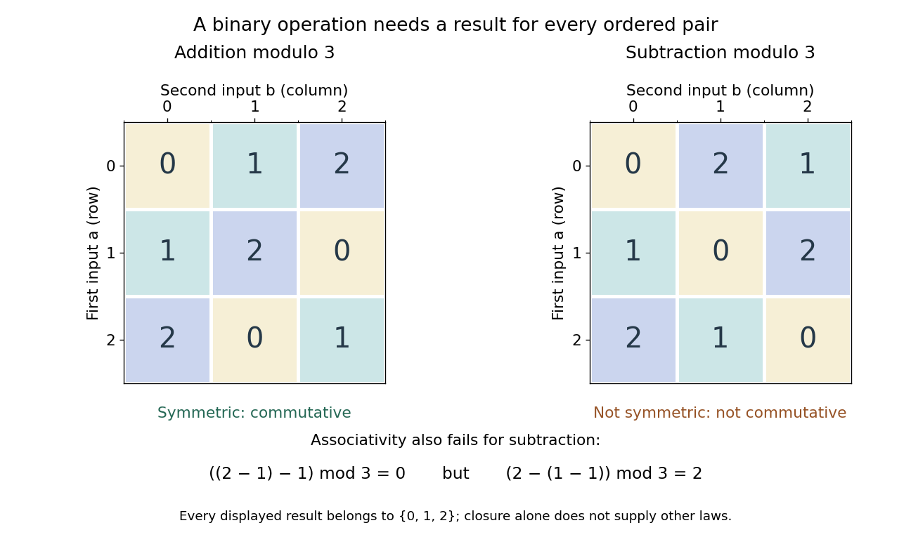
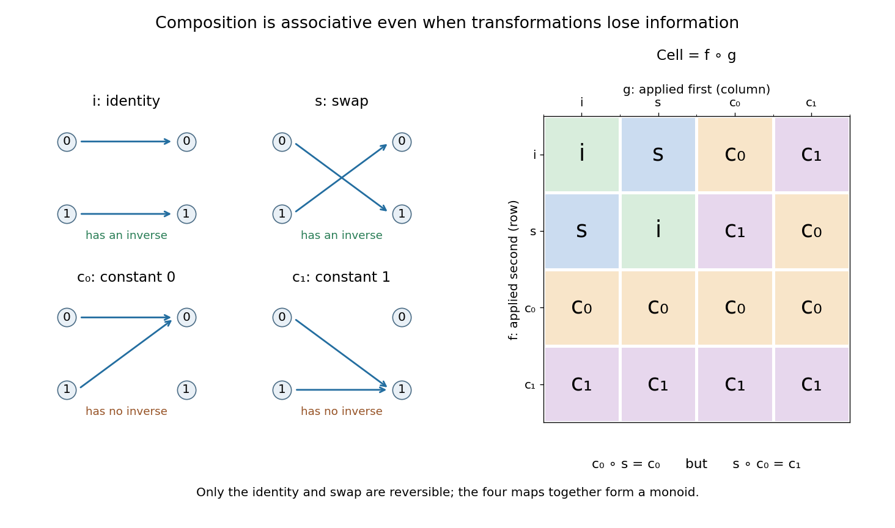

# Algebraic operation

↑ **Parent:** [Algebra](algebra.md)

An algebraic operation combines one or more elements of a set to produce another element.

**Table of contents**

- [Binary operation](#binary-operation)
  - [Magma (algebra)](#magma-algebra)
  - [Closure under a binary operation](#closure-under-a-binary-operation)
  - [Cayley table](#cayley-table)
  - [Identity element](#identity-element)
    - [Additive identity](#additive-identity)
  - [Distributive property](#distributive-property)
  - [Idempotence](#idempotence)
  - [Commutativity](#commutativity)
    - [Commuting elements](#commuting-elements)
    - [Noncommutativity](#noncommutativity)
  - [Associative property](#associative-property)
    - [Semigroup](#semigroup)
      - [Numerical semigroup](#numerical-semigroup)
      - [Rectangular band](#rectangular-band)
        - [Cartesian closed category of rectangular bands](#cartesian-closed-category-of-rectangular-bands)
      - [Idempotent element of a semigroup](#idempotent-element-of-a-semigroup)
      - [Semigroup presentation](#semigroup-presentation)
        - [Finite semigroup presentation](#finite-semigroup-presentation)
          - [Semigroup simulation of a Turing machine](#semigroup-simulation-of-a-turing-machine)
      - [Subsemigroup](#subsemigroup)
      - [Monoid](#monoid)
        - [Inverse element](#inverse-element)
        - [Transformation monoid](#transformation-monoid)
          - [Full transformation monoid](#full-transformation-monoid)
        - [Monoid action](#monoid-action)
          - [Right monoid action](#right-monoid-action)
            - [Exponential of right monoid actions](#exponential-of-right-monoid-actions)
              - [Exponential of right group actions](#exponential-of-right-group-actions)
          - [Equivariant map of monoid sets](#equivariant-map-of-monoid-sets)
          - [M-set](#m-set)
        - [Monoid homomorphism](#monoid-homomorphism)
        - [Monoid automorphism](#monoid-automorphism)
        - [Free monoid](#free-monoid)
        - [Commutative monoid](#commutative-monoid)
          - [Free commutative monoid](#free-commutative-monoid)
          - [Cancellative commutative monoid](#cancellative-commutative-monoid)
            - [Congruence submonoid of the positive integers](#congruence-submonoid-of-the-positive-integers)
              - [Nonunique factorization in a congruence submonoid](#nonunique-factorization-in-a-congruence-submonoid)
            - [Irreducible element of a commutative monoid](#irreducible-element-of-a-commutative-monoid)
            - [Torsion-free cancellative commutative monoid](#torsion-free-cancellative-commutative-monoid)
          - [Category of commutative monoids](#category-of-commutative-monoids)
      - [Additive semigroup](#additive-semigroup)
        - [Face of an additive monoid](#face-of-an-additive-monoid)
      - [Topological semigroup](#topological-semigroup)
        - [Left-topological semigroup](#left-topological-semigroup)
          - [Ellis–Numakura lemma](#ellis-numakura-lemma)

## Binary operation

↑ **Parent:** [Algebraic operation](algebraic-operation.md)  
ⓦ [Wiki](https://en.wikipedia.org/wiki/Binary_operation)

A [binary operation](#binary-operation) on a [set](set.md) $S$ is a [function](function.md) $\ast:S\times S\to S$. It takes two ordered [inputs](theoretical-computer-science.md#input-computer-science) from the same [set](set.md) and returns exactly one [output](theoretical-computer-science.md#output-computing) in that [set](set.md). The [codomain](function.md#codomain) is part of the definition: ordinary [subtraction](arithmetic.md#subtraction) is a [binary operation](#binary-operation) on the [integers](integer.md), but not on the positive [integers](integer.md), since $2-3=-1$ leaves that [set](set.md). Ordinary [division](arithmetic.md#division-mathematics) is not a total [binary operation](#binary-operation) on the [real numbers](arithmetic.md#real-number), because division by zero is undefined; it is one on the nonzero [real numbers](arithmetic.md#real-number).

The same [set](set.md) can carry several different [binary operations](#binary-operation). On $S=\{0,1,2\}$, both $a\ast b=(a+b)\bmod3$ and $a\diamond b=(a-b)\bmod3$ return an element of $S$, using [modular arithmetic](modular-arithmetic.md). Yet the [addition](arithmetic.md#addition) operation is [commutative](#commutativity) and [associative](#associative-property), while the [subtraction](arithmetic.md#subtraction) operation is neither. Specifying the allowed [inputs](theoretical-computer-science.md#input-computer-science) and [outputs](theoretical-computer-science.md#output-computing) tells us what can be evaluated; additional laws tell us how expressions may be transformed. [Grassl and Mingus, Some Abstract Algebra: A Primer and Interactive Workbook, binary operations](https://openmathbooks.org/someabstract/pdf/primer.pdf).

For a [finite set](set.md#finite-set), a [Cayley table](#cayley-table) records every ordered pair and its result. This turns abstract laws into checkable examples. It also makes the order of the [inputs](theoretical-computer-science.md#input-computer-science) explicit: the row gives the first [input](theoretical-computer-science.md#input-computer-science), and the column gives the second.

### Magma (algebra)

↑ **Parent:** [Binary operation](#binary-operation)  
ⓦ [Wiki](https://en.wikipedia.org/wiki/Magma_(algebra))

An [algebraic magma](#magma-algebra) is a [set](set.md) equipped with a [binary operation](#binary-operation). No [associative property](#associative-property), [commutativity](#commutativity), or [identity element](#identity-element) is required. A [semigroup](#semigroup) adds the [associative property](#associative-property); a [monoid](#monoid) also adds an [identity element](#identity-element).

### Closure under a binary operation

↑ **Parent:** [Binary operation](#binary-operation)

A [subset](set.md#subset) $A\subseteq S$ is closed under a [binary operation](#binary-operation) on $S$ when the result of combining any two elements of $A$ is again in $A$. The [even integers](integer.md#even-number) are closed under [addition](arithmetic.md#addition), but the [odd integers](integer.md#odd-integer) are not: $1+3=4$ is even. Closure permits restricting the [binary operation](#binary-operation) to $A\times A\to A$. It is different from being a [closed set](topology.md#closed-set) in [topology](topology.md).

### Cayley table

↑ **Parent:** [Binary operation](#binary-operation)  
ⓦ [Wiki](https://en.wikipedia.org/wiki/Cayley_table)

A [Cayley table](#cayley-table) records a [binary operation](#binary-operation) on a [finite set](set.md#finite-set): the cell at row $a$, column $b$ contains $a\ast b$. Every cell must contain an element of the specified [set](set.md). With the same ordering of row and column labels, the table is symmetric across its main diagonal exactly when the [binary operation](#binary-operation) is [commutative](#commutativity). Checking the [associative property](#associative-property) instead requires comparing $(a\ast b)\ast c$ with $a\ast(b\ast c)$ for every triple; symmetry alone cannot establish it.[§1: multiplication tables](mathematics-bibliography.md#group-theory-v4-01-by-james-s-milne)

**[Figure 1](#image-cayley-tables-for-addition-and-subtraction-in-modular-arithmetic-modulo-three). Cayley tables for addition and subtraction in modular arithmetic modulo three**. Read the first [input](theoretical-computer-science.md#input-computer-science) from the row and the second from the column. Both tables give [binary operations](#binary-operation) on $\{0,1,2\}$. The [addition](arithmetic.md#addition) table is symmetric; the [subtraction](arithmetic.md#subtraction) table is not. The bottom calculation exhibits a failed [associative property](#associative-property) for [subtraction](arithmetic.md#subtraction).

### Identity element

↑ **Parent:** [Binary operation](#binary-operation)  
ⓦ [Wiki](https://en.wikipedia.org/wiki/Identity_element)

An [identity element](#identity-element) $e$ for a [binary operation](#binary-operation) satisfies $e\ast a=a\ast e=a$ for every element $a$ of the underlying [set](set.md). It is a two-sided identity: merely satisfying one of the two equations is insufficient. It is unique when it exists, since two candidates satisfy $e=e\ast e'=e'$. This uniqueness does not require the [associative property](#associative-property).

Zero is the [identity element](#identity-element) for [addition](arithmetic.md#addition) of [integers](integer.md), one for [multiplication](arithmetic.md#multiplication) of [integers](integer.md), and the [identity function](function.md#identity-function) for [function composition](function.md#function-composition) of [self-maps](function.md#self-map). The [empty word](foundations-of-mathematics.md#empty-word) is the [identity element](#identity-element) for [concatenation](foundations-of-mathematics.md#concatenation). An [associative operation](#associative-property) with an [identity element](#identity-element) makes a [monoid](#monoid); [inverse elements](#inverse-element) are an additional requirement for a [group](group.md).

#### Additive identity

↑ **Parent:** [Identity element](#identity-element)  
ⓦ [Wiki](https://en.wikipedia.org/wiki/Additive_identity)

An [identity element](#identity-element) for [addition](arithmetic.md#addition): $0+a=a+0=a$. In a [vector space](vector-space.md), it is the [zero vector](vector-space.md#zero-vector); among [matrices](vector-space.md#matrix) of fixed dimensions, it is the [zero matrix](vector-space.md#zero-matrix).

### Distributive property

↑ **Parent:** [Binary operation](#binary-operation)

For two [binary operations](#binary-operation), multiplication distributes over addition on the left or right when the respective displayed identity holds. If multiplication is [commutative](#commutativity), either law gives the other. Repeated distribution expands expressions in an [incline](algebra.md#incline) into finite sums of [monomials](polynomial.md#monomial). This property is distinct from [associativity](#associative-property) of either operation.

### Idempotence

↑ **Parent:** [Binary operation](#binary-operation)  
ⓦ [Wiki](https://en.wikipedia.org/wiki/Idempotence)

For a [binary operation](#binary-operation), idempotence means repeating an input does not change it: $x\ast x=x$. An associative commutative idempotent operation defines a [join](set.md#least-upper-bound-in-a-partially-ordered-set) order by $x\le y\iff x\ast y=y$.

### Commutativity

↑ **Parent:** [Binary operation](#binary-operation)  
ⓦ [Wiki](https://en.wikipedia.org/wiki/Commutativity)

A [binary operation](#binary-operation) is commutative if $a*b=b*a$ for every pair in its domain. A particular pair may commute even when the operation is not commutative. For example, [ordinal addition](ordinal.md#ordinal-addition) and [ordinal multiplication](ordinal.md#ordinal-multiplication) are not generally commutative.

#### Commuting elements

↑ **Parent:** [Commutativity](#commutativity)

Two elements commute when their two products in opposite orders agree. A particular pair of [matrices](vector-space.md#matrix) may commute even when [matrix multiplication](vector-space.md#matrix-multiplication) is not a [commutative](#commutativity) operation on the whole [set](set.md) of [matrices](vector-space.md#matrix).

#### Noncommutativity

↑ **Parent:** [Commutativity](#commutativity)

A [binary operation](#binary-operation) is noncommutative if some pair of elements fails to commute. Thus reversing their order can change the result. The same operation may still have many [commuting elements](#commuting-elements).

### Associative property

↑ **Parent:** [Binary operation](#binary-operation)  
ⓦ [Wiki](https://en.wikipedia.org/wiki/Associative_property)

The [associative property](#associative-property) says that regrouping three [inputs](theoretical-computer-science.md#input-computer-science) does not change the result of a [binary operation](#binary-operation): $(a\ast b)\ast c=a\ast(b\ast c)$ for every $a,b,c$ in its [domain of a function](function.md#domain-of-a-function). It changes parentheses while keeping the order of the [inputs](theoretical-computer-science.md#input-computer-science). [Commutativity](#commutativity) instead exchanges two [inputs](theoretical-computer-science.md#input-computer-science); the two properties are different.

For [addition](arithmetic.md#addition) modulo three, $(2+1)+1\equiv2+(1+1)\equiv1\pmod3$. For [subtraction](arithmetic.md#subtraction) modulo three,

$$
(2-1)-1\equiv0,\qquad 2-(1-1)\equiv2\pmod3,
$$

so the second [binary operation](#binary-operation) fails the [associative property](#associative-property). One failed triple disproves [associativity](#associative-property); checking a few successful triples does not establish it for all [inputs](theoretical-computer-science.md#input-computer-science).

The useful consequence is that a finite ordered sequence can be combined in chunks. For an [associative operation](#associative-property), $(a\ast b)\ast(c\ast d)$ has the same value as $((a\ast b)\ast c)\ast d$. Intermediate results can therefore summarize parts of a computation without retaining their internal parentheses. The order must still be preserved when the [binary operation](#binary-operation) is not [commutative](#commutativity). [Function composition](function.md#function-composition) and [concatenation](foundations-of-mathematics.md#concatenation) provide examples where grouping is harmless but exchanging entries changes the result.

#### Semigroup

↑ **Parent:** [Associative property](#associative-property)  
ⓦ [Wiki](https://en.wikipedia.org/wiki/Semigroup)

A [semigroup](#semigroup) is an [algebraic magma](#magma-algebra) whose [binary operation](#binary-operation) has the [associative property](#associative-property). Its products can be regrouped while preserving the order of their elements. An [identity element](#identity-element) and [inverse elements](#inverse-element) are not required.

For example, the positive [integers](integer.md) with [addition](arithmetic.md#addition) form a [semigroup](#semigroup), since $(a+b)+c=a+(b+c)$ and a sum of positive [integers](integer.md) is positive. They have no [identity element](#identity-element): it would have to be zero, which is outside that [set](set.md). Nonempty [words over an alphabet](foundations-of-mathematics.md#string) with [concatenation](foundations-of-mathematics.md#concatenation) give a noncommutative example without an [identity element](#identity-element). Including the [empty word](foundations-of-mathematics.md#empty-word) instead gives a [free monoid](#free-monoid).

The usefulness of a [semigroup](#semigroup) is that an ordered list has one product regardless of its parentheses. This permits replacing a consecutive block by its already computed value. Here the empty [set](set.md) is also allowed as a [semigroup](#semigroup); a [monoid](#monoid) is necessarily nonempty because it contains an [identity element](#identity-element).

##### Numerical semigroup

↑ **Parent:** [Semigroup](#semigroup)

A numerical semigroup is an additive subset of the [nonnegative integers](arithmetic.md#natural-number) that contains zero and has finite complement. Positive generators with [greatest common divisor](divisibility.md#greatest-common-divisor) one generate such a semigroup; the missing nonnegative integers are its gaps.

##### Rectangular band

↑ **Parent:** [Semigroup](#semigroup)

A rectangular band is a [semigroup](#semigroup) satisfying the displayed identities; these also imply associativity. Every nonempty such algebra is a product $B\times C$ with $(b,c)*(b',c')=(b,c')$. Fixing $e$, the factor sets are $B=\{x*e\}$ and $C=\{e*x\}$, and $x\mapsto(x*e,e*x)$ has inverse $(b,c)\mapsto b*c$. Homomorphisms between nonempty products are exactly pairs of maps on the two factors.

###### Cartesian closed category of rectangular bands

↑ **Parent:** [Rectangular band](#rectangular-band)

The category of [rectangular bands](#rectangular-band) is [Cartesian closed](category.md#cartesian-closed-category). For nonempty products $A=B\times C$, $D=E\times F$, the exponential is $E^B\times F^C$. Also $D^0=1$ and $0^A=0$ for nonempty $A$. It has no [subobject classifier](category-theory.md#subobject-classifier): the classifier would have two elements, hence would be left-zero or right-zero, while its characteristic maps on a two-by-two product could not single out a one-point subalgebra.

##### Idempotent element of a semigroup

↑ **Parent:** [Semigroup](#semigroup)

An element of a [semigroup](#semigroup) is idempotent when multiplying it by itself leaves it unchanged. Every element of a left-zero or right-zero semigroup is idempotent, whereas a [group](group.md) has only its identity as an idempotent. The [Ellis–Numakura lemma](#ellis-numakura-lemma) guarantees such an element in a nonempty compact one-sided topological semigroup. Additive idempotence on ultrafilters gives the [idempotent ultrafilter](set-theory.md#idempotent-ultrafilter) relation $p+p=p$.

##### Semigroup presentation

↑ **Parent:** [Semigroup](#semigroup)

A semigroup presentation specifies generators $X$ and equalities between nonempty words. The resulting [semigroup](#semigroup) is the quotient of the free semigroup $X^+$ by the smallest congruence containing these equalities. Two words are equal precisely when one can be transformed into the other by finitely many replacements in contexts, using the defining equalities in either direction.

###### Finite semigroup presentation

↑ **Parent:** [Semigroup presentation](#semigroup-presentation)

A semigroup presentation is finite when both its generator set and its list of defining equalities are finite. A finite transition table for a [Turing machine](theoretical-computer-science.md#turing-machine) can be encoded this way: state-and-tape words simulate transitions, boundary rules supply blank cells, and halting-state rules erase the configuration to one distinguished symbol.

###### Semigroup simulation of a Turing machine

↑ **Parent:** [Finite semigroup presentation](#finite-semigroup-presentation)

A finite deterministic [Turing machine](theoretical-computer-science.md#turing-machine) can be represented by a [finite semigroup presentation](#finite-semigroup-presentation) whose generators are tape symbols, state symbols, a boundary marker $h$, and an accept symbol $q$. Defining equalities replace the local scanned symbol and state according to machine instructions, with separate boundary cases for implicit blanks. Only terminal-state equalities erase tape letters and then replace $hq_Hh$ by $q$. A derivation from an initial description to $q$ must encounter a terminal state before its first erasure. Simulation equalities preserve halting membership in either direction: for a deterministic transition $C\to D$, $C$ halts if and only if $D$ halts. Thus reverse use of defining equalities cannot create a false halting certificate. Boundary and erasure rules require explicit checking for every chosen encoding.

##### Subsemigroup

↑ **Parent:** [Semigroup](#semigroup)

A subsemigroup is a nonempty subset of a [semigroup](#semigroup) closed under its [associative operation](#associative-property). In a [compact Hausdorff space](topology.md#compact-hausdorff-space) carrying a [left-topological semigroup](#left-topological-semigroup), descending chains of nonempty compact subsemigroups have a nonempty compact subsemigroup as their intersection. This supplies the minimal object used in the [Ellis–Numakura lemma](#ellis-numakura-lemma).

##### Monoid

↑ **Parent:** [Semigroup](#semigroup)  
ⓦ [Wiki](https://en.wikipedia.org/wiki/Monoid)

A [monoid](#monoid) is a [semigroup](#semigroup) with a two-sided [identity element](#identity-element) $e$: $e\ast a=a\ast e=a$ for every element $a$. [Associativity](#associative-property) handles the grouping of a nonempty sequence; the [identity element](#identity-element) also supplies the result for an empty sequence. This makes the same rules apply to combining zero, one, or many contributions. [Group Theory (v4.01) by James S. Milne](mathematics-bibliography.md#group-theory-v4-01-by-james-s-milne).

The nonnegative [integers](integer.md) $\{0,1,2,\ldots\}$ with [addition](arithmetic.md#addition) form a [commutative monoid](#commutative-monoid), with [identity element](#identity-element) zero. They do not form a [group](group.md): a positive [integer](integer.md) has no [additive inverse](arithmetic.md#additive-inverse) in that [set](set.md). All [words over an alphabet](foundations-of-mathematics.md#string) with [concatenation](foundations-of-mathematics.md#concatenation) form a [free monoid](#free-monoid), whose [identity element](#identity-element) is the [empty word](foundations-of-mathematics.md#empty-word). The [full transformation monoid](#full-transformation-monoid) consists of all [self-maps](function.md#self-map) of a [set](set.md), with [function composition](function.md#function-composition) and the [identity function](function.md#identity-function).

These examples explain why [monoids](#monoid) are useful: accumulation needs an operation and a starting value, but it need not be reversible. Adding counts, joining [strings](foundations-of-mathematics.md#string), and composing transformations all share the same grouping and identity laws. Requiring every element to have an [inverse element](#inverse-element) gives a [group](group.md), a stronger structure suitable for reversible operations.

###### Inverse element

↑ **Parent:** [Monoid](#monoid)  
ⓦ [Wiki](https://en.wikipedia.org/wiki/Inverse_element)

An [inverse element](#inverse-element) of $a$ in a [monoid](#monoid) is an element $b$ satisfying $a\ast b=b\ast a=e$, where $e$ is the [identity element](#identity-element). Its notation is $a^{-1}$. Some elements of a [monoid](#monoid) can lack an [inverse element](#inverse-element); a [group](group.md) requires one for every element. [Associativity](#associative-property) makes a two-sided [inverse element](#inverse-element) unique: if $b,c$ both invert $a$, then $b=b\ast(a\ast c)=(b\ast a)\ast c=c$.

For the [full transformation monoid](#full-transformation-monoid), a [self-map](function.md#self-map) has an [inverse element](#inverse-element) exactly when it is a [bijection](function.md#bijection); that element is its [inverse function](function.md#inverse-function). On $\{0,1\}$, the swap $s(0)=1,s(1)=0$ is its own [inverse element](#inverse-element), while a [constant function](function.md#constant-function) has none because it merges the two [inputs](theoretical-computer-science.md#input-computer-science).

###### Transformation monoid

↑ **Parent:** [Monoid](#monoid)

A [transformation monoid](#transformation-monoid) is a collection of [self-maps](function.md#self-map) of a fixed [set](set.md) $X$ that contains the [identity function](function.md#identity-function) and is closed under [function composition](function.md#function-composition). The [associative property](#associative-property) comes from [function composition](function.md#function-composition). A [monoid action](#monoid-action) describes transformations of a [set](set.md) that obey a [monoid](#monoid)'s multiplication and identity laws.

###### Full transformation monoid

↑ **Parent:** [Transformation monoid](#transformation-monoid)

The [full transformation monoid](#full-transformation-monoid) consists of every [self-map](function.md#self-map) of $X$, with [function composition](function.md#function-composition) as its [binary operation](#binary-operation). For $X=\{0,1\}$, there are four [functions](function.md): the [identity function](function.md#identity-function) $i$, the swap $s(0)=1,s(1)=0$, and the [constant functions](function.md#constant-function) $c_0(x)=0,c_1(x)=1$. Their composition order matters: $c_0\circ s=c_0$, whereas $s\circ c_0=c_1$. Thus [associativity](#associative-property) does not imply [commutativity](#commutativity).

**[Figure 2](#image-four-self-maps-of-0-1-form-a-full-transformation-monoid). Four self-maps of $\{0,1\}$ form a full transformation monoid**. The arrow diagrams show each [function](function.md). The [Cayley table](#cayley-table) reads row $f$, column $g$ as $f\circ g$, applying $g$ first. Only $i$ and $s$ have [inverse elements](#inverse-element). The [constant functions](function.md#constant-function) lose information and satisfy [idempotence](#idempotence).

Only $i$ and $s$ are [bijections](function.md#bijection), and their [inverse elements](#inverse-element) are themselves. They form a two-element [group](group.md) within this [monoid](#monoid). The [constant functions](function.md#constant-function) instead satisfy $c_0\circ c_0=c_0$ and $c_1\circ c_1=c_1$, so they are [idempotent elements of a semigroup](#idempotent-element-of-a-semigroup). Such irreversible transformations explain why the [monoid](#monoid) setting is useful even when a [group](group.md) would be too restrictive.

###### Monoid action

↑ **Parent:** [Monoid](#monoid)

A left monoid action assigns each $m\in M$ a map $a\mapsto m\cdot a$ with $1\cdot a=a$ and $(mn)\cdot a=m\cdot(n\cdot a)$. It need not be invertible or injective. A left [M-set](#m-set) is equivalently a covariant functor from the one-object category determined by $M$.

###### Right monoid action

↑ **Parent:** [Monoid action](#monoid-action)

A right [monoid action](#monoid-action) has $x1=x$ and $(xm)n=x(mn)$. It is a contravariant [functor](functor.md) from the one-object category of the [monoid](#monoid) to sets. The regular right action is multiplication on $M$ itself. Products of right actions use the diagonal action.

###### Exponential of right monoid actions

↑ **Parent:** [Right monoid action](#right-monoid-action)

Give $M\times X$ the diagonal [right monoid action](#right-monoid-action). On its [equivariant maps](group-action.md#equivariant-map) into $Y$, define $(ek)(g,x)=e(kg,x)$. The [evaluation map of an exponential object](category.md#evaluation-map-of-an-exponential-object) is $e(1,x)$ and [currying](category.md#currying) of $h:Z\times X\to Y$ is $\widehat h(z)(g,x)=h(zg,x)$. Both maps are equivariant, and they are inverse under evaluation. The left multiplication $kg$ in this right action is essential in a noncommutative [monoid](#monoid).

###### Exponential of right group actions

↑ **Parent:** [Exponential of right monoid actions](#exponential-of-right-monoid-actions)

For a [group](group.md), evaluation at the identity identifies the [monoid](#monoid) exponential with all set functions $X\to Y$. Its inverse is $e_f(g,x)=f(xg^{-1})g$, and the resulting function action is the displayed formula. Fixed functions are precisely [equivariant maps](group-action.md#equivariant-map). The inverse on the input is necessary for equivariance of evaluation and for the right-action law.

###### Equivariant map of monoid sets

↑ **Parent:** [Monoid action](#monoid-action)

An equivariant map $h:A\to B$ between left [M-sets](#m-set) obeys $h(m\cdot a)=m\cdot h(a)$. These are the natural transformations of the corresponding functors from the one-object monoid category.

###### M-set

↑ **Parent:** [Monoid action](#monoid-action)

An M-set is a set carrying a [monoid action](#monoid-action). This terminology here uses left actions. Morphisms are [equivariant maps of monoid sets](#equivariant-map-of-monoid-sets), and the resulting [functor category](functor.md#functor-category) $[M,\mathbf{Set}]$ is an [elementary topos](category-theory.md#elementary-topos).

###### Monoid homomorphism

↑ **Parent:** [Monoid](#monoid)

A [monoid](#monoid) homomorphism $h:M\to N$ preserves multiplication and identity: $h(xy)=h(x)h(y)$ and $h(1_M)=1_N$. It therefore preserves every finite ordered product, including the empty product. The [monoids](#monoid) with these maps form the category $\mathbf{Mon}$.

###### Monoid automorphism

↑ **Parent:** [Monoid](#monoid)

A monoid automorphism is a bijective operation- and identity-preserving self-map of a [monoid](#monoid). Its inverse is also a monoid homomorphism. Permuting [prime numbers](prime-number.md) and extending by [prime factorization](prime-number.md#fundamental-theorem-of-arithmetic) gives all automorphisms of the multiplicative monoid of positive natural numbers; extending by $0\mapsto0$ gives automorphisms of the multiplicative monoid including zero.

###### Free monoid

↑ **Parent:** [Monoid](#monoid)  
ⓦ [Wiki](https://en.wikipedia.org/wiki/Free_monoid)

The [free monoid](#free-monoid) $\Sigma^*$ on an [alphabet](information-theory.md#alphabet) $\Sigma$ consists of all finite [words over an alphabet](foundations-of-mathematics.md#string), including the [empty word](foundations-of-mathematics.md#empty-word) $\varepsilon$, with [concatenation](foundations-of-mathematics.md#concatenation) as its [binary operation](#binary-operation). Distinct [strings](foundations-of-mathematics.md#string) represent distinct elements: there are no imposed equalities between different sequences of letters. The [empty word](foundations-of-mathematics.md#empty-word) is its [identity element](#identity-element), and [concatenation](foundations-of-mathematics.md#concatenation) has the [associative property](#associative-property).[§2: free monoids](mathematics-bibliography.md#group-theory-v4-01-by-james-s-milne)

For $\Sigma=\{a,b\}$, the elements begin $\varepsilon,a,b,aa,ab,ba,bb,\ldots$. Both $(ab)a$ and $a(ba)$ give the same [word](foundations-of-mathematics.md#string) $aba$, but $ab\ne ba$, so this [monoid](#monoid) is not [commutative](#commutativity). The [length of a word over an alphabet](foundations-of-mathematics.md#length-of-a-word-over-an-alphabet) obeys $\ell(uv)=\ell(u)+\ell(v)$; it is a [monoid homomorphism](#monoid-homomorphism) to the nonnegative [integers](integer.md) with [addition](arithmetic.md#addition). A nonempty [word](foundations-of-mathematics.md#string) has no [inverse element](#inverse-element), since joining it to any other [word](foundations-of-mathematics.md#string) cannot decrease its length to zero.

The defining benefit of being free is that letters can stand for arbitrary elements of another [monoid](#monoid). Choose a value $h(a)$ for each letter $a\in\Sigma$; then $h(a_1\cdots a_n)=h(a_1)\ast\cdots\ast h(a_n)$, with $h(\varepsilon)=e$, is the unique [monoid homomorphism](#monoid-homomorphism) extending those choices. [Associativity](#associative-property) and the [identity element](#identity-element) make this evaluation consistent for every finite [word](foundations-of-mathematics.md#string). For example, interpreting the letters as [self-maps](function.md#self-map) evaluates a [word](foundations-of-mathematics.md#string) as a composed transformation; interpreting them as nonnegative counts evaluates it by [addition](arithmetic.md#addition).

###### Commutative monoid

↑ **Parent:** [Monoid](#monoid)  
ⓦ [Wiki](https://en.wikipedia.org/wiki/Commutative_monoid)

A commutative monoid is a [monoid](#monoid) whose operation is commutative. The natural numbers with addition form a commutative monoid that is not an [abelian group](group.md#abelian-group), because positive elements have no additive inverses.

###### Free commutative monoid

↑ **Parent:** [Commutative monoid](#commutative-monoid)

The [free commutative monoid](#free-commutative-monoid) on $d$ generators consists of the nonnegative integral sums of those generators, with unique coefficients. Its [semigroup algebra](algebra.md#semigroup-algebra) over a [commutative ring](commutative-algebra.md#commutative-ring) is the [polynomial ring](commutative-algebra.md#polynomial-ring) in $d$ variables. In a smooth toric chart, the dual-cone lattice points form such a monoid, yielding affine-space coordinates.

###### Cancellative commutative monoid

↑ **Parent:** [Commutative monoid](#commutative-monoid)

A [commutative monoid](#commutative-monoid) is cancellative when $a+c=b+c$ implies $a=b$. Cancellation makes the natural map into its [Grothendieck group](algebraic-topology.md#grothendieck-group) injective.

###### Congruence submonoid of the positive integers

↑ **Parent:** [Cancellative commutative monoid](#cancellative-commutative-monoid)

For an integer $m\geq2$, the positive integers congruent to one modulo $m$ form a [cancellative commutative monoid](#cancellative-commutative-monoid) under multiplication. The identity is one, and it is the only unit. Proper factors outside this congruence class do not witness reducibility inside the monoid. Hence [irreducible elements of a commutative monoid](#irreducible-element-of-a-commutative-monoid) need not coincide with ordinary [prime numbers](prime-number.md).

###### Nonunique factorization in a congruence submonoid

↑ **Parent:** [Congruence submonoid of the positive integers](#congruence-submonoid-of-the-positive-integers)

The [congruence submonoid of the positive integers](#congruence-submonoid-of-the-positive-integers) with modulus ten has four distinct [irreducible elements of a commutative monoid](#irreducible-element-of-a-commutative-monoid) $21,221,51,91$ with equal pairwise products. Their ordinary prime factors are respectively $(3,7),(13,17),(3,17),(7,13)$. None of these proper prime factors is congruent to one modulo ten. The [Euclid lemma](number-theory.md#euclid-s-lemma) proves that a product of two distinct primes has no other proper positive divisors, so all four are irreducible in this monoid. This gives nonunique factorization without assuming the fundamental theorem of arithmetic.

###### Irreducible element of a commutative monoid

↑ **Parent:** [Cancellative commutative monoid](#cancellative-commutative-monoid)

A nonunit element of a [commutative monoid](#commutative-monoid) is irreducible if each factorization has a unit factor. In a submonoid of the positive integers under multiplication, the only unit is one. Irreducibility is relative to the allowed factors: a composite integer can be irreducible in a smaller monoid even though it is not a [prime number](prime-number.md).

###### Torsion-free cancellative commutative monoid

↑ **Parent:** [Cancellative commutative monoid](#cancellative-commutative-monoid)

A [cancellative commutative monoid](#cancellative-commutative-monoid) is torsion-free in this sense when $na=nb$ implies $a=b$ for every positive integer $n$. Its [Grothendieck group](algebraic-topology.md#grothendieck-group) is then a [torsion-free abelian group](group.md#torsion-free-abelian-group), because $n(a-b)=0$ forces $na=nb$. This is the condition inherited by a submonoid of a [torsion-free abelian group](group.md#torsion-free-abelian-group).

###### Category of commutative monoids

↑ **Parent:** [Commutative monoid](#commutative-monoid)

This [category](category.md) has [commutative monoids](#commutative-monoid) and their homomorphisms. Pointwise addition makes each hom-set a commutative monoid, and composition is additive in both variables. Finite cartesian products are also coproducts, using the coordinate injections with zero in the other coordinates and summing images. Therefore it is a [semi-additive category](category-theory.md#semi-additive-category), but it is not an [additive category](category-theory.md#additive-category). The reflexive pair from the submonoid $\{(m,n):m\leq n\leq2m\}$ of $\mathbb N^2$ to $\mathbb N$, using the two projections and section $m\mapsto(m,m)$, has an arrow from $1$ to $2$ and none from $2$ to $1$ in its represented graph. Thus a [reflexive pair](category-theory.md#reflexive-pair) here need not yield a [groupoid](category.md#groupoid).

##### Additive semigroup

↑ **Parent:** [Semigroup](#semigroup)

An additive semigroup is a [semigroup](#semigroup) whose operation is written as addition.

###### Face of an additive monoid

↑ **Parent:** [Additive semigroup](#additive-semigroup)

A face $F$ of an additive monoid $S$ is a submonoid such that $a+b\in F$ implies $a,b\in F$. If $S=C\cap M$ for a rational polyhedral cone, its faces are precisely $S\cap\nu$ for faces $\nu$ of $C$. Finite generation and clearing rational denominators identify these monoid faces with the exposed faces of the cone.

// Target: geometry-and-topology.bigb

##### Topological semigroup

↑ **Parent:** [Semigroup](#semigroup)  
ⓦ [Wiki](https://en.wikipedia.org/wiki/Topological_semigroup)

A topological semigroup is a [semigroup](#semigroup) with a [topology](topology.md#topological-space) for which multiplication is jointly [continuous](calculus.md#continuous-function).

###### Left-topological semigroup

↑ **Parent:** [Topological semigroup](#topological-semigroup)

A left-topological semigroup requires only that every right translation $x\mapsto xa$ be [continuous](calculus.md#continuous-function).

<h6 id="ellis-numakura-lemma">Ellis–Numakura lemma</h6>

↑ **Parent:** [Left-topological semigroup](#left-topological-semigroup)  
ⓦ [Wiki](https://en.wikipedia.org/wiki/Ellis–Numakura_lemma)

Every nonempty compact Hausdorff left-topological [semigroup](#semigroup) contains an [idempotent](commutative-algebra.md#idempotent). Choose a minimal nonempty compact subsemigroup $K$. For $a\in K$, minimality gives $Ka=K$; the nonempty compact subsemigroup $\{x\in K:xa=a\}$ is therefore all of $K$, so $a^2=a$.

## ↑ Ancestors (4)

1. [Algebra](algebra.md)
2. [Area of mathematics](mathematics.md#area-of-mathematics)
3. [Mathematics](mathematics.md)
4. [Codex Wiki](README.md)

## ← Incoming links (5)

- [Algebra](algebra.md)
- [Algebraic notation](algebra.md#algebraic-notation)
- [Algebraic structure](algebra.md#algebraic-structure)
- [Expression (mathematics)](algebra.md#expression-mathematics)
- [Identity (mathematics)](algebra.md#identity-mathematics)
