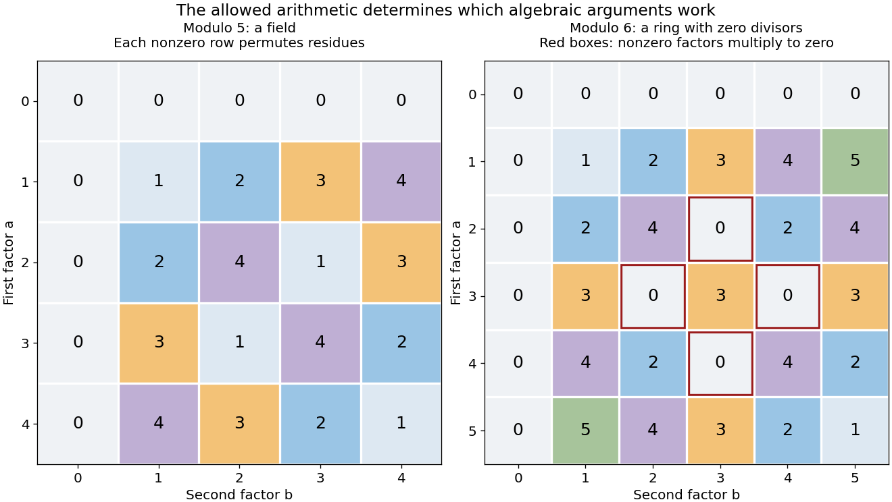

# Algebraic structure

↑ **Parent:** [Algebra](algebra-split.md)  
ⓦ [Wiki](https://en.wikipedia.org/wiki/Algebraic_structure)

An algebraic structure is a [set](set-split.md) equipped with specified [algebraic operations](algebraic-operation.md) satisfying selected axioms. An operation's domain is part of the structure: a [binary operation](binary-operation.md) on $S$ takes two elements of $S$ and produces another element of $S$. [Groups](group-split.md) specify one such operation, [rings](ring.md) specify addition and multiplication, and [vector spaces](vector-space-split.md) specify vector addition and scalar multiplication by a separate [field](field.md).

Different choices of operations can give the same underlying [set](set-split.md) different structures. The [integers](integer.md) form a [group](group-split.md) under addition, since every integer has an additive inverse. They do not form a [group](group-split.md) under multiplication: for example, $2$ has no multiplicative inverse among the [integers](integer.md). Even the nonzero [integers](integer.md) fail that inverse requirement. In contrast, nonzero [rational numbers](rational-number.md) form a [group](group-split.md) under multiplication.

Finite multiplication tables make such distinctions visible. Arithmetic modulo $5$ gives a [field](field.md); arithmetic modulo $6$ gives a [commutative ring](commutative-ring.md) with [zero divisors](zero-divisor.md). In the former, multiplying by any nonzero element permutes all residue classes. In the latter, multiplying by $2$ reaches only $0,2,4$, and $2\cdot3=0$ even though both factors are nonzero.

**[Figure 3](#image-multiplication-tables-distinguish-a-prime-field-from-a-ring-with-zero-divisors). Multiplication tables distinguish a prime field from a ring with zero divisors**.

The goal is to extract reusable properties rather than memorize isolated tables. A [homomorphism](homomorphism.md) preserves the specified operations, and an [isomorphism](isomorphism.md) shows that two structures have identical operation patterns after relabeling.

**Table of contents**

- [Vertex operator algebra](vertex-operator-algebra.md)
- [Incline](incline.md)
  - [Finitely generated incline is well-quasi-ordered by reverse absorption](finitely-generated-incline-is-well-quasi-ordered-by-reverse-absorption.md)
- [Homomorphism](homomorphism.md)
  - [Kernel (algebra)](kernel-algebra.md)

## ↑ Ancestors (4)

1. [Algebra](algebra-split.md)
2. [Area of mathematics](area-of-mathematics.md)
3. [Mathematics](mathematics-split.md)
4. [Codex Wiki](split.md)

## ← Incoming links (3)

- [Field](field.md)
- [Homomorphism](homomorphism.md)
- [Vertex operator algebra](vertex-operator-algebra.md)
