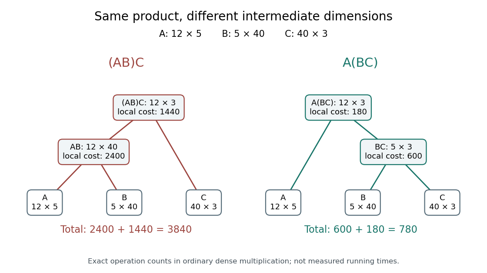
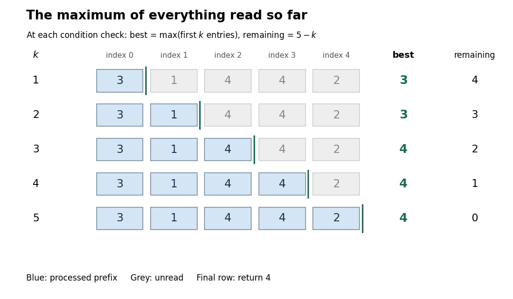
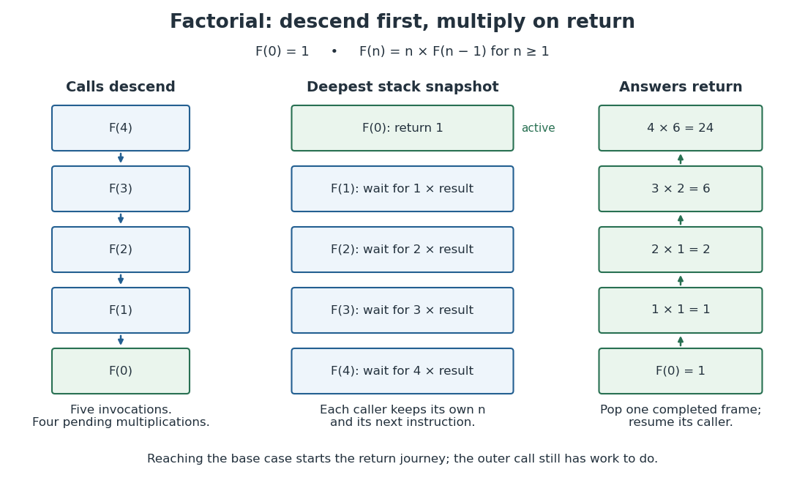
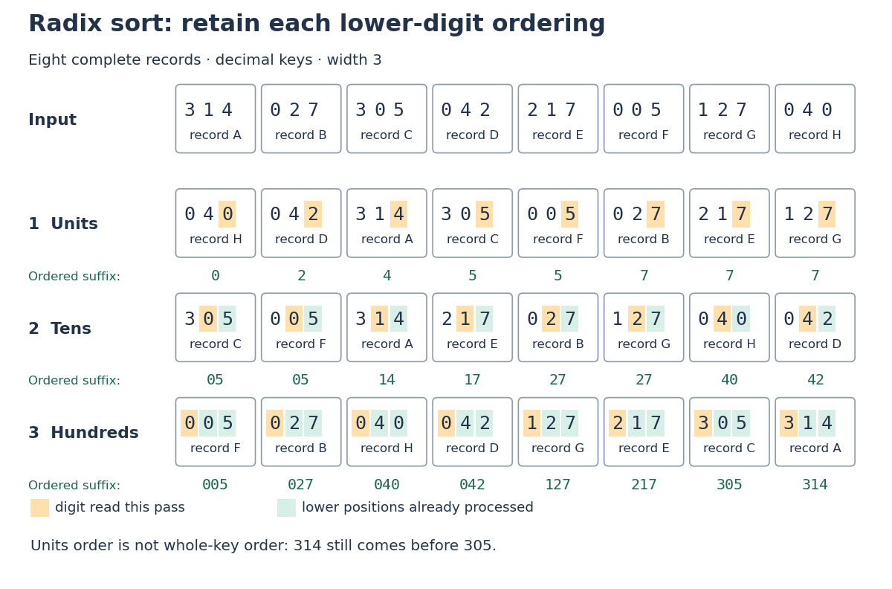

# Algorithm

↑ **Parent:** [Computer science](computer-science.md)  
ⓦ [Wiki](https://en.wikipedia.org/wiki/Algorithm)

An algorithm is a finite, precise procedure for transforming an [input](theoretical-computer-science.md#input-computer-science) into an [output](theoretical-computer-science.md#output-computing).

Here "finite" refers to the description: a short [algorithm](algorithm.md) can perform arbitrarily many steps on increasingly large [inputs](theoretical-computer-science.md#input-computer-science). Solving a [computational problem](theoretical-computer-science.md#computational-problem) additionally requires termination and the specified [output](theoretical-computer-science.md#output-computing) on every permitted [input](theoretical-computer-science.md#input-computer-science). State assumptions explicitly: [binary search](#binary-search) requires a [sorted array](data-structure.md#sorted-array).

An [algorithm](algorithm.md) is an idea that can have implementations in different [programming languages](programming-language.md). Its explanation should make three things visible: the permitted [inputs](theoretical-computer-science.md#input-computer-science), the rule for each step, and the meaning of the returned [output](theoretical-computer-science.md#output-computing). [Algorithm correctness](#algorithm-correctness) then separates finding the right answer from eventually finishing; [time complexity](theoretical-computer-science.md#time-complexity) asks how much work finishing requires.

A particularly useful design question is: what knowledge survives each step? In [binary search](#binary-search), it is the location of every possible match inside the remaining candidate range. Writing that fact as a [loop invariant](#loop-invariant) turns an intuitive shortcut into a procedure whose discarded candidates can be justified. This often helps discover the [algorithm](algorithm.md), rather than merely check it afterward.

**Table of contents**

- [Quantum algorithm](#quantum-algorithm)
- [Heuristic algorithm](#heuristic-algorithm)
- [Sweep-line algorithm](#sweep-line-algorithm)
- [Four-sum problem](#four-sum-problem)
- [Bit parallelism](#bit-parallelism)
- [Memory usage](#memory-usage)
  - [Auxiliary space](#auxiliary-space)
- [Running time](#running-time)
- [Sorting](#sorting)
- [Unification](#unification)
  - [First-order unification](#first-order-unification)
    - [Robinson unification algorithm](#robinson-unification-algorithm)
  - [Most general unifier](#most-general-unifier)
- [Bostan-Mori algorithm](#bostan-mori-algorithm)
- [Bitwise operation](#bitwise-operation)
  - [Bitwise complement](#bitwise-complement)
  - [Bitwise AND](#bitwise-and)
- [Exponential search](#exponential-search)
- [Coordinate compression](#coordinate-compression)
- [Two-pointer technique](#two-pointer-technique)
- [Aho-Corasick algorithm](#aho-corasick-algorithm)
  - [Aho-Corasick automaton](#aho-corasick-automaton)
- [Tonelli-Shanks algorithm](#tonelli-shanks-algorithm)
- [String-searching algorithm](#string-searching-algorithm)
  - [FM-index](#fm-index)
  - [Backward search](#backward-search)
  - [Last-to-first mapping](#last-to-first-mapping)
  - [Burrows-Wheeler transform](#burrows-wheeler-transform)
  - [Failure link](#failure-link)
  - [Knuth-Morris-Pratt algorithm](#knuth-morris-pratt-algorithm)
    - [Knuth-Morris-Pratt automaton](#knuth-morris-pratt-automaton)
  - [Border of a string](#border-of-a-string)
  - [Prefix function](#prefix-function)
- [Redelmeier's algorithm](#redelmeier-s-algorithm)
- [Cycle detection](#cycle-detection)
  - [Brent cycle-finding algorithm](#brent-cycle-finding-algorithm)
- [Floyd's cycle-finding algorithm](#floyd-s-cycle-finding-algorithm)
- [Rotating calipers](#rotating-calipers)
- [Meet-in-the-middle algorithm](#meet-in-the-middle-algorithm)
- [Maximum subarray problem](#maximum-subarray-problem)
  - [Kadane's algorithm](#kadane-s-algorithm)
- [Search algorithm](#search-algorithm)
- [Backtracking](#backtracking)
- [Sliding-window algorithm](#sliding-window-algorithm)
- [Brute-force search](#brute-force-search)
- [Search pruning](#search-pruning)
- [Number-theoretic sieve](#number-theoretic-sieve)
  - [Odd-only sieve](#odd-only-sieve)
  - [Totient sieve](#totient-sieve)
  - [Smallest prime factor sieve](#smallest-prime-factor-sieve)
  - [Prime sieve](#prime-sieve)
  - [Wheel factorization](#wheel-factorization)
    - [Wheel modulus](#wheel-modulus)
  - [Du Jiao sieve](#du-jiao-sieve)
  - [Min\_25 sieve](#min-25-sieve)
  - [Segmented sieve](#segmented-sieve)
    - [Odd-only segmented sieve](#odd-only-segmented-sieve)
  - [Linear sieve](#linear-sieve)
- [Matrix-chain multiplication](#matrix-chain-multiplication)
  - [Matrix-chain cost model](#matrix-chain-cost-model)
  - [Matrix-chain dynamic programming](#matrix-chain-dynamic-programming)
  - [Matrix-chain split reconstruction](#matrix-chain-split-reconstruction)
- [Greedy algorithm](#greedy-algorithm)
  - [Greedy-choice property](#greedy-choice-property)
    - [Exchange argument](#exchange-argument)
  - [Interval scheduling](#interval-scheduling)
    - [Shortest-duration interval scheduling counterexample](#shortest-duration-interval-scheduling-counterexample)
    - [Weighted interval scheduling](#weighted-interval-scheduling)
- [Algorithm correctness](#algorithm-correctness)
  - [Partial correctness](#partial-correctness)
  - [Total correctness](#total-correctness)
    - [Algorithm termination](#algorithm-termination)
  - [Prefix maximum correctness example](#prefix-maximum-correctness-example)
  - [Formal verification](#formal-verification)
    - [Summation loop verification](#summation-loop-verification)
    - [Formal specification](#formal-specification)
      - [Precondition](#precondition)
      - [Postcondition](#postcondition)
    - [Binary correctness](#binary-correctness)
  - [Functional correctness](#functional-correctness)
  - [Loop invariant](#loop-invariant)
    - [Loop variant](#loop-variant)
- [Linear search](#linear-search)
  - [Linear search comparison count](#linear-search-comparison-count)
  - [Linear search correctness](#linear-search-correctness)
- [Equality test](#equality-test)
- [Strength reduction](#strength-reduction)
- [Statistical program profiling](#statistical-program-profiling)
- [Depth-first search](#depth-first-search)
  - [Iterative deepening depth-first search](#iterative-deepening-depth-first-search)
- [Memoization](#memoization)
  - [Overlapping subproblems](#overlapping-subproblems)
  - [Memoized Fibonacci evaluation](#memoized-fibonacci-evaluation)
  - [Memoization arithmetic and stack costs](#memoization-arithmetic-and-stack-costs)
  - [Memoization cache contract](#memoization-cache-contract)
    - [Memoization key](#memoization-key)
    - [Memoization cache lifetime](#memoization-cache-lifetime)
- [Recursion (computer science)](#recursion-computer-science)
  - [McCarthy 91 function](#mccarthy-91-function)
    - [Generalized McCarthy function](#generalized-mccarthy-function)
  - [Recursive procedure](#recursive-procedure)
  - [Recursive process](#recursive-process)
  - [Factorial recursion and returning frames](#factorial-recursion-and-returning-frames)
  - [Binary array sum by recursion](#binary-array-sum-by-recursion)
  - [Well-founded progress in recursion](#well-founded-progress-in-recursion)
  - [Base case](#base-case)
  - [Recursive call](#recursive-call)
- [Divide-and-conquer algorithm](#divide-and-conquer-algorithm)
  - [CDQ divide and conquer](#cdq-divide-and-conquer)
  - [Divide-and-conquer combination cost](#divide-and-conquer-combination-cost)
  - [Divide-and-conquer product ledger](#divide-and-conquer-product-ledger)
- [Sorting algorithm](#sorting-algorithm)
  - [Patience sorting](#patience-sorting)
  - [Sort key](#sort-key)
    - [Sorting record](#sorting-record)
  - [Sortedness](#sortedness)
  - [Sorting permutation preservation](#sorting-permutation-preservation)
  - [Insertion sort](#insertion-sort)
  - [Comparison sort](#comparison-sort)
    - [Comparison sorting lower bound](#comparison-sorting-lower-bound)
  - [Counting sort](#counting-sort)
    - [Counting sort prefix ranges](#counting-sort-prefix-ranges)
    - [Stable record placement in counting sort](#stable-record-placement-in-counting-sort)
  - [Radix sort](#radix-sort)
    - [Least-significant-digit radix sort](#least-significant-digit-radix-sort)
      - [Radix sort suffix invariant](#radix-sort-suffix-invariant)
    - [Stable digit sort](#stable-digit-sort)
    - [Radix sort key encoding](#radix-sort-key-encoding)
  - [Stable sorting](#stable-sorting)
  - [Merge sort](#merge-sort)
- [Merge algorithm](#merge-algorithm)
  - [K-way merge algorithm](#k-way-merge-algorithm)
- [Binary search](#binary-search)
- [Karatsuba multiplication](#karatsuba-multiplication)
  - [Karatsuba operand splitting](#karatsuba-operand-splitting)
  - [Karatsuba three-product identity](#karatsuba-three-product-identity)
  - [Karatsuba worked multiplication](#karatsuba-worked-multiplication)
  - [Karatsuba carry handling](#karatsuba-carry-handling)
  - [Karatsuba recursion termination](#karatsuba-recursion-termination)
  - [Karatsuba digit-operation cost](#karatsuba-digit-operation-cost)
  - [Karatsuba practical crossover](#karatsuba-practical-crossover)
- [Randomized algorithm](#randomized-algorithm)
  - [Derandomization](#derandomization)
    - [Method of conditional probabilities](#method-of-conditional-probabilities)
      - [Conditional expectation choice invariant](#conditional-expectation-choice-invariant)
      - [Conditional expectations for maximum cut](#conditional-expectations-for-maximum-cut)
        - [Conditional expectation cut formula](#conditional-expectation-cut-formula)
        - [Conditional expectations cut example](#conditional-expectations-cut-example)
        - [Conditional expectations algorithm cost](#conditional-expectations-algorithm-cost)
  - [Probabilistic Turing machine](#probabilistic-turing-machine)
  - [One-sided error](#one-sided-error)
    - [RP (complexity)](#rp-complexity)
    - [co-RP](#co-rp)
  - [ZPP](#zpp)
  - [Error reduction for a randomized algorithm](#error-reduction-for-a-randomized-algorithm)
  - [Polynomial identity testing](#polynomial-identity-testing)
    - [Polynomial identity testing over a finite field](#polynomial-identity-testing-over-a-finite-field)
    - [Random evaluation test for a polynomial identity](#random-evaluation-test-for-a-polynomial-identity)
    - [Independent repetition of a polynomial identity test](#independent-repetition-of-a-polynomial-identity-test)

## Quantum algorithm

↑ **Parent:** [Algorithm](algorithm.md)

A computational procedure using quantum state preparation, controlled operations and measurement, together with any required classical processing. Complexity counts the relevant operations and repetitions; a large superposition is not itself a guarantee of a useful speedup.

## Heuristic algorithm

↑ **Parent:** [Algorithm](algorithm.md)

A [heuristic algorithm](#heuristic-algorithm) uses a selective search or approximation to obtain a useful result efficiently, without a general guarantee of finding the exact optimum.

## Sweep-line algorithm

↑ **Parent:** [Algorithm](algorithm.md)

## Four-sum problem

↑ **Parent:** [Algorithm](algorithm.md)

## Bit parallelism

↑ **Parent:** [Algorithm](algorithm.md)

## Memory usage

↑ **Parent:** [Algorithm](algorithm.md)

### Auxiliary space

↑ **Parent:** [Memory usage](#memory-usage)

The extra working storage required by an [algorithm](algorithm.md), excluding the storage occupied by its input. This includes temporary tables and the stack of active [recursive calls](#recursive-call).

## Running time

↑ **Parent:** [Algorithm](algorithm.md)

## Sorting

↑ **Parent:** [Algorithm](algorithm.md)

Rearranging a finite [sequence](sequence-and-series.md#sequence) according to a specified order while preserving its entries and their multiplicities. A [sorting algorithm](#sorting-algorithm) performs this operation; [lexicographic order](extremal-set-theory.md#lexicographic-order) supplies a common order for tuples or strings.

## Unification

↑ **Parent:** [Algorithm](algorithm.md)

Unification seeks substitutions for variables that make symbolic terms identical. First-order unification compares matching constructors recursively; an [occurs check](programming-language.md#occurs-check) rejects substitutions that would make a variable contain itself.

### First-order unification

↑ **Parent:** [Unification](#unification)

First-order unification seeks substitutions making first-order terms identical. Constructor decomposition and the [occurs check](programming-language.md#occurs-check) produce a [most general unifier](#most-general-unifier) when one exists.

#### Robinson unification algorithm

↑ **Parent:** [First-order unification](#first-order-unification)

### Most general unifier

↑ **Parent:** [Unification](#unification)

A most general unifier is a unifying substitution through which every other unifier factors by a further substitution. It records exactly the equality constraints forced by the terms.

## Bostan-Mori algorithm

↑ **Parent:** [Algorithm](algorithm.md)

The Bostan-Mori algorithm extracts a distant coefficient from a [rational generating function](sequence-and-series.md#rational-generating-function) $P(x)/Q(x)$ by multiplying both by $Q(-x)$. The new denominator is even; retaining the appropriate even or odd numerator coefficients halves the coefficient index at each step.

## Bitwise operation

↑ **Parent:** [Algorithm](algorithm.md)

### Bitwise complement

↑ **Parent:** [Bitwise operation](#bitwise-operation)

### Bitwise AND

↑ **Parent:** [Bitwise operation](#bitwise-operation)

Bitwise AND combines binary representations position by position, setting a bit exactly when it is set in every operand. For [bit masks](programming-language.md#bit-mask) representing sets, it computes intersection.

## Exponential search

↑ **Parent:** [Algorithm](algorithm.md)

## Coordinate compression

↑ **Parent:** [Algorithm](algorithm.md)

Coordinate compression replaces coordinates by a smaller representation while retaining the order or distance information needed by an [algorithm](algorithm.md). Rank compression retains only order; geometry-specific transformations may instead remove known gaps or widths.

## Two-pointer technique

↑ **Parent:** [Algorithm](algorithm.md)

## Aho-Corasick algorithm

↑ **Parent:** [Algorithm](algorithm.md)

The Aho-Corasick algorithm matches multiple patterns in a [string](foundations-of-mathematics.md#string) using a [trie](data-structure.md#trie) equipped with failure links. After preprocessing the patterns, it scans the input while reporting every pattern ending at each position.

### Aho-Corasick automaton

↑ **Parent:** [Aho-Corasick algorithm](#aho-corasick-algorithm)

An Aho-Corasick automaton stores a [trie](data-structure.md#trie) of patterns together with failure links and pattern-output information. It supports simultaneous pattern matching by the [Aho-Corasick algorithm](#aho-corasick-algorithm).

## Tonelli-Shanks algorithm

↑ **Parent:** [Algorithm](algorithm.md)

The Tonelli-Shanks algorithm finds a [square root](algebra.md#square-root) of a [quadratic residue](quadratic-residue.md) [modulo](modular-arithmetic.md#modulo-operation) an [odd prime](prime-number.md#odd-prime). It uses the decomposition of the prime minus one into an odd part and a [power of two](integer.md#power-of-two) to successively correct a candidate root.

## String-searching algorithm

↑ **Parent:** [Algorithm](algorithm.md)

### FM-index

↑ **Parent:** [String-searching algorithm](#string-searching-algorithm)

An [FM-index](#fm-index) is a compressed text index supporting [backward search](#backward-search) through the [Burrows-Wheeler transform](#burrows-wheeler-transform) and occurrence counts. Character [rank queries](data-structure.md#rank-query) locate a matching interval; sampled [suffix array](data-structure.md#suffix-array) positions then allow the actual text positions to be recovered. Query length, number of matches and the chosen sampling density control different parts of the search cost.[§§3.1–3.2, counting and locating occurrences](computer-science-bibliography.md#opportunistic-data-structures-with-applications-by-paolo-ferragina-and-others)

### Backward search

↑ **Parent:** [String-searching algorithm](#string-searching-algorithm)

[Backward search](#backward-search) finds a query's matching interval in a [suffix array](data-structure.md#suffix-array) by processing the query from right to left. With inclusive one-based interval $[l,r]$, prepending $c$ changes it to $[C(c)+\operatorname{Occ}(c,l-1)+1,C(c)+\operatorname{Occ}(c,r)]$. An empty interval means no match. This works through the occurrence-order property of the [last-to-first mapping](#last-to-first-mapping).[§3.1, Figure 1, BW Search](computer-science-bibliography.md#opportunistic-data-structures-with-applications-by-paolo-ferragina-and-others)

### Last-to-first mapping

↑ **Parent:** [String-searching algorithm](#string-searching-algorithm)

In a sorted [cyclic rotation](foundations-of-mathematics.md#cyclic-rotation) matrix, the [last-to-first mapping](#last-to-first-mapping) sends the $k$th occurrence of a character in the last column to its $k$th occurrence in the first column. For one-based rows, $\operatorname{LF}(r)=C(L_r)+\operatorname{Occ}(L_r,r)$, where $C(c)$ counts smaller characters and $\operatorname{Occ}(c,r)$ counts $c$ in the first $r$ entries of the last column. It moves a rotation's start one character backwards cyclically. Equal characters retain the [lexicographic order](extremal-set-theory.md#lexicographic-order) of their following sequences, which proves the occurrence-order rule.[§2, properties (a)–(b) and LF-mapping](computer-science-bibliography.md#opportunistic-data-structures-with-applications-by-paolo-ferragina-and-others)

### Burrows-Wheeler transform

↑ **Parent:** [String-searching algorithm](#string-searching-algorithm)

The [Burrows-Wheeler transform](#burrows-wheeler-transform) appends a unique smallest terminator to a [string](foundations-of-mathematics.md#string), sorts its [cyclic rotations](foundations-of-mathematics.md#cyclic-rotation) in [lexicographic order](extremal-set-theory.md#lexicographic-order), and records the last column. It is reversible because the first and last columns contain the same characters and the [last-to-first mapping](#last-to-first-mapping) preserves the occurrence order of each character. The resulting letter arrangement supports both compression and [backward search](#backward-search).[§2, Background: sorted cyclic shifts and inversion](computer-science-bibliography.md#opportunistic-data-structures-with-applications-by-paolo-ferragina-and-others)

### Failure link

↑ **Parent:** [String-searching algorithm](#string-searching-algorithm)

A transition to a shorter suffix match after an attempted extension fails. In a [Knuth-Morris-Pratt automaton](#knuth-morris-pratt-automaton), the [prefix function](#prefix-function) determines the next shorter matching prefix.

### Knuth-Morris-Pratt algorithm

↑ **Parent:** [String-searching algorithm](#string-searching-algorithm)

#### Knuth-Morris-Pratt automaton

↑ **Parent:** [Knuth-Morris-Pratt algorithm](#knuth-morris-pratt-algorithm)

### Border of a string

↑ **Parent:** [String-searching algorithm](#string-searching-algorithm)

### Prefix function

↑ **Parent:** [String-searching algorithm](#string-searching-algorithm)

For a string $s$, the value $\pi_i$ is the length of the longest proper prefix of $s_0\cdots s_i$ that is also its suffix. Repeatedly following these lengths lists all proper [borders of a string](#border-of-a-string); this is the failure-link information used by the [Knuth-Morris-Pratt algorithm](#knuth-morris-pratt-algorithm).

<h2 id="redelmeier-s-algorithm">Redelmeier's algorithm</h2>

↑ **Parent:** [Algorithm](algorithm.md)

An [algorithm](algorithm.md) for enumerating [polyominoes](combinatorics.md#polyomino) by maintaining included cells, an ordered frontier of untried cells, and excluded cells. Exploring inclusion and exclusion in a consistent order prevents different growth histories from counting the same rooted shape repeatedly.

## Cycle detection

↑ **Parent:** [Algorithm](algorithm.md)

Determine whether repeated deterministic updates revisit a state, and optionally find the preperiod and cycle length. Recording all visited states uses memory proportional to the visited orbit. [Floyd's cycle-finding algorithm](#floyd-s-cycle-finding-algorithm) detects repetition with constant extra memory.

### Brent cycle-finding algorithm

↑ **Parent:** [Cycle detection](#cycle-detection)

A constant-memory [algorithm](algorithm.md) for detecting the eventual cycle in a sequence generated by repeated [function](function.md) evaluation. It holds a checkpoint fixed while a second pointer advances, doubling the checkpoint interval when exhausted; a second pass locates the start of the cycle.

<h2 id="floyd-s-cycle-finding-algorithm">Floyd's cycle-finding algorithm</h2>

↑ **Parent:** [Algorithm](algorithm.md)

For a deterministic iteration $x_{n+1}=f(x_n)$ on a [finite set](set.md#finite-set), move one pointer by one step and another by two steps. They eventually meet inside the repeated cycle. Restarting one pointer at the initial state and advancing both by one step locates the cycle entrance; a further traversal measures its length. The method uses constant extra [space complexity](theoretical-computer-science.md#space-complexity) and time proportional to the preperiod plus cycle length.

## Rotating calipers

↑ **Parent:** [Algorithm](algorithm.md)

A family of algorithms that exploit monotonically changing geometric directions while traversing sorted points or the boundary of a [convex polygon](convex-set.md#convex-polygon). For example, after sorting rays by [polar angle](multivariable-calculus.md#polar-angle) around a point, a second index can advance monotonically to identify all rays lying in each open half-plane. Collinear rays require consistent boundary handling.

## Meet-in-the-middle algorithm

↑ **Parent:** [Algorithm](algorithm.md)

An [algorithm](algorithm.md) that splits choices into two groups, enumerates partial results for each group, and matches compatible results. For $n$ binary choices, the two lists each have about $2^{n/2}$ entries instead of enumerating $2^n$ complete choices; the matching cost and memory requirements depend on the problem.

## Maximum subarray problem

↑ **Parent:** [Algorithm](algorithm.md)

Given a finite sequence of [real numbers](arithmetic.md#real-number), find a nonempty contiguous block with maximum sum. Its restriction to contiguous blocks distinguishes it from choosing an arbitrary [subset](set.md#subset). The problem admits a linear-time solution using [Kadane's algorithm](#kadane-s-algorithm).

<h3 id="kadane-s-algorithm">Kadane's algorithm</h3>

↑ **Parent:** [Maximum subarray problem](#maximum-subarray-problem)

For input $a_1,\ldots,a_n$, let $E_i$ be the largest sum of a nonempty contiguous block ending at $i$. The [recurrence relation](sequence-and-series.md#recurrence-relation) $E_1=a_1$ and $E_i=\max(a_i,E_{i-1}+a_i)$ is exact: an optimal block either starts at $i$ or extends an optimal block ending at $i-1$. The answer is $\max_i E_i$. Keeping only the current $E_i$ and best value gives linear [time complexity](theoretical-computer-science.md#time-complexity) and constant extra [space complexity](theoretical-computer-science.md#space-complexity).

## Search algorithm

↑ **Parent:** [Algorithm](algorithm.md)

## Backtracking

↑ **Parent:** [Algorithm](algorithm.md)

Build a candidate incrementally, abandoning a partial candidate as soon as no valid completion is possible. A [depth-first search](#depth-first-search) explores one choice, restores the previous state, and tries the next. Constraint propagation and bounds can greatly reduce the visited [state space](dynamical-systems.md#state-space), although the worst-case [time complexity](theoretical-computer-science.md#time-complexity) may remain exponential.

## Sliding-window algorithm

↑ **Parent:** [Algorithm](algorithm.md)

An [algorithm](algorithm.md) that maintains information about a contiguous part of a [sequence](sequence-and-series.md#sequence) while moving its endpoints. Updating a fixed-length window [sum](arithmetic.md#sum) needs subtraction of the outgoing term and [addition](arithmetic.md#addition) of the incoming term. A window [product](arithmetic.md#product-of-numbers) can be updated by [division](arithmetic.md#division-mathematics) only when the outgoing factor is nonzero; zero counts or zero-free segments handle that exception.

## Brute-force search

↑ **Parent:** [Algorithm](algorithm.md)

A search [algorithm](algorithm.md) that tests candidates directly, without exploiting enough structure to avoid their enumeration. A small brute-force implementation is often useful for checking an optimized [algorithm](algorithm.md) independently.

## Search pruning

↑ **Parent:** [Algorithm](algorithm.md)

Discarding a branch of a [search tree](theoretical-computer-science.md#search-tree) after proving that no completion can satisfy the constraints or improve the current best solution. For minimization, a [lower bound](set.md#lower-bound-in-a-partially-ordered-set) on every completion justifies pruning when it is at least the best value already found; this is the principle behind [branch and bound](mathematical-optimization.md#branch-and-bound).

## Number-theoretic sieve

↑ **Parent:** [Algorithm](algorithm.md)

A number-theoretic sieve processes many [integers](integer.md) together by marking or updating those sharing a [divisor](divisibility.md#divisor), rather than testing each [integer](integer.md) independently. The [sieve of Eratosthenes](prime-number.md#sieve-of-eratosthenes) marks composite multiples of successive [prime numbers](prime-number.md); related sieves accumulate a [smallest prime factor](prime-number.md#smallest-prime-factor), [Euler's totient function](number-theory.md#euler-totient-function), or [Möbius function](arithmetic-function.md#mobius-function) for every argument up to a bound. The useful structure is that the multiples of a fixed [integer](integer.md) form an [arithmetic progression](arithmetic.md#arithmetic-progression), so one loop can update all affected entries in an array.

For example, initializing an array to true and then marking $2p,3p,\ldots$ for each surviving [prime number](prime-number.md) $p$ leaves precisely the [prime numbers](prime-number.md) unmarked, apart from the separately excluded zero and one. Every [composite number](number-theory.md#composite-number) has a [prime factor](prime-number.md#prime-factor), which proves that every composite is eventually removed. Starting the marking at $p^2$ avoids work already performed by smaller [prime numbers](prime-number.md). Different sieves use different update rules and [time complexity](theoretical-computer-science.md#time-complexity) bounds; the name alone does not imply the complexity of the [sieve of Eratosthenes](prime-number.md#sieve-of-eratosthenes).

### Odd-only sieve

↑ **Parent:** [Number-theoretic sieve](#number-theoretic-sieve)

An odd-only sieve stores only odd candidates, handling the [prime](prime-number.md) two separately. This reduces the candidate storage and avoids marking even composites repeatedly.

### Totient sieve

↑ **Parent:** [Number-theoretic sieve](#number-theoretic-sieve)

A totient sieve computes the [Euler totient function](number-theory.md#euler-totient-function) for many integers at once. Initialize $\phi(n)=n$ and, for each [prime](prime-number.md) $p$, replace $\phi(n)$ by $\phi(n)(1-1/p)$ for every multiple $n$ of $p$.

### Smallest prime factor sieve

↑ **Parent:** [Number-theoretic sieve](#number-theoretic-sieve)

### Prime sieve

↑ **Parent:** [Number-theoretic sieve](#number-theoretic-sieve)

A [number-theoretic sieve](#number-theoretic-sieve) used to enumerate [prime numbers](prime-number.md) by excluding [composite numbers](number-theory.md#composite-number). The [sieve of Eratosthenes](prime-number.md#sieve-of-eratosthenes) marks multiples of each discovered prime, beginning at its square.

### Wheel factorization

↑ **Parent:** [Number-theoretic sieve](#number-theoretic-sieve)

Choose a modulus $W$ that is a product of small [primes](prime-number.md). Every [prime](prime-number.md) not dividing $W$ must be [coprime](divisibility.md#coprime-integers) to $W$, so a search can restrict candidates to the corresponding [residue classes](modular-arithmetic.md#residue-class) modulo $W$. For several [linear polynomials](polynomial.md#linear-polynomial), discard each [residue class](modular-arithmetic.md#residue-class) in which any required value is divisible by a selected [prime](prime-number.md). The surviving [residue classes](modular-arithmetic.md#residue-class) can be combined using the [Chinese remainder theorem](mathematics.md#chinese-remainder-theorem).

#### Wheel modulus

↑ **Parent:** [Wheel factorization](#wheel-factorization)

### Du Jiao sieve

↑ **Parent:** [Number-theoretic sieve](#number-theoretic-sieve)

A Du Jiao sieve computes a summatory [arithmetic function](arithmetic-function.md) using a [Dirichlet convolution](arithmetic-function.md#dirichlet-convolution) identity and [memoization](#memoization) of repeated quotient arguments. For the [Mertens function](arithmetic-function.md#mertens-function) $M(n)=\sum_{k\le n}\mu(k)$, the identity $\sum_{d\mid k}\mu(d)=[k=1]$ gives $M(n)=1-\sum_{i=2}^n M(\lfloor n/i\rfloor)$. Grouping equal quotients and precomputing small arguments makes this [recurrence relation](sequence-and-series.md#recurrence-relation) useful for large inputs.

<h3 id="min-25-sieve">Min_25 sieve</h3>

↑ **Parent:** [Number-theoretic sieve](#number-theoretic-sieve)

A family of [algorithms](algorithm.md) for summatory [multiplicative functions](arithmetic-function.md#multiplicative-function) that first computes suitable sums over [primes](prime-number.md) at quotient values and then incorporates [prime powers](prime-number.md#prime-power). The required prime-sum formulas and complexity depend on the particular [multiplicative function](arithmetic-function.md#multiplicative-function).

### Segmented sieve

↑ **Parent:** [Number-theoretic sieve](#number-theoretic-sieve)

A [number-theoretic sieve](#number-theoretic-sieve) that processes a large search range in smaller [intervals](real-analysis.md#interval-mathematics). To find [primes](prime-number.md) in $[L,H]$, first generate the [primes](prime-number.md) at most $\sqrt H$, then mark their multiples in the current segment. Memory for the segment depends on its width rather than on $H$.

#### Odd-only segmented sieve

↑ **Parent:** [Segmented sieve](#segmented-sieve)

### Linear sieve

↑ **Parent:** [Number-theoretic sieve](#number-theoretic-sieve)

A [number-theoretic sieve](#number-theoretic-sieve) that visits each [composite number](number-theory.md#composite-number) exactly once, through its [smallest prime factor](prime-number.md#smallest-prime-factor). Keep a growing list of [prime numbers](prime-number.md); for each $i$, generate $ip$ only for stored primes $p\le\operatorname{spf}(i)$. Each composite $m$ has a unique representation $m=\operatorname{spf}(m)(m/\operatorname{spf}(m))$ admitted by this rule, giving $O(N)$ arithmetic updates up to $N$.

## Matrix-chain multiplication

↑ **Parent:** [Algorithm](algorithm.md)

Given a fixed [sequence](sequence-and-series.md#sequence) of compatible [matrices](vector-space.md#matrix) $A_1,\ldots,A_m$, choose a binary parenthesization of $A_1\cdots A_m$ that minimizes the number of scalar multiplications in ordinary [matrix multiplication](vector-space.md#matrix-multiplication). The order of the [matrices](vector-space.md#matrix) is fixed: parenthesization changes the grouping, not the operand order. [Associativity](algebraic-operation.md#associative-property) preserves the product while intermediate [matrix](vector-space.md#matrix) dimensions change the cost. The possible binary groupings are counted by the [Catalan number](combinatorics.md#catalan-number) $C_{m-1}$ for $m\geq1$.

### Matrix-chain cost model

↑ **Parent:** [Matrix-chain multiplication](#matrix-chain-multiplication)

For [matrix dimensions](vector-space.md#matrix-dimensions) $r\times s$ and $s\times t$, ordinary [matrix multiplication](vector-space.md#matrix-multiplication) computes $rt$ [matrix entries](vector-space.md#matrix-entry), each using $s$ [scalar multiplications](vector-space.md#scalar-multiplication). Thus its cost is $rst$ [scalar multiplications](vector-space.md#scalar-multiplication), with $rt(s-1)$ [additions](arithmetic.md#addition) if each sum starts from its first term. Here we minimize only the [scalar multiplication](vector-space.md#scalar-multiplication) count, using this dense [matrix multiplication](vector-space.md#matrix-multiplication) rule throughout. The counts describe [arithmetic operations](numerical-analysis.md#arithmetic-operation), rather than measured elapsed time; [matrix multiplication](vector-space.md#matrix-multiplication) methods that exploit structure or use faster formulas require a different cost rule.

Take [matrices](vector-space.md#matrix) $A$, $B$, $C$ with [matrix dimensions](vector-space.md#matrix-dimensions) $12\times5$, $5\times40$, $40\times3$. Both groupings produce a $12\times3$ [matrix product](vector-space.md#matrix-product), but their intermediate [matrix dimensions](vector-space.md#matrix-dimensions) differ:

$$
\begin{aligned}
(AB)C &: \quad 12\cdot5\cdot40+12\cdot40\cdot3=2400+1440=3840,\\
A(BC) &: \quad 5\cdot40\cdot3+12\cdot5\cdot3=600+180=780.
\end{aligned}
$$

The second grouping first compresses $BC$ into a $5\times3$ [matrix](vector-space.md#matrix), avoiding the $12\times40$ intermediate [matrix](vector-space.md#matrix) $AB$. The saving is $3060$ [scalar multiplications](vector-space.md#scalar-multiplication), although both groupings use exactly two [matrix multiplications](vector-space.md#matrix-multiplication). This is why counting only [matrix multiplication](vector-space.md#matrix-multiplication) operations hides the interesting choice.

<a id="image-the-same-matrix-product-can-require-3840-or-780-scalar-multiplications"></a>


**[Figure 1](#image-the-same-matrix-product-can-require-3840-or-780-scalar-multiplications). The same matrix product can require 3840 or 780 scalar multiplications**. Original [binary trees](data-structure.md#binary-tree) for the three-[matrix](vector-space.md#matrix) example. Leaves keep $A,B,C$ in the same order. Each internal node gives its resulting [matrix dimensions](vector-space.md#matrix-dimensions) and the local [scalar multiplication](vector-space.md#scalar-multiplication) cost; adding those costs gives the total.

[Associativity](algebraic-operation.md#associative-property) permits these regroupings in exact arithmetic; [commutativity](algebraic-operation.md#commutativity) is neither assumed nor generally true for [matrix multiplication](vector-space.md#matrix-multiplication). Swapping $A$ and $B$ here would even make their [matrix product](vector-space.md#matrix-product) undefined. In [floating-point arithmetic](floating-point-arithmetic.md), [round-off error](numerical-analysis.md#round-off-error) can make the two groupings yield different computed [matrix entries](vector-space.md#matrix-entry); the cost optimum alone does not guarantee the smallest numerical error.

### Matrix-chain dynamic programming

↑ **Parent:** [Matrix-chain multiplication](#matrix-chain-multiplication)

Let $A_i$ have [matrix dimensions](vector-space.md#matrix-dimensions) $p_{i-1}\times p_i$, where $p_0,\ldots,p_n$ are positive [integers](integer.md). For $1\leq i\leq j\leq n$, define $m[i,j]$ as the minimum [scalar multiplication](vector-space.md#scalar-multiplication) cost of the contiguous [matrix product](vector-space.md#matrix-product) $A_i\cdots A_j$. The endpoints $(i,j)$ of an [integer interval](integer.md#integer-interval) identify a [dynamic programming state](mathematical-optimization.md#dynamic-programming-state). A single [matrix](vector-space.md#matrix) needs no [matrix multiplication](vector-space.md#matrix-multiplication), giving the [base case](#base-case) $m[i,i]=0$. At the final [matrix multiplication](vector-space.md#matrix-multiplication), split after $A_k$:

$$
m[i,j]=\min_{i\leq k<j}\bigl(m[i,k]+m[k+1,j]+p_{i-1}p_kp_j\bigr),\qquad i<j.
$$

The two subproducts have [matrix dimensions](vector-space.md#matrix-dimensions) $p_{i-1}\times p_k$ and $p_k\times p_j$, regardless of their internal grouping. The [recurrence relation](sequence-and-series.md#recurrence-relation) adds their optimal costs and the final [scalar multiplication](vector-space.md#scalar-multiplication) cost.[6.006 Introduction to Algorithms, Fall 2011 by Massachusetts Institute of Technology, 6.006 course staff; Lecture 21: Dynamic Programming III, printed p. 2, Parenthesization: final split, recurrence and zero one-matrix base case; notes use half-open indices](computer-science-bibliography.md#6-006-introduction-to-algorithms-fall-2011-by-massachusetts-institute-of-technology-6-006-course-staff/lecture-21-dynamic-programming-iii)

Why is this [optimal substructure](mathematical-optimization.md#optimal-substructure)? For a chosen final split $k$, replacing either subproduct's grouping by a cheaper one leaves its [matrix dimensions](vector-space.md#matrix-dimensions) and exact [matrix product](vector-space.md#matrix-product) unchanged, so it decreases the whole cost by the same amount. Therefore an optimal grouping can use optimal groupings on both sides. Conversely, each candidate in the [recurrence relation](sequence-and-series.md#recurrence-relation) joins two achievable groupings. [Mathematical induction](foundations-of-mathematics.md#mathematical-induction) on $j-i+1$, starting with the single-[matrix](vector-space.md#matrix) [base case](#base-case), proves that the minimum is achievable and no grouping is cheaper.

There are also [overlapping subproblems](#overlapping-subproblems): while evaluating the different final splits of $ABCD$, the cases $A(BCD)$ and $(ABC)D$ both request the cost of $BC$. [Recursion](#recursion-computer-science) without reuse recomputes this answer; [memoization](#memoization) or a [dynamic programming](mathematical-optimization.md#dynamic-programming) table stores it once. Fill the table by increasing length $j-i+1$, so both dependencies are ready. Record an attaining split $s[i,j]$ alongside each cost.[6.006 Introduction to Algorithms, Fall 2011 by Massachusetts Institute of Technology, 6.006 course staff; Lecture 21: Dynamic Programming III, printed p. 2, Parenthesization: increasing substring size, cubic time and parent pointers](computer-science-bibliography.md#6-006-introduction-to-algorithms-fall-2011-by-massachusetts-institute-of-technology-6-006-course-staff/lecture-21-dynamic-programming-iii)

The [dynamic programming](mathematical-optimization.md#dynamic-programming) table has $n(n+1)/2$ cost entries. For length $\ell$, there are $n-\ell+1$ entries and $\ell-1$ possible splits, so the exact number of candidate evaluations is

$$
\sum_{\ell=2}^{n}(n-\ell+1)(\ell-1)=\frac{n(n-1)(n+1)}{6}.
$$

Under the unit-cost assumption that [arithmetic operations](numerical-analysis.md#arithmetic-operation), comparisons and access to stored costs each take constant time, this gives [time complexity](theoretical-computer-science.md#time-complexity) $O(n^3)$ and [space complexity](theoretical-computer-science.md#space-complexity) $O(n^2)$, using [Big O notation](real-analysis.md#big-o-notation). These bounds concern choosing a grouping from the [matrix dimensions](vector-space.md#matrix-dimensions); they exclude the subsequent [matrix multiplication](vector-space.md#matrix-multiplication) work. If the dimensions or costs require arbitrarily long [integers](integer.md), their arithmetic and storage costs must also be counted.

### Matrix-chain split reconstruction

↑ **Parent:** [Matrix-chain multiplication](#matrix-chain-multiplication)

Extend the original example by a [matrix](vector-space.md#matrix) $D$ with [matrix dimensions](vector-space.md#matrix-dimensions) $3\times15$, so $(p_0,p_1,p_2,p_3,p_4)=(12,5,40,3,15)$. The [Catalan number](combinatorics.md#catalan-number) $C_3=5$ counts all possible groupings. Their [scalar multiplication](vector-space.md#scalar-multiplication) costs are

$$
\begin{array}{c|r}
\text{grouping}&\text{cost}\\\hline
((AB)C)D&2400+1440+540=4380\\
(A(BC))D&600+180+540=1320\\
(AB)(CD)&2400+1800+7200=11400\\
A((BC)D)&600+225+900=1725\\
A(B(CD))&1800+3000+900=5700
\end{array}
$$

The optimum is $(A(BC))D$, with cost $1320$. Enumeration makes a useful check here, but [dynamic programming](mathematical-optimization.md#dynamic-programming) reaches the same answer by solving ten [integer intervals](integer.md#integer-interval), including the four single-[matrix](vector-space.md#matrix) [base cases](#base-case):

$$
\begin{array}{c|rrrr}
i\backslash j&1&2&3&4\\\hline
1&0&2400&780&1320\\
2&&0&600&825\\
3&&&0&1800\\
4&&&&0
\end{array}
$$

For example, $m[2,4]=\min\{1800+5\cdot40\cdot15,\ 600+5\cdot3\cdot15\}=\min\{4800,825\}=825$. The three final-split candidates for the full [matrix product](vector-space.md#matrix-product) supply a compact certificate:

$$
\begin{aligned}
k=1 &: \quad 0+825+12\cdot5\cdot15=1725,\\
k=2 &: \quad 2400+1800+12\cdot40\cdot15=11400,\\
k=3 &: \quad 780+0+12\cdot3\cdot15=1320.
\end{aligned}
$$

The first candidate already uses the better grouping of $BCD$; the worse $A(B(CD))$ need not be reconsidered at the top level. This is how [optimal substructure](mathematical-optimization.md#optimal-substructure) lets the table represent all five possibilities with only three final candidates.

<a id="image-a-four-matrix-cost-table-and-the-splits-certifying-the-optimum"></a>


**[Figure 2](#image-a-four-matrix-cost-table-and-the-splits-certifying-the-optimum). A four-matrix cost table and the splits certifying the optimum**. Original [dynamic programming](mathematical-optimization.md#dynamic-programming) calculation for $(12,5,40,3,15)$. Orange entries are the nonsingleton [integer intervals](integer.md#integer-interval) used in the recovered optimum. The [binary tree](data-structure.md#binary-tree) follows stored splits down both children to the single-[matrix](vector-space.md#matrix) [base cases](#base-case); the final candidates certify the cost $1320$.

Read $s[1,4]=3$, which separates $ABC$ from $D$. Then $s[1,3]=1$ separates $A$ from $BC$, and $s[2,3]=2$ separates $B$ from $C$. This [recursion](#recursion-computer-science) stops at every $i=j$, returning the corresponding [matrix](vector-space.md#matrix) name. Combining the returned expressions recovers $(A(BC))D$, rather than only its cost. Every [recursive call](#recursive-call) uses a shorter [integer interval](integer.md#integer-interval), establishing [algorithm termination](#algorithm-termination); a tied minimum may choose any attaining split. The recovered [binary tree](data-structure.md#binary-tree) has $n$ leaves and $n-1$ internal nodes, so reconstruction takes $O(n)$ steps. Its attraction is the separation between an enormous family of groupings and a small set of reusable [dynamic programming states](mathematical-optimization.md#dynamic-programming-state).

## Greedy algorithm

↑ **Parent:** [Algorithm](algorithm.md)  
ⓦ [Wiki](https://en.wikipedia.org/wiki/Greedy_algorithm)

A [greedy algorithm](#greedy-algorithm) builds a [feasible solution](mathematical-optimization.md#feasible-point) by repeatedly committing to a locally preferred next choice. Each commitment is final: the [algorithm](algorithm.md) does not revisit it when later choices become available. In [mathematical optimization](mathematical-optimization.md), the important question is whether those commitments can still attain the best [objective function](mathematical-optimization.md#objective-function) value.

For example, a shared telescope can accept several observation requests with fixed time slots. In [interval scheduling](#interval-scheduling), every completed request counts equally, and overlapping requests cannot both be accepted. Choosing the request that finishes earliest leaves the resource available sooner. The example below turns that intuition into a precise rule, then shows why choosing the earliest start or shortest duration can lose jobs.

[Greedy algorithms](#greedy-algorithm) are attractive because a single pass can replace a search through many candidate [subsets](set.md#subset). However, "locally best" is only a design proposal. A problem-specific [greedy-choice property](#greedy-choice-property), often established by an [exchange argument](#exchange-argument), must connect the local decision to the actual [objective function](mathematical-optimization.md#objective-function). The largest-individual-value rule in the [0-1 knapsack problem](mathematical-optimization.md#0-1-knapsack-problem) fails; [Dijkstra's algorithm](shortest-path-problem.md#dijkstra-algorithm) needs its nonnegative-edge assumptions. A rule's success in one [optimization](mathematical-optimization.md) task does not justify it in another.

### Greedy-choice property

↑ **Parent:** [Greedy algorithm](#greedy-algorithm)

A [greedy-choice property](#greedy-choice-property) says that some optimal [feasible solution](mathematical-optimization.md#feasible-point) contains the locally selected choice. Together with [optimal substructure](mathematical-optimization.md#optimal-substructure) in the remaining instance, it allows repeated commitments. An [exchange argument](#exchange-argument) often establishes this property.[Algorithms by Jeff Erickson; §4.3 General Pattern, printed pp. 164–165: exchange without worsening an optimum](computer-science-bibliography.md#algorithms-by-jeff-erickson/greedy-algorithms)

For [interval scheduling](#interval-scheduling), a safe first choice need not belong to every optimal [feasible solution](mathematical-optimization.md#feasible-point). When several optima exist, a commitment may exclude one while retaining another. The useful [loop invariant](#loop-invariant) is that the accepted prefix can still be extended to an optimum. Merely keeping the accepted [intervals](real-analysis.md#interval-mathematics) compatible proves feasibility, which is a weaker claim.

#### Exchange argument

↑ **Parent:** [Greedy-choice property](#greedy-choice-property)

An [exchange argument](#exchange-argument) modifies an optimal [feasible solution](mathematical-optimization.md#feasible-point) to include a desired choice while preserving feasibility and not worsening its [objective function](mathematical-optimization.md#objective-function) value. The modification need not strictly improve the optimum; equality suffices.[Algorithms by Jeff Erickson; §4.3 General Pattern, printed pp. 164–165: exchange at the first disagreement](computer-science-bibliography.md#algorithms-by-jeff-erickson/greedy-algorithms)

For [interval scheduling](#interval-scheduling), the exchange replaces the first selected job with an earliest-finishing job. Its safety comes from the finish-time inequality below. Replacing a job with a shorter one has no such guarantee: it might move the occupied [interval](real-analysis.md#interval-mathematics) into the middle of two useful jobs, as the [shortest-duration interval scheduling counterexample](#shortest-duration-interval-scheduling-counterexample) shows.

### Interval scheduling

↑ **Parent:** [Greedy algorithm](#greedy-algorithm)  
ⓦ [Wiki](https://en.wikipedia.org/wiki/Interval_scheduling)

Given a [finite set](set.md#finite-set) of jobs with fixed half-open [intervals](real-analysis.md#interval-mathematics) $[s_i,f_i)$, where $s_i<f_i$, choose a [subset](set.md#subset) $S$ of [maximum](set.md#maximum-of-a-subset-of-a-total-order) [cardinality](cardinal-number.md#cardinality). Each job occupies one shared resource throughout its [interval](real-analysis.md#interval-mathematics). A [feasible solution](mathematical-optimization.md#feasible-point) has pairwise [disjoint](set.md#disjoint-sets) [intervals](real-analysis.md#interval-mathematics): for distinct selected jobs $i,j$, either $f_i\leq s_j$ or $f_j\leq s_i$. Thus a finish and the next start may coincide. Every job has value one; occupied time is not the [objective function](mathematical-optimization.md#objective-function).[6.046J Design and Analysis of Algorithms, Spring 2015; Printed p. 2, Interval Scheduling: fixed requests, one resource, compatibility with endpoint equality, maximum size](computer-science-bibliography.md#6-046j-design-and-analysis-of-algorithms-spring-2015/lecture-1-introduction)

Consider these six original jobs, with arbitrary time units:

$$
\begin{array}{c|rrrrrr}
\text{job}&A&B&C&D&E&F\\\hline
s_i&0&1&3&5&6&8\\
f_i&6&3&5&7&9&10
\end{array}.
$$

Job $B=[1,3)$ can be followed immediately by $C=[3,5)$ and $D=[5,7)$. Job $A=[0,6)$ conflicts with all three. Starting the resource earlier is therefore not automatically beneficial: one long commitment can displace several shorter requests.

The earliest-finish [greedy algorithm](#greedy-algorithm) uses a [sorting algorithm](#sorting-algorithm) to put jobs in [nondecreasing](calculus.md#nondecreasing-function) finish time. Scan that order, accepting the first job and then each job whose start is at least the last accepted finish. Break finish-time ties arbitrarily; an empty [input](theoretical-computer-science.md#input-computer-science) returns the [empty set](set.md#empty-set). For these jobs, the order and decisions are

$$
\begin{array}{c|rrrrrr}
\text{finish order}&B&C&A&D&E&F\\\hline
\text{decision}&\text{take}&\text{take}&\text{skip}&\text{take}&\text{skip}&\text{take}
\end{array}.
$$

After $B,C$, job $A$ starts before the current finish five and is rejected. Accept $D$; then reject $E=[6,9)$ because six is before seven. Finally accept $F=[8,10)$. The result is $S=\{B,C,D,F\}$, with [cardinality](cardinal-number.md#cardinality) four. Leaving $[0,1)$ idle makes room for more jobs.

By contrast, the earliest-start rule scans $A,B,C,D,E,F$. It accepts $A$, skips $B,C,D$, accepts $E$, and skips $F$. Its [feasible solution](mathematical-optimization.md#feasible-point) $\{A,E\}$ contains only two jobs. Here $A$ and $E$ meet at time six and are compatible; $E$ and $F$ overlap on $[8,9)$.

<a id="image-earliest-finish-accepts-four-jobs-earliest-start-accepts-two"></a>


**[Figure 3](#image-earliest-finish-accepts-four-jobs-earliest-start-accepts-two). Earliest finish accepts four jobs; earliest start accepts two**. The same six original [intervals](real-analysis.md#interval-mathematics) appear in both panels. Colored jobs are accepted and gray jobs rejected. A filled start and hollow finish depict a half-open [interval](real-analysis.md#interval-mathematics); jobs meeting at an endpoint are compatible.

There is also an elementary optimality certificate for this example. The four [subsets](set.md#subset) $\{A,B\}$, $\{C\}$, $\{D,E\}$ and $\{F\}$ form a [partition of a set](set.md#partition-of-a-set) of the jobs. A [feasible solution](mathematical-optimization.md#feasible-point) takes at most one job from each group: $A,B$ overlap, as do $D,E$, and each other group is a [singleton](set.md#singleton-mathematics). Hence four is an [upper bound](set.md#upper-bound-in-a-partially-ordered-set), attained by $\{B,C,D,F\}$. Checking all $2^6=64$ [subsets](set.md#subset) gives a unique optimum of size four: $\{B,C,D,F\}$.

The earliest-finish theorem states that this [greedy algorithm](#greedy-algorithm) maximizes job count for every finite instance of [interval scheduling](#interval-scheduling). For the [exchange argument](#exchange-argument), let $q$ be the first job in an optimal [feasible solution](mathematical-optimization.md#feasible-point) and $g$ an earliest-finishing job. Every later selected job $j$ satisfies

$$
f_g\leq f_q\leq s_j.
$$

Replace $q$ by $g$; compatibility and [cardinality](cardinal-number.md#cardinality) survive. The remainder must be optimal among jobs starting at or after $f_g$, or improving it would improve the whole selection. [Mathematical induction](foundations-of-mathematics.md#mathematical-induction) on the smaller remaining instance, starting with the [empty set](set.md#empty-set), completes the outline.[Algorithms by Jeff Erickson; §4.2 Scheduling Classes, Lemma 4.3 and Theorem 4.4, printed pp. 163–164; endpoint equality is allowed by our half-open convention](computer-science-bibliography.md#algorithms-by-jeff-erickson/greedy-algorithms)

Why is the [algorithm](algorithm.md) fast? Once sorted, each job is examined once, using only the last accepted finish to decide compatibility. The scan takes $O(n)$ time; comparison [sorting algorithms](#sorting-algorithm) give total [time complexity](theoretical-computer-science.md#time-complexity) $O(n\log n)$ for $n\geq2$, in [Big O notation](real-analysis.md#big-o-notation), assuming constant-cost endpoint comparisons. Already sorted [input](theoretical-computer-science.md#input-computer-science) needs only the $O(n)$ scan.[6.046J Design and Analysis of Algorithms, Spring 2015; Printed pp. 2–4, earliest-finish rule, compatibility and first-job exchange; scan cost follows by counting one comparison per subsequent request](computer-science-bibliography.md#6-046j-design-and-analysis-of-algorithms-spring-2015/lecture-1-introduction)

The reason the shortcut is correct is stronger than "finishing sooner looks good": the [exchange argument](#exchange-argument) preserves every later job of a suitable optimum. This is the problem-specific fact that permits final decisions without exploring all [subsets](set.md#subset).

#### Shortest-duration interval scheduling counterexample

↑ **Parent:** [Interval scheduling](#interval-scheduling)

In this separate three-job example, labels $A,B,C$ denote new jobs:

$$
A=[0,5),\qquad B=[5,10),\qquad C=[4,6).
$$

Their durations are five, five and two. Consider the rule "accept a shortest remaining job, discard all jobs conflicting with it, and repeat". It selects $C$ first. But $C$ overlaps $A$ on $[4,5)$ and $B$ on $[5,6)$, so both are discarded. The rule returns one job, while the compatible [subset](set.md#subset) $\{A,B\}$ contains two. The common endpoint five is allowed, and no [feasible solution](mathematical-optimization.md#feasible-point) contains all three jobs, so two is the [maximum](set.md#maximum-of-a-subset-of-a-total-order).

<a id="image-a-two-unit-job-blocks-two-compatible-five-unit-jobs"></a>


**[Figure 4](#image-a-two-unit-job-blocks-two-compatible-five-unit-jobs). A two-unit job blocks two compatible five-unit jobs**. A separate three-job [counterexample](foundations-of-mathematics.md#counterexample) to choosing shortest duration. The left panel accepts only $C=[4,6)$; the right panel accepts $A=[0,5)$ and $B=[5,10)$. Shaded bands mark the two positive-length overlaps with $C$.

Duration alone ignores where a job sits. Here the shortest job straddles the useful handover time. Earliest finish instead chooses $A$, then $B$, and attains two. A [counterexample](foundations-of-mathematics.md#counterexample) can refute a proposed [greedy-choice property](#greedy-choice-property) even when the rule succeeds on many other [inputs](theoretical-computer-science.md#input-computer-science).

#### Weighted interval scheduling

↑ **Parent:** [Interval scheduling](#interval-scheduling)

[Weighted interval scheduling](#weighted-interval-scheduling) assigns each job a reward $w_i$ and maximizes their sum over compatible jobs. Earliest finish can fail for this different [objective function](mathematical-optimization.md#objective-function); [dynamic programming](mathematical-optimization.md#dynamic-programming) can compare alternatives.[6.046J Design and Analysis of Algorithms, Spring 2015; Printed pp. 4–5, Weighted Interval Scheduling and Dynamic Programming](computer-science-bibliography.md#6-046j-design-and-analysis-of-algorithms-spring-2015/lecture-1-introduction)

For a separate two-job example, let $X=[0,2)$ have reward one and $Y=[1,3)$ reward ten. Earliest finish accepts $X$ and rejects $Y$, earning one; the optimum accepts $Y$, earning ten. Replacing $Y$ by $X$ preserves job count but loses reward. Thus the [interval scheduling](#interval-scheduling) [exchange argument](#exchange-argument) proves the unit-value theorem only: its preserved quantity must match the intended [objective function](mathematical-optimization.md#objective-function).

## Algorithm correctness

↑ **Parent:** [Algorithm](algorithm.md)

[Partial correctness](#partial-correctness) means that, if the [algorithm](algorithm.md) terminates on a permitted [input](theoretical-computer-science.md#input-computer-science), its [output](theoretical-computer-science.md#output-computing) meets the [formal specification](#formal-specification). [Total correctness](#total-correctness) additionally requires [algorithm termination](#algorithm-termination) on every permitted [input](theoretical-computer-science.md#input-computer-science).

A [precondition](#precondition) $P$ describes permitted starting circumstances; a [postcondition](#postcondition) $Q$ describes the required result. [Partial correctness](#partial-correctness) says that starting with $P$ and finishing implies $Q$. [Total correctness](#total-correctness) also guarantees finishing. A [loop invariant](#loop-invariant) supplies the connection between these conditions during repeated steps.[CS 2112 Fall 2019; Loop invariants, Using loop invariants to show code is correct: Establishment, Preservation, Postcondition, and Termination](computer-science-bibliography.md#cs-2112-fall-2019/loop-invariants)

Correctness is relative to a [formal specification](#formal-specification). Returning the first entry of an [array](data-structure.md#array-data-structure) correctly implements "return the first entry", but fails "return the [maximum](set.md#maximum-of-a-subset-of-a-total-order)" on $[3,1,4,4,2]$. A fast wrong answer does not acquire [algorithm correctness](#algorithm-correctness) from its [time complexity](theoretical-computer-science.md#time-complexity). Numerical closeness matters only when the [formal specification](#formal-specification) allows an approximation. [Software testing](computer-science.md#software-testing) and [test coverage](computer-science.md#test-coverage) provide evidence about selected executions; they do not by themselves establish [algorithm correctness](#algorithm-correctness) for every permitted [input](theoretical-computer-science.md#input-computer-science).

### Partial correctness

↑ **Parent:** [Algorithm correctness](#algorithm-correctness)

[Partial correctness](#partial-correctness) means that every terminating execution begun in a [program state](programming-language.md#program-state) satisfying the [precondition](#precondition) $P$ finishes in a [program state](programming-language.md#program-state) satisfying the [postcondition](#postcondition) $Q$. For a sequential program $C$, the usual [Hoare triple](programming-language.md#hoare-triple) notation is

$$
\{P\}\ C\ \{Q\}.
$$

Here the notation expresses [partial correctness](#partial-correctness); it makes no promise that $C$ finishes. The [precondition](#precondition) and [postcondition](#postcondition) describe permitted starting circumstances and required final circumstances, rather than tests performed automatically by the program.[Hoare, 1969, §3 Program Execution, p. 577, and §4 General Reservations, pp. 578–579; the paper instead labels the precondition P, program Q and result R](computer-science-bibliography.md#an-axiomatic-basis-for-computer-programming-by-tony-hoare)

For a sharp example, take the [precondition](#precondition) $n=4$ and the following sequential program over mathematical [integers](integer.md):
```
i = 0
s = 0
while i < n:
    i = i
```
The condition remains true, so execution never reaches the instruction after the loop. Consequently its [partial correctness](#partial-correctness) claim holds for the [postcondition](#postcondition) $2s=n(n+1)$, and even for the impossible [postcondition](#postcondition) $0=1$: there is no terminating execution with a wrong final result. This is [vacuous truth](mathematical-logic.md#vacuous-truth), not evidence that the loop computes a [sum](arithmetic.md#sum). The same program fails [total correctness](#total-correctness) for this permitted [input](theoretical-computer-science.md#input-computer-science).

The distinction is useful in a proof: first show that an answer, whenever produced, is right; then establish [algorithm termination](#algorithm-termination). The [summation loop verification](#summation-loop-verification) supplies both arguments for a loop that actually progresses. Its finite trace illustrates one execution, while its [loop invariant](#loop-invariant) covers every permitted [input](theoretical-computer-science.md#input-computer-science).

### Total correctness

↑ **Parent:** [Algorithm correctness](#algorithm-correctness)

[Total correctness](#total-correctness) requires [partial correctness](#partial-correctness) and [algorithm termination](#algorithm-termination) for every [program state](programming-language.md#program-state) allowed by the [precondition](#precondition). For a deterministic sequential program, every permitted start must reach a final [program state](programming-language.md#program-state) satisfying the [postcondition](#postcondition) after finitely many steps. Thus an infinite execution can satisfy [partial correctness](#partial-correctness), but refutes [total correctness](#total-correctness) for a permitted start.

In the [summation loop verification](#summation-loop-verification), the [loop invariant](#loop-invariant) establishes the answer conditional on exit, and the [loop variant](#loop-variant) establishes exit. Both parts matter: replacing the body by a step that never returns would defeat [total correctness](#total-correctness) even if every completed iteration preserved the [loop invariant](#loop-invariant). Likewise, a terminating loop with the wrong [sum](arithmetic.md#sum) fails [partial correctness](#partial-correctness) and therefore fails [total correctness](#total-correctness).

These obligations depend on the [formal specification](#formal-specification). A program that rejects every [input](theoretical-computer-science.md#input-computer-science) might correctly implement a rejection service, but does not meet a contract promising a [sum](arithmetic.md#sum) for every nonnegative [integer](integer.md). A proof of [total correctness](#total-correctness) also gives no particular physical response-time guarantee: [time complexity](theoretical-computer-science.md#time-complexity) and the execution environment require their own assumptions.

#### Algorithm termination

↑ **Parent:** [Total correctness](#total-correctness)

[Algorithm termination](#algorithm-termination) means that execution finishes after finitely many steps on the [inputs](theoretical-computer-science.md#input-computer-science) under consideration. Specify that domain: the stalled loop in [partial correctness](#partial-correctness) terminates for $n=0$ but runs forever for $n=4$. A successful run on one [input](theoretical-computer-science.md#input-computer-science) does not establish termination on another.

A useful method is a [loop variant](#loop-variant) $V$ that is a nonnegative [integer](integer.md) at every condition check and strictly decreases whenever the condition is true and the body completes. Also prove that condition evaluation and each body execution terminate. An infinite run would then give an infinite strictly decreasing [sequence](sequence-and-series.md#sequence) of nonnegative [integers](integer.md), contradicting their [well-founded relation](set-theory.md#well-founded-relation). This establishes [algorithm termination](#algorithm-termination) without enumerating all executions.

For the [summation loop verification](#summation-loop-verification), $V=n-i$ begins at $n$ and decreases by exactly one per iteration. The body executes exactly $n$ times, including zero times for $n=0$. Merely bounding a decreasing measure below is insufficient for [real numbers](arithmetic.md#real-number): $1,1/2,1/4,\ldots$ decreases forever while staying positive. The choice of a [well-founded relation](set-theory.md#well-founded-relation) supplies the essential progress argument; [well-founded progress in recursion](#well-founded-progress-in-recursion) applies the same idea to [recursive calls](#recursive-call).

### Prefix maximum correctness example

↑ **Parent:** [Algorithm correctness](#algorithm-correctness)

Given a nonempty finite [sequence](sequence-and-series.md#sequence) $a=(a_0,\ldots,a_{n-1})$ of [integers](integer.md), return its [maximum](set.md#maximum-of-a-subset-of-a-total-order) value. Represent the [sequence](sequence-and-series.md#sequence) by an [array](data-structure.md#array-data-structure) whose contents remain unchanged during execution. The [precondition](#precondition) requires an [integer](integer.md) length $n\geq1$ and exact, terminating [integer](integer.md) comparisons and [variable assignments](programming-language.md#variable-assignment). The [postcondition](#postcondition) for returned value $r$ is

$$
r\in\{a_i:0\leq i<n\}\quad\text{and}\quad a_i\leq r\ \text{for every }0\leq i<n.
$$

Thus the [output](theoretical-computer-science.md#output-computing) belongs to the [finite set](set.md#finite-set) of entries and is at least every entry. The contract permits ties and negative [integers](integer.md); it asks for a value, not the position of a particular occurrence. There is no [maximum](set.md#maximum-of-a-subset-of-a-total-order) of an empty [set](set.md) of [integers](integer.md), so empty [input](theoretical-computer-science.md#input-computer-science) is deliberately outside this [precondition](#precondition). A service accepting empty [inputs](theoretical-computer-science.md#input-computer-science) needs a different [formal specification](#formal-specification), such as a separate absent result.

This [Python](programming-language.md#python-programming-language) implementation makes the [variable assignments](programming-language.md#variable-assignment) explicit. Its index arithmetic models exact [integer](integer.md) arithmetic; fixed-width implementations additionally need enough index range for $n$:
```
def find_max(a):
    n = len(a)
    best = a[0]
    k = 1
    while k < n:
        if a[k] > best:
            best = a[k]
        k = k + 1
    return best
```
For the original [input](theoretical-computer-science.md#input-computer-science) $[3,1,4,4,2]$, initialization gives $k=1$ and $\mathrm{best}=3$. Reading $a_1=1$ keeps $3$; reading $a_2=4$ changes it to $4$; reading $a_3=4$ and $a_4=2$ keeps $4$. At successive condition checks, the pairs $(k,\mathrm{best})$ are $(1,3),(2,3),(3,4),(4,4),(5,4)$. The returned [maximum](set.md#maximum-of-a-subset-of-a-total-order) is $4$.

<a id="image-maximum-values-of-successive-prefixes-in-the-original-integer-array"></a>


**[Figure 5](#image-maximum-values-of-successive-prefixes-in-the-original-integer-array). Maximum values of successive prefixes in the original integer array**. Each row shows the processed prefix of $[3,1,4,4,2]$ immediately before checking $k<n$. Blue cells have been processed; grey cells have not. The [loop invariant](#loop-invariant) records the [maximum](set.md#maximum-of-a-subset-of-a-total-order) of the blue entries, while the [loop variant](#loop-variant) $n-k$ counts remaining entries. These are exact constructed execution states.

At each condition check, use the [loop invariant](#loop-invariant)

$$
I:\qquad 1\leq k\leq n,\qquad \mathrm{best}=\max\{a_i:0\leq i<k\},
$$

together with the fact that the [input](theoretical-computer-science.md#input-computer-science) [array](data-structure.md#array-data-structure) is unchanged. The prefix is the first $k$ entries of the [sequence](sequence-and-series.md#sequence), so its [finite set](set.md#finite-set) of values is nonempty. The [maximum](set.md#maximum-of-a-subset-of-a-total-order) need not be unique as an occurrence: the invariant concerns its value.

Initialization establishes $I$: $k=1$ and $\mathrm{best}=a_0$, the [maximum](set.md#maximum-of-a-subset-of-a-total-order) of a one-element [set](set.md). For preservation, suppose $I$ and $k<n$ hold. Then $a_k$ is a valid [array](data-structure.md#array-data-structure) entry. Either the comparison replaces $\mathrm{best}$ with the larger value $a_k$, or it keeps a value at least $a_k$. Before increasing $k$, the resulting value is

$$
\max\bigl(\max\{a_i:0\leq i<k\},a_k\bigr)=\max\{a_i:0\leq i<k+1\}.
$$

The [variable assignment](programming-language.md#variable-assignment) $k\gets k+1$ restores the complete [loop invariant](#loop-invariant). Between the two [variable assignments](programming-language.md#variable-assignment), the old prefix formula may temporarily be false; the [loop invariant](#loop-invariant) is required at condition checks, not at every instruction.

At exit, $k\geq n$, while $I$ gives $k\leq n$. Hence $k=n$, and $I$ gives exactly the required [postcondition](#postcondition). This establishes [partial correctness](#partial-correctness). The preservation argument is [mathematical induction](foundations-of-mathematics.md#mathematical-induction) on the number of completed iterations, covering every permitted [integer](integer.md) [sequence](sequence-and-series.md#sequence), rather than just the pictured [input](theoretical-computer-science.md#input-computer-science).

For [algorithm termination](#algorithm-termination), the [loop variant](#loop-variant) $V=n-k$ is a nonnegative [integer](integer.md) whenever $I$ holds. If $k<n$, then $V\geq1$. Every body terminates under the [precondition](#precondition) and changes $V$ to $V-1$. Starting at $n-1$, it reaches zero after exactly $n-1$ iterations. For $n=1$, the initial value is already zero and the body is never entered. Together with [partial correctness](#partial-correctness), this proves [total correctness](#total-correctness).

Starting $\mathrm{best}$ at zero instead of $a_0$ fails on the original negative [input](theoretical-computer-science.md#input-computer-science) $[-7,-3,-3,-8]$: it returns zero, which is neither an entry nor the [maximum](set.md#maximum-of-a-subset-of-a-total-order) $-3$. Keeping $k=1$ forever preserves the correct initial prefix claim but loops forever when $n>1$; a [loop invariant](#loop-invariant) alone does not ensure [algorithm termination](#algorithm-termination). Using `>=` instead of `>` still returns the same [maximum](set.md#maximum-of-a-subset-of-a-total-order) value when entries tie, although a version returning a position would need an explicit tie rule.

### Formal verification

↑ **Parent:** [Algorithm correctness](#algorithm-correctness)

Establishing specified properties of a system using [formal proofs](mathematical-logic.md#formal-proof) about a precise model. [Formal verification](#formal-verification) connects an implementation to a [formal specification](#formal-specification); correctness of the model and its assumptions still matters when applying the result to a physical system.

For a small example, the [summation loop verification](#summation-loop-verification) below starts with executable steps and asks two separate questions: does any returned value satisfy the [postcondition](#postcondition), and does execution reach that return? A [loop invariant](#loop-invariant) answers the first; a [loop variant](#loop-variant) answers the second. This turns an unbounded family of permitted [inputs](theoretical-computer-science.md#input-computer-science) into a few reusable proof obligations.

The model must specify [programming language semantics](programming-language.md#programming-language-semantics), including the meaning of [variable assignments](programming-language.md#variable-assignment), comparisons and [integer arithmetic](arithmetic.md#integer-arithmetic). A proof about exact mathematical [integers](integer.md) need not describe a machine that wraps on [integer overflow](programming-language.md#integer-overflow). Similarly, a correct [formal proof](mathematical-logic.md#formal-proof) of a weak or mistaken [formal specification](#formal-specification) does not establish the intended behavior. Choosing the right [formal specification](#formal-specification) and relating the model to the implemented system remain substantive tasks.

[Software testing](computer-science.md#software-testing) examines chosen executions and can expose a [counterexample](foundations-of-mathematics.md#counterexample). A [formal proof](mathematical-logic.md#formal-proof) instead justifies a statement throughout its stated model; it does not require executing every permitted [input](theoretical-computer-science.md#input-computer-science). This makes [formal verification](#formal-verification) valuable when rare boundary cases matter, while [software testing](computer-science.md#software-testing) can still reveal an incorrect model or misunderstood requirement.

In 1969, [Tony Hoare](computer-science.md#tony-hoare) presented rules for [variable assignment](programming-language.md#variable-assignment), composition and iteration in a small [programming language](programming-language.md). His paper explicitly says those rules do not prove successful termination, and discusses the dependence of arithmetic reasoning on the chosen overflow behavior. These reservations already make the model's scope part of the argument.[Hoare, An Axiomatic Basis for Computer Programming, §2 Computer Arithmetic, pp. 576–577; §§3.1–3.4, pp. 577–578; §4 General Reservations, pp. 578–579](computer-science-bibliography.md#an-axiomatic-basis-for-computer-programming-by-tony-hoare)

#### Summation loop verification

↑ **Parent:** [Formal verification](#formal-verification)

Compute $1+2+\cdots+n$, the [triangular number](arithmetic.md#triangular-number) $T_n$, for a nonnegative [integer](integer.md) $n$. The [empty sum](arithmetic.md#empty-sum) gives zero when $n=0$. Use exact mathematical [integers](integer.md) and keep the [input](theoretical-computer-science.md#input-computer-science) $n$ unchanged; every comparison and [variable assignment](programming-language.md#variable-assignment) is a terminating operation. The original sequential procedure is
```
require n is an integer and n >= 0
i = 0
s = 0
while i < n:
    i = i + 1
    s = s + i
return s
```
The order of the two [variable assignments](programming-language.md#variable-assignment) matters: the [addition](arithmetic.md#addition) uses the newly incremented $i$. For $n=4$, the pairs $(i,s)$ at successive condition checks are $(0,0),(1,1),(2,3),(3,6),(4,10)$. At the last check, $i<n$ is false, and the returned [sum](arithmetic.md#sum) is $10$.

The [precondition](#precondition) is $n\in\mathbb Z$ with $n\geq0$, under the exact-arithmetic model just stated. The [postcondition](#postcondition) for returned value $s$ is $2s=n(n+1)$, with $n$ still equal to its starting value. At each condition check use the [loop invariant](#loop-invariant)

$$
I:\qquad i,s\in\mathbb Z,\qquad 0\leq i\leq n,\qquad 2s=i(i+1),
$$

and the [loop variant](#loop-variant) $V=n-i$. The equation says that the accumulator is the [triangular number](arithmetic.md#triangular-number) for precisely the processed prefix $1,\ldots,i$; the inequalities connect that prefix to the loop's condition.

<a id="image-the-summation-loop-restores-its-invariant-before-each-condition-check"></a>


**[Figure 6](#image-the-summation-loop-restores-its-invariant-before-each-condition-check). The summation loop restores its invariant before each condition check**. Original sequential control flow for the [summation loop verification](#summation-loop-verification). The blue loop head carries the [loop invariant](#loop-invariant); the orange body increments $i$ before adding it to $s$. A false condition leads to the [postcondition](#postcondition). The [loop variant](#loop-variant) decreases on the return arrow. All values are mathematical [integers](integer.md) and $n$ remains unchanged.

Initialization gives $i=s=0$, so $I$ holds, including when $n=0$. For preservation, let the old values satisfy $I$ and $i<n$. Write $i'=i+1$ and $s'=s+i'$ for the values after both [variable assignments](programming-language.md#variable-assignment). Since $i,n$ are [integers](integer.md), $i<n$ gives $i'\leq n$, and

$$
2s'=2s+2(i+1)=i(i+1)+2(i+1)=(i+1)(i+2)=i'(i'+1).
$$

Thus the completed body restores $I$. Between the two [variable assignments](programming-language.md#variable-assignment), the equation can be false; the [loop invariant](#loop-invariant) is required at the loop head. This preservation step is [mathematical induction](foundations-of-mathematics.md#mathematical-induction) on the number of completed iterations.

At exit, the false condition gives $i\geq n$, while $I$ gives $i\leq n$. Hence $i=n$, so $2s=n(n+1)$: this proves [partial correctness](#partial-correctness). For [algorithm termination](#algorithm-termination), $I$ gives the nonnegative [integer](integer.md) $V=n-i$. When the condition is true, $V\geq1$; the terminating body gives $V'=n-i'=V-1$. Therefore the loop cannot repeat forever. Together these arguments prove [total correctness](#total-correctness) for every permitted [input](theoretical-computer-science.md#input-computer-science), including $n=0$.

<a id="image-four-additions-finish-the-sum-an-unchanged-index-cannot-make-progress"></a>


**[Figure 7](#image-four-additions-finish-the-sum-an-unchanged-index-cannot-make-progress). Four additions finish the sum; an unchanged index cannot make progress**. Original exact trace for $n=4$: five condition checks and four body executions give $s=10$, while the [loop variant](#loop-variant) decreases from four to zero. The right panel shows the stalled loop from [partial correctness](#partial-correctness): the same [program state](programming-language.md#program-state) repeats and $V=4$ never decreases. Its equation $2s=i(i+1)$ remains true, but it never reaches an exit.

Two changes expose what the proof checks. Swapping the two body instructions computes $0+1+\cdots+(n-1)$, returning $6$ rather than $10$ for $n=4$. Leaving $i$ unchanged can preserve an initial equation forever without producing any answer. The first change breaks the intended [postcondition](#postcondition); the second breaks [algorithm termination](#algorithm-termination). A trace can reveal these failures, while the two proof obligations explain them.

The exact-arithmetic assumption has a concrete boundary. In a stipulated unsigned eight-[bit](information-theory.md#bit) model where each [addition](arithmetic.md#addition) wraps modulo $256$, $n=23$ fits in the [input](theoretical-computer-science.md#input-computer-science) representation, but its intended [triangular number](arithmetic.md#triangular-number) is $276$. The stored accumulator instead finishes at $20$, so the mathematical [postcondition](#postcondition) fails. This is [integer overflow](programming-language.md#integer-overflow), and the proof above does not apply to that altered model. Restricting the same implementation to $0\leq n\leq22$ prevents overflow in its stored loop values, since $T_{22}=253$; alternatively use a representation supporting the required exact [integer arithmetic](arithmetic.md#integer-arithmetic). The equations in the proof are mathematical statements, not instructions to evaluate products in eight [bits](information-theory.md#bit).

#### Formal specification

↑ **Parent:** [Formal verification](#formal-verification)

A mathematically precise description of permitted behaviour. A [formal specification](#formal-specification) for the [microkernel file-read example](operating-system.md#microkernel-file-read-example)'s service could relate an authorized request to the exact returned [bytes](computer-science.md#byte); a [formal specification](#formal-specification) of its [microkernel](operating-system.md#microkernel)'s [IPC](operating-system.md#inter-process-communication) need only describe the protected transport operation. They state different obligations.

For the [summation loop verification](#summation-loop-verification), require a nonnegative [integer](integer.md) [input](theoretical-computer-science.md#input-computer-science) $n$ and a returned value $s$ satisfying $2s=n(n+1)$. The [formal specification](#formal-specification) describes what answer is acceptable without requiring this particular loop: another implementation may satisfy the same contract. State separately whether [partial correctness](#partial-correctness) or [total correctness](#total-correctness) is required. A [Hoare triple](programming-language.md#hoare-triple) packages the [precondition](#precondition), the program and the [postcondition](#postcondition); [Hoare logic](programming-language.md#hoare-logic) supplies rules for establishing such claims.

Precision alone does not ensure a useful requirement. The [postcondition](#postcondition) $s\geq0$ permits returning zero for every nonnegative [integer](integer.md) [input](theoretical-computer-science.md#input-computer-science); it does not specify the intended [triangular number](arithmetic.md#triangular-number). Conversely, an impossible [precondition](#precondition) permits no starts, making a universal correctness claim vacuous. Check both that intended [inputs](theoretical-computer-science.md#input-computer-science) are admitted and that admitted [outputs](theoretical-computer-science.md#output-computing) express the intended task.

##### Precondition

↑ **Parent:** [Formal specification](#formal-specification)

The condition required of a starting [program state](programming-language.md#program-state) for a stated correctness guarantee. In the [summation loop verification](#summation-loop-verification), $n\in\mathbb Z$ and $n\geq0$ admit $n=0$ and $n=4$, but exclude $n=-1$. The accompanying model assumes exact [integer arithmetic](arithmetic.md#integer-arithmetic) and terminating elementary operations. The initial values of $i,s$ need no restriction because initialization overwrites them before use.

A [precondition](#precondition) is a logical assumption, not automatically an executable check. Writing `require` in a procedure states its contract; an implementation that checks or rejects invalid [inputs](theoretical-computer-science.md#input-computer-science) needs that behavior specified too. Weakening a [precondition](#precondition) admits more starts and therefore demands more proof: dropping $n\geq0$ here makes $n=-2$ a terminating [counterexample](foundations-of-mathematics.md#counterexample) to $2s=n(n+1)$, since initialization returns zero while $n(n+1)=2$.

##### Postcondition

↑ **Parent:** [Formal specification](#formal-specification)

The condition required of a final [program state](programming-language.md#program-state) when a program finishes under its [precondition](#precondition). The [summation loop verification](#summation-loop-verification) requires returned value $s$ to satisfy $2s=n(n+1)$ and preserves the [input](theoretical-computer-science.md#input-computer-science) $n$. Relating the answer to the original [input](theoretical-computer-science.md#input-computer-science) matters: allowing the program to replace $n$ by zero would change the intended contract.

A [postcondition](#postcondition) alone gives no promise of [algorithm termination](#algorithm-termination). It also need not specify a unique [output](theoretical-computer-science.md#output-computing): $s\geq0$ allows many answers, while the exact [triangular number](arithmetic.md#triangular-number) equation determines one [integer](integer.md) answer for each permitted $n$. Stronger [postconditions](#postcondition) express more obligations; proving only a weaker consequence cannot justify the stronger requirement.

#### Binary correctness

↑ **Parent:** [Formal verification](#formal-verification)

Conformance of compiled machine code to the behaviour of the code model used to justify it. [Binary correctness](#binary-correctness) can extend [formal verification](#formal-verification) across the compilation step; the result applies to the particular compiled artifact and its assumptions.

### Functional correctness

↑ **Parent:** [Algorithm correctness](#algorithm-correctness)

Conformance of an implementation's behaviour to its specified functional requirements. The exact obligations come from the [formal specification](#formal-specification): correct delivery of an [IPC](operating-system.md#inter-process-communication) payload and correct computation of a [file](file-system.md#computer-file) read are different requirements. Neither requirement by itself supplies a numerical response-time bound.

### Loop invariant

↑ **Parent:** [Algorithm correctness](#algorithm-correctness)  
ⓦ [Wiki](https://en.wikipedia.org/wiki/Loop_invariant)

A statement true whenever execution reaches a chosen point in a loop, usually immediately before its condition is tested. Establish it initially, preserve it through each iteration, and combine it with the exit condition to establish [algorithm correctness](#algorithm-correctness). Termination needs a separate argument.[CS 2112 Fall 2019; Loop invariants, Using loop invariants to show code is correct: the three partial-correctness obligations and separate Termination step](computer-science-bibliography.md#cs-2112-fall-2019/loop-invariants)

Write $I$ for the [loop invariant](#loop-invariant), $B$ for the condition, $P$ for the [precondition](#precondition), and $Q$ for the [postcondition](#postcondition). Prove that initialization under $P$ establishes $I$, that a completed body starting with $I$ and $B$ restores $I$, and that $I$ with false $B$ implies $Q$.[CS 2112 Fall 2019; Loop invariants, Using loop invariants to show code is correct: Establishment, Preservation, and Postcondition](computer-science-bibliography.md#cs-2112-fall-2019/loop-invariants)

In the [prefix maximum correctness example](#prefix-maximum-correctness-example), the [loop invariant](#loop-invariant) remembers exactly the [maximum](set.md#maximum-of-a-subset-of-a-total-order) of the processed prefix and the valid index bounds. The weaker statement $\mathrm{best}\geq a_0$ survives every iteration, but does not imply the [postcondition](#postcondition): for $[3,1,4,4,2]$, the wrong value $3$ satisfies it. A useful [loop invariant](#loop-invariant) retains enough information to recover the answer when the condition becomes false.

#### Loop variant

↑ **Parent:** [Loop invariant](#loop-invariant)

A decreasing measure used to prove [algorithm termination](#algorithm-termination). A nonnegative [integer](integer.md) [loop variant](#loop-variant) must strictly decrease after every completed body whose condition was true; the body itself must terminate.[CS 2112 Fall 2019; Loop invariants, Using loop invariants to show code is correct: Termination and the decrementing function](computer-science-bibliography.md#cs-2112-fall-2019/loop-invariants)

The [prefix maximum correctness example](#prefix-maximum-correctness-example) uses $V=n-k$. It counts unread entries and is independent of whether the new entry changes the [maximum](set.md#maximum-of-a-subset-of-a-total-order). Ties therefore cannot stall progress: $k$ increases even when $\mathrm{best}$ stays the same. An [integer](integer.md) bounded below cannot strictly decrease indefinitely, which supplies the missing [algorithm termination](#algorithm-termination) argument.

<a id="image-control-flow-and-four-proof-obligations-for-the-prefix-maximum-correctness-example"></a>


**[Figure 8](#image-control-flow-and-four-proof-obligations-for-the-prefix-maximum-correctness-example). Control flow and four proof obligations for the prefix maximum correctness example**. Initialization, preservation, and exit establish [partial correctness](#partial-correctness); the [loop variant](#loop-variant) establishes [algorithm termination](#algorithm-termination) and hence [total correctness](#total-correctness). The [loop invariant](#loop-invariant) is restored after both [variable assignments](programming-language.md#variable-assignment). The [input](theoretical-computer-science.md#input-computer-science) [array](data-structure.md#array-data-structure) stays unchanged throughout.

Strict decrease and a lower bound are insufficient for arbitrary [real numbers](arithmetic.md#real-number). The positive [sequence](sequence-and-series.md#sequence) $1,1/2,1/4,\ldots$ strictly decreases and is bounded below by zero, but never reaches zero. Choosing an [integer](integer.md) measure avoids this failure.

## Linear search

↑ **Parent:** [Algorithm](algorithm.md)  
ⓦ [Wiki](https://en.wikipedia.org/wiki/Linear_search)

[Linear search](#linear-search), also called [sequential search](#linear-search), examines a finite [sequence](sequence-and-series.md#sequence) from its beginning, performing an [equality test](#equality-test) on each entry until one matches the target or the entries run out. It needs no [sorted array](data-structure.md#sorted-array) or [total order](set.md#total-order) on the values. This makes it useful for a small collection, a one-off lookup, or data available only in succession: the next entry is enough to make progress.

Specify the answer precisely. For an [array](data-structure.md#array-data-structure) $A$ of length $n\geq0$ with indices $0,\ldots,n-1$ and target $x$, return the smallest index $j$ satisfying $A_j=x$, or a distinct absent result if no such index exists. Repeated values are allowed. In this contract, finding a later duplicate is insufficient when an earlier match exists. Assume the [input](theoretical-computer-science.md#input-computer-science) remains unchanged during the search and each [equality test](#equality-test) terminates with a stable truth value expressing the intended matching relation.

Here is an implementation in [Python](programming-language.md#python-programming-language); `None` represents absence and is distinct from the valid index zero:
```
def linear_search(entries, target):
    for index, entry in enumerate(entries):
        if entry == target:
            return index
    return None
```
The official [Python](programming-language.md#python-programming-language) [sequence](sequence-and-series.md#sequence) method `s.index(x)` likewise specifies the first occurrence, but signals absence by raising `ValueError`. An API's absent-result convention belongs to its contract.[Python 3.14 documentation, Common Sequence Operations: s.index(x), first occurrence and ValueError](computer-science-bibliography.md#python-3-14-documentation/built-in-types-python-3-14-documentation)

Take the original unsorted [array](data-structure.md#array-data-structure) $A=[7,4,7,2,9]$. For $x=7$, the first [equality test](#equality-test) succeeds and returns index $0$; the other $7$ at index $2$ is never inspected. For $x=2$, the checks against $7,4,7$ fail, the check against $2$ succeeds, and the answer is index $3$ after four [equality tests](#equality-test). For absent target $x=6$, all five [equality tests](#equality-test) fail and the answer is `None`. On the empty [sequence](sequence-and-series.md#sequence), there is no entry to inspect: return `None` with zero [equality tests](#equality-test).

<a id="image-linear-search-on-an-unsorted-array-first-duplicate-later-match-and-absent-target"></a>


**[Figure 9](#image-linear-search-on-an-unsorted-array-first-duplicate-later-match-and-absent-target). Linear search on an unsorted array: first duplicate, later match, and absent target**. Indices start at zero. Each numbered cell is one [equality test](#equality-test); green cells match, orange cells fail, and grey cells are never inspected. The empty [sequence](sequence-and-series.md#sequence) requires zero [equality tests](#equality-test).

Value order never justifies skipping an entry in this [algorithm](algorithm.md). For $x=2$, stopping because the first value $7$ is larger would give a wrong absent result. Any [permutation](combinatorics.md#permutation) of the [input](theoretical-computer-science.md#input-computer-science) remains searchable by [linear search](#linear-search), although the first matching index and number of [equality tests](#equality-test) can change. By contrast, [binary search](#binary-search) uses a [total order](set.md#total-order) and the [sorted array](data-structure.md#sorted-array) property to discard whole candidate ranges. Its logarithmic [time complexity](theoretical-computer-science.md#time-complexity) additionally assumes cheap access to middle entries; a sorted [linked list](data-structure.md#linked-list) does not acquire constant-cost indexed access merely by being sorted. Sorting for a single query also has a cost, and changes positions relative to the original [sequence](sequence-and-series.md#sequence).

### Linear search comparison count

↑ **Parent:** [Linear search](#linear-search)

Count just the [equality tests](#equality-test) between the target and an entry, excluding loop conditions and index updates. If the first match is at index $j$, [linear search](#linear-search) uses exactly $C=j+1$ [equality tests](#equality-test). If the target is absent, it uses exactly $C=n$. Thus for $n\geq1$ the best successful case costs one [equality test](#equality-test), and the worst case costs $n$, attained by absence or a first match at the last index. For $n=0$, the sole outcome is absence with $C=0$.

<a id="image-linear-search-comparison-count-depends-on-the-first-matching-position"></a>


**[Figure 10](#image-linear-search-comparison-count-depends-on-the-first-matching-position). Linear search comparison count depends on the first matching position**. For length $n=8$, a first match at index $j$ costs $j+1$ [equality tests](#equality-test); absence costs eight. The dashed mean $4.5$ assumes a successful unique target uniformly located over the eight positions. It does not include absent queries.

An [expected value](expected-value.md) needs a specified [probability distribution](probability-distribution.md). For $n\geq1$, condition on success, assume the target occurs exactly once, and assume its position $J$ has a [uniform distribution on a finite set](discrete-probability-distribution.md#discrete-uniform-distribution) of indices $0,\ldots,n-1$. Then the [expected value](expected-value.md) of the [linear search comparison count](#linear-search-comparison-count) is

$$
\mathbb E[C\mid\text{success}]=\frac{1}{n}\sum_{j=0}^{n-1}(j+1)=\frac{n+1}{2}.
$$

This is the average of the costs $1,2,\ldots,n$ under those assumptions, with no assumption that the [array](data-structure.md#array-data-structure) is sorted. It is not a universal average for arbitrary queries. For example, with $n=5$, a unique successful target at index $0$ with [probability](probability-theory.md#probability) $3/4$ and at index $4$ with [probability](probability-theory.md#probability) $1/4$ has [expected value](expected-value.md) $(3/4)\cdot1+(1/4)\cdot5=2$, rather than $3$.

Duplicates also require care about what is sampled. Choose a position uniformly in $[7,4,7,2,9]$, then search for its value. All queries succeed, but the five possible sampled positions give costs $1,2,1,4,5$: both positions holding $7$ cause an immediate match at index $0$. The [expected value](expected-value.md) is $13/5$, not $(5+1)/2$. Uniformly choosing an occurrence does not uniformly locate the first match.

More generally, let the success [probability](probability-theory.md#probability) be $p>0$ and let $q_j$ be the conditional [probability](probability-theory.md#probability) that the first matching index is $j$, allowing duplicates. Since $\sum_{j=0}^{n-1}q_j=1$, the [expected value](expected-value.md) is

$$
\mathbb E[C]=p\sum_{j=0}^{n-1}(j+1)q_j+(1-p)n.
$$

Under the unique, uniformly located successful-target assumptions this becomes $p(n+1)/2+(1-p)n$. If every query is absent, $p=0$ and $C=n$ without needing conditional probabilities. When $n=0$, success is impossible and $C=0$; the successful-search conditional formula is undefined.

Converting the [linear search comparison count](#linear-search-comparison-count) to execution time needs a cost model. Under constant-cost [equality tests](#equality-test), next-entry access, and loop bookkeeping, worst-case [time complexity](theoretical-computer-science.md#time-complexity) is $O(n)$ in [Big O notation](real-analysis.md#big-o-notation) for $n\geq1$, with constant overhead even for the empty [sequence](sequence-and-series.md#sequence). Variable-length entries can make an [equality test](#equality-test) expensive. On a [linked list](data-structure.md#linked-list), advance along its links; repeatedly restarting at the head to obtain the next numeric index adds work that the comparison count does not capture. These are exact operation counts and conditional mathematical averages, not runtime measurements.

### Linear search correctness

↑ **Parent:** [Linear search](#linear-search)

The [loop invariant](#loop-invariant) just before inspecting index $i$ is: $0\leq i\leq n$, and no entry at an index $k<i$ matches $x$. Initially $i=0$, so there are no earlier entries. A failed [equality test](#equality-test) extends the excluded region by one position and preserves the [loop invariant](#loop-invariant). A successful [equality test](#equality-test) at index $i$ establishes a match; the [loop invariant](#loop-invariant) establishes that it is the first one. At exhaustion, $i=n$ and every entry has failed, so the absent result is correct. The number $n-i$ of remaining entries decreases after each failed [equality test](#equality-test), proving termination for a finite [sequence](sequence-and-series.md#sequence). Together these establish [algorithm correctness](#algorithm-correctness) under the assumptions that the [input](theoretical-computer-science.md#input-computer-science) is stable and each [equality test](#equality-test) terminates. No step of the argument compares the relative order of values.

## Equality test

↑ **Parent:** [Algorithm](algorithm.md)

A terminating check returning whether two values match under a specified relation. Mathematical equality is one such relation; a chosen [equivalence relation](set-theory.md#equivalence-relation) can instead express matching keys. [Linear search](#linear-search) only needs this check, whereas [binary search](#binary-search) also uses relative order. The cost of an [equality test](#equality-test) depends on the representation and implementation of its operands.

## Strength reduction

↑ **Parent:** [Algorithm](algorithm.md)

Replace an operation by an equivalent operation sequence with lower cost on the target machine. For fixed-width wrapping integers, multiplication by eight equals left shift by three, and multiplication by fifteen equals left shift by four minus the original operand. Condition codes and wider results must also be preserved if the original machine instruction exposes them.

// Destination: computer-science.bigb

## Statistical program profiling

↑ **Parent:** [Algorithm](algorithm.md)

Periodically sample an executing program's [instruction pointer](computer-science.md#instruction-pointer) and accumulate an address histogram. Samples approximate time spent in address regions, rather than exact instruction execution counts. Jittering the sampling interval reduces accidental synchronization with periodic code.

// Destination: computer-science.bigb

## Depth-first search

↑ **Parent:** [Algorithm](algorithm.md)  
ⓦ [Wiki](https://en.wikipedia.org/wiki/Depth-first_search)

[Depth-first search](#depth-first-search) is a [graph search](graph.md#graph-search) that follows a branch as far as it can before returning to try the next unexplored branch. Starting at a [vertex](graph.md#vertex-graph-theory) $s$ of an [undirected graph](graph-theory.md#undirected-graph) on a [finite set](set.md#finite-set) of [vertices](graph.md#vertex-graph-theory), mark $s$ as discovered. Scan its [graph neighbours](graph-theory.md#neighbour-of-a-vertex) in a fixed order: for each undiscovered [vertex](graph.md#vertex-graph-theory), record the current [vertex](graph.md#vertex-graph-theory) as its [parent in a rooted tree](tree-graph-theory.md#parent-in-a-rooted-tree) in the discovery [tree](tree-graph-theory.md), mark the new [vertex](graph.md#vertex-graph-theory), and explore it immediately using [recursion](#recursion-computer-science). Return when its [adjacency list](data-structure.md#adjacency-list) is exhausted. Discovery marks persist after return, preventing a [graph cycle](graph-theory.md#cycle-in-a-graph) from causing repeated exploration. This branch-and-return rule is the maze exploration described in MIT's notes. [MIT 6.006, lecture 14: depth-first search, pp. 2–3](computer-science-bibliography.md#6-006-introduction-to-algorithms-fall-2011-by-massachusetts-institute-of-technology-6-006-course-staff/lecture-14-graphs-ii-depth-first-search)

Use the same unweighted [undirected graph](graph-theory.md#undirected-graph) as [breadth-first search](tree-graph-theory.md#breadth-first-search), with [vertex set](graph.md#vertex-set) $V=\{A,B,C,D,E,F,G\}$ and [edges](graph-theory.md#edge-of-a-graph)

$$
E=\{AB,AC,BD,BE,CE,CF,EG,FG\},
$$

where $XY$ denotes the unordered pair $\{X,Y\}$. Visit [graph neighbours](graph-theory.md#neighbour-of-a-vertex) in [lexicographic order](extremal-set-theory.md#lexicographic-order) of their one-letter labels, starting at $A$. The discovery order, computed by the diagram's generator, is

$$
A,B,D,E,C,F,G.
$$

The discovery [edges](graph-theory.md#edge-of-a-graph) in order are $AB,BD,BE,EC,CF,FG$. They form a [rooted tree](tree-graph-theory.md#rooted-tree) spanning the reached [vertices](graph.md#vertex-graph-theory), with [root of a tree](tree-graph-theory.md#root-of-a-tree) $A$. The other [edges](graph-theory.md#edge-of-a-graph), $AC$ and $EG$, remain in the original [graph](graph.md) but never discover a new [vertex](graph.md#vertex-graph-theory). In particular, the [graph cycle](graph-theory.md#cycle-in-a-graph) $A,B,E,C,A$ causes no repeated discovery.

<a id="image-depth-first-search-discovery-edges-and-the-active-call-stack-on-seven-vertices"></a>


**[Figure 11](#image-depth-first-search-discovery-edges-and-the-active-call-stack-on-seven-vertices). Depth-first search: discovery edges and the active call stack on seven vertices**. Numbers show first-discovery order. Solid [edges](graph-theory.md#edge-of-a-graph) form the discovery [tree](tree-graph-theory.md); dashed [edges](graph-theory.md#edge-of-a-graph) belong only to the original [graph](graph.md). The right panel shows the [call stack](data-structure.md#call-stack) from oldest call to current call, including the return from $D$ before entering $E$.

At $D$ there is no undiscovered [graph neighbour](graph-theory.md#neighbour-of-a-vertex), so its call returns to $B$. The next call enters $E$, then $C$, then $F$, then $G$. Immediately after discovering $G$, the [call stack](data-structure.md#call-stack) is $A,B,E,C,F,G$, with $G$ on top; $D$ is still discovered but its call has finished. The maximum [call stack](data-structure.md#call-stack) depth is six, although seven [vertices](graph.md#vertex-graph-theory) are discovered. Following the recorded [parent in a rooted tree](tree-graph-theory.md#parent-in-a-rooted-tree) backwards at each step reconstructs a [graph path](graph-theory.md#path-in-a-graph); here the route from $A$ to $G$ is $A,B,E,C,F,G$, using five [edges](graph-theory.md#edge-of-a-graph). [Breadth-first search](tree-graph-theory.md#breadth-first-search) instead finds $A,B,E,G$, using three [edges](graph-theory.md#edge-of-a-graph). [Depth-first search](#depth-first-search) establishes [reachability](graph.md#reachability-in-a-graph) but does not guarantee the fewest [edges](graph-theory.md#edge-of-a-graph).

An explicit [LIFO stack](data-structure.md#stack-data-structure) can replace [recursion](#recursion-computer-science), but its entries and discovery rule must be specified. To reproduce this exact traversal, store one frame per active [vertex](graph.md#vertex-graph-theory), retaining the next position in its [adjacency list](data-structure.md#adjacency-list). Advance the top frame by one [graph neighbour](graph-theory.md#neighbour-of-a-vertex); if that [vertex](graph.md#vertex-graph-theory) is undiscovered, mark it and push its frame immediately; pop an exhausted frame. Pushing all undiscovered [graph neighbours](graph-theory.md#neighbour-of-a-vertex) at once and marking them on push is a different iterative variant. Even pushing them in reverse [lexicographic order](extremal-set-theory.md#lexicographic-order) does not generally reproduce the [parent in a rooted tree](tree-graph-theory.md#parent-in-a-rooted-tree) relationships above: $C$ would already be marked while processing $A$, so $E$ could not discover $C$.

With an [adjacency list](data-structure.md#adjacency-list) representation, constant-cost discovery checks and frame operations, and the [graph neighbours](graph-theory.md#neighbour-of-a-vertex) already ordered, [depth-first search](#depth-first-search) has [time complexity](theoretical-computer-science.md#time-complexity) $O(|V|+|E|)$ in [Big O notation](real-analysis.md#big-o-notation). Each reached [vertex](graph.md#vertex-graph-theory) is entered once and each incident [edge](graph-theory.md#edge-of-a-graph) is examined at most twice in an [undirected graph](graph-theory.md#undirected-graph); initializing all discovery marks costs $O(|V|)$. The [call stack](data-structure.md#call-stack) has depth at most $|V|$, since no active [vertex](graph.md#vertex-graph-theory) repeats. Discovery marks and the recorded [parent in a rooted tree](tree-graph-theory.md#parent-in-a-rooted-tree) for each nonroot [vertex](graph.md#vertex-graph-theory) also need $O(|V|)$ auxiliary [space complexity](theoretical-computer-science.md#space-complexity), excluding storage for the [graph](graph.md). Sorting [adjacency lists](data-structure.md#adjacency-list) to obtain a chosen order is additional work. [Sedgewick and Wayne, Algorithms: DepthFirstPaths discovery marks and resource bounds](https://raw.githubusercontent.com/kevin-wayne/algs4/master/src/main/java/edu/princeton/cs/algs4/DepthFirstPaths.java)

One start explores only its [connected component of a graph](graph.md#component-graph-theory). To cover a disconnected [graph](graph.md), start again at every still-undiscovered [vertex](graph.md#vertex-graph-theory) while keeping all discovery marks; the discovery [trees](tree-graph-theory.md) form a [forest](tree-graph-theory.md#forest). [Depth-first search](#depth-first-search) is useful for [reachability](graph.md#reachability-in-a-graph), constructing a [spanning tree](tree-graph-theory.md#spanning-tree) of a [connected graph](graph.md#connected-graph), and organizing the return steps needed by a [depth-first traversal of a tree](tree-graph-theory.md#depth-first-traversal-of-a-tree). For detecting a [graph cycle](graph-theory.md#cycle-in-a-graph) in a [simple graph](graph.md#simple-graph) that is an [undirected graph](graph-theory.md#undirected-graph), an [edge](graph-theory.md#edge-of-a-graph) to an already discovered [vertex](graph.md#vertex-graph-theory) other than the current [parent in a rooted tree](tree-graph-theory.md#parent-in-a-rooted-tree) closes a [graph cycle](graph-theory.md#cycle-in-a-graph); the immediate return [edge](graph-theory.md#edge-of-a-graph) to that [parent in a rooted tree](tree-graph-theory.md#parent-in-a-rooted-tree) is not itself a [graph cycle](graph-theory.md#cycle-in-a-graph).

// Target: computer-science.bigb

### Iterative deepening depth-first search

↑ **Parent:** [Depth-first search](#depth-first-search)

Repeat a depth-limited [depth-first search](#depth-first-search) with successively larger depth limits. With unit-cost steps, the first successful depth is the minimum number of steps, provided each depth-limited search is complete. Each pass stores only the current path and its search bookkeeping.

## Memoization

↑ **Parent:** [Algorithm](algorithm.md)  
ⓦ [Wiki](https://en.wikipedia.org/wiki/Memoization)

[Memoization](#memoization) retains a completed [function](function.md) result under a [memoization key](#memoization-key) and returns that result when an equivalent request recurs. For a terminating [pure function](programming-language.md#pure-function), repeated evaluation can therefore become lookup rather than repeated work. The benefit is especially striking with [recursion](#recursion-computer-science) and [overlapping subproblems](#overlapping-subproblems): a large [tree](tree-graph-theory.md) of calls can refer to a small [Directed acyclic graph](combinatorics.md#directed-acyclic-graph) of distinct answers. The [memoization cache contract](#memoization-cache-contract) determines whether reuse is correct; the [memoization cache lifetime](#memoization-cache-lifetime) determines whether an answer is still present when wanted.

[Memoization](#memoization) records computed answers, whereas a [memory cache](computer-science.md#cache-computing) retains data from [computer memory](computer-science.md#computer-memory). A [CPU](computer-science.md#central-processing-unit) [cache hit](computer-science.md#cache-hit) does not by itself prevent a program from evaluating the same [function](function.md) again. [Spreadsheet dependency evaluation](spreadsheet.md#spreadsheet-dependency-evaluation) adds an explicit mechanism for invalidating affected [cached cell values](spreadsheet.md#cached-cell-value) after inputs change; a general [memoization](#memoization) table does not discover such changes automatically.

A documented early motivation was to let programs improve their efficiency during execution through rote learning: the abstract of a 1968 paper explicitly proposes such a [programming language](programming-language.md) facility.[Donald Michie, “Memo” Functions and Machine Learning, Nature 218, pp. 19–22 (1968), abstract: programming-language rote learning motivated by efficiency during execution](computer-science-bibliography.md#“memo”-functions-and-machine-learning-by-donald-michie)

### Overlapping subproblems

↑ **Parent:** [Memoization](#memoization)  
ⓦ [Wiki](https://en.wikipedia.org/wiki/Overlapping_subproblems)

[Overlapping subproblems](#overlapping-subproblems) occur when several parts of a calculation request the same smaller problem. [Memoization](#memoization) can share its answer if the [memoization key](#memoization-key) identifies that problem completely. For the [Fibonacci numbers](sequence-and-series.md#fibonacci-number), both $F_5$ and $F_4$ require $F_3$. In [dynamic programming](mathematical-optimization.md#dynamic-programming), the [dynamic programming state](mathematical-optimization.md#dynamic-programming-state) plays the corresponding role of identifying a reusable continuation. Overlap explains potential savings; the [recurrence relation](sequence-and-series.md#recurrence-relation) and its base cases still need to be correct.

### Memoized Fibonacci evaluation

↑ **Parent:** [Memoization](#memoization)

The [Fibonacci numbers](sequence-and-series.md#fibonacci-number) give an exact example. For a nonnegative [integer](integer.md) $n$, their [recurrence relation](sequence-and-series.md#recurrence-relation) is

$$
F_0=0,\qquad F_1=1,\qquad F_n=F_{n-1}+F_{n-2}\quad(n\geq2).
$$

To obtain $F_5=5$ by direct [recursion](#recursion-computer-science), evaluate $F_4$ and $F_3$ separately; computing $F_4$ also evaluates $F_3$. The full call [tree](tree-graph-theory.md) has 15 occurrences but just six distinct arguments, $0,1,2,3,4,5$. Shared dependencies form a [Directed acyclic graph](combinatorics.md#directed-acyclic-graph) because every [directed edge](graph-theory.md#directed-edge) goes to a strictly smaller argument. [Memoization](#memoization) evaluates a distinct argument on first demand; filling values in increasing argument order is the corresponding bottom-up [dynamic programming](mathematical-optimization.md#dynamic-programming) calculation.[MIT 6.006 Spring 2020, Lecture 15: Recursive Algorithms, printed pp. 2–3, Fibonacci Numbers and Re-using Subproblem Solutions](computer-science-bibliography.md#lecture-15-recursive-algorithms-6-006-spring-2020-by-massachusetts-institute-of-technology-6-006-course-staff)

<a id="image-repeated-calls-for-fibonacci-numbers-and-their-shared-directed-acyclic-graph-of-dependencies"></a>


**[Figure 12](#image-repeated-calls-for-fibonacci-numbers-and-their-shared-directed-acyclic-graph-of-dependencies). Repeated calls for Fibonacci numbers and their shared Directed acyclic graph of dependencies**. The call [tree](tree-graph-theory.md) contains 15 occurrences for $F_5$. The dependency [graph](graph.md) contains six distinct arguments and eight [directed edges](graph-theory.md#directed-edge). Equal labels have equal colors; arrows in the right panel point from a caller to the value it requires.

Use an initially empty [hash table](data-structure.md#hash-table) `memo`, shared by every recursive call. Count even the first evaluations of the two base cases, store only completed results, evaluate the left term first, and retain all entries. The following original procedure assumes a nonnegative [integer](integer.md) argument:

```
def cached_fib(n, memo):
    if n in memo:
        return memo[n]
    if n < 2:
        value = n
    else:
        value = cached_fib(n - 1, memo) + cached_fib(n - 2, memo)
    memo[n] = value
    return value
```

Every self-call must pass through the [memoization](#memoization) lookup. Wrapping only the outer call while leaving inner calls uncached retains the repeated work. Test membership rather than whether the stored value is nonzero: $F_0=0$ is a valid completed result.

For cold $F_5$, the lookup arguments are $5,4,3,2,1,0,1,2,3$. The first six are absent; the last three reuse completed answers. Results are stored on return in argument order $1,0,2,3,4,5$, with values $1,0,1,2,3,5$. Thus there are nine wrapper calls, six body evaluations and four [additions](arithmetic.md#addition). Repeating $F_5$ with the same table takes one wrapper call and no body evaluation. Requesting $F_6$ next evaluates only its body, reuses $F_5$ and $F_4$, and stores $F_6=8$: three wrapper calls, one body evaluation and two hits.

<a id="image-an-exact-memoization-lookup-trace-and-the-effect-of-retaining-or-clearing-its-table"></a>


**[Figure 13](#image-an-exact-memoization-lookup-trace-and-the-effect-of-retaining-or-clearing-its-table). An exact memoization lookup trace and the effect of retaining or clearing its table**. The first row records cold $F_5$ lookup order. The table records successive requests with one retained table; clearing it before the final request restores the cold counts. Calls include lookups that immediately return stored values; bodies count only first evaluations.

The direct-call count satisfies $C_0=C_1=1$ and $C_n=1+C_{n-1}+C_{n-2}$. Its exact solution is $C_n=2F_{n+1}-1$, as substitution into this [recurrence relation](sequence-and-series.md#recurrence-relation) verifies. With the specified [memoization](#memoization) procedure, a cold call at $n\geq2$ evaluates $n+1$ distinct bodies, makes $n-1$ [additions](arithmetic.md#addition) and makes $2n-1$ wrapper calls. There are $n-2$ hits: each of the $n-1$ nonbase bodies issues two recursive calls, in addition to the initial call. The difference is between the number of occurrences and the number of distinct subproblems.

### Memoization arithmetic and stack costs

↑ **Parent:** [Memoization](#memoization)

Under constant-cost lookup and [integer](integer.md) [addition](arithmetic.md#addition), [Memoized Fibonacci evaluation](#memoized-fibonacci-evaluation) has [time complexity](theoretical-computer-science.md#time-complexity) $O(n)$ in [Big O notation](real-analysis.md#big-o-notation), retaining $O(n)$ values. A [hash table](data-structure.md#hash-table) needs its own lookup-cost assumptions; an [array](data-structure.md#array-data-structure) indexed by $0,\ldots,n$ avoids [hash collisions](computer-science.md#hash-collision) in this example. [Memoization](#memoization) removes repeated bodies, but also pays for keys, lookups and retained answers. A workload without reuse can pay those costs without saving evaluations.

The [call stack](data-structure.md#call-stack) remains. Left-first [recursion](#recursion-computer-science) descends through arguments $n,n-1,\ldots,1$ before returning, giving $n$ simultaneously active frames for $n\geq2$. Therefore the auxiliary [space complexity](theoretical-computer-science.md#space-complexity) includes $O(n)$ frames as well as $O(n)$ table entries in the constant-size-value model. An iterative bottom-up [dynamic programming](mathematical-optimization.md#dynamic-programming) calculation removes these recursive frames; retaining only the two previous [Fibonacci numbers](sequence-and-series.md#fibonacci-number) suffices when only the final value is wanted, but discards the table useful for later requests.

Exact [Fibonacci numbers](sequence-and-series.md#fibonacci-number) do not remain constant-size values. For $k\geq2$, the [recurrence relation](sequence-and-series.md#recurrence-relation) gives $2^{(k-2)/2}\leq F_k\leq2^{k-1}$, so the representation of $F_k$ as a [binary number](arithmetic.md#binary-number) has order $k$ [bits](information-theory.md#bit). With ordinary [addition](arithmetic.md#addition) costing order $k$ [bit](information-theory.md#bit) operations on such operands, the $n-1$ [additions](arithmetic.md#addition) cost order $n^2$ [bit](information-theory.md#bit) operations in total. Retaining all values also requires order $n^2$ [bits](information-theory.md#bit) of value storage, before keys and frame overhead. The linear bound counts [additions](arithmetic.md#addition) under its stated cost model; it is not a linear bound on exact [integer arithmetic](arithmetic.md#integer-arithmetic) in [bits](information-theory.md#bit).[MIT 6.006 Spring 2020, Lecture 15: Recursive Algorithms, printed p. 3, final three bullets: growing Fibonacci bit lengths and addition cost](computer-science-bibliography.md#lecture-15-recursive-algorithms-6-006-spring-2020-by-massachusetts-institute-of-technology-6-006-course-staff)

### Memoization cache contract

↑ **Parent:** [Memoization](#memoization)

For a terminating [pure function](programming-language.md#pure-function), a reusable entry must record its correct completed result, and equal [memoization keys](#memoization-key) must imply equal results throughout the entry's [memoization cache lifetime](#memoization-cache-lifetime). Reusing that result must also preserve the behavior callers require. These conditions separate correctness from speed: a complete key can be correct even if it rarely repeats.

A procedure using [deterministic computation](theoretical-computer-science.md#deterministic-computation) can still have a required [side effect](programming-language.md#side-effect-computer-science). If a procedure returns $n^2$ and appends an audit record on every call, serving the second call from a table preserves the numerical answer but skips the second record. Likewise, if each call promises a fresh [mutable list](data-structure.md#mutable-list), returning the same stored [mutable list](data-structure.md#mutable-list) changes observable sharing and allows a caller to damage later answers. Plain result reuse is unsuitable for those contracts.[Python documentation, functools.lru\_cache: paragraph warning against functions with side effects, distinct mutable results, or impure time/random results](computer-science-bibliography.md#python-3-14-documentation/functools-higher-order-functions-and-operations-on-callable-objects-python-3-14-documentation)

Completion matters for [recursion](#recursion-computer-science). Suppose computing key $A$ needs key $B$, and computing $B$ needs $A$. A table containing only completed answers has no answer to return for the second $A$; remembering completed values does not make this [directed cycle](graph-theory.md#directed-cycle) terminate. Marking a key `ACTIVE` before descending detects re-entry, as in [spreadsheet dependency evaluation](spreadsheet.md#spreadsheet-dependency-evaluation), but detection is not a solution of the circular equations. If computation fails, clear its active mark and do not publish an unfinished value. The example using [Fibonacci numbers](sequence-and-series.md#fibonacci-number) avoids this issue through a strictly decreasing argument.

The call counts above assume sequential execution and no eviction. Concurrent requests for an absent key can both begin evaluation before either publishes its result; keeping a table coherent alone does not ensure one body execution per key.[Python documentation, functools.cache and functools.lru\_cache: thread-safe cache updates can still allow repeated evaluation before completion](computer-science-bibliography.md#python-3-14-documentation/functools-higher-order-functions-and-operations-on-callable-objects-python-3-14-documentation)

#### Memoization key

↑ **Parent:** [Memoization cache contract](#memoization-cache-contract)

A [memoization key](#memoization-key) identifies all information that determines a reusable answer. Write $x$ for explicit arguments and $c$ for relevant context. For a [function](function.md) $f$ and key [function](function.md) $K$, the necessary value condition is

$$
K(x,c)=K(y,d)\ \Longrightarrow\ f(x,c)=f(y,d).
$$

This implication need hold only for contexts in which the entry can be reused. The condition concerns [key equality](data-structure.md#key-equality), not merely equality of [hash function](computer-science.md#hash-function) outputs: a [hash table](data-structure.md#hash-table) must resolve [hash collisions](computer-science.md#hash-collision) by comparing complete keys. Include the identity or version of the procedure if one table stores results for several procedures or changing implementations.

For an original toy example, let $g(n,a)=an$. Caching only by $n$ after $g(3,2)=6$ incorrectly returns $6$ for $g(3,4)$, whose answer is $12$. The pair $(n,a)$ is complete for this [function](function.md). If $a$ is hidden in mutable configuration, either freeze that configuration for the [memoization cache lifetime](#memoization-cache-lifetime), include a reliable version in the key, or invalidate affected entries before reuse. A version is sufficient only if every relevant change updates it. Object identity alone is likewise insufficient for a [mutable list](data-structure.md#mutable-list) whose contents determine the answer.

#### Memoization cache lifetime

↑ **Parent:** [Memoization cache contract](#memoization-cache-contract)

A [memoization cache lifetime](#memoization-cache-lifetime) is the interval over which retained entries are available and valid. One table per top-level request shares recursive subproblems within that request; keeping a table between requests also allows the warm $F_5$ and incremental $F_6$ examples. Clearing it loses those savings. Evicting a correct answer can preserve correctness for a terminating [pure function](programming-language.md#pure-function), while forcing recomputation; changing an input without invalidating an obsolete answer can break correctness.

Specify who owns the table, when context changes invalidate it, and how long keys and results occupy [computer memory](computer-science.md#computer-memory). In a concrete implementation, retained references can keep arguments and answers alive until removal or clearing.[Python documentation, functools.lru\_cache: cache\_clear and retention of argument and return-value references until eviction or clearing](computer-science-bibliography.md#python-3-14-documentation/functools-higher-order-functions-and-operations-on-callable-objects-python-3-14-documentation) The [memoization](#memoization) promise is conditional reuse of valid completed answers, not an automatic guarantee of freshness, termination or bounded [computer memory](computer-science.md#computer-memory).

// Target: computer-science.bigb

## Recursion (computer science)

↑ **Parent:** [Algorithm](algorithm.md)  
ⓦ [Wiki](https://en.wikipedia.org/wiki/Recursion_(computer_science))

[Recursion](#recursion-computer-science) solves a problem by invoking the same procedure on smaller instances, with base cases answered directly. For [merge sort](#merge-sort), an empty or one-entry [array](data-structure.md#array-data-structure) is already sorted, and every larger [array](data-structure.md#array-data-structure) is split into two shorter parts. The decreasing lengths justify termination; a self-call without a progress rule would not suffice.

A [recursive procedure](#recursive-procedure) refers to itself, directly or through another procedure. A [recursive call](#recursive-call) starts another invocation, with its own arguments and local [variables](mathematics.md#variable-mathematics); the caller can wait for its returned [output](theoretical-computer-science.md#output-computing). A [base case](#base-case) supplies an answer without further [recursive calls](#recursive-call). To establish [algorithm termination](#algorithm-termination), also show that every [recursive call](#recursive-call) progresses in a [well-founded relation](set-theory.md#well-founded-relation). “Smaller” means smaller in that chosen relation: argument values need not all decrease, and the arguments need not even be numbers.

[Recursion](#recursion-computer-science) is especially expressive when a [data structure](data-structure.md) already decomposes into smaller structures. A [binary tree](data-structure.md#binary-tree) has two child [subtrees](data-structure.md#subtree), so [structural recursion](programming-language.md#structural-recursion) can follow its shape. A short rule for each case can describe an entire traversal or computation. The distinction between a [recursive procedure](#recursive-procedure) and the [recursive process](#recursive-process) it generates helps connect that compact description to its resource use.[Structure and Interpretation of Computer Programs, second edition, §1.2.1: procedure versus process; §1.2.2: closing discussion before Counting change, hierarchical data and straightforward definitions](computer-science-bibliography.md#structure-and-interpretation-of-computer-programs-by-harold-abelson-and-others)

### McCarthy 91 function

↑ **Parent:** [Recursion (computer science)](#recursion-computer-science)

#### Generalized McCarthy function

↑ **Parent:** [McCarthy 91 function](#mccarthy-91-function)

### Recursive procedure

↑ **Parent:** [Recursion (computer science)](#recursion-computer-science)

A procedure whose definition invokes itself directly or indirectly. This is a property of its [programming language syntax](programming-language.md#programming-language-syntax). It does not determine whether execution accumulates unfinished operations.[Structure and Interpretation of Computer Programs, second edition, §1.2.1: paragraph beginning “In contrasting iteration and recursion”](computer-science-bibliography.md#structure-and-interpretation-of-computer-programs-by-harold-abelson-and-others)

### Recursive process

↑ **Parent:** [Recursion (computer science)](#recursion-computer-science)

A computation that retains pending operations while further calls run, then completes those operations as results return. A [recursive procedure](#recursive-procedure) can instead describe an iterative process: passing an updated accumulator onward may leave no arithmetic pending. Avoiding growing [call stack](data-structure.md#call-stack) storage in that case depends on the implementation. A fixed number of [variables](mathematics.md#variable-mathematics) also does not imply fixed storage in [bits](information-theory.md#bit) when their [integer](integer.md) values grow.[Structure and Interpretation of Computer Programs, second edition, §1.2.1: deferred operations, state variables, and implementation dependence of space use; bit-storage qualification added here](computer-science-bibliography.md#structure-and-interpretation-of-computer-programs-by-harold-abelson-and-others)

### Factorial recursion and returning frames

↑ **Parent:** [Recursion (computer science)](#recursion-computer-science)

For a [natural number](arithmetic.md#natural-number) $n$, the [factorial](combinatorics.md#factorial) satisfies $0!=1$ and $n!=n(n-1)!$ for $n\geq1$. The following description includes the zero [base case](#base-case) explicitly; a negative or nonintegral [input](theoretical-computer-science.md#input-computer-science) is outside its [precondition](#precondition):
```
F(n):
    require n is an integer and n >= 0
    if n == 0:
        return 1
    child_result = F(n - 1)
    return n * child_result
```
For $n=4$, the arguments on descent are $4,3,2,1,0$. Each positive-argument invocation postpones one [multiplication](arithmetic.md#multiplication) until its [recursive call](#recursive-call) returns. At the deepest point, the [call stack](data-structure.md#call-stack) has five [stack frames](data-structure.md#stack-frame): four suspended callers and the active zero [base case](#base-case). The invocation at zero returns $1$ to the invocation at one, rather than finishing the entire computation. Returns then give

$$
F(0)=1,\quad F(1)=1\cdot1=1,\quad F(2)=2\cdot1=2,\quad F(3)=3\cdot2=6,\quad F(4)=4\cdot6=24.
$$

A [stack frame](data-structure.md#stack-frame) retains the caller's argument and where to resume. When the invocation at three receives $2$, it uses its own $n=3$, obtains $6$, and returns that value to the invocation at four. The [recursive calls](#recursive-call) share a definition, but their local [variables](mathematics.md#variable-mathematics) belong to separate invocations.

<a id="image-factorial-descent-builds-pending-work-returning-frames-complete-it"></a>


**[Figure 14](#image-factorial-descent-builds-pending-work-returning-frames-complete-it). Factorial descent builds pending work; returning frames complete it**. Original trace of $F(4)$ with [base case](#base-case) $F(0)=1$. The central snapshot shows all five [stack frames](data-structure.md#stack-frame) at maximum depth. Downward arrows create [recursive calls](#recursive-call); upward arrows carry completed answers to suspended callers. A return removes only the completed invocation's [stack frame](data-structure.md#stack-frame).

The [natural number](arithmetic.md#natural-number) measure $n$ decreases by one on every [recursive call](#recursive-call), so [algorithm termination](#algorithm-termination) follows. For [algorithm correctness](#algorithm-correctness), use [mathematical induction](foundations-of-mathematics.md#mathematical-induction): the zero [base case](#base-case) returns $0!=1$; assuming the child's answer is $(n-1)!$, the caller returns $n(n-1)!=n!$. This also explains why keeping the caller's $n$ matters.

There are exactly $n+1$ invocations and $n$ [multiplications](arithmetic.md#multiplication), including one invocation and no [multiplications](arithmetic.md#multiplication) when $n=0$. Ordinary execution of this [recursive process](#recursive-process) uses at most $n+1$ active [stack frames](data-structure.md#stack-frame), hence $O(n)$ frames for $n\geq1$ in [Big O notation](real-analysis.md#big-o-notation). If each test, call, [subtraction](arithmetic.md#subtraction) and [multiplication](arithmetic.md#multiplication) is counted as constant cost, its [time complexity](theoretical-computer-science.md#time-complexity) is $O(n)$. That is an arithmetic-operation model: exact arbitrary-length [integer](integer.md) [multiplication](arithmetic.md#multiplication) has growing cost, and neither the [factorial](combinatorics.md#factorial) [output](theoretical-computer-science.md#output-computing) nor every [stack frame](data-structure.md#stack-frame)'s numeric contents occupies a universally fixed number of [bits](information-theory.md#bit).

### Binary array sum by recursion

↑ **Parent:** [Recursion (computer science)](#recursion-computer-science)

Keep an [array](data-structure.md#array-data-structure) $A$ unchanged, and sum entries in the half-open [integer interval](integer.md#integer-interval) of [array indices](data-structure.md#array-index) $[l,r)$. The [precondition](#precondition) requires [integers](integer.md) $0\leq l\leq r\leq\operatorname{length}(A)$ and exact, terminating [integer](integer.md) [addition](arithmetic.md#addition). An empty range returns the [empty sum](arithmetic.md#empty-sum) zero; a one-entry range returns that entry. Every longer range splits at its middle [array index](data-structure.md#array-index):
```
S(A, l, r):
    require integer indices with 0 <= l <= r <= length(A)
    size = r - l
    if size == 0:
        return 0
    if size == 1:
        return A[l]
    middle = l + floor(size / 2)
    left_sum = S(A, l, middle)
    right_sum = S(A, middle, r)
    return left_sum + right_sum
```
For the original [array](data-structure.md#array-data-structure) $A=[6,-2,5,1]$, call $S(A,0,4)$. The left half returns $6+(-2)=4$, the right half returns $5+1=6$, and the original invocation returns $4+6=10$. The right half's left endpoint increases from zero to two: what decreases is range length $r-l$, not every argument. Negative entries affect the answer but do not affect [algorithm termination](#algorithm-termination).

<a id="image-seven-calls-compute-an-array-sum-with-only-three-frames-active-at-once"></a>


**[Figure 15](#image-seven-calls-compute-an-array-sum-with-only-three-frames-active-at-once). Seven calls compute an array sum with only three frames active at once**. Original [binary tree](data-structure.md#binary-tree) of invocations for $A=[6,-2,5,1]$, with [integer intervals](integer.md#integer-interval) labeling ranges and upward arrows labeling returned sums. Small numbers give the order in which invocations begin when the left child runs first. The highlighted [graph path](graph-theory.md#path-in-a-graph) contains the three active [stack frames](data-structure.md#stack-frame) while the entry $-2$ is read; the result $6$ from the completed left sibling is retained by its parent.

For range length $n=r-l\geq2$, the children have lengths $\lfloor n/2\rfloor$ and $\lceil n/2\rceil$, both positive and strictly less than $n$. The [floor function](calculus.md#floor-function) chooses the split; the [ceiling function](calculus.md#ceiling-function) gives the other length. [Algorithm termination](#algorithm-termination) follows by this [natural number](arithmetic.md#natural-number) measure. For [algorithm correctness](#algorithm-correctness), apply [mathematical induction](foundations-of-mathematics.md#mathematical-induction) on $n$: the two [base cases](#base-case) return the specified [sum](arithmetic.md#sum); for a larger range, the two disjoint child ranges cover every original [array index](data-structure.md#array-index) exactly once, so [addition](arithmetic.md#addition) of their correct [sums](arithmetic.md#sum) gives the required [sum](arithmetic.md#sum).

For $n\geq1$, the invocation [tree](tree-graph-theory.md) is a [full binary tree](data-structure.md#full-binary-tree) with $n$ leaves, one per [array](data-structure.md#array-data-structure) entry. If $I$ is its number of nonleaf [vertices](graph.md#vertex-graph-theory), counting [edges](graph-theory.md#edge-of-a-graph) gives $2I=I+n-1$, so $I=n-1$. Thus the total invocation count is $2n-1$, and there are $n-1$ combining [additions](arithmetic.md#addition). Here $n=4$ gives seven calls and three combining [additions](arithmetic.md#addition). For $n=1$, there is one call and no combining [addition](arithmetic.md#addition); for $n=0$, there is also one call and no combining [addition](arithmetic.md#addition), but no entry leaf, so the $2n-1$ formula does not apply.

The [call stack](data-structure.md#call-stack) holds the active branch, rather than the entire invocation [tree](tree-graph-theory.md). Execute the left child completely before the right child, retaining the left result in the parent [stack frame](data-structure.md#stack-frame). The maximum number of active [stack frames](data-structure.md#stack-frame) is $1+\lceil\log_2 n\rceil$ for $n\geq1$, and one for $n=0$. Balanced splitting therefore needs $O(\log n)$ frames for $n\geq2$, compared with the $O(n)$ frames of the [factorial](combinatorics.md#factorial) [recursive process](#recursive-process). Assuming constant-cost [array](data-structure.md#array-data-structure) access, index operations and [addition](arithmetic.md#addition), its [time complexity](theoretical-computer-science.md#time-complexity) is $O(n)$ and its auxiliary [space complexity](theoretical-computer-science.md#space-complexity) is $O(\log n)$ [machine words](computer-science.md#machine-word) for $n\geq2$, excluding the stored [input](theoretical-computer-science.md#input-computer-science). Pass the same [array](data-structure.md#array-data-structure) with different endpoints, rather than copying slices. These bounds require all stored indices and partial sums to fit in a constant number of [machine words](computer-science.md#machine-word); exact unbounded [integer](integer.md) [addition](arithmetic.md#addition) and storage require a separate [bit](information-theory.md#bit) cost analysis.

### Well-founded progress in recursion

↑ **Parent:** [Recursion (computer science)](#recursion-computer-science)

A [base case](#base-case) and a decreasing [natural number](arithmetic.md#natural-number) measure work together. Check that every invocation satisfies its [precondition](#precondition), each [base case](#base-case) finishes with the correct [output](theoretical-computer-science.md#output-computing), and every other invocation makes finitely many [recursive calls](#recursive-call) with strictly smaller measure. All local work must also terminate. By [well-founded induction](set-theory.md#well-founded-induction), the children finish, so their caller finishes; if their answers are correct and the combination rule preserves the [postcondition](#postcondition), the caller is correct too. This proves [total correctness](#total-correctness), not just correctness conditional on return.

Strict decrease without a lower bound is insufficient: subtracting one forever from a negative [integer](integer.md) never reaches zero. Even a positive real-valued measure can decrease indefinitely, as $1,1/2,1/4,\ldots$ shows. A [well-founded relation](set-theory.md#well-founded-relation) rules out that descent. In [structural recursion](programming-language.md#structural-recursion), a proper child [subtree](data-structure.md#subtree) of a finite [binary tree](data-structure.md#binary-tree) supplies progress without numeric arguments. The proof obligation is the relation between parent and child instances, together with terminating local work and complete [base cases](#base-case).

### Base case

↑ **Parent:** [Recursion (computer science)](#recursion-computer-science)

A case answered without further [recursive calls](#recursive-call). Complete [base cases](#base-case) are one part of an [algorithm termination](#algorithm-termination) argument; the other cases must progress in a [well-founded relation](set-theory.md#well-founded-relation).

### Recursive call

↑ **Parent:** [Recursion (computer science)](#recursion-computer-science)

An invocation made by a [recursive procedure](#recursive-procedure) of itself, directly or through another procedure. Each invocation has its own arguments and local [variables](mathematics.md#variable-mathematics); a returning invocation supplies an [output](theoretical-computer-science.md#output-computing) to its caller.

## Divide-and-conquer algorithm

↑ **Parent:** [Algorithm](algorithm.md)  
ⓦ [Wiki](https://en.wikipedia.org/wiki/Divide-and-conquer_algorithm)

A [divide-and-conquer algorithm](#divide-and-conquer-algorithm) divides a problem into smaller instances, solves them using [recursion](#recursion-computer-science), and combines their answers. In [merge sort](#merge-sort), the division makes two contiguous halves, and the [merge algorithm](#merge-algorithm) combines the resulting [sorted arrays](data-structure.md#sorted-array). The important design step is finding a combination rule cheaper than solving the whole problem afresh.

Halving the [input](theoretical-computer-science.md#input-computer-science) is only one part of the design. The number of [recursive calls](#recursive-call) and the work outside those calls determine whether the smaller instances actually save time. [Divide-and-conquer combination cost](#divide-and-conquer-combination-cost) keeps these quantities separate; the [divide-and-conquer product ledger](#divide-and-conquer-product-ledger) shows how an algebraic identity changes the number of required calls in [Karatsuba multiplication](#karatsuba-multiplication).

For [algorithm correctness](#algorithm-correctness), specify the meaning of each returned answer, prove the [base cases](#base-case), and show that combining correct smaller answers gives the required [output](theoretical-computer-science.md#output-computing). [Induction](foundations-of-mathematics.md#mathematical-induction) then proves correctness, provided every [recursive call](#recursive-call) progresses towards a [base case](#base-case). The combination rule must reconstruct everything the caller needs: two sorted halves alone are not a [sorted array](data-structure.md#sorted-array), and four digit blocks alone are not their [integer](integer.md) product.

### CDQ divide and conquer

↑ **Parent:** [Divide-and-conquer algorithm](#divide-and-conquer-algorithm)

### Divide-and-conquer combination cost

↑ **Parent:** [Divide-and-conquer algorithm](#divide-and-conquer-algorithm)

The combination cost is the work needed to reconstruct an answer from the returned smaller answers. In a [time complexity](theoretical-computer-science.md#time-complexity) calculation, also count partitioning the [input](theoretical-computer-science.md#input-computer-science), preparing arguments, and other work outside [recursive calls](#recursive-call). Write their total as $g(n)$ for a size-$n$ call. For an ideal balanced [divide-and-conquer algorithm](#divide-and-conquer-algorithm) making $a$ calls of size $n/2$, the [recurrence relation](sequence-and-series.md#recurrence-relation) is

$$
T(1)=c_0,\qquad T(n)=aT(n/2)+g(n)\quad(n>1),
$$

where $a$ is a fixed positive [integer](integer.md) and $c_0>0$ is the [base case](#base-case) cost. Take $n=2^k$, a [power of two](integer.md#power-of-two), so the size becomes one after exactly $k$ divisions. This is a model of total sequential work: all $a$ smaller calls contribute, even if a machine could run some simultaneously.

At level $j$, there are $a^j$ calls, each of size $n/2^j$. Expanding the [recurrence relation](sequence-and-series.md#recurrence-relation) gives the exact identity

$$
T(n)=a^k c_0+\sum_{j=0}^{k-1}a^j g(n/2^j).
$$

The first term counts the [base cases](#base-case); the [sum](arithmetic.md#sum) stops before their level because $g$ describes work in nonterminal calls. This separates depth, number of calls, and local work. [Merge sort](#merge-sort) has two smaller calls and a linear [merge algorithm](#merge-algorithm), giving $T(n)=2T(n/2)+O(n)=O(n\log n)$ in [Big O notation](real-analysis.md#big-o-notation). The MIT notes derive this by summing equal work across levels, and contrast it with the same two-way split followed by quadratic local work.[6.006 Introduction to Algorithms, Fall 2011, Lecture 3: slides 32–44, recurrence and equal work per level; slide 46, quadratic local work](computer-science-bibliography.md#6-006-introduction-to-algorithms-fall-2011-by-massachusetts-institute-of-technology-6-006-course-staff/lecture-3-insertion-sort-merge-sort)

<a id="image-the-same-halving-tree-can-have-linear-or-quadratic-work-at-each-call"></a>


**[Figure 16](#image-the-same-halving-tree-can-have-linear-or-quadratic-work-at-each-call). The same halving tree can have linear or quadratic work at each call**. Original exact cost models with $n=16$, two children per nonterminal call, and one unit per [base case](#base-case). For local work $g(s)=s$, every internal level costs 16 and the total is 80. For $g(s)=s^2$, internal levels cost 256, 128, 64, 32 and the total is 496. The tree shows instance sizes; the ledger counts work rather than execution order.

For the first constructed model, set $a=2$, $c_0=1$ and $g(s)=s$. Every internal level costs $2^j(n/2^j)=n$, while the leaves cost $n$. Thus $T(n)=n\log_2 n+n$, giving $T(16)=80$. If the same split instead has $g(s)=s^2$, then the [finite geometric series](sequence-and-series.md#finite-geometric-series) gives

$$
T(n)=n+n^2\sum_{j=0}^{k-1}2^{-j}=2n^2-n,
$$

so $T(16)=496$. The root alone already costs $n^2$ in this second model. Smaller arguments do not eliminate expensive reconstruction. These are stipulated operation counts, rather than measured running times or exact [merge sort](#merge-sort) instruction counts.

[Binary search](#binary-search) has a different saving: after its comparison, only one half remains a candidate. With constant-cost indexed [array](data-structure.md#array-data-structure) access and comparisons, its worst-case [time complexity](theoretical-computer-science.md#time-complexity) satisfies an upper [recurrence relation](sequence-and-series.md#recurrence-relation) $T(n)\leq T(\lfloor n/2\rfloor)+C$ for $n\geq1$, with $T(0)=c_0$. There is one continuing branch, rather than two. At most $\lfloor\log_2 n\rfloor+1$ nonempty candidate ranges are inspected for $n\geq1$. Copying the retained half into a fresh [array](data-structure.md#array-data-structure) on every step would add linear work at that step and lose this logarithmic bound. The shrinking range and its representation both matter.

### Divide-and-conquer product ledger

↑ **Parent:** [Divide-and-conquer algorithm](#divide-and-conquer-algorithm)

Splitting two [integers](integer.md) in [positional notation](integer.md#positional-notation) gives $x=aq+b$ and $y=cq+d$, where $q=B^m$ shifts a block by $m$ [numeral digits](integer.md#numerical-digit) in fixed [radix](integer.md#radix) $B\geq2$. The [distributive property](algebraic-operation.md#distributive-property) gives

$$
xy=acq^2+(ad+bc)q+bd.
$$

Computing $ac,ad,bc,bd$ separately needs four block [multiplications](arithmetic.md#multiplication). Merely halving the operands therefore gives an ideal [recurrence relation](sequence-and-series.md#recurrence-relation) $F(n)=4F(n/2)+O(n)$, still with quadratic [time complexity](theoretical-computer-science.md#time-complexity). The [Karatsuba three-product identity](#karatsuba-three-product-identity) instead computes $ac$, $bd$ and $(a+b)(c+d)$, recovering the middle [coefficient](vector-space.md#coefficient) by two [subtractions](arithmetic.md#subtraction). The MIT notes present precisely this four-product versus three-product distinction.[6.006 Introduction to Algorithms, Fall 2011, Lecture 11: Numerics I, printed pp. 4–5, High Precision Multiplication and Karatsuba's Method](computer-science-bibliography.md#6-006-introduction-to-algorithms-fall-2011-by-massachusetts-institute-of-technology-6-006-course-staff/lecture-11-numerics-i)

For an original small example, multiply $47$ by $63$. Set $B=q=10$, $a=4$, $b=7$, $c=6$, $d=3$. Four separate block products would give $ac=24$, $ad=12$, $bc=42$, $bd=21$. The three-product calculation is

$$
\begin{aligned}
u&=ac=24,&v&=bd=21,&w&=(a+b)(c+d)=11\cdot9=99,\\
h&=w-u-v=99-24-21=54,\\
47\cdot63&=100u+10h+v=2400+540+21=2961.
\end{aligned}
$$

The crucial reuse is that $u$ and $v$ supply the outer [coefficients](vector-space.md#coefficient) and also remove the unwanted terms from $w$. There is no need to compute $ad$ and $bc$ separately. Expanding $w=ac+ad+bc+bd$ proves the identity. [Induction](foundations-of-mathematics.md#mathematical-induction) extends it to [Karatsuba multiplication](#karatsuba-multiplication) once each smaller block product is correct and [Karatsuba recursion termination](#karatsuba-recursion-termination) supplies decreasing sizes and complete [base cases](#base-case).

<a id="image-four-block-products-or-three-the-exact-ledger-for-47-cdot63"></a>


**[Figure 17](#image-four-block-products-or-three-the-exact-ledger-for-47-cdot63). Four block products or three: the exact ledger for $47\cdot63$**. The left ledger computes both cross products separately. The right ledger reuses $ac=24$ and $bd=21$ to recover their sum as $99-24-21=54$. Both reconstructions yield $2961$. Counts refer to block [multiplication](arithmetic.md#multiplication) calls at this split; the extra [numeral digit](integer.md#numerical-digit) in $4+7=11$ prevents interpreting all three as single-digit products.

The operation model matters. Let $n$ count [numeral digits](integer.md#numerical-digit) in fixed [radix](integer.md#radix) $B$, and count single-digit [multiplication](arithmetic.md#multiplication), [addition](arithmetic.md#addition), [subtraction](arithmetic.md#subtraction) and copying as constant-cost operations. The nonrecursive work on size-$n$ operands is $O(n)$: it includes forming sums, positional shifts and [Karatsuba carry handling](#karatsuba-carry-handling). Treating an arbitrarily large [integer](integer.md) [multiplication](arithmetic.md#multiplication) as one operation would hide the very saving being studied. The coefficients $24,54,21$ above must be shifted and added; concatenating them does not give $2961$.

In the ideal equal-half model, [Karatsuba multiplication](#karatsuba-multiplication) has $K(n)=3K(n/2)+O(n)$. At depth $j$ its additional work is at most a constant times $n(3/2)^j$, and its leaf count is $3^k=n^{\log_2 3}$ for $n=2^k$. A [geometric series](sequence-and-series.md#geometric-series) gives $K(n)=O(n^{\log_2 3})$, where $\log_2 3\approx1.585$. Four recursive products would instead give $4^k=n^2$ leaves. Saving one block product repeatedly changes the exponent, even though the combination requires extra [addition](arithmetic.md#addition) and [subtraction](arithmetic.md#subtraction).

For the literal sum-based version, each operand sum can occupy one extra [numeral digit](integer.md#numerical-digit). Its worst-case upper [recurrence relation](sequence-and-series.md#recurrence-relation) is $K(n)\leq3K(\lceil n/2\rceil+1)+Cn$ for a nondecreasing cost envelope, above a fixed [base case](#base-case) threshold of at least three digits. [Karatsuba digit-operation cost](#karatsuba-digit-operation-cost) proves that this extra digit preserves the exponent; [Karatsuba operand splitting](#karatsuba-operand-splitting) handles odd lengths and leading zero padding. For signed [integers](integer.md), apply the nonnegative procedure to their [absolute values](real-analysis.md#absolute-value) and restore the sign. The small ledger establishes an exact identity, while [Karatsuba practical crossover](#karatsuba-practical-crossover) explains why it alone cannot predict a speedup for two-digit operands.

## Sorting algorithm

↑ **Parent:** [Algorithm](algorithm.md)  
ⓦ [Wiki](https://en.wikipedia.org/wiki/Sorting_algorithm)

A [sorting algorithm](#sorting-algorithm) rearranges a finite [sequence](sequence-and-series.md#sequence) into nondecreasing order under a chosen [total order](set.md#total-order) on its keys. Its [output](theoretical-computer-science.md#output-computing) must contain every [input](theoretical-computer-science.md#input-computer-science) entry exactly once, including repetitions: producing ordered values is insufficient if entries are lost. [Merge sort](#merge-sort) is one such [algorithm](algorithm.md); [stable sorting](#stable-sorting) adds a requirement about equal keys.

Sorting creates reusable structure: equal [sort keys](#sort-key) become adjacent, and a [sorted array](data-structure.md#sorted-array) supports [binary search](#binary-search). However, an [algorithm correctness](#algorithm-correctness) check must establish both [sortedness](#sortedness) and [sorting permutation preservation](#sorting-permutation-preservation). Replacing every entry by the smallest key can produce ordered keys while destroying the original data. [Stable sorting](#stable-sorting) imposes a third condition when equal [sort keys](#sort-key) occur: retain their arrival order.

For example, take complete [sorting records](#sorting-record) $(2,A),(1,B),(2,C),(1,D)$, with the first component as the [sort key](#sort-key) and the letter as associated data. A correct [output](theoretical-computer-science.md#output-computing) is $(1,B),(1,D),(2,A),(2,C)$. The [sort keys](#sort-key) are ordered, every complete [sorting record](#sorting-record) remains, and the equal-key pairs keep $A$ before $C$ and $B$ before $D$. The [output](theoretical-computer-science.md#output-computing) $(1,D),(1,B),(2,C),(2,A)$ satisfies [sortedness](#sortedness) and [sorting permutation preservation](#sorting-permutation-preservation), but fails [stable sorting](#stable-sorting). The [output](theoretical-computer-science.md#output-computing) $(1,B),(1,B),(2,A),(2,A)$ has the right [multiset](set.md#multiset) of [sort keys](#sort-key) but loses $C,D$ and duplicates $A,B$; it fails [sorting permutation preservation](#sorting-permutation-preservation) of complete [sorting records](#sorting-record).

To express [stable sorting](#stable-sorting) precisely, label every [input](theoretical-computer-science.md#input-computer-science) occurrence by its original position, even when two complete [sorting records](#sorting-record) have identical contents. Let $p(i)$ be the [output](theoretical-computer-science.md#output-computing) position of the occurrence originally at position $i$. Besides [sortedness](#sortedness) and [sorting permutation preservation](#sorting-permutation-preservation), require

$$
i<j\ \text{and}\ k(A_i)=k(A_j)\quad\Longrightarrow\quad p(i)<p(j).
$$

Here $k$ is the [sort key](#sort-key) [function](function.md). Sorting by the pair $(k(A_i),i)$ under [lexicographic order](extremal-set-theory.md#lexicographic-order) gives the same order as [stable sorting](#stable-sorting) by $k$: the original position breaks ties without discarding associated data. For a two-field ordering, first apply [stable sorting](#stable-sorting) by the secondary [sort key](#sort-key), then apply [stable sorting](#stable-sorting) by the primary [sort key](#sort-key). The second pass retains the secondary order within each group of equal primary [sort keys](#sort-key). For instance, $(2,B),(1,C),(2,A),(1,A)$ first becomes $(2,A),(1,A),(2,B),(1,C)$ by letter, then $(1,A),(1,C),(2,A),(2,B)$ by number.

### Patience sorting

↑ **Parent:** [Sorting algorithm](#sorting-algorithm)

### Sort key

↑ **Parent:** [Sorting algorithm](#sorting-algorithm)

A [sort key](#sort-key) is the value extracted from a complete entry to determine its ordering. Model extraction as a [function](function.md) $k$ into a [total order](set.md#total-order); compare $k(A_i)$ and $k(A_j)$, while moving the complete entries. Ordering [sorting records](#sorting-record) by an age field does not also compare their names. Repeated [sort keys](#sort-key) are allowed, so this induces equal-key groups even when the complete [sorting records](#sorting-record) differ. Keep the [sort key](#sort-key) [function](function.md) and the comparison rule fixed throughout a sort; inconsistent comparisons need not admit any sorted result.

#### Sorting record

↑ **Parent:** [Sort key](#sort-key)

A complete entry comprising a [sort key](#sort-key) together with any associated data. In $(2,A)$, the [sort key](#sort-key) is $2$ and $A$ stands for the associated data or an identity label. [Sorting permutation preservation](#sorting-permutation-preservation) concerns these complete entries, rather than only their extracted [sort keys](#sort-key).

### Sortedness

↑ **Parent:** [Sorting algorithm](#sorting-algorithm)

For an [output](theoretical-computer-science.md#output-computing) [sequence](sequence-and-series.md#sequence) $B$ of length $n$, [sortedness](#sortedness) means

$$
k(B_i)\leq k(B_{i+1})\qquad(0\leq i<n-1)
$$

under the chosen [total order](set.md#total-order) on [sort keys](#sort-key). Its [transitivity](set-theory.md#transitive-relation) also gives $k(B_i)\leq k(B_j)$ whenever $i<j$. An empty [sequence](sequence-and-series.md#sequence) and a one-entry [sequence](sequence-and-series.md#sequence) satisfy [sortedness](#sortedness) without any adjacent comparison. For longer [sequences](sequence-and-series.md#sequence), checking adjacent pairs suffices; checking only the first and last [sort keys](#sort-key) does not. For example, $(1,3,2,4)$ passes an endpoint comparison but fails [sortedness](#sortedness) at $3,2$. [Sortedness](#sortedness) alone says nothing about which [input](theoretical-computer-science.md#input-computer-science) entries survived.

### Sorting permutation preservation

↑ **Parent:** [Sorting algorithm](#sorting-algorithm)

The [output](theoretical-computer-science.md#output-computing) of a [sorting algorithm](#sorting-algorithm) must be a [permutation](combinatorics.md#permutation) of the complete [input](theoretical-computer-science.md#input-computer-science) [sequence](sequence-and-series.md#sequence). For equal lengths $n$, require a [permutation](combinatorics.md#permutation) $\pi$ of $\{0,\ldots,n-1\}$ such that

$$
B_i=A_{\pi(i)}\qquad(0\leq i<n).
$$

Equivalently, the [input](theoretical-computer-science.md#input-computer-science) and [output](theoretical-computer-science.md#output-computing) have the same [multiset](set.md#multiset) of complete entries: each entry has the same multiplicity. Equality of the underlying [sets](set.md) is insufficient; $(1,1,2)$ and $(1,2,2)$ have the same [set](set.md) of values and the same length but different [multisets](set.md#multiset). When tracking occurrences rather than contents, retain original identity labels to check that each one is moved exactly once. A swap preserves this [multiset](set.md#multiset) automatically; an overwrite need not.

### Insertion sort

↑ **Parent:** [Sorting algorithm](#sorting-algorithm)  
ⓦ [Wiki](https://en.wikipedia.org/wiki/Insertion_sort)

[Insertion sort](#insertion-sort) grows a sorted prefix of an [array](data-structure.md#array-data-structure) one entry at a time. In the adjacent-swap version, start with position $i=1$, compare its current [sort key](#sort-key) with the preceding [sort key](#sort-key), and swap the complete [sorting records](#sorting-record) only when the right [sort key](#sort-key) is strictly smaller. Continue leftward until no swap is needed or the entry reaches position zero; then process original position $i+1$. A tie stops the pass. This is the strict comparison and exchange rule in the authored implementation.[Insertion.java by Robert Sedgewick and others](computer-science-bibliography.md#insertion-java-by-robert-sedgewick-and-others)

Take $A=(2_A,1_B,2_C,1_D)$, where the subscript labels a complete [sorting record](#sorting-record) and comparisons inspect only its [sort key](#sort-key). Starting from index zero, the complete key-comparison trace is:

| Comparison | Right [sort key](#sort-key) smaller than left? | Action | [Array](data-structure.md#array-data-structure) after the action |
| --- | --- | --- | --- |
| 1, insert position $1$ | $1_B<2_A$: yes | Swap positions $0,1$. | $(1_B,2_A,2_C,1_D)$ |
| 2, insert position $2$ | $2_C<2_A$: no | Stop this pass on a tie. | $(1_B,2_A,2_C,1_D)$ |
| 3, insert position $3$ | $1_D<2_C$: yes | Swap positions $2,3$. | $(1_B,2_A,1_D,2_C)$ |
| 4, continue leftward | $1_D<2_A$: yes | Swap positions $1,2$. | $(1_B,1_D,2_A,2_C)$ |
| 5, continue leftward | $1_D<1_B$: no | Stop this pass on a tie. | $(1_B,1_D,2_A,2_C)$ |

<a id="sorting-stable-insertion-compare-swap-trace"></a>


**[Figure 18](#sorting-stable-insertion-compare-swap-trace). Insertion sort: five sort key comparisons and three complete-entry swaps**. Each row after the [input](theoretical-computer-science.md#input-computer-science) shows the state after one comparison. Orange cells mark an adjacent swap; green cells mark a stopping tie. Identity letters are not compared. Both equal-key groups retain their [input](theoretical-computer-science.md#input-computer-science) order, demonstrating [stable sorting](#stable-sorting).

The [loop invariant](#loop-invariant) is that, before pass $i$, positions $0,\ldots,i-1$ satisfy [sortedness](#sortedness) and contain precisely the entries originally in that prefix. Moving the next entry left through strictly larger [sort keys](#sort-key) extends that prefix, and every swap retains [sorting permutation preservation](#sorting-permutation-preservation). Equal-key entries never cross, giving [stable sorting](#stable-sorting). Each leftward step decreases the position, and each completed pass increases the prefix length, so the [algorithm](algorithm.md) terminates.

With constant-cost key comparisons and swaps, reverse-ordered distinct [sort keys](#sort-key) cause $1+2+\cdots+(n-1)=n(n-1)/2$ comparisons and swaps. Thus worst-case [time complexity](theoretical-computer-science.md#time-complexity) is $O(n^2)$ in [Big O notation](real-analysis.md#big-o-notation). An already sorted [array](data-structure.md#array-data-structure) needs only $n-1$ key comparisons for $n\geq1$ and no swaps. The adjacent-swap version uses constant auxiliary [space complexity](theoretical-computer-science.md#space-complexity). Small or nearly sorted [arrays](data-structure.md#array-data-structure) can therefore make [insertion sort](#insertion-sort) useful despite its quadratic worst case.

### Comparison sort

↑ **Parent:** [Sorting algorithm](#sorting-algorithm)  
ⓦ [Wiki](https://en.wikipedia.org/wiki/Comparison_sort)

A [comparison sort](#comparison-sort) learns the ordering of [sort keys](#sort-key) only by comparing pairs. The keys are otherwise opaque: their numeric values, digits or encodings cannot choose an [array](data-structure.md#array-data-structure) index or a branch. It may move complete [sorting records](#sorting-record) and retain previous answers. [Merge sort](#merge-sort) and the adjacent-swap [insertion sort](#insertion-sort) are [comparison sorts](#comparison-sort); [counting sort](#counting-sort) and [radix sort](#radix-sort) exploit additional information.

#### Comparison sorting lower bound

↑ **Parent:** [Comparison sort](#comparison-sort)

Any deterministic [comparison sort](#comparison-sort) correct for all orders of $n$ distinct [sort keys](#sort-key) needs at least $\lceil\log_2(n!)\rceil$ comparisons on some [input](theoretical-computer-science.md#input-computer-science). Here $n!$ is a [factorial](combinatorics.md#factorial), $\log_2$ a [logarithm](calculus.md#logarithm), and the brackets denote the [ceiling function](calculus.md#ceiling-function). This is a worst-case requirement, not a requirement on every [input](theoretical-computer-science.md#input-computer-science).[Theorem 11.5: deterministic comparison-tree lower bound](computer-science-bibliography.md#open-data-structures-an-introduction-by-pat-morin/11-1-comparison-based-sorting)

For three distinct [sort keys](#sort-key), the diagram has one leaf for each possible ordering of the original entries $a,b,c$. Some paths need two comparisons, others three; two comparisons cannot distinguish all six orders.

<a id="sorting-three-distinct-keys-comparison-decision-tree"></a>


**[Figure 19](#sorting-three-distinct-keys-comparison-decision-tree). A comparison decision tree distinguishes the six orders of three distinct sort keys**. Each internal node tests the [sort keys](#sort-key) of two fixed original entries. A leaf gives the order in which their complete [sorting records](#sorting-record) must be emitted. There are $3!=6$ leaves and maximum depth three. The diagram assumes distinct [sort keys](#sort-key), so no equality branch is needed.

For the proof outline, represent adaptive comparisons by a [binary tree](data-structure.md#binary-tree): distinct [sort keys](#sort-key) give only two outcomes per comparison. A leaf fixes an [output](theoretical-computer-science.md#output-computing) [permutation](combinatorics.md#permutation); one leaf cannot correctly handle two different strict orders. Hence there must be at least $n!$ leaves. Maximum depth $h$ permits at most $2^h$ leaves, so $2^h\geq n!$ gives the bound. Even a three-way comparator has only two reachable outcomes on this distinct-key family.

The growth follows without a precise approximation to the [factorial](combinatorics.md#factorial). At least $\lfloor n/2\rfloor$ of its factors are at least $n/2$, so for $n\geq2$,

$$
\log_2(n!)\geq\lfloor n/2\rfloor\log_2(n/2).
$$

The brackets denote the [floor function](calculus.md#floor-function). This gives a constant times $n\log n$ lower bound for large $n$, matching the worst-case comparison growth of [merge sort](#merge-sort).

Distinct [sort keys](#sort-key) are essential to the $n!$ counting argument. Identical [sort keys](#sort-key) do not create $n!$ different strict orders. If all [sort keys](#sort-key) coincide, [stable sorting](#stable-sorting) returns the arrival order. This does not remove the worst-case bound for a [comparison sort](#comparison-sort) required to handle arbitrary distinct-key [inputs](theoretical-computer-science.md#input-computer-science).

### Counting sort

↑ **Parent:** [Sorting algorithm](#sorting-algorithm)  
ⓦ [Wiki](https://en.wikipedia.org/wiki/Counting_sort)

[Counting sort](#counting-sort) uses [integer](integer.md) [sort keys](#sort-key) in $\{0,\ldots,K-1\}$ directly as indices into an [array](data-structure.md#array-data-structure) of counts. Constant-cost counting and indexing give $O(n+K)$ [time complexity](theoretical-computer-science.md#time-complexity) in [Big O notation](real-analysis.md#big-o-notation). To retain complete [sorting records](#sorting-record), cumulative counts locate their [output](theoretical-computer-science.md#output-computing) ranges; filling each range from its end while scanning the [input](theoretical-computer-science.md#input-computer-science) backwards gives [stable sorting](#stable-sorting). Emitting bare [sort keys](#sort-key) from counts would discard associated data. The $K$ term matters when the key range is large.[Open Data Structures: An Introduction by Pat Morin; Theorem 11.7 and stability](computer-science-bibliography.md#open-data-structures-an-introduction-by-pat-morin/11-2-counting-sort-and-radix-sort)

For an original worked example, take $n=7$ complete [sorting records](#sorting-record) and $K=4$ possible [integer](integer.md) [sort keys](#sort-key):

$$
A=\bigl((2,\mathrm A),(0,\mathrm B),(2,\mathrm C),(1,\mathrm D),(0,\mathrm E),(3,\mathrm F),(2,\mathrm G)\bigr).
$$

The letters label the associated data, and are never compared. Both [input](theoretical-computer-science.md#input-computer-science) and [output](theoretical-computer-science.md#output-computing) [array indices](data-structure.md#array-index) start at zero, so their valid positions are $0,\ldots,6$; the count [array](data-structure.md#array-data-structure) has [array indices](data-structure.md#array-index) $0,\ldots,3$. [Stable sorting](#stable-sorting) must produce

$$
B=\bigl((0,\mathrm B),(0,\mathrm E),(1,\mathrm D),(2,\mathrm A),(2,\mathrm C),(2,\mathrm G),(3,\mathrm F)\bigr).
$$

The equal-[sort key](#sort-key) groups retain $\mathrm B,\mathrm E$ and $\mathrm A,\mathrm C,\mathrm G$ in arrival order. [Counting sort prefix ranges](#counting-sort-prefix-ranges) explain where those groups belong; [stable record placement in counting sort](#stable-record-placement-in-counting-sort) explains how to fill them without losing that order or the complete [sorting records](#sorting-record).

#### Counting sort prefix ranges

↑ **Parent:** [Counting sort](#counting-sort)

For $n\geq0$ [sorting records](#sorting-record) with [integer](integer.md) [sort keys](#sort-key) in $\{0,\ldots,K-1\}$, where $K\geq1$, let $c_k$ count the [input](theoretical-computer-science.md#input-computer-science) occurrences of [sort key](#sort-key) $k$. Define two [prefix sums](arithmetic.md#prefix-sum):

$$
S_k=\sum_{h=0}^{k-1}c_h,\qquad P_k=\sum_{h=0}^{k}c_h=S_k+c_k.
$$

The [empty sum](arithmetic.md#empty-sum) gives $S_0=0$. Here $c_k,S_k,P_k$ are counts of [sorting records](#sorting-record). Exactly $S_k$ [sorting records](#sorting-record) have smaller [sort keys](#sort-key), so the [output](theoretical-computer-science.md#output-computing) positions for [sort key](#sort-key) $k$ form the half-open [integer interval](integer.md#integer-interval)

$$
\{j\in\mathbb Z:S_k\leq j<P_k\}=[S_k,P_k)\cap\mathbb Z.
$$

Its right endpoint $P_k$ is excluded: the last occupied [array index](data-structure.md#array-index) is $P_k-1$ when $c_k>0$.[Open Data Structures: An Introduction by Pat Morin; §11.2.1 Counting Sort, paragraphs after Figure 11.7: running sums count keys at most k and determine the output block](computer-science-bibliography.md#open-data-structures-an-introduction-by-pat-morin/11-2-counting-sort-and-radix-sort)

For the seven-[sorting record](#sorting-record) example, the frequency [array](data-structure.md#array-data-structure), inclusive cumulative count [array](data-structure.md#array-data-structure), and start [array](data-structure.md#array-data-structure) are

$$
c=(2,1,3,1),\qquad P=(2,3,6,7),\qquad S=(0,2,3,6).
$$

Thus [sort keys](#sort-key) zero, one, two and three occupy the [integer intervals](integer.md#integer-interval) $[0,2)$, $[2,3)$, $[3,6)$ and $[6,7)$, respectively. In particular, the three [sorting records](#sorting-record) with [sort key](#sort-key) two belong at [array indices](data-structure.md#array-index) three, four and five. The inclusive cumulative count $P_2=6$ counts all six [sorting records](#sorting-record) with [sort keys](#sort-key) at most two; six is the exclusive endpoint, not the final position of a [sorting record](#sorting-record) with [sort key](#sort-key) two.

<a id="image-frequencies-and-prefix-sums-reserve-disjoint-counting-sort-output-ranges"></a>


**[Figure 20](#image-frequencies-and-prefix-sums-reserve-disjoint-counting-sort-output-ranges). Frequencies and prefix sums reserve disjoint counting sort output ranges**. Original seven-[sorting record](#sorting-record) example with $K=4$. The bar heights count [sorting records](#sorting-record). The table gives the start $S_k$ and exclusive endpoint $P_k$ for each [sort key](#sort-key); the lower strip shows zero-based [output](theoretical-computer-science.md#output-computing) [array indices](data-structure.md#array-index). The boundary seven lies just beyond the last slot six.

These [integer intervals](integer.md#integer-interval) fit together because $P_k=S_{k+1}$ for $k<K-1$, and $P_{K-1}=n$. Their lengths $P_k-S_k=c_k$ add to $n$, so they partition all [output](theoretical-computer-science.md#output-computing) positions without overlaps or gaps. An absent [sort key](#sort-key) contributes an empty [integer interval](integer.md#integer-interval): with frequencies $(0,2,0,1)$, the endpoints are $(0,2,2,3)$ and [sort key](#sort-key) two has range $[2,2)$. For empty [input](theoretical-computer-science.md#input-computer-science), every count and endpoint is zero; every reserved [integer interval](integer.md#integer-interval) is empty. This makes the same formulas cover missing [sort keys](#sort-key) and the empty case.

#### Stable record placement in counting sort

↑ **Parent:** [Counting sort](#counting-sort)

Initialize a mutable endpoint [array](data-structure.md#array-data-structure) $E$ to the inclusive cumulative counts $P$. Scan [input](theoretical-computer-science.md#input-computer-science) [array indices](data-structure.md#array-index) $i=n-1,n-2,\ldots,0$. For each complete [sorting record](#sorting-record) $A_i$ with [sort key](#sort-key) $k$, first decrement $E_k$, then write $A_i$ at [output](theoretical-computer-science.md#output-computing) [array index](data-structure.md#array-index) $E_k$. This is equivalent to writing at the old endpoint minus one and then decrementing the endpoint.[Open Data Structures: An Introduction by Pat Morin; §11.2.1 Counting Sort, final scan paragraph and stability paragraph after Theorem 11.7](computer-science-bibliography.md#open-data-structures-an-introduction-by-pat-morin/11-2-counting-sort-and-radix-sort)

In the worked example, the first [input](theoretical-computer-science.md#input-computer-science) [sorting record](#sorting-record) read is $(2,\mathrm G)$ at [array index](data-structure.md#array-index) six. Its endpoint changes from $E_2=6$ to $E_2=5$, so the complete [sorting record](#sorting-record) goes to $B_5$. Next, $(3,\mathrm F)$ changes $E_3$ from seven to six and goes to $B_6$. Writing before the decrement at the old endpoint would put $\mathrm G$ outside its reserved [integer interval](integer.md#integer-interval) and try to put $\mathrm F$ beyond the [output](theoretical-computer-science.md#output-computing) [array](data-structure.md#array-data-structure). All seven writes are:

$$
\begin{array}{c|c|c|c|c}
\text{step}&\text{input index }i&A_i& E_k\text{ before}\to\text{after}&\text{output index}\\\hline
1&6&(2,\mathrm G)&6\to5&5\\
2&5&(3,\mathrm F)&7\to6&6\\
3&4&(0,\mathrm E)&2\to1&1\\
4&3&(1,\mathrm D)&3\to2&2\\
5&2&(2,\mathrm C)&5\to4&4\\
6&1&(0,\mathrm B)&1\to0&0\\
7&0&(2,\mathrm A)&4\to3&3
\end{array}
$$

Each endpoint changes only when a [sorting record](#sorting-record) with its own [sort key](#sort-key) is placed. Consequently, $E_2$ stays at five through the placements of $\mathrm F,\mathrm E,\mathrm D$ before dropping to four for $\mathrm C$.

<a id="image-a-backward-input-scan-gives-forward-order-among-equal-sort-keys"></a>


**[Figure 21](#image-a-backward-input-scan-gives-forward-order-among-equal-sort-keys). A backward input scan gives forward order among equal sort keys**. Original complete trace of the seven-[sorting record](#sorting-record) example. Each row shows the endpoint decrement and resulting [output](theoretical-computer-science.md#output-computing) [array](data-structure.md#array-data-structure); the newly written complete [sorting record](#sorting-record) is dark. Both [input](theoretical-computer-science.md#input-computer-science) and [output](theoretical-computer-science.md#output-computing) [array indices](data-structure.md#array-index) start at zero. The final order is $\mathrm B,\mathrm E,\mathrm D,\mathrm A,\mathrm C,\mathrm G,\mathrm F$.

Here is a complete implementation under the stated [input](theoretical-computer-science.md#input-computer-science) contract; each [sorting record](#sorting-record) is a pair whose first component is its [integer](integer.md) [sort key](#sort-key):

```
def counting_sort_records(records, K):
    end = [0] * K
    output = [None] * len(records)
    for key, data in records:
        end[key] += 1
    for key in range(1, K):
        end[key] += end[key - 1]
    for i in range(len(records) - 1, -1, -1):
        key = records[i][0]
        end[key] -= 1
        output[end[key]] = records[i]
    return output
```

The same [array](data-structure.md#array-data-structure) `end` successively stores frequencies, inclusive cumulative counts, and moving exclusive endpoints; the formulas $c,S,P$ describe their mathematical values without requiring three stored [arrays](data-structure.md#array-data-structure). The write copies the complete [sorting record](#sorting-record), including its associated data. In particular, two occurrences of an identical pair still cause two separate writes.

For a short [algorithm correctness](#algorithm-correctness) proof, let $r_k$ be the number of already placed [sorting records](#sorting-record) with [sort key](#sort-key) $k$. A [loop invariant](#loop-invariant) is

$$
E_k=P_k-r_k,\qquad [S_k,E_k)\text{ is unfilled},\qquad [E_k,P_k)\text{ is filled}.
$$

All [integer intervals](integer.md#integer-interval) here mean [output](theoretical-computer-science.md#output-computing) [array indices](data-structure.md#array-index). Initially $r_k=0$, so each whole reserved [integer interval](integer.md#integer-interval) is unfilled. When the next [sorting record](#sorting-record) has [sort key](#sort-key) $k$, fewer than $c_k$ such occurrences have been placed, giving $E_k>S_k$. Decrementing selects a fresh slot inside its reserved [integer interval](integer.md#integer-interval). At termination, $r_k=c_k$ and $E_k=S_k$: every [output](theoretical-computer-science.md#output-computing) slot has been filled exactly once with a complete [input](theoretical-computer-science.md#input-computer-science) occurrence. The disjoint, increasing [sort key](#sort-key) ranges establish [sortedness](#sortedness), while the fresh-slot property establishes [sorting permutation preservation](#sorting-permutation-preservation).

For [stable sorting](#stable-sorting), take two [input](theoretical-computer-science.md#input-computer-science) occurrences with equal [sort keys](#sort-key) at [array indices](data-structure.md#array-index) $i<j$. The backward scan visits $j$ first and puts it farther right in their shared [integer interval](integer.md#integer-interval). When $i$ is visited, the endpoint has decreased at least once, so its [output](theoretical-computer-science.md#output-computing) position is smaller. Thus their original order survives. A forward scan with this same decrement rule reverses every equal-[sort key](#sort-key) group: it would put $\mathrm A,\mathrm C,\mathrm G$ at positions five, four, three. A forward scan can instead be stable if it starts from $S_k$ and fills each [integer interval](integer.md#integer-interval) left to right, incrementing after each write. The scan direction and endpoint convention must agree.

Count initialization takes $K$ writes, [output](theoretical-computer-science.md#output-computing) initialization takes $n$ writes, counting takes $n$ updates, the [prefix sum](arithmetic.md#prefix-sum) pass takes $K-1$ updates, and placement takes $n$ writes. Hence [time complexity](theoretical-computer-science.md#time-complexity) and auxiliary storage are $O(n+K)$ in [Big O notation](real-analysis.md#big-o-notation), assuming constant-cost [sort key](#sort-key) access, [integer](integer.md) arithmetic, [array](data-structure.md#array-data-structure) indexing and complete [sorting record](#sorting-record) movement. Large records can instead be represented by constant-size references.[Open Data Structures: An Introduction by Pat Morin; §11.2.1 Counting Sort, auxiliary counter and output arrays, loop-cost discussion and Theorem 11.7](computer-science-bibliography.md#open-data-structures-an-introduction-by-pat-morin/11-2-counting-sort-and-radix-sort)

For example, three [sorting records](#sorting-record) with [sort keys](#sort-key) zero, $999999$ and zero require one million counters if $K=1000000$; unused [sort keys](#sort-key) still incur initialization and [prefix sum](arithmetic.md#prefix-sum) work. The bound is therefore linear in the [input](theoretical-computer-science.md#input-computer-science) length only when $K=O(n)$. Empty [input](theoretical-computer-science.md#input-computer-science) skips the record scans, but this implementation still initializes $K$ counters and accumulates their [prefix sums](arithmetic.md#prefix-sum). For nonempty [input](theoretical-computer-science.md#input-computer-science), counting all $n$ records and filling their ranges gives a concrete termination argument.

Direct [sort key](#sort-key) indexing is a different operation from a binary comparison. The [comparison sorting lower bound](#comparison-sorting-lower-bound) concerns [comparison sorts](#comparison-sort); [counting sort](#counting-sort) uses its restricted [integer](integer.md) [sort keys](#sort-key) as [array indices](data-structure.md#array-index). Its small-$K$ speed is particularly useful for categorical numerical labels and for each [stable sorting](#stable-sorting) pass of [radix sort](#radix-sort): the reserved [integer intervals](integer.md#integer-interval) turn group sizes into exact destinations.

### Radix sort

↑ **Parent:** [Sorting algorithm](#sorting-algorithm)  
ⓦ [Wiki](https://en.wikipedia.org/wiki/Radix_sort)

[Radix sort](#radix-sort) sorts encoded [sort keys](#sort-key) a digit at a time. Its least-significant-digit version uses [stable sorting](#stable-sorting) on each successive digit, often by [counting sort](#counting-sort). For $d$ digits with $R$ possible values each, it takes $O(d(n+R))$ [time complexity](theoretical-computer-science.md#time-complexity) in [Big O notation](real-analysis.md#big-o-notation), assuming constant-cost digit extraction and indexing. [Stable sorting](#stable-sorting) retains the ordering established by earlier digits when a later digit ties. Both digit access and the direct indexing in [counting sort](#counting-sort) lie outside the [comparison sort](#comparison-sort) model, so these bounds do not contradict the [comparison sorting lower bound](#comparison-sorting-lower-bound).[Open Data Structures: An Introduction by Pat Morin; Theorem 11.8](computer-science-bibliography.md#open-data-structures-an-introduction-by-pat-morin/11-2-counting-sort-and-radix-sort)

#### Least-significant-digit radix sort

↑ **Parent:** [Radix sort](#radix-sort)

A least-significant-digit radix sort processes [numerical digits](integer.md#numerical-digit) from smallest to largest [place value](integer.md#place-value). Fix [integers](integer.md) $R\ge2$ and $d\ge1$, and take $n$ complete [sorting records](#sorting-record) whose [sort keys](#sort-key) satisfy $0\le k<R^d$. Use exactly $d$ positions in [positional notation](integer.md#positional-notation) with [radix](integer.md#radix) $R$, including leading zeros. At pass $j=0,\ldots,d-1$, apply a [stable digit sort](#stable-digit-sort) to the current [array](data-structure.md#array-data-structure) using

$$
\delta_j(k)=\left\lfloor\frac{k}{R^j}\right\rfloor\bmod R.
$$

The [floor function](calculus.md#floor-function) selects the integer [quotient](arithmetic.md#quotient), and the [remainder](integer.md#remainder) selects the current [numerical digit](integer.md#numerical-digit). Move the complete [sorting record](#sorting-record), including its associated data. There are exactly $d$ passes, so this procedure terminates even for an empty [array](data-structure.md#array-data-structure). The [radix sort suffix invariant](#radix-sort-suffix-invariant) supplies its [algorithm correctness](#algorithm-correctness) argument.

For an original [input](theoretical-computer-science.md#input-computer-science), let the letters identify the attached data:

$$
(314_A,027_B,305_C,042_D,217_E,005_F,127_G,040_H).
$$

Here $R=10$, $d=3$, and leading zeros only align [place values](integer.md#place-value); $005$ represents the [integer](integer.md) five. The exact pass ledger is:

$$
\begin{array}{c|llllllll}
\text{input}&314_A&027_B&305_C&042_D&217_E&005_F&127_G&040_H\\
\text{units}&040_H&042_D&314_A&305_C&005_F&027_B&217_E&127_G\\
\text{tens}&305_C&005_F&314_A&217_E&027_B&127_G&040_H&042_D\\
\text{hundreds}&005_F&027_B&040_H&042_D&127_G&217_E&305_C&314_A
\end{array}
$$

After the units pass, the [numerical digits](integer.md#numerical-digit) are $0,2,4,5,5,7,7,7$. The ties retain $C$ before $F$ and $B$ before $E$ before $G$. This [array](data-structure.md#array-data-structure) is not yet ordered by its whole [integer](integer.md) [sort keys](#sort-key): $314$ still precedes $305$. After the tens pass, the two-position suffixes are $05,05,14,17,27,27,40,42$. In particular, $217_E$ now precedes $027_B$: their tens [numerical digits](integer.md#numerical-digit) differ, so [stable sorting](#stable-sorting) does not require retaining their previous order. The hundreds pass produces the final [sorted array](data-structure.md#sorted-array), with all attached letters preserved.

<a id="image-three-stable-digit-passes-order-successively-longer-suffixes"></a>


**[Figure 22](#image-three-stable-digit-passes-order-successively-longer-suffixes). Three stable digit passes order successively longer suffixes**. Original decimal [radix sort](#radix-sort) ledger. Each card carries an unchanged record label. Orange marks the [numerical digit](integer.md#numerical-digit) read in the current pass; green marks lower positions already processed. The suffix row beneath each pass shows precisely what is ordered, rather than claiming whole-key [sortedness](#sortedness) early.

##### Radix sort suffix invariant

↑ **Parent:** [Least-significant-digit radix sort](#least-significant-digit-radix-sort)

After $p$ passes, $0\le p\le d$, the [array](data-structure.md#array-data-structure) is in nondecreasing order of $s_p(k)=k\bmod R^p$, the [integer](integer.md) represented by its $p$ lowest [numerical digits](integer.md#numerical-digit). Equivalently it is ordered by the [tuple](set-theory.md#finite-tuple) $(\delta_{p-1}(k),\ldots,\delta_0(k))$ under [lexicographic order](extremal-set-theory.md#lexicographic-order), with the most significant processed [numerical digit](integer.md#numerical-digit) first. Among equal suffixes it retains the original order of the complete [sorting records](#sorting-record).

The [loop invariant](#loop-invariant) has a simple [mathematical induction](foundations-of-mathematics.md#mathematical-induction) proof. Before any pass, $s_0(k)=k\bmod1=0$ for every [sort key](#sort-key), so the original [array](data-structure.md#array-data-structure) satisfies it. Suppose it holds after $p$ passes. The next [stable digit sort](#stable-digit-sort) puts smaller $\delta_p$ groups first and preserves the existing $s_p$ order within each tie. Since

$$
s_{p+1}(k)=R^p\delta_p(k)+s_p(k),\qquad 0\le s_p(k)<R^p,
$$

the new [array](data-structure.md#array-data-structure) is ordered by $s_{p+1}$. Equal new suffixes have equal current [numerical digits](integer.md#numerical-digit) and equal old suffixes, so their original order is also preserved. Every pass is a [permutation](combinatorics.md#permutation) of complete [sorting records](#sorting-record), establishing [sorting permutation preservation](#sorting-permutation-preservation). At termination $p=d$, the assumption $k<R^d$ gives $s_d(k)=k$: the invariant becomes whole-key [sortedness](#sortedness), together with [stable sorting](#stable-sorting).

#### Stable digit sort

↑ **Parent:** [Radix sort](#radix-sort)

A [stable digit sort](#stable-digit-sort) applies [stable sorting](#stable-sorting) to complete [sorting records](#sorting-record) using one specified [numerical digit](integer.md#numerical-digit) of their encoded [sort keys](#sort-key). [Counting sort](#counting-sort) can supply it; [stable record placement in counting sort](#stable-record-placement-in-counting-sort) moves records without discarding their associated data. Stability concerns equal current [numerical digits](integer.md#numerical-digit), even when the full [sort keys](#sort-key) differ. This is the information-preservation step in [least-significant-digit radix sort](#least-significant-digit-radix-sort).[Open Data Structures: An Introduction by Pat Morin; §11.2.1, associated-data and stability paragraphs; §11.2.2, least-significant passes and correctness paragraph after Figure 11.8](computer-science-bibliography.md#open-data-structures-an-introduction-by-pat-morin/11-2-counting-sort-and-radix-sort)

An original two-record counterexample exposes the need for the tie rule. Start with $(42_A,41_B)$ at width three. A units pass gives $(041_B,042_A)$. Both tens [numerical digits](integer.md#numerical-digit) are four. A deliberately unstable tens pass may reverse their tie and return $(042_A,041_B)$: it is sorted by the tens [numerical digit](integer.md#numerical-digit), yet its two-position suffixes $42,41$ are decreasing. The final stable hundreds pass sees two zeros and keeps this wrong order. [Sorting permutation preservation](#sorting-permutation-preservation) still holds, but [sortedness](#sortedness) fails. Stability in the tens pass would have retained the units information.

With [counting sort](#counting-sort) as the [stable digit sort](#stable-digit-sort), each pass initializes $R$ counters, counts $n$ current [numerical digits](integer.md#numerical-digit), constructs their [prefix sums](arithmetic.md#prefix-sum), and places $n$ complete [sorting records](#sorting-record). Thus each pass costs $O(n+R)$, and $d$ passes cost $O(d(n+R))$ in [Big O notation](real-analysis.md#big-o-notation). Reuse the counters and two [arrays](data-structure.md#array-data-structure) of record references between passes: auxiliary [space complexity](theoretical-computer-science.md#space-complexity) is $O(n+R)$, rather than $O(d(n+R))$. Assume constant-cost [numerical digit](integer.md#numerical-digit) extraction, counter [arithmetic](arithmetic.md), [array](data-structure.md#array-data-structure) indexing and record-reference movement; the bound counts these operations, not the cost of copying arbitrarily large payloads or performing arbitrary-precision [integer arithmetic](arithmetic.md#integer-arithmetic).

The benefit is avoiding a counter for every possible whole [sort key](#sort-key): width $d$ has $R^d$ possibilities, while each pass needs only $R$ counters. A larger [radix](integer.md#radix) reduces the number of passes for a fixed key range but enlarges the counter [array](data-structure.md#array-data-structure). The [comparison sorting lower bound](#comparison-sorting-lower-bound) does not apply to these direct [array indices](data-structure.md#array-index); they reveal more than a two-way comparison. Nor does fixing $R$ make $d$ disappear: growing key width still increases work.

#### Radix sort key encoding

↑ **Parent:** [Radix sort](#radix-sort)

An encoding for [radix sort](#radix-sort) must make the intended [total order](set.md#total-order) of [sort keys](#sort-key) agree with the [lexicographic order](extremal-set-theory.md#lexicographic-order) of its fixed-width [numerical digit](integer.md#numerical-digit) [tuples](set-theory.md#finite-tuple). The [positional notation](integer.md#positional-notation) for bounded nonnegative [integers](integer.md) has this property. At the most significant differing position $m$, a one-unit [numerical digit](integer.md#numerical-digit) difference contributes $R^m$, while all lower positions together contribute at most

$$
(R-1)\sum_{j=0}^{m-1}R^j=R^m-1.
$$

This [geometric series](sequence-and-series.md#geometric-series) shows why lower [numerical digits](integer.md#numerical-digit) cannot reverse that comparison. Leading zero padding works here because it preserves [place values](integer.md#place-value) and the represented [integer](integer.md).

For signed [integers](integer.md) in a known [integer interval](integer.md#integer-interval) $L\le x\le U$, encode $e(x)=x-L$ and choose $d$ with $U-L<R^d$. This [order-preserving function](set.md#order-preserving-function) is also [injective](algebra.md#injective-function): $x<y$ exactly when $e(x)<e(y)$. For $-8\le x\le7$, the four-[bit](information-theory.md#bit) encodings of $-8,-3,-1,0,4,7$ are $0000,0101,0111,1000,1100,1111$ after adding eight. Restore the original signed [sort keys](#sort-key) when displaying the complete [sorting records](#sorting-record); the encoding need not replace their data. Sorting the unsigned values of raw [two's complement](programming-language.md#two-s-complement) [bit](information-theory.md#bit) patterns would put nonnegative [integers](integer.md) before negative ones, so their representation alone is not this ordered encoding.

For variable-length [strings](foundations-of-mathematics.md#string), first specify the [alphabet](information-theory.md#alphabet) order and whether a proper prefix precedes its extensions. As an original construction, use $a<b$, let every [string](foundations-of-mathematics.md#string) have length at most three, encode $a$ as one and $b$ as two, and append zeros to width three. Zero is reserved for an end marker strictly below every real symbol. The [strings](foundations-of-mathematics.md#string) $\varepsilon,a,aa,ab,b$ encode as $000,100,110,120,200$ in [radix](integer.md#radix) three, which preserves their [lexicographic order](extremal-set-theory.md#lexicographic-order). A differing real symbol decides the comparison; at a prefix boundary, the shorter [string](foundations-of-mathematics.md#string)'s zero comes before the extension's one or two. Left padding would instead encode $b$ as $002$ and $aa$ as $011$, reversing $aa<b$. Padding raw [bytes](computer-science.md#byte) with zero also fails if zero is an allowed data symbol: distinct [strings](foundations-of-mathematics.md#string) can then receive the same encoding. A reserved end marker and an explicit symbol ordering are essential; byte order alone does not establish a desired human text order.

<a id="image-stable-ties-preserve-lower-digits-suitable-encodings-preserve-the-intended-order"></a>


**[Figure 23](#image-stable-ties-preserve-lower-digits-suitable-encodings-preserve-the-intended-order). Stable ties preserve lower digits; suitable encodings preserve the intended order**. Original counterexample above: reversing a tens tie destroys the units order and a later stable hundreds pass cannot repair it. Below: signed [integer](integer.md) offsets and a reserved end marker for bounded [strings](foundations-of-mathematics.md#string) produce increasing fixed-width encodings. All entries are exact constructed examples.

### Stable sorting

↑ **Parent:** [Sorting algorithm](#sorting-algorithm)

[Stable sorting](#stable-sorting) preserves the original relative order of entries with equal keys. The entries may carry different names or other information even when their keys coincide. For example, sorting records $(2,\mathrm{Ada}),(1,\mathrm{Bo}),(2,\mathrm{Cy})$ by the numerical key gives $(1,\mathrm{Bo}),(2,\mathrm{Ada}),(2,\mathrm{Cy})$: Ada remains before Cy. This is useful when a previous ordering contains information worth retaining, such as arrival order among equally ranked requests.

### Merge sort

↑ **Parent:** [Sorting algorithm](#sorting-algorithm)  
ⓦ [Wiki](https://en.wikipedia.org/wiki/Merge_sort)

[Merge sort](#merge-sort) is a [divide-and-conquer algorithm](#divide-and-conquer-algorithm) that sorts a finite [array](data-structure.md#array-data-structure) by splitting it into contiguous halves, sorting each half using [recursion](#recursion-computer-science), and combining the two [sorted arrays](data-structure.md#sorted-array) with the [merge algorithm](#merge-algorithm). An empty or one-entry [array](data-structure.md#array-data-structure) is returned immediately. For length $n\geq2$, put the first $\lfloor n/2\rfloor$ entries on the left and the remaining $\lceil n/2\rceil$ on the right; the brackets are the [floor function](calculus.md#floor-function) and [ceiling function](calculus.md#ceiling-function). Always choose the left head on equal keys to obtain [stable sorting](#stable-sorting). This is the split, sort, combine structure taught in the MIT lecture notes.[6.006 Introduction to Algorithms, Fall 2011 by Massachusetts Institute of Technology, 6.006 course staff; MIT 6.006 (2011), lecture 3: merge sort](computer-science-bibliography.md#6-006-introduction-to-algorithms-fall-2011-by-massachusetts-institute-of-technology-6-006-course-staff/lecture-3-insertion-sort-merge-sort)

Take the concrete [input](theoretical-computer-science.md#input-computer-science) [array](data-structure.md#array-data-structure)

$$
A=(7,2_a,5,2_b,9,1,4,3).
$$

The tags identify the entries originally at indices $1$ and $3$, counting from zero. Both keys are $2$; the tags are never compared. Reading downward in the figure follows the splits, then the returned [sorted arrays](data-structure.md#sorted-array). Arrows show dependencies; the level layout groups independent calls rather than giving their chronological execution order.

<a id="image-merge-sort-splits-into-base-cases-and-returns-sorted-arrays"></a>


**[Figure 24](#image-merge-sort-splits-into-base-cases-and-returns-sorted-arrays). Merge sort splits into base cases and returns sorted arrays**. The tagged keys 2a and 2b retain their original order through [stable sorting](#stable-sorting). The [merge algorithm](#merge-algorithm) makes 4, 6 and 7 head comparisons on the three returning levels, for 17 in total.

The first two halves are $(7,2_a,5,2_b)$ and $(9,1,4,3)$. Their pairs split into one-entry base cases. Applying the [merge algorithm](#merge-algorithm) gives the following fully worked return levels; each number in the last column counts only comparisons between two available heads.

| Returning level | Resulting [sorted arrays](data-structure.md#sorted-array) | Head comparisons |
| --- | --- | --- |
| Pairs | $(2_a,7)$, $(2_b,5)$, $(1,9)$, $(3,4)$ | $1+1+1+1=4$ |
| Halves | $(2_a,2_b,5,7)$, $(1,3,4,9)$ | $3+3=6$ |
| Whole [array](data-structure.md#array-data-structure) | $(1,2_a,2_b,3,4,5,7,9)$ | $7$ |

In the left-half [merge algorithm](#merge-algorithm), the head pairs are $(2_a,2_b)$, $(7,2_b)$ and $(7,5)$; it takes $2_a,2_b,5$, then appends $7$. In the final [merge algorithm](#merge-algorithm), the head pairs are $(2_a,1)$, $(2_a,3)$, $(2_b,3)$, $(5,3)$, $(5,4)$, $(5,9)$ and $(7,9)$. It takes $1,2_a,2_b,3,4,5,7$, then appends $9$. Thus this precise version makes $4+6+7=17$ head comparisons and, ignoring identity tags, returns $(1,2,2,3,4,5,7,9)$.

The elegance of [merge sort](#merge-sort) is that it creates exactly the structure its next step needs: two smaller [sorted arrays](data-structure.md#sorted-array) make the larger ordering inexpensive. Once the whole [array](data-structure.md#array-data-structure) is sorted, equal keys are adjacent and [binary search](#binary-search) can serve repeated queries. [Stable sorting](#stable-sorting) also retains information that the keys alone do not express. If the left-half [merge algorithm](#merge-algorithm) instead takes the right head on the $2_a=2_b$ tie, it returns $(2_b,2_a,5,7)$; the keys are sorted but [stable sorting](#stable-sorting) has failed.

For [time complexity](theoretical-computer-science.md#time-complexity), assume each key comparison, entry access and entry copy has constant cost. The [merge algorithm](#merge-algorithm) processes $n$ entries in $O(n)$ time. In [Big O notation](real-analysis.md#big-o-notation), the resulting [recurrence relation](sequence-and-series.md#recurrence-relation) is

$$
T(0),T(1)=O(1),\qquad T(n)=T(\lfloor n/2\rfloor)+T(\lceil n/2\rceil)+O(n)\quad(n\geq2).
$$

For $n=2^k$, the balanced levels contain $n$ entries each and there are $k=\log_2 n$ returning levels. Each costs $O(n)$, so the worst-case [time complexity](theoretical-computer-science.md#time-complexity) is $O(n\log n)$. For arbitrary $n$, there are at most $\lceil\log_2 n\rceil$ returning levels, each processing at most $n$ entries, giving the same bound. The worst-case number of head comparisons is also $O(n\log n)$. Here $\log_2$ is the base-two [logarithm](calculus.md#logarithm). The MIT notes give this level-by-level analysis for [merge sort](#merge-sort).[MIT 6.006 (2020), lecture 3, page 5: merge sort analysis](https://ocw.mit.edu/courses/6-006-introduction-to-algorithms-spring-2020/6d1ae5278d02bbecb5c4428928b24194_MIT6_006S20_lec3.pdf)

The conventional [array](data-structure.md#array-data-structure) implementation uses a reusable buffer of $n$ entries for the [merge algorithm](#merge-algorithm), together with $O(\log n)$ pending calls for [recursion](#recursion-computer-science). Its auxiliary [space complexity](theoretical-computer-science.md#space-complexity) is therefore $O(n)$, beyond the original [array](data-structure.md#array-data-structure). This bound describes that implementation. A [linked list](data-structure.md#linked-list) permits a [merge algorithm](#merge-algorithm) that reconnects existing nodes; its storage accounting differs from copying [array](data-structure.md#array-data-structure) entries into a buffer.

For a short [algorithm correctness](#algorithm-correctness) outline, the empty and one-entry base cases are sorted. Assuming [recursion](#recursion-computer-science) correctly sorts both shorter halves, the [merge algorithm](#merge-algorithm) returns all their entries in order. Equal keys within a half keep their relative order by the same argument applied to the smaller call; across halves, every left entry originally preceded every right entry, so taking left first preserves [stable sorting](#stable-sorting). Both half-lengths decrease for $n\geq2$, establishing termination.

## Merge algorithm

↑ **Parent:** [Algorithm](algorithm.md)  
ⓦ [Wiki](https://en.wikipedia.org/wiki/Merge_algorithm)

The [merge algorithm](#merge-algorithm) combines two finite sorted [sequences](sequence-and-series.md#sequence) under the same [total order](set.md#total-order), retaining every entry exactly once. Keep a position at the first unconsumed entry, or "head", of each [input](theoretical-computer-science.md#input-computer-science). While both heads exist, compare their keys, append the smaller head to the [output](theoretical-computer-science.md#output-computing), and advance only that head's position. On equality take the left head. Once either [sequence](sequence-and-series.md#sequence) is exhausted, append the other remainder without further key comparisons. Empty [inputs](theoretical-computer-science.md#input-computer-science) therefore require no head comparisons. The MIT notes illustrate this two-head combination step.[6.006 Introduction to Algorithms, Fall 2011 by Massachusetts Institute of Technology, 6.006 course staff; MIT 6.006 (2011), lecture 3: merging sorted arrays](computer-science-bibliography.md#6-006-introduction-to-algorithms-fall-2011-by-massachusetts-institute-of-technology-6-006-course-staff/lecture-3-insertion-sort-merge-sort)

For example, the [merge algorithm](#merge-algorithm) applied to $(1,4,7)$ and $(2,3,8,9)$ returns $(1,2,3,4,7,8,9)$:

<a id="image-five-head-comparisons-in-the-merge-algorithm"></a>


**[Figure 25](#image-five-head-comparisons-in-the-merge-algorithm). Five head comparisons in the merge algorithm**. Orange heads are chosen and arrows lead to the next [output](theoretical-computer-science.md#output-computing) entry. The compared head pairs are (1,2), (4,2), (4,3), (4,8) and (7,8). The left [sequence](sequence-and-series.md#sequence) then runs out; append (8,9) without further key comparisons.

The head pairs $(1,2)$, $(4,2)$, $(4,3)$, $(4,8)$ and $(7,8)$ select $1,2,3,4,7$ respectively. After the fifth comparison the left [sequence](sequence-and-series.md#sequence) is empty, so $(8,9)$ is appended. Seven entries are written, but only five head comparisons occur: tests for exhaustion and appending the remainder are separate operations. This distinction makes the example's count smaller than the bound $3+4-1=6$.

For nonempty [inputs](theoretical-computer-science.md#input-computer-science) of lengths $m,n$, each head comparison consumes exactly one entry. After $m+n-1$ such removals at most one entry remains, so both heads cannot still exist. Hence the [merge algorithm](#merge-algorithm) uses at most $m+n-1$ head comparisons. The bound can be attained: $(1,3,5)$ and $(2,4,6,7)$ require six head comparisons before the left [sequence](sequence-and-series.md#sequence) is exhausted. With constant-cost comparisons, access and copying, writing all $m+n$ entries gives [time complexity](theoretical-computer-science.md#time-complexity) $O(m+n)$ in [Big O notation](real-analysis.md#big-o-notation). Writing a separate [output](theoretical-computer-science.md#output-computing) [array](data-structure.md#array-data-structure) needs $m+n$ entry slots; the two positions require only constant additional storage.

The [merge algorithm](#merge-algorithm) is useful whenever two already ordered collections must become one: it reads each [input](theoretical-computer-science.md#input-computer-science) only forwards. This works with [arrays](data-structure.md#array-data-structure) and [linked lists](data-structure.md#linked-list), without needing access to arbitrary middle positions. Choosing left on ties preserves each [input](theoretical-computer-science.md#input-computer-science)'s internal order and places equal left entries before equal right entries, which is the combination rule needed for [stable sorting](#stable-sorting) in [merge sort](#merge-sort).

The [loop invariant](#loop-invariant) behind [algorithm correctness](#algorithm-correctness) is that the emitted prefix is sorted, contains exactly the consumed entries, and every emitted key is at most every unconsumed key. Each sorted [sequence](sequence-and-series.md#sequence) has its smallest remaining key at its head, so the smaller of the two heads is safe to append. The invariant survives each removal; when one [sequence](sequence-and-series.md#sequence) ends, the other sorted remainder is safe to append in full. Each comparison removes an entry, so termination follows from the finite [input](theoretical-computer-science.md#input-computer-science) lengths.

// Target: computer-science.bigb

### K-way merge algorithm

↑ **Parent:** [Merge algorithm](#merge-algorithm)

## Binary search

↑ **Parent:** [Algorithm](algorithm.md)  
ⓦ [Wiki](https://en.wikipedia.org/wiki/Binary_search)

[Binary search](#binary-search) finds a target $x$ in a [sorted array](data-structure.md#sorted-array) $A$ by inspecting the middle of the remaining candidate range. If the middle entry is smaller than $x$, every entry to its left is also too small; if larger, every entry to its right is too large. One comparison therefore rules out many entries. Equal entries are allowed; this version returns any matching index, without promising the first occurrence.

Use indices starting at zero and inclusive endpoints $L,R$. Initially $L=0$, $R=n-1$, where $n$ is the [array](data-structure.md#array-data-structure) length. While $L\leq R$, choose

$$
m=L+\left\lfloor\frac{R-L}{2}\right\rfloor.
$$

The brackets denote the [floor function](calculus.md#floor-function). Compare $A_m$ with $x$: return $m$ on equality; set $L=m+1$ if $A_m<x$; otherwise set $R=m-1$. If $L>R$, report absence. The updates exclude the already inspected middle entry. This also handles an empty [array](data-structure.md#array-data-structure), whose initial endpoints are $0,-1$. Sedgewick and Wayne specify a [sorted array](data-structure.md#sorted-array) as [input](theoretical-computer-science.md#input-computer-science) and return a matching index or $-1$ for absence.[Sedgewick and Wayne: BinarySearch API](https://algs4.cs.princeton.edu/code/javadoc/edu/princeton/cs/algs4/BinarySearch.html)

For a fully worked example, take the [sorted array](data-structure.md#sorted-array)

$$
A=(2,5,8,12,16,23,38,56,72,91,104,130,160,205,260).
$$

Search for $x=23$:

| Step | Candidate indices | Middle index and value | Consequence |
| --- | --- | --- | --- |
| 1 | $0\ldots14$ | $m=7$, $A_7=56$ | $23<56$: retain $0\ldots6$. |
| 2 | $0\ldots6$ | $m=3$, $A_3=12$ | $23>12$: retain $4\ldots6$. |
| 3 | $4\ldots6$ | $m=5$, $A_5=23$ | Return index $5$. |

For $x=24$, the first two steps agree. Next $24>23$ retains only index $6$; inspecting $A_6=38$ sets $R=5$. Now $L=6>5=R$, so the answer is "absent" after four comparisons.

<a id="image-binary-search-retains-only-candidates-compatible-with-every-comparison"></a>


**[Figure 26](#image-binary-search-retains-only-candidates-compatible-with-every-comparison). Binary search retains only candidates compatible with every comparison**. Blue cells are current candidates, orange marks the middle entry, and green marks a match. Both searches use the same fifteen-entry sorted array.

The [loop invariant](#loop-invariant) is: the [array](data-structure.md#array-data-structure) stays sorted, $0\leq L\leq R+1\leq n$, and every index containing $x$ lies between $L$ and $R$. It holds initially. The [sorted array](data-structure.md#sorted-array) property justifies each exclusion. Returning on equality gives a match; an empty candidate range implies absence. Crucially, this [loop invariant](#loop-invariant) allows $x$ to be absent from the beginning.

For a nonempty range of size $s=R-L+1$, an unsuccessful comparison leaves at most $\lfloor s/2\rfloor$ candidates. Thus sizes satisfy $s_k\leq\lfloor n/2^k\rfloor$ after $k$ unsuccessful comparisons. This proves termination and, for $n\geq1$, at most $\lfloor\log_2 n\rfloor+1$ middle-entry comparisons. The final singleton still needs inspection: $n=1$ requires one comparison, not zero. For $n=15$, the bound is four. This is the halving argument behind logarithmic [time complexity](theoretical-computer-science.md#time-complexity).[Princeton COS 126: binary search analysis](https://www.cs.princeton.edu/courses/archive/fall24/cos126/static/lectures/42Algorithms.pdf)

A [decision tree](theoretical-computer-science.md#decision-tree) with $q$ binary tests has at most $2^q$ leaves. Distinguishing $n$ possible matching positions therefore requires $q\geq\lceil\log_2 n\rceil$. This lower bound counts binary tests, whereas the bound above counts three-way comparisons.

## Karatsuba multiplication

↑ **Parent:** [Algorithm](algorithm.md)  
ⓦ [Wiki](https://en.wikipedia.org/wiki/Karatsuba_multiplication)

[Karatsuba multiplication](#karatsuba-multiplication) is a [divide-and-conquer algorithm](#divide-and-conquer-algorithm) for [multiplication](arithmetic.md#multiplication) of [integers](integer.md). Splitting each operand into two blocks seems to require four smaller products; the [Karatsuba three-product identity](#karatsuba-three-product-identity) recovers the two cross terms together from just three products. Repeating that saving through [recursion](#recursion-computer-science) changes the [time complexity](theoretical-computer-science.md#time-complexity) from quadratic to $O(n^{\log_2 3})$, where $n$ counts digits in a fixed [positional notation](integer.md#positional-notation). The exponent is about $1.585$: the benefit comes from the [algorithm](algorithm.md), even though each splitting step needs more [addition](arithmetic.md#addition) and [subtraction](arithmetic.md#subtraction).

The [Karatsuba worked multiplication](#karatsuba-worked-multiplication) below computes $1234\cdot5678=7{,}006{,}652$ using $12\cdot56$, $34\cdot78$, and $46\cdot134$. The last operand already shows why “half-size” needs care: [Karatsuba carry handling](#karatsuba-carry-handling) and [Karatsuba recursion termination](#karatsuba-recursion-termination) account for the extra digit. [Karatsuba digit-operation cost](#karatsuba-digit-operation-cost) states the operation model; [Karatsuba practical crossover](#karatsuba-practical-crossover) explains why the asymptotic saving alone does not select a useful threshold.

The original 1962 paper presents a [binary numeral system](integer.md#binary-numeral-system) automaton construction: its Theorem 2 and proof reduce [multiplication](arithmetic.md#multiplication) to taking [squares of numbers](arithmetic.md#square-of-a-number), then reduce a larger [square of a number](arithmetic.md#square-of-a-number) to three smaller [squares of numbers](arithmetic.md#square-of-a-number). Its footnote explicitly addresses the extra digit in a sum of halves. The sequential [time complexity](theoretical-computer-science.md#time-complexity) analysis below uses a different operation model from that paper's automaton size and depth bounds, including its [Boolean circuit](theoretical-computer-science.md#boolean-circuit) realization without feedback.[Karatsuba and Ofman, Multiplication of many-digital numbers by automatic computers, original Russian article, 1962, pp. 293–294: Theorem 2, its proof, and the footnote on p. 294](computer-science-bibliography.md#multiplication-of-many-digital-numbers-by-automatic-computers-by-a-karatsuba-and-yu-ofman)

### Karatsuba operand splitting

↑ **Parent:** [Karatsuba multiplication](#karatsuba-multiplication)

Fix an [integer](integer.md) base $B\geq2$. Let $x,y\geq0$ have at most $n$ digits in [positional notation](integer.md#positional-notation), treating zero as one digit. For $n>1$, set $m=\lceil n/2\rceil$ using the [ceiling function](calculus.md#ceiling-function), and $q=B^m$. [Euclidean division](integer.md#euclidean-division) gives

$$
a=\lfloor x/q\rfloor,\quad b=x-aq,\qquad c=\lfloor y/q\rfloor,\quad d=y-cq,
$$

where $0\leq b,d<q$ and $0\leq a,c<B^{n-m}$. The [floor function](calculus.md#floor-function) selects the high block; the remainder selects the low block. Both operands must use the same $q$, including when their actual digit lengths differ.

For odd $n$, the low block has $m$ digit positions and the high block has $n-m=m-1$. Leading zero padding aligns a shorter operand without changing its [integer](integer.md) value. Padding to a power-of-two length is optional: the split itself works for every $n$. If power-of-two padding is used, the padded length is less than twice the original length, so it changes only a constant factor in the [asymptotic analysis](real-analysis.md#asymptotic-analysis).

### Karatsuba three-product identity

↑ **Parent:** [Karatsuba multiplication](#karatsuba-multiplication)

Compute exactly three smaller products,

$$
p_2=ac,\qquad p_0=bd,\qquad p_s=(a+b)(c+d).
$$

The [distributive property](algebraic-operation.md#distributive-property) gives $p_s=ac+ad+bc+bd$, so the cross coefficient is $h=p_s-p_2-p_0=ad+bc$. Recombine by

$$
xy=p_2q^2+hq+p_0,\qquad q=B^m.
$$

The saving is that $ad$ and $bc$ are never separately multiplied. Multiplying a digit block by $q$ or $q^2$ shifts its position in [positional notation](integer.md#positional-notation); it does not require another general [integer](integer.md) [multiplication](arithmetic.md#multiplication). [Addition](arithmetic.md#addition) of the shifted results still requires [Karatsuba carry handling](#karatsuba-carry-handling).

<a id="image-three-products-recover-the-karatsuba-cross-coefficient"></a>


**[Figure 27](#image-three-products-recover-the-karatsuba-cross-coefficient). Three products recover the Karatsuba cross coefficient**. The arrows carry exact [integer](integer.md) values for the [Karatsuba worked multiplication](#karatsuba-worked-multiplication). Only the three coloured product boxes require recursive [multiplication](arithmetic.md#multiplication); the lower boxes use [subtraction](arithmetic.md#subtraction), digit shifts and [addition](arithmetic.md#addition).

### Karatsuba worked multiplication

↑ **Parent:** [Karatsuba multiplication](#karatsuba-multiplication)

Use [decimal expansion](integer.md#decimal-expansion), $B=10$, $n=4$, $m=2$, and $q=100$. The [Karatsuba operand splitting](#karatsuba-operand-splitting) is $1234=12\cdot100+34$, $5678=56\cdot100+78$. The [Karatsuba three-product identity](#karatsuba-three-product-identity) gives

$$
\begin{aligned}
p_2&=12\cdot56=672,\\
p_0&=34\cdot78=2652,\\
p_s&=(12+34)(56+78)=46\cdot134=6164,\\
h&=6164-672-2652=2840,\\
xy&=672\cdot10000+2840\cdot100+2652=7{,}006{,}652.
\end{aligned}
$$

The third product has a three-digit operand. A small-input base case can evaluate these three products directly, or a smaller threshold can continue [recursion](#recursion-computer-science). Either choice preserves the identity; only the operation count changes.

The same [Karatsuba operand splitting](#karatsuba-operand-splitting) handles $123\cdot45$: choose $n=3$, $m=2$, and write $123=1\cdot100+23$, $45=0\cdot100+45$. Then $p_2=0$, $p_0=1035$, $p_s=24\cdot45=1080$, and $h=45$, giving $4500+1035=5535$. A zero high block and unequal lengths require no new algebraic rule.

### Karatsuba carry handling

↑ **Parent:** [Karatsuba multiplication](#karatsuba-multiplication)

The blocks in the [Karatsuba three-product identity](#karatsuba-three-product-identity) are [integers](integer.md), not single digits: $p_0$ can need $2m$ positions and $h$ can exceed $q-1$. Concatenating the displayed blocks therefore fails. Accumulate their shifted values with ordinary [addition](arithmetic.md#addition), normalizing each digit position by [Euclidean division](integer.md#euclidean-division): a coefficient $v$ becomes the digit $v\bmod B$, with carry $\lfloor v/B\rfloor$ passed to the next position. [Subtraction](arithmetic.md#subtraction) likewise propagates borrows. Although $h\geq0$ for these nonnegative [integers](integer.md), intermediate digitwise [subtraction](arithmetic.md#subtraction) can still borrow.

In the four-digit [Karatsuba worked multiplication](#karatsuba-worked-multiplication), grouping by base $q=100$ gives unnormalized coefficients $[672,2840,2652]$, written from high to low. Normalize from the right: $2652=26\cdot100+52$; $2840+26=2866=28\cdot100+66$; $672+28=700=7\cdot100+0$. The final groups are $[7,00,66,52]$, yielding $7{,}006{,}652$. The zero group must retain its two positions.

Since $a,b,c,d<B^m$, their sums are less than $2B^m\leq B^{m+1}$ and can need $m+1$ digits. Allocate that extra digit before the third recursive product; discarding it can change the answer. The GMP manual describes this sum growth and uses a difference-based form to avoid it.[GNU MP 6.3.0 manual, §15.1.2 Karatsuba Multiplication: sum-based middle product can exceed k limbs; absolute differences and their signs](computer-science-bibliography.md#gnu-mp-6-3-0-manual/karatsuba-multiplication)

### Karatsuba recursion termination

↑ **Parent:** [Karatsuba multiplication](#karatsuba-multiplication)

For the sum-based [Karatsuba three-product identity](#karatsuba-three-product-identity), a safe fixed base-case threshold is three digits or more. Return zero directly if either operand is zero; at or below the threshold, use ordinary digit-by-digit [multiplication](arithmetic.md#multiplication). Otherwise split by the maximum current operand length and invoke [Karatsuba multiplication](#karatsuba-multiplication) on $(a,c)$, $(b,d)$, and $(a+b,c+d)$.

Each recursive operand has at most $\lceil n/2\rceil+1$ digits. This is strictly less than $n$ for $n\geq4$, proving termination. A rule stopping only at one digit does not supply this guarantee: in base two, $3=11_2$ splits into $1,1$, whose sum is $2=10_2$, still two digits. An implementation must choose a sufficient threshold or explicitly handle such nonshrinking calls. Leading zero padding must not be repeatedly added in a way that defeats the decreasing size measure.

For signed [integers](integer.md), multiply absolute values with the same nonnegative procedure and restore the sign afterwards. This changes the representation bookkeeping, rather than the three-product identity.

### Karatsuba digit-operation cost

↑ **Parent:** [Karatsuba multiplication](#karatsuba-multiplication)

Count a fixed-base digit [addition](arithmetic.md#addition), [subtraction](arithmetic.md#subtraction), digit copy, or single-digit [multiplication](arithmetic.md#multiplication) as constant cost. Base $B$ stays fixed as $n$ grows; an entire arbitrary-length [integer](integer.md) [multiplication](arithmetic.md#multiplication) is not one constant-cost step. With this model, splitting, sum formation, shifts and recombination require $O(n)$ digit operations. Ordinary digit-by-digit [multiplication](arithmetic.md#multiplication) forms $n^2$ digit products for two $n$-position operands. The GMP base-case description uses this rectangular product arrangement.[GNU MP 6.3.0 manual, §15.1.1 Basecase Multiplication: rectangular cross-products and O(NM) cost](computer-science-bibliography.md#gnu-mp-6-3-0-manual/basecase-multiplication)

The ideal equal-half [recurrence relation](sequence-and-series.md#recurrence-relation) is

$$
T(n)=3T(n/2)+O(n).
$$

For $n=2^k$, level $j$ has $3^j$ calls of size $n/2^j$. If each internal call incurs exactly $\alpha$ times its size in additional digit work, that level contributes $\alpha n(3/2)^j$. There are $3^k=n^{\log_2 3}$ leaves. The [geometric series](sequence-and-series.md#geometric-series) of internal work is

$$
\alpha n\sum_{j=0}^{k-1}(3/2)^j=2\alpha(3^k-2^k).
$$

Thus fixed positive leaf cost plus this internal work grows on the order of $n^{\log_2 3}$. In [Big O notation](real-analysis.md#big-o-notation), $T(n)=O(n^{\log_2 3})$. Removing one of four products at every level matters much more than saving just one at the root.

<a id="image-karatsuba-recursion-levels-and-an-explicitly-stipulated-cost-comparison"></a>


**[Figure 28](#image-karatsuba-recursion-levels-and-an-explicitly-stipulated-cost-comparison). Karatsuba recursion levels and an explicitly stipulated cost comparison**. Left: the ideal equal-half [recursion](#recursion-computer-science) for $n=8$, with three children per internal call. Right: model counts for $n=2^k$, one unit per leaf and internal overhead $\alpha s$ for size $s$ with $\alpha=1$. The resulting count is $3\cdot3^k-2\cdot2^k$, compared with $n^2$ ordinary digit products. This illustrates the [recurrence relation](sequence-and-series.md#recurrence-relation); its constants and crossover are stipulated, rather than measured execution times.

The literal sum-based implementation instead admits the upper bound

$$
T(n)\leq3T(\lceil n/2\rceil+1)+Cn
$$

for a nondecreasing worst-case cost envelope above a fixed base-case threshold. The extra digit does not change the exponent: since $\lceil n/2\rceil+1\leq n/2+3/2$, subtracting three from the size makes each child's adjusted size at most half its parent's. Stop this comparison at any fixed threshold greater than three; its [recursion](#recursion-computer-science) depth is $\log_2 n+O(1)$ and the level-work sum is bounded by the same [geometric series](sequence-and-series.md#geometric-series) up to constant factors. Exact call counts can depend on carries, zero shortcuts and the threshold, so they need not equal the ideal $3^j$ at each depth.

### Karatsuba practical crossover

↑ **Parent:** [Karatsuba multiplication](#karatsuba-multiplication)

[Karatsuba digit-operation cost](#karatsuba-digit-operation-cost) explains eventual scaling, while a practical base-case threshold depends on the costs of [addition](arithmetic.md#addition), [subtraction](arithmetic.md#subtraction), copying and function calls relative to small [integer](integer.md) [multiplication](arithmetic.md#multiplication). Using $M(n)=An^2+Dn+E$ for a base-case cost, one Karatsuba level costs $3M(n/2)+Fn+G$: the quadratic coefficient falls to $3A/4$, but the linear contribution includes $3Dn/2+Fn$. Small operands can therefore cost more despite the smaller exponent. This comparison and the effect of implementation improvements on the threshold are described in the GMP manual.[GNU MP 6.3.0 manual, §15.1.2 Karatsuba Multiplication: final paragraphs comparing M(N) and K(N), and effects of base-case speedups on thresholds](computer-science-bibliography.md#gnu-mp-6-3-0-manual/karatsuba-multiplication)

The plotted crossover belongs only to the stipulated constants in its caption; its ordinary-method curve counts digit products alone, while the Karatsuba curve includes the chosen internal overhead. Selecting a threshold for real software requires measuring the actual implementation on its intended machine. With base $B=2^w$ for a fixed machine digit width $w$, the same analysis counts machine digits; it does not establish a universal crossover in decimal digits, [bits](information-theory.md#bit), or elapsed time.

## Randomized algorithm

↑ **Parent:** [Algorithm](algorithm.md)  
ⓦ [Wiki](https://en.wikipedia.org/wiki/Randomized_algorithm)

A randomized algorithm makes some choices using random bits.

For a fixed [input](theoretical-computer-science.md#input-computer-science), the random [bits](information-theory.md#bit) can change the path taken by a [randomized algorithm](#randomized-algorithm), its [output](theoretical-computer-science.md#output-computing), or its running time. Specify the distribution of those choices and which guarantee is required: [one-sided error](#one-sided-error) permits mistakes of only one kind, whereas [ZPP](#zpp) requires a correct answer and bounds the expected running time. [Polynomial identity testing](#polynomial-identity-testing) makes this distinction concrete: choosing different [field](algebra.md#field) elements changes whether a nonidentity is detected.

A [uniform distribution on a finite set](discrete-probability-distribution.md#discrete-uniform-distribution) must be implemented faithfully. To choose uniformly from $\{0,1,2,3,4\}$ using fair [independent](random-variable.md#independent-random-variables) [bits](information-theory.md#bit), read three [bits](information-theory.md#bit) as a number from zero to seven, discard five through seven, and repeat until a permitted value appears. Each retained value has the same chance. Taking the three-bit number modulo five instead would give zero, one and two twice as many preimages as three and four, invalidating a calculation that assumes equal chances.

### Derandomization

↑ **Parent:** [Randomized algorithm](#randomized-algorithm)  
ⓦ [Wiki](https://en.wikipedia.org/wiki/Derandomization)

Derandomization converts a randomized construction or algorithm into a deterministic one while preserving its desired guarantee. The [method of conditional probabilities](#method-of-conditional-probabilities) does this by maintaining a computable [conditional expectation](measure-theory.md#conditional-expectation) until all choices are fixed.

#### Method of conditional probabilities

↑ **Parent:** [Derandomization](#derandomization)  
ⓦ [Wiki](https://en.wikipedia.org/wiki/Method_of_conditional_probabilities)

The method of conditional probabilities turns an [expected value](expected-value.md) guarantee into a deterministic construction. For a maximization [objective function](mathematical-optimization.md#objective-function), fix one choice at a time, always keeping the [conditional expectation](measure-theory.md#conditional-expectation) of the final value at least as large as before. Once every choice is fixed, that [conditional expectation](measure-theory.md#conditional-expectation) is the actual value. The useful ingredient is a way to evaluate the [conditional expectations](measure-theory.md#conditional-expectation) efficiently.

No actual random choices are needed during this construction. The [probability distribution](probability-distribution.md) describes hypothetical completions used in the analysis; the algorithm compares their [conditional expectations](measure-theory.md#conditional-expectation) and commits deterministically. For [maximum cut](graph-theory.md#maximum-cut), this converts the [random cut lower bound](graph-theory.md#random-cut-lower-bound) into a [cut of a graph](graph-theory.md#cut-graph-theory) containing at least half the [edges](graph-theory.md#edge-of-a-graph). A [maximum cut](graph-theory.md#maximum-cut) can still be larger, as the [conditional expectations cut example](#conditional-expectations-cut-example) shows.

##### Conditional expectation choice invariant

↑ **Parent:** [Method of conditional probabilities](#method-of-conditional-probabilities)

Let $Z=Z(X_1,\ldots,X_n)$ be a real-valued [objective function](mathematical-optimization.md#objective-function) of finitely many choices, with finite [expected value](expected-value.md). Suppose a prefix $P=(X_1=x_1,\ldots,X_i=x_i)$ has positive [probability](probability-theory.md#probability). Write $q(P)=\mathbb E[Z\mid P]$. If the next choice is a fair [bit](information-theory.md#bit), the [law of total expectation](measure-theory.md#law-of-total-expectation) gives

$$
q(P)=\frac{q(P,0)+q(P,1)}2.
$$

At least one child is at least this average. Choose a child with the larger value, using a fixed rule for ties. The resulting [loop invariant](#loop-invariant) is $q(P)\geq\mathbb E Z$. At a complete assignment $x$, there is only one completion left, so $q(x)=Z(x)$ and therefore $Z(x)\geq\mathbb E Z$.

For a biased choice or more than two possibilities, use the corresponding weighted average:

$$
q(P)=\sum_{a:\,p_a>0}p_aq(P,a),\qquad p_a=\mathbb P(X_{i+1}=a\mid P).
$$

Some positive-[probability](probability-theory.md#probability) child is at least the weighted average. For minimization, choose a child at most the current [conditional expectation](measure-theory.md#conditional-expectation) and reverse the invariant. The averaging identity is the same in both directions.[Jeff Erickson, Discrete Probability, §1.2.2, printed pp. 6–7: conditional expectation decomposition and linearity; authorship stated on the author's Algorithms notes page](computer-science-bibliography.md#discrete-probability-by-jeff-erickson)

The word "probabilities" in the method's name also covers an [indicator random variable](expected-value.md#indicator-random-variable) for an undesirable outcome: keeping its [conditional expectation](measure-theory.md#conditional-expectation), which is its [conditional probability](probability-theory.md#conditional-probability), strictly below one eventually forces that indicator to be zero. Optimizing an ordinary numerical [objective function](mathematical-optimization.md#objective-function) is the [method of conditional expectations](#method-of-conditional-probabilities) formulation used below.

##### Conditional expectations for maximum cut

↑ **Parent:** [Method of conditional probabilities](#method-of-conditional-probabilities)

Let $G=(V,E)$ be a finite undirected [simple graph](graph.md#simple-graph), with $n=|V|$ [vertices](graph.md#vertex-graph-theory) and $m=|E|$ [edges](graph-theory.md#edge-of-a-graph). A [cut of a graph](graph-theory.md#cut-graph-theory) assigns each [vertex](graph.md#vertex-graph-theory) a label zero or one; an [edge](graph-theory.md#edge-of-a-graph) crosses precisely when its endpoints have different labels. Its size is the number of crossing [edges](graph-theory.md#edge-of-a-graph). A [maximum cut](graph-theory.md#maximum-cut) maximizes that size.

For the analysis, assign [independent](random-variable.md#independent-random-variables) fair [bits](information-theory.md#bit) $X_v$ to the [vertices](graph.md#vertex-graph-theory). For each [edge](graph-theory.md#edge-of-a-graph) $uv$, the [indicator random variable](expected-value.md#indicator-random-variable) $I_{uv}=\mathbf1_{\{X_u\ne X_v\}}$ has [expected value](expected-value.md) $1/2$: exactly two of the four equally likely endpoint assignments cross. Thus [linearity of expectation](expected-value.md#linearity-of-expectation) gives the [random cut lower bound](graph-theory.md#random-cut-lower-bound):

$$
C=\sum_{uv\in E}I_{uv},\qquad \mathbb E C=\sum_{uv\in E}\frac12=\frac m2.
$$

[Linearity of expectation](expected-value.md#linearity-of-expectation) does not require the [indicator random variables](expected-value.md#indicator-random-variable) to be [independent](random-variable.md#independent-random-variables). What matters here is the stipulated distribution of the endpoint [bits](information-theory.md#bit).

###### Conditional expectation cut formula

↑ **Parent:** [Conditional expectations for maximum cut](#conditional-expectations-for-maximum-cut)

For any partial assignment $P$, let $f(P)$ count [edges](graph-theory.md#edge-of-a-graph) whose two endpoints are already fixed on opposite sides, and let $u(P)$ count [edges](graph-theory.md#edge-of-a-graph) with at least one unassigned endpoint. Under the remaining [independent](random-variable.md#independent-random-variables) fair [bits](information-theory.md#bit),

$$
q(P)=\mathbb E[C\mid P]=f(P)+\frac{u(P)}2.
$$

An [edge](graph-theory.md#edge-of-a-graph) with fixed equal labels contributes zero; fixed unequal labels contribute one. If one endpoint is unassigned, its fair [bit](information-theory.md#bit) disagrees with the fixed label with [probability](probability-theory.md#probability) $1/2$. If both endpoints are unassigned, their [independent](random-variable.md#independent-random-variables) fair [bits](information-theory.md#bit) disagree with [probability](probability-theory.md#probability) $1/2$ as well. Count each unresolved [edge](graph-theory.md#edge-of-a-graph) once, even when both endpoints are unassigned.

Process [vertices](graph.md#vertex-graph-theory) in a fixed order. Evaluate the [conditional expectation cut formula](#conditional-expectation-cut-formula) after setting the next label to zero and after setting it to one; retain the larger value, choosing zero on ties. The [conditional expectation choice invariant](#conditional-expectation-choice-invariant) ensures the final [cut of a graph](graph-theory.md#cut-graph-theory) has size at least $m/2$. This is a deterministic [approximation algorithm](mathematical-optimization.md#approximation-algorithm) for [maximum cut](graph-theory.md#maximum-cut).[CS 4820: Algorithms, Spring 2011; Cornell CS 4820, Lecture notes on randomized approximation algorithms, 2 May 2011, §1.1.2, printed pp. 2–3: conditional expectations, Algorithms 1–2 and the half-total-edge-weight guarantee; no individual byline stated](computer-science-bibliography.md#cs-4820-algorithms-spring-2011/lecture-notes-on-randomized-approximation-algorithms)

###### Conditional expectations cut example

↑ **Parent:** [Conditional expectations for maximum cut](#conditional-expectations-for-maximum-cut)

Consider the following original five-[vertex](graph.md#vertex-graph-theory) [simple graph](graph.md#simple-graph), where $AB$ denotes the undirected [edge](graph-theory.md#edge-of-a-graph) $\{A,B\}$:

$$
V=\{A,B,C,D,E\},\qquad E=\{AB,BC,CD,DE,EA,AC,BD\}.
$$

Its seven [edges](graph-theory.md#edge-of-a-graph) give initial [expected value](expected-value.md) $q(\varnothing)=7/2=3.5$. Use [vertex](graph.md#vertex-graph-theory) order $A,B,C,D,E$ and choose zero whenever the two child [conditional expectations](measure-theory.md#conditional-expectation) tie.

<a id="image-a-guaranteed-five-edge-cut-and-a-six-edge-maximum-cut-of-the-same-graph"></a>


**[Figure 29](#image-a-guaranteed-five-edge-cut-and-a-six-edge-maximum-cut-of-the-same-graph). A guaranteed five-edge cut and a six-edge maximum cut of the same graph**. The [conditional expectations cut example](#conditional-expectations-cut-example) uses the same original [simple graph](graph.md#simple-graph) in both panels. Node colours and labels identify the two sides of each [cut of a graph](graph-theory.md#cut-graph-theory). Solid teal [edges](graph-theory.md#edge-of-a-graph) cross; dashed grey [edges](graph-theory.md#edge-of-a-graph) do not. The deterministic choices on the left give five crossing [edges](graph-theory.md#edge-of-a-graph); the assignment on the right gives six. Crossings of drawn lines are not additional [vertices](graph.md#vertex-graph-theory).

The complete decision ledger is below. A prefix lists fixed labels in [vertex](graph.md#vertex-graph-theory) order; all later labels remain hypothetically [independent](random-variable.md#independent-random-variables) fair [bits](information-theory.md#bit). Each candidate entry is the [conditional expectation](measure-theory.md#conditional-expectation) of the final [cut of a graph](graph-theory.md#cut-graph-theory), including the contribution of unresolved [edges](graph-theory.md#edge-of-a-graph).

| Prefix before choice | Next [vertex](graph.md#vertex-graph-theory) | Set to 0 | Set to 1 | Chosen label | Retained [conditional expectation](measure-theory.md#conditional-expectation) |
| --- | --- | --- | --- | --- | --- |
| Empty | $A$ | $3.5$ | $3.5$ | $0$ | $3.5$ |
| $0$ | $B$ | $3$ | $4$ | $1$ | $4$ |
| $01$ | $C$ | $4$ | $4$ | $0$ | $4$ |
| $010$ | $D$ | $4$ | $4$ | $0$ | $4$ |
| $0100$ | $E$ | $3$ | $5$ | $1$ | $5$ |

For example, after $A=0,B=1$, [edge](graph-theory.md#edge-of-a-graph) $AB$ is fixed crossing and the other six [edges](graph-theory.md#edge-of-a-graph) are unresolved, giving $1+6/2=4$. Setting $C=0$ fixes $BC$ crossing and $AC$ noncrossing, leaving four unresolved [edges](graph-theory.md#edge-of-a-graph): $2+4/2=4$. Setting $C=1$ instead fixes $AC$ crossing and $BC$ noncrossing, giving the same [conditional expectation](measure-theory.md#conditional-expectation).

<a id="image-conditional-expected-cut-values-along-every-chosen-branch"></a>


**[Figure 30](#image-conditional-expected-cut-values-along-every-chosen-branch). Conditional expected cut values along every chosen branch**. At each step, both candidate values are computed by the [conditional expectation cut formula](#conditional-expectation-cut-formula). The highlighted cell is chosen; ties choose zero. Below, the retained [conditional expectation](measure-theory.md#conditional-expectation) follows $3.5,3.5,4,4,4,5$, starting before any label is fixed. The last value is the actual size of the resulting [cut of a graph](graph-theory.md#cut-graph-theory), rather than an average over remaining choices.

The final labels are $(0,1,0,0,1)$, so the two sides are $\{A,C,D\}$ and $\{B,E\}$. The five crossing [edges](graph-theory.md#edge-of-a-graph) are $AB,BC,DE,EA,BD$; $AC,CD$ do not cross. This exceeds $m/2=3.5$, and hence also the rounded-up guarantee of four [edges](graph-theory.md#edge-of-a-graph).

It is not a [maximum cut](graph-theory.md#maximum-cut). Labels $(0,1,1,0,1)$ cross all [edges](graph-theory.md#edge-of-a-graph) except $BC$, giving six. Seven are impossible because the [triangle in a graph](graph.md#triangle-in-a-graph) $ABC$ cannot have all three [edges](graph-theory.md#edge-of-a-graph) crossing a two-sided [cut of a graph](graph-theory.md#cut-graph-theory). An independent enumeration of all $2^5=32$ complete label assignments gives the following distribution, counting an assignment and its label-swapped counterpart separately:

| Size of [cut of a graph](graph-theory.md#cut-graph-theory) | Number of label assignments |
| --- | --- |
| $0$ | $2$ |
| $1$ | $0$ |
| $2$ | $2$ |
| $3$ | $12$ |
| $4$ | $10$ |
| $5$ | $4$ |
| $6$ | $2$ |
| $7$ | $0$ |

The weighted sum is $112$, so the average is $112/32=3.5$, agreeing with [linearity of expectation](expected-value.md#linearity-of-expectation). Choosing $C=0$ in the earlier tie discards the remaining size-six completion while preserving the average of four. The method protects an [expected value](expected-value.md) guarantee; it need not preserve the best possible completion.

###### Conditional expectations algorithm cost

↑ **Parent:** [Conditional expectations for maximum cut](#conditional-expectations-for-maximum-cut)

Directly scanning all $m$ [edges](graph-theory.md#edge-of-a-graph) to evaluate each child of each of $n$ choices takes $O(nm+n)$ elementary operations, in [Big O notation](real-analysis.md#big-o-notation). There is a faster implementation. When assigning [vertex](graph.md#vertex-graph-theory) $v$, let $d_0$ and $d_1$ count its already assigned [graph neighbours](graph-theory.md#neighbour-of-a-vertex) labelled zero and one. Contributions from [edges](graph-theory.md#edge-of-a-graph) not incident to $v$ are unchanged, and contributions from [edges](graph-theory.md#edge-of-a-graph) to unassigned [graph neighbours](graph-theory.md#neighbour-of-a-vertex) stay $1/2$ for either choice. Therefore

$$
q(P,v=0)-q(P,v=1)=d_1-d_0.
$$

Choose zero if $d_1\geq d_0$, otherwise one: put $v$ on the side with fewer already assigned [graph neighbours](graph-theory.md#neighbour-of-a-vertex). With [adjacency lists](data-structure.md#adjacency-list), scanning each [vertex](graph.md#vertex-graph-theory)'s list once costs $O(n+m)$ operations overall and uses $O(n+m)$ storage including the [graph](graph.md). These bounds count operations on labels and counters that fit in machine words of $O(\log(n+m+2))$ [bits](information-theory.md#bit). Multiplying the [conditional expectation cut formula](#conditional-expectation-cut-formula) by two also permits exact integer comparisons without rounding.

If $\operatorname{OPT}$ is the size of a [maximum cut](graph-theory.md#maximum-cut), then $\operatorname{OPT}\leq m$. The constructed [cut of a graph](graph-theory.md#cut-graph-theory) thus has size at least $m/2\geq\operatorname{OPT}/2$, an [approximation ratio](mathematical-optimization.md#approximation-ratio) of $1/2$ in the maximization convention. The five-versus-six example illustrates the gap between this guarantee and exact optimization.

For a general [randomized algorithm](#randomized-algorithm), the averaging proof alone does not establish efficient [derandomization](#derandomization). One needs a polynomial number of commitments, an efficient way to find a suitable child at each step, and manageable representations and evaluation costs for the relevant [conditional expectations](measure-theory.md#conditional-expectation). Those evaluations can themselves be hard. Enumerating all completions verifies this small example, but would take exponentially many assignments as $n$ grows. The [polynomial-time algorithm](theoretical-computer-science.md#polynomial-time-algorithm) here comes from the local [conditional expectation cut formula](#conditional-expectation-cut-formula), not from that enumeration.

### Probabilistic Turing machine

↑ **Parent:** [Randomized algorithm](#randomized-algorithm)  
ⓦ [Wiki](https://en.wikipedia.org/wiki/Probabilistic_Turing_machine)

A probabilistic Turing machine is a [Turing machine](theoretical-computer-science.md#turing-machine) whose transitions may depend on independent random bits.

### One-sided error

↑ **Parent:** [Randomized algorithm](#randomized-algorithm)

A randomized decision algorithm has one-sided error when one answer is always correct and only the other answer can be mistaken.

The guarantee concerns each fixed [input](theoretical-computer-science.md#input-computer-science), with [probability](probability-theory.md#probability) taken over the choices of the [randomized algorithm](#randomized-algorithm). Always state which answer is protected. In [polynomial identity testing](#polynomial-identity-testing), call an [input](theoretical-computer-science.md#input-computer-science) positive when its [polynomial](polynomial.md) is identically zero, and let acceptance mean claiming an identity. Then the possibilities are:

| Actual [polynomial](polynomial.md) | Accept: claim identity | Reject: claim nonidentity |
| --- | --- | --- |
| Identically zero | Always correct; every trial accepts. | Impossible with exact [polynomial evaluation](polynomial.md#polynomial-evaluation). |
| Nonzero | Possible mistake if the chosen point is a zero. | Always correct; the point is a witness. |

Thus a zero [polynomial evaluation](polynomial.md#polynomial-evaluation) can leave uncertainty, but a nonzero [polynomial evaluation](polynomial.md#polynomial-evaluation) settles the question. An error bound for a fixed nonzero [polynomial](polynomial.md) is not the [conditional probability](probability-theory.md#conditional-probability) that a particular accepted [input](theoretical-computer-science.md#input-computer-science) is an identity; that latter question would need a distribution on the [inputs](theoretical-computer-science.md#input-computer-science) as well.

In [computational complexity theory](theoretical-computer-science.md#computational-complexity-theory), a [polynomial-time algorithm](theoretical-computer-science.md#polynomial-time-algorithm) with this orientation and false acceptance [probability](probability-theory.md#probability) at most $1/2$ establishes membership in [co-RP](#co-rp). Reversing the question to ask whether the [polynomial](polynomial.md) is nonzero gives the [RP](#rp-complexity) orientation: negative instances are always rejected. The [random evaluation test for a polynomial identity](#random-evaluation-test-for-a-polynomial-identity) explains the required [field](algebra.md#field), [total degree](polynomial.md#total-degree-of-a-polynomial), sampling and evaluation assumptions.

#### RP (complexity)

↑ **Parent:** [One-sided error](#one-sided-error)  
ⓦ [Wiki](https://en.wikipedia.org/wiki/RP_(complexity))

$\mathbf{RP}$ contains decision problems with a polynomial-time randomized algorithm that rejects every negative instance and accepts every positive instance with probability at least one half.

#### co-RP

↑ **Parent:** [One-sided error](#one-sided-error)

$\mathbf{co\text{-}RP}$ consists of complements of languages in [RP](#rp-complexity). Its algorithms always accept positive instances and reject negative instances with probability at least one half.

### ZPP

↑ **Parent:** [Randomized algorithm](#randomized-algorithm)  
ⓦ [Wiki](https://en.wikipedia.org/wiki/ZPP)

$\mathbf{ZPP}=\mathbf{RP}\cap\mathbf{co\text{-}RP}$. Equivalently, it consists of problems having an always-correct randomized algorithm with polynomial expected running time.

### Error reduction for a randomized algorithm

↑ **Parent:** [Randomized algorithm](#randomized-algorithm)

Independent repetitions reduce a randomized algorithm's error probability while preserving polynomial running time.

The combining rule depends on the error orientation. For [one-sided error](#one-sided-error) with false acceptance [probability](probability-theory.md#probability) at most $p<1$, reject as soon as any trial rejects and accept only if every trial accepts. For $k$ [independent](random-variable.md#independent-random-variables) trials on the same fixed negative [input](theoretical-computer-science.md#input-computer-science), false acceptance has [probability](probability-theory.md#probability) at most $p^k$. The protected positive [inputs](theoretical-computer-science.md#input-computer-science) still always accept. If false rejection is the possible mistake instead, accept as soon as any trial accepts. This uses the decisive answer rather than a majority vote.

For constant $p<1$, $k$ grows only logarithmically in $1/\varepsilon$ to achieve error at most $\varepsilon$. A polynomial number of trials preserves a [polynomial-time algorithm](theoretical-computer-science.md#polynomial-time-algorithm)'s running-time bound. Independence matters: repeating one answer, or evaluating at the same random point each time, supplies no new evidence. The [independent repetition of a polynomial identity test](#independent-repetition-of-a-polynomial-identity-test) gives an exact $25$-outcome example.

### Polynomial identity testing

↑ **Parent:** [Randomized algorithm](#randomized-algorithm)  
ⓦ [Wiki](https://en.wikipedia.org/wiki/Polynomial_identity_testing)

Polynomial identity testing asks whether a polynomial represented implicitly, such as by an arithmetic circuit or a remainder computation, is the zero polynomial.

Here zero means that every [coefficient](vector-space.md#coefficient) vanishes after collecting equal [monomials](polynomial.md#monomial) in the [polynomial ring](commutative-algebra.md#polynomial-ring). Testing equality of two [polynomials](polynomial.md) $A,B$ amounts to testing $P=A-B$ for zero. An [arithmetic circuit](theoretical-computer-science.md#arithmetic-circuit) can permit cheap [polynomial evaluation](polynomial.md#polynomial-evaluation) even when expanding all [monomials](polynomial.md#monomial) is expensive. The [random evaluation test for a polynomial identity](#random-evaluation-test-for-a-polynomial-identity) exploits this: one nonzero value disproves the [polynomial identity](polynomial.md#polynomial-identity), while a known [total degree](polynomial.md#total-degree-of-a-polynomial) limits how often a nonzero [polynomial](polynomial.md) can evade detection.[CPSC 536N: Randomized Algorithms; Lecture 9: Polynomial Identity Testing by the Schwartz-Zippel Lemma, §1: formal zero means all coefficients vanish; representations and evaluation access](computer-science-bibliography.md#cpsc-536n-randomized-algorithms/lecture-9-polynomial-identity-testing-by-the-schwartz-zippel-lemma)

For example, for an [integer](integer.md) $n\ge1$, $\prod_{i=1}^n(1+x_i)$ has $2^n$ distinct [monomials](polynomial.md#monomial), one for each [subset](set.md#subset) of the $n$ [variables](mathematics.md#variable-mathematics). Its factored expression needs only $n$ [additions](arithmetic.md#addition) and $n-1$ [multiplications](arithmetic.md#multiplication) for one [polynomial evaluation](polynomial.md#polynomial-evaluation). Evaluating the compact expression avoids creating its expanded list of [coefficients](vector-space.md#coefficient). The saving is especially attractive in many [variables](mathematics.md#variable-mathematics); it does not make a zero result into a proof of identity.

#### Polynomial identity testing over a finite field

↑ **Parent:** [Polynomial identity testing](#polynomial-identity-testing)

Work in the [finite field](algebra.md#finite-field) $\mathbb F_5=\{0,1,2,3,4\}$, using [modular arithmetic](modular-arithmetic.md) modulo five. Consider the two original [polynomial](polynomial.md) examples

$$
F(x)=(x+1)^2-x^2-2x-1,\qquad G(x)=(x-1)(x-2).
$$

The [distributive property](algebraic-operation.md#distributive-property) gives $(x+1)^2=x^2+2x+1$, so all [coefficients](vector-space.md#coefficient) of $F$ cancel: $F$ is identically zero. In contrast, $G=x^2-3x+2=x^2+2x+2$ in this [finite field](algebra.md#finite-field), with nonzero leading [coefficient](vector-space.md#coefficient). Its [roots of a polynomial](polynomial.md#root-of-a-polynomial) are exactly one and two: a product in a [field](algebra.md#field) is zero only if a factor is zero.

The complete [polynomial evaluations](polynomial.md#polynomial-evaluation), displayed as representatives modulo five, are

$$
\begin{array}{c|ccccc}
a&0&1&2&3&4\\\hline
F(a)&0&0&0&0&0\\
G(a)&2&0&0&2&1
\end{array}.
$$

In particular, $G(3)=(3-1)(3-2)=2$ is a nonzero witness, which disproves identity without examining other points. At one or two, a zero value fails to reveal that $G$ is nonzero. A [random variable](random-variable.md) $a$ with a [uniform distribution on a finite set](discrete-probability-distribution.md#discrete-uniform-distribution) $\mathbb F_5$ hits those two [polynomial roots](polynomial.md#root-of-a-polynomial) with [probability](probability-theory.md#probability) $2/5$.

<a id="image-exact-evaluations-distinguish-a-zero-polynomial-from-a-nonzero-polynomial-with-two-roots"></a>


**[Figure 31](#image-exact-evaluations-distinguish-a-zero-polynomial-from-a-nonzero-polynomial-with-two-roots). Exact evaluations distinguish a zero polynomial from a nonzero polynomial with two roots**. Every element of the [finite field](algebra.md#finite-field) $\mathbb F_5$ is shown. The upper row always accepts the identity $F=0$. In the lower row, the two orange zero values falsely accept $G=0$; the three blue nonzero values correctly reject it. These are all possible outcomes, not sampled frequencies.

A crucial limit appears with $H(x)=x^5-x$. Its [coefficients](vector-space.md#coefficient) make it a nonzero [polynomial](polynomial.md) of [polynomial degree](polynomial.md#degree-of-a-polynomial) five in $\mathbb F_5[x]$, yet direct [polynomial evaluation](polynomial.md#polynomial-evaluation) gives zero at all five [field](algebra.md#field) elements: the values before reduction are $0,0,30,240,1020$, all divisible by five. Thus $H$ induces the same [polynomial function](polynomial.md#polynomial-function) as the zero [polynomial](polynomial.md). Any number of trials restricted to $\mathbb F_5$ will falsely accept this identity. This is compatible with the [Schwartz-Zippel lemma](combinatorics.md#schwartz-zippel-lemma): the ratio of [polynomial degree](polynomial.md#degree-of-a-polynomial) to sampling-set size is $5/5=1$, which gives no useful guarantee.

When a [polynomial](polynomial.md)'s representation permits [polynomial evaluation](polynomial.md#polynomial-evaluation) over a larger [field extension](algebra.md#field-extension), a larger sampling [set](set.md) can restore the useful degree ratio. Access only to the induced [polynomial function](polynomial.md#polynomial-function) on the original [finite field](algebra.md#finite-field) cannot distinguish $H$ from zero.[CPSC 536N: Randomized Algorithms; Lecture 9: Polynomial Identity Testing by the Schwartz-Zippel Lemma, §1.4: formal nonzero polynomials can vanish everywhere on a finite field; extension-field evaluations need a suitable representation](computer-science-bibliography.md#cpsc-536n-randomized-algorithms/lecture-9-polynomial-identity-testing-by-the-schwartz-zippel-lemma)

#### Random evaluation test for a polynomial identity

↑ **Parent:** [Polynomial identity testing](#polynomial-identity-testing)

Let $P$ be a nonzero [multivariate polynomial](polynomial.md#multivariate-polynomial) over a [field](algebra.md#field) $K$, with [total degree](polynomial.md#total-degree-of-a-polynomial) at most $d\ge0$. Choose a nonempty [finite set](set.md#finite-set) $S\subseteq K$. For [independent random variables](random-variable.md#independent-random-variables) $a_1,\ldots,a_n$, each with a [uniform distribution on a finite set](discrete-probability-distribution.md#discrete-uniform-distribution) on $S$, the [Schwartz-Zippel lemma](combinatorics.md#schwartz-zippel-lemma) gives

$$
\mathbb P\bigl(P(a_1,\ldots,a_n)=0\bigr)\le\min\{1,d/|S|\}.
$$

Nonzeroness is essential; the zero [polynomial](polynomial.md) always evaluates to zero. The [total degree](polynomial.md#total-degree-of-a-polynomial) sums exponents within each [monomial](polynomial.md#monomial), rather than taking their maximum: $x^2y^3+y$ has [total degree](polynomial.md#total-degree-of-a-polynomial) five. The [field](algebra.md#field) need not be finite, but $S$ must be finite. The estimate reduces error only when $d/|S|<1$.[CMPT 710 and CMPT 407 - Computational Complexity - Fall 2007; CMPT 710 - Complexity Theory: Lecture 18, §3.1, pp. 3–4: Lemma 4 and its inductive proof](computer-science-bibliography.md#cmpt-710-and-cmpt-407-computational-complexity-fall-2007/cmpt-710-complexity-theory-lecture-18)

The proof begins with the [root bound for a polynomial](polynomial.md#lagrange-root-bound-over-a-field). For several [variables](mathematics.md#variable-mathematics), write $P=\sum_{j=0}^m Q_j(x_1,\ldots,x_{n-1})x_n^j$, with $Q_m\ne0$. The [total degree](polynomial.md#total-degree-of-a-polynomial) of $Q_m$ is at most $d-m$. By [induction](foundations-of-mathematics.md#mathematical-induction), $Q_m$ vanishes with [probability](probability-theory.md#probability) at most $(d-m)/|S|$. Otherwise the remaining univariate [polynomial](polynomial.md) has at most $m$ [polynomial roots](polynomial.md#root-of-a-polynomial). Adding the two contributions gives $d/|S|$.[CMPT 710 and CMPT 407 - Computational Complexity - Fall 2007; CMPT 710 - Complexity Theory: Lecture 18, §3.1, pp. 3–4: split by the leading coefficient in the last variable](computer-science-bibliography.md#cmpt-710-and-cmpt-407-computational-complexity-fall-2007/cmpt-710-complexity-theory-lecture-18)

The [algorithm](algorithm.md) samples a point, performs exact [polynomial evaluation](polynomial.md#polynomial-evaluation), rejects the identity if the value is nonzero, and otherwise accepts. The lemma bounds false acceptance for every fixed nonzero [input](theoretical-computer-science.md#input-computer-science). For the [polynomial identity testing over a finite field](#polynomial-identity-testing-over-a-finite-field) example, $G$ has $d=2$ and $|S|=5$, so its exact $2/5$ error attains the bound. Numerical near-zero values from [floating-point arithmetic](floating-point-arithmetic.md) do not satisfy this exact algebraic contract. A [polynomial-time algorithm](theoretical-computer-science.md#polynomial-time-algorithm) claim additionally needs efficient sampling and evaluation, including the [bit](information-theory.md#bit) cost of representing and operating on [field](algebra.md#field) elements. Counting [field](algebra.md#field) operations alone does not establish that cost.

#### Independent repetition of a polynomial identity test

↑ **Parent:** [Polynomial identity testing](#polynomial-identity-testing)

Repeat the [random evaluation test for a polynomial identity](#random-evaluation-test-for-a-polynomial-identity) with fresh [independent random variables](random-variable.md#independent-random-variables), keeping the same fixed [polynomial](polynomial.md). Reject as soon as any [polynomial evaluation](polynomial.md#polynomial-evaluation) is nonzero; accept only if all $k$ values vanish. An identity is always accepted, preserving [one-sided error](#one-sided-error). If a nonzero [polynomial](polynomial.md) has single-trial false acceptance [probability](probability-theory.md#probability) $p_1$, [independence](random-variable.md#independent-random-variables) gives $p_k=p_1^k$. The [Schwartz-Zippel lemma](combinatorics.md#schwartz-zippel-lemma) bounds this by $(d/|S|)^k$ when $d<|S|$.

For $G(x)=(x-1)(x-2)$ over the [finite field](algebra.md#finite-field) $\mathbb F_5$, two uniform [independent](random-variable.md#independent-random-variables) choices $(a,b)$ have $25$ equally likely ordered outcomes, each with [probability](probability-theory.md#probability) $1/25$. Both [polynomial evaluations](polynomial.md#polynomial-evaluation) are zero only at $(1,1),(1,2),(2,1),(2,2)$. Hence false acceptance falls from $2/5$ in one trial to $4/25$ in two trials, and correct rejection rises from $3/5$ to $21/25$.

<a id="image-four-of-the-twenty-five-independent-pairs-falsely-accept-the-nonidentity"></a>


**[Figure 32](#image-four-of-the-twenty-five-independent-pairs-falsely-accept-the-nonidentity). Four of the twenty-five independent pairs falsely accept the nonidentity**. The orange cells have both coordinates among the [polynomial roots](polynomial.md#root-of-a-polynomial) one and two of $G(x)=(x-1)(x-2)$ in the [finite field](algebra.md#finite-field) $\mathbb F_5$. Every blue cell supplies at least one nonzero witness. The full grid enumerates exact outcomes under [independence](random-variable.md#independent-random-variables) and a [uniform distribution on a finite set](discrete-probability-distribution.md#discrete-uniform-distribution); it is not a simulation.

If the second choice reuses the first, the pair is $(a,a)$ and only five diagonal outcomes are possible. Two still falsely accept, so the error remains $2/5$. Choosing fresh [independent](random-variable.md#independent-random-variables) points is precisely what makes the full $25$-cell grid and the product of [probabilities](probability-theory.md#probability) valid. For a target error $0<\varepsilon<1$, this example needs

$$
k\ge\left\lceil\frac{\log(1/\varepsilon)}{\log(5/2)}\right\rceil.
$$

The [ceiling function](calculus.md#ceiling-function) makes the trial count an [integer](integer.md). Four trials give $(2/5)^4=16/625>1/100$, while six give $64/15625<1/100$; five still give $32/3125>1/100$, so six is the first count below one percent. This is an exact error guarantee for each run on $G$, rather than an observed success rate.

## ↑ Ancestors (2)

1. [Computer science](computer-science.md)
2. [Codex Wiki](README.md)

## ← Incoming links (84)

- [Algorithm](algorithm.md)
- [Algorithm correctness](#algorithm-correctness)
- [Auxiliary space](#auxiliary-space)
- [Bareiss algorithm](numerical-linear-algebra.md#bareiss-algorithm)
- [Binary powering multiplication count](number-theory.md#binary-powering-multiplication-count)
- [Brent cycle-finding algorithm](#brent-cycle-finding-algorithm)
- [Brouwer fixed-point theorem](topological-analysis.md#brouwer-fixed-point-theorem)
- [Brute-force search](#brute-force-search)
- [Cached cell value](spreadsheet.md#cached-cell-value)
- [Catastrophic cancellation](floating-point-arithmetic.md#catastrophic-cancellation)
- [Chaikin subdivision](computer-aided-geometric-design.md#chaikin-subdivision)
- [Clique (graph theory)](graph-theory.md#clique-graph-theory)
- [Combinatorics](combinatorics.md)
- [Competitive programming](computer-science.md#competitive-programming)
- [Computable colouring](ramsey-theory.md#computable-colouring)
- [Computer science](computer-science.md)
- [Conway Game of Life](computer-science.md#conway-game-of-life)
- [Cooley-Tukey FFT algorithm](discrete-fourier-transform.md#cooley-tukey-fft-algorithm)
- [Coordinate compression](#coordinate-compression)
- [Cut vertex](graph-theory.md#cut-vertex)
- [Data structure](data-structure.md)
- [De Casteljau's algorithm](computer-aided-geometric-design.md#de-casteljau-s-algorithm)
- [Dijkstra algorithm](shortest-path-problem.md#dijkstra-algorithm)
- [Dynamic program](mathematical-optimization.md#dynamic-program)
- [Dynamic programming](mathematical-optimization.md#dynamic-programming)
- [Exponentiation by squaring](number-theory.md#exponentiation-by-squaring)
- [Fast Fourier transform](discrete-fourier-transform.md#fast-fourier-transform)
- [Floating-point arithmetic](floating-point-arithmetic.md)
- [Floor and ceiling functions](calculus.md#floor-and-ceiling-functions)
- [Floor quotient grouping](calculus.md#floor-quotient-grouping)
- [Gaussian elimination](numerical-linear-algebra.md#gaussian-elimination)
- [Givens row-pair update](numerical-analysis.md#givens-row-pair-update)
- [Golden-section search](numerical-analysis.md#golden-section-search)
- [Greedy algorithm](#greedy-algorithm)
- [Huffman code](information-theory.md#huffman-code)
- [Increasing subsequence](combinatorics.md#increasing-subsequence)
- [Insertion sort](#insertion-sort)
- [Interval scheduling](#interval-scheduling)
- [Inverse Ackermann function](computability-theory.md#inverse-ackermann-function)
- [K-core of a graph](graph-theory.md#k-core-of-a-graph)
- [Kahan summation algorithm](floating-point-arithmetic.md#kahan-summation-algorithm)
- [Karatsuba multiplication](#karatsuba-multiplication)
- [Kruskal's algorithm worked example](tree-graph-theory.md#kruskal-s-algorithm-worked-example)
- [Lehmer prime-counting algorithm](number-theory.md#lehmer-prime-counting-algorithm)
- [Linear search](#linear-search)
- [Linked list](data-structure.md#linked-list)
- [Longest increasing subsequence](combinatorics.md#longest-increasing-subsequence)
- [Mathematical induction](foundations-of-mathematics.md#mathematical-induction)
- [Meet-in-the-middle algorithm](#meet-in-the-middle-algorithm)
- [Min\_25 sieve](#min-25-sieve)
- [Numerical analysis](numerical-analysis.md)
- [Numerical method](numerical-analysis.md#numerical-method)
- [One-row in-place Life update](computer-science.md#one-row-in-place-life-update)
- [Solution](past-exam-of-the-mathematics-course-of-the-university-of-cambridge/2001/iii/paper-16.md#4/solution)
- [Solution](past-exam-of-the-mathematics-course-of-the-university-of-cambridge/2003/iii/paper-37.md#2/solution)
- [Solution](past-exam-of-the-mathematics-course-of-the-university-of-cambridge/2003/iii/paper-5.md#3/i/solution)
- [Solution](past-exam-of-the-mathematics-course-of-the-university-of-cambridge/2003/iii/paper-5.md#4/ii/solution)
- [Solution](past-exam-of-the-mathematics-course-of-the-university-of-cambridge/2003/iii/paper-5.md#4/iii/solution)
- [Solution](past-exam-of-the-mathematics-course-of-the-university-of-cambridge/2015/iii/paper-38.md#4/a/solution)
- [Solution](past-exam-of-the-mathematics-course-of-the-university-of-cambridge/2015/iii/paper-38.md#5/c/solution)
- [Path compression](data-structure.md#path-compression)
- [Perfect elimination ordering](graph-theory.md#perfect-elimination-ordering)
- [Pigeonhole principle](combinatorics.md#pigeonhole-principle)
- [Positional notation](integer.md#positional-notation)
- [Potential method](theoretical-computer-science.md#potential-method)
- [Project Euler](project-euler.md)
- [Pseudo-polynomial time](theoretical-computer-science.md#pseudo-polynomial-time)
- [QR decomposition by Givens rotations](numerical-analysis.md#qr-decomposition-by-givens-rotations)
- [Random evaluation test for a polynomial identity](#random-evaluation-test-for-a-polynomial-identity)
- [Redelmeier's algorithm](#redelmeier-s-algorithm)
- [Sieve of Eratosthenes](prime-number.md#sieve-of-eratosthenes)
- [Sliding-window algorithm](#sliding-window-algorithm)
- [Sorting algorithm](#sorting-algorithm)
- [Spreadsheet circular reference](spreadsheet.md#spreadsheet-circular-reference)
- [Strictly increasing subsequence](combinatorics.md#strictly-increasing-subsequence)
- [Strong induction for factorization existence](foundations-of-mathematics.md#strong-induction-for-factorization-existence)
- [Tentative distance](shortest-path-problem.md#tentative-distance)
- [Time complexity](theoretical-computer-science.md#time-complexity)
- [Tiny-pivot roundoff in Gaussian elimination](numerical-linear-algebra.md#tiny-pivot-roundoff-in-gaussian-elimination)
- [Total variation distance](probability-and-statistics.md#total-variation-distance)
- [Undecidable decision problem](computability-theory.md#undecidable-decision-problem)
- [Unit roundoff](floating-point-arithmetic.md#unit-roundoff)
- [Universal lossless shortening is impossible](data-compression.md#universal-lossless-shortening-is-impossible)
- [Verifying a satisfying assignment](theoretical-computer-science.md#verifying-a-satisfying-assignment)
