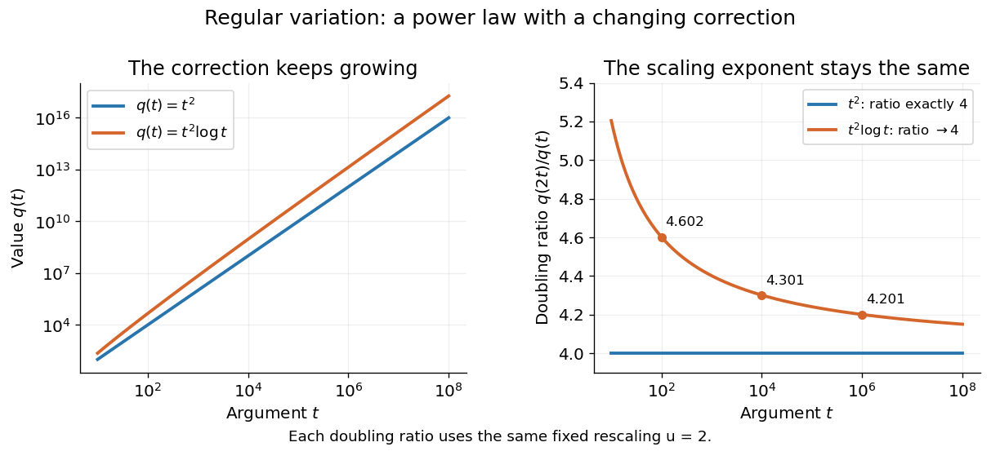
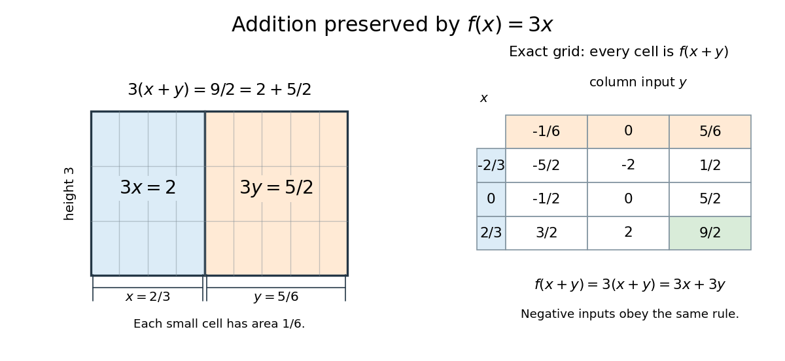
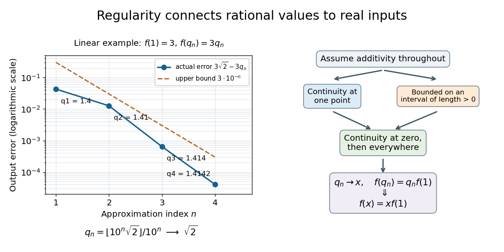
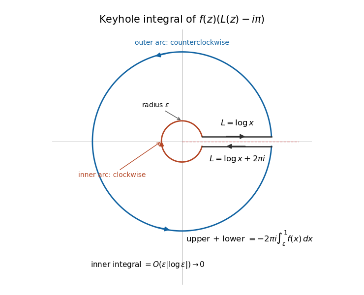
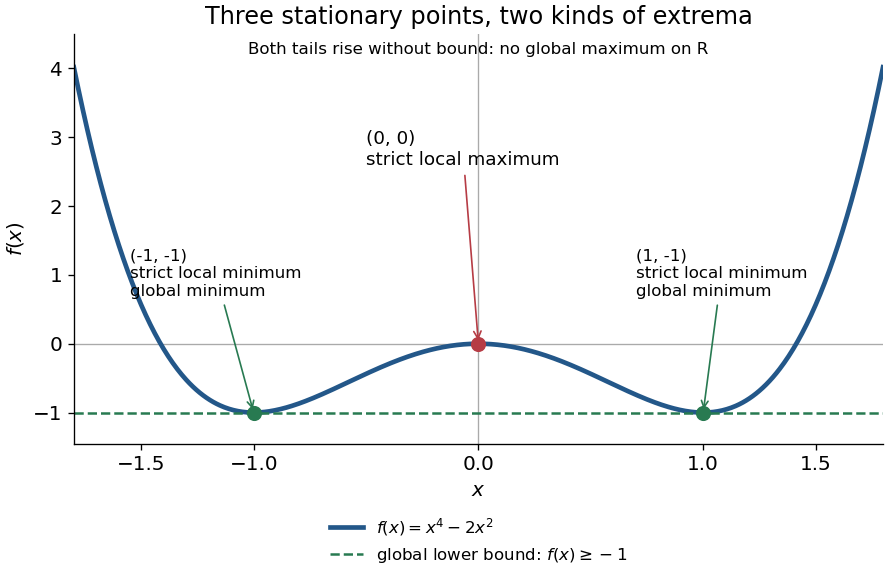
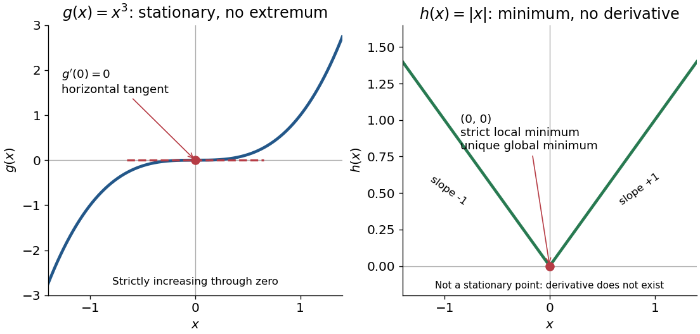
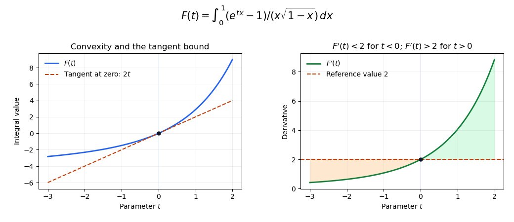
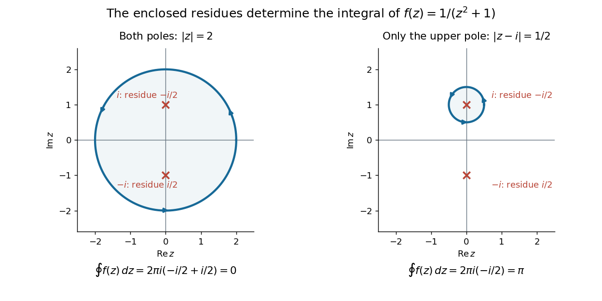
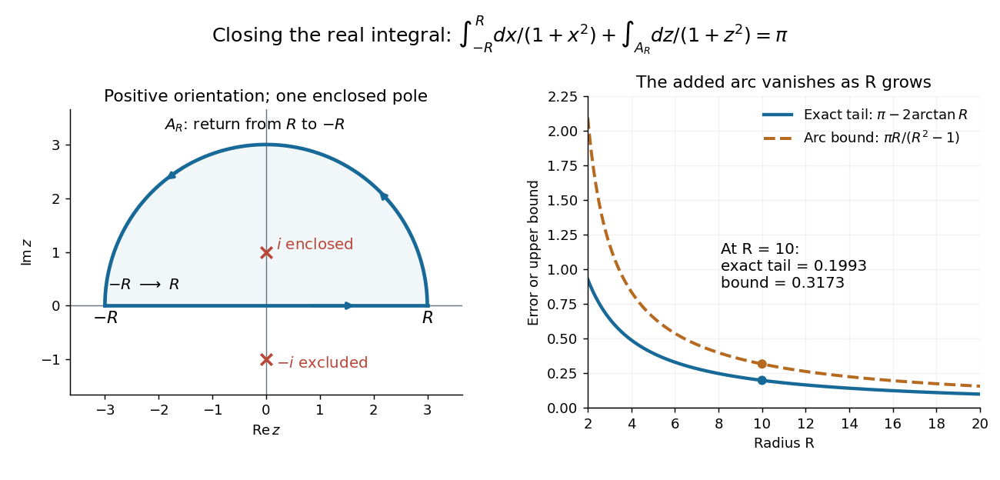
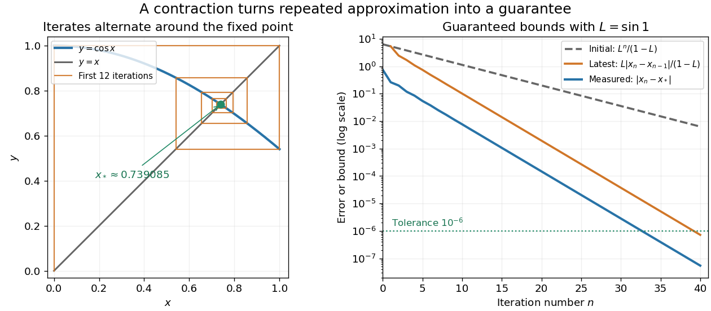

# Analysis

↑ **Parent:** [Area of mathematics](mathematics.md#area-of-mathematics)  
ⓦ [Wiki](https://en.wikipedia.org/wiki/Analysis)

**Table of contents**

- [Rough path](#rough-path)
  - [Control function for rough paths](#control-function-for-rough-paths)
  - [Rough differential equation](#rough-differential-equation)
  - [Enhanced Brownian motion](#enhanced-brownian-motion)
  - [Signature of a bounded variation path](#signature-of-a-bounded-variation-path)
  - [Rough path metric](#rough-path-metric)
  - [Geometric p-rough path](#geometric-p-rough-path)
  - [Weak geometric p-rough path](#weak-geometric-p-rough-path)
- [Harmonic analysis](harmonic-analysis.md)
  - [Carleson measure](harmonic-analysis.md#carleson-measure)
  - [Non-tangential maximal function](harmonic-analysis.md#non-tangential-maximal-function)
  - [Hardy space](harmonic-analysis.md#hardy-space)
  - [Calderón–Zygmund decomposition](harmonic-analysis.md#calderon-zygmund-decomposition)
  - [Positive-definite function](harmonic-analysis.md#positive-definite-function)
- [Potential theory](#potential-theory)
  - [Dirichlet form](#dirichlet-form)
- [Integral equation](#integral-equation)
  - [Abel integral equation](#abel-integral-equation)
  - [Linear integral equation](#linear-integral-equation)
  - [Volterra integral equation](#volterra-integral-equation)
- [Spherical harmonic](#spherical-harmonic)
  - [Cartesian p-orbital decomposition](#cartesian-p-orbital-decomposition)
  - [Angular dipole](#angular-dipole)
  - [Angular monopole](#angular-monopole)
  - [Vector spherical harmonic](#vector-spherical-harmonic)
  - [Solid harmonic](#solid-harmonic)
  - [Spectrum of the round sphere](#spectrum-of-the-round-sphere)
  - [Gaunt integral](#gaunt-integral)
  - [Regular solid harmonic](#regular-solid-harmonic)
  - [Spherical harmonic addition theorem](#spherical-harmonic-addition-theorem)
  - [Spin weight](#spin-weight)
  - [Spherical-harmonic streaming recurrence](#spherical-harmonic-streaming-recurrence)
  - [Rayleigh plane-wave expansion](#rayleigh-plane-wave-expansion)
- [Power law](#power-law)
  - [Power-law distribution](#power-law-distribution)
  - [Cored power-law density profile](#cored-power-law-density-profile)
  - [Polynomial growth](#polynomial-growth)
- [Complex dynamics](complex-dynamics.md)
  - [Holomorphic conjugacy](complex-dynamics.md#holomorphic-conjugacy)
  - [Completely invariant set of a rational map](complex-dynamics.md#completely-invariant-set-of-a-rational-map)
  - [Periodic point](complex-dynamics.md#periodic-point)
  - [Mandelbrot set](complex-dynamics.md#mandelbrot-set)
  - [Normal family](complex-dynamics.md#normal-family)
  - [Fatou set](complex-dynamics.md#fatou-set)
  - [Julia set](complex-dynamics.md#julia-set)
  - [Böttcher's equation](complex-dynamics.md#bottcher-s-equation)
  - [Holomorphic fixed-point index](complex-dynamics.md#holomorphic-fixed-point-index)
  - [Parabolic cycle](complex-dynamics.md#parabolic-cycle)
  - [Hyperbolic component](complex-dynamics.md#hyperbolic-component)
- [Functional equation](#functional-equation)
  - [Continuous exponential functional equation](#continuous-exponential-functional-equation)
  - [Cauchy's functional equation](#cauchy-s-functional-equation)
- [Complex analysis](complex-analysis.md)
  - [Complex singularity](complex-analysis.md#complex-singularity)
  - [Complex integration](complex-analysis.md#complex-integration)
  - [Power maps of a reciprocal-coordinate hyperbola](complex-analysis.md#power-maps-of-a-reciprocal-coordinate-hyperbola)
  - [Nontangential limit](complex-analysis.md#nontangential-limit)
  - [Polynomial hull](complex-analysis.md#polynomial-hull)
  - [Lower half-plane](complex-analysis.md#lower-half-plane)
  - [Holomorphic square root](complex-analysis.md#holomorphic-square-root)
  - [Monodromy](complex-analysis.md#monodromy)
  - [Cayley transform between the half-plane and disk](complex-analysis.md#cayley-transform-between-the-half-plane-and-disk)
  - [Right half-plane](complex-analysis.md#right-half-plane)
  - [Holomorphic logarithm](complex-analysis.md#holomorphic-logarithm)
  - [Upper half-plane (complex analysis)](complex-analysis.md#upper-half-plane-complex-analysis)
  - [Polylogarithm](complex-analysis.md#polylogarithm)
  - [Holomorphic function](holomorphic-function.md)
  - [Simply connected domain](complex-analysis.md#simply-connected-domain)
  - [Complex inverse sine](complex-analysis.md#complex-inverse-sine)
  - [Morera's theorem](complex-analysis.md#morera-s-theorem)
  - [Cauchy's integral theorem](complex-analysis.md#cauchy-s-integral-theorem)
  - [Cauchy principal value](complex-analysis.md#cauchy-principal-value)
  - [Principal-value residue rule](complex-analysis.md#principal-value-residue-rule)
  - [Exponential integral](complex-analysis.md#exponential-integral)
  - [Gamma function](complex-analysis.md#gamma-function)
  - [Riemann surfaces](riemann-surfaces.md)
  - [Elliptic integral](complex-analysis.md#elliptic-integral)
  - [Elliptic function](complex-analysis.md#elliptic-function)
  - [Runge's theorem](complex-analysis.md#runge-s-theorem)
  - [Winding number](complex-analysis.md#winding-number)
  - [Homotopy invariance of winding number](complex-analysis.md#homotopy-invariance-of-winding-number)
  - [Bromwich contour](complex-analysis.md#bromwich-contour)
  - [Branch point](complex-analysis.md#branch-point)
  - [Complex number](complex-analysis.md#complex-number)
  - [Isolated singularity](isolated-singularity.md)
  - [Contour integration](complex-analysis.md#contour-integration)
  - [Univalent function](complex-analysis.md#univalent-function)
  - [Liouville theorem](complex-analysis.md#liouville-theorem)
  - [Cauchy derivative formula](complex-analysis.md#cauchy-derivative-formula)
  - [Locally uniform convergence of holomorphic functions](complex-analysis.md#locally-uniform-convergence-of-holomorphic-functions)
  - [Schwarz reflection principle](complex-analysis.md#schwarz-reflection-principle)
  - [Upper half-plane self-map](complex-analysis.md#upper-half-plane-self-map)
  - [Argument principle](complex-analysis.md#argument-principle)
  - [Meromorphic function with prescribed zeros and poles](complex-analysis.md#meromorphic-function-with-prescribed-zeros-and-poles)
  - [Maximum modulus principle](complex-analysis.md#maximum-modulus-principle)
  - [Mean value property for holomorphic functions](complex-analysis.md#mean-value-property-for-holomorphic-functions)
  - [Dirichlet beta function](complex-analysis.md#dirichlet-beta-function)
  - [Identity theorem](complex-analysis.md#identity-theorem)
  - [Residue at infinity from an asymptotic constant](complex-analysis.md#residue-at-infinity-from-an-asymptotic-constant)
  - [Large-circle contour estimate](complex-analysis.md#large-circle-contour-estimate)
  - [Fuchsian differential equation](complex-analysis.md#fuchsian-differential-equation)
- [Fourier analysis](fourier-analysis.md)
  - [Homogeneous Banach space on the circle](fourier-analysis.md#homogeneous-banach-space-on-the-circle)
  - [Semidiscrete Fourier transform](fourier-analysis.md#semidiscrete-fourier-transform)
  - [Infrared cutoff](fourier-analysis.md#infrared-cutoff)
  - [Fourier shell correlation](fourier-analysis.md#fourier-shell-correlation)
  - [Cross-correlation](fourier-analysis.md#cross-correlation)
  - [Wiener-Khinchin theorem](fourier-analysis.md#wiener-khinchin-theorem)
  - [Frequency spectrum](fourier-analysis.md#frequency-spectrum)
  - [Spatial frequency](fourier-analysis.md#spatial-frequency)
  - [Nyquist–Shannon sampling theorem](fourier-analysis.md#nyquist-shannon-sampling-theorem)
  - [Euclidean lattice](fourier-analysis.md#euclidean-lattice)
  - [Poisson summation formula](fourier-analysis.md#poisson-summation-formula)
  - [Orthogonality of complex exponentials](fourier-analysis.md#orthogonality-of-complex-exponentials)
  - [Wavelet](fourier-analysis.md#wavelet)
  - [Fourier mode](fourier-analysis.md#fourier-mode)
  - [Schwartz space](fourier-analysis.md#schwartz-space)
  - [Fourier inversion theorem](fourier-analysis.md#fourier-inversion-theorem)
  - [Fourier transform of a triangular function](fourier-analysis.md#fourier-transform-of-a-triangular-function)
  - [Convolution](fourier-analysis.md#convolution)
  - [Riemann-Lebesgue lemma](fourier-analysis.md#riemann-lebesgue-lemma)
  - [Dirichlet integral](fourier-analysis.md#dirichlet-integral)
  - [Plancherel theorem](fourier-analysis.md#plancherel-theorem)
  - [Parseval identity](fourier-analysis.md#parseval-identity)
  - [Fourier transform of a Gaussian](fourier-analysis.md#fourier-transform-of-a-gaussian)
  - [Khintchine inequality](fourier-analysis.md#khintchine-inequality)
  - [Fourier restriction theory](fourier-analysis.md#fourier-restriction-theory)
- [Functional analysis](functional-analysis.md)
  - [Nemytskii operator](functional-analysis.md#nemytskii-operator)
  - [Continuous embedding](functional-analysis.md#continuous-embedding)
  - [Compact embedding](functional-analysis.md#compact-embedding)
  - [Sublinear operator](functional-analysis.md#sublinear-operator)
  - [Operator algebra](functional-analysis.md#operator-algebra)
  - [Metric embedding](metric-embedding.md)
  - [Exponentially weighted supremum norm](functional-analysis.md#exponentially-weighted-supremum-norm)
  - [Operator topology](functional-analysis.md#operator-topology)
  - [Schauder basis](functional-analysis.md#schauder-basis)
  - [Reflexive space](functional-analysis.md#reflexive-space)
  - [Banach algebra](banach-algebra.md)
  - [Weak topology](weak-topology.md)
  - [Weakly compact operator](functional-analysis.md#weakly-compact-operator)
  - [Topological vector space](topological-vector-space.md)
  - [Function space](functional-analysis.md#function-space)
  - [Integral operator](functional-analysis.md#integral-operator)
  - [Normed vector space](normed-vector-space.md)
  - [Riesz-Markov-Kakutani representation theorem](functional-analysis.md#riesz-markov-kakutani-representation-theorem)
  - [Stone-Weierstrass theorem](functional-analysis.md#stone-weierstrass-theorem)
  - [Open mapping theorem (functional analysis)](functional-analysis.md#open-mapping-theorem-functional-analysis)
  - [Diagonal operator on sequence space](functional-analysis.md#diagonal-operator-on-sequence-space)
  - [Coercive operator](functional-analysis.md#coercive-operator)
  - [Graph of a linear operator](functional-analysis.md#graph-of-a-linear-operator)
  - [Closed-range criterion for an injection](functional-analysis.md#closed-range-criterion-for-an-injection)
  - [Neumann-series perturbation](functional-analysis.md#neumann-series-perturbation)
  - [Density by annihilators](functional-analysis.md#density-by-annihilators)
  - [Hilbert space](hilbert-space.md)
  - [Weak lower semicontinuity](functional-analysis.md#weak-lower-semicontinuity)
  - [Compact operator](compact-operator.md)
  - [Lower norm of an operator](functional-analysis.md#lower-norm-of-an-operator)
  - [Gap between closed operators](functional-analysis.md#gap-between-closed-operators)
  - [Solvability complexity index](functional-analysis.md#solvability-complexity-index)
  - [Numerical range of an operator](functional-analysis.md#numerical-range-of-an-operator)
  - [Sublinear function](functional-analysis.md#sublinear-function)
  - [Hahn-Banach theorem](functional-analysis.md#hahn-banach-theorem)
  - [Banach-Alaoglu theorem](functional-analysis.md#banach-alaoglu-theorem)
  - [Krein-Milman theorem](functional-analysis.md#krein-milman-theorem)
  - [Lax-Milgram theorem](functional-analysis.md#lax-milgram-theorem)
  - [Sobolev space](sobolev-space.md)
  - [Space of continuous functions vanishing at infinity](functional-analysis.md#space-of-continuous-functions-vanishing-at-infinity)
  - [Noncompactness by separated translates](functional-analysis.md#noncompactness-by-separated-translates)
  - [Continuous dual space](continuous-dual-space.md)
  - [Holder inequality](functional-analysis.md#holder-inequality)
  - [Space of sequences converging to zero](functional-analysis.md#space-of-sequences-converging-to-zero)
  - [Banach space isomorphism](functional-analysis.md#banach-space-isomorphism)
  - [John-Nirenberg inequality](functional-analysis.md#john-nirenberg-inequality)
  - [C0-semigroup](functional-analysis.md#c0-semigroup)
- [Nonlinear analysis](nonlinear-analysis.md)
  - [Hemicontinuity](nonlinear-analysis.md#hemicontinuity)
  - [Hardy–Littlewood–Sobolev inequality](nonlinear-analysis.md#hardy-littlewood-sobolev-inequality)
  - [Generalized Korteweg–De Vries equation](nonlinear-analysis.md#generalized-korteweg-de-vries-equation)
  - [Gravitational Hartree equation](nonlinear-analysis.md#gravitational-hartree-equation)
  - [Emden-Fowler transformation](nonlinear-analysis.md#emden-fowler-transformation)
  - [Pohozaev identity](nonlinear-analysis.md#pohozaev-identity)
  - [Symmetric decreasing rearrangement](nonlinear-analysis.md#symmetric-decreasing-rearrangement)
  - [Nonlinear Schrödinger blowup analysis](nonlinear-analysis.md#nonlinear-schrodinger-blowup-analysis)
  - [Young's inequality for products](nonlinear-analysis.md#young-s-inequality-for-products)
  - [Confining-potential energy space](nonlinear-analysis.md#confining-potential-energy-space)
  - [Defocusing cubic nonlinear Schrödinger equation in two dimensions](nonlinear-analysis.md#defocusing-cubic-nonlinear-schrodinger-equation-in-two-dimensions)
- [Topological analysis](topological-analysis.md)
  - [Brouwer fixed-point theorem](topological-analysis.md#brouwer-fixed-point-theorem)
  - [No-retraction theorem](topological-analysis.md#no-retraction-theorem)
  - [Metric space](topological-analysis.md#metric-space)
  - [Equicontinuity](topological-analysis.md#equicontinuity)
- [Piecewise continuous function](#piecewise-continuous-function)
- [Integral transform](integral-transform.md)
  - [Linear canonical transformation](integral-transform.md#linear-canonical-transformation)
  - [Weierstrass transform](integral-transform.md#weierstrass-transform)
  - [Spherical mean](integral-transform.md#spherical-mean)
  - [Radon transform](integral-transform.md#radon-transform)
  - [Mellin transform](integral-transform.md#mellin-transform)
  - [Laplace transform](integral-transform.md#laplace-transform)
- [Hardy-Littlewood maximal function](#hardy-littlewood-maximal-function)
  - [Radial decreasing kernel domination by the maximal function](#radial-decreasing-kernel-domination-by-the-maximal-function)
  - [Uncentered maximal function of a finite measure](#uncentered-maximal-function-of-a-finite-measure)
  - [Hardy-Littlewood maximal inequality](#hardy-littlewood-maximal-inequality)
- [Watson's lemma](#watson-s-lemma)
  - [Parameter-shift remainder bound for a logarithmic Laplace integral](#parameter-shift-remainder-bound-for-a-logarithmic-laplace-integral)
  - [Laplace endpoint expansion with a logarithmic denominator](#laplace-endpoint-expansion-with-a-logarithmic-denominator)
  - [Logarithmic endpoint Fourier asymptotics](#logarithmic-endpoint-fourier-asymptotics)
  - [Complex Watson lemma](#complex-watson-lemma)
  - [Reciprocal-amplitude Laplace integral](#reciprocal-amplitude-laplace-integral)
- [Incomplete gamma function](#incomplete-gamma-function)
  - [Scaled lower incomplete gamma integral](#scaled-lower-incomplete-gamma-integral)
  - [Asymptotic expansion by repeated integration by parts](#asymptotic-expansion-by-repeated-integration-by-parts)
  - [Fixed-lower-limit incomplete gamma asymptotic](#fixed-lower-limit-incomplete-gamma-asymptotic)
  - [Endpoint expansion of the incomplete gamma function](#endpoint-expansion-of-the-incomplete-gamma-function)
- [Stationary phase method](#stationary-phase-method)
  - [Quadratic stationary endpoint with quadratically vanishing amplitude](#quadratic-stationary-endpoint-with-quadratically-vanishing-amplitude)
  - [Stationary-phase flexural-beam pulse](#stationary-phase-flexural-beam-pulse)
  - [Cubic stationary endpoint](#cubic-stationary-endpoint)
  - [Oscillatory integral phase](#oscillatory-integral-phase)
  - [Two-dimensional stationary-phase formula](#two-dimensional-stationary-phase-formula)
  - [Stationary phase endpoint cancellation in a half-strip contour](#stationary-phase-endpoint-cancellation-in-a-half-strip-contour)
  - [Nondegenerate stationary point of a phase](#nondegenerate-stationary-point-of-a-phase)
  - [One-dimensional stationary-phase formula](#one-dimensional-stationary-phase-formula)
  - [Cubic endpoint stationary-phase scaling](#cubic-endpoint-stationary-phase-scaling)
  - [Stationary-phase asymptotic for the generalized Bessel cosine integral](#stationary-phase-asymptotic-for-the-generalized-bessel-cosine-integral)
  - [Nonstationary oscillatory integral](#nonstationary-oscillatory-integral)
- [WKB approximation](#wkb-approximation)
  - [Flux-normalized WKB amplitude](#flux-normalized-wkb-amplitude)
  - [Wave turning point](#wave-turning-point)
  - [Mass dependence of fixed-barrier tunnelling](#mass-dependence-of-fixed-barrier-tunnelling)
  - [WKB tunnelling exponent](#wkb-tunnelling-exponent)
  - [WKB validity condition](#wkb-validity-condition)
  - [Localized forcing determines WKB phase constants](#localized-forcing-determines-wkb-phase-constants)
  - [Slowly varying triangular-jet envelope](#slowly-varying-triangular-jet-envelope)
  - [WKB correction term](#wkb-correction-term)
  - [WKB approximation for a slowly varying oscillator](#wkb-approximation-for-a-slowly-varying-oscillator)
  - [WKB amplitude in a slowly varying duct](#wkb-amplitude-in-a-slowly-varying-duct)
  - [Airy turning-point connection formula](#airy-turning-point-connection-formula)
  - [Classical turning point](#classical-turning-point)
  - [WKB quantization condition](#wkb-quantization-condition)
  - [Removal of the first derivative from a second-order differential equation](#removal-of-the-first-derivative-from-a-second-order-differential-equation)
  - [Irregular singular point at infinity](#irregular-singular-point-at-infinity)
  - [Liouville-Green exponential ansatz](#liouville-green-exponential-ansatz)
- [Asymptotic expansion](asymptotic-expansion.md)
  - [Logarithmic inversion of a Gaussian divided by its argument](asymptotic-expansion.md#logarithmic-inversion-of-a-gaussian-divided-by-its-argument)
  - [Monotone parametrization of sine perturbation roots](asymptotic-expansion.md#monotone-parametrization-of-sine-perturbation-roots)
  - [Uniform asymptotic approximation](asymptotic-expansion.md#uniform-asymptotic-approximation)
  - [Lorentzian peak approaching an integration endpoint](asymptotic-expansion.md#lorentzian-peak-approaching-an-integration-endpoint)
  - [Asymptotic power series](asymptotic-expansion.md#asymptotic-power-series)
  - [Compactified approximation from endpoint asymptotics](asymptotic-expansion.md#compactified-approximation-from-endpoint-asymptotics)
  - [Perturbation theory](asymptotic-expansion.md#perturbation-theory)
  - [Integer-frequency endpoint expansion of cosine integrals](asymptotic-expansion.md#integer-frequency-endpoint-expansion-of-cosine-integrals)
  - [Dominant balance](asymptotic-expansion.md#dominant-balance)
  - [Regular perturbation](asymptotic-expansion.md#regular-perturbation)
  - [Large roots near tangent poles](asymptotic-expansion.md#large-roots-near-tangent-poles)
  - [Uniform error bound for nearby decaying exponentials](asymptotic-expansion.md#uniform-error-bound-for-nearby-decaying-exponentials)
  - [Borel summation](asymptotic-expansion.md#borel-summation)
  - [Optimal truncation](asymptotic-expansion.md#optimal-truncation)
  - [Dominant balance for algebraic roots](asymptotic-expansion.md#dominant-balance-for-algebraic-roots)
  - [Endpoint transition of a regularized interior pole](asymptotic-expansion.md#endpoint-transition-of-a-regularized-interior-pole)
  - [Stokes phenomenon](asymptotic-expansion.md#stokes-phenomenon)
  - [Series reversion](asymptotic-expansion.md#series-reversion)
  - [Divide-and-conquer asymptotic expansion](asymptotic-expansion.md#divide-and-conquer-asymptotic-expansion)
  - [Asymptotic sequence](asymptotic-expansion.md#asymptotic-sequence)
  - [Laplace's method](asymptotic-expansion.md#laplace-s-method)
  - [Method of steepest descent](asymptotic-expansion.md#method-of-steepest-descent)
- [Numerical analysis](numerical-analysis.md)
  - [Time-stepping method](numerical-analysis.md#time-stepping-method)
  - [Numerical differentiation](numerical-analysis.md#numerical-differentiation)
  - [Discretization](numerical-analysis.md#discretization)
  - [Implicit numerical method](numerical-analysis.md#implicit-numerical-method)
  - [Explicit numerical method](numerical-analysis.md#explicit-numerical-method)
  - [One-step method](numerical-analysis.md#one-step-method)
  - [Energy error](numerical-analysis.md#energy-error)
  - [Manufactured solution](numerical-analysis.md#manufactured-solution)
  - [Error norm](numerical-analysis.md#error-norm)
  - [Vectorized numerical computation](numerical-analysis.md#vectorized-numerical-computation)
  - [Backward stability](numerical-analysis.md#backward-stability)
  - [Root finding](numerical-analysis.md#root-finding)
  - [Fixed-point iteration](numerical-analysis.md#fixed-point-iteration)
  - [Fixed-point arithmetic](numerical-analysis.md#fixed-point-arithmetic)
  - [Rounding](numerical-analysis.md#rounding)
  - [Shooting method](numerical-analysis.md#shooting-method)
  - [Golden-section search](numerical-analysis.md#golden-section-search)
  - [Significant figures](numerical-analysis.md#significant-figures)
  - [Numerical method](numerical-analysis.md#numerical-method)
  - [Floating-point arithmetic](floating-point-arithmetic.md)
  - [Newton root-finding iteration](numerical-analysis.md#newton-root-finding-iteration)
  - [Bracketing method](numerical-analysis.md#bracketing-method)
  - [Chord error bound](numerical-analysis.md#chord-error-bound)
  - [Interval arithmetic](numerical-analysis.md#interval-arithmetic)
  - [Continuation method](numerical-analysis.md#continuation-method)
  - [Computer aided geometric design](computer-aided-geometric-design.md)
  - [Round-off error](numerical-analysis.md#round-off-error)
  - [Richardson extrapolation](numerical-analysis.md#richardson-extrapolation)
  - [Error control for ODE solvers](error-control-for-ode-solvers.md)
  - [Finite volume method](finite-volume-method.md)
  - [Interval bisection](numerical-analysis.md#interval-bisection)
  - [Multigrid method](multigrid-method.md)
  - [Convergence of a numerical method](numerical-analysis.md#convergence-of-a-numerical-method)
  - [Global discretization error](numerical-analysis.md#global-discretization-error)
  - [Midpoint quadrature rule](numerical-analysis.md#midpoint-quadrature-rule)
  - [Approximation error](numerical-analysis.md#approximation-error)
  - [Truncation error](numerical-analysis.md#truncation-error)
  - [Spectral method](numerical-analysis.md#spectral-method)
  - [Stability of a numerical method](numerical-analysis.md#stability-of-a-numerical-method)
  - [Consistency of a numerical method](numerical-analysis.md#consistency-of-a-numerical-method)
  - [Energy method](numerical-analysis.md#energy-method)
  - [Finite element method](finite-element-method.md)
  - [Arithmetic operation](numerical-analysis.md#arithmetic-operation)
  - [Schur stability criterion](numerical-analysis.md#schur-stability-criterion)
  - [Lie product formula](numerical-analysis.md#lie-product-formula)
  - [Strang splitting](numerical-analysis.md#strang-splitting)
  - [Composite midpoint rule error](numerical-analysis.md#composite-midpoint-rule-error)
  - [Discrete Fourier transform](discrete-fourier-transform.md)
  - [Interpolation](interpolation.md)
  - [Gershgorin circle theorem](numerical-analysis.md#gershgorin-circle-theorem)
  - [Finite difference](finite-difference.md)
  - [Tridiagonal matrix algorithm](numerical-analysis.md#tridiagonal-matrix-algorithm)
  - [Gaussian quadrature](numerical-analysis.md#gaussian-quadrature)
  - [Lobatto quadrature](numerical-analysis.md#lobatto-quadrature)
  - [Chebyshev polynomial](numerical-analysis.md#chebyshev-polynomial)
  - [Backward differentiation formula](numerical-analysis.md#backward-differentiation-formula)
  - [Constrained optimization](numerical-analysis.md#constrained-optimization)
  - [Equally spaced interpolation](numerical-analysis.md#equally-spaced-interpolation)
  - [Givens rotation](numerical-analysis.md#givens-rotation)
  - [Gradient descent](gradient-descent.md)
  - [Peano kernel theorem](numerical-analysis.md#peano-kernel-theorem)
  - [Periodic trapezoidal Fourier aliasing](numerical-analysis.md#periodic-trapezoidal-fourier-aliasing)
  - [Fourier-Galerkin matrix for a drift-diffusion equation](numerical-analysis.md#fourier-galerkin-matrix-for-a-drift-diffusion-equation)
  - [Fourier spectral method for variable-coefficient advection](numerical-analysis.md#fourier-spectral-method-for-variable-coefficient-advection)
  - [Simplex algorithm](numerical-analysis.md#simplex-algorithm)
  - [Sparse optimization](numerical-analysis.md#sparse-optimization)
  - [Stability function](numerical-analysis.md#stability-function)
  - [Linear multistep method](linear-multistep-method.md)
  - [Numerical linear algebra](numerical-linear-algebra.md)
  - [Linear stability domain](numerical-analysis.md#linear-stability-domain)
  - [Numerical integration](numerical-integration.md)
  - [Orthogonal polynomial](orthogonal-polynomial.md)
  - [Midpoint method](numerical-analysis.md#midpoint-method)
  - [Collocation method](numerical-analysis.md#collocation-method)
  - [QR algorithm](numerical-analysis.md#qr-algorithm)
  - [Iterative method](numerical-analysis.md#iterative-method)
  - [Forward error](numerical-analysis.md#forward-error)
  - [Backward error](numerical-analysis.md#backward-error)
- [Saddle point](#saddle-point)
  - [Monkey saddle](#monkey-saddle)
  - [Saddle-point approximation](#saddle-point-approximation)
- [Lambert W function](#lambert-w-function)
  - [Real branches of Lambert W](#real-branches-of-lambert-w)
- [Scorer function](#scorer-function)
  - [Scorer Hi function](#scorer-hi-function)
- [Bessel function](bessel-function.md)
  - [Bessel inverse-power expansion at infinity](bessel-function.md#bessel-inverse-power-expansion-at-infinity)
  - [Hankel function](bessel-function.md#hankel-function)
  - [Bessel function of the second kind](bessel-function.md#bessel-function-of-the-second-kind)
  - [Spherical Bessel function](bessel-function.md#spherical-bessel-function)
  - [Bessel function of the first kind](bessel-function.md#bessel-function-of-the-first-kind)
  - [Bessel differential equation](bessel-function.md#bessel-differential-equation)
  - [Modified Bessel function](bessel-function.md#modified-bessel-function)
- [Branch cut](#branch-cut)
  - [Jump of a fractional power across a branch cut](#jump-of-a-fractional-power-across-a-branch-cut)
  - [Semicircle integral from a slit-plane square root](#semicircle-integral-from-a-slit-plane-square-root)
  - [Monodromy of a meromorphic integral](#monodromy-of-a-meromorphic-integral)
  - [Branch cut joining cancelling poles](#branch-cut-joining-cancelling-poles)
  - [Path independence by vanishing periods](#path-independence-by-vanishing-periods)
- [Cauchy integral formula](#cauchy-integral-formula)
  - [Conjugated Cauchy integral on a circle](#conjugated-cauchy-integral-on-a-circle)
  - [Orientation sign in quadrant harmonic spectral inversion](#orientation-sign-in-quadrant-harmonic-spectral-inversion)
  - [Cauchy coefficient formula](#cauchy-coefficient-formula)
  - [Cauchy-Pompeiu formula](#cauchy-pompeiu-formula)
  - [Half-plane decomposition by Cauchy integrals](#half-plane-decomposition-by-cauchy-integrals)
  - [Cauchy estimate](#cauchy-estimate)
- [Cauchy-Riemann equations](#cauchy-riemann-equations)
  - [Distributional Cauchy-Riemann lemma](#distributional-cauchy-riemann-lemma)
  - [Orthogonality of regular real and imaginary level curves](#orthogonality-of-regular-real-and-imaginary-level-curves)
  - [First-order Cauchy-Riemann operator](#first-order-cauchy-riemann-operator)
  - [Wirtinger derivatives](#wirtinger-derivatives)
- [Complex logarithm](#complex-logarithm)
  - [Complex logarithm on the negative real axis](#complex-logarithm-on-the-negative-real-axis)
  - [Circle integral of a logarithm with a radial branch cut](#circle-integral-of-a-logarithm-with-a-radial-branch-cut)
  - [Logarithmic singularity](#logarithmic-singularity)
  - [Branch of the complex logarithm](#branch-of-the-complex-logarithm)
  - [Analytic branch of a square root](#analytic-branch-of-a-square-root)
  - [Complex exponentiation](#complex-exponentiation)
  - [Analytic logarithm on the positive-axis slit plane](#analytic-logarithm-on-the-positive-axis-slit-plane)
- [Critical point](#critical-point)
  - [Degenerate critical point](#degenerate-critical-point)
  - [Separable quartic landscape with nine stationary points](#separable-quartic-landscape-with-nine-stationary-points)
  - [Quartic double well with bilinear coupling](#quartic-double-well-with-bilinear-coupling)
  - [Quartic surface with axes and a circle as its zero set](#quartic-surface-with-axes-and-a-circle-as-its-zero-set)
  - [Exponential-linear separable potential](#exponential-linear-separable-potential)
  - [Parabolic quartic critical-point classification](#parabolic-quartic-critical-point-classification)
  - [Quartic potential with fourfold symmetry](#quartic-potential-with-fourfold-symmetry)
  - [Saddle point of a scalar function](#saddle-point-of-a-scalar-function)
  - [Local maximum](#local-maximum)
  - [Nonisolated stationary point](#nonisolated-stationary-point)
  - [Critical set](#critical-set)
  - [Local minimum](#local-minimum)
  - [Global minimum](#global-minimum)
- [Damped harmonic oscillator](#damped-harmonic-oscillator)
  - [Ringdown](#ringdown)
  - [Energy decay of a viscously damped harmonic oscillator](#energy-decay-of-a-viscously-damped-harmonic-oscillator)
  - [Spring-base displacement response with a grounded damper](#spring-base-displacement-response-with-a-grounded-damper)
  - [Mass change in a viscously damped spring oscillator](#mass-change-in-a-viscously-damped-spring-oscillator)
  - [Initial-value solution of a damped harmonic trap](#initial-value-solution-of-a-damped-harmonic-trap)
  - [Causal Green function of an overdamped oscillator](#causal-green-function-of-an-overdamped-oscillator)
  - [Velocity-impulse response of a damped oscillator](#velocity-impulse-response-of-a-damped-oscillator)
  - [Initially circular damped planar oscillator](#initially-circular-damped-planar-oscillator)
  - [Two-time expansion of a weakly damped linear oscillator](#two-time-expansion-of-a-weakly-damped-linear-oscillator)
  - [Causal Green function of a damped oscillator](#causal-green-function-of-a-damped-oscillator)
  - [Forced harmonic oscillator](#forced-harmonic-oscillator)
- [Differentiable function](#differentiable-function)
  - [Continuity and differentiability thresholds for a damped oscillation](#continuity-and-differentiability-thresholds-for-a-damped-oscillation)
  - [Differentiability does not imply continuity of the derivative](#differentiability-does-not-imply-continuity-of-the-derivative)
  - [Quadratic damping restores differentiability at the origin](#quadratic-damping-restores-differentiability-at-the-origin)
  - [Secants straddling a differentiability point](#secants-straddling-a-differentiability-point)
  - [Differentiability implies continuity](#differentiability-implies-continuity)
  - [Differentiability](#differentiability)
  - [Smoothness](#smoothness)
  - [Existence of partial derivatives does not imply their continuity](#existence-of-partial-derivatives-does-not-imply-their-continuity)
- [Differentiation under the integral sign](#differentiation-under-the-integral-sign)
  - [Dominated differentiation under the integral sign](#dominated-differentiation-under-the-integral-sign)
  - [Logarithmic moments of a power on the unit interval](#logarithmic-moments-of-a-power-on-the-unit-interval)
  - [Logarithmic sine integral](#logarithmic-sine-integral)
  - [Logarithmic parameter integral with Cauchy weight](#logarithmic-parameter-integral-with-cauchy-weight)
  - [Logarithmic quadratic parameter integral](#logarithmic-quadratic-parameter-integral)
  - [Leibniz integral rule](#leibniz-integral-rule)
  - [Hadamard's lemma](#hadamard-s-lemma)
- [Dirichlet problem](#dirichlet-problem)
  - [Logarithmic Dirichlet potential between a circle and a line](#logarithmic-dirichlet-potential-between-a-circle-and-a-line)
  - [Harmonic extension](#harmonic-extension)
  - [Harmonic measure of a semicircle in a disk](#harmonic-measure-of-a-semicircle-in-a-disk)
  - [Harmonic sine mode in a half-strip](#harmonic-sine-mode-in-a-half-strip)
  - [Zero-boundary harmonic uniqueness](#zero-boundary-harmonic-uniqueness)
  - [Nonuniqueness of Dirichlet data without control at infinity](#nonuniqueness-of-dirichlet-data-without-control-at-infinity)
  - [Uniqueness of the Dirichlet problem](#uniqueness-of-the-dirichlet-problem)
  - [Brownian representation of the Dirichlet problem](#brownian-representation-of-the-dirichlet-problem)
  - [Perron method](#perron-method)
- [Euler-Lagrange equation](#euler-lagrange-equation)
  - [Affine Euler-Lagrange solution from finite derivative fibers](#affine-euler-lagrange-solution-from-finite-derivative-fibers)
  - [First integral for a variational integrand independent of the function value](#first-integral-for-a-variational-integrand-independent-of-the-function-value)
  - [Semicircular extremals of the hyperbolic length functional](#semicircular-extremals-of-the-hyperbolic-length-functional)
  - [Total time derivatives preserve fixed-endpoint Euler-Lagrange equations](#total-time-derivatives-preserve-fixed-endpoint-euler-lagrange-equations)
  - [Flat-cylinder travel metric for sine-latitude speed](#flat-cylinder-travel-metric-for-sine-latitude-speed)
  - [Isoperimetric constraint](#isoperimetric-constraint)
  - [Beltrami identity](#beltrami-identity)
  - [Catenary](#catenary)
  - [Natural boundary conditions for a free endpoint](#natural-boundary-conditions-for-a-free-endpoint)
  - [Euler-Lagrange equations for two fields](#euler-lagrange-equations-for-two-fields)
- [Exponential decay](#exponential-decay)
  - [Attenuation count model with an additive background](#attenuation-count-model-with-an-additive-background)
  - [Time constant](#time-constant)
  - [Stretched exponential function](#stretched-exponential-function)
  - [Half-life](#half-life)
- [First-step analysis](#first-step-analysis)
  - [Two-turn renewal game](#two-turn-renewal-game)
- [Forced oscillator](#forced-oscillator)
  - [Transmissibility](#transmissibility)
  - [Base-excited oscillator](#base-excited-oscillator)
  - [Steady-state response](#steady-state-response)
- [Fourier series](fourier-series.md)
  - [Dini test for Fourier series](fourier-series.md#dini-test-for-fourier-series)
  - [Lacunary Fourier series](fourier-series.md#lacunary-fourier-series)
  - [Orthogonality of trigonometric functions](fourier-series.md#orthogonality-of-trigonometric-functions)
  - [Dirichlet's theorem on Fourier series](fourier-series.md#dirichlet-s-theorem-on-fourier-series)
  - [Fourier series of a periodic rectangular pulse](fourier-series.md#fourier-series-of-a-periodic-rectangular-pulse)
  - [Fourier series of a half-wave rectified ramp](fourier-series.md#fourier-series-of-a-half-wave-rectified-ramp)
  - [Fourier series of a noninteger-frequency cosine](fourier-series.md#fourier-series-of-a-noninteger-frequency-cosine)
  - [Fourier solution of a first-order equation with periodic forcing](fourier-series.md#fourier-solution-of-a-first-order-equation-with-periodic-forcing)
  - [Fourier series of a periodically extended exponential](fourier-series.md#fourier-series-of-a-periodically-extended-exponential)
  - [Fourier series of a half-wave rectified sinusoid](fourier-series.md#fourier-series-of-a-half-wave-rectified-sinusoid)
  - [Translation of a Fourier series](fourier-series.md#translation-of-a-fourier-series)
  - [Fourier series of periodic hyperbolic sine and cosine](fourier-series.md#fourier-series-of-periodic-hyperbolic-sine-and-cosine)
  - [Square wave](fourier-series.md#square-wave)
  - [Gibbs phenomenon](fourier-series.md#gibbs-phenomenon)
  - [Fourier series of a noninteger-frequency sine](fourier-series.md#fourier-series-of-a-noninteger-frequency-sine)
  - [Fourier orthogonality](fourier-series.md#fourier-orthogonality)
  - [Uniqueness of a trigonometric series outside a finite set](fourier-series.md#uniqueness-of-a-trigonometric-series-outside-a-finite-set)
  - [Riemann summation of a convergent trigonometric series](fourier-series.md#riemann-summation-of-a-convergent-trigonometric-series)
  - [Decay of coefficients of an almost-everywhere convergent trigonometric series](fourier-series.md#decay-of-coefficients-of-an-almost-everywhere-convergent-trigonometric-series)
  - [Periodic triangular bump](fourier-series.md#periodic-triangular-bump)
  - [Du Bois-Reymond theorem](fourier-series.md#du-bois-reymond-theorem)
  - [Smooth-window Fourier coefficients of a periodic distribution](fourier-series.md#smooth-window-fourier-coefficients-of-a-periodic-distribution)
  - [Fourier coefficients of a periodic logarithmic singularity](fourier-series.md#fourier-coefficients-of-a-periodic-logarithmic-singularity)
  - [Cohomological equation on a Diophantine torus](fourier-series.md#cohomological-equation-on-a-diophantine-torus)
  - [Kahane-Katznelson divergence theorem](fourier-series.md#kahane-katznelson-divergence-theorem)
  - [Orthogonality of integer Fourier modes](fourier-series.md#orthogonality-of-integer-fourier-modes)
  - [Dirichlet-Jordan convergence theorem](fourier-series.md#dirichlet-jordan-convergence-theorem)
  - [Fourier series of a periodically extended quadratic arch](fourier-series.md#fourier-series-of-a-periodically-extended-quadratic-arch)
  - [Pointwise convergence of a piecewise smooth Fourier series](fourier-series.md#pointwise-convergence-of-a-piecewise-smooth-fourier-series)
  - [Complex Fourier series](fourier-series.md#complex-fourier-series)
  - [Reciprocal-square sine series positivity](fourier-series.md#reciprocal-square-sine-series-positivity)
  - [Wiener algebra](fourier-series.md#wiener-algebra)
  - [Fourier harmonic](fourier-series.md#fourier-harmonic)
  - [Cotangent partial-fraction Fourier kernel](fourier-series.md#cotangent-partial-fraction-fourier-kernel)
  - [Fourier basis](fourier-series.md#fourier-basis)
  - [Fourier sine series](fourier-series.md#fourier-sine-series)
  - [Leibniz formula for π](fourier-series.md#leibniz-formula-for-pi)
  - [Trigonometric polynomial](fourier-series.md#trigonometric-polynomial)
  - [Fourier partial sum](fourier-series.md#fourier-partial-sum)
  - [Fejér kernel](fourier-series.md#fejer-kernel)
  - [Fourier coefficient](fourier-series.md#fourier-coefficient)
  - [Fourier cosine series](fourier-series.md#fourier-cosine-series)
  - [Fourier series of x cubed minus pi squared x](fourier-series.md#fourier-series-of-x-cubed-minus-pi-squared-x)
- [Fourier transform](fourier-transform.md)
  - [Half-line Fourier transform](fourier-transform.md#half-line-fourier-transform)
  - [Uniqueness of the Fourier transform on integrable functions](fourier-transform.md#uniqueness-of-the-fourier-transform-on-integrable-functions)
  - [Fourier transform of a two-sided exponential](fourier-transform.md#fourier-transform-of-a-two-sided-exponential)
  - [Frequency domain](fourier-transform.md#frequency-domain)
  - [Fourier transform of an inverse power of one plus x squared](fourier-transform.md#fourier-transform-of-an-inverse-power-of-one-plus-x-squared)
  - [Inverse Fourier transform](fourier-transform.md#inverse-fourier-transform)
  - [Fourier transform of a polynomial multiple](fourier-transform.md#fourier-transform-of-a-polynomial-multiple)
  - [Duality property of the Fourier transform](fourier-transform.md#duality-property-of-the-fourier-transform)
  - [Fourier transform of a truncated cosine](fourier-transform.md#fourier-transform-of-a-truncated-cosine)
  - [Fourier transform of the hyperbolic secant](fourier-transform.md#fourier-transform-of-the-hyperbolic-secant)
  - [Hermitian symmetry](fourier-transform.md#hermitian-symmetry)
  - [Window function](fourier-transform.md#window-function)
  - [Uncentred Fourier uncertainty principle](fourier-transform.md#uncentred-fourier-uncertainty-principle)
  - [Fourier transform on a locally compact abelian group](fourier-transform.md#fourier-transform-on-a-locally-compact-abelian-group)
  - [Fourier decay from a derivative jump](fourier-transform.md#fourier-decay-from-a-derivative-jump)
  - [Modulation property of the Fourier transform](fourier-transform.md#modulation-property-of-the-fourier-transform)
  - [Fourier transform of a finite measure](fourier-transform.md#fourier-transform-of-a-finite-measure)
  - [Complex spectral Fourier transform](fourier-transform.md#complex-spectral-fourier-transform)
  - [Bandlimited function](fourier-transform.md#bandlimited-function)
  - [Half-range Fourier transform](fourier-transform.md#half-range-fourier-transform)
  - [Fourier transform isomorphism of the Schwartz space](fourier-transform.md#fourier-transform-isomorphism-of-the-schwartz-space)
  - [Fourier cosine transform](fourier-transform.md#fourier-cosine-transform)
  - [Fourier sine transform](fourier-transform.md#fourier-sine-transform)
  - [Sinc function](fourier-transform.md#sinc-function)
  - [Fourier space](fourier-transform.md#fourier-space)
  - [Moment differentiation of the Fourier transform](fourier-transform.md#moment-differentiation-of-the-fourier-transform)
  - [Fourier transform has proper dense image from L1 to C0](fourier-transform.md#fourier-transform-has-proper-dense-image-from-l1-to-c0)
  - [Hankel transform](fourier-transform.md#hankel-transform)
  - [Wigner distribution](fourier-transform.md#wigner-distribution)
  - [Japanese bracket](fourier-transform.md#japanese-bracket)
  - [Fourier shift theorem](fourier-transform.md#fourier-shift-theorem)
  - [Fresnel integral](fourier-transform.md#fresnel-integral)
  - [Additive character](fourier-transform.md#additive-character)
  - [Fourier transform over a local field](fourier-transform.md#fourier-transform-over-a-local-field)
  - [Fourier multiplier](fourier-transform.md#fourier-multiplier)
  - [Fourier transform of a function with reciprocal tails](fourier-transform.md#fourier-transform-of-a-function-with-reciprocal-tails)
  - [Scaling property of the Fourier transform](fourier-transform.md#scaling-property-of-the-fourier-transform)
  - [Fourier transform of inverse distance in three dimensions](fourier-transform.md#fourier-transform-of-inverse-distance-in-three-dimensions)
  - [Hilbert transform](fourier-transform.md#hilbert-transform)
  - [Fourier transform of an interval indicator](fourier-transform.md#fourier-transform-of-an-interval-indicator)
  - [Sinc-squared integral](fourier-transform.md#sinc-squared-integral)
- [Gradient flow](#gradient-flow)
  - [Morse-Smale gradient flow](#morse-smale-gradient-flow)
  - [Gradient flow of the periodic screened Poisson energy](#gradient-flow-of-the-periodic-screened-poisson-energy)
  - [Sheared quartic double-well gradient flow](#sheared-quartic-double-well-gradient-flow)
  - [Subgradient flow](#subgradient-flow)
  - [Gradient flow with diagonal mobility](#gradient-flow-with-diagonal-mobility)
  - [Gradient-flow dissipation identity](#gradient-flow-dissipation-identity)
  - [Diffusion from a gradient energy](#diffusion-from-a-gradient-energy)
- [Differential operator](#differential-operator)
  - [Linear differential operator](#linear-differential-operator)
  - [Differentiation on an exponential-polynomial space](#differentiation-on-an-exponential-polynomial-space)
  - [Euler differential operator](#euler-differential-operator)
  - [Differential operator relative to a base ring](#differential-operator-relative-to-a-base-ring)
  - [Formal pseudodifferential operator](#formal-pseudodifferential-operator)
  - [Formal transpose of a differential operator](#formal-transpose-of-a-differential-operator)
  - [Divergence form](#divergence-form)
- [Green's function](green-s-function.md)
  - [Mixed endpoint Green kernel for a first-derivative drift](green-s-function.md#mixed-endpoint-green-kernel-for-a-first-derivative-drift)
  - [Dirichlet resonance for the forced sine equation](green-s-function.md#dirichlet-resonance-for-the-forced-sine-equation)
  - [Mixed Green function for an Euler operator with exponents one and two](green-s-function.md#mixed-green-function-for-an-euler-operator-with-exponents-one-and-two)
  - [Adjoint Green function](green-s-function.md#adjoint-green-function)
  - [Green function jump conditions](green-s-function.md#green-function-jump-conditions)
  - [Green function under dependent-variable rescaling](green-s-function.md#green-function-under-dependent-variable-rescaling)
  - [Mixed Dirichlet-Neumann Green function in a quadrant](green-s-function.md#mixed-dirichlet-neumann-green-function-in-a-quadrant)
  - [Boundary-matrix construction of an ordinary differential Green function](green-s-function.md#boundary-matrix-construction-of-an-ordinary-differential-green-function)
  - [Time support from poles of a Fourier Green function](green-s-function.md#time-support-from-poles-of-a-fourier-green-function)
  - [Fourier Green function in a spatially varying background](green-s-function.md#fourier-green-function-in-a-spatially-varying-background)
  - [Advanced Green function](green-s-function.md#advanced-green-function)
  - [Source-position-dependent Fourier Green function](green-s-function.md#source-position-dependent-fourier-green-function)
  - [Neumann Green function with constant boundary flux](green-s-function.md#neumann-green-function-with-constant-boundary-flux)
  - [Half-line Green function for the first cylindrical harmonic](green-s-function.md#half-line-green-function-for-the-first-cylindrical-harmonic)
  - [Bounded Green kernel for a radial Euler operator](green-s-function.md#bounded-green-kernel-for-a-radial-euler-operator)
  - [Green function of an undamped oscillator](green-s-function.md#green-function-of-an-undamped-oscillator)
  - [Green kernels for a radial dipole Euler equation](green-s-function.md#green-kernels-for-a-radial-dipole-euler-equation)
  - [Green kernel and endpoint compatibility for a singular Euler equation](green-s-function.md#green-kernel-and-endpoint-compatibility-for-a-singular-euler-equation)
  - [Radial modified Helmholtz Green function on the half-line](green-s-function.md#radial-modified-helmholtz-green-function-on-the-half-line)
  - [Green kernel with a vanishing Wronskian at an interior singular point](green-s-function.md#green-kernel-with-a-vanishing-wronskian-at-an-interior-singular-point)
  - [Decaying two-sided Green function of a constant-coefficient ordinary differential equation](green-s-function.md#decaying-two-sided-green-function-of-a-constant-coefficient-ordinary-differential-equation)
  - [Nonunique Green kernel at a singular endpoint with two vanishing modes](green-s-function.md#nonunique-green-kernel-at-a-singular-endpoint-with-two-vanishing-modes)
  - [Fourth-order Green kernel with two decay scales](green-s-function.md#fourth-order-green-kernel-with-two-decay-scales)
  - [Causal Green function for a repeated-root Euler operator](green-s-function.md#causal-green-function-for-a-repeated-root-euler-operator)
  - [Boundary-decaying Green kernel for an inverse-square differential operator](green-s-function.md#boundary-decaying-green-kernel-for-an-inverse-square-differential-operator)
  - [Radial Helmholtz Dirichlet Green function](green-s-function.md#radial-helmholtz-dirichlet-green-function)
  - [Dipole Green tensor angular cancellation](green-s-function.md#dipole-green-tensor-angular-cancellation)
  - [Robin half-line Green function from left and right solutions](green-s-function.md#robin-half-line-green-function-from-left-and-right-solutions)
  - [Green function on a Riemann surface](green-s-function.md#green-function-on-a-riemann-surface)
  - [Impulse response](green-s-function.md#impulse-response)
  - [Complex transport Green function](green-s-function.md#complex-transport-green-function)
  - [Dirichlet Green function](green-s-function.md#dirichlet-green-function)
  - [Green-function representation](green-s-function.md#green-function-representation)
  - [One-dimensional modified Helmholtz Green function](green-s-function.md#one-dimensional-modified-helmholtz-green-function)
  - [Dirichlet Green function for an infinite strip](green-s-function.md#dirichlet-green-function-for-an-infinite-strip)
  - [Neumann Green function for a second-order ordinary differential equation](green-s-function.md#neumann-green-function-for-a-second-order-ordinary-differential-equation)
  - [Causal Green function](green-s-function.md#causal-green-function)
  - [One-dimensional outgoing Green function](green-s-function.md#one-dimensional-outgoing-green-function)
- [Hermite differential equation](#hermite-differential-equation)
  - [Power series solutions of the Hermite differential equation](#power-series-solutions-of-the-hermite-differential-equation)
  - [Hermite oscillator quantization](#hermite-oscillator-quantization)
  - [Odd polynomial solutions of the Hermite differential equation](#odd-polynomial-solutions-of-the-hermite-differential-equation)
- [Higher-order Euler-Lagrange equation](#higher-order-euler-lagrange-equation)
  - [Singular endpoints in higher-order variational problems](#singular-endpoints-in-higher-order-variational-problems)
  - [Clamped second-variation inequality](#clamped-second-variation-inequality)
  - [Clamped-free beam under uniform load and endpoint force](#clamped-free-beam-under-uniform-load-and-endpoint-force)
- [Laurent series](#laurent-series)
  - [Principal part of a Laurent series](#principal-part-of-a-laurent-series)
  - [Laurent coefficient](#laurent-coefficient)
  - [Basel sum from exponential poles](#basel-sum-from-exponential-poles)
  - [Puiseux series](#puiseux-series)
  - [Laurent theorem](#laurent-theorem)
- [Differential equation](differential-equation.md)
  - [Orthogonal trajectory](differential-equation.md#orthogonal-trajectory)
  - [Stationary solution](differential-equation.md#stationary-solution)
  - [Direction field](differential-equation.md#direction-field)
  - [Isocline](differential-equation.md#isocline)
  - [Jump condition](differential-equation.md#jump-condition)
  - [Delay differential equation](differential-equation.md#delay-differential-equation)
  - [Solution of a differential equation](differential-equation.md#solution-of-a-differential-equation)
  - [Ordinary differential equation](differential-equation.md#ordinary-differential-equation)
- [Real analytic function](#real-analytic-function)
  - [Factorial derivative criterion for real analyticity](#factorial-derivative-criterion-for-real-analyticity)
  - [Uniform analyticity under polynomial coordinate changes](#uniform-analyticity-under-polynomial-coordinate-changes)
- [Residue](#residue)
  - [Shrinking arc integral at a simple pole](#shrinking-arc-integral-at-a-simple-pole)
  - [Residue formula for a quotient at a simple denominator zero](#residue-formula-for-a-quotient-at-a-simple-denominator-zero)
  - [Residue at a pole of order n](#residue-at-a-pole-of-order-n)
- [Residue theorem](#residue-theorem)
  - [Cosine-difference inverse-square integral](#cosine-difference-inverse-square-integral)
  - [Cotangent contour summation](#cotangent-contour-summation)
  - [Logarithmic beta integral from a sector contour](#logarithmic-beta-integral-from-a-sector-contour)
  - [Fourier integral of a rational function with simple nonreal poles](#fourier-integral-of-a-rational-function-with-simple-nonreal-poles)
  - [Rectangular contour for an exponential beta integral](#rectangular-contour-for-an-exponential-beta-integral)
  - [Contour integral for a sine-squared trigonometric quotient](#contour-integral-for-a-sine-squared-trigonometric-quotient)
  - [Upper-half-plane contour for square-root logarithmic integrals](#upper-half-plane-contour-for-square-root-logarithmic-integrals)
  - [Upper-half-plane indentation rule](#upper-half-plane-indentation-rule)
  - [Residue cancellation by symmetry](#residue-cancellation-by-symmetry)
  - [Symmetric residue summation](#symmetric-residue-summation)
- [Schwarz lemma](#schwarz-lemma)
  - [Brownian proof of the Schwarz lemma](#brownian-proof-of-the-schwarz-lemma)
  - [Zero-free Schwarz lemma](#zero-free-schwarz-lemma)
  - [Carathéodory derivative bound for the right half-plane](#caratheodory-derivative-bound-for-the-right-half-plane)
  - [Schwarz-Pick theorem](#schwarz-pick-theorem)
- [Spectral radius](#spectral-radius)
  - [Spectral radius criterion for matrix powers](#spectral-radius-criterion-for-matrix-powers)
  - [Spectral-radius three-circle inequality](#spectral-radius-three-circle-inequality)
  - [Joint spectral radius](#joint-spectral-radius)
  - [Spectral radius formula](#spectral-radius-formula)
- [Spherical average](#spherical-average)
- [Sturm-Liouville theory](sturm-liouville-theory.md)
  - [Power-coordinate reduction of a singular Sturm-Liouville quotient](sturm-liouville-theory.md#power-coordinate-reduction-of-a-singular-sturm-liouville-quotient)
  - [Sturm-Liouville eigenfunction](sturm-liouville-theory.md#sturm-liouville-eigenfunction)
  - [Ground-state representation of a Sturm-Liouville energy](sturm-liouville-theory.md#ground-state-representation-of-a-sturm-liouville-energy)
  - [Sturm-Liouville equation](sturm-liouville-theory.md#sturm-liouville-equation)
  - [Sturm oscillation theorem](sturm-liouville-theory.md#sturm-oscillation-theorem)
  - [Drift-removing substitution for a Dirichlet Sturm-Liouville problem](sturm-liouville-theory.md#drift-removing-substitution-for-a-dirichlet-sturm-liouville-problem)
  - [Orthogonality of Sturm-Liouville eigenfunctions](sturm-liouville-theory.md#orthogonality-of-sturm-liouville-eigenfunctions)
  - [Gegenbauer polynomial](sturm-liouville-theory.md#gegenbauer-polynomial)
  - [Sturm-Liouville form](sturm-liouville-theory.md#sturm-liouville-form)
  - [Sturm-Liouville problem](sturm-liouville-theory.md#sturm-liouville-problem)
  - [Self-adjoint differential operator](sturm-liouville-theory.md#self-adjoint-differential-operator)
- [Travelling wave](#travelling-wave)
  - [Trapping triangle for a saturating monostable invasion front](#trapping-triangle-for-a-saturating-monostable-invasion-front)
  - [Travelling front](#travelling-front)
  - [Growth-factor depletion travelling wave](#growth-factor-depletion-travelling-wave)
  - [One-diffuser reaction front](#one-diffuser-reaction-front)
  - [Solitary wave](#solitary-wave)
  - [Front solution](#front-solution)
  - [Fisher's equation](#fisher-s-equation)
  - [Phase-plane construction of a Fisher travelling front](#phase-plane-construction-of-a-fisher-travelling-front)
  - [Travelling-wave reduction of a reaction-diffusion system](#travelling-wave-reduction-of-a-reaction-diffusion-system)
  - [Linear spreading speed](#linear-spreading-speed)
- [Uniqueness of Poisson equation](#uniqueness-of-poisson-equation)
  - [Dirichlet uniqueness for the Poisson equation](#dirichlet-uniqueness-for-the-poisson-equation)
- [Uniqueness theorem for ordinary differential equations](#uniqueness-theorem-for-ordinary-differential-equations)
- [Calculus of variations](calculus-of-variations.md)
  - [Log-cosh energy on a Sobolev space](calculus-of-variations.md#log-cosh-energy-on-a-sobolev-space)
  - [Weierstrass excess function](calculus-of-variations.md#weierstrass-excess-function)
  - [Strong local minimizer of a variational integral](calculus-of-variations.md#strong-local-minimizer-of-a-variational-integral)
  - [Weak local minimizer of a variational integral](calculus-of-variations.md#weak-local-minimizer-of-a-variational-integral)
  - [Length extremals from a constant quadratic energy](calculus-of-variations.md#length-extremals-from-a-constant-quadratic-energy)
  - [Euler-Lagrange equation for a second-derivative functional](calculus-of-variations.md#euler-lagrange-equation-for-a-second-derivative-functional)
  - [Extremal](calculus-of-variations.md#extremal)
  - [Variational principle](calculus-of-variations.md#variational-principle)
  - [Quadratic minor null Lagrangian](calculus-of-variations.md#quadratic-minor-null-lagrangian)
  - [Brachistochrone problem](calculus-of-variations.md#brachistochrone-problem)
  - [Travel-time minimization with speed proportional to squared radius](calculus-of-variations.md#travel-time-minimization-with-speed-proportional-to-squared-radius)
  - [Gamma-convergence](calculus-of-variations.md#gamma-convergence)
  - [Variational problem](calculus-of-variations.md#variational-problem)
  - [Direct method in the calculus of variations](calculus-of-variations.md#direct-method-in-the-calculus-of-variations)
  - [Functional](calculus-of-variations.md#functional)
  - [Stationary point](calculus-of-variations.md#stationary-point)
  - [Dirichlet principle](calculus-of-variations.md#dirichlet-principle)
  - [Optical ray in cylindrical coordinates](calculus-of-variations.md#optical-ray-in-cylindrical-coordinates)
  - [Noether theorem](calculus-of-variations.md#noether-theorem)
  - [Second variation](calculus-of-variations.md#second-variation)
- [Distribution theory](distribution-theory.md)
  - [Distribution (mathematical analysis)](distribution-theory.md#distribution-mathematical-analysis)
  - [Space of smooth functions](distribution-theory.md#space-of-smooth-functions)
  - [Test function](distribution-theory.md#test-function)
  - [Distributional identity](distribution-theory.md#distributional-identity)
  - [Dirac delta function](distribution-theory.md#dirac-delta-function)
  - [Multi-index notation](distribution-theory.md#multi-index-notation)
  - [Distributional derivative](distribution-theory.md#distributional-derivative)
  - [Multiplication of a distribution by a smooth function](distribution-theory.md#multiplication-of-a-distribution-by-a-smooth-function)
  - [Dilation of a distribution](distribution-theory.md#dilation-of-a-distribution)
  - [Riesz potential](distribution-theory.md#riesz-potential)
  - [Mollifier](distribution-theory.md#mollifier)
  - [Support of a distribution](distribution-theory.md#support-of-a-distribution)
  - [Fundamental solution of a linear differential operator](distribution-theory.md#fundamental-solution-of-a-linear-differential-operator)
  - [Elliptic differential operator](distribution-theory.md#elliptic-differential-operator)
  - [Oscillatory integral](distribution-theory.md#oscillatory-integral)
  - [Singular support](distribution-theory.md#singular-support)
  - [Paley–Wiener theorem](distribution-theory.md#paley-wiener-theorem)
  - [Hypoelliptic operator](distribution-theory.md#hypoelliptic-operator)
- [Partial differential equation](partial-differential-equation.md)
  - [Supersolution](partial-differential-equation.md#supersolution)
  - [Free boundary problem](partial-differential-equation.md#free-boundary-problem)
  - [Mixed-type partial differential equation](partial-differential-equation.md#mixed-type-partial-differential-equation)
  - [First-order partial differential equation](partial-differential-equation.md#first-order-partial-differential-equation)
  - [Parabolic boundary](partial-differential-equation.md#parabolic-boundary)
  - [Initial and boundary data for evolution equations](partial-differential-equation.md#initial-and-boundary-data-for-evolution-equations)
  - [Kuramoto-Sivashinsky equation](partial-differential-equation.md#kuramoto-sivashinsky-equation)
  - [Green's identities](partial-differential-equation.md#green-s-identities)
  - [Maximum principle](partial-differential-equation.md#maximum-principle)
  - [Burgers' equation](partial-differential-equation.md#burgers-equation)
  - [Semilinear partial differential equation](partial-differential-equation.md#semilinear-partial-differential-equation)
  - [Obstacle problem](partial-differential-equation.md#obstacle-problem)
  - [Parabolic comparison principle](partial-differential-equation.md#parabolic-comparison-principle)
  - [Domain of dependence](partial-differential-equation.md#domain-of-dependence)
  - [Linear partial differential equation](partial-differential-equation.md#linear-partial-differential-equation)
  - [Ill-posed problem](partial-differential-equation.md#ill-posed-problem)
  - [Linear partial differential operator](partial-differential-equation.md#linear-partial-differential-operator)
  - [Liouville equation](partial-differential-equation.md#liouville-equation)
  - [Radial function](partial-differential-equation.md#radial-function)
  - [Periodic domain](partial-differential-equation.md#periodic-domain)
  - [Energy estimate](partial-differential-equation.md#energy-estimate)
  - [Second-order partial differential equation](partial-differential-equation.md#second-order-partial-differential-equation)
  - [Quasilinear partial differential equation](partial-differential-equation.md#quasilinear-partial-differential-equation)
  - [Cauchy problem](partial-differential-equation.md#cauchy-problem)
  - [Solution of a partial differential equation](partial-differential-equation.md#solution-of-a-partial-differential-equation)
  - [Elliptic boundary value problem](elliptic-boundary-value-problem.md)
  - [Transport equation](transport-equation.md)
  - [Helmholtz equation](partial-differential-equation.md#helmholtz-equation)
  - [Modified Helmholtz equation](partial-differential-equation.md#modified-helmholtz-equation)
  - [Poisson's equation](partial-differential-equation.md#poisson-s-equation)
  - [Nonlinear partial differential equation](partial-differential-equation.md#nonlinear-partial-differential-equation)
  - [Moving-boundary problem](partial-differential-equation.md#moving-boundary-problem)
  - [Diffusion equation](diffusion-equation.md)
  - [Similarity solution](partial-differential-equation.md#similarity-solution)
  - [Separation of variables](partial-differential-equation.md#separation-of-variables)
  - [Polynomial ansatz](partial-differential-equation.md#polynomial-ansatz)
  - [Harmonic function](partial-differential-equation.md#harmonic-function)
  - [Smooth bump function](partial-differential-equation.md#smooth-bump-function)
  - [Laplace operator](partial-differential-equation.md#laplace-operator)
  - [Wave equation](wave-equation.md)
  - [Green second identity](partial-differential-equation.md#green-second-identity)
  - [Lie point symmetry](partial-differential-equation.md#lie-point-symmetry)
- [Real analysis](real-analysis.md)
  - [Hardy's inequality](real-analysis.md#hardy-s-inequality)
  - [Infimum and supremum](real-analysis.md#infimum-and-supremum)
  - [Asymptotic analysis](real-analysis.md#asymptotic-analysis)
  - [Monotone integral Tauberian lemma](real-analysis.md#monotone-integral-tauberian-lemma)
  - [Homogeneous function](real-analysis.md#homogeneous-function)
  - [Regular variation](real-analysis.md#regular-variation)
  - [Lipschitz continuity](real-analysis.md#lipschitz-continuity)
  - [Big O notation](real-analysis.md#big-o-notation)
  - [Real line](real-analysis.md#real-line)
  - [Extreme value theorem](real-analysis.md#extreme-value-theorem)
  - [Coercive function](real-analysis.md#coercive-function)
  - [Lp norm](real-analysis.md#lp-norm)
  - [Calculus](calculus.md)
  - [Sequence and series](sequence-and-series.md)
  - [Riemann integration](real-analysis.md#riemann-integration)
  - [Convergent subsequence](real-analysis.md#convergent-subsequence)
  - [Proper extended-real function](real-analysis.md#proper-extended-real-function)
  - [Convex function](real-analysis.md#convex-function)
  - [Concave function](real-analysis.md#concave-function)
  - [Measure theory](measure-theory.md)
- [Fixed-point theorem](#fixed-point-theorem)
  - [Schauder fixed-point theorem](#schauder-fixed-point-theorem)
  - [Strict distance decrease on a compact metric space](#strict-distance-decrease-on-a-compact-metric-space)
  - [Kakutani fixed-point theorem](#kakutani-fixed-point-theorem)
  - [Schauder-Tychonoff fixed-point theorem](#schauder-tychonoff-fixed-point-theorem)
  - [Leray-Schauder fixed point theorem](#leray-schauder-fixed-point-theorem)
  - [Knaster-Tarski theorem](#knaster-tarski-theorem)
  - [Fixed-point property](#fixed-point-property)
  - [Contraction mapping theorem](#contraction-mapping-theorem)
- [Inverse problem](inverse-problem.md)
  - [Nonuniqueness of geophysical inversion](inverse-problem.md#nonuniqueness-of-geophysical-inversion)
  - [Gravity inversion](inverse-problem.md#gravity-inversion)
  - [Image registration](inverse-problem.md#image-registration)
  - [Phase retrieval](inverse-problem.md#phase-retrieval)
  - [Seismic tomography](inverse-problem.md#seismic-tomography)
  - [Seismic source inversion](inverse-problem.md#seismic-source-inversion)
  - [Image deblurring](inverse-problem.md#image-deblurring)
  - [Tomography](inverse-problem.md#tomography)
  - [Ill-posed inverse problem](inverse-problem.md#ill-posed-inverse-problem)
  - [X-ray transform](inverse-problem.md#x-ray-transform)
  - [Forward problem](inverse-problem.md#forward-problem)
  - [Residual of an inverse problem](inverse-problem.md#residual-of-an-inverse-problem)
  - [Inverse scattering problem](inverse-problem.md#inverse-scattering-problem)
  - [Well-posed problem](inverse-problem.md#well-posed-problem)
  - [Regularization of an inverse problem](inverse-problem.md#regularization-of-an-inverse-problem)
  - [Normal equation for a linear inverse problem](inverse-problem.md#normal-equation-for-a-linear-inverse-problem)
- [Uniform approximation](uniform-approximation.md)
  - [Lebesgue constant of interpolation](uniform-approximation.md#lebesgue-constant-of-interpolation)
  - [Chebyshev system](uniform-approximation.md#chebyshev-system)
  - [Uniform closure of a function algebra](uniform-approximation.md#uniform-closure-of-a-function-algebra)
  - [Integer polynomial approximation away from zero and one](uniform-approximation.md#integer-polynomial-approximation-away-from-zero-and-one)
  - [Polynomial approximation](uniform-approximation.md#polynomial-approximation)
  - [Bernstein inequality for algebraic polynomials](uniform-approximation.md#bernstein-inequality-for-algebraic-polynomials)
  - [Extension of approximation operators from a dense subspace](uniform-approximation.md#extension-of-approximation-operators-from-a-dense-subspace)
  - [Kolmogorov-Arnold representation theorem](uniform-approximation.md#kolmogorov-arnold-representation-theorem)
  - [Polynomial approximation of an exterior pole on a convex compact set](uniform-approximation.md#polynomial-approximation-of-an-exterior-pole-on-a-convex-compact-set)
  - [Integer-coefficient polynomial approximation](uniform-approximation.md#integer-coefficient-polynomial-approximation)
  - [Second modulus of smoothness](uniform-approximation.md#second-modulus-of-smoothness)
  - [Uniform step approximation on a compact interval](uniform-approximation.md#uniform-step-approximation-on-a-compact-interval)
  - [Best uniform approximation](uniform-approximation.md#best-uniform-approximation)
  - [Equioscillation theorem](uniform-approximation.md#equioscillation-theorem)
  - [Bernstein's lethargy theorem](uniform-approximation.md#bernstein-s-lethargy-theorem)
  - [Jackson-type estimate](uniform-approximation.md#jackson-type-estimate)
  - [Inverse theorem for trigonometric approximation](uniform-approximation.md#inverse-theorem-for-trigonometric-approximation)
  - [Korovkin theorem](uniform-approximation.md#korovkin-theorem)
  - [Spline (mathematics)](uniform-approximation.md#spline-mathematics)
- [Root mean square](#root-mean-square)
  - [RMS spread versus raw root mean square](#rms-spread-versus-raw-root-mean-square)
- [Full width at half maximum](#full-width-at-half-maximum)
  - [Half width at half maximum](#half-width-at-half-maximum)

## Rough path

↑ **Parent:** [Analysis](analysis.md)

A rough path augments a path with compatible higher-order iterated-integral data. The extra data records effects, such as signed area, that are not continuously determined by the first-level path in the uniform topology. A [rough differential equation](#rough-differential-equation) uses this enhancement to recover a continuous solution map for irregular drivers.

### Control function for rough paths

↑ **Parent:** [Rough path](#rough-path)

A control is a continuous nonnegative function on ordered pairs of times, zero on the diagonal and superadditive as displayed. It measures the size of increments of a [rough path](#rough-path), typically through $|X^{(k)}_{s,t}|\leq\omega(s,t)^{k/p}$. Continuous finite variation gives suitable controls, which let local estimates be stated without tying them to a particular time parametrization.

### Rough differential equation

↑ **Parent:** [Rough path](#rough-path)

A rough differential equation interprets a differential equation using the higher-order data of its driving [rough path](#rough-path). For $2<p<3$, its local expansion includes $V_i(Y_s)X^i_{s,t}+DV_j(Y_s)V_i(Y_s)\mathbb X^{ij}_{s,t}$, with a remainder controlled at order greater than one. For a smooth driver it is the usual controlled [ordinary differential equation](differential-equation.md#ordinary-differential-equation); for [enhanced Brownian motion](#enhanced-brownian-motion) it is the corresponding Stratonovich equation.

#### Pathlevel solution of a rough differential equation

↑ **Parent:** [Rough differential equation](#rough-differential-equation)

A pathlevel solution is the ordinary state path satisfying a local rough Taylor expansion with a remainder of order $\theta>1$ in a [control function for rough paths](#control-function-for-rough-paths). It specifies the first level of the solution, rather than requiring the full lifted solution as part of the definition. With vector fields of regularity $\operatorname{Lip}^\gamma$, $\gamma>p$, the [Davie lemma](#davie-discrete-sewing-lemma) bounds discrete Euler errors uniformly; compactness and passage to the limit give such a path.

#### Davie discrete sewing lemma

↑ **Parent:** [Rough differential equation](#rough-differential-equation)

For a finite time grid, suppose a nonnegative error is zero on neighboring points and obeys $a_{s,t}\leq a_{s,u}+a_{u,t}+L\omega(s,t)^{1/p}a_{s,u}+A\omega(s,t)^\theta$. For a [control function for rough paths](#control-function-for-rough-paths) and $\theta>1$, sufficiently small control intervals have the displayed bound with constants independent of the grid. Splitting near half the control size makes the higher-order errors contract, and handles a crossing single grid interval by its zero error. Applying this to local Euler composition errors yields compactness of approximate pathlevel solutions.

#### Universal limit theorem

↑ **Parent:** [Rough differential equation](#rough-differential-equation)

For sufficiently regular vector fields, for example bounded fields with bounded derivatives through order three when $2<p<3$, the solution map of a [rough differential equation](#rough-differential-equation) exists uniquely and is locally continuous in the [rough path metric](#rough-path-metric). [Ordinary differential equations](differential-equation.md#ordinary-differential-equation) driven by smooth approximations therefore converge whenever their enhanced drivers converge. The theorem makes the enhancement, rather than just the original path, the correct input for a continuous solution map.

### Enhanced Brownian motion

↑ **Parent:** [Rough path](#rough-path)

The Stratonovich enhancement of [Brownian motion](brownian-motion.md) is a geometric $p$-rough path for every $p>2$. Its second level consists of [Lévy area](brownian-motion.md#levy-area) and the prescribed symmetric tensor. Its increments satisfy the [Chen identity](#chen-identity) and have finite Hölder rough-path norms at every exponent below $1/2$.

#### Brownian rough path small-ball positivity

↑ **Parent:** [Enhanced Brownian motion](#enhanced-brownian-motion)

For every $2<p<3$ and every positive radius, the canonical Brownian enhancement has positive probability of lying in the displayed [rough path metric](#rough-path-metric) ball. This controls both displacement and area. Together with [Cameron-Martin quasi-invariance of enhanced Brownian motion](#cameron-martin-quasi-invariance-of-enhanced-brownian-motion), it puts every lifted Cameron-Martin control in the [support of enhanced Brownian motion](#support-of-enhanced-brownian-motion).

#### Support of enhanced Brownian motion

↑ **Parent:** [Enhanced Brownian motion](#enhanced-brownian-motion)

For $2<p<3$, the [support of a measure](measure.md#support-of-a-measure) of [enhanced Brownian motion](#enhanced-brownian-motion) is the rough-path closure of [path signatures](#signature-of-a-bounded-variation-path) of paths in the [Cameron-Martin space of Wiener measure](brownian-motion.md#cameron-martin-space-of-wiener-measure). Polygonal convergence gives one inclusion. For the reverse inclusion, decompose [Brownian motion](brownian-motion.md) into its polygonal interpolation and independent pinned bridges. The bridge enhancement becomes small in probability as the mesh decreases, while every finite-dimensional neighborhood of the polygonal vertices has positive Gaussian probability. [Rough path translation](#rough-path-translation) then gives positive probability in every ball around a prescribed control [path signature](#signature-of-a-bounded-variation-path).

#### Nested polygonal approximation of Brownian rough paths

↑ **Parent:** [Enhanced Brownian motion](#enhanced-brownian-motion)

For deterministic nested partitions with mesh tending to zero, lift the polygonal interpolation of [Brownian motion](brownian-motion.md) by its ordinary iterated integrals. These [path signatures](#signature-of-a-bounded-variation-path) converge almost surely to [enhanced Brownian motion](#enhanced-brownian-motion) in every Hölder rough-path metric of exponent below $1/2$, hence in $p$-variation for $p>2$. Conditioning on the partition values gives a nested [martingale](martingale.md) for the first level and the off-diagonal second levels. Moment bounds and interpolation upgrade pointwise convergence to convergence in the [rough path metric](#rough-path-metric).

<h5 id="brownian-rough-path-martingale-holder-bound">Brownian rough path martingale Hölder bound</h5>

↑ **Parent:** [Nested polygonal approximation of Brownian rough paths](#nested-polygonal-approximation-of-brownian-rough-paths)

Condition on the Brownian values at a dyadic mesh. First-level increments and antisymmetric area increments of its polygonal lift are conditional expectations of the corresponding Brownian increments. Conditional Jensen inequalities and the homogeneous degree-two norm give the displayed bound. The [Doob maximal inequality](martingale.md#doob-maximal-inequality-for-a-nonnegative-submartingale) makes the right-hand side uniformly finite almost surely when the Brownian Hölder norm has sufficiently many moments. Dense-time martingale convergence and equicontinuity then yield simultaneous convergence at every time.

### Signature of a bounded variation path

↑ **Parent:** [Rough path](#rough-path)

The [path signature](#signature-of-a-bounded-variation-path) collects the ordered iterated [Riemann-Stieltjes integrals](real-analysis.md#riemann-stieltjes-integral) of a continuous path of [bounded variation](real-analysis.md#total-variation-of-a-function). Its truncation belongs to the [free step-N nilpotent Lie group](lie-theory.md#free-step-n-nilpotent-lie-group). It multiplies under concatenation by the [Chen identity](#chen-identity), is independent of orientation-preserving reparametrisation of the whole path, and records more than its endpoint displacement.

#### Iterated integral of a path

↑ **Parent:** [Signature of a bounded variation path](#signature-of-a-bounded-variation-path)

For a continuous path of [bounded variation](real-analysis.md#total-variation-of-a-function), integrate successively over the ordered simplex using [Riemann-Stieltjes integrals](real-analysis.md#riemann-stieltjes-integral). These integrals form the levels of its [path signature](#signature-of-a-bounded-variation-path). Appending the final integration variable gives the differential recursion $dS^{(k)}_t=S^{(k-1)}_t\otimes dx_t$.

##### Shuffle identity for iterated integrals

↑ **Parent:** [Iterated integral of a path](#iterated-integral-of-a-path)

The product of two coordinate [iterated integrals of a path](#iterated-integral-of-a-path) is the sum over order-preserving interleavings of their integration variables. Split the product of the two ordered simplices according to the joint order of all variables. This identity explains the algebraic constraints on a geometric [rough path](#rough-path) and the cancellation of low-degree terms in the composition of its local Euler maps.

#### Chen identity

↑ **Parent:** [Signature of a bounded variation path](#signature-of-a-bounded-variation-path)

Partition each ordered integration simplex according to the number of times before the concatenation point. The integral over each resulting region factors into an initial iterated integral and a final iterated integral. Summing these factorizations proves the identity in the [truncated tensor algebra](multilinear-algebra.md#truncated-tensor-algebra).

### Rough path metric

↑ **Parent:** [Rough path](#rough-path)

This inhomogeneous variation metric compares the tensor increments level by level. A common alternative is the Hölder metric $\rho_\alpha=\max_k\sup_{s<t}|X^{(k)}_{s,t}-Y^{(k)}_{s,t}|/|t-s|^{k\alpha}$. On a finite interval convergence in this metric implies $p$-variation convergence whenever $p\alpha\ge1$. Both topologies control the iterated integrals needed by the [universal limit theorem](#universal-limit-theorem).

### Geometric p-rough path

↑ **Parent:** [Rough path](#rough-path)

A geometric $p$-rough path is a limit, in the [rough path metric](#rough-path-metric), of [path signatures](#signature-of-a-bounded-variation-path) of sufficiently regular paths. It is a [weak geometric p-rough path](#weak-geometric-p-rough-path). At the same exponent these definitions need not coincide; weak geometric paths can be approximated after slightly weakening the variation exponent. The Brownian enhancement is geometric for every $p>2$.

#### Rough path translation

↑ **Parent:** [Geometric p-rough path](#geometric-p-rough-path)

For $2<p<3$ and a continuous path $h$ of [bounded variation](real-analysis.md#total-variation-of-a-function), translate the first level by $h$ and add the mixed integrals $\int X_{s,r}\otimes dh_r$, $\int h_{s,r}\otimes dX_r$ and $\int h_{s,r}\otimes dh_r$ to the second level. [Integration by parts](calculus.md#integration-by-parts) defines the second mixed integral. The operation is continuous in the [rough path metric](#rough-path-metric) and the variation norm of $h$. For canonical lifts it is precisely the enhancement of the sum of the paths.

##### Cameron-Martin quasi-invariance of enhanced Brownian motion

↑ **Parent:** [Rough path translation](#rough-path-translation)

For a deterministic path $h$ in the [Cameron-Martin space of Wiener measure](brownian-motion.md#cameron-martin-space-of-wiener-measure), the law of $T_h\mathbf B$ is equivalent to the law of [enhanced Brownian motion](#enhanced-brownian-motion). The [Cameron-Martin theorem](brownian-motion.md#cameron-martin-theorem) gives equivalence for the underlying Brownian paths; the canonical enhancement of the translated path is exactly the rough-path translation, including its mixed area terms. Continuity of this translation transfers small-ball positivity at the identity to every control signature.

### Weak geometric p-rough path

↑ **Parent:** [Rough path](#rough-path)

A weak geometric $p$-rough path is a continuous path in the [free step-N nilpotent Lie group](lie-theory.md#free-step-n-nilpotent-lie-group), with $N=\lfloor p\rfloor$, whose increments have finite $p$-variation for the [Carnot-Carathéodory distance](differential-geometry.md#carnot-caratheodory-distance). Its multiplicative increments are $\mathbf X_{s,t}=\mathbf X_s^{-1}\otimes\mathbf X_t$. They obey the [Chen identity](#chen-identity) and the algebraic symmetries of [path signatures](#signature-of-a-bounded-variation-path).

#### Pure-area rough path

↑ **Parent:** [Weak geometric p-rough path](#weak-geometric-p-rough-path)

The first level of this group path is zero but its second level grows linearly. Its [Carnot-Carathéodory distance](differential-geometry.md#carnot-caratheodory-distance) increments are a constant times $|t-s|^{1/2}$. It therefore has finite $p$-variation precisely when $p\geq2$, and is a step-two weak geometric rough path at $p=2$, even though its first-level trace is constant. For higher truncations the same Lie exponential defines a compatible lift.

## Harmonic analysis

↑ **Parent:** [Analysis](analysis.md)

[This section is present in another page, follow this link to view it.](harmonic-analysis.md)

## Potential theory

↑ **Parent:** [Analysis](analysis.md)  
ⓦ [Wiki](https://en.wikipedia.org/wiki/Potential_theory)

[Potential theory](#potential-theory) studies [harmonic functions](partial-differential-equation.md#harmonic-function), [subharmonic functions](partial-differential-equation.md#subharmonic-function), and the [Laplace operator](partial-differential-equation.md#laplace-operator), including [harmonic measure](brownian-motion.md#harmonic-measure), [regular boundary points](#regular-boundary-point), and the [Dirichlet problem](#dirichlet-problem). The [Brownian representation of the Dirichlet problem](#brownian-representation-of-the-dirichlet-problem) connects these analytic objects with exit [probability distributions](probability-distribution.md).

### Dirichlet form

↑ **Parent:** [Potential theory](#potential-theory)  
ⓦ [Wiki](https://en.wikipedia.org/wiki/Dirichlet_form)

A Dirichlet form on a real $L^2$ space is a densely defined closed nonnegative symmetric [bilinear form](bilinear-form.md) with the Markov contraction property. In the real case, truncating $u$ to $(0\vee u)\wedge1$ keeps it in the form domain and cannot increase $\mathcal E(u,u)$. The [Dirichlet form of a Markov chain](markov-chain.md#dirichlet-form-of-a-markov-chain) is a discrete energy example; Laplacian energy on a region supplies a continuous example.

## Integral equation

↑ **Parent:** [Analysis](analysis.md)  
ⓦ [Wiki](https://en.wikipedia.org/wiki/Integral_equation)

An integral equation asks for an unknown function that occurs under an integral. Integral equations with a variable upper limit have a triangular dependence structure that often permits successive approximation.

### Abel integral equation

↑ **Parent:** [Integral equation](#integral-equation)

This square-root-kernel [integral equation](#integral-equation) is inverted by integrating $g(x)/\sqrt{x-z}$ over $z<x<b$ and interchanging integrations. The inner integral over $z<x<y$ equals $\pi$, so $\int_z^bg(x)/\sqrt{x-z}\,dx=\pi\int_z^bf(y)\,dy$. Differentiating recovers $f(z)=-\pi^{-1}d[\int_z^bg(x)/\sqrt{x-z}\,dx]/dz$. The changes of variables $x=p^2$, $y=\eta^2$ put the angular-ray equation into this form.

#### Derivative of an Abel integral

↑ **Parent:** [Abel integral equation](#abel-integral-equation)

Suppose $h$ is continuously [differentiable](#differentiable-function) on $[0,L]$. For $0<x\leq L$, the [improper integral](real-analysis.md#improper-integral) $g(x)=\int_0^xh(t)(x-t)^{-1/2}dt$ exists, but substituting directly into the ordinary [Leibniz integral rule](#leibniz-integral-rule) produces an undefined endpoint term. First use [integration by parts](calculus.md#integration-by-parts) to obtain

$$
g(x)=2h(0)\sqrt x+2\int_0^xh'(t)\sqrt{x-t}\,dt.
$$

The new endpoint term at $t=x$ vanishes, and the differentiated kernel is locally [integrable](measure-theory.md#integrability). Differentiating gives the displayed formula. One rigorous justification rewrites the second term as $\int_0^x[\int_0^s h'(t)(s-t)^{-1/2}dt]ds$ by [Fubini's theorem](measure-theory.md#fubini-s-theorem); the inner [integral](integral.md) is continuous for $s>0$, so the [fundamental theorem of calculus](calculus.md#fundamental-theorem-of-calculus) applies. Moreover $g(x)=2h(0)\sqrt x+O(x^{3/2})$: if $h(0)\ne0$, the right [difference quotient](calculus.md#difference-quotient) at zero diverges rather than defining a finite [derivative](calculus.md#derivative).

#### Abel integral equation of fractional order

↑ **Parent:** [Abel integral equation](#abel-integral-equation)

For an absolutely continuous $f$ with $f(0)=0$, this causal [Abel integral equation](#abel-integral-equation) has inversion

$$
\Phi(t)=\frac1{\Gamma(\alpha)\Gamma(1-\alpha)}\int_0^tf'(\tau)(t-\tau)^{\alpha-1}d\tau.
$$

Under Laplace-transform growth hypotheses, the [convolution theorem for Laplace transforms](integral-transform.md#convolution-theorem-for-laplace-transforms) converts the original kernel into $\Gamma(1-\alpha)s^{\alpha-1}$. Since $\mathcal L[f']=s\mathcal L[f]$, the transformed inverse is $s^{-\alpha}\mathcal L[f']/\Gamma(1-\alpha)$, giving the formula. It also holds locally in the corresponding integrable convolution class: convolving the two power kernels produces the constant $B(\alpha,1-\alpha)=\Gamma(\alpha)\Gamma(1-\alpha)$ by the [beta-gamma identity](complex-analysis.md#beta-gamma-identity), so substitution recovers $\int_0^tf'=f(t)$. The same convolution identity proves uniqueness in that class. For example $f(t)=t$ gives $\Phi=t^\alpha/[\Gamma(\alpha+1)\Gamma(1-\alpha)]$.

### Linear integral equation

↑ **Parent:** [Integral equation](#integral-equation)

A [linear integral equation](#linear-integral-equation) depends linearly on its unknown function. For example, $(I+K)f=g$ with $(Kf)(x)=\int K(x,y)f(y)dy$ has a trivial homogeneous null space whenever its inhomogeneous problem has a unique solution: otherwise a nonzero homogeneous solution could be added to that solution. This is the uniqueness step used in dressing constructions of a [Lax pair](integrable-systems.md#lax-pair).

### Volterra integral equation

↑ **Parent:** [Integral equation](#integral-equation)  
ⓦ [Wiki](https://en.wikipedia.org/wiki/Volterra_integral_equation)

A Volterra integral equation has a variable integration limit, so its value at a point depends only on earlier values. Repeated integration produces factorial decay, which often makes its Neumann series converge without a smallness assumption.

#### Laplace solution of a first-order equation with exponential memory

↑ **Parent:** [Volterra integral equation](#volterra-integral-equation)

The [derivative](calculus.md#derivative) and [convolution theorem for Laplace transforms](integral-transform.md#convolution-theorem-for-laplace-transforms) give $[p+1/(p+2)]\bar x=1/p$. Partial fractions yield $\bar x=2/p-2/(p+1)-1/(p+1)^2$, so $x(t)=2-(2+t)e^{-t}$ tends to two. A direct check gives $x'=(1+t)e^{-t}$ and $(e^{-2t}*x)(t)=1-(1+t)e^{-t}$. Introducing the memory variable $w=e^{-2t}*x$ gives the equivalent local system $x'+w=1$, $w'=x-2w$, $w(0)=0$, explaining why the transform denominator has a repeated pole at $p=-1$.

#### Sine-kernel Volterra resolvent

↑ **Parent:** [Volterra integral equation](#volterra-integral-equation)

For causal [convolution](fourier-analysis.md#convolution) on $t\ge0$, the [Laplace transform convolution theorem](integral-transform.md#convolution-theorem-for-laplace-transforms) converts $x+\sin*x=F$ into $\bar x=[(p^2+1)/(p^2+2)]\bar F$. Since this multiplier is $1-1/(p^2+2)$, inversion gives the displayed resolvent kernel. The formula remains valid for locally integrable forcing on finite intervals: substitution and the [Fubini theorem](measure-theory.md#fubini-s-theorem) reduce verification to an identity between the two continuous sine kernels. Thus a global Laplace transform is a convenient derivation, rather than an essential growth restriction on every local forcing.

#### Memory kernel

↑ **Parent:** [Volterra integral equation](#volterra-integral-equation)

A function weighting the influence of past values in a history-dependent equation. In a [Volterra integral equation](#volterra-integral-equation) its [convolution](fourier-analysis.md#convolution) with the history is causal: only earlier times appear. For an integrable kernel, $\widetilde\kappa(0)=\int_0^\infty\kappa(u)\,du$ measures its response to a constant input. In a [generalized Langevin equation](stochastic-process.md#generalized-langevin-equation), the friction [memory kernel](#memory-kernel) records delayed resistance to the [velocity](classical-mechanics.md#velocity).

#### Volterra iteration for a singular power-series problem

↑ **Parent:** [Volterra integral equation](#volterra-integral-equation)

The iteration $y_0=x$, $y_n=x-\int_0^x(x-s)y_{n-1}(s)/s\,ds$ successively appends terms of the displayed series. Induction verifies the iterates, and factorial denominator bounds give convergence with derivatives on compact sets. Its limit is the [power series](sequence-and-series.md#power-series) solution of $xy''+y=0$, $y(0)=0$, $y'(0)=1$.

#### Volterra convolution of kernels

↑ **Parent:** [Volterra integral equation](#volterra-integral-equation)

For time-dependent integral kernels on a [Riemannian manifold](riemannian-geometry.md#riemannian-manifold), composition also integrates over the intermediate point: $(A*B)(t,x,y)=\int_0^t\int_M A(t-s,x,z)B(s,z,y)\,dV_z\,ds$. It is associative under the usual absolute-integrability hypotheses. The integration simplex gives factorial bounds for iterated convolutions of bounded kernels.

#### Iterated Cauchy-Schwarz bound for a Volterra operator

↑ **Parent:** [Volterra integral equation](#volterra-integral-equation)

Starting from $\|\tau g(t)\|^2\leq C^2t\int_0^t\|g(s)\|^2ds$, induction integrates $s^{2n-2}$ at the $n$th step. Its denominator accumulates the odd integers $1,3,\ldots,2n-1$. The [factorial bound for a Volterra iterate](#factorial-bound-for-a-volterra-iterate) is stronger because $(n!)^2\geq(2n-1)!!$.

#### Factorial bound for a Volterra iterate

↑ **Parent:** [Volterra integral equation](#volterra-integral-equation)

If $\|\tau f(t)\|\leq C\int_0^t\|f(s)\|ds$, repeated integration produces the time-ordered simplex of volume $t^n/n!$. Thus the [Neumann series](banach-algebra.md#neumann-series) $\sum_{n\geq0}\tau^n$ converges on every finite interval, without requiring the single-step [operator norm](continuous-dual-space.md#operator-norm) to be less than one.

## Spherical harmonic

↑ **Parent:** [Analysis](analysis.md)  
ⓦ [Wiki](https://en.wikipedia.org/wiki/Spherical_harmonic)

A spherical harmonic is an eigenfunction of the Laplacian on the unit sphere:

$$
\nabla_{S^2}^2Y_\ell^m=-\ell(\ell+1)Y_\ell^m.
$$

### Cartesian p-orbital decomposition

↑ **Parent:** [Spherical harmonic](#spherical-harmonic)

The angular parts $x/r$, $y/r$ and $z/r$ span the $\ell=1$ [spherical harmonic](#spherical-harmonic) basis. A radial function times $x+y+z$ therefore has definite $L^2=2\hbar^2$ and equal probabilities for the three $L_z$ outcomes.

### Angular dipole

↑ **Parent:** [Spherical harmonic](#spherical-harmonic)

The angular dipole is the degree-one [spherical harmonic](#spherical-harmonic) component. A real angular dipole is a function $\mathbf d\cdot\widehat{\mathbf n}$ for a fixed vector $\mathbf d$. Direction-dependent observer velocity and gravitational endpoint terms can therefore be discarded from higher-multipole calculations when they have this form.

### Angular monopole

↑ **Parent:** [Spherical harmonic](#spherical-harmonic)

The angular monopole of a function on the sphere is its constant spherical-harmonic component, equal to its angular average. Subtracting it removes the mean temperature of a cosmic microwave background sky map without altering higher angular multipoles.

### Vector spherical harmonic

↑ **Parent:** [Spherical harmonic](#spherical-harmonic)  
ⓦ [Wiki](https://en.wikipedia.org/wiki/Vector_spherical_harmonic)

For an angular [spherical harmonic](#spherical-harmonic) $Y$ of degree $n\geq1$, the radial, tangential gradient and tangential curl families can be normalized as $\mathbf P=\widehat{\mathbf r}Y$, $\mathbf B=r\nabla Y/\sqrt{n(n+1)}$ and $\mathbf C=-r\widehat{\mathbf r}\times\nabla Y/\sqrt{n(n+1)}$. They depend only on direction. At $n=0$ only the radial family is defined by these formulas.

### Solid harmonic

↑ **Parent:** [Spherical harmonic](#spherical-harmonic)  
ⓦ [Wiki](https://en.wikipedia.org/wiki/Solid_harmonic)

A [solid harmonic](#solid-harmonic) extends a [spherical harmonic](#spherical-harmonic) to a [harmonic function](partial-differential-equation.md#harmonic-function) in space with either the regular radial power $r^n$ or the irregular radial power $r^{-n-1}$. In three dimensions these are the two separated radial solutions of the [Laplace equation](partial-differential-equation.md#laplace-equation) at angular degree $n$.

#### Irregular solid harmonic

↑ **Parent:** [Solid harmonic](#solid-harmonic)

An [irregular solid harmonic](#irregular-solid-harmonic) is harmonic on punctured three-dimensional [Euclidean space](normed-vector-space.md#euclidean-norm) and generally singular at the origin. The [Kelvin transform](partial-differential-equation.md#kelvin-transform) maps a degree-$n$ [regular solid harmonic](#regular-solid-harmonic) to a constant multiple of its irregular counterpart.

##### Homogeneous harmonic inversion

↑ **Parent:** [Irregular solid harmonic](#irregular-solid-harmonic)

A degree-$n$ [homogeneous polynomial](algebra.md#homogeneous-polynomial) satisfies [Euler homogeneous function theorem](real-analysis.md#euler-theorem-for-homogeneous-functions) $\mathbf r\cdot\nabla H_n=nH_n$. The [product rule](calculus.md#product-rule) gives $\Delta(r^sH_n)=r^s\Delta H_n+s(2n+s+1)r^{s-2}H_n$ in three dimensions. Taking $s=-(2n+1)$ gives the displayed identity and the equivalence of harmonicity on $r>0$. The origin is excluded; even $1/r$ has a distributional [Dirac delta function](distribution-theory.md#dirac-delta-function) source there.

### Spectrum of the round sphere

↑ **Parent:** [Spherical harmonic](#spherical-harmonic)

For the positive [Laplace-Beltrami operator](differential-geometry.md#laplace-beltrami-operator) on the unit [sphere](euclidean-geometry.md#sphere) $S^d$, with $d\geq1$, the [eigenvalues](linear-operator-theory.md#eigenvalue) are $n(n+d-1)$ for integers $n\geq0$. Their [eigenspaces](linear-operator-theory.md#eigenspace) consist of restrictions of degree-$n$ [harmonic polynomials](partial-differential-equation.md#harmonic-polynomial) and have dimensions $\binom{n+d}{d}-\binom{n+d-2}{d}$, with the second term zero for $n<2$. The [Laplacian in polar coordinates](multivariable-calculus.md#laplacian-in-polar-coordinates) gives the eigenvalue; [Fischer decomposition](partial-differential-equation.md#harmonic-decomposition-of-homogeneous-polynomials) and the [Stone-Weierstrass theorem](functional-analysis.md#stone-weierstrass-theorem) prove completeness.

### Gaunt integral

↑ **Parent:** [Spherical harmonic](#spherical-harmonic)

The integral of three [spherical harmonics](#spherical-harmonic) on the sphere. In the conventional complex basis it is real and equals a product of two [Wigner 3j symbols](representation-theory.md#3-j-symbol) and $\sqrt{(2\ell_1+1)(2\ell_2+1)(2\ell_3+1)/(4\pi)}$. It vanishes unless the multipoles satisfy a triangle condition, $\ell_1+\ell_2+\ell_3$ is even, and $m_1+m_2+m_3=0$. It carries the angular geometry of the [reduced CMB bispectrum](cosmic-microwave-background-anisotropy.md#reduced-cmb-bispectrum).

### Regular solid harmonic

↑ **Parent:** [Spherical harmonic](#spherical-harmonic)

A [regular solid harmonic](#regular-solid-harmonic) is $r^lY_l^m(\theta,\phi)$: it is homogeneous of degree $l$ and solves the [Laplace equation](partial-differential-equation.md#laplace-equation). Thus $\mathbf r\cdot\nabla F=lF$ and $\nabla^2F=0$. These identities turn angular [spherical harmonic](#spherical-harmonic) expansions of displacement, density and [Newtonian gravitational potential](newton-s-law-of-universal-gravitation.md#newtonian-gravitational-potential) into radial equations.

### Spherical harmonic addition theorem

↑ **Parent:** [Spherical harmonic](#spherical-harmonic)

For orthonormal complex [spherical harmonics](#spherical-harmonic), $P_\ell(\hat{\mathbf n}\cdot\hat{\mathbf m})=4\pi\sum_{m=-\ell}^{\ell}Y_{\ell m}(\hat{\mathbf n})Y_{\ell m}^*(\hat{\mathbf m})/(2\ell+1)$. This converts an angle between two directions into a separable sum. Together with [Orthogonality of Legendre polynomials](linear-ordinary-differential-equation.md#orthogonality-of-legendre-polynomials), it projects rotationally invariant scattering kernels onto angular multipoles.

### Spin weight

↑ **Parent:** [Spherical harmonic](#spherical-harmonic)

A spin-weight-$s$ field on an oriented sphere acquires a phase under rotation of its local tangent-frame basis. [Spin-weighted spherical harmonics](#spin-weighted-spherical-harmonic) form the angular basis for such fields. The polarization combinations $Q\pm iU$ carry opposite spin weights of magnitude two; ordinary scalar functions have spin weight zero.

#### Spin-weighted spherical harmonic

↑ **Parent:** [Spin weight](#spin-weight)

The angular basis ${}_sY_{\ell m}$ for a spin-weight-$s$ field generalizes ordinary [spherical harmonics](#spherical-harmonic). It has $\ell\ge|s|$. For scalar-source [CMB polarization](cosmic-microwave-background-anisotropy.md#cosmic-microwave-background-polarization) about a wavevector, only $m=0$ survives and ${}_{\pm2}Y_{20}\propto\sin^2\theta$.

##### Spin-raising and lowering operators

↑ **Parent:** [Spin-weighted spherical harmonic](#spin-weighted-spherical-harmonic)

On a spin-$s$ field $f$, the spin-raising and lowering operations are $\eth f=-\sin^s\theta(\partial_\theta+i\csc\theta\partial_\varphi)(\sin^{-s}\theta f)$ and $\overline{\eth}f=-\sin^{-s}\theta(\partial_\theta-i\csc\theta\partial_\varphi)(\sin^s\theta f)$. The intermediate spin changes after each application. For an axisymmetric scalar $f(\mu)$, either operation applied twice yields $(1-\mu^2)f''(\mu)$.

### Spherical-harmonic streaming recurrence

↑ **Parent:** [Spherical harmonic](#spherical-harmonic)

Here $\mu=\cos\theta$ and $a_{\ell,m}=\sqrt{(\ell^2-m^2)/[(2\ell+1)(2\ell-1)]}$. This follows by combining the [associated Legendre function](linear-ordinary-differential-equation.md#associated-legendre-function) recurrence $(2\ell+1)\mu P_\ell^m=(\ell-m+1)P_{\ell+1}^m+(\ell+m)P_{\ell-1}^m$ with the normalized [spherical harmonic](#spherical-harmonic) constants. It gives the adjacent-multipole couplings in a [photon Boltzmann hierarchy](cosmic-microwave-background-anisotropy.md#photon-boltzmann-hierarchy).

### Rayleigh plane-wave expansion

↑ **Parent:** [Spherical harmonic](#spherical-harmonic)

The Rayleigh plane-wave expansion is

$$
e^{i\mathbf k\cdot\mathbf x}
=4\pi\sum_{\ell m}i^\ell j_\ell(kr)
Y_{\ell m}^*(\widehat{\mathbf k})Y_{\ell m}(\widehat{\mathbf x}),
$$

where $j_\ell$ is a spherical Bessel function.

## Power law

↑ **Parent:** [Analysis](analysis.md)  
ⓦ [Wiki](https://en.wikipedia.org/wiki/Power_law)

A [power law](#power-law) is a relation $f(x)=Cx^p$, with fixed constants $C$ and $p$. For positive $x$, any [real number](arithmetic.md#real-number) $p$ is allowed. Its useful feature is a simple scaling rule:

$$
f(\lambda x)=\lambda^p f(x)\qquad(\lambda>0).
$$

The same proportional change of input produces the same proportional change of output, independently of the starting value. The exponent controls that response; the coefficient fixes the magnitude.

For example, the [area](differential-geometry.md#surface-area) of a [circle](topology.md#circle) is $A(r)=\pi r^2$. Doubling the [radius](topology.md#radius) multiplies its [area](differential-geometry.md#surface-area) by four, and tripling it multiplies the [area](differential-geometry.md#surface-area) by nine. The [volume](geometry-and-topology.md#volume) of a [sphere](euclidean-geometry.md#sphere) is $V(r)=4\pi r^3/3$: the same changes multiply its [volume](geometry-and-topology.md#volume) by eight and twenty-seven. The distinction explains why similarly shaped objects do not preserve their ratio of [surface area](differential-geometry.md#surface-area) to [volume](geometry-and-topology.md#volume) when their size changes.

When the output is positive, a [logarithm](calculus.md#logarithm) turns the [power law](#power-law) into a straight-line relation. Using positive reference values $x_0$ and $f_0=f(x_0)$,

$$
\frac{f(x)}{f_0}=\left(\frac{x}{x_0}\right)^p,
\qquad
\log\frac{f(x)}{f_0}=p\log\frac{x}{x_0}.
$$

These ratios are [dimensionless quantities](physics.md#dimensionless-quantity), so the formula also applies to physical measurements with units. Plotting both ratios on a [logarithmic scale](calculus.md#logarithmic-scale) gives a line of slope $p$. Changing a unit changes the numerical coefficient, while the exponent stays the same. Positive $p$ describes increasing values; negative $p$ describes decreasing values; $p=0$ gives a constant. The zero coefficient is a degenerate case with no useful logarithmic slope.

Exact scaling is stronger than [regular variation](real-analysis.md#regular-variation). The [function](function.md) $x^2\log x$ has a doubling ratio tending to four, but its logarithmic correction keeps growing. The diagram contrasts it with the exact [power law](#power-law) $x^2$.

**[Figure 1](#image-exact-quadratic-scaling-and-a-logarithmic-correction-have-different-finite-doubling-ratios-even-though-the-correction-leaves-the-limiting-exponent-unchanged). Exact quadratic scaling and a logarithmic correction have different finite doubling ratios, even though the correction leaves the limiting exponent unchanged**.

A [power law](#power-law) for a [probability density](wave-function.md#probability-density) and a [power law](#power-law) for a [tail probability](probability-theory.md#tail-probability) have different exponents. For a [Pareto distribution](continuous-probability-distribution.md#pareto-distribution) with $\alpha>0$ and lower endpoint one,

$$
\mathbb P(X>x)=x^{-\alpha},
\qquad
p_X(x)=\alpha x^{-\alpha-1}
\qquad(x>1).
$$

The [tail probability](probability-theory.md#tail-probability) has exponent $-\alpha$; differentiating it and changing sign gives the [probability density](wave-function.md#probability-density) exponent $-\alpha-1$. Confusing them changes the interpretation of a fitted exponent. The normalizing coefficient and lower endpoint also matter: a decreasing [power law](#power-law) is not automatically a valid [probability density](wave-function.md#probability-density) over the entire positive [real line](real-analysis.md#real-line).

The appearance of a line over a finite logarithmic range is evidence to investigate, rather than a proof of an exact [power law](#power-law) or its mechanism. In their study of [power-law distributions](#power-law-distribution), Clauset, Shalizi and Newman combine [maximum likelihood estimation](maximum-likelihood-estimation.md), [goodness-of-fit tests](statistical-modelling.md#goodness-of-fit-test) and comparisons with alternative models; their abstract explains why ordinary least-squares fitting can give misleading results for tail data. See [Aaron Clauset, Cosma Rohilla Shalizi and M. E. J. Newman, Power-law distributions in empirical data, SIAM Review 51 (2009), 661–703](https://arxiv.org/abs/0706.1062). The scaling rule is mathematically exact when it defines a model; whether a dataset supports that model is a question of [statistical inference](statistical-inference.md).

### Power-law distribution

↑ **Parent:** [Power law](#power-law)

A [power-law distribution](#power-law-distribution) uses a [power law](#power-law) for a [probability mass function](probability-distribution.md#probability-mass-function) or a [probability density](wave-function.md#probability-density) on a specified range. For a continuous model with $p_X(x)=Cx^{-\beta}$ on $x\geq x_{\min}>0$ and zero below it, the total [integral](integral.md) is finite exactly when $\beta>1$. Normalization then requires $C=(\beta-1)x_{\min}^{\beta-1}$, giving a [Pareto distribution](continuous-probability-distribution.md#pareto-distribution) with shape parameter $\alpha=\beta-1$. Discrete models instead normalize a [sum](arithmetic.md#sum). The support and normalizing coefficient are part of the model, and a [power law](#power-law) for its [tail probability](probability-theory.md#tail-probability) uses a different exponent from its [probability density](wave-function.md#probability-density).

### Cored power-law density profile

↑ **Parent:** [Power law](#power-law)

A cored power-law density profile is finite at its centre and approaches a [power law](#power-law) outside a core radius. A simple continuous example is $n(r)=n_0$ for $r\leq r_c$ and $n(r)=n_0(r/r_c)^{-\beta}$ for $r>r_c$. The normalization $n_0$ is the core density. Smoothing the transition changes integrated coefficients but not convergence thresholds fixed by the outer slope.

### Polynomial growth

↑ **Parent:** [Power law](#power-law)

A function has polynomial growth when $|f(x)|\leq C(1+|x|)^N$ for some constants $C,N$. Such growth is slow enough for a [locally integrable function](distribution-theory.md#locally-integrable-function) to define a [tempered distribution](fourier-analysis.md#tempered-distribution).

## Complex dynamics

↑ **Parent:** [Analysis](analysis.md)

[This section is present in another page, follow this link to view it.](complex-dynamics.md)

## Functional equation

↑ **Parent:** [Analysis](analysis.md)  
ⓦ [Wiki](https://en.wikipedia.org/wiki/Functional_equation)

A functional equation specifies a [function](function.md) through an identity involving values of that function at several arguments.

### Continuous exponential functional equation

↑ **Parent:** [Functional equation](#functional-equation)

A continuous real [function](function.md) satisfying $g(x+y)=g(x)g(y)$ is either identically zero or $g(x)=e^{cx}$ for a real constant $c$. If it is nonzero somewhere, $g(0)=1$ and $g(x)g(-x)=1$, so it never vanishes. The identity $g(x)=g(x/2)^2$ then makes it everywhere positive. Its real logarithm is a continuous [additive function](#additive-function), hence linear by [additive function continuous at one point is linear](#additive-function-continuous-at-one-point-is-linear). Exponentiating proves the classification, and each listed [function](function.md) satisfies the equation.

<h3 id="cauchy-s-functional-equation">Cauchy's functional equation</h3>

↑ **Parent:** [Functional equation](#functional-equation)  
ⓦ [Wiki](https://en.wikipedia.org/wiki/Cauchy's_functional_equation)

[Cauchy's functional equation](#cauchy-s-functional-equation) asks for [functions](function.md) $f:\mathbb R\to\mathbb R$ satisfying

$$
f(x+y)=f(x)+f(y)\qquad(x,y\in\mathbb R).
$$

The identity must hold for every pair of [real numbers](arithmetic.md#real-number), and a solution is an [additive function](#additive-function). It says that combining two inputs before applying $f$ gives the same result as combining their outputs.[Daniel Reem, Remarks on the Cauchy functional equation and variations of it, version 7, §1.1, Eq. (1) and the real domain](mathematics-bibliography.md#remarks-on-the-cauchy-functional-equation-and-variations-of-it-by-daniel-reem)

For example, $f(x)=3x$ satisfies the identity because $3(x+y)=3x+3y$. At $x=2/3$ and $y=5/6$ the two sides give

$$
f\left(\frac23+\frac56\right)=f\left(\frac32\right)=\frac92,
\qquad
f\left(\frac23\right)+f\left(\frac56\right)=2+\frac52=\frac92.
$$

For positive widths, a [rectangle](euclidean-geometry.md#rectangle) of height three makes this visible: cutting its width into $x$ and $y$ partitions its [area](differential-geometry.md#surface-area) into $3x$ and $3y$. The same identity also holds for negative inputs, where $3x$ is a signed output rather than an ordinary [area](differential-geometry.md#surface-area).

**[Figure 2](#image-the-function-f-x-3x-preserves-addition-partitioning-a-rectangle-and-checking-exact-rational-grid-sums). The function f(x)=3x preserves addition: partitioning a rectangle and checking exact rational grid sums**.

Every [function](function.md) $f(x)=cx$ with a fixed [real number](arithmetic.md#real-number) $c$ solves [Cauchy's functional equation](#cauchy-s-functional-equation). The surprising question is whether these are all the solutions. [Rational homogeneity of an additive function](#rational-homogeneity-of-an-additive-function) forces $f(q)=qf(1)$ for every [rational number](number-theory.md#rational-number) $q$, but reaching an [irrational number](algebra.md#irrational-number) requires an additional argument. [Continuity](calculus.md#continuous-function) at just one point or being a [bounded function](function.md#bounded-function) on an [interval](real-analysis.md#interval-mathematics) of positive length supplies that argument; without such a condition, [discontinuous additive functions](#discontinuous-additive-function) exist.[Reem, version 7, §1.1, printed p. 2: classical continuity and bounded-interval conditions and nonlinear solutions](mathematics-bibliography.md#remarks-on-the-cauchy-functional-equation-and-variations-of-it-by-daniel-reem)

This makes [Cauchy's functional equation](#cauchy-s-functional-equation) a useful test of the boundary between [algebra](algebra.md) and [analysis](analysis.md): a rule about [addition](arithmetic.md#addition) fixes all rational multiples, while a tiny amount of [continuity](calculus.md#continuous-function) fixes the entire [real line](real-analysis.md#real-line). For example, the [continuous exponential functional equation](#continuous-exponential-functional-equation) reduces to an [additive function](#additive-function) after taking a [logarithm](calculus.md#logarithm), so this result explains why its nonzero solutions are [exponential functions](calculus.md#exponential-function).

#### Additive function

↑ **Parent:** [Cauchy's functional equation](#cauchy-s-functional-equation)

An additive function on an [additive semigroup](algebraic-operation.md#additive-semigroup) satisfies $f(x+y)=f(x)+f(y)$ whenever $x$, $y$, and $x+y$ belong to its domain.

For [real numbers](arithmetic.md#real-number), an [additive function](#additive-function) is a [group homomorphism](group-theory.md#group-homomorphism) from $(\mathbb R,+)$ to itself. It preserves [scalar multiplication](vector-space.md#scalar-multiplication) by every [rational number](number-theory.md#rational-number), so it is a [linear map](vector-space.md#linear-map) when domain and codomain are viewed as [vector spaces over the rational numbers](vector-space.md#vector-space-over-the-rational-numbers). Being a [linear map](vector-space.md#linear-map) over the [real numbers](arithmetic.md#real-number) additionally requires $f(tx)=tf(x)$ for every [real number](arithmetic.md#real-number) $t$. On the [real line](real-analysis.md#real-line) this stronger condition is equivalent to $f(x)=xf(1)$. Additivity alone does not imply it.

##### Rational homogeneity of an additive function

↑ **Parent:** [Additive function](#additive-function)

For every [additive function](#additive-function) $f:\mathbb R\to\mathbb R$, every [real number](arithmetic.md#real-number) $x$, and every [rational number](number-theory.md#rational-number) $q$, one has $f(qx)=qf(x)$. This is the [scalar multiplication](vector-space.md#scalar-multiplication) part of being a [linear map](vector-space.md#linear-map) over the [rational numbers](number-theory.md#rational-number).

First $f(0)=f(0)+f(0)$ gives $f(0)=0$, and $f(x)+f(-x)=f(0)$ gives $f(-x)=-f(x)$. Repeated [addition](arithmetic.md#addition) gives $f(nx)=nf(x)$ for each positive [integer](integer.md) $n$, and the negative case follows from the sign identity. If $q=m/n$ with $m\in\mathbb Z$ and $n>0$, then

$$
nf\left(\frac mn x\right)=f(mx)=mf(x),
\qquad
f\left(\frac mn x\right)=\frac mn f(x).
$$

No [continuity](calculus.md#continuous-function) was used. In particular $f(1)=3$ fixes $f(-2/3)=-2$, $f(5/6)=5/2$, and every other rational value, even for a [discontinuous additive function](#discontinuous-additive-function).

##### Additive function continuous at one point is linear

↑ **Parent:** [Additive function](#additive-function)

A real [additive function](#additive-function) $f:\mathbb R\to\mathbb R$ that is [continuous](calculus.md#continuous-function) at one point $x_0$ is [continuous](calculus.md#continuous-function) everywhere and has form $f(x)=xf(1)$. Indeed $f(0)=0$, and $f(h)=f(x_0+h)-f(x_0)\to0$ as $h\to0$. Then $f(x+h)-f(x)=f(h)\to0$ for every $x$. Additivity gives $f(q)=qf(1)$ for every [rational number](number-theory.md#rational-number); continuity and the [density of the rational numbers](number-theory.md#density-of-the-rational-numbers) extend this identity to every real argument.

The step from the [rational numbers](number-theory.md#rational-number) to the [real numbers](arithmetic.md#real-number) can be made explicit. Put $c=f(1)$. For an arbitrary [real number](arithmetic.md#real-number) $x$, the [density of the rational numbers](number-theory.md#density-of-the-rational-numbers) supplies a [sequence](sequence-and-series.md#sequence) of [rational numbers](number-theory.md#rational-number) $q_n\to x$. Because [continuity](calculus.md#continuous-function) at the original point already implied [continuity](calculus.md#continuous-function) everywhere,

$$
f(x)=\lim_{n\to\infty}f(q_n)=\lim_{n\to\infty}cq_n=cx.
$$

This is where [continuity](calculus.md#continuous-function) enters: knowing all the rational values alone does not justify the first equality.

For an original numerical example, use the [floor function](calculus.md#floor-function) to define the rational lower approximants $q_n=\lfloor10^n\sqrt2\rfloor/10^n$. They obey $0\leq\sqrt2-q_n<10^{-n}$. When $f(1)=3$ and $f$ is [continuous](calculus.md#continuous-function) at one point, [rational homogeneity of an additive function](#rational-homogeneity-of-an-additive-function) and the preceding argument give

$$
\begin{array}{c|c|c}
n&q_n&f(q_n)\\\hline
1&1.4&4.2\\
2&1.41&4.23\\
3&1.414&4.242\\
4&1.4142&4.2426
\end{array}
\qquad
f(\sqrt2)=3\sqrt2,
\qquad
0\leq3\sqrt2-f(q_n)<3\cdot10^{-n}.
$$

The error bound here follows from the resulting [linear map](vector-space.md#linear-map), rather than from a quantitative bound on the initially assumed [continuity](calculus.md#continuous-function).

**[Figure 3](#image-continuity-connects-exact-rational-values-to-an-irrational-limit-either-one-point-continuity-or-boundedness-on-an-interval-forces-f-x-xf-1). Continuity connects exact rational values to an irrational limit; either one-point continuity or boundedness on an interval forces f(x)=xf(1)**

##### Additive function bounded on an interval is linear

↑ **Parent:** [Additive function](#additive-function)

Let $f:\mathbb R\to\mathbb R$ be an [additive function](#additive-function). Suppose $|f(x)|\leq M$ for all $x$ in a nondegenerate [interval](real-analysis.md#interval-mathematics) $(a,b)$, meaning $a<b$. Then $f$ is [continuous](calculus.md#continuous-function) everywhere and $f(x)=xf(1)$. A finite bound on even one such [interval](real-analysis.md#interval-mathematics) is enough; a bound at one isolated point is not.

Here is a proof outline that turns a finite bound into arbitrarily small outputs. Set $z=(a+b)/2$ and $\delta=(b-a)/2$. If $|h|<\delta$, then both $z$ and $z+h$ lie in $(a,b)$, so [Cauchy's functional equation](#cauchy-s-functional-equation) gives

$$
|f(h)|=|f(z+h)-f(z)|\leq2M.
$$

Given $\varepsilon>0$, choose a positive [integer](integer.md) $N$ with $2M/N<\varepsilon$. For $|h|<\delta/N$, the argument $Nh$ lies in $(-\delta,\delta)$, and [rational homogeneity of an additive function](#rational-homogeneity-of-an-additive-function) gives

$$
|f(h)|=\frac{|f(Nh)|}{N}\leq\frac{2M}{N}<\varepsilon.
$$

This proves [continuity](calculus.md#continuous-function) at zero. Now [additive function continuous at one point is linear](#additive-function-continuous-at-one-point-is-linear) completes the proof. The key mechanism is that repeated [addition](arithmetic.md#addition) magnifies a tiny input without escaping the bounded region, forcing the original output to be small.

##### Measurable additive function is continuous

↑ **Parent:** [Additive function](#additive-function)

Every Lebesgue-measurable additive function $f:\mathbb R^n\to\mathbb R^m$ is continuous. Small-value preimages are measurable; one of their integer dilates has positive measure, so the [Steinhaus theorem](fourier-analysis.md#steinhaus-theorem) puts a neighbourhood of zero in their difference set. Additivity then makes $f$ small on that neighbourhood.

##### Continuous additive function on the nonnegative real numbers

↑ **Parent:** [Additive function](#additive-function)

If $f:[0,\infty)\to\mathbb R$ is [continuous](calculus.md#continuous-function) and is an [additive function](#additive-function), then $f(t)=tf(1)$. Additivity proves this first for nonnegative [rational numbers](number-theory.md#rational-number); because $f$ is [continuous](calculus.md#continuous-function), the identity extends to every nonnegative [real number](arithmetic.md#real-number).

##### Discontinuous additive function

↑ **Parent:** [Additive function](#additive-function)

Assuming the [axiom of choice](set-theory.md#axiom-of-choice), [Cauchy's functional equation](#cauchy-s-functional-equation) has solutions that are not [linear maps](vector-space.md#linear-map) over the [real numbers](arithmetic.md#real-number). Regard $\mathbb R$ as a [vector space over the rational numbers](vector-space.md#vector-space-over-the-rational-numbers). Because $\sqrt2$ is an [irrational number](algebra.md#irrational-number), $1$ and $\sqrt2$ are [linearly independent](vector-space.md#linear-independence) over $\mathbb Q$. [Zorn's lemma](set-theory.md#zorn-s-lemma) extends them to a [Hamel basis](vector-space.md#basis) $B$; assigning arbitrary real outputs to its [basis vectors](vector-space.md#basis-vector) and extending by finite rational [linear combinations](vector-space.md#linear-combination) gives an [additive function](#additive-function).[§4, printed pp. 19–20, Corollaries 4.2 and 4.5: basis extension and an additive map not of the form cx](mathematics-bibliography.md#zorn’s-lemma-and-some-applications-by-keith-conrad)

For a particular choice, assign $g(1)=3$ and $g(b)=0$ for every $b\in B\setminus\{1\}$. Every [real number](arithmetic.md#real-number) has a unique finite [linear combination](vector-space.md#linear-combination) $x=\sum_{b\in F}q_bb$ with $F\subset B$ finite and $q_b\in\mathbb Q$. Define

$$
g(x)=3q_1,
$$

where the coefficient $q_1$ is zero if $1\notin F$. The uniqueness of the [Hamel basis](vector-space.md#basis) representation makes this definition unambiguous, and adding the coefficients proves $g(x+y)=g(x)+g(y)$. On the rational two-dimensional [vector subspace](vector-space.md#vector-subspace) spanned by $1$ and $\sqrt2$, the rule is particularly simple:

$$
g(p+q\sqrt2)=3p\qquad(p,q\in\mathbb Q).
$$

For instance, $u=2/3+\sqrt2$ and $v=5/6-2\sqrt2$ give $g(u)=2$, $g(v)=5/2$, and $g(u+v)=9/2$. Thus the map still preserves [addition](arithmetic.md#addition), even though $g(\sqrt2)=0\ne3\sqrt2$ rules out being a [linear map](vector-space.md#linear-map) over the [real numbers](arithmetic.md#real-number).

The rational approximants $q_n$ from [additive function continuous at one point is linear](#additive-function-continuous-at-one-point-is-linear) expose the failure of [continuity](calculus.md#continuous-function): $q_n\to\sqrt2$ but $g(q_n)=3q_n\to3\sqrt2\ne g(\sqrt2)$. Moreover $h_n=\sqrt2-q_n\to0$ while $g(h_n)=-3q_n\to-3\sqrt2$. The map is [continuous](calculus.md#continuous-function) nowhere, since [continuity](calculus.md#continuous-function) at any point would imply [additive function continuous at one point is linear](#additive-function-continuous-at-one-point-is-linear). It is unbounded on every [interval](real-analysis.md#interval-mathematics) of positive length by [additive function bounded on an interval is linear](#additive-function-bounded-on-an-interval-is-linear).

The [axiom of choice](set-theory.md#axiom-of-choice) is used to obtain the [Hamel basis](vector-space.md#basis); the coefficient rule does not provide an explicit way to find the representation of an arbitrary [real number](arithmetic.md#real-number). A plot sampled only at [rational numbers](number-theory.md#rational-number) would show exactly the same values as $f(x)=3x$, so that plot cannot reveal this [discontinuous additive function](#discontinuous-additive-function).

## Complex analysis

↑ **Parent:** [Analysis](analysis.md)

[This section is present in another page, follow this link to view it.](complex-analysis.md)

## Fourier analysis

↑ **Parent:** [Analysis](analysis.md)

[This section is present in another page, follow this link to view it.](fourier-analysis.md)

## Functional analysis

↑ **Parent:** [Analysis](analysis.md)

[This section is present in another page, follow this link to view it.](functional-analysis.md)

## Nonlinear analysis

↑ **Parent:** [Analysis](analysis.md)

[This section is present in another page, follow this link to view it.](nonlinear-analysis.md)

## Topological analysis

↑ **Parent:** [Analysis](analysis.md)

[This section is present in another page, follow this link to view it.](topological-analysis.md)

## Piecewise continuous function

↑ **Parent:** [Analysis](analysis.md)

A [function](function.md) is piecewise continuous on a finite [interval](real-analysis.md#interval-mathematics) if it is [continuous](calculus.md#continuous-function) between finitely many breakpoints and has finite [one-sided limits](calculus.md#one-sided-limit) at those points and at the endpoints. On $[0,\infty)$, require this on every finite [interval](real-analysis.md#interval-mathematics). A [Heaviside step function](integral-transform.md#heaviside-step-function) is an example; a [function](function.md) with an infinite blow-up at an interior point is not. This condition guarantees local [integrability](measure-theory.md#integrability) while allowing jumps in an input.

## Integral transform

↑ **Parent:** [Analysis](analysis.md)

[This section is present in another page, follow this link to view it.](integral-transform.md)

## Hardy-Littlewood maximal function

↑ **Parent:** [Analysis](analysis.md)  
ⓦ [Wiki](https://en.wikipedia.org/wiki/Hardy–Littlewood_maximal_function)

The centered Hardy-Littlewood maximal function on the real line is

$$
Mf(x)=\sup_{r>0}\frac1{2r}\int_{x-r}^{x+r}|f(t)|\,dt.
$$

### Radial decreasing kernel domination by the maximal function

↑ **Parent:** [Hardy-Littlewood maximal function](#hardy-littlewood-maximal-function)

If $k(x)=\phi(|x|)\geq0$ is decreasing in radius and has integral one, then $|k_t*f(x)|\leq M f(x)$, where $k_t(x)=t^{-d}k(x/t)$ and $M$ is the centered [Hardy-Littlewood maximal function](#hardy-littlewood-maximal-function) of $|f|\,dx$. The [layer cake representation](metric-embedding.md#layer-cake-representation) expresses $k_t$ as a positive mixture of ball indicators; each corresponding integral is bounded by its ball volume times $Mf(x)$. Integrating these volumes gives exactly one. This applies to the [Poisson kernel for the upper half-space](partial-differential-equation.md#poisson-kernel-for-the-upper-half-space) and supplies a [weak type (1,1)](functional-analysis.md#weak-type-1-1) domination for its boundary convergence.

### Uncentered maximal function of a finite measure

↑ **Parent:** [Hardy-Littlewood maximal function](#hardy-littlewood-maximal-function)

The uncentered maximal function takes the supremum over all open Euclidean balls containing $x$, not only balls centred at $x$. It is an extended nonnegative [lower semicontinuous](calculus.md#lower-semicontinuity) function: each strict superlevel set is the union of the balls whose average density exceeds that level. For finite positive measures it satisfies the [uncentered maximal weak-type inequality](#uncentered-maximal-weak-type-inequality).

#### One-sided interval averaging operator

↑ **Parent:** [Uncentered maximal function of a finite measure](#uncentered-maximal-function-of-a-finite-measure)

For $r>0$, the forward average is $r^{-1}\int_x^{x+r}f(t)\,dt$ and the backward average is $r^{-1}\int_{x-r}^xf(t)\,dt$, both with positive interval length in the denominator. They are [linear operators](vector-space.md#linear-operator). Their absolute values are bounded by the [uncentered maximal function](#uncentered-maximal-function-of-a-finite-measure): enlarge the interval to put $x$ in its interior and pass to the limit. The same boundary-enlargement argument works regardless of the value of the chosen representative at $x$.

#### Uncentered maximal weak-type inequality

↑ **Parent:** [Uncentered maximal function of a finite measure](#uncentered-maximal-function-of-a-finite-measure)

For a finite positive measure on Euclidean space, cover a compact subset of the maximal superlevel set by finitely many high-density balls. [Wiener covering lemma](measure-theory.md#wiener-covering-lemma) selects disjoint balls whose triples cover it. Their total measure mass is at most the mass of the original measure. [Inner regularity of Lebesgue measure](measure-theory.md#inner-regularity-of-lebesgue-measure) yields the displayed bound. Applied to approximation errors, it proves the [Lebesgue differentiation theorem](measure-theory.md#lebesgue-differentiation-theorem).

##### Localized uncentered maximal weak-type inequality

↑ **Parent:** [Uncentered maximal weak-type inequality](#uncentered-maximal-weak-type-inequality)

For a positive [Borel measure](measure.md#borel-measure) on $\mathbb R^d$, let $E_\alpha=\{M_u\nu>\alpha\}$, using open balls in the [uncentered maximal function of a finite measure](#uncentered-maximal-function-of-a-finite-measure). Every ball witnessing the inequality lies entirely in $E_\alpha$. Cover a compact subset by finitely many witnessing balls and select disjoint balls greedily by decreasing radius. Their threefold dilations cover the compact set. Their total measure is at most $\nu(E_\alpha)$, giving the bound by [inner regularity of Lebesgue measure](measure-theory.md#inner-regularity-of-lebesgue-measure). For a signed or complex measure, apply this to its [total variation measure](measure.md#variation-measure).

### Hardy-Littlewood maximal inequality

↑ **Parent:** [Hardy-Littlewood maximal function](#hardy-littlewood-maximal-function)

The maximal averaging operator has weak type $(1,1)$, controlling the measure of points where local averages are large.

#### Strong Lp bound for the Hardy-Littlewood maximal function

↑ **Parent:** [Hardy-Littlewood maximal inequality](#hardy-littlewood-maximal-inequality)

For $1<p\leq\infty$, the [Hardy-Littlewood maximal function](#hardy-littlewood-maximal-function) is bounded on $L^p(\mathbb R^n)$. A direct proof for finite $p$ applies the weak $(1,1)$ estimate to $f\mathbf1_{\{|f|>s/2\}}$, integrates the resulting distribution-function bound against $ps^{p-1}$, and uses [Tonelli theorem](measure-theory.md#tonelli-theorem).

<h2 id="watson-s-lemma">Watson's lemma</h2>

↑ **Parent:** [Analysis](analysis.md)  
ⓦ [Wiki](https://en.wikipedia.org/wiki/Watson's_lemma)

Suppose that, as $t\downarrow0$,

$$
f(t)\sim\sum_{n=0}^{\infty}a_nt^{\lambda_n-1},
\qquad
0<\lambda_0<\lambda_1<\cdots,
$$

and that the corresponding Laplace integral has suitable integrability and growth control away from zero. Watson lemma gives the endpoint expansion

$$
\int_0^b e^{-xt}f(t)\,dt
\sim\sum_{n=0}^{\infty}a_n\Gamma(\lambda_n)x^{-\lambda_n}
$$

as $x\to+\infty$. Each finite truncation of the local amplitude expansion produces the corresponding finite truncation and remainder of the integral expansion.

### Parameter-shift remainder bound for a logarithmic Laplace integral

↑ **Parent:** [Watson's lemma](#watson-s-lemma)

For $g(s)=-(1/a)e^{ias}\int_0^\infty x^{s+\sigma-1}e^{-tx}/(ia+\log x)\,dx$ with positive $a,t,\sigma$ and $s\ge0$, differentiation cancels the logarithmic denominator and gives $g_s=-(1/a)e^{ias}\Gamma(s+\sigma)t^{-s-\sigma}$. Integrating this [derivative](calculus.md#derivative) expresses $g(0)$ as a finite parameter-Laplace [integral](integral.md) plus $g(s)$. The elementary lower bound $|ia+\log x|\ge a$ gives the displayed remainder, smaller than every logarithmic term at fixed $s>0$. [Watson's lemma](#watson-s-lemma) then determines all coefficients from the finite [integral](integral.md)'s endpoint Taylor series.

### Laplace endpoint expansion with a logarithmic denominator

↑ **Parent:** [Watson's lemma](#watson-s-lemma)

A cut-off endpoint integral with amplitude $(\log u)^{-2}$ has a logarithmic rather than a Taylor endpoint expansion. Set $v=xu$ and expand $(\log x-\log v)^{-2}$ against $e^{-v}dv/x$. The [derivatives of the gamma function](complex-analysis.md#derivative-of-the-gamma-function) at one supply the logarithmic moments: $\int_0^\infty e^{-v}\log v\,dv=-\gamma_E$ and $\int_0^\infty e^{-v}(\log v)^2dv=\gamma_E^2+\pi^2/6$. Other peaks or singularities must be treated separately before applying this endpoint result to a whole integral.

### Logarithmic endpoint Fourier asymptotics

↑ **Parent:** [Watson's lemma](#watson-s-lemma)

For real $x\to+\infty$, deformation into the upper half-plane separates a logarithmically singular endpoint at zero from the smooth endpoint at one. The first contributes the exact logarithmic term displayed. The second yields its factorial [asymptotic expansion](asymptotic-expansion.md) by [Watson's lemma](#watson-s-lemma). The two endpoints must both be retained; repeated [integration by parts](calculus.md#integration-by-parts) without treating the logarithmic singularity loses its leading contribution.

### Complex Watson lemma

↑ **Parent:** [Watson's lemma](#watson-s-lemma)

Under the corresponding holomorphic and uniform remainder hypotheses, the expansion in [Watson lemma](#watson-s-lemma) remains valid for a complex large parameter $z$, uniformly in every closed subsector

$$
|\arg z|\leq\frac\pi2-\delta
$$

with $0<\delta<\pi/2$. A rotation of an endpoint contour reduces oscillatory factors to this decaying Laplace form.

### Reciprocal-amplitude Laplace integral

↑ **Parent:** [Watson's lemma](#watson-s-lemma)

Expanding $(1+t)^{-1}$ at the endpoint and applying Watson's lemma gives

$$
\int_0^\infty\frac{e^{-xt}}{1+t}\,dt
\sim\sum_{n=0}^\infty(-1)^n n!x^{-n-1}
\qquad(x\to+\infty).
$$

## Incomplete gamma function

↑ **Parent:** [Analysis](analysis.md)  
ⓦ [Wiki](https://en.wikipedia.org/wiki/Incomplete_gamma_function)

The upper incomplete gamma function is $\gamma(x,y)=\int_y^\infty t^{x-1}e^{-t}dt$ under the convention used here.

### Scaled lower incomplete gamma integral

↑ **Parent:** [Incomplete gamma function](#incomplete-gamma-function)

For $a>0$, this [integral](integral.md) is an [entire function](holomorphic-function.md#entire-function) of $x$: the [exponential series](calculus.md#exponential-series) converges uniformly on bounded subsets after multiplication by the [integrable](measure-theory.md#integrability) bound $e^{|x|}u^{a-1}$. Thus

$$
F_a(x)=\sum_{m=0}^{\infty}\frac{(-x)^m}{m!(a+m)},\qquad F_a^{(m)}(0)=\frac{(-1)^m}{a+m}.
$$

For positive real $x$, a [change of variables](multivariable-calculus.md#change-of-variables-formula) gives $F_a(x)=x^{-a}\gamma(a,x)$, where here $\gamma(a,x)=\int_0^xe^{-t}t^{a-1}dt$ denotes the lower [incomplete gamma function](#incomplete-gamma-function). The singular-looking factor $x^{-a}$ is removed by the integral over $[0,1]$. Applying [integration by parts](calculus.md#integration-by-parts) to the [derivative](calculus.md#derivative) of $u^ae^{-xu}$ gives $xF_a'+aF_a=e^{-x}$; differentiating and eliminating $e^{-x}$ proves $xF_a''+(a+1+x)F_a'+aF_a=0$.

### Asymptotic expansion by repeated integration by parts

↑ **Parent:** [Incomplete gamma function](#incomplete-gamma-function)

Repeated integration by parts generates successive inverse powers of a large endpoint, with a remainder expressed by the same integral with shifted parameters.

#### Large-lower-limit expansion of the incomplete gamma function

↑ **Parent:** [Asymptotic expansion by repeated integration by parts](#asymptotic-expansion-by-repeated-integration-by-parts)

For fixed $x$ and $y\to\infty$,

$$
\gamma(x,y)\sim y^{x-1}e^{-y}
\sum_{n\geq0}\left(\prod_{j=1}^n(x-j)\right)y^{-n}.
$$

#### Fixed-lower-limit sine-integral expansion

↑ **Parent:** [Asymptotic expansion by repeated integration by parts](#asymptotic-expansion-by-repeated-integration-by-parts)

For

$$
\operatorname{si}(x)=\int_1^\infty\frac{\sin(xt)}t\,dt,
$$

repeated integration by parts gives

$$
\operatorname{si}(x)\sim
\cos x\sum_{n\geq0}(-1)^n(2n)!x^{-2n-1}
+\sin x\sum_{n\geq0}(-1)^n(2n+1)!x^{-2n-2}.
$$

### Fixed-lower-limit incomplete gamma asymptotic

↑ **Parent:** [Incomplete gamma function](#incomplete-gamma-function)

For fixed finite $y$ and $x\to\infty$, the omitted integral from zero to $y$ is negligible, so $\gamma(x,y)\sim\Gamma(x)$ and Stirling's formula applies.

### Endpoint expansion of the incomplete gamma function

↑ **Parent:** [Incomplete gamma function](#incomplete-gamma-function)

When $y=\lambda x$ with $\lambda>1$, the integral is dominated by its lower endpoint. Setting $t=y+s$ and applying Watson's lemma gives coefficients rational in $\lambda-1$.

## Stationary phase method

↑ **Parent:** [Analysis](analysis.md)  
ⓦ [Wiki](https://en.wikipedia.org/wiki/Stationary_phase_method)

Oscillatory integrals are led by points where the phase derivative vanishes, with a phase shift determined by the Hessian signature.

### Quadratic stationary endpoint with quadratically vanishing amplitude

↑ **Parent:** [Stationary phase method](#stationary-phase-method)

The stationary endpoint contributes $ce^{3i\pi/4}\sqrt\pi/(4x^{3/2})$ by [method of steepest descent](asymptotic-expansion.md#method-of-steepest-descent) along $t=e^{i\pi/4}r$. Its ordinary $x^{-1/2}$ term vanishes because $a(0)=0$. A nonstationary upper endpoint with $a(b)\neq0$ contributes $a(b)e^{ixb^2}/(2ibx)$ and therefore dominates the stationary contribution. The [stationary phase method](#stationary-phase-method) must retain both this boundary term and the first nonzero local-amplitude term.

### Stationary-phase flexural-beam pulse

↑ **Parent:** [Stationary phase method](#stationary-phase-method)

For $\eta_{tt}+\lambda^2\eta_{xxxx}=0$ with Lorentzian displacement $\epsilon a/[\pi(x^2+\epsilon^2)]$ and zero initial velocity, the [Fourier transform](fourier-transform.md) is $ae^{-\epsilon|k|}\cos(\lambda k^2t)$. Along a fixed ray $x=Vt$, the two phases $Vk\pm\lambda k^2$ have saddles $k=\mp V/(2\lambda)$ and curvatures $\pm2\lambda$. Applying [stationary phase](#stationary-phase-method) and adding the conjugate contributions gives the displayed leading term. The finite pulse width supplies the attenuation factor; it may be dropped only if $\epsilon|V|/\lambda\ll1$. The expansion is an additive $o(t^{-1/2})$ statement, which remains meaningful at zeros of the leading cosine.

### Cubic stationary endpoint

↑ **Parent:** [Stationary phase method](#stationary-phase-method)

If the first two phase [derivatives](calculus.md#derivative) vanish at an endpoint but the third does not, an oscillatory contribution is concentrated on a width proportional to $N^{-1/3}$. For a smooth nonzero endpoint [oscillatory integral amplitude](distribution-theory.md#amplitude-of-an-oscillatory-integral), rescaling reduces the leading contribution to a cubic oscillatory integral. Its constant follows from the [Gamma function](complex-analysis.md#gamma-function) Fourier integral. This is a degenerate form of the [stationary phase method](#stationary-phase-method), and a quadratic formula is insufficient.

#### Bessel turning-point asymptotic

↑ **Parent:** [Cubic stationary endpoint](#cubic-stationary-endpoint)

At equal argument and large integer order, the [Bessel function of the first kind](bessel-function.md#bessel-function-of-the-first-kind) has phase $n(\sin t-t)=-nt^3/6+\cdots$ near the endpoint. The [cubic stationary endpoint](#cubic-stationary-endpoint) yields the displayed positive constant. It is also the zero-argument value of the [Airy function](linear-ordinary-differential-equation.md#airy-function) in the uniform Bessel turning-point approximation.

### Oscillatory integral phase

↑ **Parent:** [Stationary phase method](#stationary-phase-method)

In an integral $\int a(q)e^{i\lambda\beta(q)}dq$, the real-valued function $\beta$ is the phase. Its stationary points satisfy $\nabla\beta=0$; its [Hessian matrix](multivariable-calculus.md#hessian-matrix) determines the local quadratic oscillation and the signature factor in [stationary phase method](#stationary-phase-method). Degenerate stationary points and boundaries require separate analysis.

### Two-dimensional stationary-phase formula

↑ **Parent:** [Stationary phase method](#stationary-phase-method)

For a smooth real phase with an isolated nondegenerate interior critical point $q$, smooth amplitude $a$, and no competing boundary contribution, the leading contribution is $2\pi\lambda^{-1}a(q)|\det H|^{-1/2}e^{i\lambda\phi(q)+i\pi\operatorname{sgn}(H)/4}$, where $H$ is the [Hessian matrix](multivariable-calculus.md#hessian-matrix). Orthogonal diagonalization gives two one-dimensional [Fresnel integrals](fourier-transform.md#fresnel-integral). A degenerate critical point or a stationary boundary needs its own local analysis.

### Stationary phase endpoint cancellation in a half-strip contour

↑ **Parent:** [Stationary phase method](#stationary-phase-method)

For fixed $\nu$, the vertical sides of the half-strip integral of $e^{-ix\sin z+i\nu z}$ contribute $-\sin(\pi\nu)/(\pi x)+O(x^{-2})$. [Integration by parts](calculus.md#integration-by-parts) on the nonstationary horizontal pieces contributes the opposite endpoint term. After cancellation, the two stationary points give $\sqrt{2/(\pi x)}\cos(x-\nu\pi/2-\pi/4)+O(x^{-3/2})$.

### Nondegenerate stationary point of a phase

↑ **Parent:** [Stationary phase method](#stationary-phase-method)

A [stationary point](calculus-of-variations.md#stationary-point) $x_0$ of a [smooth](#smooth-function) phase $\phi$ is nondegenerate when its [Hessian matrix](multivariable-calculus.md#hessian-matrix) at $x_0$ is an [invertible matrix](linear-algebra.md#invertible-matrix). In one dimension, this condition is $\phi''(x_0)\ne0$.

### One-dimensional stationary-phase formula

↑ **Parent:** [Stationary phase method](#stationary-phase-method)

If $\psi'(k_0)=0$, $\psi''(k_0)\ne0$, and $A$ is smooth near $k_0$, then

$$
\int A(k)e^{it\psi(k)}\,dk
\sim A(k_0)e^{it\psi(k_0)+i\pi\operatorname{sgn}(\psi''(k_0))/4}
\sqrt{\frac{2\pi}{t|\psi''(k_0)|}}.
$$

Contributions from distinct stationary points add.

### Cubic endpoint stationary-phase scaling

↑ **Parent:** [Stationary phase method](#stationary-phase-method)

If a phase at an endpoint satisfies $\phi(u)=\phi(0)-cu^3+O(u^5)$ with $c>0$, the leading region has width $O(t^{-1/3})$. Rescaling $u=(ct)^{-1/3}v$ reduces the leading term to a cubic oscillatory integral and produces decay $t^{-1/3}$.

### Stationary-phase asymptotic for the generalized Bessel cosine integral

↑ **Parent:** [Stationary phase method](#stationary-phase-method)

For

$$
Q_\alpha(x)=\frac1\pi\int_0^\pi
\cos(x\sin\theta-\alpha\theta)d\theta,
$$

fixed $\alpha$ and $x\to+\infty$, the stationary point near $\pi/2$ gives

$$
Q_\alpha(x)\sim\sqrt{\frac2{\pi x}}
\cos\left(x-\frac{\pi\alpha}{2}-\frac\pi4\right).
$$

When $\alpha=x$, the stationary point coalesces cubically with the endpoint at zero and the leading order changes to $x^{-1/3}$.

### Nonstationary oscillatory integral

↑ **Parent:** [Stationary phase method](#stationary-phase-method)

If the phase derivative has no zero on the support of a smooth amplitude, repeated [integration by parts](calculus.md#integration-by-parts) makes the oscillatory integral decay faster than any prescribed inverse power, subject to corresponding decay and regularity of the amplitude.

## WKB approximation

↑ **Parent:** [Analysis](analysis.md)  
ⓦ [Wiki](https://en.wikipedia.org/wiki/WKB_approximation)

For a large-parameter second-order ODE, WKB separates a rapidly varying exponential phase from a slowly varying transport amplitude.

### Flux-normalized WKB amplitude

↑ **Parent:** [WKB approximation](#wkb-approximation)

For a real scalar [wave equation](wave-equation.md) $E''+k^2E=0$, the next order of the [WKB approximation](#wkb-approximation) gives $2ka'+k'a=0$. Thus $a=A/\sqrt k$, and the leading [Wronskian flux](wave-equation.md#wronskian-flux) of a right-travelling component is $|A|^2$ independently of the local [wavenumber](wave-equation.md#wavenumber).

### Wave turning point

↑ **Parent:** [WKB approximation](#wkb-approximation)

A zero of the local squared [wavenumber](wave-equation.md#wavenumber) in $E''+k^2(x)E=0$. At a simple zero, $(k^2)'(x_T)\ne0$, the [WKB approximation](#wkb-approximation) fails in a layer with scale $|(k^2)'(x_T)|^{-1/3}$ and the [Airy ordinary differential equation](linear-ordinary-differential-equation.md#airy-ordinary-differential-equation) supplies the local replacement. Two nearby [wave turning points](#wave-turning-point) require a uniform treatment rather than independent [Airy turning-point connection formulas](#airy-turning-point-connection-formula).

### Mass dependence of fixed-barrier tunnelling

↑ **Parent:** [WKB approximation](#wkb-approximation)

At fixed incident [energy](energy.md) and fixed potential-energy profile, the forbidden-region WKB action is $\int\sqrt{2m(V-E)}\,dx$. Its leading transmission exponent grows as the square root of [mass](classical-mechanics.md#mass). Equal electrostatic voltages need not define equal potential-energy barriers for particles with different charges. The leading exponential comparison assumes a sufficiently opaque barrier; prefactors and the WKB turning-point conditions remain relevant.

### WKB tunnelling exponent

↑ **Parent:** [WKB approximation](#wkb-approximation)

For an opaque barrier between simple [turning points](energy.md#turning-point), the leading [transmission probability](quantum-scattering.md#transmission-probability) is $T\simeq e^{-2S_B/\hbar}$, where $S_B=\int\sqrt{2m[V(x)-E]}\,\mathrm dx$ over the forbidden interval. The exponent for [probability](probability-theory.md#probability) is twice that for amplitude. Matching determines prefactors and the domain where this approximation applies.

### WKB validity condition

↑ **Parent:** [WKB approximation](#wkb-approximation)

For $p(x)=\sqrt{2m[E-V(x)]}$ in a [classically allowed region](mathematical-physics.md#classically-allowed-region), a local validity condition is $|\hbar p^\prime/p^2|\ll1$. The [momentum](momentum.md) changes little during a local oscillation. It fails at an ordinary [turning point](energy.md#turning-point) where $p=0$, requiring an [Airy turning-point connection formula](#airy-turning-point-connection-formula).

### Localized forcing determines WKB phase constants

↑ **Parent:** [WKB approximation](#wkb-approximation)

For a slowly varying oscillator with rapidly decaying forcing, first construct the localized particular solution $u_p$. Apply the [initial conditions](differential-equation.md#initial-condition) to the residual $u_h$ to determine its [WKB approximation](#wkb-approximation) amplitude and phase constants. Ignoring the early forcing because it later becomes small loses the permanent free oscillations it excites. In $u''+4e^{-2\varepsilon t}u=8e^{-2t}$, the particular expansion is $u_p=e^{-2t}[1+\varepsilon(t+1/2)]+O(\varepsilon^2)$, whose initial value shifts the first homogeneous cosine coefficient by $-\varepsilon/2$.

### Slowly varying triangular-jet envelope

↑ **Parent:** [WKB approximation](#wkb-approximation)

For $A_t=-a(\epsilon x)A_x-ia(\epsilon x)^2A_{xx}$, a downstream [WKB approximation](#wkb-approximation) at fixed frequency $\Omega<1/4$ has local [wavenumber](wave-equation.md#wavenumber) $k=q/a$. The next-order [amplitude](wave.md#wave-amplitude) equation is $(a-2a^2k)B_X=a^2k_XB$, giving the stated envelope. For small $\Omega$, it reduces to $B\propto a^{-\Omega}$ to first order in frequency. The approximation requires positive slowly varying width and separation from the double root at $\Omega=1/4$.

### WKB correction term

↑ **Parent:** [WKB approximation](#wkb-approximation)

The [Liouville transformation of a second-order equation](linear-ordinary-differential-equation.md#liouville-transformation-of-a-second-order-equation) with $t=\int^x\sqrt f\,dx$ gives $\ddot U-(1+F)U=0$. Neglecting this correction yields amplitude $f^{-1/4}$ and phase or exponent $\int\sqrt f$. Its smallness measures a local slowly-varying-coefficient approximation, away from zeros of $f$.

### WKB approximation for a slowly varying oscillator

↑ **Parent:** [WKB approximation](#wkb-approximation)

For $\epsilon^2y_{XX}+k^2(X)y=0$ with nonzero slowly varying $k$,

$$
y\sim k(X)^{-1/2}\left[
C_+e^{i\epsilon^{-1}\int^Xk(s)ds}
+C_-e^{-i\epsilon^{-1}\int^Xk(s)ds}
\right].
$$

It fails near turning points and where $\epsilon|k'|/|k|^2$ is not small.

#### WKB phase correction for a slowly varying oscillator

↑ **Parent:** [WKB approximation for a slowly varying oscillator](#wkb-approximation-for-a-slowly-varying-oscillator)

For smooth $K=|k|>0$ and fixed amplitude flux, use $\sigma=K+\epsilon^2\sigma_1+\cdots$ and $A_0\propto K^{-1/2}$. The [exact amplitude-phase equation](differential-equation.md#exact-amplitude-phase-equation) gives $\sigma_1=A_0''/(2KA_0)$, which is the displayed formula. The first phase correction is order $\epsilon^2$ in the local wavenumber, hence order $\epsilon$ in its integrated exponential phase.

#### Bessel transition for an exponentially decaying oscillator

↑ **Parent:** [WKB approximation for a slowly varying oscillator](#wkb-approximation-for-a-slowly-varying-oscillator)

An oscillator with frequency $\omega(t)=e^{-\varepsilon t}$ leaves the [WKB approximation](#wkb-approximation) when $|\omega_t|/\omega^2=\varepsilon e^{\varepsilon t}$ becomes order one. The shifted variable $T=\varepsilon t-\log(\varepsilon^{-1})$ changes its leading undamped equation to $Y_{TT}+e^{-2T}Y=0$. With $Z=e^{-T}$ this is the order-zero [Bessel differential equation](bessel-function.md#bessel-differential-equation). Large-$Z$ [Bessel functions](bessel-function.md) match the earlier oscillations, while the small-$Z$ constant and logarithmic solutions become a constant and a linear function of late time.

##### Exact late slope of an exponentially damped oscillator

↑ **Parent:** [Bessel transition for an exponentially decaying oscillator](#bessel-transition-for-an-exponentially-decaying-oscillator)

For $y_{tt}+e^{-2\varepsilon t}(\varepsilon y_t+y)=0$, $y(0)=0$, $y_t(0)=1$, set $r=e^{-2\varepsilon t}/2$. The exact equation becomes $ry_{rr}+(1-r)y_r+y/(2\varepsilon^2)=0$. Let $m(t)=M(-1/(2\varepsilon^2),1,r)$, using the [Kummer function](linear-ordinary-differential-equation.md#confluent-hypergeometric-function-of-the-first-kind). It is regular at $r=0$ and tends to one. The [Wronskian](linear-ordinary-differential-equation.md#wronskian) $W=my_t-m_ty$ obeys $W_t=-\varepsilon e^{-2\varepsilon t}W$, with $W(0)=M(-1/(2\varepsilon^2),1,1/2)$. Integration gives the displayed exact late slope. The other local solution grows at most logarithmically in $r$, so $m_ty\to0$ and $W\to y_t$. This provides a check on a [WKB approximation](#wkb-approximation) even near phases where its leading predicted slope vanishes.

### WKB amplitude in a slowly varying duct

↑ **Parent:** [WKB approximation](#wkb-approximation)

For a separated duct mode with local width $h(X)$ and nonzero axial wavenumber $k(X)$, conservation of modal flux gives amplitude proportional to $[h(X)k(X)]^{-1/2}$. The phase is $\epsilon^{-1}\int^Xk(\xi)d\xi$.

#### Variable-sound-speed WKB duct amplitude

↑ **Parent:** [WKB amplitude in a slowly varying duct](#wkb-amplitude-in-a-slowly-varying-duct)

For $\nabla\cdot(k_0(X)^{-2}\nabla p)+p=0$ in a slowly varying rigid duct, a real local transverse [normal mode](wave-equation.md#normal-mode) $F$ with squared norm $N(X)$ has longitudinal [wavenumber](wave-equation.md#wavenumber) $k(X)$. The [WKB approximation](#wkb-approximation) is $p=A(X)F(y,X)\exp[-i\epsilon^{-1}\int^Xk(\xi)d\xi]$. The moving-wall [Neumann boundary condition](differential-equation.md#neumann-boundary-condition) and next-order solvability give $2kN k_0^{-2}A_X+(kN k_0^{-2})_X A=0$, hence the displayed amplitude. For $F=\cos(n\pi y/R)$, $N=R$ for $n\ge1$ and $N=2R$ for $n=0$. The factor $k_0$ is essential when the coefficient in the divergence-form equation varies. This approximation requires a mode separated from cutoff and from other modes.

### Airy turning-point connection formula

↑ **Parent:** [WKB approximation](#wkb-approximation)

Near a simple turning point, rescaling the independent variable reduces a second-order equation to the Airy equation. The decaying Airy solution on the forbidden side matches an oscillatory solution with phase shift $\pi/4$ on the allowed side.

### Classical turning point

↑ **Parent:** [WKB approximation](#wkb-approximation)  
ⓦ [Wiki](https://en.wikipedia.org/wiki/Classical_turning_point)

For a one-dimensional energy $E$ and potential $V(x)$, a classical turning point satisfies $V(x)=E$. The classically allowed region has $E>V(x)$ and supports an oscillatory leading-order WKB solution.

### WKB quantization condition

↑ **Parent:** [WKB approximation](#wkb-approximation)

For an oscillatory interval terminated by a hard boundary and a simple turning point, matching the boundary condition to the decaying solution gives an action integral equal to an integer multiple of $\pi$ with the turning-point phase correction.

#### WKB quantization condition for a symmetric double well

↑ **Parent:** [WKB quantization condition](#wkb-quantization-condition)

For a smooth symmetric confining [potential energy](energy.md#potential-energy) with four separated simple [classical turning points](#classical-turning-point) $-x_2<-x_1<x_1<x_2$, define

$$
\theta(E)=\frac1\hbar\int_{x_1}^{x_2}\sqrt{2m(E-V)}\,dx,\qquad\phi(E)=\frac1\hbar\int_{-x_1}^{x_1}\sqrt{2m(V-E)}\,dx.
$$

The [Airy turning-point connection formula](#airy-turning-point-connection-formula) applied to a decaying exterior [wavefunction](wave-function.md) gives a central [WKB approximation](#wkb-approximation) proportional to $\chi^{-1/2}[2\cos\theta\,e^K+\sin\theta\,e^{-K}]$, where $\chi=\sqrt{2m(V-E)}$ and $K(x)=\hbar^{-1}\int_x^{x_1}\chi\,dx$. Since $\chi'(0)=0$ and $2K(0)=\phi$, the even [Neumann boundary condition](differential-equation.md#neumann-boundary-condition) gives $\tan\theta=2e^\phi$, while the odd [Dirichlet boundary condition](differential-equation.md#dirichlet-boundary-condition) gives $\tan\theta=-2e^\phi$. For $\phi\gg1$, $\theta=(n+\tfrac12)\pi\mp\tfrac12e^{-\phi}+O(e^{-3\phi})$, with the minus correction for even [parity](quantum-mechanics.md#parity). Since $\theta'=\mathcal T/(2\hbar)$ for the single-well classical [oscillation period](classical-mechanics.md#period-of-an-oscillation) $\mathcal T$, the leading [double-well tunneling splitting](quantum-mechanics.md#double-well-tunneling-splitting) is $2\hbar e^{-\phi}/\mathcal T$.

#### Hard-wall and soft-turning-point WKB quantization

↑ **Parent:** [WKB quantization condition](#wkb-quantization-condition)

A [Dirichlet boundary condition](differential-equation.md#dirichlet-boundary-condition) at a hard endpoint and a single smooth [classical turning point](#classical-turning-point) give the leading [WKB quantization condition](#wkb-quantization-condition) $\int_0^{x_{\rm t}}k(x)\,dx=(n+3/4)\pi$, with $n=0,1,\ldots$. The phase differs from the two-soft-turning-point condition because the hard wall imposes an exact [wavefunction](wave-function.md) zero rather than an [Airy function](linear-ordinary-differential-equation.md#airy-function) connection phase. The [WKB validity condition](#wkb-validity-condition) is still checked in the interior.

##### WKB spectrum of a square-root half-line well

↑ **Parent:** [Hard-wall and soft-turning-point WKB quantization](#hard-wall-and-soft-turning-point-wkb-quantization)

For the [half-line square-root potential well](energy.md#half-line-square-root-potential-well), the [dimensionless](physics.md#dimensionless-quantity) [action integral](hamiltonian-mechanics.md#action-integral) is

$$
\int_0^{(E/a)^2}\frac{\sqrt{2m(E-a\sqrt x)}}{\hbar}\,dx
=\frac{8\sqrt{2m}E^{5/2}}{15\hbar a^2}.
$$

Hence $E_n/E_*=[15\pi(n+3/4)/8]^{2/5}$. The ground-state estimate is $1.811694E_*$. This is a semiclassical estimate, not a variational upper bound.

#### Two-term Dirichlet WKB quantization

↑ **Parent:** [WKB quantization condition](#wkb-quantization-condition)

For smooth positive $K$ on an interval with regular Dirichlet [boundary conditions](differential-equation.md#boundary-condition), there is no turning-point phase shift. Combining conjugate [WKB approximation](#wkb-approximation) branches to vanish at the first endpoint makes the total phase at the second an integer multiple of $\pi$. The first correction is the integrated [WKB phase correction for a slowly varying oscillator](#wkb-phase-correction-for-a-slowly-varying-oscillator). For $K=x+1$ on $[0,1]$ the resulting [eigenvalues](linear-operator-theory.md#eigenvalue) are $4\pi^2n^2/9-3/16+O(n^{-2})$.

#### Two-turning-point WKB quantization condition

↑ **Parent:** [WKB quantization condition](#wkb-quantization-condition)

For two simple [turning points](#classical-turning-point) $a(E)<b(E)$ surrounding one classically allowed well,

$$
\frac1\varepsilon\int_{a(E)}^{b(E)}\sqrt{E-V(x)}\,dx
=\left(n+\frac12\right)\pi,
\qquad n=0,1,2,\ldots.
$$

##### Semiclassical action integral

↑ **Parent:** [Two-turning-point WKB quantization condition](#two-turning-point-wkb-quantization-condition)

The semiclassical action integral

$$
f(E)=\int_{a(E)}^{b(E)}\sqrt{E-V(x)}\,dx
$$

is strictly increasing for a confining one-dimensional potential. Consequently the [two-turning-point WKB quantization condition](#two-turning-point-wkb-quantization-condition) has at most one energy at each quantum number.

###### Action integral for a linear-to-square-root potential

↑ **Parent:** [Semiclassical action integral](#semiclassical-action-integral)

For the even potential

$$
V(x)=\begin{cases}|x|/4,&|x|\leq4,\\
\sqrt{|x|}-1,&|x|\geq4,
\end{cases}
$$

the turning points are $\pm4E$ for $0\leq E\leq1$ and $\pm(E+1)^2$ for $E\geq1$. Its action is

$$
f(E)=\begin{cases}
\dfrac{16}{3}E^{3/2},&0\leq E\leq1,\\[4pt]
\dfrac{16}{3}E^{3/2}+\dfrac{16}{15}(E-1)^{5/2},&E\geq1.
\end{cases}
$$

### Removal of the first derivative from a second-order differential equation

↑ **Parent:** [WKB approximation](#wkb-approximation)

For

$$
y''+P(x)y'+Q(x)y=0,
$$

the substitution

$$
y=e^{-\frac12\int P(x)\,dx}v
$$

gives the normal form

$$
v''+\left(Q-\frac12P'-\frac14P^2\right)v=0.
$$

### Irregular singular point at infinity

↑ **Parent:** [WKB approximation](#wkb-approximation)

To classify infinity, set $z=1/x$ and classify $z=0$. For a second-order equation in normal form, a transformed coefficient with a pole of order greater than two makes infinity an irregular singular point.

### Liouville-Green exponential ansatz

↑ **Parent:** [WKB approximation](#wkb-approximation)

Writing $v=e^S$ in $v''=q(x)v$ produces the [Riccati equation](#riccati-equation)

$$
S''+(S')^2=q(x).
$$

Expanding $S'$ in inverse powers of $x$ determines the exponential phase and algebraic prefactor recursively.

#### Riccati equation

↑ **Parent:** [Liouville-Green exponential ansatz](#liouville-green-exponential-ansatz)  
ⓦ [Wiki](https://en.wikipedia.org/wiki/Riccati_equation)

A Riccati equation is a first-order equation quadratic in the unknown function.

##### Tangent comparison for finite-time Riccati blow-up

↑ **Parent:** [Riccati equation](#riccati-equation)

Compare the displayed [ordinary differential equation](differential-equation.md#ordinary-differential-equation) with $u'=1+u^2$, $u(0)=1$, whose solution is $u=\tan(x+\pi/4)$. Their difference satisfies $w'=(y+u)w+x^2$, $w(0)=0$. The [integrating factor](linear-ordinary-differential-equation.md#integrating-factor) formula makes $w\geq0$ on the common forward existence interval. Since $u$ diverges at $\pi/4$, the increasing solution $y$ has a maximal forward endpoint $0<x_*\leq\pi/4$. If $y$ remained bounded at this finite endpoint, local existence with the smooth right side would continue it, a contradiction. Hence $y\to+\infty$. The [Picard-Lindelöf theorem](differential-equation.md#picard-lindelof-theorem) guarantees local existence, not existence through such a [finite-time blow-up](differential-equation.md#finite-time-blowup). On $|x|\leq1$, $|y|\leq10$, a bound $|1+x^2+y^2|\leq102$ and distance nine to the nearer horizontal box edge give the explicit guaranteed interval $|x|\leq3/34$.

##### Riccati cross-ratio superposition

↑ **Parent:** [Riccati equation](#riccati-equation)

Three distinct particular solutions $g,h,j$ of a [Riccati equation](#riccati-equation) determine every solution by one constant [cross-ratio](group-theory.md#cross-ratio). Indeed, for $f'=af^2+bf+c$, differences satisfy $(f-g)'=(a(f+g)+b)(f-g)$. The logarithmic derivatives cancel in the displayed cross-ratio, so it is constant. Solving for $f$ gives a [rational function](isolated-singularity.md#rational-function) of the three solutions and $K$, interpreted on the [Riemann sphere](riemann-surfaces.md#riemann-sphere) at poles.

##### Linearization of a Riccati equation

↑ **Parent:** [Riccati equation](#riccati-equation)

For constant nonzero $c$, putting $y=x'/(cx)$ in $y'+cy^2+a(t)y+b(t)=0$ cancels the quadratic derivative terms and gives $x''+a(t)x'+cb(t)x=0$. The [logarithmic derivative](analytic-number-theory.md#logarithmic-derivative) is defined on intervals where $x\ne0$, and multiplying $x$ by a nonzero scalar does not change $y$. For variable $c(t)\ne0$, the derivative coefficient becomes $a-c'/c$.

###### Constant-coefficient Riccati equation

↑ **Parent:** [Linearization of a Riccati equation](#linearization-of-a-riccati-equation)

The [linearization of a Riccati equation](#linearization-of-a-riccati-equation) turns this equation into $z''-(a+b)z'+abz=0$. For distinct real roots, every nonzero linearizing solution is $z=Ae^{ax}+Be^{bx}$ and $y=(aAe^{ax}+bBe^{bx})/(Ae^{ax}+Be^{bx})$ on intervals with nonzero denominator. The constants $y=a,b$ arise when one coefficient vanishes. With $A\ne0$, the relative coefficient $B/A$ can have either sign; replacing it by a fixed-sign real exponential would omit a real family of solutions.

For $a=b$, the solutions are $z=(A+Bx)e^{ax}$ and $y=a+B/(A+Bx)$. The equilibrium $y=a$ occurs at $B=0$. Zeros of a nontrivial $z$ give [poles of a Riccati solution from zeros of its linearizing solution](#poles-of-a-riccati-solution-from-zeros-of-its-linearizing-solution), so the corresponding $y$ is defined separately between them. Multiplying both coefficients by the same nonzero scalar changes $z$ but not $y$.

###### Poles of a Riccati solution from zeros of its linearizing solution

↑ **Parent:** [Linearization of a Riccati equation](#linearization-of-a-riccati-equation)

At a regular point of a second-order [linear ordinary differential equation](linear-ordinary-differential-equation.md), a nontrivial solution cannot have both $x$ and $x'$ zero, by initial-value uniqueness. Its zeros are therefore simple. Under the [linearization of a Riccati equation](#linearization-of-a-riccati-equation), such a zero $t_*$ produces $y=x'/(cx)\sim1/[c(t-t_*)]$. Zeros separate the intervals on which the [Riccati equation](#riccati-equation) solution is finite.

## Asymptotic expansion

↑ **Parent:** [Analysis](analysis.md)

[This section is present in another page, follow this link to view it.](asymptotic-expansion.md)

## Numerical analysis

↑ **Parent:** [Analysis](analysis.md)

[This section is present in another page, follow this link to view it.](numerical-analysis.md)

## Saddle point

↑ **Parent:** [Analysis](analysis.md)  
ⓦ [Wiki](https://en.wikipedia.org/wiki/Saddle_point)

A saddle point of a differentiable real-valued function is a [critical point](#critical-point) which is neither a [local maximum](#local-maximum) nor a [local minimum](#local-minimum). For example $f(x,y)=x^2-y^2$ has a saddle at the origin. For a nonconstant [holomorphic function](holomorphic-function.md), critical points of its real part supply the complex-phase application used by the [method of steepest descent](asymptotic-expansion.md#method-of-steepest-descent).

### Monkey saddle

↑ **Parent:** [Saddle point](#saddle-point)  
ⓦ [Wiki](https://en.wikipedia.org/wiki/Monkey_saddle)

This cubic [smooth function](#smooth-function) has one isolated degenerate [critical point](#critical-point) at the origin, with three ascending and three descending sectors. Adding $-tx$ with $t>0$ replaces it by two nondegenerate saddle points at $(\pm\sqrt{t/3},0)$. The [Hessians](multivariable-calculus.md#hessian-matrix) there have opposite diagonal entries $6x$ and $-6x$. It illustrates why the number of smooth [critical points](#critical-point) can be smaller than that required for a [Morse function](differential-geometry.md#morse-function).

### Saddle-point approximation

↑ **Parent:** [Saddle point](#saddle-point)

A saddle-point approximation expands an exponent around a stationary configuration and integrates its leading Gaussian fluctuations. A large parameter multiplying the exponent suppresses higher fluctuations.

#### Cubic saddle-point approximation

↑ **Parent:** [Saddle-point approximation](#saddle-point-approximation)

When two quadratic saddles coalesce and the first nonzero phase derivative is cubic, the contributing neighborhood has width $O(\lambda^{-1/3})$ rather than $O(\lambda^{-1/2})$. The leading contour integral reduces to a Gamma-function or Airy-function constant.

#### Saddle-point approximation with a nearby pole

↑ **Parent:** [Saddle-point approximation](#saddle-point-approximation)

When a simple pole approaches a saddle within its Gaussian width, separate residue and saddle approximations cease to be uniform. A local change of variable reduces the transition to a complementary error function whose multiplier smoothly switches the pole residue across the deformed contour.

##### Simple saddle coinciding with a simple pole

↑ **Parent:** [Saddle-point approximation with a nearby pole](#saddle-point-approximation-with-a-nearby-pole)

Let $G'(z_0)=0$, $G''(z_0)\ne0$, and let $F,G$ be analytic. Assume a contributing contour can be deformed onto two descent arms of the [method of steepest descent](asymptotic-expansion.md#method-of-steepest-descent) with one clockwise semicircular avoidance of the pole at $z_0$, and that its other portions are negligible. For the integrand $F(z)e^{-i\lambda G(z)}/(z-z_0)$, a local coordinate with $G-G_0=-iw^2/2$ gives

$$
z-z_0=cw+dw^2+\cdots,\qquad c^2=-i/G''(z_0),\qquad
\frac{F(z)}{z-z_0}\frac{dz}{dw}=\frac{F_0}w+c\left(F'_0-\frac{F_0G'''_0}{6G''_0}\right)+O(w).
$$

The odd pole term has zero [Cauchy principal value](complex-analysis.md#cauchy-principal-value) on the real arms and integral $-i\pi F_0$ on the clockwise indentation. The constant regular term integrates to $\sqrt{2\pi/\lambda}$ times its coefficient, proving the expansion and generic correction order. A degenerate saddle has a different local width and possibly a different indentation angle; analyticity and a single critical point alone do not imply this result. If $F_0=0$, retain the additive expansion rather than writing asymptotic equivalence to zero.

##### Gaussian saddle-pole transition

↑ **Parent:** [Saddle-point approximation with a nearby pole](#saddle-point-approximation-with-a-nearby-pole)

For a simple [saddle point](#saddle-point), a nearby [pole](isolated-singularity.md#pole) coalesces with its contributing region when their separation is of order the inverse square root of the large parameter. A local quadratic phase coordinate changes the singular part to a [Gaussian pole integral](integral.md#gaussian-pole-integral). Adding any residue crossed by the [contour deformation](complex-analysis.md#contour-deformation) gives a [Faddeeva function](integral.md#faddeeva-function) rather than two separately singular approximations. The regular part of the transformed amplitude remains smaller by the ordinary saddle width.

## Lambert W function

↑ **Parent:** [Analysis](analysis.md)  
ⓦ [Wiki](https://en.wikipedia.org/wiki/Lambert_W_function)

The Lambert W function is the multivalued inverse of $w\mapsto we^w$, so $W(z)e^{W(z)}=z$. Its principal real branch satisfies $W(z)=\log z-\log\log z+o(1)$ as $z\to+\infty$.

### Real branches of Lambert W

↑ **Parent:** [Lambert W function](#lambert-w-function)

On $-e^{-1}<z<0$, the [Lambert W function](#lambert-w-function) has two real branches: $-1<W_0(z)<0$ and $W_{-1}(z)<-1$. The [derivative](calculus.md#derivative) of $we^w$ is $e^w(1+w)$, so this function decreases on $(-\infty,-1)$ and increases on $(-1,\infty)$, proving the two-branch structure. As $u\to\infty$, [series reversion](asymptotic-expansion.md#series-reversion) gives

$$
W_0(-e^{-u})=-e^{-u}-e^{-2u}+O(e^{-3u}),\qquad W_{-1}(-e^{-u})=-u-\log u+O(\log u/u).
$$

Consequently the two positive roots of $xe^{1/x}=e^u$ are $-1/W_0(-e^{-u})$ and $-1/W_{-1}(-e^{-u})$.

## Scorer function

↑ **Parent:** [Analysis](analysis.md)  
ⓦ [Wiki](https://en.wikipedia.org/wiki/Scorer_function)

The Scorer functions are particular solutions of inhomogeneous [Airy equations](integrable-systems.md#airy-equation): $\operatorname{Hi}''(x)-x\operatorname{Hi}(x)=1/\pi$ and $\operatorname{Gi}''(x)-x\operatorname{Gi}(x)=-1/\pi$. They occur when an endpoint participates in an Airy-type transition. The [NIST Digital Library of Mathematical Functions](https://dlmf.nist.gov/9.12) gives their standard normalizations.

### Scorer Hi function

↑ **Parent:** [Scorer function](#scorer-function)

For real $x$, the integral representation is

$$
\operatorname{Hi}(x)=\frac1\pi\int_0^\infty e^{xt-t^3/3}\,dt.
$$

Using [differentiation under the integral sign](#differentiation-under-the-integral-sign) twice and then [integration by parts](calculus.md#integration-by-parts) shows $\operatorname{Hi}''-x\operatorname{Hi}=1/\pi$. The cubic decay makes the integral converge for every real $x$.

#### Cubic Laplace transition integral

↑ **Parent:** [Scorer Hi function](#scorer-hi-function)

The integral $I(x)=\int_0^\infty e^{xt-t^3/3}\,dt$ is a rescaled [Scorer Hi function](#scorer-hi-function). It has the three useful limits

$$
I(-M)\sim M^{-1},\qquad I(0)=3^{-2/3}\Gamma(1/3),\qquad I(M)\sim\sqrt\pi M^{-1/4}e^{2M^{3/2}/3},\quad M\to\infty.
$$

For the negative-argument limit, scale $t=s/M$ and use the [dominated convergence theorem](measure-theory.md#dominated-convergence-theorem). At zero, substitute $s=t^3/3$ and use the [Gamma integral](complex-analysis.md#gamma-integral). For the positive-argument limit, the exponent has its maximum at $t=\sqrt M$, with second [derivative](calculus.md#derivative) $-2\sqrt M$; [Laplace's method](asymptotic-expansion.md#laplace-s-method) gives the displayed factor. These estimates describe a [cubic endpoint-to-saddle transition](asymptotic-expansion.md#cubic-endpoint-to-saddle-transition).

## Bessel function

↑ **Parent:** [Analysis](analysis.md)

[This section is present in another page, follow this link to view it.](bessel-function.md)

## Branch cut

↑ **Parent:** [Analysis](analysis.md)  
ⓦ [Wiki](https://en.wikipedia.org/wiki/Branch_cut)

### Jump of a fractional power across a branch cut

↑ **Parent:** [Branch cut](#branch-cut)

For an entire function $f$, let $F(z)=f(z)z^{-\alpha}$ with noninteger real $\alpha$, and choose the [branch of the complex logarithm](#branch-of-the-complex-logarithm) with $\phi<\arg z<\phi+2\pi$. On the cut ray $z=re^{i\phi}$, the bank whose argument approaches $\phi$ has value $F_+=f(re^{i\phi})r^{-\alpha}e^{-i\alpha\phi}$, while the other bank has argument approaching $\phi+2\pi$ and value $F_-=e^{-2\pi i\alpha}F_+$. The signed jump is therefore $(1-e^{-2\pi i\alpha})F_+$ when defined as $F_+-F_-$. Stating the branch and order of subtraction removes the sign ambiguity. A [keyhole contour](complex-analysis.md#keyhole-contour) uses this phase relation to convert its two bank integrals into a constant multiple of one real or radial integral.

### Semicircle integral from a slit-plane square root

↑ **Parent:** [Branch cut](#branch-cut)

For $a>0$, choose the branch

$$
F(z)=\sqrt{z-a}\sqrt{z+a}
$$

that satisfies $F(z)\sim z$ at infinity and whose cut is the interval $[-a,a]$. Its boundary values are $F_\pm(x)=\pm i\sqrt{a^2-x^2}$. Comparing the integral around the two sides of the cut with the coefficient of $z^{-1}$ in

$$
F(z)=z-\frac{a^2}{2z}+O(z^{-3})
$$

gives

$$
\int_{-a}^{a}\sqrt{a^2-x^2}\,dx=\frac{\pi a^2}{2}.
$$

### Monodromy of a meromorphic integral

↑ **Parent:** [Branch cut](#branch-cut)

Analytic continuation of an integral of a meromorphic function around a closed loop changes its value by $2\pi i$ times the winding-number-weighted sum of enclosed residues.

#### Residue contribution to path dependence

↑ **Parent:** [Monodromy of a meromorphic integral](#monodromy-of-a-meromorphic-integral)

Two integration paths with the same endpoints differ by a closed-path period determined by the residues and winding numbers of their concatenation.

### Branch cut joining cancelling poles

↑ **Parent:** [Branch cut](#branch-cut)

If a cut joins two poles with opposite residues, every loop avoiding the cut has equal winding number about the endpoints, so the two residue contributions cancel.

### Path independence by vanishing periods

↑ **Parent:** [Branch cut](#branch-cut)

A holomorphic or meromorphic integrand has a single-valued path integral on a domain whenever its integral around every closed curve in that domain vanishes.

## Cauchy integral formula

↑ **Parent:** [Analysis](analysis.md)  
ⓦ [Wiki](https://en.wikipedia.org/wiki/Cauchy_integral_formula)

### Conjugated Cauchy integral on a circle

↑ **Parent:** [Cauchy integral formula](#cauchy-integral-formula)

If $f$ is [holomorphic](holomorphic-function.md) on a neighborhood of the closed [unit disc](topology.md#unit-disc) and $|a|<1$, this boundary integral is independent of $a$. Parametrizing the [unit circle](complex-analysis.md#complex-unit-circle) by $z=e^{it}$ and taking a [complex conjugate](complex-analysis.md#complex-conjugate) gives

$$
\overline{\frac1{2\pi i}\int_{|z|=1}\frac{\overline{f(z)}}{z-a}\,dz}
=\frac1{2\pi i}\int_{|z|=1}\frac{f(z)}{z(1-\overline a z)}\,dz=f(0),
$$

where the last equality is the [Cauchy integral formula](#cauchy-integral-formula) applied to the [holomorphic function](holomorphic-function.md) $f(z)/(1-\overline a z)$ at zero. The conjugation of the whole integral includes the factor $1/i$ and the differential; parametrization keeps their signs consistent. Equivalently, the conjugated boundary values have only nonpositive Fourier frequencies, so the Cauchy kernel detects their constant coefficient.

### Orientation sign in quadrant harmonic spectral inversion

↑ **Parent:** [Cauchy integral formula](#cauchy-integral-formula)

The clockwise definitions in [quarter-plane oblique boundary spectral functions](boundary-value-problem.md#quarter-plane-oblique-boundary-spectral-functions) require the minus sign in this reconstruction. Indeed integrating first in $k$ gives $i/(z-w)$, and clockwise boundary traversal has [Cauchy integral](complex-analysis.md#cauchy-transform) $-2\pi i\,q_z(z)$. Reversing both boundary spectra or both reconstruction-ray orientations reverses this sign; mixing the two conventions gives the negative of the desired [holomorphic function](holomorphic-function.md).

// Target: analysis.bigb

### Cauchy coefficient formula

↑ **Parent:** [Cauchy integral formula](#cauchy-integral-formula)

For a function holomorphic on a disk containing the contour, its Taylor series converges uniformly on the integration circle. Integrating termwise leaves only the term with exponent $-1$, giving the displayed coefficient extraction. The power is $-n-1$, not $-n$; the latter extracts the coefficient at level $n-1$.

### Cauchy-Pompeiu formula

↑ **Parent:** [Cauchy integral formula](#cauchy-integral-formula)

For a continuously differentiable function on a bounded planar domain, the [Cauchy-Pompeiu formula](#cauchy-pompeiu-formula) supplements the [Cauchy integral formula](#cauchy-integral-formula) with an area integral of its [Wirtinger derivative](#wirtinger-derivatives). Apply the [Generalized Stokes theorem](differential-form.md#generalized-stokes-theorem) to $f(\zeta)d\zeta/(\zeta-z)$ on a punctured domain; the small-circle integral supplies $2\pi i f(z)$. If the boundary term vanishes at infinity, it gives the [Cauchy-Green operator](complex-geometry.md#cauchy-green-operator) representation $f(z)=\pi^{-1}\int f_{\bar\zeta}(\zeta)/(z-\zeta)dA$.

### Half-plane decomposition by Cauchy integrals

↑ **Parent:** [Cauchy integral formula](#cauchy-integral-formula)

Let $g$ be a [meromorphic function](isolated-singularity.md#meromorphic-function) with simple poles $\alpha_+$ above $c$ and $\alpha_-$ below $-c$, and $zg(z)\to0$ uniformly at infinity in $\operatorname{Im}z\ge-c$. The left-to-right line integrals $H(\lambda)=(2\pi i)^{-1}\int_{\mathbb R-ic}g(z)/(z-\lambda)\,dz$ and $J(\lambda)=-(2\pi i)^{-1}\int_{\mathbb R+ic}g(z)/(z-\lambda)\,dz$ satisfy $H=g-r_+/(\lambda-\alpha_+)$ above $-c$ and $J=r_+/(\lambda-\alpha_+)$ below $c$, where $r_+$ is the upper [residue](#residue). Upper semicircle closure proves both formulas by the [residue theorem](#residue-theorem); subtracting the principal part makes $H$ [holomorphic](holomorphic-function.md) at $\alpha_+$ too. Consequently $H+J=g$ on the intervening strip. No lower-half-plane decay is needed.

### Cauchy estimate

↑ **Parent:** [Cauchy integral formula](#cauchy-integral-formula)

If $f$ is holomorphic on a neighbourhood of the closed disc $|z-a|\leq R$ and $|f(z)|\leq M$ on its boundary, differentiating the [Cauchy integral formula](#cauchy-integral-formula) gives

$$
|f^{(n)}(a)|\leq \frac{n!M}{R^n}.
$$

#### Equality in the Cauchy coefficient estimate

↑ **Parent:** [Cauchy estimate](#cauchy-estimate)

For an [entire function](holomorphic-function.md#entire-function) $f(z)=\sum_jc_jz^j$, equality $|c_n|=\max_{|z|=r}|f(z)|/r^n$ at a fixed $r>0$ holds exactly when $f(z)=cz^n$. The coefficient is the average of $r^{-n}f(re^{i\theta})e^{-in\theta}$. Equality in its modulus bound forces the continuous integrand to have constant modulus and argument, hence to be constant. The [identity theorem](complex-analysis.md#identity-theorem) then extends the monomial identity from the circle to the whole plane. The zero function and the constant case $n=0$ are included.

## Cauchy-Riemann equations

↑ **Parent:** [Analysis](analysis.md)  
ⓦ [Wiki](https://en.wikipedia.org/wiki/Cauchy-Riemann_equations)

### Distributional Cauchy-Riemann lemma

↑ **Parent:** [Cauchy-Riemann equations](#cauchy-riemann-equations)

A [distribution](distribution-theory.md#distribution-mathematical-analysis) $u$ on a plane [open set](topology.md#open-set) with $\partial_{\bar z}u=0$ is represented by a [holomorphic function](holomorphic-function.md). Indeed $\Delta u=4\partial_z\partial_{\bar z}u=0$, and [elliptic regularity](distribution-theory.md#elliptic-regularity) makes $u$ smooth. For a direct proof, mollify locally with a radial [mollifier](distribution-theory.md#mollifier) $\eta_\varepsilon$. The resulting [smooth functions](#smooth-function) are harmonic. Their [mean value property](partial-differential-equation.md#mean-value-property-for-harmonic-functions) gives $(u*\eta_\varepsilon)*\eta_r=u*\eta_\varepsilon$ on a smaller ball for fixed small $r$. Passing to the [weak convergence of distributions](distribution-theory.md#weak-convergence-of-distributions) limit gives $u*\eta_r=u$ there. This proves smoothness without assuming [local integrability](distribution-theory.md#locally-integrable-function) beforehand. The ordinary [Cauchy-Riemann equations](#cauchy-riemann-equations) now prove holomorphy.

The equation $\partial_zu=0$ similarly characterizes [antiholomorphic functions](holomorphic-function.md#antiholomorphic-function). On the whole plane, the homogeneous solutions are respectively arbitrary [entire functions](holomorphic-function.md#entire-function) $h(z)$ and the functions $h(\bar z)$ with $h$ entire. Consequently any two [fundamental solutions](distribution-theory.md#fundamental-solution-of-a-linear-differential-operator) for one of these [Wirtinger derivatives](#wirtinger-derivatives) differ by the corresponding homogeneous solution.

### Orthogonality of regular real and imaginary level curves

↑ **Parent:** [Cauchy-Riemann equations](#cauchy-riemann-equations)

For a [holomorphic function](holomorphic-function.md) $f=u+iv$, the [Cauchy-Riemann equations](#cauchy-riemann-equations) give the displayed [gradient](multivariable-calculus.md#gradient) identities. Where $f'\ne0$, both [level sets](topology.md#level-set) are regular curves; their nonzero [normal vectors](differential-geometry.md#normal-vector) are perpendicular, so their tangents are perpendicular as well. The qualification is necessary. At a [critical point](#critical-point) both [gradients](multivariable-calculus.md#gradient) vanish and the zero [level sets](topology.md#level-set) may have several tangent branches. For $f(z)=z^2$ at zero, $u=0$ consists of two diagonals while $v=0$ consists of the two coordinate axes; there is no general orthogonality assertion at that point.

### First-order Cauchy-Riemann operator

↑ **Parent:** [Cauchy-Riemann equations](#cauchy-riemann-equations)

The first-order Cauchy-Riemann operator on two real variables is $\partial_{\bar z}=\tfrac12(\partial_{x_1}+i\partial_{x_2})$. It is a scalar complex [elliptic differential operator](distribution-theory.md#elliptic-differential-operator), since its [principal symbol](partial-differential-equation.md#principal-symbol-of-a-partial-differential-equation) has nonzero modulus at every nonzero real frequency.

#### Dbar equation

↑ **Parent:** [First-order Cauchy-Riemann operator](#first-order-cauchy-riemann-operator)

A prescribed inhomogeneous [Wirtinger derivative](#wirtinger-derivatives) equation. The distributional identity $\partial_{\bar z}(1/(\pi z))=\delta_0$ gives its whole-plane right inverse through the [Cauchy-Green operator](complex-geometry.md#cauchy-green-operator). Boundary or decay conditions select a solution from the freedom to add a [holomorphic function](holomorphic-function.md).

##### Spectral dbar equation

↑ **Parent:** [Dbar equation](#dbar-equation)

A [dbar equation](#dbar-equation) in a complex [spectral parameter](integrable-systems.md#spectral-parameter), rather than the original spatial coordinate. In spectral reconstruction, its right-hand side is transformed data. A [Cauchy-Pompeiu formula](#cauchy-pompeiu-formula) in the spectral plane reconstructs the auxiliary function; an asymptotic coefficient or the original differential equation then recovers the spatial field.

#### Smooth-data instability of the Cauchy-Riemann Cauchy problem

↑ **Parent:** [First-order Cauchy-Riemann operator](#first-order-cauchy-riemann-operator)

For the [first-order Cauchy-Riemann operator](#first-order-cauchy-riemann-operator), the equation $\phi_t-i\phi_x=0$ admits the [entire functions](holomorphic-function.md#entire-function) $\phi_n(x,t)=e^{-\sqrt n}\cos(n(x+it))$. Every fixed-order [derivative](calculus.md#derivative) of the initial data converges uniformly to zero, since $n^r e^{-\sqrt n}\to0$. Nevertheless $\sup_x|\phi_n(x,t)|=e^{-\sqrt n}\cosh(n|t|)\to\infty$ for each $t\ne0$. Thus even convergence of all initial [derivatives](calculus.md#derivative) does not give [continuous dependence on initial data](partial-differential-equation.md#continuous-dependence-on-initial-data) away from the initial line. Analytic existence and smooth-data stability are different properties.

### Wirtinger derivatives

↑ **Parent:** [Cauchy-Riemann equations](#cauchy-riemann-equations)  
ⓦ [Wiki](https://en.wikipedia.org/wiki/Wirtinger_derivatives)

For $z=x+iy$, the Wirtinger derivatives are $\partial_z=(\partial_x-i\partial_y)/2$ and $\partial_{\bar z}=(\partial_x+i\partial_y)/2$. The [Cauchy-Riemann equations](#cauchy-riemann-equations) become $\partial_{\bar z}F=0$ for a [holomorphic function](holomorphic-function.md) $F$, and $4\partial_z\partial_{\bar z}=\Delta$. Thus $u_z$ is [holomorphic](holomorphic-function.md) whenever $u$ is a twice continuously [differentiable](#differentiable-function) [harmonic function](partial-differential-equation.md#harmonic-function).

#### Inhomogeneous Wirtinger equation with holomorphic forcing

↑ **Parent:** [Wirtinger derivatives](#wirtinger-derivatives)

Let $g$ be a [holomorphic function](holomorphic-function.md) on an [open set](topology.md#open-set) $\Omega\subseteq\mathbb C$. Among [continuously differentiable functions](multivariable-calculus.md#continuously-differentiable-function), all solutions of $\partial_{\bar z}f=g$ are

$$
f(z)=\bar z\,g(z)+h(z),
$$

where $h$ is an arbitrary [holomorphic function](holomorphic-function.md) on $\Omega$. The [Wirtinger derivatives](#wirtinger-derivatives) satisfy $\partial_{\bar z}\bar z=1$ and $\partial_{\bar z}g=0$, so the [product rule](calculus.md#product-rule) verifies the particular solution $\bar z\,g(z)$. Subtracting it from any other solution leaves a [continuously differentiable function](multivariable-calculus.md#continuously-differentiable-function) with vanishing [Wirtinger derivative](#wirtinger-derivatives), hence a [holomorphic function](holomorphic-function.md) by the [Cauchy-Riemann equations](#cauchy-riemann-equations). Conversely adding such a [holomorphic function](holomorphic-function.md) changes no prescribed derivative. For $g(z)=z$ on the [complex plane](complex-analysis.md#complex-plane), the solutions are $|z|^2+h(z)$ with $h$ any [entire function](holomorphic-function.md#entire-function).

## Complex logarithm

↑ **Parent:** [Analysis](analysis.md)  
ⓦ [Wiki](https://en.wikipedia.org/wiki/Complex_logarithm)

For $z=re^{i\theta}\ne0$, the complex logarithm has the values $\log r+i(\theta+2\pi k)$ for $k\in\mathbb Z$.

### Complex logarithm on the negative real axis

↑ **Parent:** [Complex logarithm](#complex-logarithm)

A continuous choice of [complex logarithm](#complex-logarithm) on a negative real interval has a fixed integer $k$ in the displayed expression. The choice with argument $\pi$ is the upper-bank boundary value of the [principal logarithm](#principal-complex-logarithm); the usual analytic principal-branch domain itself excludes the negative axis. Consequently, integrating a real weight times that logarithm adds $(2k+1)i\pi$ times the integral of the weight to the real logarithmic integral. The branch choice must be stated.

### Circle integral of a logarithm with a radial branch cut

↑ **Parent:** [Complex logarithm](#complex-logarithm)

Take a [complex logarithm](#complex-logarithm) whose radial [branch cut](#branch-cut) has angle $\beta$. On a positively oriented circle, use the one-sided branch values on either side of its crossing with the cut. Parametrize from $\theta=\beta$ to $\beta+2\pi$; adding an integer multiple of $2\pi i$ to the branch does not change the integral because the integral of $dz$ is zero. Along the open arc, a primitive is $z\operatorname{Log}z-z$. Its endpoint difference is $2\pi i$ times the cut-crossing point $Re^{i\beta}$, proving the displayed formula. The circle crosses the cut, so this is a piecewise contour integral of boundary values, not the integral of a single holomorphic logarithm on a neighborhood of a closed circle. The [Cauchy integral theorem](complex-analysis.md#cauchy-s-integral-theorem) therefore does not make it zero.

### Logarithmic singularity

↑ **Parent:** [Complex logarithm](#complex-logarithm)

A logarithmic singularity behaves locally like $a\log(z-z_0)$ with $a\ne0$, on a chosen branch. Although unbounded at the endpoint, it is integrable along a finite ray. In a rapidly oscillating endpoint integral its contour rotation produces a logarithm of the large parameter and a branch-angle contribution; this differs from the ordinary smooth-amplitude [Watson lemma](#watson-s-lemma).

### Branch of the complex logarithm

↑ **Parent:** [Complex logarithm](#complex-logarithm)

A branch of the complex logarithm chooses the argument continuously on a domain avoiding an appropriate branch cut, making the logarithm single-valued there.

#### Principal complex logarithm

↑ **Parent:** [Branch of the complex logarithm](#branch-of-the-complex-logarithm)

The principal complex logarithm is $\operatorname{Log}z=\log|z|+i\operatorname{Arg}z$ with $-\pi<\operatorname{Arg}z\leq\pi$.

##### Bounds for the principal logarithm near one

↑ **Parent:** [Principal complex logarithm](#principal-complex-logarithm)

The [power series](sequence-and-series.md#power-series) $\operatorname{Log}(1-w)=-\sum_{j\ge1}w^j/j$ proves this estimate. There is no global bound $|\operatorname{Log}(1-w)|\le C|w|$, since the logarithm diverges as $w\to1$. The different estimate $\log|1-w|\le\log(1+|w|)\le|w|$ is valid wherever $w\ne1$, and is sufficient for growth bounds on [canonical products](holomorphic-function.md#canonical-product).

### Analytic branch of a square root

↑ **Parent:** [Complex logarithm](#complex-logarithm)

If $\ell$ is an analytic branch of the logarithm on a connected domain avoiding zero, then $\exp(\ell/2)$ is an analytic branch of the square root. Any two such branches differ everywhere by one constant sign.

#### No entire square root of the identity function

↑ **Parent:** [Analytic branch of a square root](#analytic-branch-of-a-square-root)

If an [entire function](holomorphic-function.md#entire-function) $h$ satisfied $h(z)^2=z$, then $h(0)=0$. Differentiating would give $2h(0)h'(0)=1$, a contradiction. More generally, the order of every zero of a square of a [holomorphic function](holomorphic-function.md) is even, so a simple zero prevents a holomorphic square root on any neighborhood containing it. A square root can still exist on a slit domain avoiding the zero. The [identity theorem](complex-analysis.md#identity-theorem) can force this obstruction from values specified only on a sequence accumulating elsewhere in a connected domain.

#### Principal square root of a complex number

↑ **Parent:** [Analytic branch of a square root](#analytic-branch-of-a-square-root)

For $z=re^{i\theta}$ with $-\pi<\theta\leq\pi$, the principal square root is $\sqrt r\,e^{i\theta/2}$. Its standard analytic domain removes the nonpositive real axis.

### Complex exponentiation

↑ **Parent:** [Complex logarithm](#complex-logarithm)

This extends real [exponentiation](arithmetic.md#exponentiation).

For nonzero complex $z$ and complex $w$, the multivalued power is

$$
z^w=\left\{\exp\!\left(w(\log|z|+i(\arg z+2\pi k))\right):k\in\mathbb Z\right\}.
$$

#### Branch values of a complex power

↑ **Parent:** [Complex exponentiation](#complex-exponentiation)

For $w\ne0$, different [complex logarithm](#complex-logarithm) values differ by $2\pi ik$. Applying the [exponential function](calculus.md#exponential-function) gives the displayed multivalued power. Selecting a single logarithm branch gives one value. When $z=i$, successive branch values differ by the positive factor $e^{-2\pi}$ and lie on one ray of fixed argument $\ln|w|$. If this factor is not one, the nonzero values accumulate at zero in one direction of the integer index.

#### Modulus of a complex self-power

↑ **Parent:** [Complex exponentiation](#complex-exponentiation)

For $z\ne0$, every logarithmic value is $\log|z|+i(\arg z+2\pi k)$ with integer $k$. Multiplying by $z$ and taking the real part proves the displayed formula for the [modulus](complex-analysis.md#modulus) of each value of [complex exponentiation](#complex-exponentiation). For nonreal $z$, these values form a geometric progression with nonunit positive ratio $e^{-2\pi\operatorname{Im}z}$. For real nonzero $z$, changing the logarithm branch changes only the phase and leaves the modulus fixed. A fixed initial argument changes only the indexing of the set of values.

#### Complex exponentiation is not associative

↑ **Parent:** [Complex exponentiation](#complex-exponentiation)

Using principal [complex logarithms](#complex-logarithm), the inner power is $i^i=e^{-\pi/2}$. Consequently

$$
(i^i)^i=-i,\qquad i^{(i^i)}=\exp\left(i\frac\pi2e^{-\pi/2}\right),
$$

which are different. Thus parentheses in nested [complex exponentiation](#complex-exponentiation) cannot be dropped or moved. There is an additional issue when all [complex logarithm](#complex-logarithm) branches are allowed: each nested operation must retain its own branch choices. In the first expression, the complete set of values is $-ie^{-2\pi m}$, $m\in\mathbb Z$; in the second, it is $\exp[i(\pi/2+2\pi m)e^{-(\pi/2+2\pi k)}]$, $k,m\in\mathbb Z$. The principal-value comparison already establishes nonassociativity; the multivalued sets make the role of branching explicit.

#### Principal cube root

↑ **Parent:** [Complex exponentiation](#complex-exponentiation)

The principal cube root is $z^{1/3}=\exp(\operatorname{Log}z/3)$ using the [principal complex logarithm](#principal-complex-logarithm). In the right half-plane, its [complex argument](complex-analysis.md#argument-complex-analysis) lies between $-\pi/6$ and $\pi/6$. Consequently the roots of $r^3=-z$ consist of one root with negative [real part](complex-analysis.md#real-part), $-z^{1/3}$, and two with positive [real part](complex-analysis.md#real-part), $z^{1/3}e^{\pm i\pi/3}$.

<h4 id="de-moivre-s-theorem">De Moivre's theorem</h4>

↑ **Parent:** [Complex exponentiation](#complex-exponentiation)

For every [integer](integer.md) $n$ and real $\theta$,

$$
(\cos\theta+i\sin\theta)^n=\cos(n\theta)+i\sin(n\theta).
$$

It converts powers of a [complex number](complex-analysis.md#complex-number) in polar form into multiplication of its [complex argument](complex-analysis.md#argument-complex-analysis).

### Analytic logarithm on the positive-axis slit plane

↑ **Parent:** [Complex logarithm](#complex-logarithm)

On $\mathbb C\setminus[0,\infty)$, choose the argument in $(0,2\pi)$. Then

$$
L(z)=\log|z|+i\arg z
$$

is an analytic logarithm. Locally this follows by scaling the convergent series

$$
-\sum_{n=1}^{\infty}\frac{(1-z)^n}{n},
\qquad |z-1|<1.
$$

#### Centred logarithmic keyhole identity

↑ **Parent:** [Analytic logarithm on the positive-axis slit plane](#analytic-logarithm-on-the-positive-axis-slit-plane)

For an [entire function](holomorphic-function.md#entire-function) $f$, use the [complex logarithm](#complex-logarithm) $L$ with argument in $(0,2\pi)$. The unit-circle integral in the title uses the branch's one-sided boundary values at its crossing with the cut. On a keyhole contour, the outward upper bank has $L=\log x$, and the inward lower bank has $L=\log x+2\pi i$. Their combined integral of $f(L-i\pi)$ is $-2\pi i\int_\varepsilon^1f(x)dx$. The inner circle contributes $O(\varepsilon|\log\varepsilon|)$, which vanishes. The [Cauchy integral theorem](complex-analysis.md#cauchy-s-integral-theorem) on the slit plane therefore gives the identity.

On $z=e^{i\theta}$, $|L-i\pi|=|\theta-\pi|\leq\pi$. The [estimation lemma](complex-analysis.md#estimation-lemma) consequently gives

$$
\left|\int_0^1f(x)dx\right|\leq\frac1{2\pi}\int_0^{2\pi}|f(e^{i\theta})||\theta-\pi|d\theta\leq\frac12\int_0^{2\pi}|f(e^{i\theta})|d\theta.
$$

Subtracting the middle branch value $i\pi$ centres the weight and produces this bound. The contour crosses the cut only in the limiting boundary-value interpretation, so it is not a closed contour inside the logarithm's domain.

**[Figure 4](#image-opposite-bank-orientations-turn-a-logarithmic-jump-into-a-real-segment-integral). Opposite bank orientations turn a logarithmic jump into a real-segment integral**.

#### Positive-axis keyhole beta integral

↑ **Parent:** [Analytic logarithm on the positive-axis slit plane](#analytic-logarithm-on-the-positive-axis-slit-plane)

For $-1<\alpha<1$,

$$
\int_0^\infty\frac{x^\alpha}{(1+x)^2}\,dx
=\frac{\pi\alpha}{\sin(\pi\alpha)},
$$

with value one at $\alpha=0$ by continuity. A keyhole contour around the positive axis gives a jump factor $1-e^{2\pi i\alpha}$, while the double pole at $-1$ has residue $-\alpha e^{\pi i\alpha}$.

## Critical point

↑ **Parent:** [Analysis](analysis.md)  
ⓦ [Wiki](https://en.wikipedia.org/wiki/Critical_point)

For a [smooth function](#smooth-function) $f:U\to\mathbb R$ on an [open set](topology.md#open-set) $U\subseteq\mathbb R^n$, a critical point is an input $x_*$ where the [gradient](multivariable-calculus.md#gradient) vanishes: $\nabla f(x_*)=0$. Equivalently, every first [partial derivative](multivariable-calculus.md#partial-derivative) is zero. Such a [critical point](#critical-point) is a [stationary point](calculus-of-variations.md#stationary-point); in one variable the condition is $f'(x_*)=0$.

There is a broader convention in elementary one-variable [calculus](calculus.md): a "critical number" is an [interior](topology.md#interior-topology) input where the [derivative](calculus.md#derivative) is zero or does not exist, provided the [function](function.md) itself is defined there. Thus a corner can be a critical number without being a [stationary point](calculus-of-variations.md#stationary-point). Here the smooth meaning of [critical point](#critical-point) is used unless the broader convention is explicitly stated. [Gilbert Strang and Edwin Herman, OpenStax Calculus Volume 1, §4.3: critical numbers](https://openstax.org/books/calculus-volume-1/pages/4-3-maxima-and-minima)

For the [polynomial](polynomial.md) $f(x)=x^4-2x^2$ on the [real line](real-analysis.md#real-line),

$$
f'(x)=4x(x^2-1),\qquad f'(-1)=f'(0)=f'(1)=0,\qquad f(-1)=f(1)=-1,\quad f(0)=0.
$$

The [stationary points](calculus-of-variations.md#stationary-point) at $x=\pm1$ are strict [local minima](#local-minimum) and attain the [global minimum](#global-minimum); the [stationary point](calculus-of-variations.md#stationary-point) at $x=0$ is a strict [local maximum](#local-maximum). One can check the local classifications from $f''(x)=12x^2-4$, which is positive at $\pm1$ and negative at zero. The identity $f(x)=(x^2-1)^2-1\geq-1$ proves the [global minimum](#global-minimum) directly. Since $f(x)\to+\infty$ as $|x|\to\infty$, there is no [global maximum](function.md#global-maximum) on $\mathbb R$.

**[Figure 5](#image-three-stationary-points-of-x-4-2x-2-two-global-minima-and-one-local-maximum). Three stationary points of $x^4-2x^2$: two global minima and one local maximum**.

A zero [derivative](calculus.md#derivative) alone does not guarantee an [extremum](mathematical-optimization.md#maximum-and-minimum). The [polynomial](polynomial.md) $g(x)=x^3$ has $g'(0)=0$ but is [strictly increasing](calculus.md#strictly-increasing-function) through zero: every [neighbourhood](topology.md#neighbourhood-mathematics) of zero contains both positive and negative values, so zero is neither a [local minimum](#local-minimum) nor a [local maximum](#local-maximum). Conversely, the [absolute value function](real-analysis.md#absolute-value) $h(x)=|x|$ has a strict [local minimum](#local-minimum) and a unique [global minimum](#global-minimum) at zero, but its left and right [derivatives](calculus.md#derivative) are $-1$ and $+1$. It is not [differentiable](#differentiable-function) there, so zero is a critical number under the broader convention and is not a [stationary point](calculus-of-variations.md#stationary-point).

**[Figure 6](#image-a-stationary-point-without-an-extremum-and-a-corner-minimum-without-a-derivative). A stationary point without an extremum, and a corner minimum without a derivative**.

The usefulness of [critical points](#critical-point) is that they reduce the search for smooth [interior](topology.md#interior-topology) [extrema](mathematical-optimization.md#maximum-and-minimum) to equations. Every [local minimum](#local-minimum) or [local maximum](#local-maximum) of a [differentiable function](#differentiable-function) at an [interior](topology.md#interior-topology) point has zero [gradient](multivariable-calculus.md#gradient); this condition is necessary, and $x^3$ shows that it is not sufficient. The striking feature is that all the first [directional derivatives](multivariable-calculus.md#directional-derivative) must vanish together, even though the surrounding values can form a valley, a peak, or a [saddle point of a scalar function](#saddle-point-of-a-scalar-function). [Daniel Kleitman, MIT Calculus with Applications, §14.1: necessary conditions for an interior extremum](https://www.ocw.mit.edu/ans7870/18/18.013a/textbook/HTML/chapter14/section01.html)

Proof outline: at an [interior](topology.md#interior-topology) [local minimum](#local-minimum) $x_*$ in one variable, the [difference quotient](calculus.md#difference-quotient) $(f(x_*+h)-f(x_*))/h$ is nonnegative for small $h>0$ and nonpositive for small $h<0$. If the [derivative](calculus.md#derivative) exists, the two sides have the same limit, forcing $f'(x_*)=0$. Reverse the inequalities for a [local maximum](#local-maximum). In several variables, apply this argument along each coordinate line to obtain zero [partial derivatives](multivariable-calculus.md#partial-derivative) and hence zero [gradient](multivariable-calculus.md#gradient). At a [domain boundary](topology.md#boundary-of-a-domain), both directions may not be available: $f(x)=x$ on $[0,1]$ attains its [global minimum](#global-minimum) at zero although $f'(0)=1$ for its smooth extension.

### Degenerate critical point

↑ **Parent:** [Critical point](#critical-point)

A [critical point](#critical-point) whose [Hessian matrix](multivariable-calculus.md#hessian-matrix) is a [singular matrix](linear-algebra.md#singular-matrix). The [second-derivative test](multivariable-calculus.md#second-derivative-test) does not completely classify such a point. Higher-order terms can produce a [local minimum](#local-minimum), a [local maximum](#local-maximum), or a [saddle point of a scalar function](#saddle-point-of-a-scalar-function).

#### Cubic degenerate saddle

↑ **Parent:** [Degenerate critical point](#degenerate-critical-point)

At the origin the [gradient](multivariable-calculus.md#gradient) vanishes and the [Hessian matrix](multivariable-calculus.md#hessian-matrix) is $\operatorname{diag}(0,2)$, which is [positive semidefinite](quadratic-form.md#positive-semidefinite-matrix). Nevertheless, $F(t,0)=t^3$ takes both signs arbitrarily close to the origin. Thus the origin is a [saddle point of a scalar function](#saddle-point-of-a-scalar-function). This example shows why a zero [eigenvalue](linear-operator-theory.md#eigenvalue) prevents the ordinary [second-derivative test](multivariable-calculus.md#second-derivative-test) from establishing a [local minimum](#local-minimum).

### Separable quartic landscape with nine stationary points

↑ **Parent:** [Critical point](#critical-point)

The [gradient](multivariable-calculus.md#gradient) of this [polynomial](polynomial.md) vanishes exactly when $x=0,\pm\sqrt{a/2}$ and $y=0,\pm\sqrt{b/2}$, giving nine [stationary points](calculus-of-variations.md#stationary-point). Its diagonal [Hessian matrix](multivariable-calculus.md#hessian-matrix) has entries $12x^2-2a$ and $2b-12y^2$. The [second-derivative test](multivariable-calculus.md#second-derivative-test) therefore gives two strict [local maxima](#local-maximum) at $(0,\pm\sqrt{b/2})$, with value $b^2/4$, and two strict [local minima](#local-minimum) at $(\pm\sqrt{a/2},0)$, with value $-a^2/4$. The origin and the four points $(\pm\sqrt{a/2},\pm\sqrt{b/2})$ are [saddle points of a scalar function](#saddle-point-of-a-scalar-function), with values zero and $(b^2-a^2)/4$, respectively. Every [stationary point](calculus-of-variations.md#stationary-point) is nondegenerate.

Completing the squares organizes the [contour plot](topology.md#contour-plot):

$$
F=\frac{b^2-a^2}{4}+\left(x^2-\frac a2\right)^2-\left(y^2-\frac b2\right)^2.
$$

The [level set](topology.md#level-set) through the four outer [saddle points of a scalar function](#saddle-point-of-a-scalar-function) factors as

$$
F-\frac{b^2-a^2}{4}=\left(x^2-y^2+\frac{b-a}{2}\right)\left(x^2+y^2-\frac{a+b}{2}\right).
$$

It is a [circle](topology.md#circle) together with a [hyperbola](euclidean-geometry.md#hyperbola) when $a\ne b$; for $a=b$, the latter factor's complementary zero set is the pair of lines $y=\pm x$. Neither the [local maxima](#local-maximum) nor the [local minima](#local-minimum) are global, since the restrictions to the two coordinate axes are unbounded in opposite directions. The case $a=1$, $b=4$ gives four outer saddle values $15/4$ and an exact circle-hyperbola contour crossing at all four outer [saddle points of a scalar function](#saddle-point-of-a-scalar-function).

### Quartic double well with bilinear coupling

↑ **Parent:** [Critical point](#critical-point)

The [stationary points](calculus-of-variations.md#stationary-point) of this [polynomial](polynomial.md) are the origin and $(a,a)$, $(-a,-a)$. Its [Hessian matrix](multivariable-calculus.md#hessian-matrix) at the origin has [eigenvalues](linear-operator-theory.md#eigenvalue) $\pm4a^2$, so the origin is a [saddle point](#saddle-point). At each of the other points the [eigenvalues](linear-operator-theory.md#eigenvalue) are $8a^2$ and $16a^2$, giving strict [local minima](#local-minimum). The identity

$$
g=(x^2-y^2)^2+2(xy-a^2)^2-2a^4
$$

shows that they are also the only [global minima](#global-minimum), with value $-2a^4$.

For $-2a^4<c<0$, the [level set](topology.md#level-set) $g=c$ has two closed components, one surrounding each minimum. The zero [level set](topology.md#level-set) has two lobes meeting at the origin with the coordinate axes as tangent directions. For $c>0$, there is one closed outer component. These statements also follow in [polar coordinates](multivariable-calculus.md#polar-coordinates) from the quadratic equation in $r^2$, together with the absence of other [stationary points](calculus-of-variations.md#stationary-point).

### Quartic surface with axes and a circle as its zero set

↑ **Parent:** [Critical point](#critical-point)

The zero [level set](topology.md#level-set) of $F_R$ is the union of the coordinate axes and the [circle](topology.md#circle) of [radius](topology.md#radius) $R$. The [gradient](multivariable-calculus.md#gradient) is

$$
\nabla F_R=\bigl(y(3x^2+y^2-R^2),\ x(x^2+3y^2-R^2)\bigr)^T.
$$

Its nine [stationary points](calculus-of-variations.md#stationary-point) are the origin, the four axis points at distance $R$, and the four points with $x^2=y^2=R^2/4$. The factored [gradient](multivariable-calculus.md#gradient) proves completeness: a zero coordinate gives the five axis cases; two nonzero coordinates give a linear system in $x^2,y^2$.

The [Hessian matrix](multivariable-calculus.md#hessian-matrix) has diagonal entries $6xy$ and off-diagonal entries $3(x^2+y^2)-R^2$. At the origin its [eigenvalues](linear-operator-theory.md#eigenvalue) are $\pm R^2$; at the four unit-direction axis points they are $\pm2R^2$. These are [saddle points of a scalar function](#saddle-point-of-a-scalar-function). At the two interior points with equal coordinate signs, the [eigenvalues](linear-operator-theory.md#eigenvalue) are $R^2,2R^2$, giving strict [local minima](#local-minimum) of value $-R^4/8$. Opposite coordinate signs give the negative [eigenvalues](linear-operator-theory.md#eigenvalue) and strict [local maxima](#local-maximum) of value $R^4/8$.

On the zero circle, $\nabla F_R=2xy(x,y)^T$. Hence its direction is radial outward for $xy>0$, inward for $xy<0$, and zero at the four axis crossings. This simple geometric sign rule links the zero [level set](topology.md#level-set) to the [gradient](multivariable-calculus.md#gradient) sketch without requiring numerical differentiation.

### Exponential-linear separable potential

↑ **Parent:** [Critical point](#critical-point)

Let $a_i,c_i$ be nonzero real constants with $a_ic_i>0$. The real [function](function.md) $H:\mathbb R^n\to\mathbb R$ displayed in the title has exactly one [stationary point](calculus-of-variations.md#stationary-point):

$$
x_i^*=\log(c_i/a_i),\qquad
H(x^*)=\sum_i\bigl[c_i-c_i\log(c_i/a_i)\bigr].
$$

Indeed the [partial derivatives](multivariable-calculus.md#partial-derivative) are $a_i e^{x_i}-c_i$, each of which has precisely one zero. The [Hessian matrix](multivariable-calculus.md#hessian-matrix) at that point is $\operatorname{diag}(c_1,\ldots,c_n)$.

If every $c_i>0$, each summand is a [strictly convex function](real-analysis.md#strictly-convex-function) tending to $+\infty$ as its argument tends to either infinity. Consequently $H$ has a unique [global minimum](#global-minimum). If every $c_i<0$, negating $H$ gives the preceding case, proving a unique [global maximum](function.md#global-maximum). If both signs occur, restricting to two coordinate directions of opposite signs gives a [saddle point of a scalar function](#saddle-point-of-a-scalar-function). No degenerate [Hessian matrix](multivariable-calculus.md#hessian-matrix) is possible under the nonzero assumptions.

### Parabolic quartic critical-point classification

↑ **Parent:** [Critical point](#critical-point)

For $F(x,y)=(y-cx^2)^2+\alpha x^2-\beta x^4$ with $\beta>0$, its stationary points are the origin and, when $\alpha>0$, $x=\pm\sqrt{\alpha/(2\beta)}$, $y=cx^2$. The origin is a strict local minimum for $\alpha>0$ and a [saddle point of a scalar function](#saddle-point-of-a-scalar-function) for $\alpha<0$. At $\alpha=0$ its [Hessian matrix](multivariable-calculus.md#hessian-matrix) is singular, but the vertical line gives positive values and the parabola $y=cx^2$ negative values, so it remains a degenerate saddle. The other stationary points have Hessian determinant $-8\alpha$ and are saddles.

### Quartic potential with fourfold symmetry

↑ **Parent:** [Critical point](#critical-point)

For $b>0$, the origin is a strict [local minimum](#local-minimum). The four axis points at distance one have [Hessian](multivariable-calculus.md#hessian-matrix) eigenvalues $-4$ and $2(1-b)$. The four diagonal points with $x^2=y^2=1/(1+b)$ have [Hessian](multivariable-calculus.md#hessian-matrix) eigenvalues $-4$ and $-4(1-b)/(1+b)$. Thus for $b<1$ the diagonal points are the global maxima and the axis points are [saddle points of a scalar function](#saddle-point-of-a-scalar-function); for $b>1$ these roles reverse. In [polar coordinates](multivariable-calculus.md#polar-coordinates), $f=r^2-\tfrac12q(\theta)r^4$, where $q=1+\tfrac12(b-1)\sin^2(2\theta)>0$. Maximizing over $r$ gives $1/(2q)$ and proves the global statements. At $b=1$, $f=\tfrac12-\tfrac12(r^2-1)^2$, so the entire unit circle is the maximum set.

### Saddle point of a scalar function

↑ **Parent:** [Critical point](#critical-point)

A [saddle point of a scalar function](#saddle-point-of-a-scalar-function) is a [stationary point](calculus-of-variations.md#stationary-point) with nearby values both greater and less than its value. An indefinite [Hessian matrix](multivariable-calculus.md#hessian-matrix) proves this by choosing directions with opposite signs of the quadratic term. A degenerate [Hessian matrix](multivariable-calculus.md#hessian-matrix) may require higher-order terms: $x^2-y^4$ has a [saddle point of a scalar function](#saddle-point-of-a-scalar-function) at the origin despite a zero quadratic coefficient in the $y$ direction. This is distinct from a [saddle equilibrium](dynamical-systems.md#saddle-equilibrium) of a [dynamical system](dynamical-systems.md#dynamical-system).

#### Sextic stabilization of a quartic saddle

↑ **Parent:** [Saddle point of a scalar function](#saddle-point-of-a-scalar-function)

For every $\kappa>0$, the [polynomial](polynomial.md) $H_\kappa$ has exactly five [stationary points](calculus-of-variations.md#stationary-point): the origin and the four points with $x^2=y^2=\kappa/3$. Its [gradient](multivariable-calculus.md#gradient) factors as

$$
\nabla H_\kappa=2\bigl(x(3x^4-\kappa y^2),\ y(3y^4-\kappa x^2)\bigr).
$$

If a coordinate vanishes at a [stationary point](calculus-of-variations.md#stationary-point), both do. Otherwise put $u=x^2$, $v=y^2$ to obtain $u^2=(\kappa/3)v$ and $v^2=(\kappa/3)u$. Dividing gives $u=v$ and then $u=v=\kappa/3$.

At the origin, the [Hessian matrix](multivariable-calculus.md#hessian-matrix) vanishes. Axis restrictions give $H_\kappa(t,0)=t^6>0$, while diagonal restrictions give $H_\kappa(t,\pm t)=2t^6-\kappa t^4<0$ for small nonzero $t$. Thus the origin is a degenerate [saddle point of a scalar function](#saddle-point-of-a-scalar-function). Its leading quartic term is nonpositive, showing why the sign of the first nonzero homogeneous term alone need not settle the problem when that term vanishes along some directions.

At each nonzero [stationary point](calculus-of-variations.md#stationary-point), the [Hessian matrix](multivariable-calculus.md#hessian-matrix) has diagonal entries $8\kappa^2/3$ and off-diagonal entries $\pm4\kappa^2/3$. Its positive [eigenvalues](linear-operator-theory.md#eigenvalue) $4\kappa^2/3$ and $4\kappa^2$ prove strict [local minima](#local-minimum). They are also [global minima](#global-minimum) of value $-\kappa^3/27$: the [arithmetic-geometric mean inequality](mathematical-optimization.md#arithmetic-geometric-mean-inequality) gives $x^6+y^6\geq2|xy|^3$, and the minimum of $2u^3-\kappa u^2$ for $u\geq0$ is $-\kappa^3/27$ at $u=\kappa/3$. Equality requires $|x|=|y|$.

#### Higher-order saddle test

↑ **Parent:** [Saddle point of a scalar function](#saddle-point-of-a-scalar-function)

Suppose a function near a [critical point](#critical-point) has [Taylor expansion](calculus.md#taylor-expansion) $f(p+h)=f(p)+P_m(h)+o(\|h\|^m)$, where $P_m$ is its first nonzero homogeneous polynomial term. If $P_m$ takes both positive and negative values on directions, then $p$ is a [saddle point of a scalar function](#saddle-point-of-a-scalar-function). Indeed, on rays $h=rv$ the leading term is $r^mP_m(v)$; for each chosen direction its sign dominates the remainder for small positive $r$. This works even when the [Hessian matrix](multivariable-calculus.md#hessian-matrix) is zero. For example, $P_4(\xi,\eta)=-\xi^3(\xi+\eta)$ is negative on $(1,0)$ and positive on $(1,-2)$, hence detects a saddle despite having degree four.

### Local maximum

↑ **Parent:** [Critical point](#critical-point)

A [real-valued function](function.md#real-valued-function) $f:D\to\mathbb R$, with $D\subseteq\mathbb R^n$, has a local maximum at $x_*$ if some $\delta>0$ satisfies

$$
f(x)\leq f(x_*)\qquad\text{for all }x\in D\text{ with }\|x-x_*\|<\delta.
$$

Only a [neighbourhood](topology.md#neighbourhood-mathematics) within the [domain of a function](function.md#domain-of-a-function) is compared. Equality is allowed; a [strict local maximum](#strict-local-maximum) requires $f(x)<f(x_*)$ for every other point in that [neighbourhood](topology.md#neighbourhood-mathematics). A [constant function](function.md#constant-function) therefore has a [local maximum](#local-maximum) and a [local minimum](#local-minimum) at every input, with neither strict. This is a local form of an [extremum of a real-valued function](mathematical-optimization.md#maximum-and-minimum).

For $f(x)=x^4-2x^2$, zero is a [strict local maximum](#strict-local-maximum) because $f(x)=x^2(x^2-2)<0=f(0)$ when $0<|x|<\sqrt2$. It is not a [global maximum](function.md#global-maximum): values far away grow without bound. This distinction makes a [local maximum](#local-maximum) useful for describing a nearby peak without claiming that it is the highest value anywhere.

Negating the [function](function.md) exchanges [local maxima](#local-maximum) and [local minima](#local-minimum), including their strict versions. At a smooth [interior](topology.md#interior-topology) [local maximum](#local-maximum), the [critical point](#critical-point) argument forces zero [gradient](multivariable-calculus.md#gradient); for a [function](function.md) twice continuously [differentiable](#differentiable-function) nearby, its [Hessian matrix](multivariable-calculus.md#hessian-matrix) is [negative semidefinite](multivariable-calculus.md#negative-semidefinite-matrix). These necessary conditions alone do not establish a [local maximum](#local-maximum).

#### Strict local maximum

↑ **Parent:** [Local maximum](#local-maximum)

A [function](function.md) has a strict [local maximum](#local-maximum) at $t$ if some neighbourhood contains no other point $s$ with $f(s)\geq f(t)$. Unlike a non-strict [local maximum](#local-maximum), equality at another sufficiently nearby point is excluded. Use neighbourhoods relative to the domain, including when $t$ is an endpoint.

### Nonisolated stationary point

↑ **Parent:** [Critical point](#critical-point)

A [stationary point](calculus-of-variations.md#stationary-point) is nonisolated if every neighbourhood contains other [stationary points](calculus-of-variations.md#stationary-point). For a twice [differentiable function](#differentiable-function), a regular smooth curve of [stationary points](calculus-of-variations.md#stationary-point) through a point forces its [Hessian matrix](multivariable-calculus.md#hessian-matrix) to annihilate the curve's nonzero tangent: differentiate the vanishing [gradient](multivariable-calculus.md#gradient) along the curve. Thus the [Hessian matrix](multivariable-calculus.md#hessian-matrix) has a zero [eigenvalue](linear-operator-theory.md#eigenvalue) there, but that alone need not determine whether the point is a [local minimum](#local-minimum) or [local maximum](#local-maximum).

### Critical set

↑ **Parent:** [Critical point](#critical-point)

The critical set of a differentiable map consists of the points where its derivative fails to have full rank.

### Local minimum

↑ **Parent:** [Critical point](#critical-point)

A [real-valued function](function.md#real-valued-function) $f:D\to\mathbb R$, with $D\subseteq\mathbb R^n$, has a local minimum at $x_*$ if some $\delta>0$ satisfies

$$
f(x)\geq f(x_*)\qquad\text{for all }x\in D\text{ with }\|x-x_*\|<\delta.
$$

Equality is allowed; a [strict local minimum](#strict-local-minimum) excludes equality at every other sufficiently nearby point. The comparison uses a [neighbourhood](topology.md#neighbourhood-mathematics) relative to the [domain of a function](function.md#domain-of-a-function). On an [open set](topology.md#open-set), this is an ordinary small ball around $x_*$. At an endpoint, only points belonging to the [domain of a function](function.md#domain-of-a-function) are tested. Some elementary texts reserve "local" for [interior](topology.md#interior-topology) points; here endpoints are allowed under the relative convention, but the zero-[gradient](multivariable-calculus.md#gradient) condition still requires an [interior](topology.md#interior-topology) point.

For $f(x)=x^4-2x^2$, each of $-1$ and $1$ is a [strict local minimum](#strict-local-minimum), although both attain the same [global minimum](#global-minimum). For $h(x)=|x|$, zero is a [strict local minimum](#strict-local-minimum) despite the missing [derivative](calculus.md#derivative). Thus the definition compares values and does not require [differentiability](#differentiability).

A [local minimum](#local-minimum) describes a valley that cannot be improved by a sufficiently small move; [mathematical optimization](mathematical-optimization.md) also asks whether a better value lies farther away. At a smooth [interior](topology.md#interior-topology) [local minimum](#local-minimum), the [gradient](multivariable-calculus.md#gradient) is zero. If the [function](function.md) is twice continuously [differentiable](#differentiable-function) nearby, its [Hessian matrix](multivariable-calculus.md#hessian-matrix) is [positive semidefinite](quadratic-form.md#positive-semidefinite-matrix): restrict to a line through the point and its second [derivative](calculus.md#derivative) is nonnegative. The converse fails for a degenerate [Hessian matrix](multivariable-calculus.md#hessian-matrix), as $-x^4$ at zero shows.

#### Local minimizer

↑ **Parent:** [Local minimum](#local-minimum)

A [local minimizer](#local-minimizer) is a point $x_*$ of the [domain of a function](function.md#domain-of-a-function) at which that [function](function.md) attains a [local minimum](#local-minimum): some [neighbourhood](topology.md#neighbourhood-mathematics) $U$ of $x_*$ satisfies $f(x_*)\leq f(x)$ for all $x\in D\cap U$. The point and the attained value are different objects. Every [global minimizer](#global-minimizer) is a [local minimizer](#local-minimizer), but the converse need not hold.

#### Strict local minimum

↑ **Parent:** [Local minimum](#local-minimum)

A [local minimum](#local-minimum) is strict when every other point of the [domain of a function](function.md#domain-of-a-function) in some [neighbourhood](topology.md#neighbourhood-mathematics) has a larger value. Strictness is local: two separated [strict local minima](#strict-local-minimum) can have the same value, as $x^4-2x^2$ at $\pm1$ demonstrates. Negating the [function](function.md) gives a [strict local maximum](#strict-local-maximum).

### Global minimum

↑ **Parent:** [Critical point](#critical-point)

A [real-valued function](function.md#real-valued-function) $f:D\to\mathbb R$ attains a global minimum at $x_*$ when

$$
f(x_*)\leq f(x)\qquad\text{for every }x\in D.
$$

The point $x_*$ is a [global minimizer](#global-minimizer); $f(x_*)$ is the minimum value. A [global maximum](function.md#global-maximum) reverses the inequality throughout the same [domain of a function](function.md#domain-of-a-function). Unlike a [local minimum](#local-minimum) or [local maximum](#local-maximum), a [global minimum](#global-minimum) or [global maximum](function.md#global-maximum) compares every permitted input, however distant. The [domain of a function](function.md#domain-of-a-function) is part of the claim.

For $f(x)=x^4-2x^2$ on $\mathbb R$, completing the square gives

$$
f(x)=(x^2-1)^2-1\geq-1,
$$

with equality exactly at $x=\pm1$. This proves that $-1$ is the [global minimum](#global-minimum) and that the two [global minimizers](#global-minimizer) are $-1$ and $1$. Neither is a strict global minimizer, because the other attains the same value; both are [strict local minima](#strict-local-minimum). There is no [global maximum](function.md#global-maximum) on $\mathbb R$, whereas on $[-1,1]$ the [global maximum](function.md#global-maximum) is $0$, attained at zero.

Finding [critical points](#critical-point) supplies candidates rather than a global certificate. The squared expression above is beautiful because one inequality compares infinitely many inputs at once. A [global minimum](#global-minimum) is always a [local minimum](#local-minimum) under the relative-[neighbourhood](topology.md#neighbourhood-mathematics) convention; the converse fails. For example, $f(x)=x^3-3x$ has a [strict local minimum](#strict-local-minimum) at $x=1$, but $f(x)\to-\infty$ as $x\to-\infty$, so it has no [global minimum](#global-minimum) on the [real line](real-analysis.md#real-line).

Existence also matters: $f(x)=x$ on $(0,1)$ has [infimum](real-analysis.md#infimum) zero and [supremum](real-analysis.md#supremum) one but attains neither a [global minimum](#global-minimum) nor a [global maximum](function.md#global-maximum). By the [extreme value theorem](real-analysis.md#extreme-value-theorem), a [continuous function](calculus.md#continuous-function) on a nonempty [closed interval](real-analysis.md#closed-real-interval) $[a,b]$ attains both. To find those values, compare all [interior](topology.md#interior-topology) critical numbers, including points where the [derivative](calculus.md#derivative) does not exist, and both endpoints. Checking only [stationary points](calculus-of-variations.md#stationary-point) can miss a corner or an endpoint. [Gilbert Strang and Edwin Herman, OpenStax Calculus Volume 1, §4.3: locating absolute extrema](https://openstax.org/books/calculus-volume-1/pages/4-3-maxima-and-minima)

#### Global minimizer

↑ **Parent:** [Global minimum](#global-minimum)

A [global minimizer](#global-minimizer) is a point attaining the [infimum](real-analysis.md#infimum) of an objective. For an extended-real [functional](calculus-of-variations.md#functional), it is usual to require a finite objective value; this excludes points outside its [effective domain](real-analysis.md#effective-domain). A convention allowing $+\infty$ as the attained value gives every point as a formal minimizer of the identically infinite function.

## Damped harmonic oscillator

↑ **Parent:** [Analysis](analysis.md)  
ⓦ [Wiki](https://en.wikipedia.org/wiki/Damped_harmonic_oscillator)

### Ringdown

↑ **Parent:** [Damped harmonic oscillator](#damped-harmonic-oscillator)

Ringdown is the freely decaying motion of a [resonator](dynamical-systems.md#resonator) after an applied drive is removed. For an underdamped [damped harmonic oscillator](#damped-harmonic-oscillator), the amplitude decays as $e^{-\gamma t}$ while the [angular frequency](lagrangian-mechanics.md#angular-frequency) is $\nu=\sqrt{\Omega^2-\gamma^2}$. In the weak-damping limit, the cycle-averaged stored [energy](energy.md) decays as $e^{-2\gamma t}$, giving the [quality factor from ringdown](dynamical-systems.md#quality-factor-from-ringdown) $Q\simeq\Omega/(2\gamma)$.

### Energy decay of a viscously damped harmonic oscillator

↑ **Parent:** [Damped harmonic oscillator](#damped-harmonic-oscillator)

For a [damped harmonic oscillator](#damped-harmonic-oscillator) $\ddot y+\gamma\dot y+\omega_0^2y=0$, differentiation of the [mechanical energy](energy.md#mechanical-energy) $E=m(\dot y^2+\omega_0^2y^2)/2$ gives $\dot E=-m\gamma\dot y^2$. This identity is exact. In the weak-damping regime $\gamma\ll\omega_0$, the leading [period average](function.md#period-average) has equal [kinetic energy](energy.md#kinetic-energy) and [potential energy](energy.md#potential-energy), so $\overline{\dot y^2}\simeq\overline E/m$ and $\dot{\overline E}\simeq-\gamma\overline E$. Thus the averaged [energy](energy.md) has [exponential decay](#exponential-decay), while the instantaneous [energy](energy.md) has a small oscillatory correction. Its derivative vanishes at every turning point, ruling out an exact pointwise nonconstant exponential. The [quality factor](dynamical-systems.md#q-factor) is $Q\simeq\omega_0/\gamma$ in this approximation.

### Spring-base displacement response with a grounded damper

↑ **Parent:** [Damped harmonic oscillator](#damped-harmonic-oscillator)

A spring's support displacement supplies force $kx_1$, while a damper attached to a fixed wall supplies $-b\dot x$. Measuring from static equilibrium gives $m\ddot x+b\dot x+kx=kx_1$. The sinusoidal displacement transfer function is the displayed ratio, with low-frequency limit1 and high-frequency limit $-k/(m\omega^2)$. Moving both the spring and damper supports would introduce a different numerator. A forced particular response must be supplemented by a transient unless initial conditions already select steady motion.

### Mass change in a viscously damped spring oscillator

↑ **Parent:** [Damped harmonic oscillator](#damped-harmonic-oscillator)

For fixed [spring constant](elasticity-physics.md#spring-constant) $k$ and linear [damping](wave-equation.md#damping) coefficient $b$, replacing [mass](classical-mechanics.md#mass) $m$ by $\lambda m$ changes the exponential envelope rate from $\gamma=b/(2m)$ to $\gamma/\lambda$. The damped [angular frequency](lagrangian-mechanics.md#angular-frequency) becomes $\omega_{d,\lambda}^2=(\omega_d^2+\gamma^2)/\lambda-\gamma^2/\lambda^2$. Thus envelope decay times scale exactly as [mass](classical-mechanics.md#mass), while the familiar inverse-square-root [frequency](wave.md#frequency) scaling is a weak-damping approximation. A constant gravitational [force](force.md) shifts equilibrium without changing either rate.

### Initial-value solution of a damped harmonic trap

↑ **Parent:** [Damped harmonic oscillator](#damped-harmonic-oscillator)

For distinct roots $r_\pm=(-\gamma\pm\sqrt{\gamma^2-4mk})/(2m)$, the deterministic response is $X=(v_0-r_-x_0)e^{r_+t}/(r_+-r_-)+(r_+x_0-v_0)e^{r_-t}/(r_+-r_-)$. It satisfies $X(0)=x_0$ and $\dot X(0)=v_0$. With zero-[mean](expected-value.md) future noise and prescribed initial data it is also the conditional ensemble [mean](expected-value.md), not a full stochastic trajectory.

#### Overdamped trap relaxation after an inertial boundary layer

↑ **Parent:** [Initial-value solution of a damped harmonic trap](#initial-value-solution-of-a-damped-harmonic-trap)

For $\epsilon=km/\gamma^2\ll1$, [momentum](momentum.md) relaxes in $\tau_m=m/\gamma$ while the trap relaxes in $\tau_k=\gamma/k$. After the fast transient, the slow amplitude is $x_0+\tau_m v_0+O(\epsilon)$. Neglecting the initial-[velocity](classical-mechanics.md#velocity) contribution additionally requires $|\tau_m v_0|\ll|x_0|$; small [Reynolds number](dynamic-viscosity.md#reynolds-number) alone does not prove this condition.

##### Initial-velocity memory in the overdamped slow mode

↑ **Parent:** [Overdamped trap relaxation after an inertial boundary layer](#overdamped-trap-relaxation-after-an-inertial-boundary-layer)

### Causal Green function of an overdamped oscillator

↑ **Parent:** [Damped harmonic oscillator](#damped-harmonic-oscillator)

For $L=(D_t+a)(D_t+b)$ with $a>b>0$, $H$ denotes the [Heaviside step function](integral-transform.md#heaviside-step-function). This [Green function](green-s-function.md) vanishes at negative time and satisfies $LG=\delta(t)$. Its positive-time part solves the homogeneous [ordinary differential equation](differential-equation.md#ordinary-differential-equation), is zero at the origin, and has right [derivative](calculus.md#derivative) one. Thus it is continuous with a unit derivative jump, which gives precisely the [Dirac delta function](distribution-theory.md#dirac-delta-function) in its second [distributional derivative](distribution-theory.md#distributional-derivative).

With the negative-exponential [Fourier transform](fourier-transform.md) convention,

$$
\widehat G(k)=\frac1{(a+ik)(b+ik)}=\frac1{a-b}\left(\frac1{b+ik}-\frac1{a+ik}\right).
$$

Both [poles](isolated-singularity.md#pole) lie in the upper half-plane. [Contour integration](complex-analysis.md#contour-integration) closes above for positive time and below for negative time, giving the title expression. When the integral converges, [convolution](fourier-analysis.md#convolution) $y(t)=\int_{-\infty}^tG(t-s)f(s)ds$ supplies the response with no freely added homogeneous transient growing toward negative infinity. The continuous limit $a\to b$ is $G(t)=H(t)te^{-bt}$.

#### Bilateral exponential forcing of an overdamped oscillator

↑ **Parent:** [Causal Green function of an overdamped oscillator](#causal-green-function-of-an-overdamped-oscillator)

For $a>b>0$ with $a,b\ne1$, the solution of $(D_t+a)(D_t+b)y=e^{-|t|}$ that decays at both infinities is

$$
y(t)=\begin{cases}
\dfrac{e^t}{(a+1)(b+1)},&t\leq0,\\
\dfrac{e^{-t}}{(a-1)(b-1)}+\dfrac2{a-b}\left(\dfrac{e^{-at}}{a^2-1}-\dfrac{e^{-bt}}{b^2-1}\right),&t\geq0.
\end{cases}
$$

Its [Fourier transform](fourier-transform.md) is $2/[(1+k^2)(a+ik)(b+ik)]$. The lower half-plane contains only the [pole](isolated-singularity.md#pole) $-i$, while the upper half-plane contains $i,ia,ib$. Inverting by the [residue theorem](#residue-theorem) gives the two expressions. Direct substitution verifies the equation separately on each side, and $y,y'$ match at zero, so there is no spurious impulsive source. The negative-time response is nonzero because the forcing already acts before zero, even though the [Green function](green-s-function.md) is causal. Coinciding rates $a=1$ or $b=1$ require limits with polynomial times exponential terms.

### Velocity-impulse response of a damped oscillator

↑ **Parent:** [Damped harmonic oscillator](#damped-harmonic-oscillator)

For $\ddot x+2\gamma\dot x+\omega_0^2x=0$, an initial [velocity](classical-mechanics.md#velocity) $v_0$ at zero displacement gives

$$
x(t)=\begin{cases}
(v_0/\omega_d)e^{-\gamma t}\sin(\omega_dt),&\gamma<\omega_0,\quad\omega_d=\sqrt{\omega_0^2-\gamma^2},\\
v_0t e^{-\omega_0t},&\gamma=\omega_0,\\
(v_0/s)e^{-\gamma t}\sinh(st),&\gamma>\omega_0,\quad s=\sqrt{\gamma^2-\omega_0^2}.
\end{cases}
$$

All three cases begin with slope $v_0$. Only [underdamping](wave-equation.md#underdamping) produces repeated crossings through equilibrium; [critical damping](wave-equation.md#critical-damping) and [overdamping](wave-equation.md#overdamping) remain on the initial side of equilibrium for this particular initial condition. The overdamped long-time tail decays at rate $\gamma-s$, which becomes slow for strong [damping](wave-equation.md#damping).

### Initially circular damped planar oscillator

↑ **Parent:** [Damped harmonic oscillator](#damped-harmonic-oscillator)

For an isotropic [harmonic oscillator](classical-mechanics.md#simple-harmonic-motion) with [mass](classical-mechanics.md#mass) $m$, restoring constant $k$ and [linear drag](fluid-mechanics.md#linear-drag) coefficient $b$, put $\omega=\sqrt{k/m}$ and $\gamma=b/(2m)$. Choose initial [position](classical-mechanics.md#position) $\mathbf r_0=(c,c)$ and tangential [velocity](classical-mechanics.md#velocity) $\mathbf v_0=\omega(-c,c)$, which would give anticlockwise [circular motion](classical-mechanics.md#circular-motion) without [damping](wave-equation.md#damping). For [underdamping](wave-equation.md#underdamping), $\nu=\sqrt{\omega^2-\gamma^2}$ gives

$$
\mathbf r(t)=e^{-\gamma t}\left[\mathbf r_0\cos\nu t+\frac{\mathbf v_0+\gamma\mathbf r_0}{\nu}\sin\nu t\right].
$$

Taking the squared norm and multiplying by $k/2$ gives the exact [potential energy](energy.md#potential-energy)

$$
U(t)=kc^2e^{-2\gamma t}\left[1+\frac\gamma\nu\sin2\nu t+\frac{2\gamma^2}{\nu^2}\sin^2\nu t\right].
$$

Only to leading order in $\gamma/\omega\ll1$ does this reduce to $kc^2e^{-2\gamma t}$. The exact expression has $\dot U(0)=0$, consistent with the initially tangential [velocity](classical-mechanics.md#velocity), while the leading approximation does not reproduce this short-time derivative. Angular momentum obeys $L_z(t)=L_z(0)e^{-2\gamma t}$ by [angular momentum decay under uniform linear drag](momentum.md#angular-momentum-decay-under-uniform-linear-drag).

#### Non-spiralling overdamped central oscillator trajectory

↑ **Parent:** [Initially circular damped planar oscillator](#initially-circular-damped-planar-oscillator)

For the [initially circular damped planar oscillator](#initially-circular-damped-planar-oscillator) with [overdamping](wave-equation.md#overdamping) $\gamma>\omega$, put $\alpha=\sqrt{\gamma^2-\omega^2}$. The exact solution replaces $\cos\nu t,\sin\nu t/\nu$ by $\cosh\alpha t,\sinh\alpha t/\alpha$. Resolving along the starting radius and its anticlockwise tangent yields

$$
\tan\Delta\phi(t)=\frac{\omega\sinh\alpha t}{\alpha\cosh\alpha t+\gamma\sinh\alpha t}.
$$

Its limiting angle is the title value. Both coordinates remain positive when $c>0$, so the trajectory returns to the origin without repeated revolutions. It initially moves tangentially and bends toward its slow decaying [eigenmode](wave-equation.md#normal-mode), rather than following a radial straight line from the start.

### Two-time expansion of a weakly damped linear oscillator

↑ **Parent:** [Damped harmonic oscillator](#damped-harmonic-oscillator)

The fixed-time [regular perturbation](asymptotic-expansion.md#regular-perturbation) is $(1-\epsilon t)\sin t+O(\epsilon^2)$. Retaining the exponential decay and the first accumulated phase correction gives $e^{-\epsilon t}[\sin t-\epsilon^2t\cos t/2]+O(\epsilon^2)$ on $\epsilon t=O(1)$. When $\epsilon^2t=O(1)$ its phase series is unordered. For positive damping the absolute error is nevertheless exponentially small on that later scale, so phase failure and failure in absolute displacement must be distinguished.

### Causal Green function of a damped oscillator

↑ **Parent:** [Damped harmonic oscillator](#damped-harmonic-oscillator)

For $L=D_t^2+2kD_t+k^2+\omega^2$, with $k>0$ and $\omega>0$, the causal [Green function](green-s-function.md) is $G(t)=H(t)e^{-kt}\sin(\omega t)/\omega$, where $H$ is the [Heaviside step function](integral-transform.md#heaviside-step-function). It satisfies $LG=\delta(t)$: it is continuous at zero, with a unit jump in its first [derivative](calculus.md#derivative). Its smooth positive-time kernel $g$ obeys $g(0)=0,g'(0)=1$. The zero-frequency limit is $H(t)te^{-kt}$. Shifting $G$ gives the zero-initial-data response to a delayed [Dirac delta function](distribution-theory.md#dirac-delta-function).

With the [Fourier transform](fourier-transform.md) convention $\widehat f(\xi)=\int f(t)e^{-i\xi t}\,dt$, the transformed equation gives $\widehat G(\xi)=[k^2+\omega^2-\xi^2+2ik\xi]^{-1}$. Its [poles](isolated-singularity.md#pole) $\xi=ik\pm\omega$ lie in the upper half of the [complex plane](complex-analysis.md#complex-plane). Inverting by [contour integration](complex-analysis.md#contour-integration) therefore gives zero for negative time and an exponentially damped oscillation for positive time.

#### Exponential forcing of an underdamped oscillator

↑ **Parent:** [Causal Green function of a damped oscillator](#causal-green-function-of-a-damped-oscillator)

For $\beta>0$, $0<\gamma<\omega_0$ and zero prehistory, the equation $y''+2\gamma y'+\omega_0^2y=Fe^{-\beta t}H(t)$ has

$$
\boxed{y(t)=\frac{F H(t)}{(\beta-\gamma)^2+\Omega^2}\left[e^{-\beta t}-e^{-\gamma t}\cos\Omega t+\frac{\beta-\gamma}{\Omega}e^{-\gamma t}\sin\Omega t\right],\quad\Omega^2=\omega_0^2-\gamma^2.}
$$

One obtains it by [convolution](fourier-analysis.md#convolution) with the [causal Green function of a damped oscillator](#causal-green-function-of-a-damped-oscillator). Alternatively, a particular exponential has amplitude $F/[(\beta-\gamma)^2+\Omega^2]$; the two homogeneous terms enforce $y(0)=y'(0)=0$. These continuity conditions avoid adding impulsive forcing at switch-on. The forcing may have either sign; its [Fourier transform](fourier-transform.md) is $-iF/(\omega-i\beta)$ with the negative-exponential transform convention.

#### Decay of a damped oscillator under exponentially decaying forcing

↑ **Parent:** [Causal Green function of a damped oscillator](#causal-green-function-of-a-damped-oscillator)

For $x''+2\gamma x'+(\gamma^2+\mu^2)x=g(t)$ with $\gamma,\mu>0$, zero initial data give $x(t)=\mu^{-1}\int_0^te^{-\gamma(t-s)}\sin(\mu(t-s))g(s)\,ds$. If $|g(s)|\leq Ce^{-as}$ for $a>0$, the [causal Green function of a damped oscillator](#causal-green-function-of-a-damped-oscillator) gives

$$
|x(t)|\leq\frac C\mu\begin{cases}\dfrac{e^{-at}-e^{-\gamma t}}{\gamma-a},&a\neq\gamma,\\te^{-\gamma t},&a=\gamma.\end{cases}
$$

Both bounds tend to zero. A decaying homogeneous transient can be added for arbitrary finite initial data. The coincident decay rates require the extra polynomial factor and cannot be handled by dividing by zero in the first expression.

#### Step response of a damped oscillator

↑ **Parent:** [Causal Green function of a damped oscillator](#causal-green-function-of-a-damped-oscillator)

Integrating the smooth positive-time impulse kernel gives the zero-data response to the [Heaviside step function](integral-transform.md#heaviside-step-function). For nonzero $\omega$,

$$
K(t)=\frac{1-e^{-kt}[\cos\omega t+(k/\omega)\sin\omega t]}{k^2+\omega^2}.
$$

At zero frequency and nonzero $k$ the limit is $[1-e^{-kt}(1+kt)]/k^2$; when both parameters vanish it is $t^2/2$. The integral representation avoids ambiguous divisions in these limiting cases.

##### Added-load step response of a supported table

↑ **Parent:** [Step response of a damped oscillator](#step-response-of-a-damped-oscillator)

Adding a load $M$ to a spring-supported table shifts its static downward position by $\Delta=Mg/k$. If the load is deposited with negligible impulse and moves with the table, the moving [mass](classical-mechanics.md#mass) is $m+M$. Starting at the former equilibrium with zero [velocity](classical-mechanics.md#velocity), an [underdamped](wave-equation.md#underdamping) response is

$$
x(t)=\Delta\left[1-e^{-\beta t}\left(\cos\omega_dt+\frac\beta{\omega_d}\sin\omega_dt\right)\right],\qquad
\beta=\frac{b}{2(m+M)},\quad \omega_d^2=\frac{k}{m+M}-\beta^2.
$$

Its transient envelope decays over $1/\beta$. [Critical damping](wave-equation.md#critical-damping) $b=2\sqrt{k(m+M)}$ gives $x=\Delta[1-(1+\omega_0t)e^{-\omega_0t}]$. A nonzero impact impulse changes the initial [velocity](classical-mechanics.md#velocity) and therefore the transient.

##### Shift derivative of a step response

↑ **Parent:** [Step response of a damped oscillator](#step-response-of-a-damped-oscillator)

For a step-response kernel with $K(0)=0$, differentiating the start time produces no delta term from the response itself, because its coefficient is zero. The negative shift derivative is the impulse response. More generally an additional $\delta(t-b)K(0)$ term appears if the kernel has a nonzero initial value. The identity holds distributionally as well as for the ordinary smooth pieces.

### Forced harmonic oscillator

↑ **Parent:** [Damped harmonic oscillator](#damped-harmonic-oscillator)  
ⓦ [Wiki](https://en.wikipedia.org/wiki/Forced_harmonic_oscillator)

A forced harmonic oscillator responds at both its natural and forcing frequencies.

#### Translating harmonic trap on a circular orbit

↑ **Parent:** [Forced harmonic oscillator](#forced-harmonic-oscillator)

A nonrotating frame whose origin travels on a circle carries a spatially uniform fictitious force. A harmonic trap fixed to that origin therefore drives its relative coordinate by the displayed equation. Away from resonance its circular particular response has radius $R\Omega^2/(\omega^2-\Omega^2)$. At $\omega^2=\Omega^2\ne0$, the response grows linearly in time. Rotating the coordinate axes adds Coriolis and centrifugal terms but does not change this physical resonance condition.

#### Tracking an exponentially moving equilibrium without oscillation

↑ **Parent:** [Forced harmonic oscillator](#forced-harmonic-oscillator)

For $\ddot x+\gamma\dot x+\omega_0^2(x-x_0)=0$, the particular path $x=x_0$ is a solution precisely when $\ddot x_0+\gamma\dot x_0=0$. An exponentially moving equilibrium $x_0=d e^{-\gamma t}$ satisfies this condition. If the initial position and [velocity](classical-mechanics.md#velocity) match it, uniqueness removes all homogeneous oscillations even when the natural system is underdamped. The motion is sustained dynamically by [linear drag](fluid-mechanics.md#linear-drag), with zero instantaneous spring extension.

#### Frequency bandwidth of viscous oscillator power absorption

↑ **Parent:** [Forced harmonic oscillator](#forced-harmonic-oscillator)

For a [forced harmonic oscillator](#forced-harmonic-oscillator) with constant viscous damping coefficient $m\gamma>0$, the [average power](energy.md#average-power) divided by its maximum is $\gamma^2\omega^2/[(\omega_0^2-\omega^2)^2+\gamma^2\omega^2]$. It peaks at $\omega_0=\sqrt{k/m}$. Its two positive half-power [angular frequencies](lagrangian-mechanics.md#angular-frequency) are $\omega_{1,2}=(\sqrt{4\omega_0^2+\gamma^2}\mp\gamma)/2$. Hence their separation is exactly $\gamma$, and their product is $\omega_0^2$. The narrow-resonance approximation $\omega_{1,2}\simeq\omega_0\mp\gamma/2$ is needed for symmetry about the peak, not for the exact bandwidth in angular-frequency units.

#### Phase matching for a displacement referenced driven oscillator

↑ **Parent:** [Forced harmonic oscillator](#forced-harmonic-oscillator)

For the [forced harmonic oscillator](#forced-harmonic-oscillator) $m\ddot z+m\gamma\dot z+kz=F_0\cos(\omega t+\phi_0)$, a response $z=A\cos\omega t$ requires $A(k-m\omega^2)=F_0\cos\phi_0$ and $Am\gamma\omega=F_0\sin\phi_0$. Squaring and adding gives the [amplitude](wave.md#wave-amplitude) $A=F_0/\sqrt{(k-m\omega^2)^2+(m\gamma\omega)^2}$ for positive $A,F_0$. The two coefficient equations determine the full quadrant of the forcing [phase](wave.md#phase-waves), while their ratio alone can lose that information. In particular the [amplitude](wave.md#wave-amplitude) cannot generally be independent of damping: at $m=k=F_0=\omega=1$ and $\phi_0=\pi/2$, it is $A=1/\gamma$.

#### Near-resonant mechanical susceptibility

↑ **Parent:** [Forced harmonic oscillator](#forced-harmonic-oscillator)

For the convention $x=\operatorname{Im}(RFe^{i\omega t})$, [viscous damping](wave-equation.md#viscous-damping) $b$ gives $R=[m(\omega_0^2-\omega^2)+ib\omega]^{-1}$. Put $\delta=\omega-\omega_0$ and $\gamma=b/(2m)$. If both are small relative to $\omega_0$, the displayed approximation follows. Its squared modulus has half-width $\gamma$, and the displacement lags the force by $\pi/2$ at $\omega=\omega_0$.

#### Residual amplitude of an oscillator after an integrable force

↑ **Parent:** [Forced harmonic oscillator](#forced-harmonic-oscillator)

Let $y''+\omega^2y=F(t)$ with $\omega>0$, zero initial displacement and [velocity](classical-mechanics.md#velocity), and real-valued forcing with $\int_0^\infty|F(t)|dt<\infty$. The causal [Green function](green-s-function.md) gives $y(t)=\omega^{-1}\int_0^tF(s)\sin[\omega(t-s)]ds$. Expanding the sine difference, the two coefficients tend to finite limits by [absolute convergence](sequence-and-series.md#absolute-convergence). Thus $y(t)$ approaches a sinusoid whose amplitude is the displayed [modulus](complex-analysis.md#modulus) of the one-sided [Fourier transform](fourier-transform.md), divided by $\omega$. The displacement error is at most $\omega^{-1}\int_t^\infty|F(s)|ds$, which tends to zero. This describes the surviving free oscillation after a transient force; an arbitrary nonzero initial oscillation must be added before taking the final amplitude.

#### Force-driven vibration isolation

↑ **Parent:** [Forced harmonic oscillator](#forced-harmonic-oscillator)

For a supported [mass](classical-mechanics.md#mass) $m$, total [spring constant](elasticity-physics.md#spring-constant) $k$, and viscous coefficient $b$, a harmonic applied [force](force.md) has response $|x|=F_0/\sqrt{(k-m\omega^2)^2+b^2\omega^2}$. Far above the natural [angular frequency](lagrangian-mechanics.md#angular-frequency), light damping gives $|x|\simeq F_0/(m\omega^2)$. For a prescribed displacement bound $x_{\max}$, this estimates $m\gtrsim F_0/(\omega^2x_{\max})$, but the finite spring term can make the estimated equality slightly violate the bound. If $F_0/x_{\max}>b\omega$, the high-mass exact threshold is

$$
m_{\min}=\frac{k+\sqrt{(F_0/x_{\max})^2-b^2\omega^2}}{\omega^2}.
$$

This model describes a specified external [force](force.md). Motion transmitted through a moving support instead has a base-displacement forcing term and a different dependence on damping.

#### Oscillator parameters from static and resonant displacement

↑ **Parent:** [Forced harmonic oscillator](#forced-harmonic-oscillator)

For a lightly damped [forced harmonic oscillator](#forced-harmonic-oscillator) with known force amplitude $F_0$, measure the static displacement $x_s$, the resonance [angular frequency](lagrangian-mechanics.md#angular-frequency) $\omega_r$ and the peak displacement $x_p$. The response is $|x_0|=F_0/\sqrt{(k-m\omega^2)^2+b^2\omega^2}$. To leading order at large [quality factor](dynamical-systems.md#q-factor),

$$
k\simeq F_0/x_s,\qquad m\simeq k/\omega_r^2,\qquad b\simeq F_0/(\omega_r x_p),\qquad Q\simeq x_p/x_s.
$$

The exact displacement resonance is $\omega_r^2=k/m-b^2/(2m^2)$, whereas the undamped natural [angular frequency](lagrangian-mechanics.md#angular-frequency) is $\omega_0=\sqrt{k/m}$. A lightly damped half-power bandwidth obeys $\Delta\omega\simeq b/m$ and $Q\simeq\omega_0/\Delta\omega$. Half power corresponds to displacement $x_p/\sqrt2$, not $x_p/2$. Graph readings should be reported as estimates rather than extra significant digits from the model inversion.

#### Velocity-switched driven oscillator

↑ **Parent:** [Forced harmonic oscillator](#forced-harmonic-oscillator)

This [damped harmonic oscillator](#damped-harmonic-oscillator) receives a constant force only while moving toward increasing $x$. For $0<k<\omega$, a positive maximum $X$ evolves without forcing to a minimum $-rX$, then with forcing to the next maximum $r^2X+(1+r)a/\omega^2$, where $r=e^{-k\pi/\sqrt{\omega^2-k^2}}$. Its unique periodic maximum is $a/[\omega^2(1-r)]$ and its period is $2\pi/\sqrt{\omega^2-k^2}$. Position and velocity are continuous at switches, but acceleration has jumps. The slope $r^2<1$ of this [turning-point return map](dynamical-systems.md#poincare-map) shows attraction of nearby turning-point amplitudes.

## Differentiable function

↑ **Parent:** [Analysis](analysis.md)  
ⓦ [Wiki](https://en.wikipedia.org/wiki/Differentiable_function)

### Continuity and differentiability thresholds for a damped oscillation

↑ **Parent:** [Differentiable function](#differentiable-function)

Suppose $h$ is bounded by one in [absolute value](real-analysis.md#absolute-value) on a punctured neighbourhood of zero. Suppose also that there are positive [sequences](sequence-and-series.md#sequence) $p_n,q_n\to0$ with $h(p_n)=1$ and $h(q_n)=0$. Extend $F_a(x)=|x|^ah(x)$ by $F_a(0)=0$. Then

$$
F_a\text{ is continuous at zero}\iff a>0,
\qquad
F_a\text{ is differentiable at zero}\iff a>1.
$$

When the [derivative](calculus.md#derivative) exists, it equals zero. For [continuity](calculus.md#continuous-function), the bound $|F_a(x)|\leq|x|^a$ gives the [epsilon-delta definition of continuity](calculus.md#epsilon-delta-definition-of-continuity) with $\delta=\varepsilon^{1/a}$ when $a>0$. If $a\leq0$, the values $F_a(p_n)=p_n^a$ remain at least one for sufficiently large $n$, contradicting [continuity](calculus.md#continuous-function) at zero.

For [differentiability](#differentiability), the [difference quotient](calculus.md#difference-quotient) is bounded in [absolute value](real-analysis.md#absolute-value) by $|x|^{a-1}$, so it tends to zero when $a>1$. Conversely its values along $q_n$ are zero, forcing any possible [derivative](calculus.md#derivative) to be zero. Its values along $p_n$ equal $p_n^{a-1}$ and fail to tend to zero when $a\leq1$.

For example, $h(x)=\sin(\pi\sin(1/x))$ has the required positive [sequences](sequence-and-series.md#sequence) $p_n=1/(2\pi n+\pi/6)$ and $q_n=1/(2\pi n)$. This separates the suppression needed for [continuity](calculus.md#continuous-function) from the stronger suppression needed for [differentiability](#differentiability).

### Differentiability does not imply continuity of the derivative

↑ **Parent:** [Differentiable function](#differentiable-function)

Extend the displayed function by $f(0)=0$. Its [difference quotient](calculus.md#difference-quotient) at zero is $h\sin(1/h)$, which tends to zero. Away from zero its [derivative](calculus.md#derivative) is $2x\sin(1/x)-\cos(1/x)$. At $x_k=1/(2\pi k)$ this derivative equals $-1$, whereas at $y_k=1/((2k+1)\pi)$ it equals $+1$. Thus [differentiability implies continuity](#differentiability-implies-continuity) of the function but does not imply [continuity](calculus.md#continuous-function) of its derivative.

### Quadratic damping restores differentiability at the origin

↑ **Parent:** [Differentiable function](#differentiable-function)

A function with $f(0)=0$ and the displayed bound has zero [Fréchet derivative](multivariable-calculus.md#frechet-derivative) at zero, since $|f(x)|/|x|\to0$. In particular, a bounded oscillatory factor multiplied by a quadratic expression is differentiable at the origin even if the oscillations have no limit themselves. For $f(x,y)=(x^2-y^2)\sin[1/(x^2-y^2)]$, extended by zero on the two diagonal lines, this damping works at the origin. At a nonzero point of either line, the quadratic factor instead vanishes to first order along a transverse direction; the difference quotient oscillates without a limit. Thus the differentiability set is the complement of those two lines together with the origin.

### Secants straddling a differentiability point

↑ **Parent:** [Differentiable function](#differentiable-function)

If $u_n\le x\le v_n$, $u_n<v_n$ and both endpoints tend to $x$, differentiability gives $g(x+h)=g(x)+g'(x)h+r(h)$ with $r(h)=o(|h|)$. The error in the secant is bounded by $\varepsilon(|v_n-x|+|u_n-x|)/(v_n-u_n)=\varepsilon$ for large $n$. Thus these secants converge even when either endpoint equals $x$.

### Differentiability implies continuity

↑ **Parent:** [Differentiable function](#differentiable-function)

If a real [function](function.md) has a finite [derivative](calculus.md#derivative) at $x$, its [difference quotient](calculus.md#difference-quotient) tends to $f'(x)$ and is bounded for sufficiently small nonzero increments. Multiplying it by the increment shows $f(x+h)-f(x)\to0$, proving [continuity](calculus.md#continuous-function) at $x$. The converse fails: the [absolute value function](real-analysis.md#absolute-value) is continuous but not differentiable at zero.

### Differentiability

↑ **Parent:** [Differentiable function](#differentiable-function)

Differentiability is the existence of a [derivative](calculus.md#derivative) at a point. For maps between finite-dimensional [normed vector spaces](normed-vector-space.md), the existence of a [Fréchet derivative](multivariable-calculus.md#frechet-derivative) requires a single [linear map](vector-space.md#linear-map) approximating the increment with error $o(\|h\|)$. Merely having [partial derivatives](multivariable-calculus.md#partial-derivative) need not provide this approximation; [continuous](calculus.md#continuous-function) [partial derivatives](multivariable-calculus.md#partial-derivative) on a neighbourhood do suffice.

#### Discontinuous derivative of a differentiable plane curve

↑ **Parent:** [Differentiability](#differentiability)

Set $f(0)=0$. The difference quotient has [Euclidean norm](normed-vector-space.md#euclidean-norm) $|t|$, so $f'(0)=0$. For $t\ne0$, differentiation gives $\|f'(t)\|^2=1+4t^2$. Thus this [differentiable](#differentiable-function) curve has a [derivative](calculus.md#derivative) discontinuous at zero, despite each scalar component satisfying the usual one-dimensional derivative properties.

#### Differentiability does not imply continuous derivatives

↑ **Parent:** [Differentiability](#differentiability)

The function $f(x)=x^2\sin(1/x^2)$ for $x\ne0$, extended by $f(0)=0$, is [differentiable](#differentiable-function) everywhere. At zero its [derivative](calculus.md#derivative) is zero by the difference quotient, while away from zero $f'(x)=2x\sin(1/x^2)-2x^{-1}\cos(1/x^2)$ is unbounded near zero. Differentiability of a function is therefore weaker than continuity of its derivative.

#### Differentiability from continuous partial derivatives

↑ **Parent:** [Differentiability](#differentiability)

If all [partial derivatives](multivariable-calculus.md#partial-derivative) exist near a point and are continuous there, successive coordinate increments and the one-variable [mean value theorem](calculus.md#mean-value-theorem) express $f(a+h)-f(a)$ as $\sum_j h_j\partial_jf(a+\eta_j(h))$ with $\eta_j(h)\to0$. Subtracting the displayed [linear map](vector-space.md#linear-map) leaves $o(\|h\|)$, proving [Fréchet differentiability](multivariable-calculus.md#frechet-differentiability). In two dimensions the absolute remainder is at most $\epsilon(|h_1|+|h_2|)\le\sqrt2\epsilon\|h\|$ for small enough increments.

#### Differentiability of the square of a continuous function

↑ **Parent:** [Differentiability](#differentiability)

At a point with $f(x)\ne0$, factor the difference of squares and divide by $f(x+h)+f(x)\to2f(x)$ to show that [differentiability](#differentiability) of $f^2$ is equivalent to that of $f$. At a zero of $f$, its square has a local minimum; if [differentiable](#differentiable-function), its derivative must vanish. The difference quotient then vanishes exactly when $f(x+h)^2/|h|\to0$, equivalently $f(x+h)/\sqrt{|h|}\to0$. For example, $f(t)=|t|^\alpha$ with $1/2<\alpha<1$ is not [differentiable](#differentiable-function) at zero, but its square is.

#### Higher-order differentiability at a point

↑ **Parent:** [Differentiability](#differentiability)

For $n=1$, [differentiability](#differentiability) at $a$ means that the [difference quotient](calculus.md#difference-quotient) has a finite two-sided [limit of a function](calculus.md#limit-of-a-function). For $n\geq2$, require [derivatives](calculus.md#derivative) through order $n-1$ throughout some open [neighbourhood](topology.md#neighbourhood-mathematics) of $a$, and require the final [difference quotient](calculus.md#difference-quotient)

$$
f^{(n)}(a)=\lim_{h\to0}\frac{f^{(n-1)}(a+h)-f^{(n-1)}(a)}h
$$

to exist as a finite real number. The last [derivative](calculus.md#derivative) need not exist elsewhere or be continuous at $a$. In particular, existence of $f'(a)$ by itself does not justify taking a second [derivative](calculus.md#derivative): the function $f'$ must first be defined in a [neighbourhood](topology.md#neighbourhood-mathematics) of $a$.

### Smoothness

↑ **Parent:** [Differentiable function](#differentiable-function)  
ⓦ [Wiki](https://en.wikipedia.org/wiki/Smoothness)

Smoothness describes the degree of [differentiability](#differentiability) of a [function](function.md). The class $C^k$ has continuous [derivatives](calculus.md#derivative) through order $k$; a [smooth function](#smooth-function) is of class $C^\infty$.

#### Smooth function

↑ **Parent:** [Smoothness](#smoothness)

A smooth function has continuous derivatives of every order.

##### Flat function

↑ **Parent:** [Smooth function](#smooth-function)

A [smooth function](#smooth-function) is flat at $a$ when every [derivative](calculus.md#derivative), including order zero, vanishes at $a$. The function $e^{-1/x^2}$ off zero, extended by zero at zero, is flat there but not identically zero near zero. Thus its [Taylor series](calculus.md#taylor-series) does not determine it. A [real analytic function](#real-analytic-function) that is flat at a point vanishes on a neighborhood of that point.

###### Radial Gaussian flat function

↑ **Parent:** [Flat function](#flat-function)

In any finite-dimensional [Euclidean space](normed-vector-space.md#euclidean-norm), this extension is a [smooth function](#smooth-function) and all its [partial derivatives](multivariable-calculus.md#partial-derivative) at the origin vanish. Away from zero, repeated [differentiation](calculus.md#differentiation) gives finite sums of coordinate [polynomials](polynomial.md) divided by powers of $|x|$, multiplied by $e^{-1/|x|^2}$. Every such term is bounded in absolute value by $C|x|^{-N}e^{-1/|x|^2}$ near zero. Since [Gaussian decay dominates every power](calculus.md#gaussian-decay-dominates-every-power), this bound tends to zero faster than any prescribed positive power of $|x|$. Induction using difference quotients then proves smoothness and zero [derivatives](calculus.md#derivative) of every order at zero.

The origin is nevertheless a strict [global minimum](#global-minimum), because $F(x)>0$ for $x\ne0$. All its [Taylor series](calculus.md#taylor-series) coefficients vanish, so the function is not [real analytic](#real-analytic-function) at zero. Adding a constant preserves the stationary minimum but changes the zeroth-order value. An expression written only for $x\ne0$ has no stationary point at the excluded origin until an extension is specified.

###### Polynomial multiples of a Gaussian flat function

↑ **Parent:** [Flat function](#flat-function)

Extend this expression by zero at zero. [Gaussian decay dominates every power](calculus.md#gaussian-decay-dominates-every-power), so the resulting function and its derivative difference quotients vanish to every order at zero. Away from zero, differentiation replaces $p(t)$ by $2t^3p(t)-t^2p'(t)$, another [polynomial](polynomial.md). Induction therefore gives a [smooth function](#smooth-function) flat at zero. If $p$ is nonzero, its [Taylor series](calculus.md#taylor-series) is zero while the function is nonzero at every sufficiently small nonzero argument, so it is not [real analytic](#real-analytic-function) there.

##### Smooth cutoff function

↑ **Parent:** [Smooth function](#smooth-function)

A smooth cutoff function is a smooth function used to localize an argument, typically equal to one on one region and zero outside a slightly larger region. Such functions can be built from [bump functions](#bump-function) and smooth [partitions of unity](smooth-manifold.md#partition-of-unity).

##### Bump function

↑ **Parent:** [Smooth function](#smooth-function)  
ⓦ [Wiki](https://en.wikipedia.org/wiki/Bump_function)

A bump function is a [smooth function](#smooth-function) with [compact support](function.md#compact-support). Rescaled and translated bump functions provide local cutoffs.

### Existence of partial derivatives does not imply their continuity

↑ **Parent:** [Differentiable function](#differentiable-function)

A function can be differentiable even when its partial derivatives are discontinuous. For example,

$$
f(x,y)=(x^2+y^2)\sin\frac1{\sqrt{x^2+y^2}}
$$

away from the origin, with value zero at the origin, is differentiable there while its partial derivatives oscillate along the coordinate axes.

## Differentiation under the integral sign

↑ **Parent:** [Analysis](analysis.md)  
ⓦ [Wiki](https://en.wikipedia.org/wiki/Differentiation_under_the_integral_sign)

If $g(t,x)$ and its partial derivative $D_i g(t,x)$ are continuous for $t$ in a compact interval and $x$ in an open set, then

$$
D_i\int_a^b g(t,x)\,dt
=\int_a^b D_i g(t,x)\,dt.
$$

Apply the [fundamental theorem of calculus](calculus.md#fundamental-theorem-of-calculus) to the difference quotient in the $i$th coordinate and use uniform continuity on a compact neighbourhood.

### Dominated differentiation under the integral sign

↑ **Parent:** [Differentiation under the integral sign](#differentiation-under-the-integral-sign)

Let $t_0$ be interior to a parameter interval. Suppose $h(t,\cdot)$ is a [measurable function](measure-theory.md#measurable-function) for each $t$, $h(t_0,\cdot)$ is a [Lebesgue integrable function](measure-theory.md#lebesgue-integrable-function), and $h(\cdot,x)$ is differentiable near $t_0$ for $x$ [almost everywhere](measure-theory.md#almost-everywhere). If one integrable nonnegative function $D$ satisfies $|\partial_t h(t,x)|\leq D(x)$ throughout that neighbourhood off one fixed null set, then $F(t)=\int_Xh(t,x)\,d\mu(x)$ is defined there and satisfies the displayed derivative formula at $t_0$.

The [mean value theorem](calculus.md#mean-value-theorem) gives $|h(t,x)-h(t_0,x)|\leq|t-t_0|D(x)$, proving local integrability. It also bounds the difference quotient by $D$. That quotient converges [almost everywhere](measure-theory.md#almost-everywhere) to $\partial_t h(t_0,x)$, so the [dominated convergence theorem](measure-theory.md#dominated-convergence-theorem) permits passing the limit through the [Lebesgue integral](measure-theory.md#lebesgue-integral).

#### Differentiation of parameter integrals on compact rectangles

↑ **Parent:** [Dominated differentiation under the integral sign](#dominated-differentiation-under-the-integral-sign)

Suppose $f$ and its [partial derivative](multivariable-calculus.md#partial-derivative) $\partial_t f$ are jointly continuous on a compact rectangle $J\times[a,b]$. Then $F(t)=\int_a^bf(t,x)\,dx$ is continuously differentiable in the interior of $J$, and the displayed formula holds, with one-sided [derivatives](calculus.md#derivative) at parameter endpoints where the corresponding partial derivative is given.

To prove it, the [extreme value theorem](real-analysis.md#extreme-value-theorem) bounds $|\partial_t f|$ by $M_1$. For each fixed $x$, the [mean value theorem](calculus.md#mean-value-theorem) bounds the difference quotient $[f(t+h,x)-f(t,x)]/h$ by $M_1$. It converges pointwise to $\partial_t f(t,x)$, and the constant $M_1$ is integrable over $[a,b]$. [Dominated convergence](measure-theory.md#dominated-convergence-theorem) gives the derivative formula. Apply [continuity of parameter integrals on compact rectangles](measure-theory.md#continuity-of-parameter-integrals-on-compact-rectangles) to $\partial_t f$ to obtain continuity of $F'$. The proof works locally on unbounded parameter [intervals](real-analysis.md#interval-mathematics) as well.

#### Exponential integral with a square-root endpoint singularity

↑ **Parent:** [Dominated differentiation under the integral sign](#dominated-differentiation-under-the-integral-sign)

For every real $t$, the [mean value theorem](calculus.md#mean-value-theorem) bounds $|e^{tx}-1|\leq |t|xe^{|t|}$ on $0<x<1$. Hence the apparent singularity at zero cancels, and the remaining bound $|t|e^{|t|}/\sqrt{1-x}$ is [Lebesgue integrable](measure-theory.md#lebesgue-integrable-function). On a bounded parameter interval $|t|\leq M$, every positive-order parameter [derivative](calculus.md#derivative) of the integrand is bounded in absolute value by $e^M/\sqrt{1-x}$. Repeated [dominated differentiation under the integral sign](#dominated-differentiation-under-the-integral-sign) therefore proves that $F$ is a [smooth function](#smooth-function), with

$$
F^{(k)}(t)=\int_0^1\frac{x^{k-1}e^{tx}}{\sqrt{1-x}}\,dx\quad(k\geq1).
$$

In particular, $F(0)=0$, $F'(0)=2$, and $F''(t)>0$. Thus $F$ is [strictly convex](real-analysis.md#strictly-convex-function), lies above its tangent $2t$ at zero, and satisfies $F'(t)>2$ for $t>0$ and $F'(t)<2$ for $t<0$. The inequalities follow directly as well by comparing $e^{tx}$ to one. The substitution $x=1-s^2$ removes the square-root endpoint singularity for numerical integration:

$$
F(t)=2\int_0^1\frac{e^{t(1-s^2)}-1}{1-s^2}\,ds,\qquad
F'(t)=2\int_0^1e^{t(1-s^2)}\,ds.
$$

**[Figure 7](#image-convexity-and-derivative-bounds-for-the-exponential-endpoint-integral). Convexity and derivative bounds for the exponential endpoint integral**. The derivative is below two for negative parameters and above two for positive parameters. The integral lies above its tangent at zero. Substitution removes the endpoint singularity before numerical quadrature.

### Logarithmic moments of a power on the unit interval

↑ **Parent:** [Differentiation under the integral sign](#differentiation-under-the-integral-sign)

For real $m>-1$ and integer $n\geq0$, start from $\int_0^1x^m\,dx=1/(m+1)$ and differentiate $n$ times with respect to $m$. Each derivative adds one factor $\log x$, giving

$$
\int_0^1x^m(\log x)^n\,dx=\frac{(-1)^nn!}{(m+1)^{n+1}}.
$$

To justify [differentiation under the integral sign](#differentiation-under-the-integral-sign), restrict $m$ to a compact interval with lower endpoint $m_0>-1$. The derivatives are dominated by $x^{m_0}|\log x|^n$, which is integrable: $x=e^{-t}$ turns its integral into $\int_0^\infty e^{-(m_0+1)t}t^n\,dt$. A [power](energy.md#power) of $t$ is integrable against this decaying exponential. This also explains why $m=-1$ is the convergence threshold.

### Logarithmic sine integral

↑ **Parent:** [Differentiation under the integral sign](#differentiation-under-the-integral-sign)

For every real $a$, define $I(a)=\int_0^1\sin(a\log x)/\log x\,dx$. The apparent endpoint singularity at $x=1$ is removable, with limit $a$, and the bound $|\sin(a\log x)/\log x|\leq|a|$ ensures integrability. [Differentiation under the integral sign](#differentiation-under-the-integral-sign) is justified by the integrable bound $|\cos(a\log x)|\leq1$ on the parameter derivative. Thus

$$
I'(a)=\int_0^1\cos(a\log x)\,dx
=\int_0^\infty e^{-t}\cos(at)\,dt=\frac1{1+a^2},
$$

where $x=e^{-t}$ and the last integral is a [Laplace transform](integral-transform.md#laplace-transform). Since $I(0)=0$, integrating with respect to $a$ gives $I(a)=\arctan a$. This obtains an integral with a logarithmic denominator by differentiating away that denominator, then restoring the parameter dependence with one elementary antiderivative.

### Logarithmic parameter integral with Cauchy weight

↑ **Parent:** [Differentiation under the integral sign](#differentiation-under-the-integral-sign)

For real $\alpha$, the displayed [improper integral](real-analysis.md#improper-integral) converges and is an even [function](function.md) of $\alpha$. For $\alpha>0$, [differentiation under the integral sign](#differentiation-under-the-integral-sign) and [partial fraction decomposition](isolated-singularity.md#partial-fraction-decomposition) give

$$
E'(\alpha)=\int_0^\infty\frac{2\alpha x^2}{(1+\alpha^2x^2)(1+x^2)}\,dx=\frac\pi{1+\alpha}.
$$

For $\alpha\ne1$, use $x^2/[(1+\alpha^2x^2)(1+x^2)]=[1/(1+x^2)-1/(1+\alpha^2x^2)]/(\alpha^2-1)$. Integrate the resulting rational functions and extend to $\alpha=1$ by continuity. Integrating in $\alpha$ and using $E(0)=0$ gives $E(\alpha)=\pi\ln(1+\alpha)$ for $\alpha\ge0$; evenness gives the formula for negative parameters. Thus $E'(\alpha)=\pi\operatorname{sgn}(\alpha)/(1+|\alpha|)$ away from zero. At zero the one-sided [derivatives](calculus.md#derivative) are opposite, so $E$ is continuous but not differentiable. Substituting $\alpha=0$ into the pointwise differentiated integrand would therefore be an invalid interchange.

### Logarithmic quadratic parameter integral

↑ **Parent:** [Differentiation under the integral sign](#differentiation-under-the-integral-sign)

For every real parameter $a$,

$$
\boxed{F(a)=\int_0^\infty\frac{a\ln(a^2+x^2)}{1+x^2}\,dx=\pi a\ln(1+|a|),}
$$

where $F(0)=0$. For $a>0$, [differentiation under the integral sign](#differentiation-under-the-integral-sign) and a [partial fraction decomposition](isolated-singularity.md#partial-fraction-decomposition) give

$$
F'(a)-F(a)/a=2a^2\int_0^\infty\frac{dx}{(x^2+a^2)(1+x^2)}=\frac{\pi a}{1+a}.
$$

Solving this [first-order linear differential equation](linear-ordinary-differential-equation.md#first-order-linear-differential-equation) yields $F(a)=a[\pi\ln(1+a)+C]$. To fix the constant, [dominated convergence](measure-theory.md#dominated-convergence-theorem) gives $\lim_{a\to0^+}F(a)/a=\int_0^\infty\ln(x^2)/(1+x^2)dx=0$; the last absolutely convergent [integral](integral.md) changes sign under $x=1/t$. Thus $C=0$. Oddness in $a$ supplies the result for negative parameters. The initial value $F(0)=0$ alone does not determine $C$, since every solution $a[\pi\ln(1+a)+C]$ tends to zero as $a\to0^+$.

### Leibniz integral rule

↑ **Parent:** [Differentiation under the integral sign](#differentiation-under-the-integral-sign)  
ⓦ [Wiki](https://en.wikipedia.org/wiki/Leibniz_integral_rule)

For differentiable endpoints $a,b$ and a [function](function.md) $f$ with suitable continuous [partial derivative](multivariable-calculus.md#partial-derivative) in the parameter, the moving-endpoint rule is

$$
\boxed{\frac d{dx}\int_{a(x)}^{b(x)}f(x,t)\,dt=f(x,b(x))b'(x)-f(x,a(x))a'(x)+\int_{a(x)}^{b(x)}f_x(x,t)\,dt.}
$$

To prove it locally, put $H(x,u)=\int_c^u f(x,t)\,dt$ for a fixed reference endpoint $c$. The original [integral](integral.md) is $H(x,b(x))-H(x,a(x))$. Apply the [chain rule](calculus.md#chain-rule), use the [fundamental theorem of calculus](calculus.md#fundamental-theorem-of-calculus) for $H_u=f$, and use [differentiation under the integral sign](#differentiation-under-the-integral-sign) for $H_x$. The two boundary terms account for the moving endpoints, while the remaining [integral](integral.md) accounts for variation of the integrand with the parameter. For [improper integrals](real-analysis.md#improper-integral), convergence and a suitable domination condition must be verified before interchanging the [derivative](calculus.md#derivative) and [integral](integral.md).

<h3 id="hadamard-s-lemma">Hadamard's lemma</h3>

↑ **Parent:** [Differentiation under the integral sign](#differentiation-under-the-integral-sign)  
ⓦ [Wiki](https://en.wikipedia.org/wiki/Hadamard's_lemma)

On a star-shaped neighbourhood of $a$, a [smooth function](#smooth-function) satisfies

$$
f(x)-f(a)=\sum_i(x_i-a_i)g_i(x),\qquad g_i(x)=\int_0^1\partial_i f(a+t(x-a))\,dt.
$$

The [fundamental theorem of calculus](calculus.md#fundamental-theorem-of-calculus) along the segment proves the identity, and [differentiation under the integral sign](#differentiation-under-the-integral-sign) proves smoothness of the coefficients.

#### Second-order Hadamard lemma

↑ **Parent:** [Hadamard's lemma](#hadamard-s-lemma)

For a [smooth function](#smooth-function) $f(x,y)$,

$$
f(x,y)=f(x,0)+yD_2f(x,0)+y^2h(x,y),
$$

where the smooth remainder is

$$
h(x,y)=\int_0^1(1-t)D_2^2f(x,ty)\,dt.
$$

## Dirichlet problem

↑ **Parent:** [Analysis](analysis.md)  
ⓦ [Wiki](https://en.wikipedia.org/wiki/Dirichlet_problem)

### Logarithmic Dirichlet potential between a circle and a line

↑ **Parent:** [Dirichlet problem](#dirichlet-problem)

In $\operatorname{Re}z>0$ outside the circle $|z-d|=R$ with $d>R>0$, the displayed bounded [harmonic function](partial-differential-equation.md#harmonic-function) is zero on the imaginary axis and $-V_0$ on the circle. Put $\tau_0=\operatorname{arcosh}(d/R)$. The circle is the [Apollonius circle](euclidean-geometry.md#circles-of-apollonius) $|(z-a)/(z+a)|=e^{-\tau_0}$; its centre and radius are $a\coth\tau_0=d$ and $a/\sinh\tau_0=R$. The point $a$ lies inside the excluded disk and $-a$ outside the half-plane, so the logarithmic modulus is harmonic throughout the physical domain. Local branches of the complex logarithm suffice; its real part is globally single-valued even though a global complex logarithm need not exist. The potential tends to zero at infinity. A boundedness or far-field condition is needed to infer uniqueness from the finite boundary data. This is also the geometry of [cylinder-plane image charges](mathematics.md#cylinder-plane-image-charges).

### Harmonic extension

↑ **Parent:** [Dirichlet problem](#dirichlet-problem)

A harmonic extension of boundary data $f$ is a [harmonic function](partial-differential-equation.md#harmonic-function) satisfying those [Dirichlet boundary data](differential-equation.md#dirichlet-boundary-data) in a specified solution class. Existence and uniqueness depend on the domain, the regularity of the data and, on unbounded domains, growth conditions. A [Poisson kernel](partial-differential-equation.md#poisson-kernel) constructs such an extension on standard domains.

#### Exterior harmonic extension of disk boundary data

↑ **Parent:** [Harmonic extension](#harmonic-extension)

For bounded piecewise continuous [Dirichlet boundary data](differential-equation.md#dirichlet-boundary-data) $f$ on a circle of radius $R$, write its [Fourier series](fourier-series.md) as $a_0+\sum_{n\geq1}[a_n\cos(n\theta)+b_n\sin(n\theta)]$. The displayed series gives the bounded exterior [harmonic extension](#harmonic-extension) for $r>R$. The radial [inversion in a circle](group-theory.md#inversion-in-a-circle) $r\mapsto R^2/r$ converts it into the ordinary interior [Poisson kernel](partial-differential-equation.md#poisson-kernel) solution. Values at discontinuities are understood through the usual boundary trace, with midpoint radial limits at jumps; changing the assigned values at finitely many boundary points does not change the extension.

The limit at infinity is forced to equal the angular mean $a_0=(2\pi)^{-1}\int_{-\pi}^{\pi}f(\theta)d\theta$. Indeed the angular mean of any exterior [harmonic function](partial-differential-equation.md#harmonic-function) solves $(r\overline u')'=0$, and boundedness excludes its logarithmic term. Equivalently, inversion makes infinity an isolated removable singularity of a bounded planar [harmonic function](partial-differential-equation.md#harmonic-function). Uniqueness follows from interior uniqueness after inversion, including the [logarithmic cutoff proof of harmonic uniqueness with finitely many boundary exceptions](#logarithmic-cutoff-proof-of-harmonic-uniqueness-with-finitely-many-boundary-exceptions) when needed.

### Harmonic measure of a semicircle in a disk

↑ **Parent:** [Dirichlet problem](#dirichlet-problem)

The bounded [harmonic function](partial-differential-equation.md#harmonic-function) on the open unit disk with boundary values one on its upper semicircle and zero on its lower semicircle is the displayed function. The [Möbius transformation](group-theory.md#mobius-transformation) $w=i(1-z)/(1+z)$ has real part $2y/|1+z|^2$ and imaginary part $(1-|z|^2)/|1+z|^2$. Pulling back the upper-half-plane step-data solution proves the formula by [conformal invariance of harmonicity](riemann-surfaces.md#conformal-invariance-of-harmonicity). The discontinuity points $z=\pm1$ have no path-independent boundary limit.

### Harmonic sine mode in a half-strip

↑ **Parent:** [Dirichlet problem](#dirichlet-problem)

For $a>0$, a [harmonic function](partial-differential-equation.md#harmonic-function) on $x\ge0$, $0\le y\le a$ with zero data on the horizontal sides, sine data $\sin(n\pi y/a)$ at the end, and decay at infinity is given by the displayed expression for every integer $n$. The second derivatives cancel since the decay exponent squared equals the transverse [wavenumber](wave-equation.md#wavenumber) squared. The absolute value is necessary for negative integers; $n=0$ gives the zero solution. The solution is bounded and decays uniformly in $y$.

### Zero-boundary harmonic uniqueness

↑ **Parent:** [Dirichlet problem](#dirichlet-problem)

For a bounded regular region and a sufficiently smooth real [harmonic function](partial-differential-equation.md#harmonic-function), apply the [divergence theorem](multivariable-calculus.md#divergence-theorem) to $u\nabla u$. Its divergence is $|\nabla u|^2+u\Delta u$. The boundary term vanishes, hence the integral of the nonnegative gradient square is zero. The gradient vanishes and the boundary values fix each component's constant as zero. Taking the difference of two solutions gives uniqueness for the [Poisson equation](partial-differential-equation.md#poisson-s-equation) with [Dirichlet boundary data](differential-equation.md#dirichlet-boundary-data). Unbounded regions require an additional condition at infinity.

#### Logarithmic cutoff proof of harmonic uniqueness with finitely many boundary exceptions

↑ **Parent:** [Zero-boundary harmonic uniqueness](#zero-boundary-harmonic-uniqueness)

Let $w$ be a bounded [harmonic function](partial-differential-equation.md#harmonic-function) in a bounded connected smooth planar region, with zero continuous boundary limits except at finitely many points. Then $w=0$. This extends [zero-boundary harmonic uniqueness](#zero-boundary-harmonic-uniqueness) to bounded solutions with isolated boundary exceptions, without assuming their initial [Dirichlet energy](differential-geometry.md#dirichlet-energy) is finite.

Choose $\eta_\epsilon=0$ within distance $\epsilon^2$ of each exceptional point, $\eta_\epsilon=1$ beyond distance $\epsilon$, and interpolate linearly in the logarithm of distance. Each annular transition has $\int|\nabla\eta_\epsilon|^2=O(1/|\log\epsilon|)$. Apply the [divergence theorem](multivariable-calculus.md#divergence-theorem) to the equation multiplied by $\eta_\epsilon^2w$. The ordinary boundary terms vanish, and the [Cauchy-Schwarz inequality](probability-and-statistics.md#cauchy-schwarz-inequality) gives

$$
\int\eta_\epsilon^2|\nabla w|^2\leq4\|w\|_\infty^2\int|\nabla\eta_\epsilon|^2\longrightarrow0.
$$

Every fixed compact subset eventually has $\eta_\epsilon=1$, so the [gradient](multivariable-calculus.md#gradient) vanishes everywhere. The nonexceptional boundary data then fix the constant to zero. Differences of bounded [harmonic extensions](#harmonic-extension) with identical piecewise continuous data satisfy this hypothesis. The individual extensions can have infinite [Dirichlet energy](differential-geometry.md#dirichlet-energy) at a jump; the cutoff argument avoids applying an unjustified finite-energy identity to them.

### Nonuniqueness of Dirichlet data without control at infinity

↑ **Parent:** [Dirichlet problem](#dirichlet-problem)

Unbounded-domain [Dirichlet problems](#dirichlet-problem) can need a condition at infinity. On all of $\mathbb R^n$, constant functions have identical empty boundary data and are distinct finite-energy stationary points of $\frac12\int|Du|^2$. With nonempty boundary, on the exterior of the unit ball in dimension at least three, $1-|x|^{2-n}$ is a nonzero harmonic function vanishing on the sphere, with finite [Dirichlet energy](differential-geometry.md#dirichlet-energy) and a nonzero limit at infinity. It is stationary for compactly supported variations. The permitted class of variations and the behaviour at infinity must be specified for a global variational uniqueness claim.

### Uniqueness of the Dirichlet problem

↑ **Parent:** [Dirichlet problem](#dirichlet-problem)

For the Laplace or Poisson equation on a bounded connected domain, two solutions with the same Dirichlet boundary data are equal whenever the maximum principle or the corresponding energy argument applies.

### Brownian representation of the Dirichlet problem

↑ **Parent:** [Dirichlet problem](#dirichlet-problem)

Let $D$ be bounded, let $u$ be harmonic on $D$ and continuous on $\overline D$, and let $\tau_D$ be the first exit time of Brownian motion. The [Itô formula](stochastic-calculus.md#ito-s-lemma) makes $u(B_{t\wedge\tau_D})$ a bounded martingale, so

$$
u(x)=\mathbb E_x[u(B_{\tau_D})].
$$

If $u=f$ on the boundary, this becomes $u(x)=\mathbb E_x[f(B_{\tau_D})]$.

#### Kakutani solution of the Dirichlet problem

↑ **Parent:** [Brownian representation of the Dirichlet problem](#brownian-representation-of-the-dirichlet-problem)

For a bounded [domain](topology.md#domain-mathematical-analysis) whose boundary points are all [regular boundary points](#regular-boundary-point), continuous [Dirichlet boundary data](differential-equation.md#dirichlet-boundary-data) $f$ have a unique solution

$$
u(x)=\mathbb E_x[f(B_{\tau_D})],\qquad\Delta u=0\text{ in }D,\quad u|_{\partial D}=f.
$$

Here $\tau_D$ is the [Brownian exit time](brownian-motion.md#brownian-exit-time). The [Strong Markov property](markov-chain.md#strong-markov-property) gives the [mean value property for harmonic functions](partial-differential-equation.md#mean-value-property-for-harmonic-functions); a [barrier for the Dirichlet problem](#barrier-for-the-dirichlet-problem) gives continuity at the boundary. This is an existence theorem as well as the [Brownian representation of the Dirichlet problem](#brownian-representation-of-the-dirichlet-problem) for an already known solution.

#### Bounded harmonic representation with almost sure Brownian exit

↑ **Parent:** [Brownian representation of the Dirichlet problem](#brownian-representation-of-the-dirichlet-problem)

If $u$ is a bounded [harmonic function](partial-differential-equation.md#harmonic-function) on a domain $D$, continuous on its closure, and the [Brownian exit time](brownian-motion.md#brownian-exit-time) $T_D$ is almost surely finite from $z$, then $u(z)=\mathbb E_z[u(B_{T_D})]$. The [Itô formula](stochastic-calculus.md#ito-s-lemma) and compact localization make $u(B_{t\wedge T_D})$ a bounded [martingale](martingale.md). [bounded convergence theorem](measure-theory.md#bounded-convergence-theorem) at the exit time proves the representation even if the domain is unbounded. Removing boundedness of $u$ can invalidate this conclusion through loss of [uniform integrability](convergence-of-random-variables.md#uniform-integrability).

##### Harmonic limit along an infinite strip arm

↑ **Parent:** [Bounded harmonic representation with almost sure Brownian exit](#bounded-harmonic-representation-with-almost-sure-brownian-exit)

Suppose an unbounded domain contains the upper strip $(-1,1)\times(1,\infty)$ with its two vertical sides on the boundary. A bounded [harmonic function](partial-differential-equation.md#harmonic-function) with constant values $a$ on the right side and $b$ on the left side, and with valid [bounded harmonic representation with almost sure Brownian exit](#bounded-harmonic-representation-with-almost-sure-brownian-exit), satisfies $u(x,y)\to a(1+x)/2+b(1-x)/2$ as $y\to\infty$. The horizontal [Brownian exit time](brownian-motion.md#brownian-exit-time) is finite; on that finite random interval the vertical Brownian path has a finite minimum. Consequently reaching the bottom before a side has probability tending to zero. The remaining two exit probabilities are the one-dimensional interval probabilities.

#### Failure of the Brownian Dirichlet representation on an unbounded domain

↑ **Parent:** [Brownian representation of the Dirichlet problem](#brownian-representation-of-the-dirichlet-problem)

Almost-sure finiteness of the exit time does not replace boundedness of the domain. In the upper half-plane, $u(x,y)=y$ is harmonic with zero boundary values and Brownian motion reaches the boundary almost surely, but $u$ is positive inside. The stopped martingale fails to be uniformly integrable.

### Perron method

↑ **Parent:** [Dirichlet problem](#dirichlet-problem)  
ⓦ [Wiki](https://en.wikipedia.org/wiki/Perron_method)

The Perron method constructs a harmonic solution with prescribed boundary data as the pointwise supremum of all subharmonic functions lying below those data. Harmonic lifting proves interior harmonicity; barriers determine whether the supremum attains the boundary values.

#### Perron family of subharmonic functions

↑ **Parent:** [Perron method](#perron-method)

A nonempty collection of real continuous [subharmonic functions](partial-differential-equation.md#subharmonic-function) on a connected [Riemann surface](riemann-surfaces.md) is a Perron family if it is closed under pairwise maxima and [harmonic lifting of a continuous subharmonic function](partial-differential-equation.md#harmonic-lifting-of-a-continuous-subharmonic-function) on every relatively compact coordinate disk. Its pointwise supremum is either everywhere infinite or a [harmonic function on a Riemann surface](riemann-surfaces.md#harmonic-function-on-a-riemann-surface). At a point where the supremum is finite, take increasing disk lifts approaching that value. The [Harnack inequality for harmonic functions](partial-differential-equation.md#harnack-inequality-for-harmonic-functions) gives a finite harmonic limit on the disk. Lifting their maxima with any other member gives a larger harmonic limit with the same value at the chosen point, hence the same limit by the [strong maximum principle for harmonic functions](partial-differential-equation.md#strong-maximum-principle-for-harmonic-functions). The supremum is therefore harmonic on that disk; connectedness propagates finiteness to the whole surface.

#### Perron subfunction for the Poisson equation

↑ **Parent:** [Perron method](#perron-method)

A continuous function $v$ is a Perron subfunction for $\Delta u=f$ when it lies below every [classical solution](partial-differential-equation.md#classical-solution) of that [Poisson equation](partial-differential-equation.md#poisson-s-equation) on a relatively compact [open ball](topology.md#open-ball) whenever it lies below that solution on the ball's boundary. For $C^2$ functions, this is equivalent to $\Delta v\geq f$. A superfunction reverses the comparison and has $\Delta v\leq f$ when $C^2$. Adding a boundary upper bound gives the family whose supremum defines the [Perron method for the Dirichlet problem](#perron-method).

#### Barrier for the Dirichlet problem

↑ **Parent:** [Perron method](#perron-method)

A barrier at $z\in\partial\Omega$ is a continuous superharmonic function that vanishes at $z$ and is strictly positive at every other point of the closure. It forces the Perron solution to converge to its prescribed boundary value at $z$.

##### Regular boundary point

↑ **Parent:** [Barrier for the Dirichlet problem](#barrier-for-the-dirichlet-problem)

A boundary point is regular for the Dirichlet problem when the Perron solution approaches the prescribed continuous boundary value there. The existence of a barrier implies regularity.

###### Exterior cone condition

↑ **Parent:** [Regular boundary point](#regular-boundary-point)

An open set satisfies an exterior cone condition at $z$ if a solid cone with vertex $z$ lies outside the set in some neighbourhood of $z$. The stronger global version requires the closures of the cone and the set to meet only at $z$. In two dimensions, a [power barrier for an exterior cone](#power-barrier-for-an-exterior-cone) makes such a point a [regular boundary point](#regular-boundary-point) for the [Dirichlet problem](#dirichlet-problem). Local cone conditions suffice for local boundary regularity; a global cone is an additional geometric assumption.

###### Power barrier for an exterior cone

↑ **Parent:** [Exterior cone condition](#exterior-cone-condition)

For a planar set outside a global solid cone of half-angle $\alpha$, choose $0<\alpha_0<\min(\alpha,\pi/2)$, $\beta=\pi/[2(\pi-\alpha_0)]$, and $0<\nu<\beta$. If $\psi$ is the angle from the opposite axis, the [Laplacian in polar coordinates](multivariable-calculus.md#laplacian-in-polar-coordinates) gives

$$
g=-r^\nu\cos(\beta\psi)<0,\qquad
\Delta g=(\beta^2-\nu^2)r^{\nu-2}\cos(\beta\psi)>0.
$$

The cosine has a positive uniform lower bound outside the original cone. On a bounded set, $\Delta g$ therefore has a positive uniform lower bound as well. The positive function $-g$ is a [barrier for the Dirichlet problem](#barrier-for-the-dirichlet-problem). An unbounded set does not receive the same global lower bound from this construction.

###### Exterior sphere condition

↑ **Parent:** [Regular boundary point](#regular-boundary-point)

A domain satisfies the exterior sphere condition at a boundary point when a ball contained in the complement is tangent to the boundary only at that point. Fundamental solutions of the Laplace equation centred at the ball's centre provide a harmonic barrier, so such a point is regular.

###### Logarithmic exterior-sphere barrier in two dimensions

↑ **Parent:** [Exterior sphere condition](#exterior-sphere-condition)

If $B(y,R)$ is an exterior ball tangent to a planar domain at $x_0$, then

$$
w(x)=\log\frac{|x-y|}{R}
$$

is a [harmonic function](partial-differential-equation.md#harmonic-function) in the domain, vanishes at $x_0$, and is positive at every other point of its closure. It is therefore a [barrier for the Dirichlet problem](#barrier-for-the-dirichlet-problem) and proves that $x_0$ is a [regular boundary point](#regular-boundary-point).

## Euler-Lagrange equation

↑ **Parent:** [Analysis](analysis.md)  
ⓦ [Wiki](https://en.wikipedia.org/wiki/Euler-Lagrange_equation)

For $I[y]=\int_a^bF(x,y,y')\,dx$, stationarity under fixed-endpoint variations gives

$$
\frac d{dx}F_{y'}-F_y=0.
$$

### Affine Euler-Lagrange solution from finite derivative fibers

↑ **Parent:** [Euler-Lagrange equation](#euler-lagrange-equation)

For an autonomous scalar integral $\int f(u')$, the [first variation](calculus-of-variations.md#first-variation) gives the integrated [Euler-Lagrange equation](#euler-lagrange-equation) $f'(u')=c$. If $u$ is $C^1$ and each fiber of $f'$ is finite, the connected image of the interval under the continuous derivative $u'$ lies in a finite set and is therefore a singleton. The fixed endpoints then determine exactly one affine solution. If $f$ is strictly convex, the strict [Jensen's inequality](real-analysis.md#jensen-s-inequality) applied to $u'$ additionally makes this solution the unique [global minimizer](#global-minimizer) among fixed-endpoint [Lipschitz functions](real-analysis.md#lipschitz-continuity). Without [convexity](real-analysis.md#convex-function) the same unique smooth stationary solution can be a maximizer, for example at zero for $f(v)=1/(1+v^{2008})$ and zero endpoint values.

### First integral for a variational integrand independent of the function value

↑ **Parent:** [Euler-Lagrange equation](#euler-lagrange-equation)

If a smooth [functional](calculus-of-variations.md#functional) has integrand $f(x,v)$ independent of the [function](function.md) value, a weak local minimizer satisfies the displayed first [integral](integral.md) [almost everywhere](measure-theory.md#almost-everywhere). Its [first variation](calculus-of-variations.md#first-variation) gives $\int f_v(x,u')\varphi'=0$ for every compactly supported [test function](distribution-theory.md#test-function). Thus the [distributional derivative](distribution-theory.md#distributional-derivative) of $f_v(x,u')$ vanishes, making it constant on the interval. Equivalently, any smooth compactly supported [function](function.md) with [integral](integral.md) zero is the [derivative](calculus.md#derivative) of such a [test function](distribution-theory.md#test-function), so the first-variation identity says that $f_v(x,u')$ agrees with a single constant against all tests. This reduces the [Euler-Lagrange equation](#euler-lagrange-equation) from a second-order equation to an algebraic relation in $u'$.

### Semicircular extremals of the hyperbolic length functional

↑ **Parent:** [Euler-Lagrange equation](#euler-lagrange-equation)

For positive twice differentiable [functions](function.md) $y$, the [Euler-Lagrange equation](#euler-lagrange-equation) for this [functional](calculus-of-variations.md#functional) reduces to $yy''+1+y'^2=0$. Thus $(yy')'=-1$ and integration gives $(x-h)^2+y^2=R^2$. The upper [circular arc](topology.md#circular-arc) is a graph wherever its radicand is positive. A fixed horizontal endpoint with free height imposes $F_{y'}=y'/(y\sqrt{1+y'^2})=0$, so that endpoint must lie above the centre. Distinct horizontal endpoints cannot both satisfy this [natural boundary conditions for a free endpoint](#natural-boundary-conditions-for-a-free-endpoint). The [Beltrami identity](#beltrami-identity) alone also admits constant functions, which are excluded by the full [Euler-Lagrange equation](#euler-lagrange-equation).

### Total time derivatives preserve fixed-endpoint Euler-Lagrange equations

↑ **Parent:** [Euler-Lagrange equation](#euler-lagrange-equation)

Adding a [total derivative](calculus.md#total-derivative) $dg(q(t))/dt$ to a [Lagrangian](calculus-of-variations.md#lagrangian) changes its [action](lagrangian-mechanics.md#action) only by $g(q(T))-g(q(0))$. Under fixed-endpoint [variations](calculus-of-variations.md#variation), this [boundary term](calculus.md#boundary-term) is constant, so the [Euler-Lagrange equations](#euler-lagrange-equation) and their minimizing paths are unchanged. Componentwise, $d[\partial(dg/dt)/\partial\dot q_i]/dt=\sum_jg_{ij}\dot q_j=\partial(dg/dt)/\partial q_i$ by equality of mixed [partial derivatives](multivariable-calculus.md#partial-derivative). Endpoint freedom would require reconsidering the resulting [natural boundary conditions for a free endpoint](#natural-boundary-conditions-for-a-free-endpoint).

### Flat-cylinder travel metric for sine-latitude speed

↑ **Parent:** [Euler-Lagrange equation](#euler-lagrange-equation)

Motion on a sphere with speed proportional to $\sin\theta$ has travel-time line element proportional to $\sqrt{d\theta^2/\sin^2\theta+d\phi^2}$. With $z=\operatorname{arsinh}(\cot\theta)$, this becomes the flat cylinder metric $\sqrt{dz^2+d\phi^2}$. Shortest lifted paths are straight lines. Nonvertical lines give $\cot\theta=\sinh(A\phi+B)$; vertical lines are meridians of constant $\phi$. The poles lie at infinite travel-time distance.

### Isoperimetric constraint

↑ **Parent:** [Euler-Lagrange equation](#euler-lagrange-equation)

An isoperimetric constraint fixes the value of an [integral](integral.md) while optimizing another integral over functions. A constant [Lagrange multiplier](mathematical-optimization.md#lagrange-multiplier) incorporates the constraint into the variational integrand, and the resulting [Euler-Lagrange equation](#euler-lagrange-equation) must be supplemented by the appropriate [natural boundary conditions for a free endpoint](#natural-boundary-conditions-for-a-free-endpoint). The name includes integral constraints more general than prescribed geometric length.

#### Circular-arc area maximizer with a fixed graph length

↑ **Parent:** [Isoperimetric constraint](#isoperimetric-constraint)

For a nonnegative graph joining $(0,0)$ and $(2a,0)$ with length between $2a$ and $\pi a$, the area-maximizing smooth graph is a circular arch. The [Euler-Lagrange equation](#euler-lagrange-equation) integrates to the displayed [circle](topology.md#circle) formula. Its radius satisfies $l=2R\arcsin(a/R)$ with $R>a$. [Concavity](real-analysis.md#concave-function) of $y-R\sqrt{1+(y^{\prime})^2}$ gives global maximality on the fixed-length class.

##### Smooth graph length range for a circular arch

↑ **Parent:** [Circular-arc area maximizer with a fixed graph length](#circular-arc-area-maximizer-with-a-fixed-graph-length)

A circular arch of chord length $2a$ described as a smooth single-valued graph has radius $R>a$ and length $2R\arcsin(a/R)$, ranging strictly between $2a$ and $\pi a$. The straight-line limit has length $2a$. At the semicircle limit the endpoint slopes are infinite. Longer [circular arcs](topology.md#circular-arc) require overhangs and cannot be graphs in this class.

#### Abnormal isoperimetric extremal

↑ **Parent:** [Isoperimetric constraint](#isoperimetric-constraint)

If the [first variation](calculus-of-variations.md#first-variation) of the constraint vanishes in every allowed direction, the objective coefficient in a general multiplier equation can vanish. One must then allow $\lambda_0F-\lambda_1G$ with coefficients not both zero. Normalizing $\lambda_0$ to one requires the regularity condition used for a [normal isoperimetric extremal](#normal-isoperimetric-extremal).

#### Normal isoperimetric extremal

↑ **Parent:** [Isoperimetric constraint](#isoperimetric-constraint)

A constrained [extremal](calculus-of-variations.md#extremal) is normal when the constraint [functional](calculus-of-variations.md#functional) has a nonzero [first variation](calculus-of-variations.md#first-variation) in some allowed direction. The [implicit function theorem](multivariable-calculus.md#implicit-function-theorem) then permits a compensating variation, yielding a multiplier equation with objective coefficient normalized to one. The [Euler-Lagrange equation](#euler-lagrange-equation) applies to the objective integrand minus the multiplier times the constraint integrand.

#### Stationary curves of the planar isoperimetric problem

↑ **Parent:** [Isoperimetric constraint](#isoperimetric-constraint)

For a regular closed planar curve, maximize signed enclosed area at fixed length using the variational integrand $\mathcal L=(x\dot y-y\dot x)/2+\lambda\sqrt{\dot x^2+\dot y^2}$. Write the nonzero speed as $v$. The [Euler-Lagrange equations](#euler-lagrange-equation) integrate to $\lambda\dot x/v=y+c_1$ and $\lambda\dot y/v=-x+c_2$. A zero multiplier would force a zero velocity, so squaring and adding yields the displayed circle. The argument uses only regularity and is independent of the speed used to trace the curve. A positively oriented simple traversal of prescribed length $L$ encloses area $L^2/(4\pi)$; the [planar isoperimetric inequality](euclidean-geometry.md#planar-isoperimetric-inequality) supplies the separate global maximality statement.

#### Gravitational potential producing a circular hanging chain

↑ **Parent:** [Isoperimetric constraint](#isoperimetric-constraint)

For uniform [linear mass density](fluid-mechanics.md#linear-mass-density) $\mu$, a chain minimizing $\mu\int\Phi(z)\,ds$ at fixed length has [Beltrami identity](#beltrami-identity) $(\mu\Phi-\lambda)/\sqrt{1+z'^2}=C$. In the domain $z<h$, the displayed potential has downward [gravitational acceleration](newton-s-law-of-universal-gravitation.md#gravitational-acceleration) $-\Phi'(z)=-\kappa/(h-z)^2$. A circular arc $z=h-\sqrt{a^2-x^2}$ satisfies the identity because $\sqrt{1+z'^2}=a/(h-z)$.

This arc is a global minimum among admissible competitors of the same length with the same endpoints in $z<h$. Set $w=h-z>0$. The variable part of the energy is $\mu\kappa\int ds/w$, a [hyperbolic length](hyperbolic-geometry.md#hyperbolic-length-in-the-poincare-disc) in the [Poincaré half-plane model](hyperbolic-geometry.md#poincare-half-plane-model). The [calibration for semicircular hyperbolic geodesics](hyperbolic-geometry.md#calibration-for-semicircular-hyperbolic-geodesics) $S=\operatorname{arsinh}(x/w)$ has $|\nabla S|=1/w$. The [Cauchy-Schwarz inequality](probability-and-statistics.md#cauchy-schwarz-inequality) gives $\int ds/w\geq S(B)-S(A)$, with equality along the circle traversed with increasing $x$. The constant-potential part is unchanged by the fixed-length constraint.

#### Circular arc maximizes area below a fixed chord

↑ **Parent:** [Isoperimetric constraint](#isoperimetric-constraint)

For a single-valued [curve](topology.md#curve) below the chord joining $(-a,0)$ to $(a,0)$, with length $2a<L\leq\pi a$, the maximum enclosed area is attained by the lower minor [circular arc](topology.md#circular-arc). Equivalently it minimizes $\int_{-a}^a y\,dx$ at fixed length. Its equation and length are

$$
y=\sqrt{R^2-a^2}-\sqrt{R^2-x^2},\qquad
R\geq a,\qquad L=2R\arcsin(a/R).
$$

To prove global minimality for $R>a$, augment the objective by $R\int\sqrt{1+y'^2}\,dx$. The augmented integrand is linear in $y$ and strictly convex in $y'$. The displayed arc satisfies its [Euler-Lagrange equation](#euler-lagrange-equation), so the supporting-line inequality for the convex slope dependence, followed by [integration by parts](calculus.md#integration-by-parts), proves it minimizes the augmented [functional](calculus-of-variations.md#functional) among [curves](topology.md#curve) with the prescribed endpoints. On the fixed-length class the multiplier term is constant. The [semicircle](topology.md#semicircle) endpoint follows by a limit; its endpoint tangents are vertical but its length is finite.

#### Sharp area-cost bound for a barrier with fixed endpoints

↑ **Parent:** [Isoperimetric constraint](#isoperimetric-constraint)

For $y(0)=y(1)=0$, write $A=\int_0^1y\,dx$ and $w=x(1-x)$. [Integration by parts](calculus.md#integration-by-parts) gives $2A=\int_0^1y'w'\,dx$, while $\int_0^1w'^2dx=1/3$. The [Cauchy-Schwarz inequality](probability-and-statistics.md#cauchy-schwarz-inequality) therefore gives the displayed sharp bound, with equality exactly when $y=Kw$. A prescribed positive budget $B=\int_0^1(y+y'^2)dx$ consequently gives

$$
A\leq\frac{\sqrt{1+48B}-1}{24},\qquad y_{\mathrm{opt}}(x)=\frac{\sqrt{1+48B}-1}{4}x(1-x).
$$

This proves the unique global optimum, rather than only stationarity from a [Lagrange multiplier](mathematical-optimization.md#lagrange-multiplier).

#### Fixed-length stationary surface of revolution

↑ **Parent:** [Isoperimetric constraint](#isoperimetric-constraint)

The area of a [surface of revolution](differential-geometry.md#surface-of-revolution) about the horizontal axis is $2\pi\int|y|\sqrt{1+y'^2}\,dx$. For a curve below the axis with endpoints $(\pm a,0)$ and fixed [arc length](riemannian-geometry.md#arc-length), its stationarity is equivalent to stationarity of $\int(y+\lambda)\sqrt{1+y'^2}\,dx$. The [Beltrami identity](#beltrami-identity) gives $(y+\lambda)/\sqrt{1+y'^2}=C$. Choosing $C=1/k$, imposing the endpoints and integrating the length gives the displayed curve. The function $\sinh s/s$ increases strictly from $1$ to infinity on $s>0$, so every $l>2a$ determines exactly one positive $k$. Stationarity alone does not establish a global minimum.

### Beltrami identity

↑ **Parent:** [Euler-Lagrange equation](#euler-lagrange-equation)  
ⓦ [Wiki](https://en.wikipedia.org/wiki/Beltrami_identity)

When a variational integrand $f(z,z')$ has no explicit dependence on the independent variable, every extremal satisfies

$$
f-z'f_{z'}=\text{constant}.
$$

#### Beltrami identity for several dependent variables

↑ **Parent:** [Beltrami identity](#beltrami-identity)

If the [integrand](integral.md#integrand) $L(q_1,\ldots,q_m,q_1',\ldots,q_m')$ has no explicit dependence on its independent variable $z$, its [Euler-Lagrange equations](#euler-lagrange-equation) imply the displayed first integral. Indeed, differentiate the left side and cancel the second-derivative terms to obtain $\sum_jq_j'(\partial_{q_j}L-d(\partial_{q_j'}L)/dz)=0$. This is the several-variable form of the [Beltrami identity](#beltrami-identity). Applied to [Fermat principle](mathematical-physics.md#fermat-principle), it expresses conservation of the component of the [optical momentum of a ray](geometrical-optics.md#optical-momentum-of-a-ray) along a translation-invariant direction.

### Catenary

↑ **Parent:** [Euler-Lagrange equation](#euler-lagrange-equation)  
ⓦ [Wiki](https://en.wikipedia.org/wiki/Catenary)

A catenary is a curve of the form $y=a\cosh((x-x_0)/a)+y_0$. It is the equilibrium shape of a uniform flexible chain in a uniform gravitational field.

#### Catenary minimizes the integral of height along a fixed-length curve

↑ **Parent:** [Catenary](#catenary)

Among [curves](topology.md#curve) of fixed [arc length](riemannian-geometry.md#arc-length) $L>2a$ joining $(-a,0)$ to $(a,0)$, the hanging [catenary](#catenary) globally minimizes $\int y\,ds$. Parametrize a competitor by [arc length](riemannian-geometry.md#arc-length) $s\in[-L/2,L/2]$, so $x'^2+y'^2=1$. [Integration by parts](calculus.md#integration-by-parts) and the fixed horizontal endpoint separation give, for every $b>0$,

$$
\int_{-L/2}^{L/2}y\,ds=-\int_{-L/2}^{L/2}sy'\,ds
=2ab-\int_{-L/2}^{L/2}(bx'+sy')\,ds
\geq2ab-\int_{-L/2}^{L/2}\sqrt{b^2+s^2}\,ds.
$$

The inequality is the [Cauchy-Schwarz inequality](probability-and-statistics.md#cauchy-schwarz-inequality). Equality requires $x'=b/\sqrt{b^2+s^2}$ and $y'=s/\sqrt{b^2+s^2}$. [Integration](integral.md) gives the [catenary](#catenary)

$$
y=b\left[\cosh(x/b)-\cosh(a/b)\right],\qquad L=2b\sinh(a/b).
$$

The last equation has a unique positive $b$, since $\sinh q/q$ increases strictly for $q>0$. The equality [curve](topology.md#curve) is a single-valued graph below the chord, so the same global bound proves the result under those additional restrictions.

### Natural boundary conditions for a free endpoint

↑ **Parent:** [Euler-Lagrange equation](#euler-lagrange-equation)

When the values of $y$ are free at both fixed endpoint locations, integration by parts leaves the boundary term $[F_{y'}\eta]_a^b$. Since the endpoint variations are arbitrary, stationarity requires

$$
F_{y'}(a)=F_{y'}(b)=0.
$$

#### Natural boundary condition on the slope

↑ **Parent:** [Natural boundary conditions for a free endpoint](#natural-boundary-conditions-for-a-free-endpoint)

For a [functional](calculus-of-variations.md#functional) $J[y]=\int F(x,y,y',y'')\,dx$, two applications of [integration by parts](calculus.md#integration-by-parts) leave the boundary term

$$
\left[\left(F_{y'}-\frac d{dx}F_{y''}\right)\delta y+F_{y''}\delta y'\right]_a^b.
$$

If the endpoint displacement is fixed but its slope is free, $\delta y=0$ while $\delta y'$ is arbitrary. The [first variation](calculus-of-variations.md#first-variation) therefore forces $F_{y''}=0$ at that endpoint. For the beam energy density $F=\beta(y'')^2/2-\alpha(y')^2/2$ with $\beta>0$, this gives $y''=0$, the zero-[bending moment](elasticity-physics.md#bending-moment) condition. A clamped endpoint instead prescribes the slope and has $\delta y'=0$.

#### Nonattainment under an initial derivative constraint

↑ **Parent:** [Natural boundary conditions for a free endpoint](#natural-boundary-conditions-for-a-free-endpoint)

A pointwise constraint on the initial derivative need not be closed in the norm controlling the value and first-derivative square integrals. For example, minimize $b\int_0^T\dot V^2\,dt$ with $b,L,T>0$, $V(0)=0$ and $\int_0^TV\,dt=L$. The attained minimum is $3bL^2/T^3$, uniquely achieved by $V_*=3Lt(2T-t)/(2T^3)$, with natural condition $\dot V_*(T)=0$. Adding $\dot V(0)=0$ excludes this minimizer but leaves the same infimum. Multiplying $V_*$ by $1-e^{-t/\varepsilon}$ and rescaling to restore the integral gives smooth admissible approximations converging in energy. The formal quadratic from the interior [Euler-Lagrange equation](#euler-lagrange-equation) and two initial conditions alone is therefore not a true minimizer.

#### Free-endpoint normal mode of a coupled variational functional

↑ **Parent:** [Natural boundary conditions for a free endpoint](#natural-boundary-conditions-for-a-free-endpoint)

For

$$
I[y,z]=\int_0^{x_0}(y'^2+z'^2+2yz)\,dx,
\qquad y(0)=z(0)=0,
$$

with free terminal values, the Euler-Lagrange equations and natural conditions give a nonzero stationary family exactly when $x_0=(k+\tfrac12)\pi$. It is

$$
y=C\sin x,
\qquad z=-C\sin x.
$$

### Euler-Lagrange equations for two fields

↑ **Parent:** [Euler-Lagrange equation](#euler-lagrange-equation)

For

$$
\mathcal L[u,v]=\iint
f(x,y,u,v,u_x,u_y,v_x,v_y)\,dx\,dy,
$$

independent variations and integration by parts give

$$
f_u-\partial_xf_{u_x}-\partial_yf_{u_y}=0,
\qquad
f_v-\partial_xf_{v_x}-\partial_yf_{v_y}=0.
$$

## Exponential decay

↑ **Parent:** [Analysis](analysis.md)  
ⓦ [Wiki](https://en.wikipedia.org/wiki/Exponential_decay)

A quantity $E(t)$ undergoes exponential decay with rate $\gamma>0$ when

$$
\frac{dE}{dt}=-\gamma E,
\qquad
E(t)=E(0)e^{-\gamma t}.
$$

### Attenuation count model with an additive background

↑ **Parent:** [Exponential decay](#exponential-decay)

For a constant-rate radiation measurement through $n$ identical absorbing sheets, a simple [Poisson distribution](discrete-probability-distribution.md#poisson-distribution) model has expected counts $\mu_n=t[N_0e^{-bn}+B]$. Here $N_0$ is the unattenuated signal rate, $b$ is attenuation per sheet, $B$ is an additive background rate and $t$ is exposure. At low attenuation the signal is approximately exponential; at strong attenuation the observed rate approaches $B$. Consequently a logarithmic plot of raw counts bends towards a plateau rather than remaining a straight line. Measure background independently with the source absent, or fit it with its uncertainty; subtracting it and then taking a logarithm is unreliable when the net count is small or negative.

#### Attenuation fit normalized to a total reference rate

↑ **Parent:** [Attenuation count model with an additive background](#attenuation-count-model-with-an-additive-background)

If a measured unattenuated reference rate includes the same additive background as subsequent measurements, then $N_{\mathrm{ref}}=S_0+B$, where $S_0$ is signal alone. Substituting $S_0=N_{\mathrm{ref}}-B$ into an [attenuation count model with an additive background](#attenuation-count-model-with-an-additive-background) gives $N(n)=(N_{\mathrm{ref}}-B)e^{-bn}+B$. This automatically returns the measured reference at $n=0$ and tends to $B$ at strong attenuation. Adding $B$ directly to $N_{\mathrm{ref}}e^{-bn}$ would count background twice at zero attenuation. A joint count likelihood can fit the reference and attenuated data with their separate exposure times, avoiding the need to regard the reference estimate as exact.

### Time constant

↑ **Parent:** [Exponential decay](#exponential-decay)

The time constant $\tau>0$ in [exponential decay](#exponential-decay) is the time over which the decaying quantity is multiplied by $e^{-1}$. A response approaching equilibrium as $q(t)=q_\infty+(q(0)-q_\infty)e^{-t/\tau}$ has the same time constant. For a resistor-inductor circuit it is $L/R$.

### Stretched exponential function

↑ **Parent:** [Exponential decay](#exponential-decay)  
ⓦ [Wiki](https://en.wikipedia.org/wiki/Stretched_exponential_function)

A stretched exponential has the form $e^{-cx^\alpha}$ with $c>0$ and $0<\alpha<1$. A boundary cost proportional to the square root of an enclosed area naturally produces exponent $\alpha=1/2$.

### Half-life

↑ **Parent:** [Exponential decay](#exponential-decay)  
ⓦ [Wiki](https://en.wikipedia.org/wiki/Half-life)

The half-life is the time at which an exponentially decaying quantity reaches half its initial value. For decay rate $\gamma$,

$$
t_{1/2}=\frac{\log 2}{\gamma}.
$$

## First-step analysis

↑ **Parent:** [Analysis](analysis.md)  
ⓦ [Wiki](https://en.wikipedia.org/wiki/First-step_analysis)

First-step analysis conditions on the first transition of a stochastic process, turning hitting probabilities, hitting times, and accumulated rewards into linear recurrence equations.

### Two-turn renewal game

↑ **Parent:** [First-step analysis](#first-step-analysis)

Suppose each independent turn makes the current player win with [probability](probability-theory.md#probability) $p$, lose with probability $q$, or pass with probability $r$, with $p+q+r=1$ and $r<1$. The players have identical turn rules and alternate after a pass. Before the first pair of turns finishes, the starting player wins with probability $p+rq$. Passing twice returns to the initial state with probability $r^2$. [First-step analysis](#first-step-analysis) therefore gives $P=p+rq+r^2P$, proving the formula. The [geometric series](sequence-and-series.md#geometric-series) of repeated restarts converges because $r<1$; infinite play has probability zero. For $r=1$, nobody ever wins, so that excluded case has no eventual winning probability summing to one.

## Forced oscillator

↑ **Parent:** [Analysis](analysis.md)  
ⓦ [Wiki](https://en.wikipedia.org/wiki/Forced_oscillator)

### Transmissibility

↑ **Parent:** [Forced oscillator](#forced-oscillator)

A ratio of response [amplitude](wave.md#wave-amplitude) to imposed excitation [amplitude](wave.md#wave-amplitude) in a vibration problem. One must specify the input and output: displacement transmissibility and force transmissibility are different measurements. For a [base-excited oscillator](#base-excited-oscillator) whose [spring](elasticity-physics.md#spring) and [viscous damper](rheology.md#dashpot) both act relative to its support, complex displacement amplitudes obey $X/Y=(k+i\gamma\omega)/(k-m\omega^2+i\gamma\omega)$. Its magnitude is the displacement transmissibility. A damper fixed to the laboratory rather than the support has a different numerator, so the attachment geometry matters.

### Base-excited oscillator

↑ **Parent:** [Forced oscillator](#forced-oscillator)

A [base-excited oscillator](#base-excited-oscillator) has a moving support rather than a directly applied periodic [force](force.md). If its [damping](wave-equation.md#damping) depends on velocity relative to the support, $z=x-y$ obeys $m\ddot z+b\dot z+kz=-m\ddot y$. A model with damping against absolute velocity instead obeys $m\ddot x+b\dot x+kx=ky$ after subtracting its static equilibrium. These conventions give different [transfer functions](control-theory.md#transfer-function).

### Steady-state response

↑ **Parent:** [Forced oscillator](#forced-oscillator)

For a damped linear oscillator driven periodically, the steady-state response is the periodic particular solution left after homogeneous transients decay.

## Fourier series

↑ **Parent:** [Analysis](analysis.md)

[This section is present in another page, follow this link to view it.](fourier-series.md)

## Fourier transform

↑ **Parent:** [Analysis](analysis.md)

[This section is present in another page, follow this link to view it.](fourier-transform.md)

## Gradient flow

↑ **Parent:** [Analysis](analysis.md)  
ⓦ [Wiki](https://en.wikipedia.org/wiki/Gradient_flow)

### Morse-Smale gradient flow

↑ **Parent:** [Gradient flow](#gradient-flow)

For a [Morse function](differential-geometry.md#morse-function), a downward [gradient flow](#gradient-flow) is Morse-Smale if every [unstable manifold](dynamical-systems.md#unstable-manifold) meets every [stable manifold](dynamical-systems.md#stable-manifold) transversely. An intersection between points whose indices differ by one has dimension one; quotienting by time translation gives isolated connecting trajectories. Choosing orientations of the unstable [manifolds](topological-manifold.md) assigns signs to these trajectories and defines the differential of the [Morse-Smale complex](differential-geometry.md#morse-smale-complex).

### Gradient flow of the periodic screened Poisson energy

↑ **Parent:** [Gradient flow](#gradient-flow)

For smooth $2\pi$-periodic $f$, the equation $u_t-u_{xx}+u=f$ is the negative $L^2$ [gradient flow](#gradient-flow) of $I_f[u]=\frac12\int(u_x^2+u^2-2fu)\,dx$. Periodic [integration by parts](calculus.md#integration-by-parts) gives $dI_f/dt=-\int u_t^2\,dx$. Its unique equilibrium has [Fourier coefficients](fourier-series.md#fourier-coefficient) $f_n/(1+n^2)$, and every transient coefficient decays as $e^{-(1+n^2)t}$. Thus the flow converges to the unique minimizer of the energy.

### Sheared quartic double-well gradient flow

↑ **Parent:** [Gradient flow](#gradient-flow)

The completed-square form gives global minima at $(1,-1)$ and $(-1,1)$, both with value $-1$, and a [saddle point](#saddle-point) at $(0,0)$ with value zero. Negative levels split into two closed components; the zero contour joins their lobes at the saddle. The [gradient flow](#gradient-flow) $\dot x=-V_x,\dot y=-V_y$ decreases $V$ by the [gradient-flow dissipation identity](#gradient-flow-dissipation-identity). A negative initial level traps each trajectory on its original side of $x=0$, because $V(0,y)\geq0$.

### Subgradient flow

↑ **Parent:** [Gradient flow](#gradient-flow)

A nonsmooth [gradient flow](#gradient-flow) driven by the [subdifferential](convex-optimization.md#subdifferential) of a [convex function](real-analysis.md#convex-function). Explicit discretization gives the [forward subgradient step](convex-optimization.md#forward-subgradient-step); implicit discretization gives the [proximal operator](convex-optimization.md#proximal-operator). [Monotonicity of a convex subdifferential](convex-optimization.md#monotonicity-of-a-convex-subdifferential) underlies uniqueness and contraction properties.

### Gradient flow with diagonal mobility

↑ **Parent:** [Gradient flow](#gradient-flow)

Positive mobility coefficients $m_r(x)$ give $dU/dt=\sum_rm_r(x)(\partial_rU)^2\geq0$. With $m_r=\kappa_rx_r$, the substitution $z_r=2\sqrt{x_r/\kappa_r}$ turns the equation into ordinary gradient ascent for the transformed potential on positive coordinates.

### Gradient-flow dissipation identity

↑ **Parent:** [Gradient flow](#gradient-flow)

For the downward [gradient flow](#gradient-flow) $\dot x=-\nabla_gf$, the [chain rule](calculus.md#chain-rule) gives $d f(x(t))/dt=-\|\nabla_gf(x(t))\|_g^2$. Integrating converts a bound on the decrease of $f$ into a bound on elapsed time wherever its [Riemannian gradient](riemannian-metric.md#riemannian-gradient) is bounded away from zero.

#### Total occupation-time bound for a gradient flow

↑ **Parent:** [Gradient-flow dissipation identity](#gradient-flow-dissipation-identity)

If $f$ is bounded along a downward [gradient flow](#gradient-flow), the total time spent where $\|\nabla_g f\|\geq\varepsilon$ is at most $(\sup f-\inf f)/\varepsilon^2$. The [gradient-flow dissipation identity](#gradient-flow-dissipation-identity) proves this by integrating the indicator of that region. It bounds all visits together, without requiring the visited region to be connected.

### Diffusion from a gradient energy

↑ **Parent:** [Gradient flow](#gradient-flow)

The formal $L^2$ [gradient flow](#gradient-flow) of this energy is $u_t=\operatorname{div}(\Phi'(r)\nabla u/r)$, with a [Neumann boundary condition](differential-equation.md#neumann-boundary-condition) for no flux. The radial Hessian eigenvalues of the gradient integrand are $\Phi''(r)$ and $\Phi'(r)/r$. Their signs distinguish convex forward diffusion from formal backward diffusion. The [heat equation](diffusion-equation.md#heat-equation) uses $\Phi(r)=r^2/2$, whereas [total variation flow](inverse-problem.md#total-variation-flow) uses $\Phi(r)=r$ with a [subgradient](real-analysis.md#subgradient) interpretation at zero.

## Differential operator

↑ **Parent:** [Analysis](analysis.md)  
ⓦ [Wiki](https://en.wikipedia.org/wiki/Differential_operator)

A differential operator maps a [function](function.md) to an expression depending on finitely many of its [derivatives](calculus.md#derivative). A linear differential operator has the form $P=\sum_{|\alpha|\leq m}a_\alpha(x)\partial^\alpha$; its order is the largest derivative order with nonzero coefficient. The [Laplacian](multivariable-calculus.md#laplacian) is a second-order example, and [boundary conditions](differential-equation.md#boundary-condition) specify the domain when defining an operator on a [function space](functional-analysis.md#function-space).

### Linear differential operator

↑ **Parent:** [Differential operator](#differential-operator)

A linear [differential operator](#differential-operator) is a finite linear combination of [derivatives](calculus.md#derivative) with specified coefficient [functions](function.md). It obeys $L(\alpha f+\beta g)=\alpha Lf+\beta Lg$ for scalar constants $\alpha,\beta$. Variable coefficients need not commute with [differentiation](calculus.md#differentiation): $D(af)=a'f+af'$.

#### Exponential shift rule for differential operators

↑ **Parent:** [Linear differential operator](#linear-differential-operator)

For a constant $a$ and a [polynomial](polynomial.md) $P$, the [product rule](calculus.md#product-rule) gives $D(e^{ax}v)=e^{ax}(D+a)v$. Iteration and [linearity](vector-space.md#linearity) prove the displayed identity. In particular $(D-a)^m(e^{ax}v)=e^{ax}v^{(m)}$, which reduces a repeated-root constant-coefficient [linear ordinary differential equation](linear-ordinary-differential-equation.md) to repeated [integration](integral.md).

### Differentiation on an exponential-polynomial space

↑ **Parent:** [Differential operator](#differential-operator)

For distinct real or complex numbers $\lambda_j$ and positive integers $m_j$, the [vector space](vector-space.md) spanned by $t^ke^{\lambda_jt}$, $0\leq k<m_j$, is preserved by [differentiation](calculus.md#differentiation). In each ordered [basis](vector-space.md#basis) $(e^{\lambda_jt},te^{\lambda_jt},\ldots)$, its [matrix](vector-space.md#matrix) has $\lambda_j$ on the diagonal and $1,2,\ldots,m_j-1$ just above it. This follows from the [product rule](calculus.md#product-rule). Rescaling to $t^ke^{\lambda_jt}/k!$ makes each block a [Jordan block](linear-operator-theory.md#jordan-block). In particular, [differentiation](calculus.md#differentiation) is invertible on this [vector space](vector-space.md) exactly when every $\lambda_j\ne0$: the [determinant](multilinear-algebra.md#determinant) is $\prod_j\lambda_j^{m_j}$.

### Euler differential operator

↑ **Parent:** [Differential operator](#differential-operator)

The [Euler differential operator](#euler-differential-operator) differentiates in logarithmic position: if $r=\log x$ and $V(r)=v(e^r)$, then $Dv=V'$. In particular $D(x^n)=nx^n$, so a polynomial $p(D)$ acts on the power law $x^n$ by multiplication by $p(n)$. This converts a [Cauchy-Euler equation](linear-ordinary-differential-equation.md#cauchy-euler-equation) into a constant-coefficient [linear differential equation](differential-equation.md#linear-differential-equation). Repeated roots give additional logarithmic factors, as ordinary constant-coefficient equations give polynomial factors multiplying exponentials.

#### Decaying profile for a fourth-order dilation equation

↑ **Parent:** [Euler differential operator](#euler-differential-operator)

For real $\beta$, the displayed [boundary value problem](boundary-value-problem.md) with $v(\xi)\to0$ as $\xi\to\infty$ has a solution exactly when $\beta>0$. Put $a=\beta^{1/3}>0$. Its unique real solution is

$$
v(\xi)=\frac{2}{\sqrt3a}\xi^{-a/2}\sin\left(\frac{\sqrt3a}2\log\xi\right).
$$

Indeed the [Euler differential operator](#euler-differential-operator) has characteristic roots $0,a,-a/2\pm i\sqrt3a/2$. Decay retains only the conjugate pair, and the two endpoint conditions determine their sine combination. For negative $\beta$ only one root has negative real part, so the two boundary conditions are incompatible. At zero every solution is a cubic polynomial in $\log\xi$, excluding nonzero decaying solutions. Complex exponents thus produce an oscillatory but decaying power-law envelope.

### Differential operator relative to a base ring

↑ **Parent:** [Differential operator](#differential-operator)

For a commutative $k$-algebra $R$, a relative differential operator is a $k$-linear endomorphism. Set $D_k^{-1}(R)=0$, and define order at most $m$ by $[P,m_a]\in D_k^{m-1}(R)$ for every $a\in R$, where $m_a$ means multiplication by $a$. Order zero is multiplication by an element of $R$. The finite-order operators form the ring $D_k(R)$ under composition. Specifying the base is essential: absolute operators on a complex polynomial ring include derivations of the coefficient field and need not be complex-linear.

### Formal pseudodifferential operator

↑ **Parent:** [Differential operator](#differential-operator)

A [formal pseudodifferential operator](#formal-pseudodifferential-operator) is a series in [integer](integer.md) powers of $\partial=d/dx$, bounded above but possibly infinite towards negative powers. Its [coefficients](vector-space.md#coefficient) are [smooth functions](#smooth-function). Multiplication uses the [formal pseudodifferential composition rule](#formal-pseudodifferential-composition-rule). Negative powers are formal inverses, not globally defined integration operators on all [smooth functions](#smooth-function). Every [coefficient](vector-space.md#coefficient) in a product is a finite sum, so multiplication is defined without analytic convergence.

#### Formal pseudodifferential wave function

↑ **Parent:** [Formal pseudodifferential operator](#formal-pseudodifferential-operator)

Treat $k$ as a formal spectral parameter near infinity. If $P=\sum_{j\geq0}g_j\partial^{\alpha-j}$, the [formal pseudodifferential composition rule](#formal-pseudodifferential-composition-rule) gives $Pw=k^{\alpha+\beta}e^{kx}\sum_{s\geq0}k^{-s}\sum_{i+j+r=s}g_j\binom{\alpha-j}{r}w_i^{(r)}$. Each [coefficient](vector-space.md#coefficient) contains finitely many terms. This describes a formal module action, not a claim that the infinite series converges at finite $k$.

#### Order filtration of formal pseudodifferential operators

↑ **Parent:** [Formal pseudodifferential operator](#formal-pseudodifferential-operator)

For scalar [coefficients](vector-space.md#coefficient), leading symbols commute. If $P=a\partial^p+\cdots$ and $Q=b\partial^q+\cdots$, their product has leading [coefficient](vector-space.md#coefficient) $ab$, and their [commutator](lie-algebra.md#commutator) has [coefficient](vector-space.md#coefficient) $pa b'-qb a'$ at order $p+q-1$. Thus product order is at most $p+q$, with equality when $ab$ is not identically zero; [commutator](lie-algebra.md#commutator) order is at most $p+q-1$, with equality when its displayed [coefficient](vector-space.md#coefficient) is not identically zero. Constant-coefficient operators commute. Nonzero [smooth functions](#smooth-function) with disjoint supports show why product orders need not add over $C^\infty(\mathbb R)$.

#### Formal pseudodifferential residue

↑ **Parent:** [Formal pseudodifferential operator](#formal-pseudodifferential-operator)

The formal residue is the [coefficient](vector-space.md#coefficient) of $\partial^{-1}$ after [coefficients](vector-space.md#coefficient) have been moved to the left by the [formal pseudodifferential composition rule](#formal-pseudodifferential-composition-rule). It is not an analytic [residue](#residue) at a point. For scalar [coefficients](vector-space.md#coefficient), the residue of a [commutator](lie-algebra.md#commutator) is a total [derivative](calculus.md#derivative); integrating it with vanishing boundary terms produces the cyclic [Adler trace](#adler-trace).

##### Adler trace

↑ **Parent:** [Formal pseudodifferential residue](#formal-pseudodifferential-residue)

Integrate the [formal pseudodifferential residue](#formal-pseudodifferential-residue) over a period, or over the real line when the integral converges and the relevant boundary terms vanish. More algebraically, apply a linear [functional](calculus-of-variations.md#functional) on the [coefficient](vector-space.md#coefficient) algebra that annihilates [derivatives](calculus.md#derivative). For $A=a\partial^p$, $B=b\partial^q$ and $r=p+q+1\geq0$, the two residues are $\binom pr ab^{(r)}$ and $\binom qr ba^{(r)}$. Since $\binom qr=(-1)^r\binom pr$, [integration by parts](calculus.md#integration-by-parts) proves $\operatorname{Tr}(AB)=\operatorname{Tr}(BA)$. For $r<0$ both residues vanish. Bounded orders ensure only finitely many monomial pairs contribute to the residue of a product.

###### Hamiltonian trace functional on monic differential operators

↑ **Parent:** [Adler trace](#adler-trace)

For a fixed [formal pseudodifferential operator](#formal-pseudodifferential-operator) $P=\sum_j p_j\partial^j$ and a monic [differential operator](#differential-operator) $L=\partial^m+\sum_{l=0}^{m-1}u_l\partial^l$, cyclicity of the [Adler trace](#adler-trace) gives $l_P(L)=\operatorname{Tr}(PL)$ with $c=\int p_{-m-1}\,dx$ and $a_l=\operatorname{res}(\partial^lP)=\sum_{k=0}^l\binom lk p_{k-l-1}^{(k)}$. The [function](function.md) is affine in the variable [coefficients](vector-space.md#coefficient); its [variational derivative](hamiltonian-mechanics.md#variational-derivative) with respect to $u_l$ is $a_l$.

#### Formal pseudodifferential composition rule

↑ **Parent:** [Formal pseudodifferential operator](#formal-pseudodifferential-operator)

The generalized [Leibniz rule](calculus.md#leibniz-rule) extends composition of [differential operators](#differential-operator) to all [integer](integer.md) $n$. Define $\binom nr=n(n-1)\cdots(n-r+1)/r!$. For nonnegative $n$ the sum stops at $r=n$. For $n=-s<0$, its [coefficients](vector-space.md#coefficient) are $(-1)^r\binom{s+r-1}{r}$; in particular $\partial^{-1}f=f\partial^{-1}-f'\partial^{-2}+f''\partial^{-3}-\cdots$. Applying $\partial$ on the left cancels consecutive [derivative](calculus.md#derivative) terms and recovers multiplication by $f$, which explains the inverse expansion.

### Formal transpose of a differential operator

↑ **Parent:** [Differential operator](#differential-operator)

The formal transpose is defined by the bilinear [integration by parts](calculus.md#integration-by-parts) identity $\int(Lf)g=\int f(L^tg)$ for [test functions](distribution-theory.md#test-function). For $L=\sum_j b_j\partial_j$, it is $L^tg=-\sum_j\partial_j(b_jg)$; unlike the Hermitian [adjoint operator](hilbert-space.md#adjoint-operator), it does not conjugate coefficients.

### Divergence form

↑ **Parent:** [Differential operator](#differential-operator)

A [differential operator](#differential-operator) is in divergence form when its highest derivatives occur inside a [divergence](multivariable-calculus.md#divergence), for example $Lu=\nabla\cdot(A\nabla u)$ or $(p(x)u')'$. This form makes [integration by parts](calculus.md#integration-by-parts) express the operator through a lower-order bilinear form and boundary flux.

<h2 id="green-s-function">Green's function</h2>

↑ **Parent:** [Analysis](analysis.md)

[This section is present in another page, follow this link to view it.](green-s-function.md)

## Hermite differential equation

↑ **Parent:** [Analysis](analysis.md)  
ⓦ [Wiki](https://en.wikipedia.org/wiki/Hermite_differential_equation)

### Power series solutions of the Hermite differential equation

↑ **Parent:** [Hermite differential equation](#hermite-differential-equation)

For $y''-2xy'+2\lambda y=0$, substitute a [power series](sequence-and-series.md#power-series) $y=\sum_{n\geq0}a_nx^n$ to obtain the displayed [recurrence relation](sequence-and-series.md#recurrence-relation). It separates into an [even](calculus.md#even-function) solution with $a_0=1,a_1=0$ and an [odd](calculus.md#odd-function) solution with $a_0=0,a_1=1$:

$$
y_e=1-\lambda x^2+\frac{\lambda(\lambda-2)}6x^4+\cdots,\qquad y_o=x+\frac{1-\lambda}3x^3+\frac{(1-\lambda)(3-\lambda)}{30}x^5+\cdots.
$$

The ratio of successive terms within each parity tends to zero at every fixed complex $x$, giving infinite [radius of convergence](sequence-and-series.md#radius-of-convergence). The two initial-value vectors are independent, so these solutions span the solution space. A nonzero [polynomial](polynomial.md) solution exists precisely when $\lambda=N$ is a nonnegative [integer](integer.md): its highest power forces this value, and the recurrence terminates the matching parity. These terminating solutions are nonzero [scalar multiples](vector-space.md#scalar-multiple) of the [Hermite polynomials](orthogonal-polynomial.md#hermite-polynomial). Multiplication by $e^{-x^2/2}$ connects them to [Hermite oscillator quantization](#hermite-oscillator-quantization).

#### Normalization forces Hermite-series termination

↑ **Parent:** [Power series solutions of the Hermite differential equation](#power-series-solutions-of-the-hermite-differential-equation)

For the [Hermite differential equation](#hermite-differential-equation) $f''-2\xi f'+(\epsilon-1)f=0$ with real $\epsilon$, the [wavefunction](wave-function.md) $e^{-\xi^2/2}f$ is square integrable on the real line only if $f$ is a [polynomial](polynomial.md). To prove this without assuming that even and odd tails cannot cancel, project a square-integrable solution onto its even and odd parts first. Each projection remains square integrable and satisfies the same equation.

In either nonterminating parity sequence, $b_j=a_{2j+p}$ obeys

$$
\frac{b_{j+1}}{b_j}=\frac{4j+2p+1-\epsilon}{(2j+p+2)(2j+p+1)}\sim\frac1j.
$$

The tail has constant complex phase. For any fixed $0<\delta<1/2$, comparison with $(1-\delta)/(j+1)$ bounds its coefficient magnitudes below by $K(1-\delta)^j/j!$ for sufficiently large $j$. Thus on the positive real axis the tail dominates a positive multiple of $\xi^p e^{(1-\delta)\xi^2}$ after subtraction of finitely many terms. The [Gaussian function](calculus.md#gaussian-function) factor leaves exponential growth $e^{(1/2-\delta)\xi^2}$, contradicting the [square-integrable](measure-theory.md#square-integrable-function) condition. Hence each nonzero parity sequence terminates. Its top coefficient forces $\epsilon=2n+1$, giving [Hermite oscillator quantization](#hermite-oscillator-quantization) and a [Hermite polynomial](orthogonal-polynomial.md#hermite-polynomial) of degree $n$.

### Hermite oscillator quantization

↑ **Parent:** [Hermite differential equation](#hermite-differential-equation)

A solution of $b''+(\Lambda-\xi^2)b=0$ decaying at both real infinities has $b=e^{-\xi^2/2}H_n(\xi)$ with a [Hermite polynomial](orthogonal-polynomial.md#hermite-polynomial). Substitution gives $H''-2\xi H'+(\Lambda-1)H=0$; its power-series recurrence terminates at degree $n$ when $\Lambda=2n+1$. The square-integrable [Hermite functions](orthogonal-polynomial.md#hermite-function) give the complete oscillator spectrum, including the ground state $n=0$. This quantization also determines [global modes of a quadratically confined Ginzburg-Landau equation](hydrodynamic-stability.md#global-modes-of-a-quadratically-confined-ginzburg-landau-equation) after removing drift.

### Odd polynomial solutions of the Hermite differential equation

↑ **Parent:** [Hermite differential equation](#hermite-differential-equation)

For $-W''+2xW'=EW$, the [power series](sequence-and-series.md#power-series) coefficients obey $(n+2)(n+1)a_{n+2}=(2n-E)a_n$. The condition $W(0)=0$ makes every even coefficient zero. A nonzero odd series terminates precisely when $E=2d$ with $d$ an odd positive integer. A polynomial of degree $d$ must have this value of $E$ by comparison of leading coefficients, so these are all possibilities. With $W'(0)=1$, the first three [polynomial](polynomial.md) solutions are $x$, $x-2x^3/3$, and $x-4x^3/3+4x^5/15$, with $E=2,6,10$. They are scalar multiples of the odd [Hermite polynomials](orthogonal-polynomial.md#hermite-polynomial).

## Higher-order Euler-Lagrange equation

↑ **Parent:** [Analysis](analysis.md)  
ⓦ [Wiki](https://en.wikipedia.org/wiki/Higher-order_Euler-Lagrange_equation)

For the [functional](calculus-of-variations.md#functional)

$$
L[y]=\int_a^b F(x,y,y',\ldots,y^{(m)})\,dx,
$$

the vanishing of its [first variation](calculus-of-variations.md#first-variation) under fixed endpoint data gives

$$
\sum_{j=0}^m(-1)^j\frac{d^j}{dx^j}F_{y^{(j)}}=0.
$$

### Singular endpoints in higher-order variational problems

↑ **Parent:** [Higher-order Euler-Lagrange equation](#higher-order-euler-lagrange-equation)

The Euler-Lagrange equation on an open interval can be derived using compactly supported variations even when an endpoint is singular. A formal solution with singular endpoint data need not make the improper action finite. For example, $y=x+x^{-1}$ solves $(x^4y'')''=0$, but substituting into $x^4(y'')^2+4y^2y'$ gives $4x^2+4-4x^{-4}$, whose [integral](integral.md) down to zero diverges. Stationarity of a finite functional then requires an additional regularization or admissible-space specification.

### Clamped second-variation inequality

↑ **Parent:** [Higher-order Euler-Lagrange equation](#higher-order-euler-lagrange-equation)

A perturbation preserving both values and slopes has $\eta=\eta\prime=0$ at the endpoints. Apply the [Poincaré inequality](sobolev-space.md#poincare-inequality) to $\eta$ and then to $\eta\prime$. The resulting inequality makes a quadratic [second variation](calculus-of-variations.md#second-variation) proportional to $\int(\eta^2-(\eta\prime\prime)^2)$ nonpositive. If a functional is quadratic, its exact expansion about a stationary function then proves a global maximum.

### Clamped-free beam under uniform load and endpoint force

↑ **Parent:** [Higher-order Euler-Lagrange equation](#higher-order-euler-lagrange-equation)

For

$$
E[y]=\int_0^L\left(\frac A2(y'')^2+\rho gy\right)\,dx
$$

with the [boundary conditions](differential-equation.md#boundary-condition) $y(0)=y'(0)=0$, $y''(L)=0$, and $-Ay'''(L)=F$, the [higher-order Euler-Lagrange equation](#higher-order-euler-lagrange-equation) is

$$
Ay''''+\rho g=0.
$$

Its solution splits as

$$
y=y_0+y_F,
\qquad
y_0=-\frac{\rho g}{24A}x^2(6L^2-4Lx+x^2),
\qquad
y_F=\frac{F}{6A}x^2(3L-x).
$$

#### Endpoint force derivative of clamped-free beam energy

↑ **Parent:** [Clamped-free beam under uniform load and endpoint force](#clamped-free-beam-under-uniform-load-and-endpoint-force)

For the [clamped-free beam under uniform load and endpoint force](#clamped-free-beam-under-uniform-load-and-endpoint-force), the additional minimized internal energy is

$$
\mathcal E(F)=\frac{F^2L^3}{6A}.
$$

Its [derivative](calculus.md#derivative) is the endpoint [displacement](classical-mechanics.md#displacement) caused by the endpoint [force](force.md):

$$
\frac{d\mathcal E}{dF}=\frac{FL^3}{3A}=h.
$$

## Laurent series

↑ **Parent:** [Analysis](analysis.md)  
ⓦ [Wiki](https://en.wikipedia.org/wiki/Laurent_series)

### Principal part of a Laurent series

↑ **Parent:** [Laurent series](#laurent-series)

The principal part consists of all negative-power terms of a [Laurent series](#laurent-series) about its center. On a punctured neighborhood of an isolated singularity it is zero for a [removable singularity](isolated-singularity.md#removable-singularity), a nonzero finite sum for a [pole](isolated-singularity.md#pole), and an infinite series for an [essential singularity](isolated-singularity.md#essential-singularity). A pole's order is the largest $N$ with $a_{-N}\ne0$. At infinity use the local variable $w=1/z$: negative powers of $w$ correspond to positive powers of $z$. A Laurent series on an annulus with strictly positive inner radius may have a principal part without the function being defined close enough to the center to classify an isolated singularity there.

### Laurent coefficient

↑ **Parent:** [Laurent series](#laurent-series)

A Laurent coefficient is a coefficient $a_n$ in the [Laurent series](#laurent-series) $f(z)=\sum_{n\in\mathbb Z}a_n(z-z_0)^n$ of a [holomorphic function](holomorphic-function.md) on an annulus. Integration around a circle in the annulus gives the displayed formula, including negative indices. The coefficient $a_{-1}$ is the [residue](#residue).

#### Jump of Laurent coefficients across poles

↑ **Parent:** [Laurent coefficient](#laurent-coefficient)

Suppose a [meromorphic function](isolated-singularity.md#meromorphic-function) is [holomorphic](holomorphic-function.md) on two concentric [annuli](topology.md#annulus-mathematics) about $a$, with only finitely many [poles](isolated-singularity.md#pole) between chosen inner and outer coefficient circles. Let $a_n,b_n$ denote the corresponding [Laurent coefficients](#laurent-coefficient). Subtract their [contour integral](complex-analysis.md#contour-integral) formulas and apply the [residue theorem](#residue-theorem) to the intervening annular region. It gives

$$
b_n-a_n=\sum_\zeta\operatorname{Res}_{z=\zeta}\frac{f(z)}{(z-a)^{n+1}}.
$$

The sum is over the [poles](isolated-singularity.md#pole) crossed, including their multiplicities through the [residue](#residue). This identity applies to every integer index. Thus changing the [annulus](topology.md#annulus-mathematics) can change even the coefficients of nonnegative powers; it is not merely a change in the [principal part](complex-geometry.md#principal-part-of-a-meromorphic-function).

For example, $f(z)=1/\sin z$ has [simple poles](isolated-singularity.md#simple-pole) at $\pm\pi$, each with [residue](#residue) $-1$. Moving a coefficient circle centered at zero from radius below $\pi$ to radius between $\pi$ and $2\pi$ changes its $n$th coefficient by $-\pi^{-n-1}-(-\pi)^{-n-1}$. Even indices remain unchanged, while odd indices acquire a nonzero correction.

### Basel sum from exponential poles

↑ **Parent:** [Laurent series](#laurent-series)

The meromorphic function $(e^z-1)^{-1}$ has simple poles of residue one at $2\pi i\mathbb Z$. Subtracting $1/z+\sum_{r=1}^n2z/(z^2+4\pi^2r^2)$ removes all poles inside radius $2(n+1)\pi$. Comparing its inner Taylor coefficients with the outer Laurent expansion gives annular coefficient $a_1=1/12-\sum_{r=1}^n1/(2\pi^2r^2)$. On circles of radius $(2n+1)\pi$, the function is uniformly bounded: outside the strip $|\operatorname{Re}z|\le1$ use the exponential modulus, and inside it the imaginary part stays near an odd multiple of $\pi$. The Laurent coefficient integral bounds $|a_1|\le C/[(2n+1)\pi]\to0$, proving the sum.

### Puiseux series

↑ **Parent:** [Laurent series](#laurent-series)

A Puiseux series permits fractional exponents with a fixed common denominator: $\sum_{n\geq n_0}a_nz^{n/q}$. These are natural local expansions of branches of algebraic functions. A [fractional-power root expansion](#fractional-power-root-expansion) uses such powers to resolve roots that coalesce as a parameter tends to zero.

#### Square-root splitting of a double polynomial root

↑ **Parent:** [Puiseux series](#puiseux-series)

Suppose a perturbed [polynomial](polynomial.md) has the local form $A(x-x_0)^2+\epsilon B+O((x-x_0)^3,\epsilon(x-x_0),\epsilon^2)$ with $AB\ne0$. [Dominant balance](asymptotic-expansion.md#dominant-balance) gives $x-x_0=\epsilon^{1/2}z$ and $Az^2+B=0$. The two resulting [Puiseux series](#puiseux-series) split a [double root](polynomial.md#double-root); their leading displacements can be real or a [complex conjugate](complex-analysis.md#complex-conjugate) pair. Ordinary [Taylor series](calculus.md#taylor-series) in $\epsilon$ cannot describe this splitting.

#### Fractional-power root expansion

↑ **Parent:** [Puiseux series](#puiseux-series)

An algebraic root can depend on a parameter through fractional powers even when the polynomial coefficients have ordinary power series. For example, the roots of $t^3=\epsilon^2$ are on the scale $\epsilon^{2/3}$. [Dominant balance for algebraic roots](asymptotic-expansion.md#dominant-balance-for-algebraic-roots) identifies the exponent, and local expansion of the scaled root supplies successive coefficients.

### Laurent theorem

↑ **Parent:** [Laurent series](#laurent-series)

An analytic function on an annulus $r<|z-a|<R$ has a unique locally uniformly convergent expansion

$$
f(z)=\sum_{n=-\infty}^{\infty}c_n(z-a)^n,
\qquad
c_n=\frac1{2\pi i}\oint_C\frac{f(\zeta)}{(\zeta-a)^{n+1}}\,d\zeta,
$$

where $C$ is any positively oriented circle around $a$ in the annulus.

## Differential equation

↑ **Parent:** [Analysis](analysis.md)

[This section is present in another page, follow this link to view it.](differential-equation.md)

## Real analytic function

↑ **Parent:** [Analysis](analysis.md)  
ⓦ [Wiki](https://en.wikipedia.org/wiki/Real_analytic_function)

A function $f$ is real analytic at $y$ when its [Taylor series](calculus.md#taylor-series)

$$
\sum_{\alpha\in\mathbb N^n}\frac{D^\alpha f(y)}{\alpha!}(x-y)^\alpha
$$

converges to $f(x)$ throughout some [neighborhood](topology.md#neighbourhood-mathematics) of $y$.

### Factorial derivative criterion for real analyticity

↑ **Parent:** [Real analytic function](#real-analytic-function)

A [smooth function](#smooth-function) on a real open interval is [real analytic](#real-analytic-function) exactly when, near each point, there are constants $C,A>0$ such that $|f^{(n)}(x)|\leq CA^n n!$ for every $n$ and every $x$ in that neighborhood. The bound must hold on a neighborhood, not only at its center. The [Taylor theorem with Lagrange remainder](calculus.md#taylor-theorem-with-lagrange-remainder) proves sufficiency; differentiating a convergent [power series](sequence-and-series.md#power-series) on a smaller interval proves necessity. A [flat function](#flat-function) shows why pointwise bounds alone are insufficient.

### Uniform analyticity under polynomial coordinate changes

↑ **Parent:** [Real analytic function](#real-analytic-function)

Suppose a family of [polynomial](polynomial.md) coordinate maps has a fixed bound on its degrees and coefficients depending continuously on a compact parameter set, and sends a fixed real compact set into a compact subset of the domain of a [real analytic function](#real-analytic-function). A common complex neighborhood can then be chosen so the compositions are holomorphic and uniformly bounded there. The multivariable [Cauchy estimate](#cauchy-estimate) gives uniform factorial [derivative](calculus.md#derivative) bounds. For the change $\tilde x=x+y^2-\varepsilon$, the coefficient pullback uses its inverse: $f_\varepsilon(\tilde x,\tilde y)=f(\tilde x-\tilde y^2+\varepsilon,\tilde y)$.

## Residue

↑ **Parent:** [Analysis](analysis.md)  
ⓦ [Wiki](https://en.wikipedia.org/wiki/Residue_(complex_analysis))

The [residue](#residue) of a [function](function.md) $f$ at an [isolated singularity](isolated-singularity.md) $a$ is its [Laurent coefficient](#laurent-coefficient) of degree $-1$. More explicitly, if $f$ is [holomorphic](holomorphic-function.md) for $0<|z-a|<\rho$, write its [Laurent series](#laurent-series) as

$$
f(z)=\sum_{n=-\infty}^{\infty}c_n(z-a)^n,
\qquad \operatorname{Res}(f,a)=c_{-1}.
$$

This one [Laurent coefficient](#laurent-coefficient) determines the [contour integral](complex-analysis.md#contour-integral) around a sufficiently small counterclockwise [circle](topology.md#circle) about $a$. A complicated local [Laurent series](#laurent-series) can therefore leave a remarkably simple answer after one complete trip around the point.

For a [simple pole](isolated-singularity.md#simple-pole), multiplying by $z-a$ removes the [pole](isolated-singularity.md#pole), leaving a [holomorphic](holomorphic-function.md) extension whose value at $a$ is the [residue](#residue):

$$
\operatorname{Res}(f,a)=\lim_{z\to a}(z-a)f(z).
$$

There is a useful shortcut for a quotient $f=g/h$. If $g$ and $h$ are [holomorphic](holomorphic-function.md) near $a$, $h$ has a [simple zero](holomorphic-function.md#simple-zero) there, and $g(a)\ne0$, then $f$ has a [simple pole](isolated-singularity.md#simple-pole) and

$$
\operatorname{Res}(g/h,a)=\frac{g(a)}{h'(a)}.
$$

The first-order [Taylor series](calculus.md#taylor-series) of $h$ explains the denominator: dividing $h(z)$ by $z-a$ leaves its [derivative](calculus.md#derivative) at $a$ in the limit. This computes a [residue](#residue) without finding the full [Laurent series](#laurent-series), which is especially useful when the numerator or denominator is complicated. [Orloff, MIT Topic 8, section 8.4.1](https://ocw.mit.edu/courses/18-04-complex-variables-with-applications-spring-2018/3c58ce71ec6f7573804221d76158a0bd_MIT18_04S18_topic8.pdf)

For example, the [rational function](isolated-singularity.md#rational-function) $f(z)=1/(z^2+1)$ has [simple poles](isolated-singularity.md#simple-pole) at $i$ and $-i$. Factoring the denominator makes both [residues](#residue) immediately visible:

$$
f(z)=\frac{1}{(z-i)(z+i)},\qquad
\operatorname{Res}(f,i)=\frac{1}{2i}=-\frac{i}{2},\qquad
\operatorname{Res}(f,-i)=\frac{1}{-2i}=\frac{i}{2}.
$$

The signs matter: these [residues](#residue) cancel when both [poles](isolated-singularity.md#pole) are enclosed, but either one contributes when enclosed alone. The [residue theorem](#residue-theorem) below turns this distinction into different [contour integrals](complex-analysis.md#contour-integral) of the same [function](function.md).

A [residue](#residue) is not the same thing as a [pole](isolated-singularity.md#pole), nor does it measure the order of a [pole](isolated-singularity.md#pole). The [function](function.md) $1/z^2$ has a [double pole](isolated-singularity.md#double-pole) at zero but [residue](#residue) zero. Conversely,

$$
e^{1/z}=1+\frac1z+\frac{1}{2!z^2}+\frac{1}{3!z^3}+\cdots
$$

has an [essential singularity](isolated-singularity.md#essential-singularity) at zero and [residue](#residue) one. Infinitely many negative powers cause no difficulty in reading off that particular [Laurent coefficient](#laurent-coefficient). At a [removable singularity](isolated-singularity.md#removable-singularity) the [residue](#residue) is zero. [Orloff, MIT Topic 7, sections 7.9–7.9.2](https://ocw.mit.edu/courses/18-04-complex-variables-with-applications-spring-2018/dff6a0c70eefb1e23bb87f8524361801_MIT18_04S18_topic7.pdf)

Why does only this [Laurent coefficient](#laurent-coefficient) survive? Parametrize a counterclockwise [circle](topology.md#circle) by $z=a+re^{it}$, $0\leq t\leq2\pi$, with $0<r<\rho$. For every [integer](integer.md) $n$,

$$
\oint_{|z-a|=r}(z-a)^n\,dz
=ir^{n+1}\int_0^{2\pi}e^{i(n+1)t}\,dt
=\begin{cases}2\pi i,&n=-1,\\0,&n\ne-1.\end{cases}
$$

When $n\ne-1$, the [complex exponential](calculus.md#complex-exponential-function) completes a whole number of turns and its contributions cancel; when $n=-1$, it is constant. [Uniform convergence](sequence-and-series.md#uniform-convergence) of the [Laurent series](#laurent-series) on this [circle](topology.md#circle) justifies [termwise integration](mathematics.md#termwise-integration), giving $\oint f(z)\,dz=2\pi i\operatorname{Res}(f,a)$. Thus the [residue](#residue) isolates exactly the local information that a closed [contour integral](complex-analysis.md#contour-integral) detects. [Orloff, MIT Topic 7, sections 7.7, 7.9.2 and 7.10](https://ocw.mit.edu/courses/18-04-complex-variables-with-applications-spring-2018/dff6a0c70eefb1e23bb87f8524361801_MIT18_04S18_topic7.pdf)

This selection rule explains why a very large value near an [isolated singularity](isolated-singularity.md) need not produce a large [contour integral](complex-analysis.md#contour-integral). The [double pole](isolated-singularity.md#double-pole) $1/z^2$ grows faster near zero than $1/z$, yet its contributions around a [circle](topology.md#circle) cancel completely. What matters is the arrangement of complex values along the path, including the differential $dz$, rather than their [moduli](complex-analysis.md#modulus) alone. A [residue](#residue) records that surviving contribution, not the size of the [function](function.md) near the point.

### Shrinking arc integral at a simple pole

↑ **Parent:** [Residue](#residue)

At a [simple pole](isolated-singularity.md#simple-pole), write $f(z)=c/(z-a)+h(z)$ with $h$ holomorphic near $a$ and $c$ its [residue](#residue). On the arc $z=a+\epsilon e^{it}$, the singular term integrates exactly to $ic(\beta-\alpha)$. The remainder has absolute integral at most $\epsilon(\beta-\alpha)\sup|h|$, which tends to zero. Reversing orientation reverses the sign. In particular a clockwise upper semicircle contributes $-i\pi c$ in the shrinking limit.

A higher-order [pole](isolated-singularity.md#pole) need not have such a limit: $(z-a)^{-2}$ has residue zero but integral $2/\epsilon$ on a positively oriented upper semicircle. Thus the simple-pole assumption controls all the potentially divergent terms of the [principal part of a Laurent series](#principal-part-of-a-laurent-series).

### Residue formula for a quotient at a simple denominator zero

↑ **Parent:** [Residue](#residue)

If $g,h$ are [holomorphic](holomorphic-function.md) near $a$, $h(a)=0$ and $h'(a)\ne0$, write $h(z)=(z-a)k(z)$ with $k(a)=h'(a)$. Then $g/h=(g/k)/(z-a)$, so its [residue](#residue) is $g(a)/h'(a)$. If $g(a)\ne0$ this is a [simple pole](isolated-singularity.md#simple-pole); if $g(a)=0$ the singularity is removable and the formula gives zero.

### Residue at a pole of order n

↑ **Parent:** [Residue](#residue)

If

$$
f(z)=\frac{g(z)}{(z-a)^n}
$$

with $g$ holomorphic at $a$, then

$$
\operatorname{Res}(f,a)
=\frac{g^{(n-1)}(a)}{(n-1)!}.
$$

## Residue theorem

↑ **Parent:** [Analysis](analysis.md)  
ⓦ [Wiki](https://en.wikipedia.org/wiki/Residue_theorem)

Let $\Gamma$ be a piecewise smooth [contour](complex-analysis.md#complex-integration-contour) forming a [simple closed curve](geometry-and-topology.md#simple-closed-curve), positively oriented: travel counterclockwise, with the interior on the left. Suppose $f$ is [holomorphic](holomorphic-function.md) on an [open set](topology.md#open-set) containing $\Gamma$ and its interior, except at finitely many [isolated singularities](isolated-singularity.md) $a_1,\ldots,a_m$ strictly inside. Then

$$
\oint_\Gamma f(z)\,dz=2\pi i\sum_{j=1}^m\operatorname{Res}(f,a_j).
$$

No [isolated singularity](isolated-singularity.md) may lie on $\Gamma$: the ordinary [contour integral](complex-analysis.md#contour-integral) must be defined there. Reversing the direction of the [contour](complex-analysis.md#complex-integration-contour) reverses the sign of the answer. The theorem applies to [essential singularities](isolated-singularity.md#essential-singularity) as well as [poles](isolated-singularity.md#pole). [Orloff, MIT Topic 8, section 8.5](https://ocw.mit.edu/courses/18-04-complex-variables-with-applications-spring-2018/3c58ce71ec6f7573804221d76158a0bd_MIT18_04S18_topic8.pdf)

Return to $f(z)=1/(z^2+1)$. A counterclockwise [circle](topology.md#circle) $|z|=2$ encloses both [simple poles](isolated-singularity.md#simple-pole), so

$$
\oint_{|z|=2}\frac{dz}{z^2+1}
=2\pi i\left(-\frac{i}{2}+\frac{i}{2}\right)=0.
$$

Yet $f$ is nonzero everywhere it is defined. A zero [contour integral](complex-analysis.md#contour-integral) does not imply a zero [function](function.md), or even absence of [poles](isolated-singularity.md#pole): the enclosed [residues](#residue) can cancel. By contrast, the counterclockwise [circle](topology.md#circle) $|z-i|=1/2$ encloses only $i$, giving

$$
\oint_{|z-i|=1/2}\frac{dz}{z^2+1}
=2\pi i\left(-\frac{i}{2}\right)=\pi.
$$

The picture compares these two selections. Changing the shape of a [contour](complex-analysis.md#complex-integration-contour) while keeping the same enclosed [poles](isolated-singularity.md#pole) leaves the [contour integral](complex-analysis.md#contour-integral) unchanged, provided the [contour deformation](complex-analysis.md#contour-deformation) stays where $f$ is [holomorphic](holomorphic-function.md).

**[Figure 8](#image-two-contour-choices-for-1-z-2-plus-1-cancellation-around-both-poles-and-integral-pi-around-i). Two contour choices for $1/(z^2+1)$: cancellation around both poles, and integral $\pi$ around $i$**.

This is the practical appeal of the [residue theorem](#residue-theorem): local [Laurent coefficients](#laurent-coefficient) determine a global [contour integral](complex-analysis.md#contour-integral). For a [rational function](isolated-singularity.md#rational-function), a few [simple pole](isolated-singularity.md#simple-pole) computations can replace a long parametrized calculation. It also makes real [improper integrals](real-analysis.md#improper-integral) accessible by treating the [real line](real-analysis.md#real-line) as part of a closed [contour](complex-analysis.md#complex-integration-contour) in the [complex plane](complex-analysis.md#complex-plane).

To compute $I=\int_{-\infty}^{\infty}dx/(1+x^2)$, take $R>1$ and travel along the [real line](real-analysis.md#real-line) from $-R$ to $R$, then return along the upper [semicircle](topology.md#semicircle) $A_R$, parametrized by $z=Re^{it}$ for $0\leq t\leq\pi$. This [contour](complex-analysis.md#complex-integration-contour) is positively oriented and encloses the [simple pole](isolated-singularity.md#simple-pole) $i$ only; $-i$ is outside. Hence

$$
\int_{-R}^{R}\frac{dx}{1+x^2}
+\int_{A_R}\frac{dz}{1+z^2}=\pi.
$$

The added arc must be controlled before taking a limit. On $A_R$, the [reverse triangle inequality](topological-analysis.md#reverse-triangle-inequality) gives $|z^2+1|\geq R^2-1$, and the [arc length](riemannian-geometry.md#arc-length) is $\pi R$. The [estimation lemma](complex-analysis.md#estimation-lemma) therefore yields

$$
\left|\int_{A_R}\frac{dz}{1+z^2}\right|
\leq\frac{\pi R}{R^2-1}\longrightarrow0.
$$

The denominator grows quadratically while the [arc length](riemannian-geometry.md#arc-length) grows only linearly. This quantitative comparison, rather than a sketch alone, explains why closing the [contour](complex-analysis.md#complex-integration-contour) does not alter the limiting real [improper integral](real-analysis.md#improper-integral). It even supplies an error bound: the difference between $\pi$ and the finite real [integral](integral.md) is at most $\pi R/(R^2-1)$.

For a numerical check, $R=10$ gives the finite real [integral](integral.md) $2\arctan(10)\approx2.94226$, leaving about $0.19934$ to reach $\pi$. The arc bound is $10\pi/99\approx0.31733$, comfortably larger than that error. The graph shows both quantities approaching zero. The exact tail here can be checked with the [antiderivative](integral.md#antiderivative) $\arctan x$; the [residue theorem](#residue-theorem) method remains useful for [improper integrals](real-analysis.md#improper-integral) where a convenient real [antiderivative](integral.md#antiderivative) is unavailable.

**[Figure 9](#image-upper-semicircle-orientation-and-convergence-of-the-real-integral-with-the-bound-pi-r-r-2-1). Upper semicircle orientation and convergence of the real integral, with the bound $\pi R/(R^2-1)$**.

Finally, both one-sided [improper integrals](real-analysis.md#improper-integral) converge absolutely: for $|x|\geq1$, $0<1/(1+x^2)\leq1/x^2$, whose tails are integrable. Thus the symmetric limit computes the ordinary [improper integral](real-analysis.md#improper-integral), not merely a [Cauchy principal value](complex-analysis.md#cauchy-principal-value), and

$$
\int_{-\infty}^{\infty}\frac{dx}{1+x^2}=\pi.
$$

Closing below instead would enclose the [simple pole](isolated-singularity.md#simple-pole) $-i$. With the same left-to-right traversal of the [real line](real-analysis.md#real-line), that [contour](complex-analysis.md#complex-integration-contour) is clockwise, so its [contour integral](complex-analysis.md#contour-integral) is $-2\pi i\operatorname{Res}(f,-i)=\pi$ again. This provides a useful sign check: the opposite [residue](#residue) is accompanied by the opposite direction around the enclosed region.

The same strategy extends to many other [rational functions](isolated-singularity.md#rational-function): choose a [contour](complex-analysis.md#complex-integration-contour), identify its enclosed [isolated singularities](isolated-singularity.md), compute their [residues](#residue), and bound the added pieces. The choice of [contour](complex-analysis.md#complex-integration-contour) and the bound are as much part of the calculation as the [residues](#residue). [Orloff, MIT Topic 9, sections 9.1–9.3](https://ocw.mit.edu/courses/18-04-complex-variables-with-applications-spring-2018/f69bc227ae476839819fb18e5b283072_MIT18_04S18_topic9.pdf)

### Cosine-difference inverse-square integral

↑ **Parent:** [Residue theorem](#residue-theorem)

For $a,b>0$, integrate $(e^{iaz}-e^{ibz})/z^2$ over an upper semicircle with a small clockwise indentation excluding zero. The large arc vanishes; the small arc tends to $-i\pi$ times the residue $i(a-b)$, namely $\pi(a-b)$. The contour encloses no poles, so the remaining real-axis principal value is $\pi(b-a)$. Taking real parts gives the displayed ordinary integral, whose cancellation at zero removes its apparent singularity. Evenness of the cosine extends the formula to arbitrary real $a,b$, with zero frequencies obtained by a limit. The individual integrals of $\cos(ax)/x^2$ cannot be subtracted as separately convergent improper integrals.

### Cotangent contour summation

↑ **Parent:** [Residue theorem](#residue-theorem)

The [cotangent](geometry-and-topology.md#cotangent) kernel $\pi\cot(\pi z)$ has a simple pole of residue one at every integer. If a meromorphic $h$ is regular at the integers, these residues sample its integer values. Integrating around squares of half-side $N+1/2$ and applying the [residue theorem](#residue-theorem) converts a finite sum of samples into residues at the other poles. When the contour integral tends to zero and $h$ has only finitely many other poles, the limiting sum is the negative sum of those off-integer residues of $\pi\cot(\pi z)h(z)$. A uniform cotangent bound and sufficiently rapid decay of $h$ justify the vanishing contour term. At an integer where $h$ itself has a pole, use the full [Laurent series](#laurent-series) to find the combined residue instead of substituting a divergent sample; the [Basel problem](analytic-number-theory.md#basel-problem) calculation with $h(z)=z^{-2}$ illustrates this exception.

### Logarithmic beta integral from a sector contour

↑ **Parent:** [Residue theorem](#residue-theorem)

For real $\beta>1$, choose a [branch of the complex logarithm](#branch-of-the-complex-logarithm) whose argument interval contains $[0,2\pi/\beta]$ strictly, and integrate $\operatorname{Log}z/(1+z^\beta)$ over an annular sector of angle $\alpha=2\pi/\beta$. The one enclosed [simple pole](isolated-singularity.md#simple-pole) is $e^{i\pi/\beta}$, with [residue](#residue) $-i\pi e^{i\pi/\beta}/\beta^2$. The circular arcs tend to zero, with bounds $O(\epsilon|\log\epsilon|)$ and $O(R^{1-\beta}\log R)$.

Writing $I$ for the title integral and $J=\int_0^\infty(1+x^\beta)^{-1}dx$, the two radial segments and the [residue theorem](#residue-theorem) give

$$
(1-e^{i\alpha})I-i\alpha e^{i\alpha}J=\frac{2\pi^2}{\beta^2}e^{i\pi/\beta}.
$$

Divide by $e^{i\pi/\beta}$ and equate real and imaginary parts. This gives $J=\pi/[\beta\sin(\pi/\beta)]$ and the title formula. When $1<\beta<2$, the sector extends below the negative real axis; the [principal complex logarithm](#principal-complex-logarithm) therefore cannot be used throughout that sector. A cut along a ray just below the positive axis avoids this issue for every $\beta>1$.

### Fourier integral of a rational function with simple nonreal poles

↑ **Parent:** [Residue theorem](#residue-theorem)

For monic $q$ with distinct nonreal zeros and $\deg p\leq\deg q-1$, close the contour in the upper half-plane. The rational factor is $O(R^{-1})$ on the large semicircle, whose exponential damping makes the arc integral $O(R^{-1})$. The two one-sided real integrals also converge by [integration by parts](calculus.md#integration-by-parts), since the rational factor tends to zero and its derivative is $O(x^{-2})$. Thus the displayed formula is an ordinary improper integral, not merely a principal value.

### Rectangular contour for an exponential beta integral

↑ **Parent:** [Residue theorem](#residue-theorem)

For $0<a<1$, integrate $e^{az}/(1+e^z)$ around a rectangle of imaginary height $2\pi$. Its single pole at $\pi i$ has residue $-e^{\pi ia}$, the top-edge integral is $-e^{2\pi ia}$ times the bottom-edge integral, and both vertical sides vanish at large real width. The [residue theorem](#residue-theorem) gives $\int_{\mathbb R}e^{ax}/(1+e^x)\,dx=\pi/\sin(\pi a)$. Substitution $t=e^x$ gives the equivalent integral $\int_0^\infty t^{a-1}/(1+t)\,dt$.

### Contour integral for a sine-squared trigonometric quotient

↑ **Parent:** [Residue theorem](#residue-theorem)

For $a>b>0$, substitution $z=e^{i\theta}$ gives poles at zero and the two roots of $bz^2+2az+b$. The inside-pole [residues](#residue) sum to $(a-\sqrt{a^2-b^2})/(ib^2)$, so

$$
\int_0^{2\pi}\frac{\sin^2\theta}{a+b\cos\theta}\,d\theta=\frac{2\pi}{b^2}(a-\sqrt{a^2-b^2}).
$$

The double pole at zero is essential; omitting it gives the wrong sign and value.

### Upper-half-plane contour for square-root logarithmic integrals

↑ **Parent:** [Residue theorem](#residue-theorem)

Set $I=\int_0^\infty x^{1/2}/(1+x^2)\,dx$ and $J=\int_0^\infty x^{1/2}\log x/(1+x^2)\,dx$. In an indented upper semicircle use the [principal complex logarithm](#principal-complex-logarithm) and $z^{1/2}=e^{\log z/2}$. The negative real boundary contributes $iJ-\pi I$, the positive boundary contributes $J$, and both circular arcs vanish. The pole at $i$ has [residue](#residue) $\pi e^{i\pi/4}/4$. Thus $(1+i)J-\pi I=(\pi^2/(2\sqrt2))(-1+i)$; comparing real and imaginary parts yields the displayed integrals.

### Upper-half-plane indentation rule

↑ **Parent:** [Residue theorem](#residue-theorem)

Suppose a contour follows the [real axis](real-analysis.md#real-line), closes in the upper half-plane, and avoids each simple real pole $a_j$ by a small semicircle above it. Each indentation is clockwise and tends to

$$
-i\pi\operatorname{Res}(f,a_j).
$$

If the large arc vanishes and there are no enclosed poles away from the real axis, the [Cauchy principal value](complex-analysis.md#cauchy-principal-value) is therefore

$$
\operatorname{PV}\int_{-\infty}^{\infty}f(x)\,dx
=i\pi\sum_j\operatorname{Res}(f,a_j).
$$

#### Sine-product integral with inverse-square weight

↑ **Parent:** [Upper-half-plane indentation rule](#upper-half-plane-indentation-rule)

By symmetry assume $a\geq b>0$ and integrate $f(z)=e^{iaz}\sin(bz)/z^2$ around an upper semicircle indented clockwise above zero. The [residue](#residue) at zero is $b$. The expansion $(e^{i(a+b)z}-e^{i(a-b)z})/(2iz^2)$ bounds the large arc by $\pi/R$, including when $a=b$. The [upper-half-plane indentation rule](#upper-half-plane-indentation-rule) therefore gives $\operatorname{PV}\int_{\mathbb R}f(x)dx=i\pi b$. Its imaginary part is even and ordinarily integrable, yielding the displayed value. At zero the sine-product integrand tends to $ab$; at infinity it is bounded by $1/x^2$. The principal value is needed for the auxiliary complex integral, not for the real sine-product integral.

### Residue cancellation by symmetry

↑ **Parent:** [Residue theorem](#residue-theorem)  
ⓦ [Wiki](https://en.wikipedia.org/wiki/Residue_cancellation_by_symmetry)

Residues at symmetry-related poles can occur with opposite signs and cancel in the contour sum.

### Symmetric residue summation

↑ **Parent:** [Residue theorem](#residue-theorem)

Pairing residues at opposite poles can produce an alternating series that converges in a larger half-plane than the corresponding absolutely summed residue series.

## Schwarz lemma

↑ **Parent:** [Analysis](analysis.md)  
ⓦ [Wiki](https://en.wikipedia.org/wiki/Schwarz_lemma)

### Brownian proof of the Schwarz lemma

↑ **Parent:** [Schwarz lemma](#schwarz-lemma)

For a [holomorphic function](holomorphic-function.md) on the unit disk fixing zero, $g(z)=f(z)/z$ has a removable singularity at zero and a bounded holomorphic extension. A bounded holomorphic function evaluated along [planar Brownian motion](brownian-motion.md#planar-brownian-motion) is a bounded stopped [martingale](martingale.md) before domain exit. Stop at the first exit from a concentric radius-$r$ disk with $|z|<r<1$. [Optional stopping](martingale.md#optional-sampling-theorem-for-a-supermartingale) gives $g(z)=\mathbb E_z g(Z_{T_r})$, hence $|g(z)|\leq1/r$. Letting $r$ increase to one proves the displayed bound.

If $|g(z_0)|=1$ at a nonzero point, put $c=g(z_0)$. The same expectation identity forces $\operatorname{Re}(\overline c\,g(Z_{T_r}))=1$ almost surely. The exit density is strictly positive on every boundary arc by the [Poisson kernel for the unit disk](partial-differential-equation.md#poisson-kernel-for-the-unit-disk), and $g$ is continuous there, so $g=c$ on that circle. The expectation identity for every starting point inside it then gives $g=c$ throughout that smaller disk. Letting $r$ increase to one shows $f(z)=cz$ on the full disk, with $|c|=1$. This derives both the inequality and its rigidity using Brownian harmonic measure.

### Zero-free Schwarz lemma

↑ **Parent:** [Schwarz lemma](#schwarz-lemma)

For a zero-free [holomorphic function](holomorphic-function.md) $f:\mathbb D\to\mathbb D$, put $c=f(0)$ and $\alpha=-\log|c|$. A [holomorphic logarithm](complex-analysis.md#holomorphic-logarithm) makes $-\log f$ have positive real part. The [Carathéodory derivative bound for the right half-plane](#caratheodory-derivative-bound-for-the-right-half-plane) yields the displayed sharp bound. Equality functions are $f(z)=c\exp[-2\alpha\omega z/(1-\omega z)]$, $|\omega|=1$. The [Harnack inequality on the unit disk](partial-differential-equation.md#harnack-inequality-on-the-unit-disk) also yields the sharp pointwise bounds $|c|^{(1+r)/(1-r)}\le|f(w)|\le|c|^{(1-r)/(1+r)}$ for $r=|w|$. Aligning $\omega w=\pm r$ attains the two endpoints.

<h3 id="caratheodory-derivative-bound-for-the-right-half-plane">Carathéodory derivative bound for the right half-plane</h3>

↑ **Parent:** [Schwarz lemma](#schwarz-lemma)

If a [holomorphic function](holomorphic-function.md) $F$ on the [unit disc](topology.md#unit-disc) has positive real part, the [Cayley transform between the half-plane and disk](complex-analysis.md#cayley-transform-between-the-half-plane-and-disk) $\phi=(F-F(0))/(F+\overline{F(0)})$ maps the disc into itself and vanishes at zero. The [Schwarz lemma](#schwarz-lemma) gives the displayed derivative bound. Equality holds exactly when $\phi(z)=\omega z$ with $|\omega|=1$, equivalently $F(z)=i\operatorname{Im}F(0)+\operatorname{Re}F(0)(1+\omega z)/(1-\omega z)$.

### Schwarz-Pick theorem

↑ **Parent:** [Schwarz lemma](#schwarz-lemma)

A holomorphic self-map of the [unit disc](topology.md#unit-disc) contracts its pseudohyperbolic distance. Conjugating by [Möbius transformations](group-theory.md#mobius-transformation) that send one chosen source point and its image to zero reduces the statement to the [Schwarz lemma](#schwarz-lemma). In the [complex upper half-plane](complex-analysis.md#upper-half-plane-complex-analysis) this gives

$$
\left|\frac{f(z)-f(w)}{f(z)-\overline{f(w)}}\right|\leq\left|\frac{z-w}{z-\overline w}\right|.
$$

If $f(iY)=iY+o(Y)$ at infinity, multiply the equivalent inequality between one minus the squared distances by $Y$ and let $Y\to\infty$. It yields $\operatorname{Im}f(z)\geq\operatorname{Im}z$. Applied to the inverse [mapping-out function](schramm-loewner-evolution.md#mapping-out-function-of-a-compact-h-hull) of a [compact H-hull](schramm-loewner-evolution.md#compact-h-hull), this proves the nonnegativity of its [half-plane capacity](schramm-loewner-evolution.md#half-plane-capacity).

#### Zero location bound from Schwarz-Pick

↑ **Parent:** [Schwarz-Pick theorem](#schwarz-pick-theorem)

If a [holomorphic function](holomorphic-function.md) $f$ on the [unit disc](topology.md#unit-disc) satisfies $|f|\leq M$ and $f(a)=0$, the [Schwarz-Pick lemma](#schwarz-pick-theorem) applied to $f/M$ gives $|f(0)|/M\leq|a|$. Equality for a nonzero central value forces a scaled [automorphism of the unit disk](topology.md#automorphism-of-the-unit-disk). If $f$ extends past the unit circle and $|f(0)|$ is smaller than its minimum boundary modulus, the [maximum modulus principle](complex-analysis.md#maximum-modulus-principle) applied to $1/f$ proves that a zero occurs inside the circle.

#### One-point value region of a holomorphic disc map

↑ **Parent:** [Schwarz-Pick theorem](#schwarz-pick-theorem)

For [holomorphic functions](holomorphic-function.md) $f:\mathbb D\to\mathbb D$ with $f(z_0)=w_0$, put $r=|(z-z_0)/(1-\overline z_0z)|$. Their possible values at $z$ form the closed disc with centre $(1-r^2)w_0/(1-r^2|w_0|^2)$ and radius $r(1-|w_0|^2)/(1-r^2|w_0|^2)$. Indeed $\psi_{w_0}\circ f=\psi_{z_0}h$ with [holomorphic](holomorphic-function.md) $|h|\le1$; all constant choices of $h$ in the closed [unit disc](topology.md#unit-disc) are admissible. Completing the square in the displayed pseudohyperbolic inequality gives the centre and radius.

#### Equality in hyperbolic Schwarz-Pick contraction

↑ **Parent:** [Schwarz-Pick theorem](#schwarz-pick-theorem)

A [holomorphic function](holomorphic-function.md) between hyperbolic [Riemann surfaces](riemann-surfaces.md) lifts to a disk map. If the lift is not an automorphism, strict [Schwarz-Pick lemma](#schwarz-pick-theorem) derivative inequality makes every nonconstant geodesic shorter. Equality of distance for one distinct pair therefore forces the map to be a [covering map](algebraic-topology.md#covering-space) and a local [isometry](riemannian-geometry.md#isometry). Covering maps attain equality for sufficiently close pairs in a single lift of a small convex metric ball; they need not preserve all global distances. A punctured disk covers a thrice-punctured sphere by including a cyclic parabolic subgroup into $\Gamma(2)$, so equality is possible in that example.

// Destination: analysis.bigb

#### Extremal derivative of a disc map into a symmetric annulus

↑ **Parent:** [Schwarz-Pick theorem](#schwarz-pick-theorem)

Let $L>0$ and consider [holomorphic functions](holomorphic-function.md) $f$ from the [unit disc](topology.md#unit-disc) into $e^{-L}<|w|<e^L$, normalized by $f(0)=1$. Their largest possible [derivative](calculus.md#derivative) modulus is $4L/\pi$. Lift $f$ to its [holomorphic logarithm](complex-analysis.md#holomorphic-logarithm) $h$ with $h(0)=0$, so $|\operatorname{Re}h|<L$. The function $\tan(\pi h/(4L))$ maps the disc into itself and fixes zero. The [Schwarz lemma](#schwarz-lemma) gives $|h'(0)|\le4L/\pi$. Equality holds precisely for

$$
f_\theta(z)=\exp\left(\frac{4L}{\pi}\arctan(e^{i\theta}z)\right),\qquad\theta\in\mathbb R.
$$

Here $\arctan$ is its [holomorphic](holomorphic-function.md) branch vanishing at zero; $(4L/\pi)\arctan z$ is a [conformal map](geometry-and-topology.md#conformal-map) from the disc onto the vertical strip. Thus the maximal [derivative](calculus.md#derivative) modulus is attained, with a circle of distinct extremizers rather than a unique map.

## Spectral radius

↑ **Parent:** [Analysis](analysis.md)  
ⓦ [Wiki](https://en.wikipedia.org/wiki/Spectral_radius)

The spectral radius is the largest modulus of an operator's or matrix's eigenvalues:

$$
\rho(A)=\max_{\lambda\in\sigma(A)}|\lambda|.
$$

### Spectral radius criterion for matrix powers

↑ **Parent:** [Spectral radius](#spectral-radius)

For a finite square matrix, powers tend to zero exactly when every [eigenvalue](linear-operator-theory.md#eigenvalue) has modulus less than one. In a complex [Jordan normal form](linear-operator-theory.md#jordan-normal-form), the entries of a block power are sums of factors $\binom{k}{j}\lambda^{k-j}$, which tend to zero when $|\lambda|<1$; a zero-eigenvalue block becomes zero after finitely many powers. Conversely, an eigenvector gives $G^kv=\lambda^kv$, so convergence to zero excludes $|\lambda|\geq1$. This criterion underlies the convergence theorem for a [stationary iterative method for a linear system](numerical-linear-algebra.md#stationary-iterative-method-for-a-linear-system).

### Spectral-radius three-circle inequality

↑ **Parent:** [Spectral radius](#spectral-radius)

For a holomorphic [Banach algebra](banach-algebra.md)-valued function, put $M_r(f)=\sup_{|z|=r}r(f(z))$. Apply the [Hadamard three-circle theorem](complex-analysis.md#hadamard-three-circle-theorem) to the holomorphic powers $f^{2^n}$. The continuous functions $\|f(z)^{2^n}\|^{1/2^n}$ decrease to the [spectral radius](#spectral-radius). [Supremum convergence for decreasing continuous functions](topology.md#supremum-convergence-for-decreasing-continuous-functions) passes the boundary suprema to the limit, proving the inequality with the same logarithmic interpolation parameter. In particular, at the geometric-mean radius, the square of the middle spectral radius is at most the product of the two boundary suprema.

#### Spectral-radius Liouville theorem

↑ **Parent:** [Spectral-radius three-circle inequality](#spectral-radius-three-circle-inequality)

If an entire [Banach algebra](banach-algebra.md)-valued function has bounded [spectral radius](#spectral-radius), that spectral radius is constant. The [spectral-radius three-circle inequality](#spectral-radius-three-circle-inequality) on circles about an arbitrary point, with the outer radius tending to infinity, bounds every interior value by the maximum on any smaller circle. Upper semicontinuity of the spectral radius then lets the smaller radius tend to zero. Every value is bounded by the value at the arbitrary center; exchanging centers gives equality. The algebra-valued function itself can be nonconstant, for example $zN$ for a fixed nonzero square-zero matrix $N$.

### Joint spectral radius

↑ **Parent:** [Spectral radius](#spectral-radius)  
ⓦ [Wiki](https://en.wikipedia.org/wiki/Joint_spectral_radius)

The [joint spectral radius](#joint-spectral-radius) measures the worst exponential growth under arbitrary products from a finite family of [matrices](vector-space.md#matrix). Submultiplicativity gives its existence and invariance under changes of the chosen norm. Every fixed-length product $B$ satisfies $\rho(B)^{1/p}\le\widehat\rho(\mathcal A)$, while the maximum norm of all length-$p$ products to the power $1/p$ is an [upper bound](set.md#upper-bound-in-a-partially-ordered-set). A repeated product gives the first inequality; grouping an arbitrary long word into blocks proves the second. The [spectral radius](#spectral-radius) of each individual [matrix](vector-space.md#matrix) does not control growth of all switched products.

### Spectral radius formula

↑ **Parent:** [Spectral radius](#spectral-radius)

For an element $a$ of a complex [Banach algebra](banach-algebra.md),

$$
r(a)=\max\{|\lambda|:\lambda\in\sigma(a)\}
=\lim_{n\to\infty}\lVert a^n\rVert^{1/n}.
$$

#### Power-decay characterization of the spectral radius

↑ **Parent:** [Spectral radius formula](#spectral-radius-formula)

In a complex unital [Banach algebra](banach-algebra.md), the [spectral radius formula](#spectral-radius-formula) makes the root norms of $(x/t)^n$ tend to $r(x)/t$. If $t>r(x)$, those norms are eventually bounded above by a geometric sequence and the powers vanish. Conversely, vanishing powers eventually have norm less than one; the infimum version of the radius formula then forces $r(x)/t<1$. Consequently $r(x)=\inf\{t>0:(x/t)^n\to0\}$, including the case $r(x)=0$.

## Spherical average

↑ **Parent:** [Analysis](analysis.md)  
ⓦ [Wiki](https://en.wikipedia.org/wiki/Spherical_average)

## Sturm-Liouville theory

↑ **Parent:** [Analysis](analysis.md)

[This section is present in another page, follow this link to view it.](sturm-liouville-theory.md)

## Travelling wave

↑ **Parent:** [Analysis](analysis.md)  
ⓦ [Wiki](https://en.wikipedia.org/wiki/Travelling_wave)

### Trapping triangle for a saturating monostable invasion front

↑ **Parent:** [Travelling wave](#travelling-wave)

For $c>2\eta$, the triangle $0\leq a\leq\eta$, $-\eta a\leq b\leq0$ traps the unstable branch leaving the saddle $(\eta,0)$ toward lower population. On its top edge $b'<0$. On the sloping edge, $(b+\eta a)'=\eta(c-\eta)a-a(\eta^2-a^2)/(1+a^2)>0$, so that edge is also inward. The right edge has $a'=b\leq0$. Monotonicity of $a$ inside the compact region leaves only $(0,0)$ as the forward limit. This proves a nonnegative monotone travelling front. For $0<c<2\eta$, the target equilibrium is a focus, so any approaching nonconstant trajectory crosses into negative population and cannot be a physical front.

### Travelling front

↑ **Parent:** [Travelling wave](#travelling-wave)

A [travelling front](#travelling-front) is a [travelling wave](#travelling-wave) joining distinct limiting states ahead of and behind a moving interface. Its spatial profile depends on a coordinate such as $x-ct$.

### Growth-factor depletion travelling wave

↑ **Parent:** [Travelling wave](#travelling-wave)

The [dimensionless](mathematical-physics.md#nondimensionalization) [bacterial](organism.md#bacteria) growth and substrate depletion system $b_t=b_{xx}+gb$, $g_t=-gb$ has [travelling-wave equations](#travelling-wave) $b\prime\prime+cb\prime+gb=0$, $cg\prime=gb$ in coordinate $y=x-ct$. For a [front](#travelling-wave) with $(b,g)\to(b_0,0)$ behind and $(b,g)\to(0,1)$ ahead, its [first integral](differential-equation.md#first-integral-of-an-ordinary-differential-equation) is $b\prime+c(b+g)=c$, forcing $b_0=1$. Positivity of the leading edge requires $c\ge2$.

#### Biomass yield identity for a depletion front

↑ **Parent:** [Growth-factor depletion travelling wave](#growth-factor-depletion-travelling-wave)

With inhibited [bacterial](organism.md#bacteria) growth $b_t=b_{xx}+gb(1-\eta b)$ and unchanged depletion $g_t=-gb$, a positive [travelling wave](#travelling-wave) leaving [density](statistical-physics.md#number-density) $b_1$ obeys $cb_1=c-\eta\int_{\mathbb R}gb^2\,dy$. This follows by [integrating](integral.md) both [travelling-wave equations](#travelling-wave) between their constant endpoint states. Thus $b_1<1$ for $\eta>0$: the yield behind the [front](#travelling-wave) is smaller than for uninhibited growth.

### One-diffuser reaction front

↑ **Parent:** [Travelling wave](#travelling-wave)

A propagating chemical front can persist when only one species diffuses. For $u_t=u(1-u-\beta v)+u_{xx}$, $v_t=-\delta uv$, set $z=x-ct$, $k^2=1-\delta/2$, $c=-\delta/(2k)$ and $\beta v_0=2-\delta$, with $0<\delta<2$. The displayed profiles satisfy both equations because $U'=kU(1-U)$ and $V'/V=-2kU$. They connect $(u,v)=(0,v_0)$ to $(1,0)$: the second [concentration](mathematical-physics.md#concentration) changes by local reaction, even without its own [diffusion](thermodynamics.md#diffusion).

### Solitary wave

↑ **Parent:** [Travelling wave](#travelling-wave)

A solitary wave is a spatially localized [travelling wave](#travelling-wave) that retains its profile as it propagates. The displayed form uses a zero background; other constant backgrounds are possible. A [soliton](integrable-systems.md#soliton) additionally has the characteristic elastic interaction property with other solitons. The existence of a single localized travelling profile does not alone establish that stronger property.

### Front solution

↑ **Parent:** [Travelling wave](#travelling-wave)

A front is a spatial profile connecting different asymptotic states on its two sides. A [travelling wave](#travelling-wave) front moves with a constant speed; a stationary front has zero speed. In a one-dimensional stationary reduction it is a [heteroclinic orbit](dynamical-systems.md#heteroclinic-orbit) between the corresponding homogeneous [equilibria](dynamical-systems.md#equilibrium-point-of-a-dynamical-system). Equal first-integral values are necessary for a stationary front in a scalar conservative spatial equation.

#### Maxwell balance for a scalar reaction-diffusion front

↑ **Parent:** [Front solution](#front-solution)

A stationary [front solution](#front-solution) of $u_t=u_{xx}+f(u)$ connecting equilibria $u_-$ and $u_+$ requires $\int_{u_-}^{u_+}f(s)\,ds=0$. Multiply the stationary equation by $u_x$ and integrate: the derivative term has zero endpoint contribution. This equal-potential condition is the Maxwell balance. For $f(u)=\mu u+\alpha u^3-u^5$, a front from zero to a nonzero constant requires $u_+^2=3\alpha/4$ and $\mu=-3\alpha^2/16$.

#### Mesa solution

↑ **Parent:** [Front solution](#front-solution)

A mesa is a localized broad plateau joined to its surrounding state by two separated [fronts](#front-solution). Its leading spatial average equals the plateau fraction times the plateau value; the transition layers give corrections proportional to their width divided by the domain length. A conserved mean can determine the fraction occupied by the plateau, as in the [coexistence fraction of a conserved-field amplitude mesa](bifurcation-theory.md#coexistence-fraction-of-a-conserved-field-amplitude-mesa).

<h3 id="fisher-s-equation">Fisher's equation</h3>

↑ **Parent:** [Travelling wave](#travelling-wave)  
ⓦ [Wiki](https://en.wikipedia.org/wiki/Fisher's_equation)

[Fisher's equation](#fisher-s-equation) is a [reaction-diffusion equation](diffusion-equation.md#reaction-diffusion-system) combining diffusion with logistic growth. For positive $D,r,K$, one-dimensional fronts joining $K$ to zero have minimum speed $2\sqrt{Dr}$. The [phase-plane construction of a Fisher travelling front](#phase-plane-construction-of-a-fisher-travelling-front) and the linearized leading edge explain this threshold.

#### Equal-diffusivity Fisher reduction

↑ **Parent:** [Fisher's equation](#fisher-s-equation)

In $u_t=u(1-u-\beta v)+u_{xx}$, $v_t=-\delta uv+v_{xx}$, the line $v=1-u$ is invariant when $\beta=1-\delta$. On it $u$ satisfies [Fisher's equation](#fisher-s-equation) with growth coefficient $\delta$. The reduction also requires compatible initial and boundary data: parameter tuning alone does not reduce arbitrary two-field solutions. Positive [concentrations](mathematical-physics.md#concentration) and positive $\beta$ in this normalization require $0<\delta<1$.

#### Exact generalized Fisher front

↑ **Parent:** [Fisher's equation](#fisher-s-equation)

For $u_t=u_{xx}+u(1-u^q)$, $q>0$, the displayed decreasing [travelling wave](#travelling-wave) has speed $c=(q+4)/\sqrt{2(q+2)}$, with $a>0$ setting its translation. Writing $Y=U^{q/2}$ gives $U'=-kU(1-Y)$, $k=\sqrt{2/(q+2)}$, which verifies the wave equation by equating constant and $Y$ coefficients. The explicit speed increases with $q$, the leading-edge decay rate decreases, and the filled-state decay rate $q/\sqrt{2(q+2)}$ increases. Aligning fronts at half height distinguishes these changes from a translation.

### Phase-plane construction of a Fisher travelling front

↑ **Parent:** [Travelling wave](#travelling-wave)

For $u_t=u_{xx}+u(k-u)$ with $k>0$, a decreasing [travelling wave](#travelling-wave) connecting $k$ to $0$ satisfies $w'=p$, $p'=-cp-w(k-w)$. If $c\geq2\sqrt{k}$, choose $a>0$ with $a(c-a)\geq k$. The triangle $0\leq w\leq k$, $-aw\leq p\leq0$ is forward invariant: on its sloping side, $(p+aw)'=w[a(c-a)-k+w]\geq0$. The descending [unstable manifold](dynamical-systems.md#unstable-manifold) of the [saddle equilibrium](dynamical-systems.md#saddle-equilibrium) $(k,0)$ stays in this triangle and tends to $(0,0)$, producing a positive [heteroclinic orbit](dynamical-systems.md#heteroclinic-orbit). Below the threshold the origin is a [stable spiral](dynamical-systems.md#stable-spiral) for positive $c$, forcing sign changes; at $c=0$ conserved energy also excludes the connection.

### Travelling-wave reduction of a reaction-diffusion system

↑ **Parent:** [Travelling wave](#travelling-wave)

The substitution $U(x,t)=U(x-ct)$ turns time derivatives into $-cU'$ and spatial diffusion into $U''$, reducing a reaction-diffusion PDE to an ODE system.

### Linear spreading speed

↑ **Parent:** [Travelling wave](#travelling-wave)

The linear spreading speed is obtained from exponentially decaying modes at an unstable state's leading edge and the condition that their spatial exponents become repeated.

#### Fisher-KPP minimum wave speed

↑ **Parent:** [Linear spreading speed](#linear-spreading-speed)

This criterion concerns travelling-front solutions of [Fisher's equation](#fisher-s-equation).

For diffusion coefficient $D$ and leading-edge growth rate $r>0$, a Fisher-KPP-type pulled front has minimum speed $2\sqrt{Dr}$.

#### Pulled travelling front

↑ **Parent:** [Linear spreading speed](#linear-spreading-speed)

A pulled front is selected by growth and diffusion in its small-amplitude leading edge rather than by nonlinear dynamics behind the front.

## Uniqueness of Poisson equation

↑ **Parent:** [Analysis](analysis.md)  
ⓦ [Wiki](https://en.wikipedia.org/wiki/Uniqueness_of_Poisson_equation)

### Dirichlet uniqueness for the Poisson equation

↑ **Parent:** [Uniqueness of Poisson equation](#uniqueness-of-poisson-equation)

The difference of two classical [Poisson equation](partial-differential-equation.md#poisson-s-equation) solutions with the same [Dirichlet boundary conditions](differential-equation.md#dirichlet-boundary-condition) is a [harmonic function](partial-differential-equation.md#harmonic-function) vanishing on the boundary. Under sufficient boundary smoothness, [Green's first identity](partial-differential-equation.md#green-s-first-identity) gives $\int_V|\nabla(\phi_1-\phi_2)|^2=0$. More generally the [maximum principle for harmonic functions](partial-differential-equation.md#maximum-principle-for-harmonic-functions) proves the same uniqueness for functions continuous up to the boundary and twice continuously differentiable in the bounded interior.

#### Uniqueness for a harmonic transmission problem

↑ **Parent:** [Dirichlet uniqueness for the Poisson equation](#dirichlet-uniqueness-for-the-poisson-equation)

Let a bounded connected body consist of two regions with positive constant [thermal conductivities](heat.md#thermal-conductivity) $k_1,k_2$. A temperature is [harmonic](partial-differential-equation.md#harmonic-function) in each region, continuous across their interface, has continuous normal heat flux there, and has prescribed outer [Dirichlet boundary conditions](differential-equation.md#dirichlet-boundary-condition). There is at most one sufficiently regular solution.

For the difference $w$ of two solutions, apply [Green's first identity](partial-differential-equation.md#green-s-first-identity) in each region and multiply by its [thermal conductivity](heat.md#thermal-conductivity). The interface outward normals are opposite, so continuity of $w$ and $k\partial_n w$ cancels their boundary terms. The outer term vanishes because $w=0$. Hence the displayed sum of nonnegative [Dirichlet energies](differential-geometry.md#dirichlet-energy) is zero. The [gradient](multivariable-calculus.md#gradient) vanishes in both regions; continuity and the outer data then force $w=0$. The proof also applies to finitely many connected subregions, provided the union is connected and the same transmission conditions hold.

## Uniqueness theorem for ordinary differential equations

↑ **Parent:** [Analysis](analysis.md)  
ⓦ [Wiki](https://en.wikipedia.org/wiki/Uniqueness_theorem_for_ordinary_differential_equations)

## Calculus of variations

↑ **Parent:** [Analysis](analysis.md)

[This section is present in another page, follow this link to view it.](calculus-of-variations.md)

## Distribution theory

↑ **Parent:** [Analysis](analysis.md)

[This section is present in another page, follow this link to view it.](distribution-theory.md)

## Partial differential equation

↑ **Parent:** [Analysis](analysis.md)

[This section is present in another page, follow this link to view it.](partial-differential-equation.md)

## Real analysis

↑ **Parent:** [Analysis](analysis.md)

[This section is present in another page, follow this link to view it.](real-analysis.md)

## Fixed-point theorem

↑ **Parent:** [Analysis](analysis.md)  
ⓦ [Wiki](https://en.wikipedia.org/wiki/Fixed-point_theorem)

A fixed-point theorem gives conditions under which a map $T$ has a point satisfying $Tx=x$.

### Schauder fixed-point theorem

↑ **Parent:** [Fixed-point theorem](#fixed-point-theorem)

Every [continuous map](topology.md#continuous-map) from a nonempty compact [convex set](convex-set.md) $K$ in a [Banach space](banach-space.md) to itself has a [fixed point](function.md#fixed-point). A useful equivalent form takes a nonempty closed bounded [convex set](convex-set.md) $C$ and a [continuous map](topology.md#continuous-map) $T:C\to C$ whose image is [relatively compact](topological-analysis.md#relatively-compact-subset). To obtain this version from the compact-domain version, restrict $T$ to $\overline{\operatorname{conv}}T(C)\subset C$ and use [closed convex hull of a compact set](convex-set.md#closed-convex-hull-of-a-compact-set).

For a proof on $K$, the [Schauder approximation lemma](#schauder-approximation-lemma) gives [continuous maps](topology.md#continuous-map) $T_\varepsilon:K\to K\cap L_\varepsilon$ with finite-dimensional $L_\varepsilon$ and $\|T-T_\varepsilon\|_\infty\leq\varepsilon$. The [Brouwer fixed-point theorem](topological-analysis.md#brouwer-fixed-point-theorem) on the nonempty compact [convex set](convex-set.md) $K\cap L_\varepsilon$ gives $x_\varepsilon=T_\varepsilon x_\varepsilon$, so $\|Tx_\varepsilon-x_\varepsilon\|\leq\varepsilon$. A [convergent subsequence](real-analysis.md#convergent-subsequence) as $\varepsilon\downarrow0$ and the [continuity](calculus.md#continuous-function) of $T$ give an exact [fixed point](function.md#fixed-point).

#### Schauder solution of a small Hammerstein integral equation

↑ **Parent:** [Schauder fixed-point theorem](#schauder-fixed-point-theorem)

For [continuous](calculus.md#continuous-function) $G$ and $f$, restrict to the closed [supremum-norm](normed-vector-space.md#supremum-norm) ball of radius $R$ in $C([0,1])$. Boundedness on the compact [kernel](kernel-of-a-linear-map.md) and nonlinearity boxes makes the [integral](integral.md) map preserve this ball for sufficiently small positive $\mu$. [Uniform continuity](topological-analysis.md#uniform-continuity) of $f$ proves [continuity](calculus.md#continuous-function) of the map; [uniform continuity](topological-analysis.md#uniform-continuity) of $G$ gives an [equicontinuous](topological-analysis.md#equicontinuity) [bounded](topological-analysis.md#boundedness) image. [Arzelà-Ascoli](topological-analysis.md#arzela-ascoli-theorem) makes that image relatively compact, and [Schauder](#schauder-fixed-point-theorem) gives a solution. No global [Lipschitz](real-analysis.md#lipschitz-continuity) hypothesis or uniqueness conclusion is needed.

#### Bounded semilinear Dirichlet existence theorem

↑ **Parent:** [Schauder fixed-point theorem](#schauder-fixed-point-theorem)

For a smooth bounded domain and a bounded continuous scalar function $f$, this problem has a [weak solution](partial-differential-equation.md#weak-solution). Let $S$ be the zero-Dirichlet inverse of $-\Delta$, defined by the [Lax-Milgram theorem](functional-analysis.md#lax-milgram-theorem). The [Poincaré inequality](sobolev-space.md#poincare-inequality) gives $\|Sh\|_2\leq C_P^2\|h\|_2$. The [Rellich-Kondrachov compactness theorem](sobolev-space.md#rellich-kondrachov-theorem) makes $S:L^2\to L^2$ compact. The [Nemytskii operator](functional-analysis.md#nemytskii-operator) $N_f$ is continuous and has bounded image, so $T=S\circ N_f$ is a [nonlinear compact operator](compact-operator.md#nonlinear-compact-operator) mapping a sufficiently large closed $L^2$ ball into itself. The [Schauder fixed-point theorem](#schauder-fixed-point-theorem) gives a [fixed point](function.md#fixed-point), necessarily in $H_0^1$, and its defining identity is the desired [weak formulation](partial-differential-equation.md#weak-formulation). This proves existence; uniqueness requires additional assumptions.

##### Nonnegative truncation of a semilinear source

↑ **Parent:** [Bounded semilinear Dirichlet existence theorem](#bounded-semilinear-dirichlet-existence-theorem)

If $f$ is continuous, bounded and nonnegative on $[0,\infty)$, extend it to a bounded continuous function on the real line by the displayed formula. The [bounded semilinear Dirichlet existence theorem](#bounded-semilinear-dirichlet-existence-theorem) gives $-\Delta u=F(u)$ with $u\in H_0^1$. Test with the negative part $u_-=\max\{-u,0\}$ to obtain $-\|\nabla u_-\|_2^2=\int F(u)u_-\geq0$. The [Poincaré inequality](sobolev-space.md#poincare-inequality) gives $u_-=0$, so $u\geq0$ and $F(u)=f(u)$. Thus singularities or uncontrolled growth of the original formula at negative arguments need not prevent a nonnegative [weak solution](partial-differential-equation.md#weak-solution).

#### Schauder approximation lemma

↑ **Parent:** [Schauder fixed-point theorem](#schauder-fixed-point-theorem)

Let $K$ be a nonempty compact [convex set](convex-set.md) in a [Banach space](banach-space.md) and $T:K\to K$ a [continuous map](topology.md#continuous-map). For every $\varepsilon>0$, there is a finite-dimensional [linear subspace](vector-space.md#vector-subspace) $L_\varepsilon$ and a [continuous map](topology.md#continuous-map) $T_\varepsilon:K\to K\cap L_\varepsilon$ that approximates $T$ uniformly to within $\varepsilon$ in [norm](normed-vector-space.md#norm).

Choose $y_1,\ldots,y_N\in T(K)$ whose open radius-$\varepsilon$ [balls](topological-analysis.md#ball-mathematics) cover the compact image $T(K)$. Set $w_i(x)=\max\{0,\varepsilon-\|Tx-y_i\|\}$ and

$$
T_\varepsilon(x)=\frac{\sum_iw_i(x)y_i}{\sum_iw_i(x)}.
$$

The denominator is positive. This [convex combination](convex-set.md#convex-combination) belongs to $K\cap\operatorname{span}\{y_1,\ldots,y_N\}$ and depends continuously on $x$. Every contributing $y_i$ has [distance](geometry-and-topology.md#distance) less than $\varepsilon$ from $Tx$, so the [triangle inequality](topological-analysis.md#triangle-inequality) gives $\|T_\varepsilon(x)-Tx\|<\varepsilon$.

### Strict distance decrease on a compact metric space

↑ **Parent:** [Fixed-point theorem](#fixed-point-theorem)

A self-map $f$ of a nonempty [compact metric space](topological-analysis.md#compact-metric-space) satisfying the displayed strict distance inequality has exactly one [fixed point](function.md#fixed-point), although a uniform [contraction](#contraction-mapping) constant need not exist. The inequality makes $f$ [Lipschitz continuous](real-analysis.md#lipschitz-continuity) with constant at most one, so $g(x)=d(fx,x)$ is continuous and attains a minimum at $p$. If $fp\ne p$, then $g(fp)<g(p)$, a contradiction. Two different [fixed points](function.md#fixed-point) contradict the same distance inequality.

#### Bounded-orbit fixed point for a strictly distance-decreasing Euclidean map

↑ **Parent:** [Strict distance decrease on a compact metric space](#strict-distance-decrease-on-a-compact-metric-space)

For a strictly distance-decreasing map of a finite-dimensional [Euclidean space](normed-vector-space.md#euclidean-norm), one bounded forward [orbit](dynamical-systems.md#orbit-dynamical-system) suffices for existence of a [fixed point](function.md#fixed-point). Its closure is compact by the [Heine-Borel theorem](topology.md#heine-borel-theorem) and invariant by continuity, so [strict distance decrease on a compact metric space](#strict-distance-decrease-on-a-compact-metric-space) applies. Strict distance decrease gives uniqueness throughout the whole space, not merely the orbit closure.

### Kakutani fixed-point theorem

↑ **Parent:** [Fixed-point theorem](#fixed-point-theorem)  
ⓦ [Wiki](https://en.wikipedia.org/wiki/Kakutani_fixed-point_theorem)

A nonempty [compact convex set](convex-set.md#compact-convex-set) $K$ in a finite-dimensional space and an [upper hemicontinuous](mathematical-optimization.md#upper-hemicontinuity) [set-valued mapping](mathematical-optimization.md#set-valued-mapping) $F:K\rightrightarrows K$ with nonempty closed [convex](real-analysis.md#convex-function) values admit $x\in F(x)$. A closed graph suffices when the whole output space is [compact](topology.md#compact-space).

### Schauder-Tychonoff fixed-point theorem

↑ **Parent:** [Fixed-point theorem](#fixed-point-theorem)

Every continuous self-map of a nonempty compact convex subset of a [locally convex space](topological-vector-space.md#locally-convex-space) has a [fixed point](function.md#fixed-point). Compactness is in the locally convex topology, which may be weaker than a norm topology. This version permits fixed-point arguments on a [weak-star topology](weak-topology.md#weak-star-topology) compact set of [linear functionals](dual-space.md#linear-functional). See [Hartman's fixed-point chapter, Theorem 0.2](https://www.math.purdue.edu/~yipn/543/hartmanODE12-ImpFctFixedPts.pdf).

### Leray-Schauder fixed point theorem

↑ **Parent:** [Fixed-point theorem](#fixed-point-theorem)  
ⓦ [Wiki](https://en.wikipedia.org/wiki/Leray-Schauder_fixed_point_theorem)

Let $T$ be a compact continuous self-map of a Banach space. If the set of solutions of $u=tT(u)$ for $0\leq t\leq1$ is bounded, then $T$ has a fixed point. The theorem converts a priori estimates for a homotopy of equations into existence.

### Knaster-Tarski theorem

↑ **Parent:** [Fixed-point theorem](#fixed-point-theorem)  
ⓦ [Wiki](https://en.wikipedia.org/wiki/Knaster–Tarski_theorem)

Every monotone self-map of a complete lattice has a complete lattice of fixed points. Its least fixed point is the meet of its prefixed points, and its greatest fixed point is the join of its postfixed points.

### Fixed-point property

↑ **Parent:** [Fixed-point theorem](#fixed-point-theorem)  
ⓦ [Wiki](https://en.wikipedia.org/wiki/Fixed-point_property)

A topological space has the fixed-point property when every continuous self-map has a fixed point.

#### Homeomorphism invariance of the fixed-point property

↑ **Parent:** [Fixed-point property](#fixed-point-property)

If $h:A\to B$ is a [homeomorphism](topology.md#homeomorphism) and $A$ has the fixed-point property, then a continuous $f:B\to B$ induces $h^{-1}fh:A\to A$. A fixed point of the conjugate map is carried by $h$ to a fixed point of $f$.

#### Fixed-point property of a closed interval

↑ **Parent:** [Fixed-point property](#fixed-point-property)

For continuous $f:[0,1]\to[0,1]$, the function $f(x)-x$ is nonnegative at zero and nonpositive at one, so the [intermediate value theorem](calculus.md#intermediate-value-theorem) gives a fixed point.

### Contraction mapping theorem

↑ **Parent:** [Fixed-point theorem](#fixed-point-theorem)  
ⓦ [Wiki](https://en.wikipedia.org/wiki/Banach_fixed-point_theorem)

A [contraction mapping](#contraction-mapping) $T:X\to X$ on a nonempty [complete metric space](topological-analysis.md#complete-metric-space) has exactly one [fixed point](function.md#fixed-point) $x_*$, and the [sequence](sequence-and-series.md#sequence) $x_{n+1}=T(x_n)$ converges to $x_*$ from every $x_0\in X$. The same constant $0\leq L<1$ must satisfy $d(Tx,Ty)\leq Ld(x,y)$ for all $x,y\in X$. The statement applies to [metric spaces](topological-analysis.md#metric-space), including closed subsets of a [Banach space](banach-space.md); neither linearity nor a [vector space](vector-space.md) structure is required.[Dirk Schütz, Analysis III/IV, page 13: contraction mapping theorem](https://maths.dur.ac.uk/users/norbert.peyerimhoff/analysis0708/dirknotes.pdf)

The force of the result is that existence, uniqueness, and a practical approximation procedure arrive together. Repeated application produces corrections bounded by a [geometric series](sequence-and-series.md#geometric-series), hence a [Cauchy sequence](sequence-and-series.md#cauchy-sequence); [completeness](topological-analysis.md#completeness) supplies its limit. The [Lipschitz continuity](real-analysis.md#lipschitz-continuity) of $T$ makes that limit a [fixed point](function.md#fixed-point). Two different [fixed points](function.md#fixed-point) would have their positive distance multiplied by at most $L<1$ while remaining unchanged, which is impossible.

#### Uniform contraction from a comparison function on a bounded set

↑ **Parent:** [Contraction mapping theorem](#contraction-mapping-theorem)

Suppose all distances lie in $[0,D]$, $\psi$ is [continuous](calculus.md#continuous-function), $0<\psi(r)<r$ for positive $r$, and $\lim_{r\to0}\psi(r)/r<1$. The ratio is uniformly [bounded](topological-analysis.md#boundedness) below one near zero, and its maximum on the remaining compact [scalar](vector-space.md#scalar) [interval](real-analysis.md#interval-mathematics) is also below one. Thus one constant $q<1$ works on the entire [bounded set](topological-analysis.md#bounded-set). If the [set](set.md) is complete and the map preserves it, [Banach's theorem](#contraction-mapping-theorem) gives a unique [fixed point](function.md#fixed-point). [Compactness](topology.md#compact-space) of the [set](set.md) itself is not required.

#### Semilinear Poisson contraction threshold

↑ **Parent:** [Contraction mapping theorem](#contraction-mapping-theorem)

For a globally [Lipschitz](real-analysis.md#lipschitz-continuity) nonlinearity of constant $\epsilon$, the map taking $v$ to the [zero-Dirichlet](differential-equation.md#dirichlet-boundary-condition) Poisson solution with load $f(v)$ is a contraction in the [gradient norm](sobolev-space.md#sobolev-norm) if the displayed inequality holds. [Poincaré](sobolev-space.md#poincare-inequality) gives the factor $C_P$ from the Sobolev input to $L^2$, and testing the linear [Poisson equation](partial-differential-equation.md#poisson-s-equation) gives another factor $C_P$ back to the [gradient norm](sobolev-space.md#sobolev-norm). The condition yields a unique [weak solution](partial-differential-equation.md#weak-solution) without requiring $f(0)=0$. With the optimal [Poincaré](sobolev-space.md#poincare-inequality) constant it reads $\epsilon<\lambda_1$.

#### Contraction iteration error bound

↑ **Parent:** [Contraction mapping theorem](#contraction-mapping-theorem)

Successive steps satisfy $d(x_{n+1},x_n)\leq L^n d(x_1,x_0)$. Summing the remaining steps with the [triangle inequality](topological-analysis.md#triangle-inequality) gives a bound available before the iteration starts:

$$
d(x_n,x_*)\leq\frac{L^n}{1-L}\,d(x_1,x_0)\qquad(n\geq0).
$$

After computing a new step, the [contraction mapping](#contraction-mapping) gives the often sharper bound

$$
d(x_n,x_*)\leq\frac{L}{1-L}\,d(x_n,x_{n-1})\qquad(n\geq1).
$$

Equivalently, the residual at any $z\in X$ satisfies $d(z,x_*)\leq d(z,Tz)/(1-L)$. These estimates convert visible step sizes into guaranteed distances to an unknown [fixed point](function.md#fixed-point). When $L$ is close to one, the factor $1/(1-L)$ can be large: a small step alone needs interpretation through the contraction constant.

#### Cosine fixed-point iteration

↑ **Parent:** [Contraction mapping theorem](#contraction-mapping-theorem)

Use radians and take $T(x)=\cos x$ on the [closed interval](real-analysis.md#closed-real-interval) $[0,1]$. This is a [complete metric space](topological-analysis.md#complete-metric-space) with distance $|x-y|$, and $T([0,1])=[\cos1,1]\subset[0,1]$. The [mean value theorem](calculus.md#mean-value-theorem) and $|T'(x)|=\sin x\leq\sin1$ give a [contraction mapping](#contraction-mapping) with $L=\sin1\approx0.841471<1$. Both the interval and its preservation matter; a small [derivative](calculus.md#derivative) by itself would not ensure that all subsequent approximations stay in the chosen space.

Starting at $x_0=0$ gives $x_1=1$, $x_2\approx0.540302$, $x_3\approx0.857553$, and $x_4\approx0.654290$. The [cosine](geometry-and-topology.md#cosine) is decreasing here, so successive iterates alternate around the unique [fixed point](function.md#fixed-point) $x_*\approx0.739085133215161$. The [contraction iteration error bound](#contraction-iteration-error-bound) needs no prior knowledge of this numerical value. At step 40, $x_{40}\approx0.739085078689123$ and the latest-step bound is below $7.20\times10^{-7}$, certifying error below one millionth for exact iteration. The initial-step bound requires 91 iterations for the same tolerance. The observed step-40 error is only about $5.45\times10^{-8}$; the guarantees allow less favorable behavior than this example actually exhibits.

**[Figure 10](#image-cosine-iteration-converges-with-computable-error-bounds). Cosine iteration converges with computable error bounds**. The staircase alternates around the intersection of $y=\cos x$ and $y=x$. The error plot compares measured error against the initial-step and latest-step contraction bounds; both bounds hold without knowing the fixed point.

This is the beauty of the [contraction mapping theorem](#contraction-mapping-theorem): a uniform local improvement controls the entire infinite process. [Completeness](topological-analysis.md#completeness) is essential. On the incomplete interval $(0,1)$, the [contraction mapping](#contraction-mapping) $T(x)=x/2$ keeps every iterate inside but has no [fixed point](function.md#fixed-point) there; its missing limit is zero. Banach's 1922 paper developed abstract methods for different spaces of functions with applications to [integral equations](#integral-equation), a motivation still visible whenever repeated approximation is used to construct a function.[Stefan Banach, Sur les opérations dans les ensembles abstraits et leur application aux équations intégrales, Fundamenta Mathematicae 3 (1922), 133–181](https://www.impan.pl/en/publishing-house/journals-and-series/fundamenta-mathematicae/all/3/0/92453/sur-les-operations-dans-les-ensembles-abstraits-et-leur-application-aux-equations-integrales)

#### A posteriori contraction ball

↑ **Parent:** [Contraction mapping theorem](#contraction-mapping-theorem)

Let $A$ be differentiable on a neighbourhood of a closed radius-$r$ ball in a [Banach space](banach-space.md), with $\|DA\|\leq\kappa<1$ on that ball. If $\|A(p_0)-p_0\|\leq(1-\kappa)r$, the mean-value estimate gives $A(B)\subseteq B$ and $\|A(p)-A(q)\|\leq\kappa\|p-q\|$. The [contraction mapping theorem](#contraction-mapping-theorem) supplies exactly one [fixed point](function.md#fixed-point) in $B$, and its distance from $p_0$ is at most $\|A(p_0)-p_0\|/(1-\kappa)$.

// Target: dynamical-systems.bigb

#### Fixed-point stability in the uniform metric

↑ **Parent:** [Contraction mapping theorem](#contraction-mapping-theorem)

For two [contraction mappings](#contraction-mapping) of a nonempty [complete metric space](topological-analysis.md#complete-metric-space), their [fixed points](function.md#fixed-point) obey $d(x_f,x_g)\leq q_fd(x_f,x_g)+d_\infty(f,g)$. Rearranging proves the displayed bound whenever the [uniform metric](topological-analysis.md#uniform-metric) is finite. It establishes continuity of the fixed-point map at each $f$ without assuming a contraction constant shared by all maps near $f$.

#### Continuity of the fixed-point assignment

↑ **Parent:** [Contraction mapping theorem](#contraction-mapping-theorem)

For [contraction mappings](#contraction-mapping) $f,g$, compare their [fixed points](function.md#fixed-point) using $f$ on both arguments, then bound the change from $f$ to $g$ by the [uniform metric](topological-analysis.md#uniform-metric). The resulting inequality gives the displayed estimate. Continuity at $f$ only needs its own contraction constant $q_f<1$, even if nearby maps have constants approaching one.

#### Contraction property of closed subsets characterizes completeness

↑ **Parent:** [Contraction mapping theorem](#contraction-mapping-theorem)

A [metric space](topological-analysis.md#metric-space) is [complete](topological-analysis.md#completeness) if and only if every [contraction mapping](#contraction-mapping) of every nonempty [closed subset](topology.md#closed-set) into itself has a [fixed point](function.md#fixed-point). For the converse, a nonconvergent [Cauchy sequence](sequence-and-series.md#cauchy-sequence) contains a rapidly approaching subsequence whose point set is closed and whose shift is a contraction without a fixed point. Requiring the property only on the whole space is a different, weaker condition.

#### Contraction mapping

↑ **Parent:** [Contraction mapping theorem](#contraction-mapping-theorem)

A contraction mapping $T$ on a metric space satisfies $d(Tx,Ty)\leq qd(x,y)$ for every $x,y$ and some constant $0\leq q<1$.

##### Swap lift of a contraction

↑ **Parent:** [Contraction mapping](#contraction-mapping)

On the [maximum product metric](topological-analysis.md#maximum-product-metric), the displayed map is nonexpansive when $f$ is a [contraction mapping](#contraction-mapping). If the space has two distinct points, changing only the second input coordinate shows that one step preserves some nonzero distance exactly, so it is not itself a strict contraction. Two iterations apply $f$ to both coordinates and therefore contract with the same constant as $f$. This provides a direct example of a map whose iterate is contractive although the map is not.

##### Contraction constant

↑ **Parent:** [Contraction mapping](#contraction-mapping)

A contraction constant for a [function](function.md) $T$ on a [metric space](topological-analysis.md#metric-space) is a single $q<1$ that bounds the ratio $d(Tx,Ty)/d(x,y)$ for every distinct pair. Pointwise strict inequalities $d(Tx,Ty)<d(x,y)$ do not imply such a common constant. For a [differentiable function](#differentiable-function) on an [interval](real-analysis.md#interval-mathematics), the [mean value theorem](calculus.md#mean-value-theorem) shows that $|T'|\leq q<1$ supplies a contraction constant.

##### Contraction property under equivalent metrics

↑ **Parent:** [Contraction mapping](#contraction-mapping)

The same self-map can be a [contraction mapping](#contraction-mapping) for one metric but not for a [bilipschitz equivalent](geometric-group-theory.md#bilipschitz-equivalence) metric. On three points with distances $d'(x,y)=d'(x,z)=2$, $d'(y,z)=1$, the map $f(x)=y$, $f(y)=f(z)=z$ has Lipschitz constant $1/2$. For the [discrete metric](topological-analysis.md#discrete-metric), its Lipschitz constant is one. The metrics satisfy $d\le d'\le2d$, so they preserve topology and completeness but not the strict numerical contraction condition. A [contraction mapping theorem](#contraction-mapping-theorem) fixed-point proof therefore needs the specified metric and its contraction constant.

#### Continuous dependence of the fixed point of a uniform contraction

↑ **Parent:** [Contraction mapping theorem](#contraction-mapping-theorem)

Suppose $T_\lambda$ are contractions of one complete metric space with a common constant $k<1$, and $T_\lambda x$ depends continuously on $\lambda$ for each fixed $x$. Their fixed points $x_\lambda$ depend continuously on $\lambda$, because for a fixed parameter $\lambda_0$,

$$
d(x_\lambda,x_{\lambda_0})
\leq\frac{d(T_\lambda x_{\lambda_0},T_{\lambda_0}x_{\lambda_0})}{1-k}.
$$

#### Iterated contraction

↑ **Parent:** [Contraction mapping theorem](#contraction-mapping-theorem)

If a self-map $T$ of a nonempty [complete metric space](topological-analysis.md#complete-metric-space) has an iterate $T^n$ that is a [contraction mapping](#contraction-mapping), the [contraction mapping theorem](#contraction-mapping-theorem) gives a unique [fixed point](function.md#fixed-point) $a$ of $T^n$. The maps commute, so $T^n(Ta)=T(T^na)=Ta$, and uniqueness forces $Ta=a$. Conversely every [fixed point](function.md#fixed-point) of $T$ is fixed by $T^n$. Thus $a$ is the unique [fixed point](function.md#fixed-point) of $T$.

##### Fixed point theorem for summably Lipschitz iterates

↑ **Parent:** [Iterated contraction](#iterated-contraction)

Let $T$ be a self-map of a nonempty closed subset of a [Banach space](banach-space.md), with the displayed bounds. Then $T$ has a unique [fixed point](function.md#fixed-point) $p$ and every orbit $x_n=T^nx_0$ converges to it. Indeed, $\|x_{n+1}-x_n\|\leq\alpha_n\|x_1-x_0\|$ makes the orbit Cauchy by summing successive increments. The first bound makes $T$ continuous, so the limit is fixed. Since $\alpha_n\to0$, the bounds also imply uniqueness. The tail sum gives $\|p-x_n\|\leq\sum_{k\geq n}\alpha_k\|x_1-x_0\|$ for $n\geq1$. A [Volterra integral equation](#volterra-integral-equation) supplies factorially decreasing bounds even when the first iterate is not a [contraction mapping](#contraction-mapping).

#### Local contraction proof for Newton iteration

↑ **Parent:** [Contraction mapping theorem](#contraction-mapping-theorem)

For the Newton map $g(x)=x-f(x)/f'(x)$ near a simple root $r$,

$$
g'(x)=\frac{f(x)f''(x)}{f'(x)^2},
\qquad g'(r)=0.
$$

Bounds $|f'|\geq\delta$ and $|f''|\leq M$ make $|g'|<1$ on a sufficiently small closed interval around $r$. The contraction mapping theorem then gives the unique local fixed point.

## Inverse problem

↑ **Parent:** [Analysis](analysis.md)

[This section is present in another page, follow this link to view it.](inverse-problem.md)

## Uniform approximation

↑ **Parent:** [Analysis](analysis.md)

[This section is present in another page, follow this link to view it.](uniform-approximation.md)

## Root mean square

↑ **Parent:** [Analysis](analysis.md)  
ⓦ [Wiki](https://en.wikipedia.org/wiki/Root_mean_square)

The root mean square of a real function or data set is the [square root](algebra.md#square-root) of its mean square. A sinusoid of amplitude $a$ has root mean square $|a|/\sqrt2$. For orthogonal or uncorrelated zero-mean components, the squared root mean square of their sum is the sum of their mean squares; this follows by expanding the square and observing that all cross terms average to zero.

### RMS spread versus raw root mean square

↑ **Parent:** [Root mean square](#root-mean-square)

The raw [root mean square](#root-mean-square) of a random variable is $\sqrt{E[X^2]}$, whereas its r.m.s. fluctuation about its [mean](expected-value.md) is the [standard deviation](variance.md#standard-deviation) $\sqrt{E[(X-\mu)^2]}$. The former cannot be smaller than $|\mu|$. Experimental phrases such as r.m.s. [noise](electrical-engineering.md#noise-signal-processing) or [temperature](temperature.md) spread usually refer to the latter and should state the reference level.

## Full width at half maximum

↑ **Parent:** [Analysis](analysis.md)  
ⓦ [Wiki](https://en.wikipedia.org/wiki/Full_width_at_half_maximum)

For a single-peaked profile, the full width at half maximum is the distance between the two positions where its value reaches half the peak above the specified background. It is often used to report the width of a [point spread function](point-spread-function.md) or a spectral feature.

### Half width at half maximum

↑ **Parent:** [Full width at half maximum](#full-width-at-half-maximum)

Half the full width between the two half-height points of a symmetric line profile. Stating whether a Doppler formula uses HWHM or FWHM avoids a factor-of-two resolution error.

## ↑ Ancestors (3)

1. [Area of mathematics](mathematics.md#area-of-mathematics)
2. [Mathematics](mathematics.md)
3. [Codex Wiki](README.md)

## ← Incoming links (8)

- [Augustin-Louis Cauchy](mathematics.md#augustin-louis-cauchy)
- [Cauchy's functional equation](#cauchy-s-functional-equation)
- [Geometric measure theory](measure-theory.md#geometric-measure-theory)
- [Henry F. Baker](mathematics.md#henry-f-baker)
- [Mathematical economics](mathematics.md#mathematical-economics)
- [Mathematics](mathematics.md)
- [Number theory](number-theory.md)
- [Solution](past-exam-of-the-history-of-mathematics-course-of-the-university-of-oxford/2023.md#7/solution)
