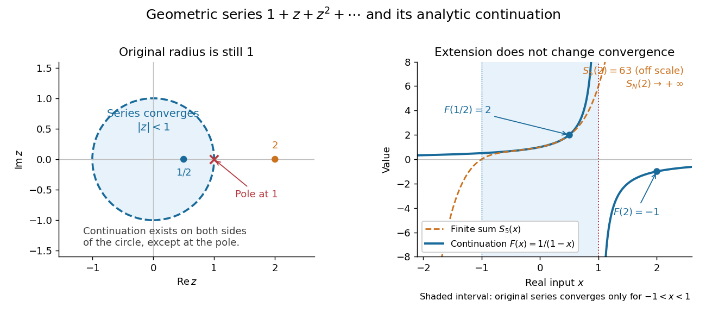

# Analytic continuation

↑ **Parent:** [Holomorphic function](holomorphic-function-split.md)  
ⓦ [Wiki](https://en.wikipedia.org/wiki/Analytic_continuation)

An analytic continuation extends a [holomorphic function](holomorphic-function-split.md) beyond its original domain without changing its existing values. Formally, if $U\subset V$ are domains and $f$ is [holomorphic](holomorphic-function-split.md) on $U$, a [holomorphic function](holomorphic-function-split.md) $F$ on $V$ with $F|_U=f$ is an analytic continuation. More locally, [holomorphic functions](holomorphic-function-split.md) on overlapping [open sets](open-set.md) continue one another when they agree on the overlap, allowing a chain of patches along a path. The [identity theorem for holomorphic functions](identity-theorem.md) forces agreement throughout a [connected](connected-space.md) overlap once they agree on a nonempty [open set](open-set.md) in it. It also makes an extension to a fixed [connected](connected-space.md) domain unique. [Orloff, MIT 18.04 Topic 13, section 13.2 and Theorem 13.2](https://ocw.mit.edu/courses/18-04-complex-variables-with-applications-spring-2018/af8c9c78c3915aaf3fd1695f8d32a3b3_MIT18_04S18_topic13.pdf)

The [geometric series](geometric-series.md) illustrates why a formula can reach farther than the [power series](power-series.md) that first represents it. For $z\ne1$, its [partial sum](partial-sum.md) is

$$
S_N(z)=\sum_{n=0}^Nz^n=\frac{1-z^{N+1}}{1-z}.
$$

When $|z|<1$, $z^{N+1}\to0$, so the [series](series-mathematics.md) converges to $f(z)=1/(1-z)$. The [rational function](rational-function.md) $F(z)=1/(1-z)$ is [holomorphic](holomorphic-function-split.md) on $\mathbb C\setminus\{1\}$ and agrees there with the sum on the [unit disc](unit-disc.md). It therefore continues $f$ to every point except its [simple pole](simple-pole.md) at $1$. In particular,

$$
f(1/2)=2,\qquad F(2)=-1,\qquad S_N(2)=2^{N+1}-1\longrightarrow+\infty.
$$

Thus [analytic continuation](analytic-continuation.md) gives a value at $2$ without making the original [geometric series](geometric-series.md) converge there. Its [radius of convergence](radius-of-convergence.md) remains $1$: on $|z|\ge1$ the terms $z^n$ do not even tend to zero.

**[Figure 3](#image-the-original-geometric-series-converges-only-inside-the-unit-circle-while-its-rational-continuation-exists-everywhere-except-the-pole-at-1). The original geometric series converges only inside the unit circle, while its rational continuation exists everywhere except the pole at 1**.

The [pole](pole.md) at $1$ limits the original [Taylor series](taylor-series.md), although most points of its convergence circle are regular for $F$. Recentring at $-1$ gives another genuinely convergent [power series](power-series.md),

$$
F(z)=\frac1{2-(z+1)}=\frac12\sum_{n=0}^{\infty}\left(\frac{z+1}{2}\right)^n,\qquad |z+1|<2.
$$

At $z=-3/2$ this yields $\tfrac12\sum_{n\ge0}(-1/4)^n=2/5$, even though the original powers of $-3/2$ grow. This is the useful idea: overlapping local descriptions can represent one [holomorphic function](holomorphic-function-split.md) on a larger region.

Uniqueness on a [connected](connected-space.md) overlap does not imply that every path leads to the same terminal [germ of a holomorphic function](germ-of-a-holomorphic-function.md). Continuing a [complex logarithm](complex-logarithm.md) around $0$ changes its value by $2\pi i$, giving [monodromy](monodromy.md); the return patch can carry a different [branch of a multivalued function](branch-of-a-multivalued-function.md). If two patches have a disconnected overlap, agreement on one component imposes no agreement on the others. [Orloff, section 13.2.1, Example 13.4](https://ocw.mit.edu/courses/18-04-complex-variables-with-applications-spring-2018/af8c9c78c3915aaf3fd1695f8d32a3b3_MIT18_04S18_topic13.pdf) Continuation using the [rational function](rational-function.md) $1/(1-z)$ is single-valued: any path avoiding $1$ gives the same terminal [germ of a holomorphic function](germ-of-a-holomorphic-function.md), even if it winds around the [pole](pole.md).

**Table of contents**

- [Natural boundary of a holomorphic function](natural-boundary-of-a-holomorphic-function.md)
- [Zeta function regularization](zeta-function-regularization.md)
  - [Half-integer zeta-regularized mode sum](half-integer-zeta-regularized-mode-sum.md)
- [Meromorphic continuation](meromorphic-continuation.md)
- [Sokhotski–Plemelj theorem](sokhotski-plemelj-theorem.md)
  - [Signed Cauchy boundary operators](signed-cauchy-boundary-operators.md)
- [Monodromy theorem](monodromy-theorem.md)
  - [Simply connected corollary of the monodromy theorem](simply-connected-corollary-of-the-monodromy-theorem.md)
  - [Logarithm and square-root continuation along different paths](logarithm-and-square-root-continuation-along-different-paths.md)
  - [Existence hypothesis of the monodromy theorem](existence-hypothesis-of-the-monodromy-theorem.md)
  - [Local continuation proof of the monodromy theorem](local-continuation-proof-of-the-monodromy-theorem.md)
  - [Monodromy group of a covering](monodromy-group-of-a-covering.md)
    - [Monodromy transposition in a three-sheeted cover](monodromy-transposition-in-a-three-sheeted-cover.md)
    - [Monodromy group of z squared plus z to the minus two](monodromy-group-of-z-squared-plus-z-to-the-minus-two.md)
- [Analytic continuation by contour deformation](analytic-continuation-by-contour-deformation.md)
  - [Branch phase in a figure-eight analytic continuation integral](branch-phase-in-a-figure-eight-analytic-continuation-integral.md)
- [Multivalued inverse hyperbolic sine](multivalued-inverse-hyperbolic-sine.md)

## ↑ Ancestors (6)

1. [Holomorphic function](holomorphic-function-split.md)
2. [Complex analysis](complex-analysis-split.md)
3. [Analysis](analysis-split.md)
4. [Area of mathematics](area-of-mathematics.md)
5. [Mathematics](mathematics-split.md)
6. [Codex Wiki](split.md)

## ← Incoming links (81)

- [Analytic continuation](analytic-continuation.md)
- [Branch point](branch-point.md)
- [Branches of the complex inverse sine](branches-of-the-complex-inverse-sine.md)
- [Complex beta integral](complex-beta-integral.md)
- [Complex ordinary differential equation](complex-ordinary-differential-equation.md)
- [Dilogarithm](dilogarithm.md)
- [Elliptic integral of the first kind](elliptic-integral-of-the-first-kind.md)
- [Euler integral for the hypergeometric function](euler-integral-for-the-hypergeometric-function.md)
- [Existence hypothesis of the monodromy theorem](existence-hypothesis-of-the-monodromy-theorem.md)
- [Half-integer zeta-regularized mode sum](half-integer-zeta-regularized-mode-sum.md)
- [Hypergeometric connection formula at one](hypergeometric-connection-formula-at-one.md)
- [Hypergeometric function](hypergeometric-function.md)
- [Inverse hyperbolic functions](inverse-hyperbolic-functions.md)
- [Laplace transform](laplace-transform.md)
- [Local continuation proof of the monodromy theorem](local-continuation-proof-of-the-monodromy-theorem.md)
- [Logarithm and square-root continuation along different paths](logarithm-and-square-root-continuation-along-different-paths.md)
- [Meromorphic telescoping cancellation](meromorphic-telescoping-cancellation.md)
- [Monodromy](monodromy.md)
- [Monodromy reflection at a square-root branch point](monodromy-reflection-at-a-square-root-branch-point.md)
- [Monodromy theorem](monodromy-theorem.md)
- [Painlevé determinateness theorem](painleve-determinateness-theorem.md)
- [Solution](past-exam-of-the-mathematics-course-of-the-university-of-cambridge/2002/iii/paper-26/3/solution.md)
- [Solution](past-exam-of-the-mathematics-course-of-the-university-of-cambridge/2003/iii/paper-24/3/iii/solution.md)
- [Solution](past-exam-of-the-mathematics-course-of-the-university-of-cambridge/2003/iii/paper-48/3/solution.md)
- [Solution](past-exam-of-the-mathematics-course-of-the-university-of-cambridge/2003/iii/paper-50/3/solution.md)
- [Solution](past-exam-of-the-mathematics-course-of-the-university-of-cambridge/2003/iii/paper-8/4/solution.md)
- [Solution](past-exam-of-the-mathematics-course-of-the-university-of-cambridge/2005/ii/paper-2/23h/solution.md)
- [Solution](past-exam-of-the-mathematics-course-of-the-university-of-cambridge/2005/ii/paper-3/30a/solution.md)
- [Solution](past-exam-of-the-mathematics-course-of-the-university-of-cambridge/2006/ii/paper-2/8e/solution.md)
- [Solution](past-exam-of-the-mathematics-course-of-the-university-of-cambridge/2007/ii/paper-1/14b/iii/solution.md)
- [Solution](past-exam-of-the-mathematics-course-of-the-university-of-cambridge/2007/ii/paper-2/8b/solution.md)
- [Solution](past-exam-of-the-mathematics-course-of-the-university-of-cambridge/2008/ii/paper-1/14c/solution.md)
- [Solution](past-exam-of-the-mathematics-course-of-the-university-of-cambridge/2008/ii/paper-2/8c/solution.md)
- [Solution](past-exam-of-the-mathematics-course-of-the-university-of-cambridge/2008/iii/paper-54/2/solution.md)
- [Solution](past-exam-of-the-mathematics-course-of-the-university-of-cambridge/2009/ii/paper-1/14b/solution.md)
- [Solution](past-exam-of-the-mathematics-course-of-the-university-of-cambridge/2009/ii/paper-3/22g/i/solution.md)
- [Solution](past-exam-of-the-mathematics-course-of-the-university-of-cambridge/2010/ii/paper-2/14e/solution.md)
- [Solution](past-exam-of-the-mathematics-course-of-the-university-of-cambridge/2010/ii/paper-2/23g/solution.md)
- [Solution](past-exam-of-the-mathematics-course-of-the-university-of-cambridge/2010/ii/paper-4/8e/solution.md)
- [Solution](past-exam-of-the-mathematics-course-of-the-university-of-cambridge/2010/iii/paper-70/1/a/solution.md)
- [Solution](past-exam-of-the-mathematics-course-of-the-university-of-cambridge/2011/ii/paper-3/11i/ii/solution.md)
- [Solution](past-exam-of-the-mathematics-course-of-the-university-of-cambridge/2011/ii/paper-4/8e/solution.md)
- [Solution](past-exam-of-the-mathematics-course-of-the-university-of-cambridge/2012/iii/paper-51/1/solution.md)
- [Solution](past-exam-of-the-mathematics-course-of-the-university-of-cambridge/2012/iii/paper-68/3/solution.md)
- [Solution](past-exam-of-the-mathematics-course-of-the-university-of-cambridge/2012/iii/paper-78/2/solution.md)
- [Solution](past-exam-of-the-mathematics-course-of-the-university-of-cambridge/2013/iii/paper-70/2/a/solution.md)
- [Solution](past-exam-of-the-mathematics-course-of-the-university-of-cambridge/2013/iii/paper-70/2/c/solution.md)
- [Solution](past-exam-of-the-mathematics-course-of-the-university-of-cambridge/2015/ii/paper-2/20f/solution.md)
- [Solution](past-exam-of-the-mathematics-course-of-the-university-of-cambridge/2015/ii/paper-2/6b/solution.md)
- [Solution](past-exam-of-the-mathematics-course-of-the-university-of-cambridge/2015/ii/paper-4/6b/solution.md)
- [Solution](past-exam-of-the-mathematics-course-of-the-university-of-cambridge/2015/iii/paper-46/2/ii/solution.md)
- [Solution](past-exam-of-the-mathematics-course-of-the-university-of-cambridge/2015/iii/paper-50/3/solution.md)
- [Solution](past-exam-of-the-mathematics-course-of-the-university-of-cambridge/2017/ii/paper-1/13e/solution.md)
- [Solution](past-exam-of-the-mathematics-course-of-the-university-of-cambridge/2017/ii/paper-2/12e/solution.md)
- [Solution](past-exam-of-the-mathematics-course-of-the-university-of-cambridge/2017/iii/paper-137/1/solution.md)
- [Solution](past-exam-of-the-mathematics-course-of-the-university-of-cambridge/2017/iii/paper-137/2/solution.md)
- [Solution](past-exam-of-the-mathematics-course-of-the-university-of-cambridge/2017/iii/paper-304/1/iv/solution.md)
- [Solution](past-exam-of-the-mathematics-course-of-the-university-of-cambridge/2017/iii/paper-304/3/v/solution.md)
- [Solution](past-exam-of-the-mathematics-course-of-the-university-of-cambridge/2017/iii/paper-306/3/solution.md)
- [Solution](past-exam-of-the-mathematics-course-of-the-university-of-cambridge/2017/iii/paper-311/4/solution.md)
- [Solution](past-exam-of-the-mathematics-course-of-the-university-of-cambridge/2018/ii/paper-1/7b/a/solution.md)
- [Solution](past-exam-of-the-mathematics-course-of-the-university-of-cambridge/2018/iii/paper-137/2/ii/solution.md)
- [Solution](past-exam-of-the-mathematics-course-of-the-university-of-cambridge/2019/ii/paper-2/13a/a/solution.md)
- [Solution](past-exam-of-the-mathematics-course-of-the-university-of-cambridge/2019/ii/paper-4/33b/b/solution.md)
- [Solution](past-exam-of-the-mathematics-course-of-the-university-of-cambridge/2020/ii/paper-1/7e/ii/solution.md)
- [Solution](past-exam-of-the-mathematics-course-of-the-university-of-cambridge/2021/ii/paper-1/14e/b/solution.md)
- [Solution](past-exam-of-the-mathematics-course-of-the-university-of-cambridge/2021/ii/paper-1/14e/d/solution.md)
- [Solution](past-exam-of-the-mathematics-course-of-the-university-of-cambridge/2021/iii/paper-150/2/b/solution.md)
- [Solution](past-exam-of-the-mathematics-course-of-the-university-of-cambridge/2023/ii/paper-2/13e/a/i/solution.md)
- [Solution](past-exam-of-the-mathematics-course-of-the-university-of-cambridge/2023/ii/paper-4/7e/solution.md)
- [Solution](past-exam-of-the-mathematics-course-of-the-university-of-cambridge/2023/iii/paper-337/1/g/solution.md)
- [Solution](past-exam-of-the-mathematics-course-of-the-university-of-cambridge/2026/iii/paper-150/2/c/solution.md)
- [Solution](past-exam-of-the-mathematics-course-of-the-year-2-of-the-natural-sciences-course-of-the-university-of-cambridge/2002/paper-2/3/solution.md)
- [Solution](past-exam-of-the-mathematics-course-of-the-year-2-of-the-natural-sciences-course-of-the-university-of-cambridge/2016/paper-1/7/b/i/solution.md)
- [Solution](past-exam-of-the-theoretical-physics-i-course-of-the-university-of-cambridge/2016/paper-1/3/c/solution.md)
- [Solution](past-exam-of-the-theoretical-physics-ii-course-of-the-university-of-cambridge/2013/paper-1/6/c/solution.md)
- [Reflection pole of a fluid-loaded membrane](reflection-pole-of-a-fluid-loaded-membrane.md)
- [Region of absolute convergence of a Laplace transform](region-of-absolute-convergence-of-a-laplace-transform.md)
- [Replica trick](replica-trick.md)
- [Simply connected corollary of the monodromy theorem](simply-connected-corollary-of-the-monodromy-theorem.md)
- [Zeta function regularization](zeta-function-regularization.md)
