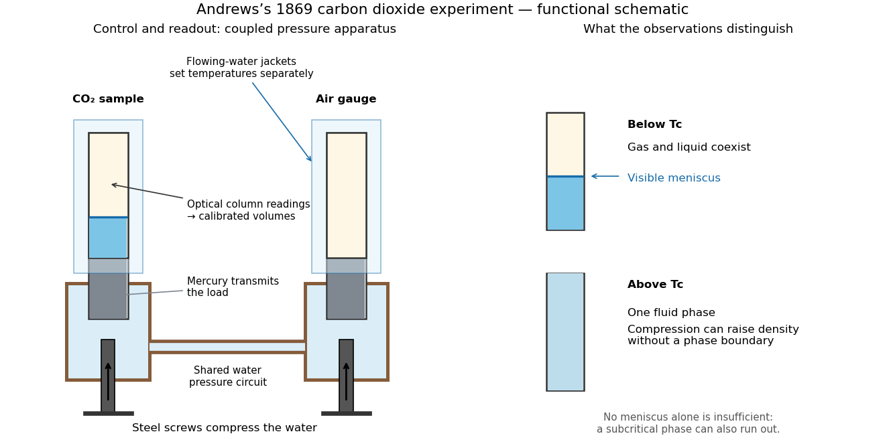

<h1 id="andrews-s-carbon-dioxide-experiment">Andrews's carbon dioxide experiment</h1>

↑ **Parent:** [Van der Waals equation](van-der-waals-equation.md)

The 1869 [The Bakerian Lecture: On the Continuity of the Gaseous and Liquid States of Matter by Thomas Andrews](the-bakerian-lecture-on-the-continuity-of-the-gaseous-and-liquid-states-of-matter-by-thomas-andrews.md) describes dried [carbon dioxide](carbon-dioxide.md) trapped above [mercury](mercury-element.md) in a sealed [capillary tube](capillary-tube.md). A steel screw pressurized [water](water.md) in a strong [copper](copper.md) tube; movable [mercury](mercury-element.md) transmitted the load. A second [capillary tube](capillary-tube.md) held air as a [pressure](pressure-split.md) gauge. Flowing [water](water.md) around the visible [capillary tubes](capillary-tube.md) controlled [temperature](temperature-split.md); a [thermometer](thermometer.md) read the bath. A [cathetometer](cathetometer.md) read column positions, converted to [volume](volume-thermodynamics.md) readings using weighed-[mercury](mercury-element.md) calibration.[Andrews, pp. 576–578 and Plate LXIII, figures 3 and 5–7: sample preparation, screw, coupled capillaries, water jackets and optical readout](the-bakerian-lecture-on-the-continuity-of-the-gaseous-and-liquid-states-of-matter-by-thomas-andrews.md)

Below the critical [temperature](temperature-split.md), compression produced a visible [liquid](liquid.md)–[gas](gas.md) boundary; above it, large density changes occurred without that boundary. Three trials gave $30.92\,{}^\circ\mathrm C$ as his critical [temperature](temperature-split.md). Purity checks detected residual air; [mercury](mercury-element.md) height corrections accounted for unequal [hydrostatic pressures](hydrostatic-pressure.md). He explicitly left air nonideality and pressure-induced tube-capacity corrections unresolved, so his air-gauge [pressures](pressure-split.md) were approximate. These readouts support a [liquid-gas critical point](liquid-gas-critical-point.md); they do not measure a homogeneous unstable loop or establish universal quantitative accuracy of the later [Van der Waals equation](van-der-waals-equation.md).[Andrews, pp. 576, 578–580 and 583: residual air, approximate air-gauge pressure, hydrostatic corrections and three critical-temperature trials](the-bakerian-lecture-on-the-continuity-of-the-gaseous-and-liquid-states-of-matter-by-thomas-andrews.md)

**[Figure 6](#image-andrews-s-carbon-dioxide-experiment-control-readout-and-the-liquid-gas-critical-point). Andrews's carbon dioxide experiment: control, readout and the liquid-gas critical point**. Original functional schematic, not a scale reconstruction. The [water](water.md) circuit transmits compression through [mercury](mercury-element.md) to two samples; separate [temperature](temperature-split.md) jackets permit control of the sample and air gauge. The right panels distinguish a visible [liquid](liquid.md)–[gas](gas.md) [liquid meniscus](meniscus-liquid-surface.md) from a single [thermodynamic phase](thermodynamic-phase.md). Interpret alongside the experimental limitations above.

A disappearing [liquid meniscus](meniscus-liquid-surface.md) by itself has more than one possible explanation: in ordinary subcritical condensation or evaporation, one [thermodynamic phase](thermodynamic-phase.md) can simply run out. The stronger critical-point inference combines [temperature](temperature-split.md) control, compression readings and the existence of a continuous route around the endpoint of the [phase coexistence curve](phase-coexistence-curve.md). On that route a dilute [gas](gas.md) can become dense without crossing a two-phase boundary. This is what continuity of [liquid](liquid.md) and [gas](gas.md) means; it does not remove their distinct equilibrium [number densities](number-density.md) below $T_c$.

In his 12 December 1910 Nobel lecture, [Johannes Diderik van der Waals](johannes-diderik-van-der-waals.md) explained [gases](gas.md) and [liquids](liquid.md) through the same moving [molecules](molecule-split.md), with attraction and finite size modifying their [pressure](pressure-split.md). He also rejected the idea that constant $a,b$ should give universal numerical agreement. His critical-volume discussion explicitly retained [derivatives](derivative.md) of a volume-dependent $b$: the familiar $v_c=3b$ follows only when those [derivatives](derivative.md) are neglected. Thus the elegant constant-parameter [Van der Waals critical point](van-der-waals-critical-point.md) is a model result whose limitations were already part of its author's account.[The equation of state for gases and liquids, Nobel lecture delivered 12 December 1910, pp. 254–257: molecular continuity, constant-parameter caveat and critical-volume derivatives](the-equation-of-state-for-gases-and-liquids-by-johannes-diderik-van-der-waals.md)

## ↑ Ancestors (8)

1. [Van der Waals equation](van-der-waals-equation.md)
2. [Equation of state](equation-of-state.md)
3. [Pressure](pressure-split.md)
4. [Thermodynamics](thermodynamics-split.md)
5. [Statistical physics](statistical-physics-split.md)
6. [Branches of physics](branches-of-physics.md)
7. [Physics](physics-split.md)
8. [Codex Wiki](split.md)

## ← Incoming links (2)

- [Andrews's carbon dioxide experiment](andrews-s-carbon-dioxide-experiment.md)
- [Renormalization group](renormalization-group.md)
