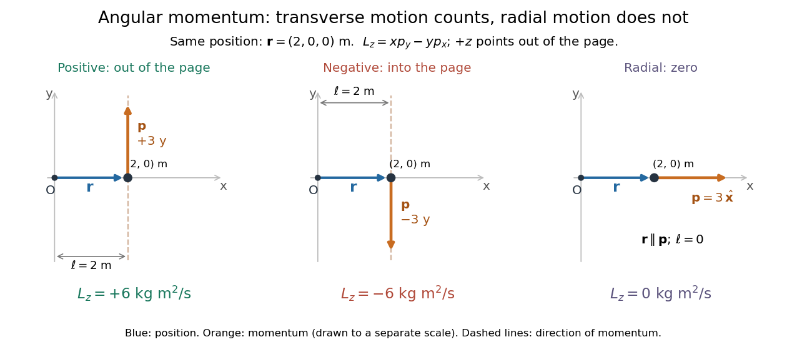

# Angular momentum

↑ **Parent:** [Momentum](momentum-split.md)  
ⓦ [Wiki](https://en.wikipedia.org/wiki/Angular_momentum)

[Angular momentum](angular-momentum.md) measures how a [point mass](point-mass.md)'s [momentum](momentum-split.md) passes around a chosen origin. Motion straight toward or away from that origin contributes zero; transverse [momentum](momentum-split.md) contributes more when it passes farther away. The picture shows the sign convention before the calculation.

**[Figure 3](#image-positive-negative-and-zero-angular-momentum-about-the-same-origin). Positive, negative and zero angular momentum about the same origin**.

Fix an origin $O$ and nonrotating axes in an [inertial frame](inertial-frame.md). For a nonrelativistic [point mass](point-mass.md) of constant [mass](mass.md) $m>0$, let $\mathbf r$ be its [position](position.md) from $O$ and $\mathbf p=m\mathbf v$ its [mechanical momentum](mechanical-momentum.md) in that same [reference frame](reference-frame.md). Its [angular momentum](angular-momentum.md) is the [cross product](cross-product.md)

$$
\mathbf L_O=\mathbf r\times\mathbf p,\qquad
|\mathbf L_O|=rp\sin\phi.
$$

Here $r=|\mathbf r|$, $p=|\mathbf p|$, and $\phi\in[0,\pi]$ is the [angle](angle.md) between them. The [right-hand rule](right-hand-rule.md) gives the direction: curl from $\mathbf r$ toward $\mathbf p$, and the thumb points along $\mathbf L_O$. Thus [angular momentum](angular-momentum.md) is an [axial vector](pseudovector.md), perpendicular to both [position](position.md) and [momentum](momentum-split.md). Its [International System of Units](international-system-of-units.md) unit is $\mathrm{kg\,m^2/s}$. A [point mass](point-mass.md) need not follow a [circle](circle.md) to have [angular momentum](angular-momentum.md).[section 11.2: Angular Momentum](university-physics-volume-1-by-william-moebs-and-others/11-2-angular-momentum.md)

With $x$ rightward, $y$ upward, and $+z$ out of the page, the [cross product](cross-product.md) gives $L_z=xp_y-yp_x$. Take

$$
\mathbf r=(2,0,0)\,\mathrm m,\qquad
\mathbf p=(0,3,0)\,\mathrm{kg\,m/s}.
$$

Then $\mathbf L_O=(0,0,6)\,\mathrm{kg\,m^2/s}$. Reversing the [momentum](momentum-split.md) makes $L_z=-6\,\mathrm{kg\,m^2/s}$; radial [momentum](momentum-split.md) $\mathbf p=(3,0,0)\,\mathrm{kg\,m/s}$ gives $\mathbf L_O=\mathbf0$. The factor $r\sin\phi$ is the [lever arm](lever-arm.md) to the line through the particle parallel to its [momentum](momentum-split.md).

For motion in the $xy$ plane, [plane polar coordinates](plane-polar-coordinates.md) give $\mathbf v=\dot r\widehat{\mathbf r}+r\dot\theta\widehat{\boldsymbol\theta}$, with $\widehat{\mathbf r}\times\widehat{\boldsymbol\theta}=\widehat{\mathbf z}$. Consequently

$$
L_z=mr^2\dot\theta,\qquad r^2\dot\theta=\frac{L_z}{m}.
$$

The signed [angular velocity](angular-velocity.md) $\dot\theta$ is positive counterclockwise viewed from $+z$ toward the plane, with $\theta$ measured in [radians](radian.md). Radial [velocity](velocity.md) does not enter the [cross product](cross-product.md). Under [conservation of angular momentum](conservation-of-angular-momentum.md), this relation predicts faster angular motion at smaller $r$ and constant [areal velocity](areal-velocity.md) $\dot A=L_z/(2m)$ for consistently oriented swept [area](surface-area.md). That is the geometric content of [Kepler's second law](kepler-s-second-law.md).

For several [point masses](point-mass.md), add their [angular momenta](angular-momentum.md) about the same origin: $\mathbf L_O=\sum_i\mathbf r_i\times\mathbf p_i$. The origin matters: [angular momentum under an origin shift](angular-momentum-under-an-origin-shift.md) explains why the same moving particle can have different values about two fixed points. The [central axis of a momentum system](central-axis-of-a-momentum-system.md) and [angular momentum decomposition about the centre of mass](angular-momentum-decomposition-about-the-centre-of-mass.md) make this dependence useful.

**Table of contents**

- [Angular momentum addition](angular-momentum-addition.md)
- [Angular momentum under an origin shift](angular-momentum-under-an-origin-shift.md)
- [Central axis of a momentum system](central-axis-of-a-momentum-system.md)
- [Gyroscope](gyroscope.md)
  - [Gyroscopic roll torque in a turning vehicle](gyroscopic-roll-torque-in-a-turning-vehicle.md)
  - [Gyrocompass](gyrocompass.md)
    - [Gyrocompass oscillation](gyrocompass-oscillation.md)
  - [Gyroscope vector geometry](gyroscope-vector-geometry.md)
  - [Spinning-wheel precession experiment](spinning-wheel-precession-experiment.md)
  - [Slow steady gyroscope precession](slow-steady-gyroscope-precession.md)
    - [Counterbalanced gyroscope precession](counterbalanced-gyroscope-precession.md)
  - [Gyroscope direction reference](gyroscope-direction-reference.md)
- [Magnetic axial angular-momentum invariant](magnetic-axial-angular-momentum-invariant.md)
- [Angular momentum decay under uniform linear drag](angular-momentum-decay-under-uniform-linear-drag.md)
- [Generalized angular momentum in a radial monopole field](generalized-angular-momentum-in-a-radial-monopole-field.md)
- [Conservation of angular momentum](conservation-of-angular-momentum.md)
  - [Quasi-static tether contraction](quasi-static-tether-contraction.md)
  - [Radius change at constant angular momentum](radius-change-at-constant-angular-momentum.md)
  - [Angular-momentum flux](angular-momentum-flux.md)
  - [Central-force radial turning point](central-force-radial-turning-point.md)
    - [Attractive and repulsive inverse-square closest approaches](attractive-and-repulsive-inverse-square-closest-approaches.md)
- [Angular momentum transport](angular-momentum-transport.md)
- [Torque](torque.md)
  - [Stopping angle under constant resisting torque](stopping-angle-under-constant-resisting-torque.md)
  - [Constant-power rotation against dry friction](constant-power-rotation-against-dry-friction.md)
  - [Angular impulse](angular-impulse.md)
  - [Lever arm](lever-arm.md)
  - [Couple (mechanics)](couple-mechanics.md)
  - [Moment balance](moment-balance.md)
- [Areal velocity](areal-velocity.md)
  - [Signed swept area](signed-swept-area.md)
  - [Equal-time sectors of a Kepler ellipse](equal-time-sectors-of-a-kepler-ellipse.md)
  - [Orbital observations behind the area law](orbital-observations-behind-the-area-law.md)
    - [Armillary sphere](armillary-sphere.md)
    - [Ecliptic longitude](ecliptic-longitude.md)
  - [Torque criterion for constant areal velocity](torque-criterion-for-constant-areal-velocity.md)
    - [Torque-driven circular swept area](torque-driven-circular-swept-area.md)

## ↑ Ancestors (5)

1. [Momentum](momentum-split.md)
2. [Classical mechanics](classical-mechanics-split.md)
3. [Branches of physics](branches-of-physics.md)
4. [Physics](physics-split.md)
5. [Codex Wiki](split.md)

## ← Incoming links (594)

- [Accreting similarity disk with viscosity proportional to radius](accreting-similarity-disk-with-viscosity-proportional-to-radius.md)
- [Accreting X-ray pulsar](accreting-x-ray-pulsar.md)
- [Active bending beam for a swimming fish](active-bending-beam-for-a-swimming-fish.md)
- [Angular impulse](angular-impulse.md)
- [Angular momentum](angular-momentum.md)
- [Angular momentum and the escape energy threshold](angular-momentum-and-the-escape-energy-threshold.md)
- [Angular momentum decomposition about the centre of mass](angular-momentum-decomposition-about-the-centre-of-mass.md)
- [Angular momentum deficit](angular-momentum-deficit.md)
- [Angular-momentum estimate of a self-gravitating galactic disk](angular-momentum-estimate-of-a-self-gravitating-galactic-disk.md)
- [Angular-momentum flux](angular-momentum-flux.md)
- [Angular-momentum integrability of a Keplerian disk](angular-momentum-integrability-of-a-keplerian-disk.md)
- [Angular momentum ladder endpoint](angular-momentum-ladder-endpoint.md)
- [Angular momentum under an origin shift](angular-momentum-under-an-origin-shift.md)
- [Angular reconstruction of a radial orbit transformation](angular-reconstruction-of-a-radial-orbit-transformation.md)
- [Anisotropic quantum harmonic oscillator](anisotropic-quantum-harmonic-oscillator.md)
- [Apsidal speed sum for an attractive inverse-square orbit](apsidal-speed-sum-for-an-attractive-inverse-square-orbit.md)
- [Area bound for an axisymmetric Kerr merger](area-bound-for-an-axisymmetric-kerr-merger.md)
- [Areal velocity](areal-velocity.md)
- [Atomic fine-structure level](atomic-fine-structure-level.md)
- [Atomic term](atomic-term.md)
- [Axial angular-momentum current of an elastic string](axial-angular-momentum-current-of-an-elastic-string.md)
- [Axisymmetric radiation carries no axial angular momentum](axisymmetric-radiation-carries-no-axial-angular-momentum.md)
- [Barkhausen effect](barkhausen-effect.md)
- [Barnett effect](barnett-effect.md)
- [Barnett equivalent magnetic field](barnett-equivalent-magnetic-field.md)
- [Beta decay transition](beta-decay-transition.md)
- [Binary mass-ratio reversal](binary-mass-ratio-reversal.md)
- [Binary mass-transfer contact equation](binary-mass-transfer-contact-equation.md)
- [Black-hole and disk alignment under internal torque](black-hole-and-disk-alignment-under-internal-torque.md)
- [Black-hole no-hair theorem](black-hole-no-hair-theorem.md)
- [Black-hole spin measurement](black-hole-spin-measurement.md)
- [Black-hole spin-up by coherent accretion](black-hole-spin-up-by-coherent-accretion.md)
- [Body-frame and space-frame frequencies of free symmetric-top precession](body-frame-and-space-frame-frequencies-of-free-symmetric-top-precession.md)
- [Breit-Rabi formula](breit-rabi-formula.md)
- [Central axis of a momentum system](central-axis-of-a-momentum-system.md)
- [Central potential](central-potential.md)
- [Centrifugal distortion](centrifugal-distortion.md)
- [Cesium-beam clock procedure](cesium-beam-clock-procedure.md)
- [Charged circular elastic ring in a uniform magnetic field](charged-circular-elastic-ring-in-a-uniform-magnetic-field.md)
- [Circular-binary orbital angular momentum](circular-binary-orbital-angular-momentum.md)
- [Circular ladder operators of a two-dimensional oscillator](circular-ladder-operators-of-a-two-dimensional-oscillator.md)
- [Circular-orbit energy gradient](circular-orbit-energy-gradient.md)
- [Circular orbit in a quadratic central potential](circular-orbit-in-a-quadratic-central-potential.md)
- [Circular orbit through an inverse-fifth-power singularity](circular-orbit-through-an-inverse-fifth-power-singularity.md)
- [Circular orbits in an exponential central potential](circular-orbits-in-an-exponential-central-potential.md)
- [Circular-shell adiabatic contraction](circular-shell-adiabatic-contraction.md)
- [Circularization under radial inverse-square drag](circularization-under-radial-inverse-square-drag.md)
- [Closed orbits with an inverse-cube perturbation](closed-orbits-with-an-inverse-cube-perturbation.md)
- [Collective nuclear model](collective-nuclear-model.md)
- [Collisionless black-hole capture](collisionless-black-hole-capture.md)
- [Compact self-similar disk with density-linear viscosity](compact-self-similar-disk-with-density-linear-viscosity.md)
- [Compact self-similar disk with square-root density viscosity](compact-self-similar-disk-with-square-root-density-viscosity.md)
- [Complete set of commuting observables](complete-set-of-commuting-observables.md)
- [Conservation of angular momentum](conservation-of-angular-momentum.md)
- [Conservative mass-transfer critical mass ratio](conservative-mass-transfer-critical-mass-ratio.md)
- [Conservative pre-giant period-ratio minimum](conservative-pre-giant-period-ratio-minimum.md)
- [Constant-mass disk with viscosity proportional to radius](constant-mass-disk-with-viscosity-proportional-to-radius.md)
- [Constant-power rotation against dry friction](constant-power-rotation-against-dry-friction.md)
- [Contact transfer rate with Jeans-mode wind loss](contact-transfer-rate-with-jeans-mode-wind-loss.md)
- [Coordinate invariance of the Schwarzschild photon radial potential](coordinate-invariance-of-the-schwarzschild-photon-radial-potential.md)
- [Counteralignment of a black hole and accretion disk](counteralignment-of-a-black-hole-and-accretion-disk.md)
- [Counterbalanced gyroscope precession](counterbalanced-gyroscope-precession.md)
- [Coupled angular-momentum state count](coupled-angular-momentum-state-count.md)
- [Critical rotation of a spherical cloud](critical-rotation-of-a-spherical-cloud.md)
- [Damped Binet equation](damped-binet-equation.md)
- [Dark-matter halo merger](dark-matter-halo-merger.md)
- [Density-slope satellite torque](density-slope-satellite-torque.md)
- [Deuteron quadrupole evidence for a tensor force](deuteron-quadrupole-evidence-for-a-tensor-force.md)
- [Donor-wind angular-momentum loss](donor-wind-angular-momentum-loss.md)
- [Donor-wind period invariant with fixed retention fraction](donor-wind-period-invariant-with-fixed-retention-fraction.md)
- [Dynamical upper bound on black-hole fuelling](dynamical-upper-bound-on-black-hole-fuelling.md)
- [Einstein-de Haas effect](einstein-de-haas-effect.md)
- [Einstein-de Haas experiment](einstein-de-haas-experiment.md)
- [Electric quadrupole transition](electric-quadrupole-transition.md)
- [Electron magnetic moment](electron-magnetic-moment.md)
- [Electron spin g-factor](electron-spin-g-factor.md)
- [Empirical evidence for nuclear shells](empirical-evidence-for-nuclear-shells.md)
- [Euler's equations (rigid body dynamics)](euler-s-equations-rigid-body-dynamics.md)
- [Even-even nucleus](even-even-nucleus.md)
- [Face-on frequency shift of a circular Schwarzschild source](face-on-frequency-shift-of-a-circular-schwarzschild-source.md)
- [Fixed-angular-momentum energy test for principal-axis rotation](fixed-angular-momentum-energy-test-for-principal-axis-rotation.md)
- [Flavour singlet of three scalar quarks](flavour-singlet-of-three-scalar-quarks.md)
- [Forbidden beta decay](forbidden-beta-decay.md)
- [Free-ended straight-string Regge relation](free-ended-straight-string-regge-relation.md)
- [G-factor (physics)](g-factor-physics.md)
- [Galactic fountain](galactic-fountain.md)
- [Galactic tide](galactic-tide.md)
- [Galaxy merger](galaxy-merger.md)
- [Gamma decay](gamma-decay.md)
- [Gap opening by a planet](gap-opening-by-a-planet.md)
- [Gas dissipation in a galaxy merger](gas-dissipation-in-a-galaxy-merger.md)
- [Generalized angular momentum in a radial monopole field](generalized-angular-momentum-in-a-radial-monopole-field.md)
- [Geodesic conserved quantity from a Killing vector](geodesic-conserved-quantity-from-a-killing-vector.md)
- [Geodesic equation in a uniformly rotating Minkowski chart](geodesic-equation-in-a-uniformly-rotating-minkowski-chart.md)
- [Gravitational stress contribution to angular-momentum transport](gravitational-stress-contribution-to-angular-momentum-transport.md)
- [Gravitationally focused growth of a planetary core](gravitationally-focused-growth-of-a-planetary-core.md)
- [Grazing impact parameter in gravitational focusing](grazing-impact-parameter-in-gravitational-focusing.md)
- [Gyrocompass](gyrocompass.md)
- [Gyrocompass oscillation](gyrocompass-oscillation.md)
- [Gyromagnetic ratio](gyromagnetic-ratio.md)
- [Gyroscope](gyroscope.md)
- [Gyroscope direction reference](gyroscope-direction-reference.md)
- [Gyroscope vector geometry](gyroscope-vector-geometry.md)
- [Gyroscopic roll torque in a turning vehicle](gyroscopic-roll-torque-in-a-turning-vehicle.md)
- [Helical symmetry of a potential](helical-symmetry-of-a-potential.md)
- [Hohmann transfer impulse fractions](hohmann-transfer-impulse-fractions.md)
- [Homologous rotating collapse](homologous-rotating-collapse.md)
- [Hydrogen fine-structure correction](hydrogen-fine-structure-correction.md)
- [Inclination to the invariable plane of two orbital planes](inclination-to-the-invariable-plane-of-two-orbital-planes.md)
- [Independent spin Barnett response](independent-spin-barnett-response.md)
- [Inertia tensor](inertia-tensor.md)
- [Inertia tensor of paired point masses](inertia-tensor-of-paired-point-masses.md)
- [Inferring an inverse-square force from Kepler laws](inferring-an-inverse-square-force-from-kepler-laws.md)
- [Invariable plane](invariable-plane.md)
- [Inverse-cube central orbit classification](inverse-cube-central-orbit-classification.md)
- [Inverse-radius viscous disk similarity](inverse-radius-viscous-disk-similarity.md)
- [Jacobi integral of a rigidly rotating potential](jacobi-integral-of-a-rigidly-rotating-potential.md)
- [Kepler dynamical symmetry algebra](kepler-dynamical-symmetry-algebra.md)
- [Killing vector field](killing-vector-field-split.md)
- [Komar angular momentum with inner boundaries](komar-angular-momentum-with-inner-boundaries.md)
- [Lamb shift](lamb-shift.md)
- [Landé g-factor](lande-g-factor.md)
- [Lever arm](lever-arm.md)
- [Lindblad resonance](lindblad-resonance.md)
- [Linear rigid rotor](linear-rigid-rotor.md)
- [Linear stability of principal-axis rotation](linear-stability-of-principal-axis-rotation.md)
- [Loss cone](loss-cone.md)
- [LS coupling](ls-coupling.md)
- [Magnetic angular-momentum invariant](magnetic-angular-momentum-invariant.md)
- [Magnetic axial angular momentum flux](magnetic-axial-angular-momentum-flux.md)
- [Magnetic dipole transition](magnetic-dipole-transition.md)
- [Magnetic-substate subtraction](magnetic-substate-subtraction.md)
- [Magnetomechanical angular momentum balance](magnetomechanical-angular-momentum-balance.md)
- [Major-axis relaxation theorem](major-axis-relaxation-theorem.md)
- [Maximum total angular momentum of equivalent fermions](maximum-total-angular-momentum-of-equivalent-fermions.md)
- [Maxwell torque conservation in an axisymmetric wind](maxwell-torque-conservation-in-an-axisymmetric-wind.md)
- [Meson-baryon scattering](meson-baryon-scattering.md)
- [Missing gamma lines and matrix-element hindrance](missing-gamma-lines-and-matrix-element-hindrance.md)
- [Moment of inertia](moment-of-inertia.md)
- [Natural parity](natural-parity.md)
- [Neutral-pseudoscalar vector-pion charge-conjugation selection](neutral-pseudoscalar-vector-pion-charge-conjugation-selection.md)
- [Newton's theorem of revolving orbits](newton-s-theorem-of-revolving-orbits.md)
- [Nonaccreting constant-torque disk](nonaccreting-constant-torque-disk.md)
- [Nonaccreting similarity disk supplied by an inner torque](nonaccreting-similarity-disk-supplied-by-an-inner-torque.md)
- [Nonconservative binary mass transfer](nonconservative-binary-mass-transfer.md)
- [Nondiffusive convective angular momentum transport](nondiffusive-convective-angular-momentum-transport.md)
- [Normal modes of three beads connected by springs on a circular hoop](normal-modes-of-three-beads-connected-by-springs-on-a-circular-hoop.md)
- [Normal modes of two spring-coupled coaxial rotors](normal-modes-of-two-spring-coupled-coaxial-rotors.md)
- [Nuclear gamma-ray multipole selection rules](nuclear-gamma-ray-multipole-selection-rules.md)
- [Nuclear pairing](nuclear-pairing.md)
- [Nuclear quadrupole vibration](nuclear-quadrupole-vibration.md)
- [Nuclear residual interaction](nuclear-residual-interaction.md)
- [Nuclear rotational band](nuclear-rotational-band.md)
- [Nuclear shell closure](nuclear-shell-closure.md)
- [Nuclear spin](nuclear-spin.md)
- [Off-axis angular momentum of a square lamina](off-axis-angular-momentum-of-a-square-lamina.md)
- [One-photon spin-zero transition prohibition](one-photon-spin-zero-transition-prohibition.md)
- [Optical pumping preparation and readout](optical-pumping-preparation-and-readout.md)
- [P branch](p-branch.md)
- [Solution](past-exam-of-the-advanced-quantum-physics-course-of-the-university-of-cambridge/2012/paper-1/2/b/solution.md)
- [Solution](past-exam-of-the-advanced-quantum-physics-course-of-the-university-of-cambridge/2014/paper-1/1/c/solution.md)
- [Solution](past-exam-of-the-advanced-quantum-physics-course-of-the-university-of-cambridge/2015/paper-1/1/a/solution.md)
- [Solution](past-exam-of-the-advanced-quantum-physics-course-of-the-university-of-cambridge/2015/paper-1/3/solution.md)
- [Solution](past-exam-of-the-advanced-quantum-physics-course-of-the-university-of-cambridge/2017/1/b/solution.md)
- [Solution](past-exam-of-the-advanced-quantum-physics-course-of-the-university-of-cambridge/2017/2/a/solution.md)
- [Solution](past-exam-of-the-advanced-quantum-physics-course-of-the-university-of-cambridge/2018/section-a/1/a/solution.md)
- [Solution](past-exam-of-the-astrophysical-fluid-dynamics-course-of-the-university-of-cambridge/2012/paper-1/2/a/solution.md)
- [Solution](past-exam-of-the-astrophysical-fluid-dynamics-course-of-the-university-of-cambridge/2013/paper-1/2/b/solution.md)
- [Solution](past-exam-of-the-astrophysical-fluid-dynamics-course-of-the-university-of-cambridge/2014/paper-1/2/a/solution.md)
- [Solution](past-exam-of-the-astrophysical-fluid-dynamics-course-of-the-university-of-cambridge/2014/paper-1/2/b/solution.md)
- [Solution](past-exam-of-the-astrophysical-fluid-dynamics-course-of-the-university-of-cambridge/2017/2/a/solution.md)
- [Solution](past-exam-of-the-astrophysical-fluid-dynamics-course-of-the-university-of-cambridge/2017/2/b/solution.md)
- [Solution](past-exam-of-the-astrophysical-fluid-dynamics-course-of-the-university-of-cambridge/2021/section-b/6/a/solution.md)
- [Solution](past-exam-of-the-atomic-and-optical-physics-course-of-the-university-of-cambridge/2016/paper-1/3/solution.md)
- [Solution](past-exam-of-the-chemistry-a-course-of-the-university-of-cambridge/2021/paper-1/a1/a/v/solution.md)
- [Solution](past-exam-of-the-chemistry-a-course-of-the-university-of-cambridge/2021/paper-2/a7/c/solution.md)
- [Solution](past-exam-of-the-chemistry-course-of-the-year-3-of-the-natural-sciences-course-of-the-university-of-cambridge/2022/paper-2b/section-a/27/a/solution.md)
- [Solution](past-exam-of-the-chemistry-course-of-the-year-3-of-the-natural-sciences-course-of-the-university-of-cambridge/2022/paper-2b/section-a/27/b/solution.md)
- [Solution](past-exam-of-the-chemistry-course-of-the-year-3-of-the-natural-sciences-course-of-the-university-of-cambridge/2022/paper-2b/section-b/35/a/solution.md)
- [Solution](past-exam-of-the-chemistry-course-of-the-year-3-of-the-natural-sciences-course-of-the-university-of-cambridge/2022/paper-2b/section-b/35/c/i/solution.md)
- [Solution](past-exam-of-the-exoplanets-and-planetary-systems-course-of-the-university-of-cambridge/2015/paper-1/3/b/solution.md)
- [Solution](past-exam-of-the-exoplanets-and-planetary-systems-course-of-the-university-of-cambridge/2016/paper-1/3/b/solution.md)
- [Solution](past-exam-of-the-formation-of-structure-in-the-universe-course-of-the-university-of-cambridge/2014/paper-1/3/b/solution.md)
- [Solution](past-exam-of-the-formation-of-structure-in-the-universe-course-of-the-university-of-cambridge/2015/paper-1/1/a/solution.md)
- [Solution](past-exam-of-the-formation-of-structure-in-the-universe-course-of-the-university-of-cambridge/2015/paper-1/1/b/solution.md)
- [Solution](past-exam-of-the-formation-of-structure-in-the-universe-course-of-the-university-of-cambridge/2016/paper-1/2/d/solution.md)
- [Solution](past-exam-of-the-formation-of-structure-in-the-universe-course-of-the-university-of-cambridge/2016/paper-1/3/a/solution.md)
- [Solution](past-exam-of-the-formation-of-structure-in-the-universe-course-of-the-university-of-cambridge/2016/paper-1/3/b/solution.md)
- [Solution](past-exam-of-the-formation-of-structure-in-the-universe-course-of-the-university-of-cambridge/2016/paper-1/3/c/solution.md)
- [Solution](past-exam-of-the-mathematics-course-of-the-university-of-cambridge/2001/ia/paper-4/11a/solution.md)
- [Solution](past-exam-of-the-mathematics-course-of-the-university-of-cambridge/2001/ia/paper-4/3a/solution.md)
- [Solution](past-exam-of-the-mathematics-course-of-the-university-of-cambridge/2001/iii/paper-35/4/solution.md)
- [Solution](past-exam-of-the-mathematics-course-of-the-university-of-cambridge/2001/iii/paper-38/2/solution.md)
- [Solution](past-exam-of-the-mathematics-course-of-the-university-of-cambridge/2001/iii/paper-40/4/i/solution.md)
- [Solution](past-exam-of-the-mathematics-course-of-the-university-of-cambridge/2001/iii/paper-42/1/solution.md)
- [Solution](past-exam-of-the-mathematics-course-of-the-university-of-cambridge/2001/iii/paper-45/1/i/solution.md)
- [Solution](past-exam-of-the-mathematics-course-of-the-university-of-cambridge/2001/iii/paper-45/1/ii/solution.md)
- [Solution](past-exam-of-the-mathematics-course-of-the-university-of-cambridge/2001/iii/paper-69/3/solution.md)
- [Solution](past-exam-of-the-mathematics-course-of-the-university-of-cambridge/2002/ia/paper-4/10e/solution.md)
- [Solution](past-exam-of-the-mathematics-course-of-the-university-of-cambridge/2002/ia/paper-4/11e/solution.md)
- [Solution](past-exam-of-the-mathematics-course-of-the-university-of-cambridge/2002/ia/paper-4/9e/solution.md)
- [Solution](past-exam-of-the-mathematics-course-of-the-university-of-cambridge/2002/iii/paper-41/2/solution.md)
- [Solution](past-exam-of-the-mathematics-course-of-the-university-of-cambridge/2002/iii/paper-44/2/c/solution.md)
- [Solution](past-exam-of-the-mathematics-course-of-the-university-of-cambridge/2002/iii/paper-44/4/a/solution.md)
- [Solution](past-exam-of-the-mathematics-course-of-the-university-of-cambridge/2002/iii/paper-46/1/i/solution.md)
- [Solution](past-exam-of-the-mathematics-course-of-the-university-of-cambridge/2002/iii/paper-63/1/solution.md)
- [Solution](past-exam-of-the-mathematics-course-of-the-university-of-cambridge/2002/iii/paper-67/1/solution.md)
- [Solution](past-exam-of-the-mathematics-course-of-the-university-of-cambridge/2002/iii/paper-74/6/solution.md)
- [Solution](past-exam-of-the-mathematics-course-of-the-university-of-cambridge/2003/ia/paper-4/12e/solution.md)
- [Solution](past-exam-of-the-mathematics-course-of-the-university-of-cambridge/2003/ia/paper-4/4e/solution.md)
- [Solution](past-exam-of-the-mathematics-course-of-the-university-of-cambridge/2003/ia/paper-4/9e/solution.md)
- [Solution](past-exam-of-the-mathematics-course-of-the-university-of-cambridge/2003/iii/paper-63/3/solution.md)
- [Solution](past-exam-of-the-mathematics-course-of-the-university-of-cambridge/2003/iii/paper-63/4/d/solution.md)
- [Solution](past-exam-of-the-mathematics-course-of-the-university-of-cambridge/2004/ia/paper-4/10a/solution.md)
- [Solution](past-exam-of-the-mathematics-course-of-the-university-of-cambridge/2004/ia/paper-4/11a/solution.md)
- [Solution](past-exam-of-the-mathematics-course-of-the-university-of-cambridge/2004/ib/paper-3/9d/solution.md)
- [Solution](past-exam-of-the-mathematics-course-of-the-university-of-cambridge/2004/iii/paper-45/3/solution.md)
- [Solution](past-exam-of-the-mathematics-course-of-the-university-of-cambridge/2004/iii/paper-57/1/solution.md)
- [Solution](past-exam-of-the-mathematics-course-of-the-university-of-cambridge/2004/iii/paper-63/3/solution.md)
- [Solution](past-exam-of-the-mathematics-course-of-the-university-of-cambridge/2004/iii/paper-65/4/solution.md)
- [Solution](past-exam-of-the-mathematics-course-of-the-university-of-cambridge/2004/iii/paper-66/4/i/2/solution.md)
- [Solution](past-exam-of-the-mathematics-course-of-the-university-of-cambridge/2004/iii/paper-77/1/ii/solution.md)
- [Solution](past-exam-of-the-mathematics-course-of-the-university-of-cambridge/2005/ia/paper-4/11c/solution.md)
- [Solution](past-exam-of-the-mathematics-course-of-the-university-of-cambridge/2005/ia/paper-4/3c/solution.md)
- [Solution](past-exam-of-the-mathematics-course-of-the-university-of-cambridge/2005/ii/paper-2/32d/solution.md)
- [Solution](past-exam-of-the-mathematics-course-of-the-university-of-cambridge/2005/ii/paper-2/9c/solution.md)
- [Solution](past-exam-of-the-mathematics-course-of-the-university-of-cambridge/2005/iii/paper-50/1/solution.md)
- [Solution](past-exam-of-the-mathematics-course-of-the-university-of-cambridge/2005/iii/paper-60/3/solution.md)
- [Solution](past-exam-of-the-mathematics-course-of-the-university-of-cambridge/2005/iii/paper-63/6/solution.md)
- [Solution](past-exam-of-the-mathematics-course-of-the-university-of-cambridge/2005/iii/paper-70/4/solution.md)
- [Solution](past-exam-of-the-mathematics-course-of-the-university-of-cambridge/2005/iii/paper-72/4/a/vi/solution.md)
- [Solution](past-exam-of-the-mathematics-course-of-the-university-of-cambridge/2005/iii/paper-72/4/a/vii/solution.md)
- [Solution](past-exam-of-the-mathematics-course-of-the-university-of-cambridge/2005/iii/paper-72/4/b/solution.md)
- [Solution](past-exam-of-the-mathematics-course-of-the-university-of-cambridge/2005/iii/paper-73/3/solution.md)
- [Solution](past-exam-of-the-mathematics-course-of-the-university-of-cambridge/2006/ia/paper-4/11c/solution.md)
- [Solution](past-exam-of-the-mathematics-course-of-the-university-of-cambridge/2006/iii/paper-64/3/solution.md)
- [Solution](past-exam-of-the-mathematics-course-of-the-university-of-cambridge/2006/iii/paper-71/4/solution.md)
- [Solution](past-exam-of-the-mathematics-course-of-the-university-of-cambridge/2006/iii/paper-73/1/ii/solution.md)
- [Solution](past-exam-of-the-mathematics-course-of-the-university-of-cambridge/2007/ia/paper-4/10c/ii/solution.md)
- [Solution](past-exam-of-the-mathematics-course-of-the-university-of-cambridge/2007/ia/paper-4/11c/solution.md)
- [Solution](past-exam-of-the-mathematics-course-of-the-university-of-cambridge/2007/ia/paper-4/12c/i/solution.md)
- [Solution](past-exam-of-the-mathematics-course-of-the-university-of-cambridge/2007/ia/paper-4/12c/ii/solution.md)
- [Solution](past-exam-of-the-mathematics-course-of-the-university-of-cambridge/2007/ia/paper-4/12c/iii/solution.md)
- [Solution](past-exam-of-the-mathematics-course-of-the-university-of-cambridge/2007/ii/paper-2/32d/solution.md)
- [Solution](past-exam-of-the-mathematics-course-of-the-university-of-cambridge/2007/ii/paper-3/9c/solution.md)
- [Solution](past-exam-of-the-mathematics-course-of-the-university-of-cambridge/2007/ii/paper-4/9c/b/solution.md)
- [Solution](past-exam-of-the-mathematics-course-of-the-university-of-cambridge/2007/iii/paper-65/3/a/solution.md)
- [Solution](past-exam-of-the-mathematics-course-of-the-university-of-cambridge/2007/iii/paper-65/3/b/solution.md)
- [Solution](past-exam-of-the-mathematics-course-of-the-university-of-cambridge/2007/iii/paper-66/4/solution.md)
- [Solution](past-exam-of-the-mathematics-course-of-the-university-of-cambridge/2007/iii/paper-84/3/iii/solution.md)
- [Solution](past-exam-of-the-mathematics-course-of-the-university-of-cambridge/2007/iii/paper-84/3/iv/solution.md)
- [Solution](past-exam-of-the-mathematics-course-of-the-university-of-cambridge/2008/ia/paper-4/10b/i/solution.md)
- [Solution](past-exam-of-the-mathematics-course-of-the-university-of-cambridge/2008/ib/paper-3/18b/ii/solution.md)
- [Solution](past-exam-of-the-mathematics-course-of-the-university-of-cambridge/2008/ii/paper-1/31c/solution.md)
- [Solution](past-exam-of-the-mathematics-course-of-the-university-of-cambridge/2008/ii/paper-2/32d/solution.md)
- [Solution](past-exam-of-the-mathematics-course-of-the-university-of-cambridge/2008/iii/paper-48/4/solution.md)
- [Solution](past-exam-of-the-mathematics-course-of-the-university-of-cambridge/2008/iii/paper-59/3/ii/solution.md)
- [Solution](past-exam-of-the-mathematics-course-of-the-university-of-cambridge/2008/iii/paper-59/4/solution.md)
- [Solution](past-exam-of-the-mathematics-course-of-the-university-of-cambridge/2008/iii/paper-66/3/a/solution.md)
- [Solution](past-exam-of-the-mathematics-course-of-the-university-of-cambridge/2008/iii/paper-66/3/b/solution.md)
- [Solution](past-exam-of-the-mathematics-course-of-the-university-of-cambridge/2008/iii/paper-70/4/solution.md)
- [Solution](past-exam-of-the-mathematics-course-of-the-university-of-cambridge/2008/iii/paper-71/1/solution.md)
- [Solution](past-exam-of-the-mathematics-course-of-the-university-of-cambridge/2008/iii/paper-71/2/b/solution.md)
- [Solution](past-exam-of-the-mathematics-course-of-the-university-of-cambridge/2008/iii/paper-71/3/a/solution.md)
- [Solution](past-exam-of-the-mathematics-course-of-the-university-of-cambridge/2008/iii/paper-71/3/b/solution.md)
- [Solution](past-exam-of-the-mathematics-course-of-the-university-of-cambridge/2008/iii/paper-71/3/solution.md)
- [Solution](past-exam-of-the-mathematics-course-of-the-university-of-cambridge/2008/iii/paper-72/4/i/solution.md)
- [Solution](past-exam-of-the-mathematics-course-of-the-university-of-cambridge/2008/iii/paper-87/1/iii/solution.md)
- [Solution](past-exam-of-the-mathematics-course-of-the-university-of-cambridge/2009/ia/paper-4/4a/b/solution.md)
- [Solution](past-exam-of-the-mathematics-course-of-the-university-of-cambridge/2009/ia/paper-4/4a/c/solution.md)
- [Solution](past-exam-of-the-mathematics-course-of-the-university-of-cambridge/2009/ib/paper-3/16b/solution.md)
- [Solution](past-exam-of-the-mathematics-course-of-the-university-of-cambridge/2009/ii/paper-3/9e/b/solution.md)
- [Solution](past-exam-of-the-mathematics-course-of-the-university-of-cambridge/2009/ii/paper-4/36d/solution.md)
- [Solution](past-exam-of-the-mathematics-course-of-the-university-of-cambridge/2009/ii/paper-4/9e/b/solution.md)
- [Solution](past-exam-of-the-mathematics-course-of-the-university-of-cambridge/2009/iii/paper-54/3/solution.md)
- [Solution](past-exam-of-the-mathematics-course-of-the-university-of-cambridge/2009/iii/paper-63/4/a/solution.md)
- [Solution](past-exam-of-the-mathematics-course-of-the-university-of-cambridge/2009/iii/paper-63/4/b/solution.md)
- [Solution](past-exam-of-the-mathematics-course-of-the-university-of-cambridge/2009/iii/paper-68/1/solution.md)
- [Solution](past-exam-of-the-mathematics-course-of-the-university-of-cambridge/2010/ia/paper-4/10b/b/solution.md)
- [Solution](past-exam-of-the-mathematics-course-of-the-university-of-cambridge/2010/ia/paper-4/10b/solution.md)
- [Solution](past-exam-of-the-mathematics-course-of-the-university-of-cambridge/2010/ia/paper-4/11b/solution.md)
- [Solution](past-exam-of-the-mathematics-course-of-the-university-of-cambridge/2010/ii/paper-1/33c/solution.md)
- [Solution](past-exam-of-the-mathematics-course-of-the-university-of-cambridge/2010/ii/paper-1/9d/solution.md)
- [Solution](past-exam-of-the-mathematics-course-of-the-university-of-cambridge/2010/ii/paper-2/15d/solution.md)
- [Solution](past-exam-of-the-mathematics-course-of-the-university-of-cambridge/2010/iii/paper-59/4/solution.md)
- [Solution](past-exam-of-the-mathematics-course-of-the-university-of-cambridge/2010/iii/paper-61/2/solution.md)
- [Solution](past-exam-of-the-mathematics-course-of-the-university-of-cambridge/2011/ia/paper-4/3b/solution.md)
- [Solution](past-exam-of-the-mathematics-course-of-the-university-of-cambridge/2011/ia/paper-4/9b/b/solution.md)
- [Solution](past-exam-of-the-mathematics-course-of-the-university-of-cambridge/2011/ia/paper-4/9b/c/solution.md)
- [Solution](past-exam-of-the-mathematics-course-of-the-university-of-cambridge/2011/ii/paper-1/33d/solution.md)
- [Solution](past-exam-of-the-mathematics-course-of-the-university-of-cambridge/2012/iii/paper-64/3/solution.md)
- [Solution](past-exam-of-the-mathematics-course-of-the-university-of-cambridge/2013/ia/paper-4/9b/a/i/solution.md)
- [Solution](past-exam-of-the-mathematics-course-of-the-university-of-cambridge/2013/ia/paper-4/9b/a/ii/solution.md)
- [Solution](past-exam-of-the-mathematics-course-of-the-university-of-cambridge/2013/iii/paper-51/1/solution.md)
- [Solution](past-exam-of-the-mathematics-course-of-the-university-of-cambridge/2013/iii/paper-54/1/b/ii/solution.md)
- [Solution](past-exam-of-the-mathematics-course-of-the-university-of-cambridge/2013/iii/paper-54/3/c/solution.md)
- [Solution](past-exam-of-the-mathematics-course-of-the-university-of-cambridge/2013/iii/paper-54/3/d/solution.md)
- [Solution](past-exam-of-the-mathematics-course-of-the-university-of-cambridge/2013/iii/paper-55/1/ii/solution.md)
- [Solution](past-exam-of-the-mathematics-course-of-the-university-of-cambridge/2013/iii/paper-56/1/solution.md)
- [Solution](past-exam-of-the-mathematics-course-of-the-university-of-cambridge/2013/iii/paper-56/2/solution.md)
- [Solution](past-exam-of-the-mathematics-course-of-the-university-of-cambridge/2013/iii/paper-56/3/solution.md)
- [Solution](past-exam-of-the-mathematics-course-of-the-university-of-cambridge/2014/iii/paper-54/1/c/solution.md)
- [Solution](past-exam-of-the-mathematics-course-of-the-university-of-cambridge/2014/iii/paper-56/1/solution.md)
- [Solution](past-exam-of-the-mathematics-course-of-the-university-of-cambridge/2014/iii/paper-58/3/solution.md)
- [Solution](past-exam-of-the-mathematics-course-of-the-university-of-cambridge/2014/iii/paper-58/4/solution.md)
- [Solution](past-exam-of-the-mathematics-course-of-the-university-of-cambridge/2015/ia/paper-4/11c/solution.md)
- [Solution](past-exam-of-the-mathematics-course-of-the-university-of-cambridge/2015/ii/paper-2/31a/solution.md)
- [Solution](past-exam-of-the-mathematics-course-of-the-university-of-cambridge/2015/ii/paper-2/34d/a/solution.md)
- [Solution](past-exam-of-the-mathematics-course-of-the-university-of-cambridge/2015/ii/paper-2/7d/a/solution.md)
- [Solution](past-exam-of-the-mathematics-course-of-the-university-of-cambridge/2015/ii/paper-4/12c/a/solution.md)
- [Solution](past-exam-of-the-mathematics-course-of-the-university-of-cambridge/2015/ii/paper-4/12c/b/solution.md)
- [Solution](past-exam-of-the-mathematics-course-of-the-university-of-cambridge/2015/iii/paper-44/4/solution.md)
- [Solution](past-exam-of-the-mathematics-course-of-the-university-of-cambridge/2015/iii/paper-54/4/a/solution.md)
- [Solution](past-exam-of-the-mathematics-course-of-the-university-of-cambridge/2015/iii/paper-62/2/solution.md)
- [Solution](past-exam-of-the-mathematics-course-of-the-university-of-cambridge/2015/iii/paper-65/1/solution.md)
- [Solution](past-exam-of-the-mathematics-course-of-the-university-of-cambridge/2015/iii/paper-65/2/solution.md)
- [Solution](past-exam-of-the-mathematics-course-of-the-university-of-cambridge/2015/iii/paper-65/3/solution.md)
- [Solution](past-exam-of-the-mathematics-course-of-the-university-of-cambridge/2016/ia/paper-4/10b/solution.md)
- [Solution](past-exam-of-the-mathematics-course-of-the-university-of-cambridge/2016/iii/paper-311/1/b/solution.md)
- [Solution](past-exam-of-the-mathematics-course-of-the-university-of-cambridge/2016/iii/paper-311/4/a/iii/solution.md)
- [Solution](past-exam-of-the-mathematics-course-of-the-university-of-cambridge/2016/iii/paper-320/4/b/solution.md)
- [Solution](past-exam-of-the-mathematics-course-of-the-university-of-cambridge/2016/iii/paper-320/4/d/solution.md)
- [Solution](past-exam-of-the-mathematics-course-of-the-university-of-cambridge/2016/iii/paper-321/1/a/ii/solution.md)
- [Solution](past-exam-of-the-mathematics-course-of-the-university-of-cambridge/2016/iii/paper-321/1/a/iii/solution.md)
- [Solution](past-exam-of-the-mathematics-course-of-the-university-of-cambridge/2016/iii/paper-322/2/solution.md)
- [Solution](past-exam-of-the-mathematics-course-of-the-university-of-cambridge/2017/ia/paper-4/10a/a/solution.md)
- [Solution](past-exam-of-the-mathematics-course-of-the-university-of-cambridge/2017/ib/paper-2/15d/solution.md)
- [Solution](past-exam-of-the-mathematics-course-of-the-university-of-cambridge/2017/ii/paper-3/32c/solution.md)
- [Solution](past-exam-of-the-mathematics-course-of-the-university-of-cambridge/2017/iii/paper-311/1/a/ii/solution.md)
- [Solution](past-exam-of-the-mathematics-course-of-the-university-of-cambridge/2017/iii/paper-311/1/b/i/solution.md)
- [Solution](past-exam-of-the-mathematics-course-of-the-university-of-cambridge/2017/iii/paper-311/1/b/ii/solution.md)
- [Solution](past-exam-of-the-mathematics-course-of-the-university-of-cambridge/2017/iii/paper-311/3/b/solution.md)
- [Solution](past-exam-of-the-mathematics-course-of-the-university-of-cambridge/2017/iii/paper-316/1/i/solution.md)
- [Solution](past-exam-of-the-mathematics-course-of-the-university-of-cambridge/2017/iii/paper-320/2/solution.md)
- [Solution](past-exam-of-the-mathematics-course-of-the-university-of-cambridge/2017/iii/paper-322/2/solution.md)
- [Solution](past-exam-of-the-mathematics-course-of-the-university-of-cambridge/2017/iii/paper-322/3/solution.md)
- [Solution](past-exam-of-the-mathematics-course-of-the-university-of-cambridge/2017/iii/paper-329/3/a/solution.md)
- [Solution](past-exam-of-the-mathematics-course-of-the-university-of-cambridge/2017/iii/paper-343/2/iii/solution.md)
- [Solution](past-exam-of-the-mathematics-course-of-the-university-of-cambridge/2017/iii/paper-343/2/iv/solution.md)
- [Solution](past-exam-of-the-mathematics-course-of-the-university-of-cambridge/2018/ia/paper-4/4a/solution.md)
- [Solution](past-exam-of-the-mathematics-course-of-the-university-of-cambridge/2018/ii/paper-2/14b/solution.md)
- [Solution](past-exam-of-the-mathematics-course-of-the-university-of-cambridge/2018/iii/paper-306/1/iv/solution.md)
- [Solution](past-exam-of-the-mathematics-course-of-the-university-of-cambridge/2018/iii/paper-321/1/d/solution.md)
- [Solution](past-exam-of-the-mathematics-course-of-the-university-of-cambridge/2018/iii/paper-321/1/e/solution.md)
- [Solution](past-exam-of-the-mathematics-course-of-the-university-of-cambridge/2019/ii/paper-1/8e/b/solution.md)
- [Solution](past-exam-of-the-mathematics-course-of-the-university-of-cambridge/2019/ii/paper-4/8e/a/solution.md)
- [Solution](past-exam-of-the-mathematics-course-of-the-university-of-cambridge/2019/ii/paper-4/8e/b/solution.md)
- [Solution](past-exam-of-the-mathematics-course-of-the-university-of-cambridge/2019/iii/paper-309/3/solution.md)
- [Solution](past-exam-of-the-mathematics-course-of-the-university-of-cambridge/2019/iii/paper-311/1/a/solution.md)
- [Solution](past-exam-of-the-mathematics-course-of-the-university-of-cambridge/2019/iii/paper-316/4/iv/solution.md)
- [Solution](past-exam-of-the-mathematics-course-of-the-university-of-cambridge/2019/iii/paper-316/4/vi/solution.md)
- [Solution](past-exam-of-the-mathematics-course-of-the-university-of-cambridge/2019/iii/paper-321/1/b/solution.md)
- [Solution](past-exam-of-the-mathematics-course-of-the-university-of-cambridge/2019/iii/paper-322/1/solution.md)
- [Solution](past-exam-of-the-mathematics-course-of-the-university-of-cambridge/2019/iii/paper-322/2/solution.md)
- [Solution](past-exam-of-the-mathematics-course-of-the-university-of-cambridge/2019/iii/paper-322/3/solution.md)
- [Solution](past-exam-of-the-mathematics-course-of-the-university-of-cambridge/2019/iii/paper-346/3/solution.md)
- [Solution](past-exam-of-the-mathematics-course-of-the-university-of-cambridge/2019/iii/paper-347/2/b/solution.md)
- [Solution](past-exam-of-the-mathematics-course-of-the-university-of-cambridge/2019/iii/paper-347/2/c/solution.md)
- [Solution](past-exam-of-the-mathematics-course-of-the-university-of-cambridge/2020/ia/paper-2/4c/i/solution.md)
- [Solution](past-exam-of-the-mathematics-course-of-the-university-of-cambridge/2020/ii/paper-3/8b/solution.md)
- [Solution](past-exam-of-the-mathematics-course-of-the-university-of-cambridge/2020/ii/paper-4/8b/solution.md)
- [Solution](past-exam-of-the-mathematics-course-of-the-university-of-cambridge/2021/ia/paper-4/10c/a/solution.md)
- [Solution](past-exam-of-the-mathematics-course-of-the-university-of-cambridge/2021/ia/paper-4/10c/b/solution.md)
- [Solution](past-exam-of-the-mathematics-course-of-the-university-of-cambridge/2021/ii/paper-2/8d/solution.md)
- [Solution](past-exam-of-the-mathematics-course-of-the-university-of-cambridge/2021/iii/paper-316/2/vii/solution.md)
- [Solution](past-exam-of-the-mathematics-course-of-the-university-of-cambridge/2021/iii/paper-321/1/a/solution.md)
- [Solution](past-exam-of-the-mathematics-course-of-the-university-of-cambridge/2022/ia/paper-3/12a/a/solution.md)
- [Solution](past-exam-of-the-mathematics-course-of-the-university-of-cambridge/2022/ii/paper-4/34d/b/solution.md)
- [Solution](past-exam-of-the-mathematics-course-of-the-university-of-cambridge/2022/iii/paper-304/1/b/i/solution.md)
- [Solution](past-exam-of-the-mathematics-course-of-the-university-of-cambridge/2023/ii/paper-2/8d/solution.md)
- [Solution](past-exam-of-the-mathematics-course-of-the-university-of-cambridge/2024/ia/paper-4/10c/i/solution.md)
- [Solution](past-exam-of-the-mathematics-course-of-the-university-of-cambridge/2024/ia/paper-4/11c/a/solution.md)
- [Solution](past-exam-of-the-mathematics-course-of-the-university-of-cambridge/2024/ia/paper-4/11c/c/ii/solution.md)
- [Solution](past-exam-of-the-mathematics-course-of-the-university-of-cambridge/2024/ii/paper-1/38b/a/solution.md)
- [Solution](past-exam-of-the-mathematics-course-of-the-university-of-cambridge/2024/ii/paper-1/38b/b/i/solution.md)
- [Solution](past-exam-of-the-mathematics-course-of-the-university-of-cambridge/2024/ii/paper-2/8e/c/solution.md)
- [Solution](past-exam-of-the-mathematics-course-of-the-university-of-cambridge/2024/ii/paper-3/33b/b/solution.md)
- [Solution](past-exam-of-the-mathematics-course-of-the-university-of-cambridge/2024/ii/paper-3/8e/b/solution.md)
- [Solution](past-exam-of-the-mathematics-course-of-the-university-of-cambridge/2024/ii/paper-3/8e/c/solution.md)
- [Solution](past-exam-of-the-mathematics-course-of-the-university-of-cambridge/2024/iii/paper-321/2/b/ii/solution.md)
- [Solution](past-exam-of-the-mathematics-course-of-the-university-of-cambridge/2024/iii/paper-349/4/solution.md)
- [Solution](past-exam-of-the-mathematics-course-of-the-university-of-cambridge/2025/iii/paper-321/2/a/solution.md)
- [Solution](past-exam-of-the-mathematics-course-of-the-university-of-cambridge/2025/iii/paper-321/2/b/solution.md)
- [Solution](past-exam-of-the-mathematics-course-of-the-university-of-cambridge/2026/ii/paper-2/14a/b/solution.md)
- [Solution](past-exam-of-the-mathematics-course-of-the-university-of-cambridge/2026/iii/paper-316/4/c/solution.md)
- [Solution](past-exam-of-the-mathematics-course-of-the-university-of-cambridge/2026/iii/paper-316/4/d/solution.md)
- [Solution](past-exam-of-the-mathematics-course-of-the-university-of-cambridge/2026/iii/paper-317/4/solution.md)
- [Solution](past-exam-of-the-mathematics-course-of-the-year-1-of-the-natural-sciences-course-of-the-university-of-cambridge/2023/paper-2/19/b/ii/solution.md)
- [Solution](past-exam-of-the-mathematics-course-of-the-year-2-of-the-natural-sciences-course-of-the-university-of-cambridge/2004/paper-2/7/solution.md)
- [Solution](past-exam-of-the-mathematics-course-of-the-year-2-of-the-natural-sciences-course-of-the-university-of-cambridge/2019/paper-2/7/b/solution.md)
- [Solution](past-exam-of-the-mathematics-course-of-the-year-2-of-the-natural-sciences-course-of-the-university-of-cambridge/2019/paper-2/7/c/solution.md)
- [Solution](past-exam-of-the-mphil-in-micro-and-nanotechnology-enterprise-course-of-the-university-of-cambridge/2021/paper-2/section-a-i/13/i/solution.md)
- [Solution](past-exam-of-the-optics-and-electrodynamics-course-of-the-university-of-cambridge/2022/section-b/6/d/solution.md)
- [Solution](past-exam-of-the-particle-and-nuclear-physics-course-of-the-university-of-cambridge/2012/paper-1/2/b/solution.md)
- [Solution](past-exam-of-the-particle-and-nuclear-physics-course-of-the-university-of-cambridge/2013/paper-1/2/b/solution.md)
- [Solution](past-exam-of-the-particle-and-nuclear-physics-course-of-the-university-of-cambridge/2014/paper-1/1/b/solution.md)
- [Solution](past-exam-of-the-particle-and-nuclear-physics-course-of-the-university-of-cambridge/2014/paper-1/2/c/solution.md)
- [Solution](past-exam-of-the-particle-and-nuclear-physics-course-of-the-university-of-cambridge/2014/paper-1/4/b/solution.md)
- [Solution](past-exam-of-the-particle-and-nuclear-physics-course-of-the-university-of-cambridge/2014/paper-1/4/c/solution.md)
- [Solution](past-exam-of-the-particle-and-nuclear-physics-course-of-the-university-of-cambridge/2015/paper-1/2/b/solution.md)
- [Solution](past-exam-of-the-particle-and-nuclear-physics-course-of-the-university-of-cambridge/2016/paper-1/1/a/solution.md)
- [Solution](past-exam-of-the-particle-and-nuclear-physics-course-of-the-university-of-cambridge/2016/paper-1/4/c/solution.md)
- [Solution](past-exam-of-the-particle-and-nuclear-physics-course-of-the-university-of-cambridge/2017/1/b/solution.md)
- [Solution](past-exam-of-the-particle-and-nuclear-physics-course-of-the-university-of-cambridge/2017/3/solution.md)
- [Solution](past-exam-of-the-particle-and-nuclear-physics-course-of-the-university-of-cambridge/2018/section-a/a1/b/solution.md)
- [Solution](past-exam-of-the-particle-and-nuclear-physics-course-of-the-university-of-cambridge/2018/section-b/b4/solution.md)
- [Solution](past-exam-of-the-particle-and-nuclear-physics-course-of-the-university-of-cambridge/2019/section-a/3/solution.md)
- [Solution](past-exam-of-the-particle-and-nuclear-physics-course-of-the-university-of-cambridge/2019/section-b/5/solution.md)
- [Solution](past-exam-of-the-particle-and-nuclear-physics-course-of-the-university-of-cambridge/2022/section-b/5/c/solution.md)
- [Solution](past-exam-of-the-particle-and-nuclear-physics-course-of-the-university-of-cambridge/2022/section-b/6/a/solution.md)
- [Solution](past-exam-of-the-particle-and-nuclear-physics-course-of-the-university-of-cambridge/2022/section-b/6/b/solution.md)
- [Solution](past-exam-of-the-physics-a-course-of-the-university-of-cambridge/2010/paper-2/section-b/b8/solution.md)
- [Solution](past-exam-of-the-physics-a-course-of-the-university-of-cambridge/2010/paper-2/section-c/c10/a/solution.md)
- [Solution](past-exam-of-the-physics-a-course-of-the-university-of-cambridge/2010/paper-2/section-c/c10/c/solution.md)
- [Solution](past-exam-of-the-physics-a-course-of-the-university-of-cambridge/2011/paper-2/section-b/b6/solution.md)
- [Solution](past-exam-of-the-physics-a-course-of-the-university-of-cambridge/2012/paper-1/section-c/c10/solution.md)
- [Solution](past-exam-of-the-physics-a-course-of-the-university-of-cambridge/2014/paper-1/section-c/c11/c/solution.md)
- [Solution](past-exam-of-the-physics-a-course-of-the-university-of-cambridge/2015/paper-1/section-b/b9/solution.md)
- [Solution](past-exam-of-the-physics-a-course-of-the-university-of-cambridge/2015/paper-1/section-c/c11/b/solution.md)
- [Solution](past-exam-of-the-physics-a-course-of-the-university-of-cambridge/2016/paper-1/section-b/b8/solution.md)
- [Solution](past-exam-of-the-physics-a-course-of-the-university-of-cambridge/2017/paper-1/section-c/c10/solution.md)
- [Solution](past-exam-of-the-physics-a-course-of-the-university-of-cambridge/2018/paper-1/section-b/b8/a/solution.md)
- [Solution](past-exam-of-the-physics-a-course-of-the-university-of-cambridge/2018/paper-1/section-b/b8/b/solution.md)
- [Solution](past-exam-of-the-physics-a-course-of-the-university-of-cambridge/2018/paper-1/section-b/b8/c/solution.md)
- [Solution](past-exam-of-the-physics-a-course-of-the-university-of-cambridge/2019/paper-1/section-b/b6/d/solution.md)
- [Solution](past-exam-of-the-physics-a-course-of-the-university-of-cambridge/2019/paper-1/section-c/c11/a/solution.md)
- [Solution](past-exam-of-the-physics-a-course-of-the-university-of-cambridge/2022/paper-1/section-b/b6/e/solution.md)
- [Solution](past-exam-of-the-physics-a-course-of-the-university-of-cambridge/2022/paper-1/section-b/b7/b/solution.md)
- [Solution](past-exam-of-the-physics-b-course-of-the-university-of-cambridge/2010/paper-1/section-b/b8/b/solution.md)
- [Solution](past-exam-of-the-physics-b-course-of-the-university-of-cambridge/2010/paper-2a/section-c/c13/solution.md)
- [Solution](past-exam-of-the-physics-b-course-of-the-university-of-cambridge/2011/paper-1/section-b/b8/d/solution.md)
- [Solution](past-exam-of-the-physics-b-course-of-the-university-of-cambridge/2011/paper-2/section-a/a5/solution.md)
- [Solution](past-exam-of-the-physics-b-course-of-the-university-of-cambridge/2011/paper-2/section-c/c10/solution.md)
- [Solution](past-exam-of-the-physics-b-course-of-the-university-of-cambridge/2011/paper-2/section-c/c12/solution.md)
- [Solution](past-exam-of-the-physics-b-course-of-the-university-of-cambridge/2012/paper-1/section-a/a5/solution.md)
- [Solution](past-exam-of-the-physics-b-course-of-the-university-of-cambridge/2012/paper-1/section-c/c11/i/solution.md)
- [Solution](past-exam-of-the-physics-b-course-of-the-university-of-cambridge/2012/paper-1/section-c/c11/ii/solution.md)
- [Solution](past-exam-of-the-physics-b-course-of-the-university-of-cambridge/2012/paper-1/section-c/c11/solution.md)
- [Solution](past-exam-of-the-physics-b-course-of-the-university-of-cambridge/2012/paper-2/section-b/b8/c/solution.md)
- [Solution](past-exam-of-the-physics-b-course-of-the-university-of-cambridge/2012/paper-2/section-b/b8/d/solution.md)
- [Solution](past-exam-of-the-physics-b-course-of-the-university-of-cambridge/2013/paper-2/section-b/b8/c/solution.md)
- [Solution](past-exam-of-the-physics-b-course-of-the-university-of-cambridge/2013/paper-2/section-b/b9/solution.md)
- [Solution](past-exam-of-the-physics-b-course-of-the-university-of-cambridge/2014/paper-2/section-a/a4/solution.md)
- [Solution](past-exam-of-the-physics-b-course-of-the-university-of-cambridge/2014/paper-2/section-b/b8/b/solution.md)
- [Solution](past-exam-of-the-physics-b-course-of-the-university-of-cambridge/2014/paper-2/section-b/b8/c/solution.md)
- [Solution](past-exam-of-the-physics-b-course-of-the-university-of-cambridge/2014/paper-2/section-b/b9/solution.md)
- [Solution](past-exam-of-the-physics-b-course-of-the-university-of-cambridge/2015/paper-1/section-c/c10/solution.md)
- [Solution](past-exam-of-the-physics-b-course-of-the-university-of-cambridge/2015/paper-2/section-b/b8/a/solution.md)
- [Solution](past-exam-of-the-physics-b-course-of-the-university-of-cambridge/2015/paper-2/section-b/b8/b/solution.md)
- [Solution](past-exam-of-the-physics-b-course-of-the-university-of-cambridge/2015/paper-2/section-b/b8/c/solution.md)
- [Solution](past-exam-of-the-physics-b-course-of-the-university-of-cambridge/2016/paper-1/section-c/c10/solution.md)
- [Solution](past-exam-of-the-physics-b-course-of-the-university-of-cambridge/2016/paper-1/section-c/c11/solution.md)
- [Solution](past-exam-of-the-physics-b-course-of-the-university-of-cambridge/2016/paper-2/section-a/a3/solution.md)
- [Solution](past-exam-of-the-physics-b-course-of-the-university-of-cambridge/2016/paper-2/section-b/b8/d/solution.md)
- [Solution](past-exam-of-the-physics-b-course-of-the-university-of-cambridge/2017/paper-2/section-b/b6/c/solution.md)
- [Solution](past-exam-of-the-physics-b-course-of-the-university-of-cambridge/2017/paper-2/section-b/b8/b/solution.md)
- [Solution](past-exam-of-the-physics-b-course-of-the-university-of-cambridge/2017/paper-2/section-b/b8/c/solution.md)
- [Solution](past-exam-of-the-physics-b-course-of-the-university-of-cambridge/2018/paper-1/section-c/c10/physical-interpretation/solution.md)
- [Solution](past-exam-of-the-physics-b-course-of-the-university-of-cambridge/2018/paper-1/section-c/c10/solution.md)
- [Solution](past-exam-of-the-physics-b-course-of-the-university-of-cambridge/2019/paper-1/section-c/c10/solution.md)
- [Solution](past-exam-of-the-physics-b-course-of-the-university-of-cambridge/2019/paper-2/section-b/b7/solution.md)
- [Solution](past-exam-of-the-physics-b-course-of-the-university-of-cambridge/2019/paper-2/section-b/b9/solution.md)
- [Solution](past-exam-of-the-physics-b-course-of-the-university-of-cambridge/2021/paper-1/section-b/b6/b/solution.md)
- [Solution](past-exam-of-the-physics-b-course-of-the-university-of-cambridge/2021/paper-1/section-b/b6/c/solution.md)
- [Solution](past-exam-of-the-physics-b-course-of-the-university-of-cambridge/2021/paper-2/section-b/b6/a/solution.md)
- [Solution](past-exam-of-the-physics-b-course-of-the-university-of-cambridge/2022/paper-1/section-b/b6/a/solution.md)
- [Solution](past-exam-of-the-physics-b-course-of-the-university-of-cambridge/2022/paper-1/section-b/b6/b/solution.md)
- [Solution](past-exam-of-the-physics-b-course-of-the-university-of-cambridge/2022/paper-1/section-b/b6/c/solution.md)
- [Solution](past-exam-of-the-physics-b-course-of-the-university-of-cambridge/2022/paper-1/section-b/b6/d/solution.md)
- [Solution](past-exam-of-the-physics-course-of-the-year-1-of-the-natural-sciences-course-of-the-university-of-cambridge/2011/paper-1/section-e/e15/solution.md)
- [Solution](past-exam-of-the-physics-course-of-the-year-1-of-the-natural-sciences-course-of-the-university-of-cambridge/2012/paper-1/section-e/e15/b/solution.md)
- [Solution](past-exam-of-the-physics-course-of-the-year-1-of-the-natural-sciences-course-of-the-university-of-cambridge/2013/paper-1/section-b/b7/solution.md)
- [Solution](past-exam-of-the-physics-course-of-the-year-1-of-the-natural-sciences-course-of-the-university-of-cambridge/2015/paper-1/section-e/e15/c/solution.md)
- [Solution](past-exam-of-the-physics-course-of-the-year-1-of-the-natural-sciences-course-of-the-university-of-cambridge/2016/paper-1/section-e/e15/a/solution.md)
- [Solution](past-exam-of-the-physics-course-of-the-year-1-of-the-natural-sciences-course-of-the-university-of-cambridge/2017/section-b/8/solution.md)
- [Solution](past-exam-of-the-physics-course-of-the-year-1-of-the-natural-sciences-course-of-the-university-of-cambridge/2018/section-b/8/solution.md)
- [Solution](past-exam-of-the-physics-course-of-the-year-1-of-the-natural-sciences-course-of-the-university-of-cambridge/2018/section-e/15/d/solution.md)
- [Solution](past-exam-of-the-physics-course-of-the-year-1-of-the-natural-sciences-course-of-the-university-of-cambridge/2019/section-b/6/solution.md)
- [Solution](past-exam-of-the-physics-course-of-the-year-1-of-the-natural-sciences-course-of-the-university-of-cambridge/2021/section-b/6/solution.md)
- [Solution](past-exam-of-the-physics-course-of-the-year-1-of-the-natural-sciences-course-of-the-university-of-cambridge/2022/section-b/6/b/solution.md)
- [Solution](past-exam-of-the-physics-course-of-the-year-4-of-the-natural-sciences-course-of-the-university-of-cambridge/2013/paper-1/section-b/b1/solution.md)
- [Solution](past-exam-of-the-physics-course-of-the-year-4-of-the-natural-sciences-course-of-the-university-of-cambridge/2015/paper-1/section-b/b8/solution.md)
- [Solution](past-exam-of-the-quantum-condensed-matter-course-of-the-university-of-cambridge/2012/2/c/solution.md)
- [Solution](past-exam-of-the-quantum-condensed-matter-field-theory-course-of-the-university-of-cambridge/2012/paper-1/3/a/solution.md)
- [Solution](past-exam-of-the-relativistic-astrophysics-and-cosmology-course-of-the-university-of-cambridge/2012/paper-1/1/solution.md)
- [Solution](past-exam-of-the-relativistic-astrophysics-and-cosmology-course-of-the-university-of-cambridge/2012/paper-1/3/a/solution.md)
- [Solution](past-exam-of-the-relativistic-astrophysics-and-cosmology-course-of-the-university-of-cambridge/2013/paper-1/3/a/solution.md)
- [Solution](past-exam-of-the-relativistic-astrophysics-and-cosmology-course-of-the-university-of-cambridge/2014/paper-1/1/solution.md)
- [Solution](past-exam-of-the-relativistic-astrophysics-and-cosmology-course-of-the-university-of-cambridge/2014/paper-1/3/b/solution.md)
- [Solution](past-exam-of-the-relativistic-astrophysics-and-cosmology-course-of-the-university-of-cambridge/2015/paper-1/1/solution.md)
- [Solution](past-exam-of-the-relativistic-astrophysics-and-cosmology-course-of-the-university-of-cambridge/2015/paper-1/3/c/solution.md)
- [Solution](past-exam-of-the-relativity-course-of-the-university-of-cambridge/2012/paper-1/3/solution.md)
- [Solution](past-exam-of-the-relativity-course-of-the-university-of-cambridge/2012/paper-1/4/solution.md)
- [Solution](past-exam-of-the-relativity-course-of-the-university-of-cambridge/2015/paper-1/4/solution.md)
- [Solution](past-exam-of-the-relativity-course-of-the-university-of-cambridge/2016/paper-1/1/a/solution.md)
- [Solution](past-exam-of-the-relativity-course-of-the-university-of-cambridge/2016/paper-1/4/solution.md)
- [Solution](past-exam-of-the-relativity-course-of-the-university-of-cambridge/2017/3/a/solution.md)
- [Solution](past-exam-of-the-relativity-course-of-the-university-of-cambridge/2017/4/solution.md)
- [Solution](past-exam-of-the-relativity-course-of-the-university-of-cambridge/2018/section-b/b4/solution.md)
- [Solution](past-exam-of-the-relativity-course-of-the-university-of-cambridge/2019/section-b/b5/solution.md)
- [Solution](past-exam-of-the-superconductivity-and-quantum-coherence-course-of-the-university-of-cambridge/2015/paper-1/1/d/solution.md)
- [Solution](past-exam-of-the-theoretical-physics-i-course-of-the-university-of-cambridge/2012/paper-1/3/c/solution.md)
- [Solution](past-exam-of-the-theoretical-physics-i-course-of-the-university-of-cambridge/2014/paper-1/2/b/solution.md)
- [Solution](past-exam-of-the-theoretical-physics-i-course-of-the-university-of-cambridge/2014/paper-1/2/c/solution.md)
- [Solution](past-exam-of-the-theoretical-physics-i-course-of-the-university-of-cambridge/2015/paper-1/2/b/solution.md)
- [Solution](past-exam-of-the-theoretical-physics-i-course-of-the-university-of-cambridge/2015/paper-1/2/d/solution.md)
- [Solution](past-exam-of-the-theoretical-physics-i-course-of-the-university-of-cambridge/2015/paper-1/2/e/solution.md)
- [Solution](past-exam-of-the-theoretical-physics-i-course-of-the-university-of-cambridge/2015/paper-1/4/c/solution.md)
- [Solution](past-exam-of-the-theoretical-physics-i-course-of-the-university-of-cambridge/2016/paper-1/1/c/solution.md)
- [Solution](past-exam-of-the-theoretical-physics-i-course-of-the-university-of-cambridge/2019/2/solution.md)
- [Solution](past-exam-of-the-theoretical-physics-i-course-of-the-university-of-cambridge/2022/1/a/solution.md)
- [Solution](past-exam-of-the-theoretical-physics-i-course-of-the-university-of-cambridge/2022/1/c/solution.md)
- [Solution](past-exam-of-the-theoretical-physics-i-course-of-the-university-of-cambridge/2022/1/f/solution.md)
- [Solution](past-exam-of-the-theoretical-physics-ii-course-of-the-university-of-cambridge/2013/paper-1/1/a/solution.md)
- [Solution](past-exam-of-the-theoretical-physics-ii-course-of-the-university-of-cambridge/2013/paper-1/1/d/solution.md)
- [Solution](past-exam-of-the-theoretical-physics-ii-course-of-the-university-of-cambridge/2013/paper-1/5/a/solution.md)
- [Solution](past-exam-of-the-theoretical-physics-ii-course-of-the-university-of-cambridge/2016/paper-1/1/e/solution.md)
- [Pedal equation for a central-force orbit](pedal-equation-for-a-central-force-orbit.md)
- [Planar rigid rotor](planar-rigid-rotor.md)
- [Principal moment of inertia](principal-moment-of-inertia.md)
- [Propeller effect](propeller-effect.md)
- [Proton hole](proton-hole.md)
- [Pseudovector](pseudovector.md)
- [Pulsar spin-down](pulsar-spin-down.md)
- [Q branch](q-branch.md)
- [Quadratic-bend turning with finite body mass](quadratic-bend-turning-with-finite-body-mass.md)
- [Quantum time-reversal operator](quantum-time-reversal-operator.md)
- [Quantum vortex](quantum-vortex.md)
- [Quarkonium](quarkonium.md)
- [Quasi-static tether contraction](quasi-static-tether-contraction.md)
- [R branch](r-branch.md)
- [Radial drift of solids in a gas disk](radial-drift-of-solids-in-a-gas-disk.md)
- [Radial-impulse circularization of a harmonic central orbit](radial-impulse-circularization-of-a-harmonic-central-orbit.md)
- [Radial null geodesic](radial-null-geodesic.md)
- [Radial timelike incompleteness in Kruskal spacetime](radial-timelike-incompleteness-in-kruskal-spacetime.md)
- [Resonance spin statistical factor](resonance-spin-statistical-factor.md)
- [Rigid inner pair in hierarchical secular inclination dynamics](rigid-inner-pair-in-hierarchical-secular-inclination-dynamics.md)
- [Rigid rotation minimizes kinetic energy at fixed angular momentum](rigid-rotation-minimizes-kinetic-energy-at-fixed-angular-momentum.md)
- [Rigid rotor](rigid-rotor.md)
- [Rolling ball between concentric races](rolling-ball-between-concentric-races.md)
- [Rotating Nambu–Goto string](rotating-nambu-goto-string.md)
- [Rotational angular momentum](rotational-angular-momentum.md)
- [Rotational Doppler effect](rotational-doppler-effect.md)
- [Rotational energy ellipsoid](rotational-energy-ellipsoid.md)
- [Rotational equation of motion](rotational-equation-of-motion.md)
- [Rotational kinetic energy](rotational-kinetic-energy.md)
- [Rough-disc collision data requirements](rough-disc-collision-data-requirements.md)
- [Rubidium-87 ground-state hyperfine structure](rubidium-87-ground-state-hyperfine-structure.md)
- [Rutherford scattering](rutherford-scattering.md)
- [S-wave superconductor](s-wave-superconductor.md)
- [Scattering in a repulsive inverse-square potential](scattering-in-a-repulsive-inverse-square-potential.md)
- [Schwarzschild marginally bound capture](schwarzschild-marginally-bound-capture.md)
- [Secular tidal torque](secular-tidal-torque.md)
- [Shifted two-dimensional oscillator in a uniform electric field](shifted-two-dimensional-oscillator-in-a-uniform-electric-field.md)
- [Single-particle nuclear magnetic moment](single-particle-nuclear-magnetic-moment.md)
- [Sisyphus cooling](sisyphus-cooling.md)
- [Slow circular inspiral under tangential drag](slow-circular-inspiral-under-tangential-drag.md)
- [Slow-drain angular-momentum amplification](slow-drain-angular-momentum-amplification.md)
- [Slow steady gyroscope precession](slow-steady-gyroscope-precession.md)
- [Small-slope particle motion on a height graph](small-slope-particle-motion-on-a-height-graph.md)
- [Spectroscopic nuclear quadrupole moment](spectroscopic-nuclear-quadrupole-moment.md)
- [Spherical tensor operator](spherical-tensor-operator.md)
- [Spin operator](spin-operator.md)
- [Spin-rotation coupling](spin-rotation-coupling.md)
- [Spin-triplet p-wave pairing](spin-triplet-p-wave-pairing.md)
- [Spinning-wheel precession experiment](spinning-wheel-precession-experiment.md)
- [Spring model of magnetorotational instability](spring-model-of-magnetorotational-instability.md)
- [Stable circular timelike geodesic in anti-de Sitter spacetime](stable-circular-timelike-geodesic-in-anti-de-sitter-spacetime.md)
- [Stäckel potential](stackel-potential.md)
- [Stellar flyby](stellar-flyby.md)
- [Stern-Gerlach historical and modern interpretations](stern-gerlach-historical-and-modern-interpretations.md)
- [Stipulated chirps and detector projections](stipulated-chirps-and-detector-projections.md)
- [Symmetric Biot stress](symmetric-biot-stress.md)
- [Symmetry-axis equation of a heavy symmetric top](symmetry-axis-equation-of-a-heavy-symmetric-top.md)
- [Tangential-exhaust rotor with a fixed dry inertia](tangential-exhaust-rotor-with-a-fixed-dry-inertia.md)
- [Term symbol](term-symbol.md)
- [Thermodynamic vortex-nucleation frequency](thermodynamic-vortex-nucleation-frequency.md)
- [Three-sublevel optical pumping model](three-sublevel-optical-pumping-model.md)
- [Tidal torque theory](tidal-torque-theory.md)
- [Torque](torque.md)
- [Torque criterion for constant areal velocity](torque-criterion-for-constant-areal-velocity.md)
- [Torque-free precession of a symmetric top](torque-free-precession-of-a-symmetric-top.md)
- [Torque-free tumbling](torque-free-tumbling.md)
- [Two spin-one-half fermions on a ring](two-spin-one-half-fermions-on-a-ring.md)
- [Type I migration](type-i-migration.md)
- [Uniform ring condensate](uniform-ring-condensate.md)
- [Unitary moment map of an isotropic oscillator](unitary-moment-map-of-an-isotropic-oscillator.md)
- [University of Florida HCl and DCl FTIR experiment](university-of-florida-hcl-and-dcl-ftir-experiment.md)
- [Vector decay into identical spin-zero mesons](vector-decay-into-identical-spin-zero-mesons.md)
- [Vibrational angular momentum](vibrational-angular-momentum.md)
- [Weak-field Zeeman splitting](weak-field-zeeman-splitting.md)
- [Wigner-Eckart theorem](wigner-eckart-theorem.md)
- [Wind-fed black-hole binary](wind-fed-black-hole-binary.md)
- [Zeeman splitting](zeeman-splitting.md)
