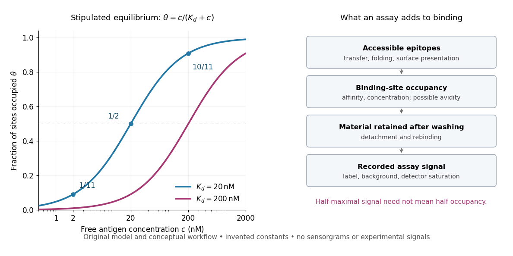

# Antibody equilibrium occupancy

↑ **Parent:** [Antibody affinity](antibody-affinity.md)

[Antibody equilibrium occupancy](antibody-equilibrium-occupancy.md) counts occupied [antibody binding sites](paratope.md), rather than retained assay label. For an original 1:1 model, let $A$ denote an unoccupied site, $E$ free [antigen](antigen.md) bearing one accessible [epitope](epitope.md), and $AE$ their complex. At [chemical equilibrium](chemical-equilibrium.md), write

$$
A+E\rightleftharpoons AE,\qquad c=[E],\qquad K_d=\frac{[A]c}{[AE]},\qquad A_T=[A]+[AE],\qquad \theta=\frac{[AE]}{A_T}=\frac{c}{K_d+c}.
$$

Square brackets mean [concentrations](concentration.md). The [dissociation constant](dissociation-constant.md) $K_d$ here has [concentration](concentration.md) units. This is the same independent-site calculation as [receptor binding occupancy](receptor-binding-occupancy.md), now applied to an [antibody binding site](paratope.md). The last equality follows by substituting $[AE]=[A]c/K_d$ into the occupied fraction and cancelling $[A]$.

Assume identical independent sites, reversible 1:1 binding, dilute [chemical solution](solution-chemistry.md) behavior, fixed [temperature](temperature-split.md) and [buffer solution](buffer-solution.md), and enough time for [chemical equilibrium](chemical-equilibrium.md). Exclude two-arm bridging, [cross-reactivity](cross-reactivity.md) and inaccessible sites from this model. Crucially, $c$ is free [antigen](antigen.md) [concentration](concentration.md); substituting the amount supplied per volume requires negligible depletion by binding. Independent [IgG](immunoglobulin-g.md) arms could obey this model site by site, but it does not describe [avidity](avidity.md) from bridging a surface.

Stipulate $K_d=20\,\mathrm{nM}$, with $1\,\mathrm{nM}=10^{-9}\,\mathrm{mol\,L^{-1}}$. Free [antigen](antigen.md) [concentrations](concentration.md) $2$, $20$ and $200\,\mathrm{nM}$ give $\theta=1/11$, $1/2$ and $10/11$. A second stipulated [dissociation constant](dissociation-constant.md) of $200\,\mathrm{nM}$ instead gives $\theta=1/11$ at $c=20\,\mathrm{nM}$. Both curves approach one at large $c$: a nearly saturated readout can conceal an [antibody affinity](antibody-affinity.md) difference. These are invented values, with no universal threshold for a useful [antibody](antibody.md).

**[Figure 5](#image-antibody-equilibrium-occupancy-and-the-additional-steps-in-an-assay-readout). Antibody equilibrium occupancy and the additional steps in an assay readout**. Original analytic curves for stipulated [dissociation constants](dissociation-constant.md) of $20$ and $200\,\mathrm{nM}$; marked examples belong to the first curve. The adjacent schematic separates [epitope](epitope.md) accessibility, binding, washing and detection. It contains no measured sensorgrams, fitted assay parameters or experimental signals. A [logarithmic scale](logarithmic-scale.md) changes the display, not the independent-site assumptions.

A [Western blot](western-blot.md) readout additionally depends on [Western blot transfer](western-blot-transfer.md), accessible [epitopes](epitope.md), loss during washing and [Western blot antibody detection](western-blot-antibody-detection.md). [Western blot response saturation](western-blot-response-saturation.md) can flatten the final signal even when binding itself remains responsive. An [ELISA](elisa.md) also reports retained label through an [enzyme](enzyme-split.md) readout, rather than automatically reporting $\theta$. Thus half of an assay's maximum signal need not occur at $c=K_d$. Varying free [antigen](antigen.md) through [concentrations](concentration.md) near the candidate [dissociation constant](dissociation-constant.md), while checking depletion and the readout's response, is more informative than comparing a single saturated point.

## ↑ Ancestors (5)

1. [Antibody affinity](antibody-affinity.md)
2. [Antibody](antibody.md)
3. [Protein](protein-split.md)
4. [Biology](biology-split.md)
5. [Codex Wiki](split.md)

## ← Incoming links (2)

- [Antibody affinity](antibody-affinity.md)
- [Antibody equilibrium occupancy](antibody-equilibrium-occupancy.md)
