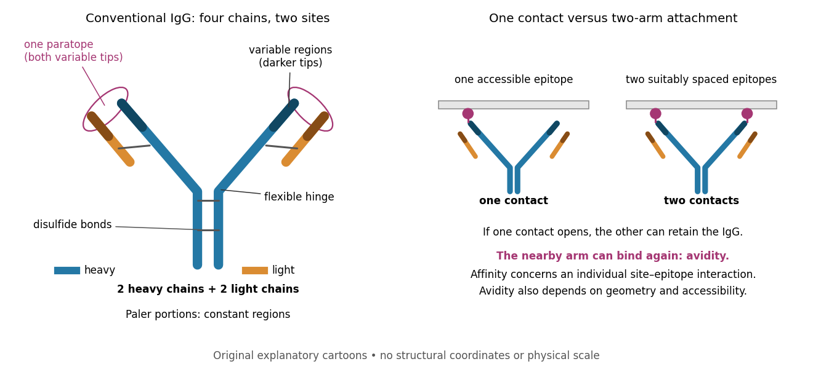

# Antibody

↑ **Parent:** [Protein](protein-split.md)  
ⓦ [Wiki](https://en.wikipedia.org/wiki/Antibody)

An [antibody](antibody.md) is a [protein](protein-split.md) that recognizes particular molecular targets through binding. [Antibodies](antibody.md) participate in [immunity](immunity-medical.md); laboratory assays such as [Western blots](western-blot.md) exploit their selective binding to detect chosen [proteins](protein-split.md).

An [IgG](immunoglobulin-g.md) gives a concrete architecture: two [immunoglobulin heavy chains](immunoglobulin-heavy-chain.md) and two [immunoglobulin light chains](immunoglobulin-light-chain.md), joined by [disulfide bonds](disulfide-bond.md). Each arm ends in a [paratope](paratope.md) assembled from an [antibody variable region](antibody-variable-region.md) of each kind of chain. The two [paratopes](paratope.md) recognize the same [epitope](epitope.md) in this conventional [IgG](immunoglobulin-g.md); the flexible hinge allows different arm separations. The [antibody constant regions](antibody-constant-region.md) form the remaining portions. This is an illustrative [IgG](immunoglobulin-g.md), rather than the architecture of every [antibody](antibody.md) format. [Immunobiology: The Immune System in Health and Disease, 5th edition by Charles A. Janeway, Jr. and others; Immunobiology, 5th edition, §§3-1, 3-2 and 3-4, Figures 3.2 and 3.4: four chains, paired sites and hinge flexibility](immunobiology-the-immune-system-in-health-and-disease-5th-edition-by-charles-a-janeway-jr-and-others/the-structure-of-a-typical-antibody-molecule.md)

**[Figure 2](#image-igg-chains-paratopes-and-two-arm-binding). IgG chains, paratopes and two-arm binding**. Original schematic of a conventional [IgG](immunoglobulin-g.md). Color distinguishes [immunoglobulin heavy chains](immunoglobulin-heavy-chain.md) from [immunoglobulin light chains](immunoglobulin-light-chain.md); darker tips mark [antibody variable regions](antibody-variable-region.md). Each outlined [paratope](paratope.md) includes both chain tips. The second panel contrasts one contact with two contacts to appropriately spaced [epitopes](epitope.md) on an imagined surface. Shapes, spacing and chain paths are illustrative, with no structural coordinates or physical scale.

Three questions must be kept separate. [Antibody specificity](antibody-specificity.md) asks which [antigens](antigen.md) are recognized. [Antibody affinity](antibody-affinity.md) describes one [paratope](paratope.md)–[epitope](epitope.md) interaction. [Avidity](avidity.md) describes the combined attachment when several contacts can cooperate. A selective [antibody](antibody.md) can have modest [antibody affinity](antibody-affinity.md), and a [monoclonal antibody](monoclonal-antibody.md) can still show [cross-reactivity](cross-reactivity.md). For an assay, the practical question is whether the observed readout identifies the intended [antigen](antigen.md) under the tested conditions; [Western blot antibody specificity controls](western-blot-antibody-specificity-control.md) make that question concrete.

**Table of contents**

- [Catalytic antibody](catalytic-antibody.md)
- [Antibody-drug conjugate](antibody-drug-conjugate.md)
- [Antibody phage display](antibody-phage-display.md)
- [Hybridoma technology](hybridoma-technology.md)
- [Primary antibody](primary-antibody.md)
- [Secondary antibody](secondary-antibody.md)
- [Epitope](epitope.md)
  - [Epitope mapping](epitope-mapping.md)
- [Immunoglobulin G](immunoglobulin-g.md)
  - [IgG chain reduction experiment](igg-chain-reduction-experiment.md)
  - [Antibody hinge region](antibody-hinge-region.md)
- [Immunoglobulin heavy chain](immunoglobulin-heavy-chain.md)
- [Immunoglobulin light chain](immunoglobulin-light-chain.md)
- [Antibody variable region](antibody-variable-region.md)
  - [Complementarity-determining region](complementarity-determining-region.md)
- [Antibody constant region](antibody-constant-region.md)
- [Fragment antigen-binding](fragment-antigen-binding.md)
  - [Papain digestion of IgG](papain-digestion-of-igg.md)
- [Fragment crystallizable region](fragment-crystallizable-region.md)
- [Paratope](paratope.md)
- [Antigen](antigen.md)
  - [Neoantigen](neoantigen.md)
  - [Tumour-associated antigen](tumour-associated-antigen.md)
- [Antibody specificity](antibody-specificity.md)
  - [Cross-reactivity](cross-reactivity.md)
- [Monoclonal antibody](monoclonal-antibody.md)
- [Avidity](avidity.md)
  - [Effective local concentration](effective-local-concentration.md)
- [Antibody affinity](antibody-affinity.md)
  - [Affinity maturation](affinity-maturation.md)
  - [Antibody equilibrium occupancy](antibody-equilibrium-occupancy.md)
  - [Antibody surface plasmon resonance experiment](antibody-surface-plasmon-resonance-experiment.md)

## ↑ Ancestors (3)

1. [Protein](protein-split.md)
2. [Biology](biology-split.md)
3. [Codex Wiki](split.md)

## ← Incoming links (54)

- [A gradient of bicoid protein in Drosophila embryos by Wolfgang Driever and Christiane Nüsslein-Volhard](a-gradient-of-bicoid-protein-in-drosophila-embryos-by-wolfgang-driever-and-christiane-nusslein-volhard.md)
- [Antibody](antibody.md)
- [Antibody constant region](antibody-constant-region.md)
- [Antibody-drug conjugate](antibody-drug-conjugate.md)
- [Antibody equilibrium occupancy](antibody-equilibrium-occupancy.md)
- [Antibody variable region](antibody-variable-region.md)
- [Antigen](antigen.md)
- [Avidity](avidity.md)
- [Chromatin immunoprecipitation sequencing](chromatin-immunoprecipitation-sequencing.md)
- [Co-immunoprecipitation](co-immunoprecipitation.md)
- [Cross-reactivity](cross-reactivity.md)
- [Crosslinking and immunoprecipitation](crosslinking-and-immunoprecipitation.md)
- [CUT&RUN](cut-and-run.md)
- [Dengue virus](dengue-virus.md)
- [Epitope](epitope.md)
- [IgG chain reduction experiment](igg-chain-reduction-experiment.md)
- [Immunofluorescence](immunofluorescence.md)
- [Immunoglobulin G](immunoglobulin-g.md)
- [Ligand-dependent membrane phosphorylation experiment](ligand-dependent-membrane-phosphorylation-experiment.md)
- [Membrane topology](membrane-topology.md)
- [Monoclonal antibody](monoclonal-antibody.md)
- [Mouse-human heterokaryon membrane-mixing experiment](mouse-human-heterokaryon-membrane-mixing-experiment.md)
- [Papain digestion of IgG](papain-digestion-of-igg.md)
- [Paratope](paratope.md)
- [Solution](past-exam-of-the-biochemistry-and-molecular-biology-course-of-the-university-of-cambridge/2025/paper-2/section-a/9/solution.md)
- [Solution](past-exam-of-the-biochemistry-and-molecular-biology-course-of-the-university-of-cambridge/2025/paper-2/section-b/13/a/solution.md)
- [Solution](past-exam-of-the-biochemistry-and-molecular-biology-course-of-the-university-of-cambridge/2025/paper-2/section-b/13/c/solution.md)
- [Solution](past-exam-of-the-biochemistry-and-molecular-biology-course-of-the-university-of-cambridge/2025/paper-2/section-b/13/d/solution.md)
- [Solution](past-exam-of-the-biochemistry-and-molecular-biology-course-of-the-university-of-cambridge/2025/paper-2/section-b/13/h/solution.md)
- [Solution](past-exam-of-the-biochemistry-and-molecular-biology-course-of-the-university-of-cambridge/2025/paper-2/section-c/14/i/solution.md)
- [Solution](past-exam-of-the-biochemistry-and-molecular-biology-course-of-the-university-of-cambridge/2025/paper-2/section-c/14/j/solution.md)
- [Solution](past-exam-of-the-biochemistry-and-molecular-biology-course-of-the-university-of-cambridge/2025/paper-2/section-c/14/l/solution.md)
- [Solution](past-exam-of-the-biochemistry-and-molecular-biology-course-of-the-university-of-cambridge/2025/paper-2/section-c/14/m/solution.md)
- [Solution](past-exam-of-the-biochemistry-and-molecular-biology-course-of-the-university-of-cambridge/2025/paper-2/section-c/14/n/solution.md)
- [Solution](past-exam-of-the-biochemistry-course-of-the-university-of-cambridge/2024/paper-2/section-i/2/solution.md)
- [Solution](past-exam-of-the-biochemistry-course-of-the-university-of-cambridge/2024/paper-2/section-ii/6/solution.md)
- [Solution](past-exam-of-the-biochemistry-course-of-the-university-of-cambridge/2025/paper-1/section-ii/5/solution.md)
- [Solution](past-exam-of-the-biochemistry-course-of-the-university-of-cambridge/2025/paper-2/section-i/1/solution.md)
- [Solution](past-exam-of-the-biochemistry-course-of-the-university-of-cambridge/2025/paper-2/section-i/2/solution.md)
- [Solution](past-exam-of-the-biochemistry-course-of-the-university-of-cambridge/2025/paper-5/section-2/2/h/solution.md)
- [Solution](past-exam-of-the-biochemistry-course-of-the-university-of-cambridge/2025/paper-5/section-2/2/j/solution.md)
- [Solution](past-exam-of-the-genetics-course-of-the-university-of-cambridge/2024/paper-2/4/solution.md)
- [Solution](past-exam-of-the-genetics-course-of-the-university-of-cambridge/2025/paper-2/2/solution.md)
- [Solution](past-exam-of-the-systems-biology-course-of-the-university-of-cambridge/2024/paper-2/3/i/solution.md)
- [Receptor phosphorylation assay](receptor-phosphorylation-assay.md)
- [RNA immunoprecipitation](rna-immunoprecipitation.md)
- [SDS-PAGE](sds-page.md)
- [Secondary antibody](secondary-antibody.md)
- [Serocatalytic model](serocatalytic-model.md)
- [Seroprevalence](seroprevalence.md)
- [Western blot](western-blot.md)
- [Western blot antibody specificity control](western-blot-antibody-specificity-control.md)
- [Western blot band interpretation](western-blot-band-interpretation.md)
- [Western blot controls](western-blot-controls.md)
