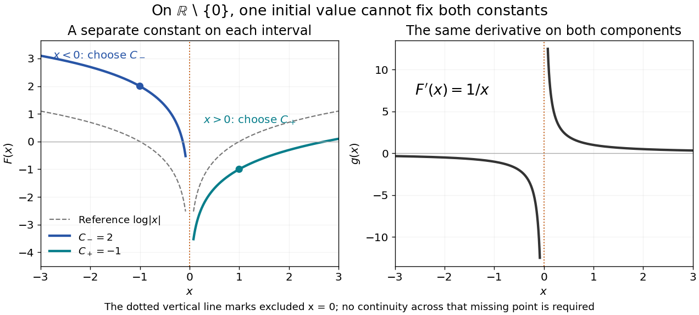

# Antiderivatives on disconnected domains

↑ **Parent:** [Constant of integration](constant-of-integration.md)

Let $U$ be an [open subset](open-set.md) of the [real line](real-line.md), and let $F,G$ be [antiderivatives](antiderivative.md) of the same [function](function-split.md) on $U$. Each [connected component](connected-component.md) $I_j$ is an open [interval](interval-mathematics.md). On that component, $(G-F)'=0$, so the [mean value theorem](mean-value-theorem.md) gives $G-F=C_j$. The constants on different components are independent: there is no subinterval inside $U$ joining them. Conversely, adding any chosen constant on each component preserves the [derivative](derivative.md) everywhere on $U$.

For example, the domain of $g(x)=1/x$ is $U=\mathbb R\setminus\{0\}$. Every [antiderivative](antiderivative.md) on this domain has the form

$$
F(x)=
\begin{cases}
\log|x|+C_-,&x<0,\\
\log|x|+C_+,&x>0,
\end{cases}
$$

with arbitrary real $C_-,C_+$. The [logarithm](logarithm.md) of the [absolute value](absolute-value.md) differentiates to $1/x$ on each side. The function with $C_-=2$ and $C_+=-1$ is therefore a valid [antiderivative](antiderivative.md), although it cannot be written as $\log|x|+C$ with one global constant.

**[Figure 9](#image-two-disconnected-intervals-allow-independent-constants-while-the-derivative-stays-the-same). Two disconnected intervals allow independent constants while the derivative stays the same**.

An [initial condition](initial-condition.md) at $x=1$ fixes $C_+$ and leaves $C_-$ free. Fixing both constants requires one reference value in each [connected component](connected-component.md), or additional conditions that couple the components. The [locally constant function](locally-constant-function.md) $F(x)-\log|x|$ captures this remaining freedom.

## ↑ Ancestors (9)

1. [Constant of integration](constant-of-integration.md)
2. [Antiderivative](antiderivative.md)
3. [Integral](integral.md)
4. [Calculus](calculus-split.md)
5. [Real analysis](real-analysis-split.md)
6. [Analysis](analysis-split.md)
7. [Area of mathematics](area-of-mathematics.md)
8. [Mathematics](mathematics-split.md)
9. [Codex Wiki](split.md)

## ← Incoming links (2)

- [Additive constant](additive-constant.md)
- [Constant of integration](constant-of-integration.md)
