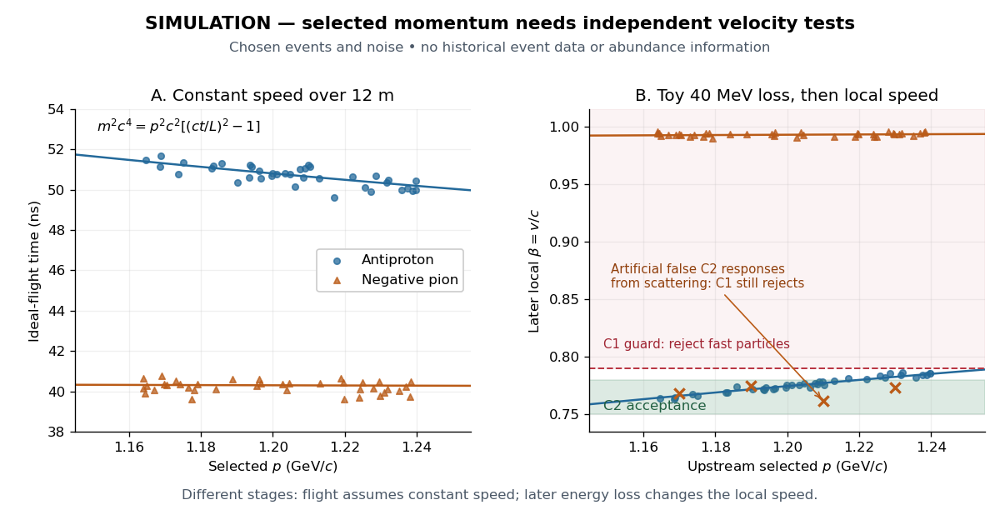

# Antiproton mass from momentum and velocity

↑ **Parent:** [Antiproton](antiproton.md)

For a singly charged track perpendicular to a uniform [magnetic field](magnetic-field-split.md), its curvature gives [magnetic rigidity](magnetic-rigidity.md) $p/|q|=Br$, and the bend direction gives the sign of [electric charge](electric-charge-split.md). The [mass shell](mass-shell.md) relation and [four-momentum](four-momentum.md) relation between [energy](energy-split.md) and [velocity](velocity.md) give

$$
E^2=p^2c^2+m^2c^4,\qquad \beta=\frac vc=\frac{pc}{E},\qquad m^2c^4=p^2c^2\left(\beta^{-2}-1\right).
$$

For a known path length $L$ and constant [velocity](velocity.md), [time of flight](time-of-flight.md) $t=L/(\beta c)$ therefore gives

$$
m^2c^4=p^2c^2\left[\left(\frac{ct}{L}\right)^2-1\right].
$$

This measures [rest mass](invariant-mass.md) under an assigned [electric charge](electric-charge-split.md) magnitude. Curvature alone measures $p/|q|$, so independent evidence for $|q|=e$ matters. In material, the measured delay is instead $t=\int dl/v(l)$; matching a local [Cherenkov detector](cherenkov-detector.md) [velocity](velocity.md) to an upstream [momentum](momentum-split.md) requires an energy-loss correction.

As an original illustrative calculation, choose $p=1.20\,\mathrm{GeV}/c$ and $L=12.0\,\mathrm m$, with rounded input [rest energies](rest-energy.md) $m_pc^2=0.93827\,\mathrm{GeV}$ and $m_\pi c^2=0.13957\,\mathrm{GeV}$. Constant-[velocity](velocity.md) propagation gives

$$
\begin{aligned}
\beta_{\bar p}&\simeq0.7878,&t_{\bar p}&\simeq50.81\,\mathrm{ns},\\
\beta_{\pi^-}&\simeq0.9933,&t_{\pi^-}&\simeq40.30\,\mathrm{ns}.
\end{aligned}
$$

Both particles have the same selected [momentum](momentum-split.md) and negative [electric charge](electric-charge-split.md), yet their [time of flight](time-of-flight.md) separation is about $10.51\,\mathrm{ns}$. These are calculated values for a deliberately simplified example, not measured discovery events.

**[Figure 2](#image-simulated-momentum-and-velocity-tests-distinguish-antiprotons-from-negative-pions). Simulated momentum and velocity tests distinguish antiprotons from negative pions**. Original simulation with chosen populations and resolutions, not historical event data or abundances. The left panel assumes constant [velocity](velocity.md) over $12\,\mathrm m$. The right panel applies a toy $40\,\mathrm{MeV}$ energy loss before a local [velocity](velocity.md) reading and overlays historical C2 acceptance and C1 guard boundaries.[UCRL-3172, p. 5](https://escholarship.org/content/qt46p0z8w7/qt46p0z8w7.pdf)

For example, the toy energy loss changes the central [antiproton](antiproton.md) [velocity](velocity.md) from $0.7878c$ to $0.7745c$. Directly substituting the slower downstream value together with the upstream [momentum](momentum-split.md) would overestimate the [rest mass](invariant-mass.md). The two panels thus describe different stages of a deliberately specified model; their numerical consistency depends on propagating [energy](energy-split.md) between stages. Likewise, the scattered-[pion](pion.md) markers represent an erroneous C2 response, not actual slow [pions](pion.md); an upstream C1 signal still rejects them.

## ↑ Ancestors (9)

1. [Antiproton](antiproton.md)
2. [Antiparticle](antiparticle.md)
3. [Mode expansion of a Dirac field](mode-expansion-of-a-dirac-field.md)
4. [Dirac field](dirac-field.md)
5. [Relativistic quantum field](relativistic-quantum-field-split.md)
6. [Quantum field theory](quantum-field-theory-split.md)
7. [Branches of physics](branches-of-physics.md)
8. [Physics](physics-split.md)
9. [Codex Wiki](split.md)

## ← Incoming links (1)

- [Fixed-target antiproton production threshold](fixed-target-antiproton-production-threshold.md)
