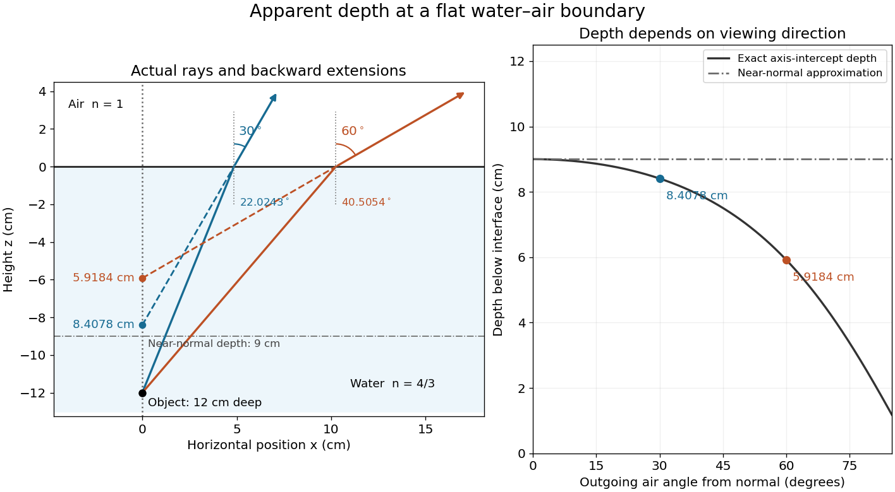

# Apparent depth

↑ **Parent:** [Refraction](refraction.md)

A submerged object looks shallower because its emerging [light rays](light-ray.md) bend away from the surface [normal vector](normal-vector.md). Their backward extensions give an approximate [virtual image](virtual-image.md) nearer the surface. For an object at perpendicular depth $d$ in a medium of [refractive index](refractive-index.md) $n_{\mathrm{obj}}$, viewed through a flat boundary from a medium of [refractive index](refractive-index.md) $n_{\mathrm{obs}}$, the near-normal [paraxial approximation](paraxial-approximation.md) gives $d_{\mathrm{par}}=(n_{\mathrm{obs}}/n_{\mathrm{obj}})d$. Thus the model [water](water.md) depth $12\,\mathrm{cm}$ appears approximately $9\,\mathrm{cm}$ from air. This is a bundle-of-[light rays](light-ray.md) statement, not a deflection of the axial [light ray](light-ray.md).[§2.3, Refraction at a Plane Interface—Apparent Depth, Figures 2.13–2.14 and equation 2.10: near-normal small-angle assumption](university-physics-volume-3-by-samuel-j-ling-and-others.md)

For general transmitted [light rays](light-ray.md), specify what “depth” means. Put the object at $(0,-d)$ below a horizontal boundary $z=0$. A [light ray](light-ray.md) reaches the boundary at $(x,0)$, with object-side [angle](angle.md) $\theta_{\mathrm{obj}}$ and observer-side [angle](angle.md) $\theta_{\mathrm{obs}}$, both measured from the upward [normal vector](normal-vector.md). For $x>0$, its backward extension meets the object's normal line $x=0$ at $z=-d_{\mathrm{axis}}$, where

$$
x=d\tan\theta_{\mathrm{obj}},\qquad
n_{\mathrm{obj}}\sin\theta_{\mathrm{obj}}=n_{\mathrm{obs}}\sin\theta_{\mathrm{obs}},\qquad
d_{\mathrm{axis}}=\frac{x}{\tan\theta_{\mathrm{obs}}}
=d\frac{n_{\mathrm{obs}}\cos\theta_{\mathrm{obs}}}{n_{\mathrm{obj}}\cos\theta_{\mathrm{obj}}}.
$$

This axis-intercept depth is exact for that one transmitted [light ray](light-ray.md) in the stated model. It tends to $d_{\mathrm{par}}$ as the [angles](angle.md) tend to zero; at exactly zero the quotient is interpreted as a [limit](limit-of-a-function.md). These elementary [tangent](tangent.md), [sine](sine.md) and [cosine](cosine.md) relations show precisely where the [small-angle approximation](small-angle-approximation.md) enters.

The original calculations below use $d=12\,\mathrm{cm}$, $n_{\mathrm{obj}}=4/3$ and $n_{\mathrm{obs}}=1$:

| Outgoing air [angle](angle.md) $\theta_{\mathrm{obs}}$ | [Water](water.md) [angle](angle.md) $\theta_{\mathrm{obj}}$ | Boundary position $x$ in cm | Axis-intercept depth $d_{\mathrm{axis}}$ in cm |
| --- | --- | --- | --- |
| $5^\circ$ | $3.7479^\circ$ | $0.7861$ | $8.9850$ |
| $30^\circ$ | $22.0243^\circ$ | $4.8542$ | $8.4078$ |
| $60^\circ$ | $40.5054^\circ$ | $10.2509$ | $5.9184$ |

**[Figure 8](#image-exact-light-ray-extensions-and-the-near-normal-apparent-depth-approximation). Exact light ray extensions and the near-normal apparent-depth approximation**. Original model of an object $12\,\mathrm{cm}$ below a planar [water](water.md)–air boundary, with [refractive indices](refractive-index.md) $4/3$ and $1$. The left panel has equal coordinate scales; solid lines are forward [light rays](light-ray.md) and dashed lines are backward extensions to the object's normal line. The two outgoing [light rays](light-ray.md) are different viewing directions, not a bundle entering one eye. The right panel compares their exact axis-intercept depths with the near-normal value $9\,\mathrm{cm}$. Marked points are calculated predictions, not observations.

At appreciable obliquity these depths differ, so the full outgoing bundle has no single exact [virtual image](virtual-image.md) on the object's normal line. An oblique eye samples a narrow bundle; its local apparent position also depends on that bundle and cannot be inferred by declaring $d_{\mathrm{axis}}$ to be a universal image depth. A plane refracting boundary gives approximate [image formation](image-formation.md) near [normal incidence](normal-incidence.md), with departures at larger [angles](angle.md). The construction assumes a flat surface, uniform transparent media with [isotropy](isotropy.md), and a propagating transmitted [light ray](light-ray.md); it does not extend to [total internal reflection](total-internal-reflection.md).

## ↑ Ancestors (5)

1. [Refraction](refraction.md)
2. [Optics](optics-split.md)
3. [Branches of physics](branches-of-physics.md)
4. [Physics](physics-split.md)
5. [Codex Wiki](split.md)
