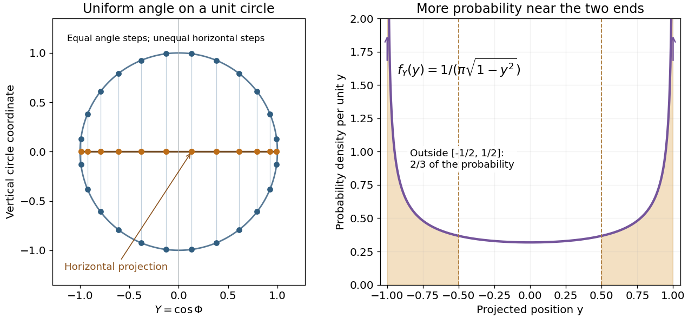

# Arcsine distribution

↑ **Parent:** [Continuous probability distribution](continuous-probability-distribution-split.md)  
ⓦ [Wiki](https://en.wikipedia.org/wiki/Arcsine_distribution)

The standard [arcsine distribution](arcsine-distribution.md) is a [continuous probability distribution](continuous-probability-distribution-split.md) on $[0,1]$ with [probability density function](probability-density-function.md)

$$
f(x)=\frac1{\pi\sqrt{x(1-x)}},\qquad0<x<1.
$$

It is the [beta distribution](beta-distribution.md) with both parameters equal to $1/2$. The density grows without bound toward both endpoints, yet neither endpoint has any [probability mass](probability-mass.md). Its name comes from the [inverse sine](inverse-sine.md) in its [cumulative distribution function](cumulative-distribution-function.md).[Random: Probability, Mathematical Statistics, Stochastic Processes by Kyle Siegrist; The Standard Arcsine Distribution, Distribution Functions and Related Distributions: density, normalization, beta representation and CDF](random-probability-mathematical-statistics-stochastic-processes-by-kyle-siegrist/the-arcsine-distribution.md)

A useful way to see the shape is to choose a point uniformly around a [circle](circle.md) and project it onto a diameter. Equal angular intervals do not give equal horizontal distances: the projection moves slowly near either end. An ideal [harmonic oscillator](simple-harmonic-motion.md) sampled at a uniformly chosen time in one complete period has the same endpoint concentration after rescaling its position. The distribution translates a simple geometric slowdown into a precise [probability](probability.md) calculation.

**[Figure 1](#image-uniform-angles-project-unevenly-onto-a-diameter). Uniform angles project unevenly onto a diameter**. Original calculated geometry. The circle marks an equally spaced angle grid to illustrate the uniform-angle model; these are not experimental observations. Horizontal projection gives $Y=\cos\Phi$ on $[-1,1]$. The right curve is its exact [probability density function](probability-density-function.md) $1/(\pi\sqrt{1-y^2})$; the standard variable is $X=(1+Y)/2$.

For an original comparison, take equal-length regions: the middle half $[1/4,3/4]$, and the two outside quarters together. Then

$$
\boxed{\mathbb P(1/4\leq X\leq3/4)=\frac13,\qquad
\mathbb P(X<1/4\text{ or }X>3/4)=\frac23.}
$$

A [uniform distribution](continuous-uniform-distribution.md) on $[0,1]$ instead assigns each region [probability](probability.md) $1/2$. Both distributions have [mean](expected-value-split.md) $1/2$; the [mean](expected-value-split.md) alone hides their different concentration.

**Table of contents**

- [Arcsine distribution from a uniform angle](arcsine-distribution-from-a-uniform-angle.md)
- [Endpoint concentration in the arcsine distribution](endpoint-concentration-in-the-arcsine-distribution.md)
- [Arcsine quantiles and moments](arcsine-quantiles-and-moments.md)
- [Arcsine distribution on a bounded interval](arcsine-distribution-on-a-bounded-interval.md)

## ↑ Ancestors (7)

1. [Continuous probability distribution](continuous-probability-distribution-split.md)
2. [Probability distribution](probability-distribution-split.md)
3. [Probability theory](probability-theory-split.md)
4. [Probability and statistics](probability-and-statistics-split.md)
5. [Area of mathematics](area-of-mathematics.md)
6. [Mathematics](mathematics-split.md)
7. [Codex Wiki](split.md)

## ← Incoming links (7)

- [Arcsine distribution](arcsine-distribution.md)
- [Arcsine distribution from a uniform angle](arcsine-distribution-from-a-uniform-angle.md)
- [Arcsine distribution on a bounded interval](arcsine-distribution-on-a-bounded-interval.md)
- [Beta distribution](beta-distribution.md)
- [Endpoint concentration in the arcsine distribution](endpoint-concentration-in-the-arcsine-distribution.md)
- [Integrable singularity](integrable-singularity.md)
- [Solution](past-exam-of-the-mathematics-course-of-the-university-of-cambridge/2007/iii/paper-48/3/i/solution.md)
