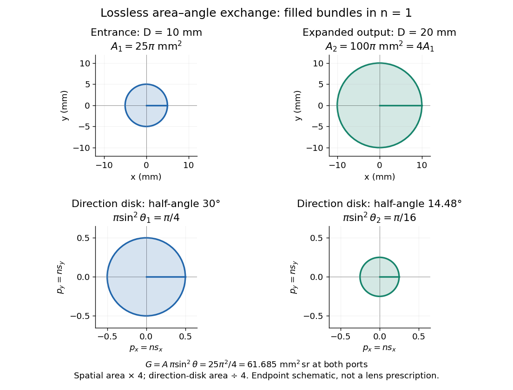

# Area-angle tradeoff

↑ **Parent:** [Etendue](etendue.md)

When both endpoint bundles have the filled circular-cone geometry of [etendue of a circular aperture and cone](etendue-of-a-circular-aperture-and-cone.md), [conservation of etendue](conservation-of-etendue.md) gives

$$
n_1^2A_1\sin^2\theta_1=n_2^2A_2\sin^2\theta_2.
$$

For the same [refractive index](refractive-index.md), quadrupling the [area](surface-area.md) halves the [sine](sine.md) of the cone half-[angle](angle.md). In the $10\,\mathrm{mm}$, $30^\circ$ example, an ideal output of [diameter](diameter.md) $20\,\mathrm{mm}$ must have $\sin\theta_2=1/4$, so $\theta_2\approx14.4775^\circ$. The exact result differs from simply halving $30^\circ$. Conversely, reducing the [diameter](diameter.md) to $5\,\mathrm{mm}$ requires a complete forward [hemisphere](hemisphere.md), $\theta_2=90^\circ$, as a limiting case.

**[Figure 38](#image-equal-etendue-four-times-the-spatial-area-exchanges-for-one-quarter-of-the-directional-area). Equal etendue: four times the spatial area exchanges for one quarter of the directional area**. The circles are cross-sections of the four-dimensional [phase space](phase-space.md): spatial disks in $(x,y)$ and direction disks in $(p_x,p_y)$. Scales agree within each row. The displayed transformation preserves their product volume; it is a schematic of endpoint bundles, not a claim that a particular [optical lens](lens-optics.md) exactly realizes the transformation at every [angle](angle.md).

Equal bounding [area](surface-area.md) and [solid angle](solid-angle.md) do not alone prove equal [etendue](etendue.md): an actual output can have unoccupied directions or position-direction correlations. The filled-cone equation is an exact model of the specified bundles and a capacity constraint on an [optical instrument](optical-instrument.md), not a guarantee of an aberration-free implementation.

## ↑ Ancestors (6)

1. [Etendue](etendue.md)
2. [Geometrical optics](geometrical-optics.md)
3. [Optics](optics-split.md)
4. [Branches of physics](branches-of-physics.md)
5. [Physics](physics-split.md)
6. [Codex Wiki](split.md)

## ← Incoming links (1)

- [Etendue bench measurement](etendue-bench-measurement.md)
