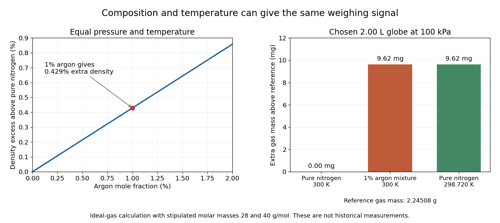

# Argon detection in a binary gas mixture

↑ **Parent:** [Argon](argon.md)

Consider an original simplified model containing only [nitrogen](nitrogen.md) and [argon](argon.md), with [argon](argon.md) [mole fraction](mole-fraction.md) $x$. Let their [molar masses](molar-mass.md) be $M_N$ and $M_A$. Adding the component [masses](mass.md) gives the mixture's mean [molar mass](molar-mass.md)

$$
\overline M=(1-x)M_N+xM_A.
$$

For an [ideal gas](ideal-gas-split.md) mixture at the same [pressure](pressure-split.md) and [temperature](temperature-split.md) as a pure-[nitrogen](nitrogen.md) reference, the [gas density](gas-density.md) ratio is

$$
r=\frac{\rho}{\rho_N}=\frac{\overline M}{M_N}
=1+x\left(\frac{M_A}{M_N}-1\right),\qquad
\boxed{x=\frac{r-1}{M_A/M_N-1}.}
$$

The inversion requires known identities, the binary-mixture assumption and $M_A\ne M_N$. A density ratio cannot uniquely recover an arbitrary multicomponent [mixture](mixture-split.md). Nor should $x$ be interpreted as the [argon](argon.md) fraction of untreated air: the model sample has only the two specified components.

Choose round model values $M_N=28\,\mathrm{g\,mol^{-1}}$ and $M_A=40\,\mathrm{g\,mol^{-1}}$. For $x=0.010$, the calculated relative density excess is

$$
\boxed{r-1=0.010\left(\frac{40}{28}-1\right)
=0.00428571\ldots\simeq0.429\%.}
$$

Thus a one-percent [mole fraction](mole-fraction.md) does not mean a one-percent [gas density](gas-density.md) change. In a chosen $2.00\,\mathrm L$ globe at $100\,\mathrm{kPa}$ and $300\,\mathrm K$, the [ideal gas law](ideal-gas-law.md) gives approximately $2.24508\,\mathrm g$ for pure [nitrogen](nitrogen.md) and $2.25471\,\mathrm g$ for this mixture: only $9.62\,\mathrm{mg}$ separates the weighings. These are model calculations with rounded [molar masses](molar-mass.md), not historical measurements.

**[Figure 12](#image-a-small-admixture-changes-gas-density-but-temperature-can-imitate-the-signal). A small admixture changes gas density, but temperature can imitate the signal**. Calculated binary-mixture model with stipulated [molar masses](molar-mass.md) $28$ and $40\,\mathrm{g\,mol^{-1}}$. The left panel shows the linear [gas density](gas-density.md) contrast. The right compares three hypothetical globe fillings: a reference, one-percent [argon](argon.md) at the same [temperature](temperature-split.md), and pure [nitrogen](nitrogen.md) cooled enough to give the identical [mass](mass.md). No historical data are plotted.

A direct control calculation explains why the filling conditions matter. At fixed [pressure](pressure-split.md), pure [nitrogen](nitrogen.md) at

$$
T'=\frac{300\,\mathrm K}{1+0.00428571\ldots}
\simeq298.720\,\mathrm K
$$

has the same [gas density](gas-density.md) as that mixture at $300\,\mathrm K$. A roughly $1.28\,\mathrm K$ mismatch can therefore imitate the entire stipulated composition signal. For small changes, the [ideal gas law](ideal-gas-law.md) gives

$$
\frac{d\rho}{\rho}=\frac{dp}{p}+\frac{d\overline M}{\overline M}-\frac{dT}{T}.
$$

An independently measured [pressure](pressure-split.md) and [temperature](temperature-split.md), matched weighing procedure, and checks for residual vapour distinguish composition from these alternative causes. The model explains the need for controls; it does not supply the complete corrections for a real gas-weighing instrument.

## ↑ Ancestors (6)

1. [Argon](argon.md)
2. [Noble gas](noble-gas.md)
3. [Chemical element](chemical-element.md)
4. [Chemical substance](chemical-substance-split.md)
5. [Chemistry](chemistry-split.md)
6. [Codex Wiki](split.md)

## ← Incoming links (1)

- [Gas density](gas-density.md)
