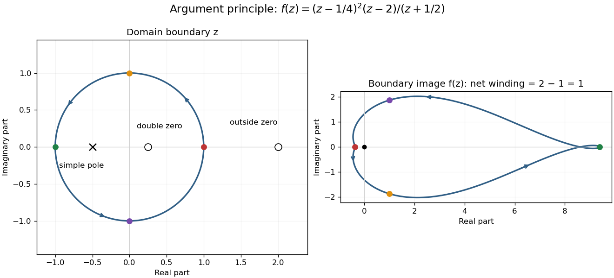

# Argument principle for a rational function

↑ **Parent:** [Argument principle](argument-principle.md)

Consider the [rational function](rational-function.md)

$$
f(z)=\frac{(z-1/4)^2(z-2)}{z+1/2}.
$$

Inside the [unit circle](complex-unit-circle.md) are a double [zero of a function](zero-of-a-function.md) at $1/4$ and a simple [pole](pole.md) at $-1/2$. The simple [zero of a function](zero-of-a-function.md) at $2$ is outside. Thus **$N=2$, $P=1$, and the [winding number](winding-number.md) is one**. The factorization checks the count exactly; the plot illustrates how the boundary records it.

**[Figure 12](#image-a-double-zero-and-a-simple-pole-leave-one-net-turn-of-the-boundary-image). A double zero and a simple pole leave one net turn of the boundary image**. Left: the positively oriented [unit circle](complex-unit-circle.md) surrounds the double [zero of a function](zero-of-a-function.md) at $1/4$ and simple [pole](pole.md) at $-1/2$. Right: the [image](image-of-a-function.md) [contour](complex-integration-contour.md) under the stipulated [rational function](rational-function.md), with matching colored boundary points and arrows. Its net [winding number](winding-number.md) about zero is one. The curve is computed from the formula, not copied from a source.

For the concentric [circle](circle.md) $|z|=r$, the [winding number](winding-number.md) is zero for $0<r<1/4$, two for $1/4<r<1/2$, one for $1/2<r<2$, and two for $r>2$. At $r=1/4$ or $r=2$, the boundary contains a [zero of a function](zero-of-a-function.md); at $r=1/2$, it contains a [pole](pole.md). The theorem does not apply at those three radii. Moving a boundary changes the count only when it crosses an object being counted; [homotopy invariance of winding number](homotopy-invariance-of-winding-number.md) describes the unchanged count between crossings.

## ↑ Ancestors (6)

1. [Argument principle](argument-principle.md)
2. [Complex analysis](complex-analysis-split.md)
3. [Analysis](analysis-split.md)
4. [Area of mathematics](area-of-mathematics.md)
5. [Mathematics](mathematics-split.md)
6. [Codex Wiki](split.md)

## ← Incoming links (1)

- [Weighted argument principle](weighted-argument-principle.md)
