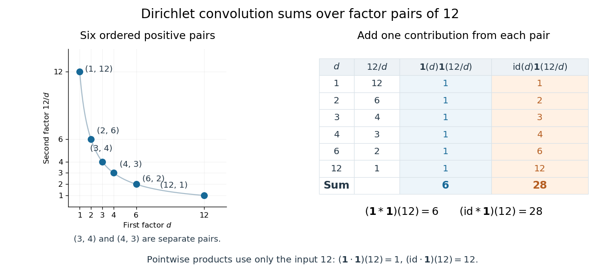

# Arithmetic function

↑ **Parent:** [Number theory](number-theory.md)  
ⓦ [Wiki](https://en.wikipedia.org/wiki/Arithmetic_function)

An [arithmetic function](arithmetic-function.md) is a [function](function.md) whose [domain of a function](function.md#domain-of-a-function) is the [positive integers](integer.md#positive-integer), usually taking values in the [complex numbers](complex-analysis.md#complex-number). Thus $f(1),f(2),\ldots$ are its values; $f(0)$ is outside this [domain of a function](function.md#domain-of-a-function). Examples include the [divisor function](#divisor-function), with $\tau(12)=6$, and the [sum-of-divisors function](#sum-of-divisors-function), with $\sigma_1(12)=28$. Studying an [arithmetic function](arithmetic-function.md) packages a question about each [positive integer](integer.md#positive-integer) into one object whose values can be combined using [Dirichlet convolution](#dirichlet-convolution). [Darij Grinberg, MIT 18.781 lecture notes, Section 2.1: arithmetic functions](https://darijgrinberg.gitlab.io/floor.pdf)

**Table of contents**

- [Liouville function](#liouville-function)
- [Summatory function](#summatory-function)
- [Radical of an integer](#radical-of-an-integer)
  - [Prime support of an integer](#prime-support-of-an-integer)
- [Total number of prime factors](#total-number-of-prime-factors)
  - [Excess prime-factor multiplicity](#excess-prime-factor-multiplicity)
- [Additive function (number theory)](#additive-function-number-theory)
  - [Mean of an additive arithmetic function](#mean-of-an-additive-arithmetic-function)
  - [Strongly additive arithmetic function](#strongly-additive-arithmetic-function)
  - [Completely additive arithmetic function](#completely-additive-arithmetic-function)
- [Multiplicative function](#multiplicative-function)
  - [Multiplicativity of an arithmetic function](#multiplicativity-of-an-arithmetic-function)
  - [Completely multiplicative function](#completely-multiplicative-function)
  - [Divisor sum](#divisor-sum)
    - [Sum-of-divisors function](#sum-of-divisors-function)
      - [Proper-divisor sum](#proper-divisor-sum)
  - [Pretentious distance](#pretentious-distance)
    - [Large Fourier coefficient criterion for pretentiousness](#large-fourier-coefficient-criterion-for-pretentiousness)
    - [Pretentious distance between one and the Möbius function](#pretentious-distance-between-one-and-the-mobius-function)
    - [Prime-restriction metric for pretentious distance](#prime-restriction-metric-for-pretentious-distance)
    - [Triangle inequality for pretentious distance](#triangle-inequality-for-pretentious-distance)
    - [Archimedean character](#archimedean-character)
    - [Halász theorem](#halasz-theorem)
    - [Strong aperiodicity of the Möbius function](#strong-aperiodicity-of-the-mobius-function)
- [Pointwise product of arithmetic functions](#pointwise-product-of-arithmetic-functions)
- [Dirichlet convolution](#dirichlet-convolution)
  - [Multiplicativity of Dirichlet convolution](#multiplicativity-of-dirichlet-convolution)
  - [Constant-one arithmetic function](#constant-one-arithmetic-function)
  - [Identity arithmetic function](#identity-arithmetic-function)
  - [Identity for Dirichlet convolution](#identity-for-dirichlet-convolution)
  - [Dirichlet hyperbola method](#dirichlet-hyperbola-method)
    - [Divisor summatory function](#divisor-summatory-function)
    - [Asymmetric Dirichlet hyperbola split](#asymmetric-dirichlet-hyperbola-split)
    - [Arithmetic work of the Dirichlet hyperbola method](#arithmetic-work-of-the-dirichlet-hyperbola-method)
    - [Divisor summatory asymptotic](#divisor-summatory-asymptotic)
    - [Harmonic divisor sum](#harmonic-divisor-sum)
- [Divisor function](#divisor-function)
  - [Perfection quotient](#perfection-quotient)
  - [Amicable number](#amicable-number)
    - [Amicable pair](#amicable-pair)
  - [Subpower bound for the divisor function](#subpower-bound-for-the-divisor-function)
  - [Divisor-square summatory bound](#divisor-square-summatory-bound)
- [Von Mangoldt function](#von-mangoldt-function)
  - [Selberg symmetry formula](#selberg-symmetry-formula)
  - [Von Mangoldt divisor identity](#von-mangoldt-divisor-identity)
  - [Chebyshev function](#chebyshev-function)
    - [Second Chebyshev function](#second-chebyshev-function)
      - [First integral of the Chebyshev function](#first-integral-of-the-chebyshev-function)
        - [Smoothed explicit formula for the Chebyshev function](#smoothed-explicit-formula-for-the-chebyshev-function)
      - [Integrated Chebyshev sum](#integrated-chebyshev-sum)
      - [Chebyshev estimate](#chebyshev-estimate)
        - [Chebyshev estimate from central binomial coefficients](#chebyshev-estimate-from-central-binomial-coefficients)
      - [Riemann–von Mangoldt explicit formula](#riemann-von-mangoldt-explicit-formula)
        - [Truncated explicit formula for the second Chebyshev function](#truncated-explicit-formula-for-the-second-chebyshev-function)
  - [Vaughan's identity](#vaughan-s-identity)
    - [Prime exponential-sum estimate from Vaughan identity](#prime-exponential-sum-estimate-from-vaughan-identity)
    - [Logarithmic coefficient bound in Vaughan identity](#logarithmic-coefficient-bound-in-vaughan-identity)
    - [Vaughan identity for the Möbius function](#vaughan-identity-for-the-mobius-function)
      - [Type I–type II inverse principle for Möbius correlation](#type-i-type-ii-inverse-principle-for-mobius-correlation)
    - [Vaughan identity proof](#vaughan-identity-proof)
- [Prime omega function](#prime-omega-function)
  - [Three to the distinct-prime-factor count](#three-to-the-distinct-prime-factor-count)
    - [Summatory bound for three to the prime omega](#summatory-bound-for-three-to-the-prime-omega)
    - [Log-weighted convolution bound for three to the prime omega](#log-weighted-convolution-bound-for-three-to-the-prime-omega)
- [Möbius function](#mobius-function)
  - [Möbius divisor-sum identity](#mobius-divisor-sum-identity)
  - [Möbius harmonic logarithmic moments](#mobius-harmonic-logarithmic-moments)
  - [Möbius inversion formula](#mobius-inversion-formula)
  - [Mertens function](#mertens-function)
    - [Prime number asymptotic from Mertens cancellation](#prime-number-asymptotic-from-mertens-cancellation)
    - [Mertens bound from a log-integrable Chebyshev error](#mertens-bound-from-a-log-integrable-chebyshev-error)
    - [Mertens function bound from the classical zeta zero-free region](#mertens-function-bound-from-the-classical-zeta-zero-free-region)

## Liouville function

↑ **Parent:** [Arithmetic function](arithmetic-function.md)

The Liouville function is $\lambda(n)=(-1)^{\Omega(n)}$, where $\Omega(n)$ is the [total number of prime factors](#total-number-of-prime-factors) counted with multiplicity. It is a [completely multiplicative function](#completely-multiplicative-function): multiplication adds prime-factor multiplicities, so $\lambda(ab)=\lambda(a)\lambda(b)$.

## Summatory function

↑ **Parent:** [Arithmetic function](arithmetic-function.md)

The summatory function of an [arithmetic function](arithmetic-function.md) $a$ is $A(x)=\sum_{1\le n\le x}a(n)$. For example, the [prime-counting function](number-theory.md#prime-counting-function) sums the indicator of the [prime numbers](prime-number.md), while the [divisor summatory function](#divisor-summatory-function) sums the [divisor function](#divisor-function). Grouping equal values of $\lfloor x/d\rfloor$ often speeds up identities involving summatory functions.

## Radical of an integer

↑ **Parent:** [Arithmetic function](arithmetic-function.md)  
ⓦ [Wiki](https://en.wikipedia.org/wiki/Radical_of_an_integer)

The [radical of an integer](#radical-of-an-integer) $n>0$ is the [product](arithmetic.md#product-of-numbers) of its distinct [prime factors](prime-number.md#prime-factor), each included exactly once. If the [prime factorization](prime-number.md#fundamental-theorem-of-arithmetic) is $n=p_1^{a_1}\cdots p_r^{a_r}$ with distinct [prime numbers](prime-number.md) $p_i$ and positive [integer](integer.md) exponents $a_i$, then

$$
\operatorname{rad}(n)=p_1\cdots p_r=\prod_{p\mid n}p.
$$

Thus the [radical of an integer](#radical-of-an-integer) remembers which [prime factors](prime-number.md#prime-factor) occur and forgets their [prime valuations](number-theory.md#prime-valuation). At $n=1$, the [empty product](arithmetic.md#empty-product) gives $\operatorname{rad}(1)=1$. The [domain of a function](function.md#domain-of-a-function) here is the [positive integers](integer.md#positive-integer); zero is excluded. [Jan-Hendrik Evertse, Diophantine approximation, Homework IV, Exercise 20: definition of the integer radical](https://pub.math.leidenuniv.nl/~evertsejh/dio12-ex4.pdf)

For example, $72=2^3\cdot3^2$ has distinct [prime factors](prime-number.md#prime-factor) $2,3$, so $\operatorname{rad}(72)=2\cdot3=6$. Similarly,

$$
\operatorname{rad}(30)=30,\qquad
\operatorname{rad}(32)=2,\qquad
\operatorname{rad}(36)=6,
$$

using the [prime factorizations](prime-number.md#fundamental-theorem-of-arithmetic) $30=2\cdot3\cdot5$, $32=2^5$ and $36=2^2\cdot3^2$. The [prime omega function](#prime-omega-function) counts the retained [prime factors](prime-number.md#prime-factor), while the [total number of prime factors](#total-number-of-prime-factors) counts their occurrences before repetitions are removed.

The [radical of an integer](#radical-of-an-integer) is its largest [squarefree divisor](divisibility.md#squarefree-divisor). Indeed, a [squarefree divisor](divisibility.md#squarefree-divisor) chooses at most one copy of each [prime factor](prime-number.md#prime-factor), so it divides $\operatorname{rad}(n)$; the [radical of an integer](#radical-of-an-integer) itself is a [squarefree divisor](divisibility.md#squarefree-divisor). Consequently,

$$
\operatorname{rad}(n)\mid n,\qquad
\operatorname{rad}(n)\le n,\qquad
\operatorname{rad}(n)=n\ \Longleftrightarrow\ n\text{ is squarefree}.
$$

The last statement follows because every nonzero [prime valuation](number-theory.md#prime-valuation) is then one. It includes $n=1$, a [squarefree integer](integer.md#square-free-integer). Applying the [radical of an integer](#radical-of-an-integer) twice also changes nothing: $\operatorname{rad}(\operatorname{rad}(n))=\operatorname{rad}(n)$.

**[Figure 1](#image-the-radical-of-an-integer-for-1-le-n-le60-squarefree-integers-lie-on-the-diagonal-and-horizontal-families-share-their-prime-support-of-an-integer). The radical of an integer for $1\le n\le60$: squarefree integers lie on the diagonal, and horizontal families share their prime support of an integer**.

For any [positive integers](integer.md#positive-integer) $a,b$, the exact [product](arithmetic.md#product-of-numbers) rule is

$$
\operatorname{rad}(ab)=\frac{\operatorname{rad}(a)\operatorname{rad}(b)}{\operatorname{rad}(\gcd(a,b))}.
$$

To prove it, a [prime factor](prime-number.md#prime-factor) dividing just one input occurs once in the numerator and not in the denominator. A [prime factor](prime-number.md#prime-factor) dividing both occurs twice in the numerator and once in the denominator, since it divides their [greatest common divisor](divisibility.md#greatest-common-divisor). Each [prime factor](prime-number.md#prime-factor) of $ab$ therefore remains exactly once. For [coprime integers](divisibility.md#coprime-integers), the denominator is $\operatorname{rad}(1)=1$, proving the [radical of an integer](#radical-of-an-integer) is a [multiplicative function](#multiplicative-function). It is not a [completely multiplicative function](#completely-multiplicative-function): $\operatorname{rad}(4)=2\ne4=\operatorname{rad}(2)^2$.

For a worked example with shared [prime factors](prime-number.md#prime-factor), take $a=12$ and $b=18$. Their [greatest common divisor](divisibility.md#greatest-common-divisor) is $6$, and $ab=216=2^3\cdot3^3$, so

$$
\operatorname{rad}(216)=\frac{6\cdot6}{6}=6.
$$

This explains why [prime support of an integer](#prime-support-of-an-integer) is useful: questions about the presence of [prime factors](prime-number.md#prime-factor) can discard their multiplicities. For example, the [squarefree divisors](divisibility.md#squarefree-divisor) of $72$ are exactly the [integer divisors](divisibility.md#divisor) of $\operatorname{rad}(72)=6$, namely $1,2,3,6$. Also $\gcd(m,n)=1$ if and only if $\gcd(m,\operatorname{rad}(n))=1$, because [coprimality](divisibility.md#coprime-integers) depends only on shared [prime factors](prime-number.md#prime-factor).

A further characterization uses mutual [divisibility](divisibility.md) of powers: for [positive integers](integer.md#positive-integer) $a,b$,

$$
\operatorname{rad}(a)=\operatorname{rad}(b)
\quad\Longleftrightarrow\quad
\text{there exist }k,\ell\ge1\text{ with }a\mid b^k\text{ and }b\mid a^\ell.
$$

If their [prime supports of an integer](#prime-support-of-an-integer) agree, sufficiently large $k,\ell$ make all the required [prime valuations](number-theory.md#prime-valuation) large enough. Conversely, these two [divisibility](divisibility.md) relations force each [prime factor](prime-number.md#prime-factor) of either input to divide the other. For $72$ and $36$, one can take $k=2$ and $\ell=1$: $72\mid36^2$ and $36\mid72$.

### Prime support of an integer

↑ **Parent:** [Radical of an integer](#radical-of-an-integer)

The [prime support of an integer](#prime-support-of-an-integer) $n>0$ is the [finite set](set.md#finite-set) of its distinct [prime factors](prime-number.md#prime-factor). For example, $P(72)=P(36)=\{2,3\}$, $P(30)=\{2,3,5\}$ and $P(1)$ is the [empty set](set.md#empty-set). Its [cardinality](cardinal-number.md#cardinality) is the [prime omega function](#prime-omega-function) $\omega(n)$, and the [product](arithmetic.md#product-of-numbers) of its elements is the [radical of an integer](#radical-of-an-integer) $\operatorname{rad}(n)$. These are two different ways to summarize the same [finite set](set.md#finite-set): a count and a [product](arithmetic.md#product-of-numbers).

## Total number of prime factors

↑ **Parent:** [Arithmetic function](arithmetic-function.md)

The [total number of prime factors](#total-number-of-prime-factors) $\Omega(n)$ counts every occurrence of a [prime factor](prime-number.md#prime-factor) in the [prime factorization](prime-number.md#fundamental-theorem-of-arithmetic) of a [positive integer](integer.md#positive-integer) $n$. Equivalently, it adds the [prime valuations](number-theory.md#prime-valuation):

$$
n=p_1^{a_1}\cdots p_r^{a_r}
\quad\Longrightarrow\quad
\Omega(n)=a_1+\cdots+a_r=\sum_{p\mid n}v_p(n).
$$

One may also write $\Omega(n)=\sum_p v_p(n)$ over all [prime numbers](prime-number.md), since only finitely many [prime valuations](number-theory.md#prime-valuation) are nonzero. The [empty sum](arithmetic.md#empty-sum) gives $\Omega(1)=0$. By contrast, the [prime omega function](#prime-omega-function) has $\omega(n)=r$ and counts distinct [prime factors](prime-number.md#prime-factor). [Darij Grinberg, MIT 18.781, Floor and arithmetic functions, Definition 2.1.2: the two prime-factor counts](https://darijgrinberg.gitlab.io/floor.pdf)

Expanding $72=2^3\cdot3^2$ into $2\cdot2\cdot2\cdot3\cdot3$ shows $\Omega(72)=3+2=5$, whereas $\omega(72)=2$ and $\operatorname{rad}(72)=6$. The same calculation for the comparison examples gives

$$
\begin{array}{c|c|c|c|c}
n&\text{prime factorization}&\operatorname{rad}(n)&\omega(n)&\Omega(n)\\\hline
1&\text{empty product}&1&0&0\\
72&2^3\cdot3^2&6&2&5\\
30&2\cdot3\cdot5&30&3&3\\
32&2^5&2&1&5\\
36&2^2\cdot3^2&6&2&4
\end{array}
$$

The [total number of prime factors](#total-number-of-prime-factors) agrees for $72$ and $32$, although their [prime supports of an integer](#prime-support-of-an-integer) differ. Meanwhile $72$ and $36$ have the same [radical of an integer](#radical-of-an-integer) and [prime omega function](#prime-omega-function), but different values of the [total number of prime factors](#total-number-of-prime-factors). These examples show exactly which information each [arithmetic function](arithmetic-function.md) forgets.

**[Figure 2](#image-one-box-per-prime-factor-occurrence-the-total-number-of-prime-factors-counts-boxes-the-prime-omega-function-counts-groups-and-the-radical-of-an-integer-multiplies-one-prime-number-from-each-group). One box per prime factor occurrence: the total number of prime factors counts boxes, the prime omega function counts groups, and the radical of an integer multiplies one prime number from each group**.

The [total number of prime factors](#total-number-of-prime-factors) is a [completely additive arithmetic function](#completely-additive-arithmetic-function):

$$
\Omega(ab)=\Omega(a)+\Omega(b)\qquad(a,b\ge1).
$$

The proof is that [multiplication](arithmetic.md#multiplication) adds each [prime valuation](number-theory.md#prime-valuation), $v_p(ab)=v_p(a)+v_p(b)$, and summing preserves that equality. No [coprimality](divisibility.md#coprime-integers) condition is needed. For example, $12=2^2\cdot3$ and $18=2\cdot3^2$ both have [total number of prime factors](#total-number-of-prime-factors) three; their [product](arithmetic.md#product-of-numbers) $216=2^3\cdot3^3$ has six. By comparison, the [prime omega function](#prime-omega-function) is only an [additive arithmetic function](#additive-function-number-theory): here $\omega(216)=2\ne4=\omega(12)+\omega(18)$.

There is a useful way to see the [total number of prime factors](#total-number-of-prime-factors) as a count of elementary building blocks: any expression of $n$ as a [product](arithmetic.md#product-of-numbers) of [prime numbers](prime-number.md) has exactly $\Omega(n)$ factors, by the [fundamental theorem of arithmetic](prime-number.md#fundamental-theorem-of-arithmetic). Equivalently, every [factorization tree](prime-number.md#factorization-tree) for $n>1$ has $\Omega(n)$ leaves. Repeated [prime factors](prime-number.md#prime-factor) increase this count without introducing new kinds of [prime number](prime-number.md). The difference is the existing [excess prime-factor multiplicity](#excess-prime-factor-multiplicity):

$$
\Omega(n)-\omega(n)=\sum_{p\mid n}\bigl(v_p(n)-1\bigr)\ge0.
$$

Every summand is nonnegative, so $\Omega(n)=\omega(n)$ if and only if $n$ is a [squarefree integer](integer.md#square-free-integer), including $n=1$. In particular, a [prime power](prime-number.md#prime-power) $p^k$ with $k\ge1$ has $\Omega(p^k)=k$, $\omega(p^k)=1$ and $\operatorname{rad}(p^k)=p$.

Historically, Hardy and Ramanujan's 1917 paper explicitly separated the [prime omega function](#prime-omega-function) from the [total number of prime factors](#total-number-of-prime-factors), writing them as $f(n)$ and $F(n)$, respectively. Their example $2^3\cdot3^2\cdot5$ has counts three and six. That distinction let them compare two measures of how an [integer](integer.md) is built from [prime factors](prime-number.md#prime-factor). [G. H. Hardy and S. Ramanujan, The normal number of prime factors of a number n, Quarterly Journal of Mathematics 48 (1917), 76–92, Section 1.2, transcribed original text](https://ramanujan.sirinudi.org/Volumes/published/ram35.html)

### Excess prime-factor multiplicity

↑ **Parent:** [Total number of prime factors](#total-number-of-prime-factors)

The nonnegative [arithmetic function](arithmetic-function.md) $\Omega(n)-\omega(n)$ counts the repeated occurrences beyond the first of each [prime factor](prime-number.md#prime-factor). Its [expectation](expected-value.md) under uniform sampling from $[N]$ is bounded by $\sum_p1/(p(p-1))\le1$, independently of $N$.

## Additive function (number theory)

↑ **Parent:** [Arithmetic function](arithmetic-function.md)  
ⓦ [Wiki](https://en.wikipedia.org/wiki/Additive_function)

An [arithmetic function](arithmetic-function.md) $f$ is additive when $f(mn)=f(m)+f(n)$ for [coprime integers](divisibility.md#coprime-integers) $m,n$. Equivalently, $f(n)=\sum_{p^k\parallel n}f(p^k)$. This concerns multiplication of integers, and differs from an [additive function](analysis.md#additive-function) on a vector space.

### Mean of an additive arithmetic function

↑ **Parent:** [Additive function (number theory)](#additive-function-number-theory)

For an [additive arithmetic function](#additive-function-number-theory), the model mean is $A_f(x)=\sum_{p^k\le x}f(p^k)(1-1/p)/p^k$. The exact uniform [expectation](expected-value.md) differs by $O(x^{-1}\sum_{p^k\le x}|f(p^k)|)$.

### Strongly additive arithmetic function

↑ **Parent:** [Additive function (number theory)](#additive-function-number-theory)

A [strongly additive arithmetic function](#strongly-additive-arithmetic-function) satisfies $f(p^k)=f(p)$ for every [prime](prime-number.md) $p$ and $k\ge1$, so $f(n)=\sum_{p\mid n}f(p)$. The [prime omega function](#prime-omega-function) is an example.

### Completely additive arithmetic function

↑ **Parent:** [Additive function (number theory)](#additive-function-number-theory)

A [completely additive arithmetic function](#completely-additive-arithmetic-function) satisfies $f(mn)=f(m)+f(n)$ for all positive $m,n$, equivalently $f(p^k)=k f(p)$. The [total number of prime factors](#total-number-of-prime-factors) is an example.

## Multiplicative function

↑ **Parent:** [Arithmetic function](arithmetic-function.md)  
ⓦ [Wiki](https://en.wikipedia.org/wiki/Multiplicative_function)

An [arithmetic function](arithmetic-function.md) $f$ is a [multiplicative function](#multiplicative-function) when $f(1)=1$ and $f(mn)=f(m)f(n)$ for all [coprime integers](divisibility.md#coprime-integers) $m,n>0$, meaning their [greatest common divisor](divisibility.md#greatest-common-divisor) is $1$. The condition $f(1)=1$ excludes the identically zero [function](function.md). This definition makes no assertion about a pair whose [greatest common divisor](divisibility.md#greatest-common-divisor) exceeds $1$. [Darij Grinberg, MIT 18.781 lecture notes, Definition 2.2.1](https://darijgrinberg.gitlab.io/floor.pdf)

For the [divisor function](#divisor-function), the [integer divisors](divisibility.md#divisor) of $2$ are $1,2$, those of $3$ are $1,3$, and those of $6$ are $1,2,3,6$. Hence

$$
\tau(6)=4=\tau(2)\tau(3)=2\cdot2.
$$

Here $2$ and $3$ are [coprime integers](divisibility.md#coprime-integers). In contrast, $\tau(4)=3\ne4=\tau(2)^2$, because the [integer divisors](divisibility.md#divisor) of $4$ are $1,2,4$. Thus the [divisor function](#divisor-function) is a [multiplicative function](#multiplicative-function) but not a [completely multiplicative function](#completely-multiplicative-function).

The practical gain is that [prime factorization](prime-number.md#fundamental-theorem-of-arithmetic) reduces all values to values at [prime powers](prime-number.md#prime-power). For distinct [prime numbers](prime-number.md) $p_1,\ldots,p_r$ and positive exponents $a_1,\ldots,a_r$,

$$
n=\prod_{k=1}^r p_k^{a_k}\quad\Longrightarrow\quad f(n)=\prod_{k=1}^r f(p_k^{a_k}).
$$

For instance, $f(12)=f(4)f(3)$ since $4$ and $3$ are [coprime integers](divisibility.md#coprime-integers); replacing $f(4)$ by $f(2)^2$ additionally requires a [completely multiplicative function](#completely-multiplicative-function). The short proof repeatedly applies the defining rule to [prime powers](prime-number.md#prime-power) belonging to different [prime numbers](prime-number.md), which are [coprime integers](divisibility.md#coprime-integers).

### Multiplicativity of an arithmetic function

↑ **Parent:** [Multiplicative function](#multiplicative-function)

For an [arithmetic function](arithmetic-function.md), [multiplicativity](#multiplicativity-of-an-arithmetic-function) means $f(1)=1$ and $f(mn)=f(m)f(n)$ whenever $m,n$ are positive [coprime integers](divisibility.md#coprime-integers). It allows values of an [arithmetic function](arithmetic-function.md) to be assembled from its values on [prime powers](prime-number.md#prime-power), as explained under [multiplicative function](#multiplicative-function).

### Completely multiplicative function

↑ **Parent:** [Multiplicative function](#multiplicative-function)  
ⓦ [Wiki](https://en.wikipedia.org/wiki/Completely_multiplicative_function)

An [arithmetic function](arithmetic-function.md) $f$ is a [completely multiplicative function](#completely-multiplicative-function) when $f(1)=1$ and $f(mn)=f(m)f(n)$ for every pair of [positive integers](integer.md#positive-integer) $m,n$. In particular $f(p^a)=f(p)^a$ for every [prime number](prime-number.md) $p$ and every nonnegative exponent $a$. Both the [constant-one arithmetic function](#constant-one-arithmetic-function) and the [identity arithmetic function](#identity-arithmetic-function) are [completely multiplicative functions](#completely-multiplicative-function): $\mathbf1(mn)=1=1\cdot1$ and $\operatorname{id}(mn)=mn=\operatorname{id}(m)\operatorname{id}(n)$. The [divisor function](#divisor-function) fails this stronger condition at $m=n=2$.

### Divisor sum

↑ **Parent:** [Multiplicative function](#multiplicative-function)

The [divisor sum](#divisor-sum) of an [arithmetic function](arithmetic-function.md) $f$ assigns to each [positive integer](integer.md#positive-integer) $n$ the [sum](arithmetic.md#sum)

$$
F(n)=\sum_{d\mid n}f(d).
$$

Only positive [integer divisors](divisibility.md#divisor) are included, so $F(1)=f(1)$. The weights $f(d)$ can count the [integer divisors](divisibility.md#divisor), measure their sizes, or record other arithmetic information: the [constant-one arithmetic function](#constant-one-arithmetic-function) gives the [divisor function](#divisor-function), whereas the [identity arithmetic function](#identity-arithmetic-function) gives the [sum-of-divisors function](#sum-of-divisors-function).

Equivalently, $F=f*\mathbf1$, where $*$ is [Dirichlet convolution](#dirichlet-convolution) and $\mathbf1$ is the [constant-one arithmetic function](#constant-one-arithmetic-function). If $f$ is a [multiplicative function](#multiplicative-function), then $F$ is a [multiplicative function](#multiplicative-function) by [Multiplicativity of Dirichlet convolution](#multiplicativity-of-dirichlet-convolution). [Darij Grinberg, MIT 18.781 notes on floor and arithmetic functions, Proposition 2.4.2 and Theorem 2.6.1](https://darijgrinberg.gitlab.io/floor.pdf)

Here is the mechanism. For positive [coprime integers](divisibility.md#coprime-integers) $m,n$, every positive [integer divisor](divisibility.md#divisor) of $mn$ has a unique form $ab$ with $a\mid m$ and $b\mid n$; moreover, $a,b$ are [coprime integers](divisibility.md#coprime-integers). Thus a [multiplicative function](#multiplicative-function) satisfies

$$
F(mn)=\sum_{a\mid m}\sum_{b\mid n}f(a)f(b)=F(m)F(n).
$$

At a [prime power](prime-number.md#prime-power), the [divisor sum](#divisor-sum) becomes $F(p^a)=f(1)+f(p)+\cdots+f(p^a)$. This turns a calculation over many [integer divisors](divisibility.md#divisor) into short local calculations at [prime powers](prime-number.md#prime-power).

#### Sum-of-divisors function

↑ **Parent:** [Divisor sum](#divisor-sum)

The [sum-of-divisors function](#sum-of-divisors-function) adds all positive [integer divisors](divisibility.md#divisor) of a [positive integer](integer.md#positive-integer), including the number itself:

$$
\sigma(n)=\sigma_1(n)=\sum_{d\mid n}d,\qquad \sigma(1)=1.
$$

It is the [divisor sum](#divisor-sum) of the [identity arithmetic function](#identity-arithmetic-function) $\operatorname{id}(n)=n$, so $\sigma=\operatorname{id}*\mathbf1$ under [Dirichlet convolution](#dirichlet-convolution). Both factors are [multiplicative functions](#multiplicative-function), hence so is the [sum-of-divisors function](#sum-of-divisors-function). The notation $\sigma_1$ distinguishes it from other weighted [divisor sums](#divisor-sum). [Darij Grinberg, MIT 18.781 notes, Definition 2.1.2 and Proposition 2.2.2(e)](https://darijgrinberg.gitlab.io/floor.pdf)

For a [prime number](prime-number.md) $p$ and a nonnegative exponent $a$, the positive [integer divisors](divisibility.md#divisor) of the [prime power](prime-number.md#prime-power) $p^a$ are precisely $1,p,\ldots,p^a$. Their [finite geometric series](sequence-and-series.md#finite-geometric-series) gives

$$
\sigma(p^a)=1+p+\cdots+p^a=\frac{p^{a+1}-1}{p-1}.
$$

For example, $\sigma(8)=1+2+4+8=15=(2^4-1)/(2-1)$. For a [prime factorization](prime-number.md#fundamental-theorem-of-arithmetic) $n=\prod_{k=1}^r p_k^{a_k}$ with distinct [prime numbers](prime-number.md) $p_k$ and positive exponents $a_k$, [multiplicativity](#multiplicativity-of-an-arithmetic-function) gives

$$
\sigma(n)=\prod_{k=1}^r(1+p_k+\cdots+p_k^{a_k})=\prod_{k=1}^r\frac{p_k^{a_k+1}-1}{p_k-1}.
$$

For $n=1$, this is an [empty product](arithmetic.md#empty-product), equal to $1$. [Darij Grinberg, MIT 18.781 notes, Theorem 2.1.8 with k equal to one](https://darijgrinberg.gitlab.io/floor.pdf)

The [distributive property](algebraic-operation.md#distributive-property) makes the formula especially beautiful: choosing one term from each factor produces each positive [integer divisor](divisibility.md#divisor) exactly once, by the [fundamental theorem of arithmetic](prime-number.md#fundamental-theorem-of-arithmetic). For $12=4\cdot3=2^2\cdot3$, the choices form a three-by-two grid with entries $2^i3^j$, where $0\le i\le2$ and $0\le j\le1$. Adding its rows gives

$$
\sigma(12)=(1+2+4)+(3+6+12)=(1+2+4)(1+3)=7\cdot4=28.
$$

The [divisor function](#divisor-function) counts six cells; the [sum-of-divisors function](#sum-of-divisors-function) adds their six values. Once the [prime factorization](prime-number.md#fundamental-theorem-of-arithmetic) is known, the product formula avoids testing every candidate [integer divisor](divisibility.md#divisor). Shared [prime factors](prime-number.md#prime-factor) require care: $\sigma(4)=7\ne9=\sigma(2)^2$, so the [sum-of-divisors function](#sum-of-divisors-function) is not a [completely multiplicative function](#completely-multiplicative-function).

**[Figure 3](#image-the-sum-of-divisors-function-for-12-each-grid-entry-is-a-positive-integer-divisor-and-the-weighted-total-is-1-plus-2-plus-4-1-plus-3-28). The sum-of-divisors function for $12$: each grid entry is a positive integer divisor, and the weighted total is $(1+2+4)(1+3)=28$**.

Subtracting the number itself gives the [proper-divisor sum](#proper-divisor-sum) $s(n)=\sigma(n)-n$. Comparing $s(n)$ with $n$ distinguishes [perfect numbers](integer.md#perfect-number), [deficient numbers](integer.md#deficient-number), and [abundant numbers](integer.md#abundant-number). For $6$, $s(6)=1+2+3=6$; for $28$, $s(28)=1+2+4+7+14=28$. Both are [perfect numbers](integer.md#perfect-number). The calculation $s(8)=1+2+4=7<8$ makes $8$ a [deficient number](integer.md#deficient-number), while $s(12)=1+2+3+4+6=16>12$ makes $12$ an [abundant number](integer.md#abundant-number). These comparisons turn the sizes of [integer divisors](divisibility.md#divisor) into a classification of [positive integers](integer.md#positive-integer). [Western Carolina University, Challenge Problem: Perfect Numbers, hosted by MIT OpenCourseWare](https://ocw.mit.edu/courses/ec-s01-internet-technology-in-local-and-global-communities-spring-2005-summer-2005/aac0b504648aff57a83daec957da3a58_MITEC_S01S05_perf_numb.pdf)

**[Figure 4](#image-the-proper-divisor-sum-for-1-le-n-le30-perfect-numbers-lie-on-s-n-n-deficient-numbers-below-it-and-abundant-numbers-above-it). The proper-divisor sum for $1\le n\le30$: perfect numbers lie on $s(n)=n$, deficient numbers below it, and abundant numbers above it**.

This connection is ancient: [Euclid's Elements](euclidean-geometry.md#euclid-s-elements), Book IX, Proposition 36, constructs a [perfect number](integer.md#perfect-number) by multiplying the last term of $1,2,\ldots,2^{k-1}$ by their [sum](arithmetic.md#sum), when that [sum](arithmetic.md#sum) is a [prime number](prime-number.md). In modern notation, put $q=2^k-1$ and $N=2^{k-1}q$, with $k\ge2$ and $q$ a [prime number](prime-number.md). The [sum-of-divisors function](#sum-of-divisors-function) proves the construction immediately:

$$
\sigma(N)=(2^k-1)(1+q)=q\,2^k=2N.
$$

Consequently the [proper-divisor sum](#proper-divisor-sum) is $s(N)=N$. Taking $k=2,3$ produces the [perfect numbers](integer.md#perfect-number) $6,28$. [Euclid, Elements IX.36, translated text and commentary by David Joyce](mathematics-bibliography.md#euclid-s-elements-by-euclid/book-ix-proposition-36)

##### Proper-divisor sum

↑ **Parent:** [Sum-of-divisors function](#sum-of-divisors-function)

The [proper-divisor sum](#proper-divisor-sum), or [aliquot sum](#proper-divisor-sum), adds the positive [proper divisors](divisibility.md#proper-divisor):

$$
s(n)=\sum_{\substack{d\mid n\\d<n}}d=\sigma(n)-n.
$$

In particular $s(1)=0$, an [empty sum](arithmetic.md#empty-sum). Removing $n$ from the [sum-of-divisors function](#sum-of-divisors-function) is essential: $\sigma(6)=12$, but its [proper-divisor sum](#proper-divisor-sum) is $6$.

### Pretentious distance

↑ **Parent:** [Multiplicative function](#multiplicative-function)

For multiplicative functions bounded by one, the pretentious distance up to $x$ is defined by

$$
\mathbb D(f,g;x)^2
=\sum_{p\leq x}\frac{1-\Re(f(p)\overline{g(p)})}{p}.
$$

It measures how similarly $f$ and $g$ behave on primes.

#### Large Fourier coefficient criterion for pretentiousness

↑ **Parent:** [Pretentious distance](#pretentious-distance)

Let $X\geq3$, and let $f$ be a normalized [multiplicative arithmetic function](#multiplicative-function) supported on [squarefree integers](integer.md#square-free-integer), with $|f(p)|\leq1$. Form the [finite measure](measure.md#finite-measure) $\nu=\sum_n f(n)n^{-1-1/\log X}\delta_{\log n}$ using [Dirac measures](measure.md#dirac-measure). Under the transform convention $\widehat\nu(t)=\int e^{-itu}\,d\nu(u)$, its [Euler product](analytic-number-theory.md#euler-product) is $\prod_p(1+f(p)p^{-1-1/\log X-it})$. Expanding its logarithmic modulus, and replacing the damped [prime](prime-number.md) weights by $1/p$ up to $X$ with [Mertens first theorem](analytic-number-theory.md#mertens-first-theorem), gives the displayed absolute bound, uniformly in real $t$. Hence $|\widehat\nu(t)|\geq\delta\log X$ forces $D(f,n^{it};X)^2\leq\log(C/\delta)$. The distance expression still defines a nonnegative pretentious score for [prime](prime-number.md) values bounded by one; its actual [metric](topological-analysis.md#metric) interpretation uses unit-modulus values.

<h4 id="pretentious-distance-between-one-and-the-mobius-function">Pretentious distance between one and the Möbius function</h4>

↑ **Parent:** [Pretentious distance](#pretentious-distance)

Because $\mu(p)=-1$, the squared [pretentious distance](#pretentious-distance) from one to the [Möbius function](#mobius-function) is twice the reciprocal-prime sum. The [Mertens second theorem](analytic-number-theory.md#mertens-second-theorem) therefore gives $D(1,\mu;X)^2=2\log\log X+2B_1+o(1)$. In particular the distance diverges, illustrating that a multiplicative function can be far from the constant function even though both have unit-modulus [prime](prime-number.md) values.

#### Prime-restriction metric for pretentious distance

↑ **Parent:** [Pretentious distance](#pretentious-distance)

For unit-modulus [prime](prime-number.md) values, [pretentious distance](#pretentious-distance) is the Euclidean [metric](topological-analysis.md#metric) on the finite vectors $(f(p)/\sqrt{2p})_{p\leq X}$. On whole [arithmetic functions](arithmetic-function.md) it is only a [pseudometric](topological-analysis.md#pseudometric): it sees neither values on [prime powers](prime-number.md#prime-power) nor [primes](prime-number.md) above the cutoff. Even for every cutoff, the functions one and $\mu^2$ have distance zero but differ on nonsquarefree integers. The [norm](normed-vector-space.md#norm) representation proves the [triangle inequality](topological-analysis.md#triangle-inequality) and identifies exactly the quotient on which separation holds.

#### Triangle inequality for pretentious distance

↑ **Parent:** [Pretentious distance](#pretentious-distance)

The pretentious distance obeys

$$
\mathbb D(f_1f_2,g_1g_2;x)
\leq\mathbb D(f_1,g_1;x)+\mathbb D(f_2,g_2;x).
$$

#### Archimedean character

↑ **Parent:** [Pretentious distance](#pretentious-distance)

An Archimedean character on the positive integers is the completely multiplicative function $n\mapsto n^{it}$ for a real parameter $t$.

<h4 id="halasz-theorem">Halász theorem</h4>

↑ **Parent:** [Pretentious distance](#pretentious-distance)

Halász's theorem bounds the mean of a bounded [multiplicative arithmetic function](#multiplicative-function) in terms of its least [pretentious distance](#pretentious-distance) from an [Archimedean character](#archimedean-character). A large mean can occur only when this distance is small.

<h4 id="strong-aperiodicity-of-the-mobius-function">Strong aperiodicity of the Möbius function</h4>

↑ **Parent:** [Pretentious distance](#pretentious-distance)

The Möbius function stays far in [pretentious distance](#pretentious-distance) from every [Archimedean character](#archimedean-character). One useful uniform form is

$$
\inf_{|t|\leq2(\log x)^{1/10}}
\mathbb D(\mu,n^{it};x)^2\longrightarrow\infty.
$$

This follows by estimating the prime sum $\sum_{p\leq x}(1+\cos(t\log p))/p$.

## Pointwise product of arithmetic functions

↑ **Parent:** [Arithmetic function](arithmetic-function.md)

The [pointwise product of arithmetic functions](#pointwise-product-of-arithmetic-functions) multiplies two [arithmetic functions](arithmetic-function.md) at the same input: $(f\cdot g)(n)=f(n)g(n)$. Thus $(\mathbf1\cdot\mathbf1)(12)=1$ and $(\operatorname{id}\cdot\mathbf1)(12)=12$, using the [constant-one arithmetic function](#constant-one-arithmetic-function) and the [identity arithmetic function](#identity-arithmetic-function). These differ from the corresponding [Dirichlet convolution](#dirichlet-convolution) values $6$ and $28$, because [Dirichlet convolution](#dirichlet-convolution) sums over every positive [integer divisor](divisibility.md#divisor).

## Dirichlet convolution

↑ **Parent:** [Arithmetic function](arithmetic-function.md)  
ⓦ [Wiki](https://en.wikipedia.org/wiki/Dirichlet_convolution)

The [Dirichlet convolution](#dirichlet-convolution) of [arithmetic functions](arithmetic-function.md) $f,g$ is the [arithmetic function](arithmetic-function.md)

$$
(f*g)(n)=\sum_{d\mid n}f(d)g(n/d)=\sum_{\substack{a,b>0\\ab=n}}f(a)g(b),\qquad n>0.
$$

In the first sum, $d$ runs over the positive [integer divisors](divisibility.md#divisor) of $n$; the second uses [ordered pairs](set.md#ordered-pair) of [positive integers](integer.md#positive-integer) whose product is $n$. Both sums are finite. Each pair contributes one weight from $f$ and one from $g$, so [Dirichlet convolution](#dirichlet-convolution) combines information attached to complementary factors. It turns a [divisor sum](#divisor-sum) into an operation on [arithmetic functions](arithmetic-function.md). [Darij Grinberg, MIT 18.781 lecture notes, Sections 2.3 and 2.4: Dirichlet convolution and examples](https://darijgrinberg.gitlab.io/floor.pdf)

For $n=12$ the six [ordered pairs](set.md#ordered-pair) are $(1,12),(2,6),(3,4),(4,3),(6,2),(12,1)$. The [constant-one arithmetic function](#constant-one-arithmetic-function) gives one per pair, while the [identity arithmetic function](#identity-arithmetic-function) weights the first factor by its size:

$$
\begin{aligned}
\tau&=\mathbf1*\mathbf1,&\tau(12)&=1+1+1+1+1+1=6,\\
\sigma_1&=\operatorname{id}*\mathbf1,&\sigma_1(12)&=1+2+3+4+6+12=28.
\end{aligned}
$$

Here $\tau$ is the [divisor function](#divisor-function) and $\sigma_1$ is the [sum-of-divisors function](#sum-of-divisors-function). By comparison, the [pointwise product of arithmetic functions](#pointwise-product-of-arithmetic-functions) gives $(\mathbf1\cdot\mathbf1)(12)=1$ and $(\operatorname{id}\cdot\mathbf1)(12)=12$.

**[Figure 5](#image-six-ordered-pairs-of-positive-integers-with-product-12-contribute-to-dirichlet-convolution-one-per-pair-for-the-divisor-function-or-the-first-factor-for-the-sum-of-divisors-function). Six ordered pairs of positive integers with product 12 contribute to Dirichlet convolution: one per pair for the divisor function, or the first factor for the sum-of-divisors function**.

[Commutativity](algebraic-operation.md#commutativity) follows by swapping the two entries of every [ordered pair](set.md#ordered-pair). [Associativity](algebraic-operation.md#associative-property) follows by reindexing either grouping over the same ordered [tuples](set-theory.md#finite-tuple) of three [positive integers](integer.md#positive-integer):

$$
((f*g)*h)(n)=\sum_{\substack{a,b,c>0\\abc=n}}f(a)g(b)h(c)=(f*(g*h))(n).
$$

For example, $((\mathbf1*\mathbf1)*\mathbf1)(12)$ counts ordered [tuples](set-theory.md#finite-tuple) of three [positive integers](integer.md#positive-integer) with product $12$. Distribute the two occurrences of the [prime factor](prime-number.md#prime-factor) $2$ among three entries in $\binom{2+2}{2}=6$ ways, and the one occurrence of the [prime factor](prime-number.md#prime-factor) $3$ in $\binom{1+2}{2}=3$ ways. These [binomial coefficients](binomial-coefficient.md) are the [stars and bars](combinatorics.md#stars-and-bars-combinatorics) counts of exponent choices in the [nonnegative integers](arithmetic.md#natural-number); [prime factorization](prime-number.md#fundamental-theorem-of-arithmetic) therefore gives $6\cdot3=18$ such [tuples](set-theory.md#finite-tuple). Directly, the same [Dirichlet convolution](#dirichlet-convolution) is $\sum_{d\mid12}\tau(d)=1+2+2+3+4+6=18$.

The [Identity for Dirichlet convolution](#identity-for-dirichlet-convolution) is $\varepsilon$, and the [Möbius function](#mobius-function) reverses a [divisor sum](#divisor-sum) because $\mu*\mathbf1=\varepsilon$. This makes [Dirichlet convolution](#dirichlet-convolution) useful both for counting factorizations and for recovering an [arithmetic function](arithmetic-function.md) from its [divisor sum](#divisor-sum).

### Multiplicativity of Dirichlet convolution

↑ **Parent:** [Dirichlet convolution](#dirichlet-convolution)

The [Dirichlet convolution](#dirichlet-convolution) of two [multiplicative functions](#multiplicative-function) is a [multiplicative function](#multiplicative-function). For positive [coprime integers](divisibility.md#coprime-integers) $m,n$, every positive [integer divisor](divisibility.md#divisor) of $mn$ has a unique form $de$ with $d\mid m$ and $e\mid n$, by [prime factorization](prime-number.md#fundamental-theorem-of-arithmetic). The pairs $d,e$ and $m/d,n/e$ are each [coprime integers](divisibility.md#coprime-integers), so the defining rules for the two [multiplicative functions](#multiplicative-function) separate the sum:

$$
(f*g)(mn)=\sum_{d\mid m}\sum_{e\mid n}f(d)f(e)g(m/d)g(n/e)=(f*g)(m)(f*g)(n).
$$

Also $(f*g)(1)=f(1)g(1)=1$. This short argument proves [multiplicativity](#multiplicativity-of-an-arithmetic-function) of both the [divisor function](#divisor-function) $\mathbf1*\mathbf1$ and the [sum-of-divisors function](#sum-of-divisors-function) $\operatorname{id}*\mathbf1$. The result need not be a [completely multiplicative function](#completely-multiplicative-function), even when both inputs are: $\mathbf1*\mathbf1=\tau$ fails at $2\cdot2$. [Darij Grinberg, MIT 18.781 lecture notes, Theorem 2.6.1](https://darijgrinberg.gitlab.io/floor.pdf)

### Constant-one arithmetic function

↑ **Parent:** [Dirichlet convolution](#dirichlet-convolution)

The [constant-one arithmetic function](#constant-one-arithmetic-function) has $\mathbf1(n)=1$ for every [positive integer](integer.md#positive-integer) $n$, including $\mathbf1(1)=\mathbf1(12)=1$. It is a [completely multiplicative function](#completely-multiplicative-function). Its [Dirichlet convolution](#dirichlet-convolution) with an [arithmetic function](arithmetic-function.md) $f$ is the [divisor sum](#divisor-sum) $(\mathbf1*f)(n)=\sum_{d\mid n}f(d)$. Thus $\mathbf1*\mathbf1=\tau$, the [divisor function](#divisor-function). Its [pointwise product of arithmetic functions](#pointwise-product-of-arithmetic-functions) with $f$ is $f$ itself; its [Dirichlet convolution](#dirichlet-convolution) with $f$ generally is not. The [Identity for Dirichlet convolution](#identity-for-dirichlet-convolution) is instead $\varepsilon$.

### Identity arithmetic function

↑ **Parent:** [Dirichlet convolution](#dirichlet-convolution)

The [identity arithmetic function](#identity-arithmetic-function) is $\operatorname{id}(n)=n$ on the [positive integers](integer.md#positive-integer), for example $\operatorname{id}(1)=1$ and $\operatorname{id}(12)=12$. It is a [completely multiplicative function](#completely-multiplicative-function) and gives the [sum-of-divisors function](#sum-of-divisors-function) through $\operatorname{id}*\mathbf1=\sigma_1$ under [Dirichlet convolution](#dirichlet-convolution). It is distinct from the [Identity for Dirichlet convolution](#identity-for-dirichlet-convolution) $\varepsilon$. The identity $\operatorname{id}=\mathbf1*\varphi$, where $\varphi$ is [Euler's totient function](number-theory.md#euler-totient-function), is equivalent to $\sum_{d\mid n}\varphi(d)=n$.

### Identity for Dirichlet convolution

↑ **Parent:** [Dirichlet convolution](#dirichlet-convolution)

The [Identity for Dirichlet convolution](#identity-for-dirichlet-convolution) is the [arithmetic function](arithmetic-function.md)

$$
\varepsilon(n)=\begin{cases}1&n=1,\\0&n>1.\end{cases}
$$

For every [arithmetic function](arithmetic-function.md) $f$, it satisfies $f*\varepsilon=\varepsilon*f=f$. Indeed, in $(f*\varepsilon)(n)=\sum_{d\mid n}f(d)\varepsilon(n/d)$, only $d=n$ survives. For example,

$$
(f*\varepsilon)(12)=f(1)0+f(2)0+f(3)0+f(4)0+f(6)0+f(12)1=f(12).
$$

At $n=1$ the sole term is $f(1)\varepsilon(1)=f(1)$. This gives a useful way to check [Dirichlet convolution](#dirichlet-convolution) calculations: inserting $\varepsilon$ leaves every value unchanged. The three [arithmetic functions](arithmetic-function.md) $\mathbf1$, $\operatorname{id}$, and $\varepsilon$ all take value $1$ at $1$, but at $12$ the [constant-one arithmetic function](#constant-one-arithmetic-function), the [identity arithmetic function](#identity-arithmetic-function), and the [Identity for Dirichlet convolution](#identity-for-dirichlet-convolution) take values $1$, $12$, and $0$, respectively. [Darij Grinberg, MIT 18.781 lecture notes, Theorem 2.3.4](https://darijgrinberg.gitlab.io/floor.pdf)

The [Möbius function](#mobius-function) is the inverse of the [constant-one arithmetic function](#constant-one-arithmetic-function) under [Dirichlet convolution](#dirichlet-convolution), meaning $\mu*\mathbf1=\mathbf1*\mu=\varepsilon$. The [Möbius divisor-sum identity](#mobius-divisor-sum-identity) gives a short proof: for $n>1$ the nonzero terms expand $\prod_{p\mid n}(1-1)=0$, while at $1$ the sum is $\mu(1)=1$. At $12$, the computation is

$$
(\mu*\mathbf1)(12)=\mu(1)+\mu(2)+\mu(3)+\mu(4)+\mu(6)+\mu(12)=1-1-1+0+1+0=0=\varepsilon(12).
$$

The zeros occur because $4$ and $12$ are divisible by the square of the [prime number](prime-number.md) $2$. Consequently, if $F=f*\mathbf1$ is a [divisor sum](#divisor-sum), then [associativity](algebraic-operation.md#associative-property) gives $F*\mu=f*(\mathbf1*\mu)=f*\varepsilon=f$: this is [Möbius inversion](#mobius-inversion-formula).

### Dirichlet hyperbola method

↑ **Parent:** [Dirichlet convolution](#dirichlet-convolution)  
ⓦ [Wiki](https://en.wikipedia.org/wiki/Dirichlet_hyperbola_method)

The [Dirichlet hyperbola method](#dirichlet-hyperbola-method) turns a long [summation](arithmetic.md#summation) over a [Dirichlet convolution](#dirichlet-convolution) into two short ones by covering the [lattice points](quantum-scattering.md#lattice-point) below a [hyperbola](euclidean-geometry.md#hyperbola) with two overlapping strips. Its simplest application is an exact count: for a [positive integer](integer.md#positive-integer) $N$, every positive [integer divisor](divisibility.md#divisor) $a$ of $n\le N$ corresponds to the [ordered pair](set.md#ordered-pair) $(a,n/a)$. Thus the [divisor summatory function](#divisor-summatory-function) counts precisely the [ordered pairs](set.md#ordered-pair) of [positive integers](integer.md#positive-integer) with $ab\le N$:

$$
D(N)=\sum_{n=1}^N\tau(n)
=\#\{(a,b)\in\mathbb Z_{>0}^2:ab\le N\}
=\sum_{a=1}^N\left\lfloor\frac Na\right\rfloor.
$$

Here $\tau$ is the [divisor function](#divisor-function), and the [floor function](calculus.md#floor-function) gives the number of allowed values of $b$ for each $a$. The axes are excluded, while points on $ab=N$ are included.

Set $r=\lfloor\sqrt N\rfloor$, using the [floor function](calculus.md#floor-function) and the positive [square root](algebra.md#square-root). **Every counted pair has $a\le r$ or $b\le r$.** Otherwise $ab\ge(r+1)^2>N$. The first strip contains $\sum_{a=1}^r\lfloor N/a\rfloor$ points; swapping the two coordinates gives the same count for the second. Their overlap contains all $r^2$ pairs with $1\le a,b\le r$, since $r^2\le N$. The [inclusion-exclusion principle](combinatorics.md#inclusion-exclusion-principle) therefore gives the exact identity

$$
\boxed{D(N)=2\sum_{a=1}^r\left\lfloor\frac Na\right\rfloor-r^2,
\qquad r=\lfloor\sqrt N\rfloor.}
$$

The subtraction is for the whole overlap square, rather than only the diagonal. The same [Dirichlet hyperbola method](#dirichlet-hyperbola-method) identity holds for real $x\ge1$, with $D(x)=\sum_{n\le x}\tau(n)$ and $r=\lfloor\sqrt x\rfloor$. [Andrew Granville and K. Soundararajan, Multiplicative number theory: The pretentious approach, §1.1.4, pp. 7–8: divisor pairing and the hyperbola split](mathematics-bibliography.md#multiplicative-number-theory-the-pretentious-approach-by-andrew-granville-and-k-soundararajan)

**[Figure 6](#image-the-dirichlet-hyperbola-method-counts-35-positive-lattice-points-with-ab-le12-two-strips-of-22-points-overlap-in-a-square-of-nine-points). The Dirichlet hyperbola method counts 35 positive lattice points with $ab\le12$: two strips of 22 points overlap in a square of nine points**.

#### Divisor summatory function

↑ **Parent:** [Dirichlet hyperbola method](#dirichlet-hyperbola-method)  
ⓦ [Wiki](https://en.wikipedia.org/wiki/Divisor_summatory_function)

The [divisor summatory function](#divisor-summatory-function) adds the [divisor function](#divisor-function) up to a cutoff $x\ge1$. It counts all [ordered pairs](set.md#ordered-pair) of [positive integers](integer.md#positive-integer) whose product is at most $x$. For $N=12$, the twelve individual [divisor function](#divisor-function) values are

$$
(\tau(1),\ldots,\tau(12))=(1,2,2,3,2,4,2,4,3,4,2,6),
\qquad D(12)=35.
$$

Counting columns of [lattice points](quantum-scattering.md#lattice-point) instead gives $12+6+4+3+2+2+1+1+1+1+1+1=35$. The [Dirichlet hyperbola method](#dirichlet-hyperbola-method) needs only the first three column counts:

$$
D(12)=2(12+6+4)-3^2=44-9=35.
$$

The [arithmetic work of the Dirichlet hyperbola method](#arithmetic-work-of-the-dirichlet-hyperbola-method) is much smaller even though the answer is identical.

This is useful for elementary averages: individual [divisor function](#divisor-function) values fluctuate, but their [summation](arithmetic.md#summation) has the regular behavior given by the [divisor summatory asymptotic](#divisor-summatory-asymptotic). Dividing that estimate by a [positive integer](integer.md#positive-integer) $N$ gives

$$
\frac1N\sum_{n=1}^N\tau(n)
=\log N+2\gamma-1+O(N^{-1/2})\qquad(N\longrightarrow\infty),
$$

where $\log$ is the [natural logarithm](calculus.md#natural-logarithm), $\gamma$ is the [Euler--Mascheroni constant](complex-analysis.md#euler-s-constant), and $O$ uses [big O notation](real-analysis.md#big-o-notation). This describes an average, rather than an estimate for every individual [divisor function](#divisor-function) value. [§1.1.4, p. 8, equation (1.1.13): the divisor summatory asymptotic](mathematics-bibliography.md#multiplicative-number-theory-the-pretentious-approach-by-andrew-granville-and-k-soundararajan)

#### Asymmetric Dirichlet hyperbola split

↑ **Parent:** [Dirichlet hyperbola method](#dirichlet-hyperbola-method)

A balanced [Dirichlet hyperbola method](#dirichlet-hyperbola-method) split takes real thresholds $A=B=\sqrt N$. An asymmetric split takes $1\le A\le N$ and $B=N/A$. Every [lattice point](quantum-scattering.md#lattice-point) with $ab\le N$ then has $a\le A$ or $b\le B$, and every point in their overlap rectangle is allowed because $AB=N$. For [arithmetic functions](arithmetic-function.md) $f,g$, define their [partial sums](sequence-and-series.md#partial-sum) by $F(t)=\sum_{a\le t}f(a)$ and $G(t)=\sum_{b\le t}g(b)$, always over [positive integers](integer.md#positive-integer). The same [inclusion-exclusion principle](combinatorics.md#inclusion-exclusion-principle), now with weight $f(a)g(b)$, yields

$$
\sum_{n\le N}(f*g)(n)
=\sum_{a\le A}f(a)G(N/a)
+\sum_{b\le B}g(b)F(N/b)-F(A)G(B),
\qquad AB=N.
$$

No [multiplicativity](#multiplicativity-of-an-arithmetic-function) assumption is needed: this is a finite rearrangement of [Dirichlet convolution](#dirichlet-convolution). The [constant-one arithmetic function](#constant-one-arithmetic-function) in both positions recovers the [divisor summatory function](#divisor-summatory-function). For $N=12$, $A=2$, $B=6$ gives

$$
D(12)=(12+6)+(12+6+4+3+2+2)-2\cdot6=18+29-12=35.
$$

It uses two columns and six rows, with a twelve-point overlap.

For general positive real thresholds, **$AB\ge N$ is sufficient for coverage**, since $a>A$ and $b>B$ would imply $ab>AB\ge N$. If $AB>N$, however, the overlap can include points above the [hyperbola](euclidean-geometry.md#hyperbola). The correct subtraction is then $\sum_{a\le A,\ b\le B,\ ab\le N}f(a)g(b)$; the product $F(A)G(B)$ is justified only when the whole integer rectangle lies below it. For example, $N=12$, $A=B=4$ covers every allowed pair, but its rectangle contains the forbidden pair $(4,4)$, so subtracting all sixteen points would give $34$ instead of $35$.

Conversely, the balanced integer thresholds $r,r$ have $r^2\le N$ and still cover every allowed pair because $(r+1)^2>N$. More generally, positive integer thresholds $U,V$ give coverage exactly when $(U+1)(V+1)>N$, and their overlap is a full rectangle exactly when $UV\le N$. These discrete conditions explain why the square-root identity works even when $r^2<N$.

#### Arithmetic work of the Dirichlet hyperbola method

↑ **Parent:** [Dirichlet hyperbola method](#dirichlet-hyperbola-method)

The direct [divisor summatory function](#divisor-summatory-function) formula evaluates $N$ floor divisions. Its balanced [Dirichlet hyperbola method](#dirichlet-hyperbola-method) formula evaluates $r=\lfloor\sqrt N\rfloor$ floor divisions and reuses their [sum](arithmetic.md#sum) for the other strip, followed by doubling and square-overlap subtraction. Thus it uses $O(\sqrt N)$ [arithmetic operations](numerical-analysis.md#arithmetic-operation), with [big O notation](real-analysis.md#big-o-notation), in a model that counts each division, addition and multiplication as one operation. At $N=10^6$, the division counts for these two formulas are $10^6$ and $10^3$.

**[Figure 7](#image-the-balanced-dirichlet-hyperbola-method-reduces-floor-divisions-from-n-to-lfloor-sqrt-n-rfloor-for-n-12-two-sequences-of-partial-sums-reach-the-same-exact-answer-35). The balanced Dirichlet hyperbola method reduces floor divisions from $N$ to $\lfloor\sqrt N\rfloor$; for $N=12$, two sequences of partial sums reach the same exact answer 35**.

For a general [Dirichlet convolution](#dirichlet-convolution), the asymmetric formula has $\lfloor A\rfloor+\lfloor B\rfloor$ outer terms; evaluating $F$ and $G$ has an additional cost. Under $AB=N$, equal thresholds minimize $A+B$, but an asymmetric split can be useful if the two [partial sums](sequence-and-series.md#partial-sum) have different evaluation costs. The balanced [divisor summatory function](#divisor-summatory-function) gains the further reuse because its two [arithmetic functions](arithmetic-function.md) are identical.

These are [arithmetic operation](numerical-analysis.md#arithmetic-operation) counts, rather than counts of elementary operations on [binary digits](integer.md#binary-digit): the [integers](integer.md) grow with $N$, and division of longer [integers](integer.md) costs more in that model of [computational complexity theory](theoretical-computer-science.md#computational-complexity-theory). Computing $r$ also requires an exact integer [square root](algebra.md#square-root), or checking and correcting a numerical [square root](algebra.md#square-root) until $r^2\le N<(r+1)^2$ holds.

#### Divisor summatory asymptotic

↑ **Parent:** [Dirichlet hyperbola method](#dirichlet-hyperbola-method)

The [Dirichlet hyperbola method](#dirichlet-hyperbola-method) gives $D(x)=2\sum_{a\le r}\lfloor x/a\rfloor-r^2$, where $r=\lfloor\sqrt x\rfloor$. The [harmonic number](analytic-number-theory.md#harmonic-number) estimate $H_r=\log r+\gamma+O(1/r)$, with $\gamma$ the [Euler's constant](complex-analysis.md#euler-s-constant), yields $D(x)=2x(\log r+\gamma)-r^2+O(x/r+r)$. Substitution of $r=\sqrt x+O(1)$ gives the displayed [asymptotic expansion](asymptotic-expansion.md). Comparison of $\sum_{n\le x}\log n$ with its integral consequently gives $\sum_{n\le N}(\tau(n)-\log n-2\gamma)=O(\sqrt N)$ for integer $N$.

#### Harmonic divisor sum

↑ **Parent:** [Dirichlet hyperbola method](#dirichlet-hyperbola-method)

Write $B(t)=\sum_{n\leq t}\tau(n)/n$ and $r=\lfloor\sqrt t\rfloor$. The weighted [Dirichlet hyperbola method](#dirichlet-hyperbola-method) gives

$$
B(t)=2\sum_{a\leq r}\frac{H_{\lfloor t/a\rfloor}}a-H_r^2
=\tfrac12\log^2t+2\gamma\log t+c+O\left(\frac{\log(2t)}{\sqrt t}\right).
$$

Indeed, use $H_{\lfloor u\rfloor}=\log u+\gamma+O(1/u)$ and $\sum_{a\leq r}(\log a)/a=\tfrac12\log^2r+c\prime+O(\log(2r)/r)$. The latter follows by comparing each summand with the integral on its unit interval: the derivative of $(\log t)/t$ has an integrable tail. Since $r=\sqrt t+O(1)$, substitution yields the expansion. Here $H_n$ is the [harmonic number](analytic-number-theory.md#harmonic-number) and $\gamma$ the [Euler--Mascheroni constant](complex-analysis.md#euler-s-constant).

## Divisor function

↑ **Parent:** [Arithmetic function](arithmetic-function.md)  
ⓦ [Wiki](https://en.wikipedia.org/wiki/Divisor_function)

The [divisor function](#divisor-function) $\tau(n)=\sum_{d\mid n}1$ counts the positive [integer divisors](divisibility.md#divisor) of a [positive integer](integer.md#positive-integer) $n$. In particular $\tau(1)=1$, because $1$ has just one positive [integer divisor](divisibility.md#divisor). More generally the notation $\sigma_k(n)=\sum_{d\mid n}d^k$ gives $\tau=\sigma_0$ and the [sum-of-divisors function](#sum-of-divisors-function) $\sigma_1$. Thus the [divisor function](#divisor-function) counts the positive [integer divisors](divisibility.md#divisor), while $\sigma_1$ adds their sizes. [Darij Grinberg, MIT 18.781 lecture notes, Definition 2.1.2 and Theorem 2.1.6](https://darijgrinberg.gitlab.io/floor.pdf)

If the [prime factorization](prime-number.md#fundamental-theorem-of-arithmetic) is $n=\prod_{k=1}^r p_k^{a_k}$ with distinct [prime numbers](prime-number.md) $p_k$ and positive exponents $a_k$, then

$$
\tau(n)=\prod_{k=1}^r(a_k+1).
$$

The short proof is a count: each positive [integer divisor](divisibility.md#divisor) has a unique form $\prod_{k=1}^r p_k^{b_k}$, where $0\le b_k\le a_k$. There are $a_k+1$ choices at each [prime number](prime-number.md), and choosing them gives every positive [integer divisor](divisibility.md#divisor) exactly once. For $n=1$ there are no [prime factors](prime-number.md#prime-factor) and the product is $1$.

For $12=2^2\cdot3$, choose $i\in\{0,1,2\}$ and $j\in\{0,1\}$ to obtain $2^i3^j$. The six values are $1,2,4,3,6,12$; sorted, the positive [integer divisors](divisibility.md#divisor) are $1,2,3,4,6,12$. Therefore $\tau(12)=(2+1)(1+1)=6$. The diagram makes the independent exponent choices visible.

**[Figure 8](#image-the-prime-factorization-12-2-2-cdot3-gives-a-three-by-two-array-of-positive-integer-divisors-2-i3-j-so-the-divisor-function-has-tau-12-6). The prime factorization $12=2^2\cdot3$ gives a three-by-two array of positive integer divisors $2^i3^j$, so the divisor function has $\tau(12)=6$**.

This count is useful because a known [prime factorization](prime-number.md#fundamental-theorem-of-arithmetic) gives $\tau(n)$ without testing every smaller [positive integer](integer.md#positive-integer) for [divisibility](divisibility.md). It also proves the [divisor function](#divisor-function) is a [multiplicative function](#multiplicative-function): [coprime integers](divisibility.md#coprime-integers) have disjoint [prime factors](prime-number.md#prime-factor), so their exponent choices combine. For example $\tau(6)=4=\tau(2)\tau(3)$, but $\tau(4)=3\ne4=\tau(2)^2$, so it is not a [completely multiplicative function](#completely-multiplicative-function). Equivalently, $\tau=\mathbf1*\mathbf1$ under [Dirichlet convolution](#dirichlet-convolution), counting [ordered pairs](set.md#ordered-pair) of [positive integers](integer.md#positive-integer) whose product is $n$.

### Perfection quotient

↑ **Parent:** [Divisor function](#divisor-function)

The ratio of the sum of the positive [divisors](divisibility.md#divisor) of a [positive integer](integer.md#positive-integer) to that [integer](integer.md). For [coprime](divisibility.md#coprime-integers) $a,b$, the ratio is multiplicative because the [divisor function](#divisor-function) $\sigma$ is multiplicative. The contribution of a [prime power](prime-number.md#prime-power) $p^e$ is $(1+p+\cdots+p^e)/p^e$, so a prescribed quotient can be searched through its remaining [numerator](number-theory.md#numerator) and [denominator](number-theory.md#denominator).

### Amicable number

↑ **Parent:** [Divisor function](#divisor-function)

Two distinct [positive integers](integer.md#positive-integer) $a,b$ are amicable when the [sum](arithmetic.md#sum) of the [proper divisors](divisibility.md#proper-divisor) of $a$ is $b$ and the [sum](arithmetic.md#sum) of the [proper divisors](divisibility.md#proper-divisor) of $b$ is $a$. The pair $220,284$ is an example. Iterating the proper-divisor [sum](arithmetic.md#sum) can also produce longer [directed cycles](graph-theory.md#directed-cycle).

#### Amicable pair

↑ **Parent:** [Amicable number](#amicable-number)

A pair of distinct [positive integers](integer.md#positive-integer) in which each is the [proper-divisor sum](#proper-divisor-sum) of the other. The [integers](integer.md) $220$ and $284$ form an [amicable pair](#amicable-pair).

### Subpower bound for the divisor function

↑ **Parent:** [Divisor function](#divisor-function)

For each $\eta>0$, the [divisor function](#divisor-function) satisfies the displayed bound. Write $n=\prod p^{a_p}$, so $\tau(n)=\prod(a_p+1)$. For all sufficiently large [primes](prime-number.md), $a+1\le2^a\le p^{\eta a}$ for every $a\ge0$. For each of the finitely many smaller [primes](prime-number.md), $\sup_{a\ge0}(a+1)p^{-\eta a}$ is finite. Multiplying these finitely many constants proves the bound. Products of a fixed number of divisor functions obey the same conclusion after reducing $\eta$.

### Divisor-square summatory bound

↑ **Parent:** [Divisor function](#divisor-function)

The [divisor function](#divisor-function) satisfies $\sum_{n\le X}d(n)^2\ll X\log^3(2X)$. [Partial summation](analytic-number-theory.md#abel-s-summation-formula) consequently gives $\sum_{n\le X}d(n)^2/n\ll\log^4(2X)$.

## Von Mangoldt function

↑ **Parent:** [Arithmetic function](arithmetic-function.md)  
ⓦ [Wiki](https://en.wikipedia.org/wiki/Von_Mangoldt_function)

The [Von Mangoldt function](#von-mangoldt-function) assigns a [natural logarithm](calculus.md#natural-logarithm) weight to each positive power of a [prime number](prime-number.md). For a [positive integer](integer.md#positive-integer) $n$,

$$
\Lambda(n)=\begin{cases}
\log p,&n=p^k,\quad p\text{ prime},\ k\geq1,\\
0,&\text{otherwise}.
\end{cases}
$$

Here and throughout the [Chebyshev functions](#chebyshev-function), **$\log$ means the [natural logarithm](calculus.md#natural-logarithm)**. In particular, $\Lambda(1)=0$: the exponent must be positive, even though the convention in [prime power](prime-number.md#prime-power) allows exponent zero. The [support of a function](function.md#support) of $\Lambda$ therefore consists precisely of the [prime powers](prime-number.md#prime-power) greater than one. [254A, Notes 1: Elementary multiplicative number theory](mathematics-bibliography.md#254a-analytic-prime-number-theory/254a-notes-1-elementary-multiplicative-number-theory)

For example, $\Lambda(2)=\Lambda(4)=\Lambda(8)=\log2$ and $\Lambda(3)=\Lambda(9)=\log3$, whereas $\Lambda(6)=\Lambda(12)=0$. A [composite number](number-theory.md#composite-number) can have a nonzero weight: $8$ has just one distinct [prime factor](prime-number.md#prime-factor). But $12=2^2\cdot3$ has two distinct [prime factors](prime-number.md#prime-factor), so its weight is zero. At $p^k$ the weight is **$\log p$, not $\log(p^k)=k\log p$**. This choice lets successive powers record successive copies of the same [prime factor](prime-number.md#prime-factor) in the [Von Mangoldt divisor identity](#von-mangoldt-divisor-identity).

The [Von Mangoldt function](#von-mangoldt-function) is useful because it connects two views of the [prime numbers](prime-number.md): the [prime factorization](prime-number.md#fundamental-theorem-of-arithmetic) of an individual [integer](integer.md), through a [divisor sum](#divisor-sum), and the accumulated weights below a cutoff, through the [Second Chebyshev function](#second-chebyshev-function). The latter turns questions about the distribution of [prime numbers](prime-number.md) into questions about a [partial sum](sequence-and-series.md#partial-sum) of an [arithmetic function](arithmetic-function.md).

### Selberg symmetry formula

↑ **Parent:** [Von Mangoldt function](#von-mangoldt-function)

The elementary Selberg symmetry formula can be written

$$
\psi(x)+\frac1{\log x}\sum_{n\leq x}\Lambda(n)\psi(x/n)=2x+O\left(\frac{x}{\log x}\right).
$$

Use the weights $\lambda_d=\mu(d)\log(x/d)/\log x$. Their [divisor sum](#divisor-sum) is $1_{n=1}+\Lambda(n)/\log x$. Apply them to the [integrated Chebyshev sum](#integrated-chebyshev-sum), then use the [Möbius harmonic logarithmic moments](#mobius-harmonic-logarithmic-moments). The [Chebyshev estimate](#chebyshev-estimate) shows this is equivalent, with an $O(x)$ error, to $\sum_{n\leq x}\Lambda(n)\log n+\sum_{mn\leq x}\Lambda(m)\Lambda(n)=2x\log x+O(x)$.

### Von Mangoldt divisor identity

↑ **Parent:** [Von Mangoldt function](#von-mangoldt-function)

For every [positive integer](integer.md#positive-integer) $n$, the [divisor sum](#divisor-sum) of its [Von Mangoldt function](#von-mangoldt-function) weights recovers its [natural logarithm](calculus.md#natural-logarithm):

$$
\sum_{d\mid n}\Lambda(d)=\log n.
$$

The sum runs over the positive [integer divisors](divisibility.md#divisor) of $n$. For $n=1$, its only term is $\Lambda(1)=0=\log1$. Equivalently, if $L(n)=\log n$ and $\mathbf1$ is the [constant-one arithmetic function](#constant-one-arithmetic-function), then $\mathbf1*\Lambda=L$, where $*$ is [Dirichlet convolution](#dirichlet-convolution). [254A, Notes 1: Elementary multiplicative number theory](mathematics-bibliography.md#254a-analytic-prime-number-theory/254a-notes-1-elementary-multiplicative-number-theory)

For $12=2^2\cdot3$, the positive [integer divisors](divisibility.md#divisor) are $1,2,3,4,6,12$. Only $2,3,4$ contribute:

$$
\Lambda(1)+\Lambda(2)+\Lambda(3)+\Lambda(4)+\Lambda(6)+\Lambda(12)
=0+\log2+\log3+\log2+0+0
=\log12.
$$

Thus the vanishing of $\Lambda(12)$ loses no information here: the [divisor sum](#divisor-sum) retrieves both copies of the [prime factor](prime-number.md#prime-factor) $2$ from the [integer divisors](divisibility.md#divisor) $2$ and $4$.

**[Figure 9](#image-von-mangoldt-divisor-contributions). The Von Mangoldt divisor identity assembles $\log12$ from three nonzero divisor weights**. The six positive [integer divisors](divisibility.md#divisor) of $12$ appear in increasing order. Blue bars contribute $\log2$ at $2$ and $4$; the orange bar contributes $\log3$ at $3$. The remaining three weights are zero. The adjacent stacked bar shows the total $2\log2+\log3=\log12$.

Proof outline: by the [fundamental theorem of arithmetic](prime-number.md#fundamental-theorem-of-arithmetic), write $n=\prod_{i=1}^r p_i^{a_i}$ with distinct [prime numbers](prime-number.md) $p_i$ and positive exponents $a_i$. Among the positive [integer divisors](divisibility.md#divisor), the ones with nonzero [Von Mangoldt function](#von-mangoldt-function) weights are exactly $p_i,p_i^2,\ldots,p_i^{a_i}$. Consequently

$$
\sum_{d\mid n}\Lambda(d)=\sum_{i=1}^r\sum_{j=1}^{a_i}\log p_i
=\sum_{i=1}^r a_i\log p_i
=\log\!\left(\prod_{i=1}^r p_i^{a_i}\right)=\log n.
$$

The [natural logarithm](calculus.md#natural-logarithm) turns the [prime factorization](prime-number.md#fundamental-theorem-of-arithmetic) product into a sum, and the [prime powers](prime-number.md#prime-power) greater than one supply exactly the required multiplicities.

### Chebyshev function

↑ **Parent:** [Von Mangoldt function](#von-mangoldt-function)  
ⓦ [Wiki](https://en.wikipedia.org/wiki/Chebyshev_function)

The two [Chebyshev functions](#chebyshev-function) measure the total [natural logarithm](calculus.md#natural-logarithm) weight of [prime numbers](prime-number.md) or of [prime powers](prime-number.md#prime-power) greater than one below a real cutoff $x\geq0$:

$$
\vartheta(x)=\sum_{p\leq x}\log p,
\qquad
\psi(x)=\sum_{n\leq x}\Lambda(n)
=\sum_{\substack{p^k\leq x\\k\geq1}}\log p.
$$

Here $p$ ranges over [prime numbers](prime-number.md), $n$ over [positive integers](integer.md#positive-integer), and $k$ over [positive integers](integer.md#positive-integer). The [Chebyshev theta function](number-theory.md#chebyshev-theta-function) $\vartheta$, also written $\theta$, weights each [prime number](prime-number.md) once. The [Second Chebyshev function](#second-chebyshev-function) $\psi$ weights every positive power of each [prime number](prime-number.md) separately. Both vanish for $0\leq x<2$; the inclusive cutoff makes them [right-continuous functions](calculus.md#right-continuous-function) and [nondecreasing functions](calculus.md#nondecreasing-function), constant between their jumps. [7.2: Chebyshev's Functions](mathematics-bibliography.md#elementary-number-theory/7-2-chebyshev-s-functions)

At $x=10$, the [prime numbers](prime-number.md) are $2,3,5,7$, while the extra [prime powers](prime-number.md#prime-power) greater than one are $4,8,9$. Exactly,

$$
\begin{aligned}
\vartheta(10)&=\log2+\log3+\log5+\log7=\log210,\\
\psi(10)&=3\log2+2\log3+\log5+\log7=\log2520,\\
\psi(10)-\vartheta(10)&=2\log2+\log3=\log12.
\end{aligned}
$$

At each [prime number](prime-number.md) $p$, both [Chebyshev functions](#chebyshev-function) jump by $\log p$. At a [prime power](prime-number.md#prime-power) $p^k$ with $k\geq2$, only the [Second Chebyshev function](#second-chebyshev-function) jumps, by $\log p$. At $6$ and $10$ neither jumps. Notice that the gap is already positive at $5$ and $7$: a shared jump does not remove the earlier contribution from $4$.

**[Figure 10](#image-chebyshev-prime-power-staircases). The Chebyshev functions separate at the extra prime powers $4$, $8$, and $9$**. The upper panel compares $\vartheta(x)$ and $\psi(x)$ for $0\leq x\leq10$. Solid endpoints include the jump at each contributing [integer](integer.md); open endpoints show the preceding value. The lower panel isolates $\psi(x)-\vartheta(x)$, which jumps by $\log2$ at $4$ and $8$ and by $\log3$ at $9$, reaching $\log12$. All logarithms are [natural logarithms](calculus.md#natural-logarithm).

Grouping the [prime powers](prime-number.md#prime-power) by their exponent gives, for $x\geq2$,

$$
\psi(x)=\sum_{k=1}^{\lfloor\log x/\log2\rfloor}\vartheta(x^{1/k}),
\qquad
\psi(x)-\vartheta(x)=\sum_{k=2}^{\lfloor\log x/\log2\rfloor}\vartheta(x^{1/k}).
$$

The [floor function](calculus.md#floor-function) cutoff is exact: $p\geq2$ forces $2^k\leq x$ whenever $p^k\leq x$. For each exponent, $p^k\leq x$ is equivalent to $p\leq x^{1/k}$. An upper cutoff smaller than the lower one means an empty sum. [7.2: Chebyshev's Functions](mathematics-bibliography.md#elementary-number-theory/7-2-chebyshev-s-functions)

#### Second Chebyshev function

↑ **Parent:** [Chebyshev function](#chebyshev-function)

The [Second Chebyshev function](#second-chebyshev-function) is the [partial sum](sequence-and-series.md#partial-sum) of the [Von Mangoldt function](#von-mangoldt-function) up to a real cutoff $x\geq0$:

$$
\psi(x)=\sum_{1\leq n\leq x}\Lambda(n).
$$

For example, $\psi(3)=\log6$, $\psi(4)=\log12$, and $\psi(4.5)=\log12$. At $4=2^2$ the jump has size $\log2$; between $4$ and $5$ no new [prime power](prime-number.md#prime-power) greater than one enters the sum. In contrast, the [Chebyshev theta function](number-theory.md#chebyshev-theta-function) stays at $\vartheta(4)=\log6$.

There is also an exact connection with the [least common multiple](divisibility.md#least-common-multiple). For $N=\lfloor x\rfloor\geq1$, each [prime number](prime-number.md) $p\leq N$ occurs to the highest exponent $k$ for which $p^k\leq N$, both in that [least common multiple](divisibility.md#least-common-multiple) and in the accumulated [Von Mangoldt function](#von-mangoldt-function) weights. Thus

$$
\psi(x)=\log\operatorname{lcm}(1,2,\ldots,N).
$$

This explains the $\log2520$ value at $x=10$: the [least common multiple](divisibility.md#least-common-multiple) is $2^3\cdot3^2\cdot5\cdot7$. The [Chebyshev theta function](number-theory.md#chebyshev-theta-function) instead gives the [natural logarithm](calculus.md#natural-logarithm) of the [primorial](number-theory.md#primorial) $2\cdot3\cdot5\cdot7=210$. The additional [prime powers](prime-number.md#prime-power) retain the highest required multiplicities.

Why is this useful for the distribution of [prime numbers](prime-number.md)? The [Prime number theorem](analytic-number-theory.md#prime-number-theorem) has the equivalent forms

$$
\pi(x)\sim\frac{x}{\log x},\qquad\vartheta(x)\sim x,\qquad\psi(x)\sim x
\quad(x\longrightarrow\infty),
$$

where $\pi$ is the [prime-counting function](number-theory.md#prime-counting-function) and $\sim$ denotes [asymptotic equivalence](real-analysis.md#asymptotic-equivalence). Thus an [arithmetic function](arithmetic-function.md) defined using [prime factorization](prime-number.md#fundamental-theorem-of-arithmetic) has average weight tending to one over long initial intervals of the [positive integers](integer.md#positive-integer). These are substantive [asymptotic equivalences](real-analysis.md#asymptotic-equivalence), not consequences of the definitions or the [Von Mangoldt divisor identity](#von-mangoldt-divisor-identity) alone. [254A, Notes 2: Complex-analytic multiplicative number theory](mathematics-bibliography.md#254a-analytic-prime-number-theory/254a-notes-2-complex-analytic-multiplicative-number-theory)

The elementary reason the two [Chebyshev functions](#chebyshev-function) have the same leading behavior is that their difference is small compared with $x$. Every additional [prime power](prime-number.md#prime-power) has base $p\leq\sqrt x$, and for each such [prime number](prime-number.md) its total extra weight is at most $\log x$. There are at most $\lfloor\sqrt x\rfloor$ such bases, so

$$
0\leq\psi(x)-\vartheta(x)\leq\lfloor\sqrt x\rfloor\log x,
\qquad
\frac{\psi(x)-\vartheta(x)}x\longrightarrow0.
$$

This transfers $\psi(x)\sim x$ to $\vartheta(x)\sim x$, or conversely, once either is established. [Partial summation](analytic-number-theory.md#abel-s-summation-formula) then relates the [Chebyshev theta function](number-theory.md#chebyshev-theta-function) to the [prime-counting function](number-theory.md#prime-counting-function). The estimate controls the extra [prime powers](prime-number.md#prime-power); proving the leading value itself is the harder [Prime number theorem](analytic-number-theory.md#prime-number-theorem) problem.

##### First integral of the Chebyshev function

↑ **Parent:** [Second Chebyshev function](#second-chebyshev-function)

For the [Second Chebyshev function](#second-chebyshev-function), finite summation gives $\Psi_1(x)=\sum_{n\le x}(x-n)\Lambda(n)$. For $c>1$, Mellin inversion of the kernel $1/(s(s+1))$ gives

$$
\Psi_1(x)=\frac1{2\pi i}\int_{c-i\infty}^{c+i\infty}-\frac{\zeta'(s)}{\zeta(s)}\frac{x^{s+1}}{s(s+1)}\,ds.
$$

The extra denominator makes this smoothing useful: the resulting sum over [Nontrivial zeros of the Riemann zeta function](analytic-number-theory.md#nontrivial-zero-of-the-riemann-zeta-function) is absolutely convergent. This integral differs from the [integrated Chebyshev sum](#integrated-chebyshev-sum), which denotes a sum of the values $\psi(x/n)$.

###### Smoothed explicit formula for the Chebyshev function

↑ **Parent:** [First integral of the Chebyshev function](#first-integral-of-the-chebyshev-function)

For $x>1$, moving the Mellin contour past the [pole](isolated-singularity.md#pole) at one, the [Nontrivial zeros of the Riemann zeta function](analytic-number-theory.md#nontrivial-zero-of-the-riemann-zeta-function), and the remaining poles gives

$$
\Psi_1(x)=\frac{x^2}{2}-\sum_\rho\frac{x^{\rho+1}}{\rho(\rho+1)}-x\log(2\pi)+\frac{\zeta'(-1)}{\zeta(-1)}-\sum_{k\ge1}\frac{x^{1-2k}}{2k(2k-1)}.
$$

Zeros are included with multiplicity. The [Riemann–von Mangoldt formula](analytic-number-theory.md#riemann-von-mangoldt-formula) makes the zero sum absolutely convergent. If every nontrivial zero has real part below one, division by $x^2$ and [dominated convergence](measure-theory.md#dominated-convergence-theorem) give $\Psi_1(x)\sim x^2/2$. Monotonicity of $\psi$ then recovers $\psi(x)\sim x$ by upper and lower difference quotients.

##### Integrated Chebyshev sum

↑ **Parent:** [Second Chebyshev function](#second-chebyshev-function)

For $\psi(t)=\sum_{m\leq t}\Lambda(m)$, finite rearrangement and the [Von Mangoldt divisor identity](#von-mangoldt-divisor-identity) give

$$
T(x)=\sum_{n\leq x}\psi(x/n)=\sum_{m\leq x}\log m=\log(\lfloor x\rfloor!).
$$

The [Stirling formula](real-analysis.md#stirling-formula), or integral comparison for the [logarithm](calculus.md#logarithm), gives $T(x)=x\log x-x+O(\log(x+1))$ for real $x\geq1$.

##### Chebyshev estimate

↑ **Parent:** [Second Chebyshev function](#second-chebyshev-function)

The Chebyshev estimate is

$$
\psi(x)\asymp x.
$$

It gives upper and lower bounds of the correct linear order without asserting the [Prime number theorem](analytic-number-theory.md#prime-number-theorem) asymptotic $\psi(x)\sim x$.

###### Chebyshev estimate from central binomial coefficients

↑ **Parent:** [Chebyshev estimate](#chebyshev-estimate)

The central [binomial coefficient](binomial-coefficient.md) satisfies $4^m/(2m+1)\leq\binom{2m}{m}\leq4^m$. Prime factors between $m$ and $2m$ give a dyadic upper bound for the [Chebyshev theta function](number-theory.md#chebyshev-theta-function). The prime-power exponents in the factorial quotient are sums of zeros and ones, so the central coefficient gives a linear lower bound for the [Second Chebyshev function](#second-chebyshev-function). Higher prime powers contribute only $O(\sqrt x\log x)$; hence the prime-counting function has upper and lower bounds of order $x/\log x$.

<h5 id="riemann-von-mangoldt-explicit-formula">Riemann–von Mangoldt explicit formula</h5>

↑ **Parent:** [Second Chebyshev function](#second-chebyshev-function)

For $x>1$ away from a jump of $\psi$,

$$
\psi(x)=x-\sum_\rho\frac{x^\rho}{\rho}
-\log(2\pi)-\frac12\log(1-x^{-2}),
$$

where the sum over [Nontrivial zeros of the Riemann zeta function](analytic-number-theory.md#nontrivial-zero-of-the-riemann-zeta-function) is taken symmetrically. A finite-height version has an explicit truncation error controlled by $x/T$ and the distance from $x$ to the nearest prime power.

###### Truncated explicit formula for the second Chebyshev function

↑ **Parent:** [Riemann–von Mangoldt explicit formula](#riemann-von-mangoldt-explicit-formula)

For $2\le T\le x$, the [truncated Perron formula](analytic-number-theory.md#truncated-perron-formula) and a contour shift give the displayed form of the [Riemann–von Mangoldt explicit formula](#riemann-von-mangoldt-explicit-formula). The [pole](isolated-singularity.md#pole) at one contributes $x$ and the [Nontrivial zeros of the Riemann zeta function](analytic-number-theory.md#nontrivial-zero-of-the-riemann-zeta-function) contribute the finite sum. One can choose a separated height in $[T,T+1]$ and then restore $T$ using the [local zero count for the Riemann zeta function](analytic-number-theory.md#local-zero-count-for-the-riemann-zeta-function). The error absorbs the half-weight discrepancy at a prime power. Outside this range of $T$, one needs the fuller error with the near-integer terms retained.

<h3 id="vaughan-s-identity">Vaughan's identity</h3>

↑ **Parent:** [Von Mangoldt function](#von-mangoldt-function)  
ⓦ [Wiki](https://en.wikipedia.org/wiki/Vaughan's_identity)

For thresholds $U,V$, write $\mu_{\leq U}(d)=\mu(d)1_{d\leq U}$ and similarly for the other truncations. Vaughan's identity is

$$
\Lambda
=\Lambda_{\leq V}
+\mu_{\leq U}*\log
-\mu_{\leq U}*\Lambda_{\leq V}*1
+\mu_{>U}*\Lambda_{>V}*1.
$$

It decomposes a sum weighted by $\Lambda$ into short, Type I, and Type II bilinear sums.

#### Prime exponential-sum estimate from Vaughan identity

↑ **Parent:** [Vaughan's identity](#vaughan-s-identity)

For reduced $a/q$ with $|\alpha-a/q|\leq q^{-2}$ and $1\leq q\leq N$, the displayed bound follows by splitting [Vaughan identity](#vaughan-s-identity) with parameters $U=V=N^{2/5}$. [Type I sums](analytic-number-theory.md#type-i-sum) use short geometric-sum bounds; [type II sums](analytic-number-theory.md#type-ii-sum) use the [Cauchy-Schwarz inequality](probability-and-statistics.md#cauchy-schwarz-inequality) and rational spacing to control bilinear cancellation. A [badly approximable number](diophantine-approximation.md#badly-approximable-number) has a Dirichlet approximant with $q\asymp N^{1/2}$, yielding $O(N^{4/5}\log^4N)$ and hence $O(N^{9/10})$.

// Target: analytic-number-theory.bigb

#### Logarithmic coefficient bound in Vaughan identity

↑ **Parent:** [Vaughan's identity](#vaughan-s-identity)

The [Von Mangoldt function](#von-mangoldt-function) is nonnegative and satisfies $\sum_{d\mid m}\Lambda(d)=\log m$. Therefore the middle short-divisor coefficient in the [Vaughan identity](#vaughan-s-identity) has the displayed pointwise bound. Grouping its long-divisor term as $\mu_{>U}(m)b(n)$, with $b(n)=\sum_{d\mid n,d>V}\Lambda(d)$, gives $0\le b(n)\le\log n$. This grouping permits bounded-coefficient [Type II sums](analytic-number-theory.md#type-ii-sum) after division by $\log N$.

<h4 id="vaughan-identity-for-the-mobius-function">Vaughan identity for the Möbius function</h4>

↑ **Parent:** [Vaughan's identity](#vaughan-s-identity)

The displayed identity is exact for all positive integers and all positive cutoffs. Expand $(\mu-\mu_{\leq U})*(\mu-\mu_{\leq V})*\mathbf1$ and use $\mu*\mathbf1=\varepsilon$. The two truncated terms are short sums; the negative term is a [type I sum](analytic-number-theory.md#type-i-sum) over [divisors](divisibility.md#divisor) at most $UV$; the last term is a [type II sum](analytic-number-theory.md#type-ii-sum) with both factor variables larger than a cutoff. This form of the [Vaughan identity](#vaughan-s-identity) is specific to Möbius weights.

<h5 id="type-i-type-ii-inverse-principle-for-mobius-correlation">Type I–type II inverse principle for Möbius correlation</h5>

↑ **Parent:** [Vaughan identity for the Möbius function](#vaughan-identity-for-the-mobius-function)

For $|f|\leq1$, if $|\sum_{n\leq X}\mu(n)f(n)|\geq\delta X$ and $U+V\leq\delta X/2$, the [Vaughan identity for the Möbius function](#vaughan-identity-for-the-mobius-function) gives a [type I sum](analytic-number-theory.md#type-i-sum) or a [type II sum](analytic-number-theory.md#type-ii-sum) of modulus at least $\delta X/4$. The first is $\sum_{d\leq UV}c_d\sum_{k\leq X/d}f(dk)$, with $c_d=\sum_{bc=d,b\leq U,c\leq V}\mu(b)\mu(c)$. The second is $\sum_{d>V,w>U,dw\leq X}a_d\mu(w)f(dw)$, with $a_d=\sum_{c\mid d,c>V}\mu(c)$. Both coefficient sequences are bounded by the [divisor function](#divisor-function). Thus correlation forces either detection by small-modulus periodic indicators or a large multiplicatively organized [bilinear sum](analytic-number-theory.md#bilinear-sum), without claiming that $f$ itself is literally periodic or multiplicative.

#### Vaughan identity proof

↑ **Parent:** [Vaughan's identity](#vaughan-s-identity)

For [Dirichlet convolution](#dirichlet-convolution), let $\mathbf1(n)=1$ and $\epsilon(n)=1_{n=1}$. [Prime factorization](prime-number.md#fundamental-theorem-of-arithmetic) gives $\mu*\mathbf1=\epsilon$ and $\Lambda*\mathbf1=\log$. With subscripts denoting truncation at $U,V$,

$$
\begin{aligned}
\mu*\log&=\Lambda,\\
\mu_{>U}*\mathbf1*\Lambda_{>V}
&=(\epsilon-\mu_{\leq U}*\mathbf1)*\Lambda_{>V}\\
&=\Lambda_{>V}-\mu_{\leq U}*\log+\mu_{\leq U}*\mathbf1*\Lambda_{\leq V}.
\end{aligned}
$$

Rearranging proves the [Vaughan identity](#vaughan-s-identity).

## Prime omega function

↑ **Parent:** [Arithmetic function](arithmetic-function.md)  
ⓦ [Wiki](https://en.wikipedia.org/wiki/Prime_omega_function)

The [prime omega function](#prime-omega-function) $\omega(n)$ counts the distinct [prime factors](prime-number.md#prime-factor) of a [positive integer](integer.md#positive-integer) $n$, so it is the [cardinality](cardinal-number.md#cardinality) of the [prime support of an integer](#prime-support-of-an-integer) $P(n)$. For a [prime factorization](prime-number.md#fundamental-theorem-of-arithmetic) with distinct [prime numbers](prime-number.md) $p_1,\ldots,p_r$ and positive exponents,

$$
n=p_1^{a_1}\cdots p_r^{a_r}\quad\Longrightarrow\quad
\omega(n)=r=\sum_{p\mid n}1.
$$

At $n=1$ there are no [prime factors](prime-number.md#prime-factor), so the [empty sum](arithmetic.md#empty-sum) gives $\omega(1)=0$. The [total number of prime factors](#total-number-of-prime-factors) instead gives $\Omega(n)=\sum_i a_i$. [Darij Grinberg, MIT 18.781, Floor and arithmetic functions, Definition 2.1.2: distinct and repeated prime factors](https://darijgrinberg.gitlab.io/floor.pdf)

For $72=2^3\cdot3^2$, the [prime support of an integer](#prime-support-of-an-integer) is $\{2,3\}$ and $\omega(72)=2$. The comparison examples give $\omega(30)=3$, $\omega(32)=1$ and $\omega(36)=2$. Raising an existing [prime factor](prime-number.md#prime-factor) to a higher power does not affect the [prime omega function](#prime-omega-function): $\omega(p^k)=1$ for a [prime number](prime-number.md) $p$ and $k\ge1$. Thus the [prime omega function](#prime-omega-function) is a [strongly additive arithmetic function](#strongly-additive-arithmetic-function), with

$$
\omega(ab)=\omega(a)+\omega(b)\quad\text{if }\gcd(a,b)=1.
$$

The reason is that [coprime integers](divisibility.md#coprime-integers) have disjoint [prime supports of an integer](#prime-support-of-an-integer). For arbitrary [positive integers](integer.md#positive-integer), their [prime support of an integer](#prime-support-of-an-integer) combines by [set union](set.md#set-union), and the shared [prime factors](prime-number.md#prime-factor) are exactly those of the [greatest common divisor](divisibility.md#greatest-common-divisor). Counting this [set union](set.md#set-union) gives the more general identity

$$
\omega(ab)=\omega(a)+\omega(b)-\omega(\gcd(a,b)).
$$

For $a=12$, $b=18$, both [prime supports of an integer](#prime-support-of-an-integer) are $\{2,3\}$ and $\gcd(a,b)=6$, so $\omega(216)=2+2-2=2$. In particular $\omega(4)=1\ne2=\omega(2)+\omega(2)$: the [prime omega function](#prime-omega-function) is not a [completely additive arithmetic function](#completely-additive-arithmetic-function).

The [prime omega function](#prime-omega-function) is useful for counting choices involving distinct [prime factors](prime-number.md#prime-factor). Every [squarefree divisor](divisibility.md#squarefree-divisor) of $n$ chooses a [subset](set.md#subset) of its [prime support of an integer](#prime-support-of-an-integer), so there are $2^{\omega(n)}$ [squarefree divisors](divisibility.md#squarefree-divisor). For $72$, this gives $2^2=4$, namely $1,2,3,6$. Also $\omega(\operatorname{rad}(n))=\omega(n)$, because the [radical of an integer](#radical-of-an-integer) keeps exactly that [prime support of an integer](#prime-support-of-an-integer). The [total number of prime factors](#total-number-of-prime-factors) records what this count discards, and the two counts agree exactly on [squarefree integers](integer.md#square-free-integer).

### Three to the distinct-prime-factor count

↑ **Parent:** [Prime omega function](#prime-omega-function)

The [multiplicative arithmetic function](#multiplicative-function) $f(n)=3^{\omega(n)}$ counts assignments of three labels to each distinct [prime factor](prime-number.md#prime-factor). It also counts pairs of [squarefree divisors](divisibility.md#squarefree-divisor) whose [least common multiple](divisibility.md#least-common-multiple) is the [radical of an integer](#radical-of-an-integer) $n$.

#### Summatory bound for three to the prime omega

↑ **Parent:** [Three to the distinct-prime-factor count](#three-to-the-distinct-prime-factor-count)

The [Euler product](analytic-number-theory.md#euler-product) and [Mertens second theorem](analytic-number-theory.md#mertens-second-theorem) give $\sum_{n\leq D}3^{\omega(n)}/n\ll\log^3D$. The [log-weighted convolution bound for three to the prime omega](#log-weighted-convolution-bound-for-three-to-the-prime-omega), with the [Chebyshev estimate](#chebyshev-estimate) $\psi(y)\ll y$, then gives $\sum_{\sqrt D\leq n\leq D}3^{\omega(n)}\ll D\log^2D$. A direct bound for the full range follows from $3^{\omega(n)}\leq\tau_3(n)$, where $\tau_3(n)=\#\{(a,b,c):abc=n\}$:

$$
\sum_{n\leq D}3^{\omega(n)}\leq\sum_{abc\leq D}1\leq D\sum_{a\leq D}\frac1a\sum_{b\leq D}\frac1b\ll D\log^2D.
$$

#### Log-weighted convolution bound for three to the prime omega

↑ **Parent:** [Three to the distinct-prime-factor count](#three-to-the-distinct-prime-factor-count)

For $f(n)=3^{\omega(n)}$,

$$
f(n)\log n\leq3(f*\Lambda)(n).
$$

If $p^a\Vert n$, its contribution to $(f*\Lambda)(n)$ is $f(n)(a-1+1/3)\log p$. Since $3(a-1+1/3)\geq a$, summing over the [prime factors](prime-number.md#prime-factor) proves the bound. Here $*$ is [Dirichlet convolution](#dirichlet-convolution) and $\Lambda$ is the [Von Mangoldt function](#von-mangoldt-function).

<h2 id="mobius-function">Möbius function</h2>

↑ **Parent:** [Arithmetic function](arithmetic-function.md)  
ⓦ [Wiki](https://en.wikipedia.org/wiki/Möbius_function)

The [Möbius function](#mobius-function) assigns a cancellation weight to each [positive integer](integer.md#positive-integer):

$$
\mu(n)=\begin{cases}
1&n=1,\\
(-1)^r&n=p_1\cdots p_r\text{ with distinct primes }p_1,\ldots,p_r,\\
0&p^2\mid n\text{ for some prime }p.
\end{cases}
$$

Thus a [squarefree integer](integer.md#square-free-integer) contributes a sign determined by its number of distinct [prime factors](prime-number.md#prime-factor); a repeated [prime factor](prime-number.md#prime-factor) makes the weight zero. This packages the alternating signs of [inclusion-exclusion](combinatorics.md#inclusion-exclusion-principle) into an [arithmetic function](arithmetic-function.md). [Darij Grinberg, MIT 18.781 lecture notes, Definition 2.1.2](https://darijgrinberg.gitlab.io/floor.pdf)

For example, $\mu(2)=\mu(3)=-1$, $\mu(6)=1$, and $\mu(30)=(-1)^3=-1$, since $30=2\cdot3\cdot5$. In contrast, $\mu(4)=\mu(12)=\mu(60)=0$: all three have the square of the [prime number](prime-number.md) $2$ as a [divisor](divisibility.md#divisor). On [prime powers](prime-number.md#prime-power), $\mu(p)=-1$ and $\mu(p^a)=0$ for $a\geq2$.

The [Möbius function](#mobius-function) is a [multiplicative function](#multiplicative-function): for [coprime integers](divisibility.md#coprime-integers), their [prime factors](prime-number.md#prime-factor) are disjoint, so either a squared [prime factor](prime-number.md#prime-factor) forces both sides of $\mu(mn)=\mu(m)\mu(n)$ to vanish, or the counts of distinct [prime factors](prime-number.md#prime-factor) add and their signs multiply. It is not a [completely multiplicative function](#completely-multiplicative-function), since $\mu(4)=0\ne1=\mu(2)^2$. Its [Möbius divisor-sum identity](#mobius-divisor-sum-identity) makes it the inverse of the [constant-one arithmetic function](#constant-one-arithmetic-function) under [Dirichlet convolution](#dirichlet-convolution): $\mu*\mathbf1=\varepsilon$, the [Identity for Dirichlet convolution](#identity-for-dirichlet-convolution). This is why the small set of weights $-1,0,1$ can undo an entire [divisor sum](#divisor-sum).

<h3 id="mobius-divisor-sum-identity">Möbius divisor-sum identity</h3>

↑ **Parent:** [Möbius function](#mobius-function)

For every [positive integer](integer.md#positive-integer) $n$, the [divisor sum](#divisor-sum) of the [Möbius function](#mobius-function) is

$$
\sum_{d\mid n}\mu(d)=\begin{cases}1&n=1,\\0&n>1.\end{cases}
$$

The sum includes all positive [integer divisors](divisibility.md#divisor), but only [squarefree divisors](divisibility.md#squarefree-divisor) contribute. Equivalently, $\mu*\mathbf1=\varepsilon$ under [Dirichlet convolution](#dirichlet-convolution), where $\mathbf1$ is the [constant-one arithmetic function](#constant-one-arithmetic-function) and $\varepsilon$ is the [Identity for Dirichlet convolution](#identity-for-dirichlet-convolution). [Darij Grinberg, MIT 18.781 lecture notes, Propositions 2.4.6 and 2.4.7](https://darijgrinberg.gitlab.io/floor.pdf)

Each [squarefree divisor](divisibility.md#squarefree-divisor) chooses a [subset](set.md#subset) of the distinct [prime factors](prime-number.md#prime-factor) of $n$, contributing $(-1)^r$ when that [subset](set.md#subset) has $r$ elements. Expanding a product therefore gives

$$
\sum_{d\mid n}\mu(d)=\prod_{p\mid n}(1-1).
$$

For $n>1$ at least one [prime factor](prime-number.md#prime-factor) occurs, so the product is zero. At $n=1$ it is an [empty product](arithmetic.md#empty-product), equal to one. This is the same alternating cancellation that drives [inclusion-exclusion](combinatorics.md#inclusion-exclusion-principle).

For $30=2\cdot3\cdot5$, all eight positive [integer divisors](divisibility.md#divisor) are [squarefree integers](integer.md#square-free-integer), giving

$$
\mu(1)+\mu(2)+\mu(3)+\mu(5)+\mu(6)+\mu(10)+\mu(15)+\mu(30)
=1-1-1-1+1+1+1-1=0.
$$

Pair each [subset](set.md#subset) not containing $2$ with the [subset](set.md#subset) obtained by inserting $2$: $(1,2),(3,6),(5,10),(15,30)$. Each pair cancels. The same nonzero terms occur for $60$, because its [squarefree divisors](divisibility.md#squarefree-divisor) are still the [integer divisors](divisibility.md#divisor) of $30$; its other [integer divisors](divisibility.md#divisor) have [Möbius function](#mobius-function) value zero.

**[Figure 11](#image-the-eight-integer-divisors-of-30-form-a-cube-of-subsets-of-its-prime-factors-adding-one-prime-factor-reverses-the-mobius-function-sign-and-all-contributions-cancel). The eight integer divisors of 30 form a cube of subsets of its prime factors; adding one prime factor reverses the Möbius function sign, and all contributions cancel**.

The [Möbius divisor-sum identity](#mobius-divisor-sum-identity) is the cancellation behind [Möbius inversion](#mobius-inversion-formula) and reciprocal [Dirichlet series](analytic-number-theory.md#dirichlet-series): aggregation over [integer divisors](divisibility.md#divisor) has an exact inverse.

<h3 id="mobius-harmonic-logarithmic-moments">Möbius harmonic logarithmic moments</h3>

↑ **Parent:** [Möbius function](#mobius-function)

Put $A_j(x)=\sum_{d\leq x}\mu(d)\log^j(x/d)/d$. The elementary estimates are

$$
A_0(x)=O(1),\qquad A_1(x)=O(1),\qquad A_2(x)=2\log x+O(1).
$$

The identities $\sum_d\mu(d)\lfloor x/d\rfloor=1$ and $\sum_d\mu(d)H_{\lfloor x/d\rfloor}/d=1$ give the first two bounds. Convolve the [harmonic divisor sum](#harmonic-divisor-sum) with $\mu(d)/d$: because $\mu*\tau=\mathbf1$, its left side is $H_{\lfloor x\rfloor}$. Thus $\tfrac12A_2+2\gamma A_1+cA_0=\log x+O(1)$. The summed error is $O(x^{-1/2}\sum_{d\leq x}d^{-1/2}\log(2x/d))=O(1)$.

This elementary smoothing argument is used in [Selberg's original proof](https://www.math.lsu.edu/~mahlburg/teaching/handouts/2014-7230/Selberg-ElemPNT1949.pdf) and [Ramaré's sieve lectures, Lemma 4.2](https://ramare-olivier.github.io/Maths/LecturesEasyChennai.pdf).

<h3 id="mobius-inversion-formula">Möbius inversion formula</h3>

↑ **Parent:** [Möbius function](#mobius-function)  
ⓦ [Wiki](https://en.wikipedia.org/wiki/Möbius_inversion_formula)

[Möbius inversion](#mobius-inversion-formula) recovers an [arithmetic function](arithmetic-function.md) from its [divisor sum](#divisor-sum). For [arithmetic functions](arithmetic-function.md) $f,g$, the following statements are equivalent, with each equality required for every [positive integer](integer.md#positive-integer) $n$:

$$
g(n)=\sum_{d\mid n}f(d)
\quad\Longleftrightarrow\quad
f(n)=\sum_{d\mid n}\mu(d)g(n/d).
$$

Here $d$ ranges over positive [integer divisors](divisibility.md#divisor) of $n$ and $\mu$ is the [Möbius function](#mobius-function). No [multiplicativity](#multiplicativity-of-an-arithmetic-function) assumption is needed, and both sums are finite. The right side can also be written $\sum_{d\mid n}\mu(n/d)g(d)$ by exchanging complementary [integer divisors](divisibility.md#divisor). [Darij Grinberg, MIT 18.781 lecture notes, Theorem 2.5.1 and Proposition 2.5.2](https://darijgrinberg.gitlab.io/floor.pdf)

The [divisor sum](#divisor-sum) $g(n)$ bundles $f(n)$ together with values at smaller [integer divisors](divisibility.md#divisor). [Möbius inversion](#mobius-inversion-formula) subtracts aggregates indexed by one distinct [prime factor](prime-number.md#prime-factor), adds those indexed by two, and continues with the alternating signs of [inclusion-exclusion](combinatorics.md#inclusion-exclusion-principle). A [divisor](divisibility.md#divisor) containing a squared [prime factor](prime-number.md#prime-factor) receives weight zero. The [Möbius divisor-sum identity](#mobius-divisor-sum-identity) ensures that every unwanted contribution cancels exactly.

In [Dirichlet convolution](#dirichlet-convolution) notation, $g=f*\mathbf1$ and $\mu*\mathbf1=\varepsilon$, where $\mathbf1$ is the [constant-one arithmetic function](#constant-one-arithmetic-function) and $\varepsilon$ is the [Identity for Dirichlet convolution](#identity-for-dirichlet-convolution). [Associativity](algebraic-operation.md#associative-property) and [commutativity](algebraic-operation.md#commutativity) give the short proof:

$$
\mu*g=\mu*(\mathbf1*f)=(\mu*\mathbf1)*f=\varepsilon*f=f.
$$

Convolving $f=\mu*g$ with $\mathbf1$ proves the reverse implication. At $n=1$, the formula reduces to $f(1)=g(1)$ because $\mu(1)=1$.

For a worked example, take $f(n)=\varphi(n)$, [Euler's totient function](number-theory.md#euler-totient-function). The [totient divisor-sum identity](number-theory.md#totient-divisor-sum-identity) says that $g(n)=n$, the [identity arithmetic function](#identity-arithmetic-function):

$$
g(12)=\varphi(1)+\varphi(2)+\varphi(3)+\varphi(4)+\varphi(6)+\varphi(12)
=1+1+2+2+2+4=12.
$$

This identity comes from classifying the [integers](integer.md) $1,\ldots,n$ by their [greatest common divisor](divisibility.md#greatest-common-divisor) with $n$: the group with $\gcd(j,n)=h$ has $\varphi(n/h)$ members, since $j/h$ and $n/h$ are [coprime integers](divisibility.md#coprime-integers). Summing the group sizes gives $n$, as detailed under [totient divisor-sum identity](number-theory.md#totient-divisor-sum-identity).

Now undo this aggregation with the [Möbius function](#mobius-function):

$$
\begin{aligned}
\varphi(12)&=\mu(1)12+\mu(2)6+\mu(3)4+\mu(4)3+\mu(6)2+\mu(12)1\\
&=12-6-4+0+2+0=4.
\end{aligned}
$$

The nonzero terms use $d=1,2,3,6$; $d=4,12$ vanish because they contain the square of the [prime number](prime-number.md) $2$. The four surviving [integers](integer.md) [coprime](divisibility.md#coprime-integers) to $12$ are $1,5,7,11$.

**[Figure 12](#image-a-divisor-sum-aggregates-euler-s-totient-function-values-to-12-while-mobius-inversion-recovers-the-four-integers-coprime-to-12). A divisor sum aggregates Euler's totient function values to 12, while Möbius inversion recovers the four integers coprime to 12**.

This example also reveals why [Möbius inversion](#mobius-inversion-formula) is useful: it turns an easy count of all objects into a count satisfying a [coprimality](divisibility.md#coprime-integers) restriction. Expanding over [subsets](set.md#subset) of distinct [prime factors](prime-number.md#prime-factor) gives

$$
\varphi(n)=\sum_{d\mid n}\mu(d)\frac nd
=n\prod_{p\mid n}\left(1-\frac1p\right).
$$

The product is [inclusion-exclusion](combinatorics.md#inclusion-exclusion-principle) over multiples of the [prime factors](prime-number.md#prime-factor). For $12$, it gives $12(1-1/2)(1-1/3)=4$. More generally, whenever a counting problem produces a [divisor sum](#divisor-sum), [Möbius inversion](#mobius-inversion-formula) lets that aggregate be reversed without solving a new system of [equations](algebra.md#equation).

### Mertens function

↑ **Parent:** [Möbius function](#mobius-function)  
ⓦ [Wiki](https://en.wikipedia.org/wiki/Mertens_function)

The Mertens function is the summatory [Möbius function](#mobius-function)

$$
M(x)=\sum_{n\leq x}\mu(n).
$$

#### Prime number asymptotic from Mertens cancellation

↑ **Parent:** [Mertens function](#mertens-function)

Let $\Delta(N)=\sum_{n\le N}(\tau(n)-\log n-2\gamma)$. The [Möbius divisor-sum identity](#mobius-divisor-sum-identity) and the [Von Mangoldt divisor identity](#von-mangoldt-divisor-identity) give $\mu*\tau=\mathbf1$ and $\mu*\log=\Lambda$, so

$$
\psi(N)=N-2\gamma-\sum_{d\le N}\mu(d)\Delta(\lfloor N/d\rfloor).
$$

Here $*$ is [Dirichlet convolution](#dirichlet-convolution). The [divisor summatory asymptotic](#divisor-summatory-asymptotic) bounds the terms with $d\le N/K$ in absolute value by $O(N/\sqrt K)$. For $d>N/K$, group by $j=\lfloor N/d\rfloor<K$: the remaining sum is $\sum_{j<K}\Delta(j)(M(N/j)-M(N/(j+1)))=o_K(N)$. First let $N$ tend to infinity, then $K$ tend to infinity. This proves the [Second Chebyshev function](#second-chebyshev-function) asymptotic from cancellation of the [Mertens function](#mertens-function).

#### Mertens bound from a log-integrable Chebyshev error

↑ **Parent:** [Mertens function](#mertens-function)

Suppose $\Psi(x)=x+O(xE(x))$ and $\sum_{j\geq0}\sup_{2^j\leq u<2^{j+1}}|E(u)|<\infty$. The [Möbius divisor-sum identity](#mobius-divisor-sum-identity) gives $\sum_{d\leq x}\mu(d)/d=O(1)$. The exact [Dirichlet convolution](#dirichlet-convolution) identity $\mu\log=-\mu*\Lambda$ then gives $\sum_{n\leq x}\mu(n)\log n=O(x)$, because its error is a convergent dyadic harmonic sum. Since $\sum_{n\leq x}\log(x/n)=O(x)$, the displayed [Mertens function](#mertens-function) bound follows. The classical [Prime number theorem](analytic-number-theory.md#prime-number-theorem) error $E(x)=e^{-c\sqrt{\log x}}$ meets the summability condition. This is a deduction from the Chebyshev error itself, without a separate estimate for the reciprocal [zeta function](analytic-number-theory.md#riemann-zeta-function).

#### Mertens function bound from the classical zeta zero-free region

↑ **Parent:** [Mertens function](#mertens-function)

The classical [zero-free region of the Riemann zeta function](analytic-number-theory.md#zero-free-region-of-the-riemann-zeta-function) and a [truncated Perron formula](analytic-number-theory.md#truncated-perron-formula) give

$$
M(x)\ll x\exp(-c\sqrt{\log x})
$$

for some absolute constant $c>0$. Take contour height $T=\exp(\sqrt{\log x})$ and move the Perron contour to $\Re s=1-c_1/\log T$.

## ↑ Ancestors (4)

1. [Number theory](number-theory.md)
2. [Area of mathematics](mathematics.md#area-of-mathematics)
3. [Mathematics](mathematics.md)
4. [Codex Wiki](README.md)

## ← Incoming links (32)

- [Additive function (number theory)](#additive-function-number-theory)
- [Analytic number theory](analytic-number-theory.md)
- [Arithmetic function](arithmetic-function.md)
- [Arithmetic work of the Dirichlet hyperbola method](#arithmetic-work-of-the-dirichlet-hyperbola-method)
- [Asymmetric Dirichlet hyperbola split](#asymmetric-dirichlet-hyperbola-split)
- [Completely multiplicative function](#completely-multiplicative-function)
- [Constant-one arithmetic function](#constant-one-arithmetic-function)
- [Dirichlet convolution](#dirichlet-convolution)
- [Divisor sum](#divisor-sum)
- [Du Jiao sieve](algorithm.md#du-jiao-sieve)
- [Euler totient function](number-theory.md#euler-totient-function)
- [Excess prime-factor multiplicity](#excess-prime-factor-multiplicity)
- [Floor-sum rearrangement](calculus.md#floor-sum-rearrangement)
- [Identity for Dirichlet convolution](#identity-for-dirichlet-convolution)
- [Möbius function](#mobius-function)
- [Möbius inversion formula](#mobius-inversion-formula)
- [Multiplicative function](#multiplicative-function)
- [Multiplicativity of an arithmetic function](#multiplicativity-of-an-arithmetic-function)
- [Normal order of an arithmetic function](analytic-number-theory.md#normal-order-of-an-arithmetic-function)
- [Solution](past-exam-of-the-mathematics-course-of-the-university-of-cambridge/2010/iii/paper-25.md#1/solution)
- [Solution](past-exam-of-the-mathematics-course-of-the-university-of-cambridge/2012/iii/paper-29.md#1/solution)
- [Solution](past-exam-of-the-mathematics-course-of-the-university-of-cambridge/2012/iii/paper-29.md#2/solution)
- [Solution](past-exam-of-the-mathematics-course-of-the-university-of-cambridge/2018/ii/paper-3.md#1g/solution)
- [Solution](past-exam-of-the-mathematics-course-of-the-university-of-cambridge/2020/ii/paper-4.md#11h/a/solution)
- [Pointwise product of arithmetic functions](#pointwise-product-of-arithmetic-functions)
- [Prime-restriction metric for pretentious distance](#prime-restriction-metric-for-pretentious-distance)
- [Probabilistic number theory](analytic-number-theory.md#probabilistic-number-theory)
- [Second Chebyshev function](#second-chebyshev-function)
- [Square-free integer](integer.md#square-free-integer)
- [Summatory function](#summatory-function)
- [Total number of prime factors](#total-number-of-prime-factors)
- [Von Mangoldt function](#von-mangoldt-function)
