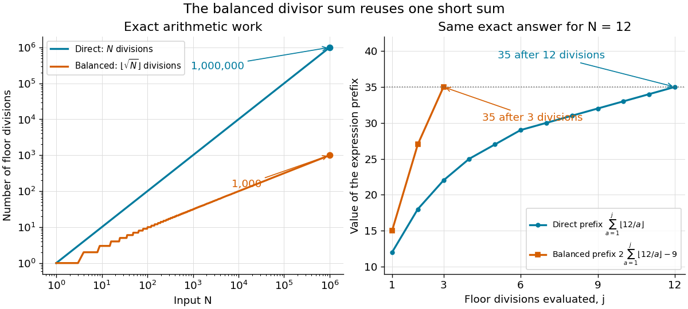

# Arithmetic work of the Dirichlet hyperbola method

↑ **Parent:** [Dirichlet hyperbola method](dirichlet-hyperbola-method.md)

The direct [divisor summatory function](divisor-summatory-function.md) formula evaluates $N$ floor divisions. Its balanced [Dirichlet hyperbola method](dirichlet-hyperbola-method.md) formula evaluates $r=\lfloor\sqrt N\rfloor$ floor divisions and reuses their [sum](sum.md) for the other strip, followed by doubling and square-overlap subtraction. Thus it uses $O(\sqrt N)$ [arithmetic operations](arithmetic-operation.md), with [big O notation](big-o-notation.md), in a model that counts each division, addition and multiplication as one operation. At $N=10^6$, the division counts for these two formulas are $10^6$ and $10^3$.

**[Figure 7](#image-the-balanced-dirichlet-hyperbola-method-reduces-floor-divisions-from-n-to-lfloor-sqrt-n-rfloor-for-n-12-two-sequences-of-partial-sums-reach-the-same-exact-answer-35). The balanced Dirichlet hyperbola method reduces floor divisions from $N$ to $\lfloor\sqrt N\rfloor$; for $N=12$, two sequences of partial sums reach the same exact answer 35**.

For a general [Dirichlet convolution](dirichlet-convolution.md), the asymmetric formula has $\lfloor A\rfloor+\lfloor B\rfloor$ outer terms; evaluating $F$ and $G$ has an additional cost. Under $AB=N$, equal thresholds minimize $A+B$, but an asymmetric split can be useful if the two [partial sums](partial-sum.md) have different evaluation costs. The balanced [divisor summatory function](divisor-summatory-function.md) gains the further reuse because its two [arithmetic functions](arithmetic-function-split.md) are identical.

These are [arithmetic operation](arithmetic-operation.md) counts, rather than counts of elementary operations on [binary digits](binary-digit.md): the [integers](integer-split.md) grow with $N$, and division of longer [integers](integer-split.md) costs more in that model of [computational complexity theory](computational-complexity-theory.md). Computing $r$ also requires an exact integer [square root](square-root.md), or checking and correcting a numerical [square root](square-root.md) until $r^2\le N<(r+1)^2$ holds.

## ↑ Ancestors (7)

1. [Dirichlet hyperbola method](dirichlet-hyperbola-method.md)
2. [Dirichlet convolution](dirichlet-convolution.md)
3. [Arithmetic function](arithmetic-function-split.md)
4. [Number theory](number-theory-split.md)
5. [Area of mathematics](area-of-mathematics.md)
6. [Mathematics](mathematics-split.md)
7. [Codex Wiki](split.md)

## ← Incoming links (1)

- [Divisor summatory function](divisor-summatory-function.md)
