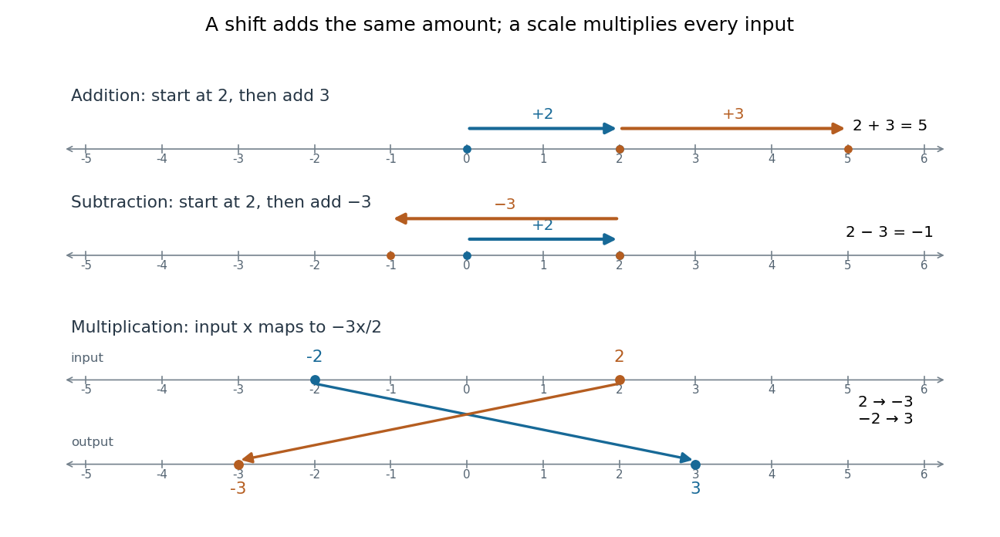
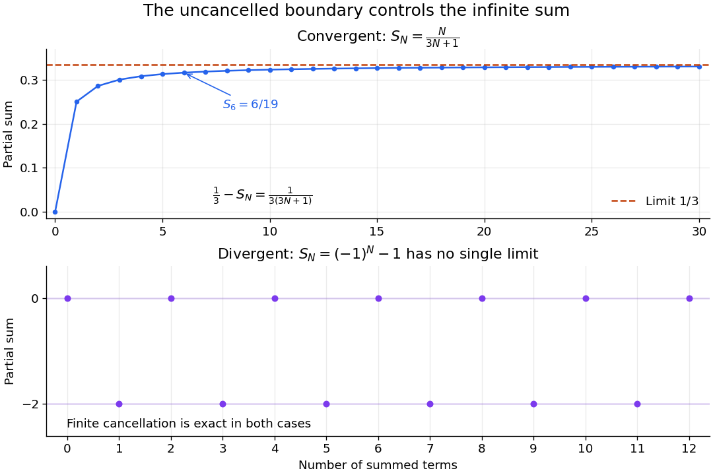
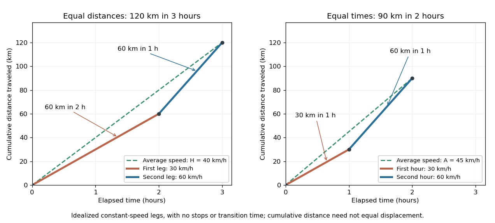
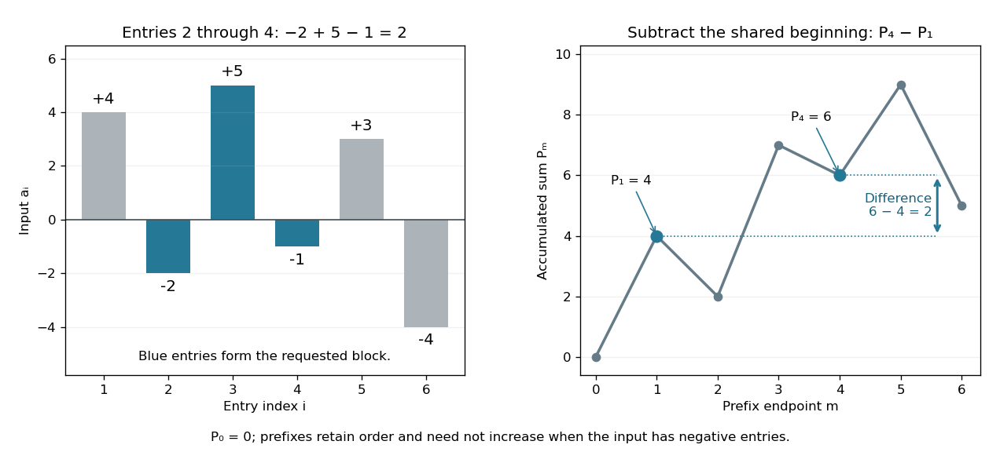
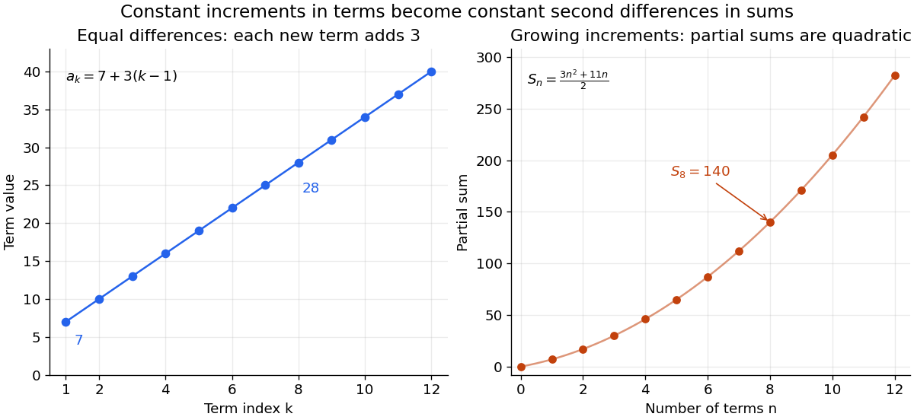

# Arithmetic

↑ **Parent:** [Area of mathematics](mathematics.md#area-of-mathematics)  
ⓦ [Wiki](https://en.wikipedia.org/wiki/Arithmetic)

[Arithmetic](arithmetic.md) studies operations on [numbers](#number): combining quantities by [addition](#addition), finding differences by [subtraction](#subtraction), scaling through [multiplication](#multiplication), and reversing a nonzero scale through [division](#division-mathematics). Its usefulness goes beyond producing an answer. A calculation can express how resources are shared, how a measurement changes with scale, or why two different descriptions of a quantity agree.

The allowed [numbers](#number) matter. Start with the [natural numbers](#natural-number) $0,1,2,\ldots$. Counting collections gives $2+3=5$, but removing three from two calls for the [integer](integer.md) $-1$. Sharing three units equally between two recipients gives the [rational number](number-theory.md#rational-number) $3/2$. These operations motivate larger number systems: [integers](integer.md) supply [additive inverses](#additive-inverse), and [rational numbers](number-theory.md#rational-number) supply [division](#division-mathematics) by nonzero [integers](integer.md). A [real number](#real-number) can also express [lengths](physics.md#length) such as a diagonal of [Euclidean norm](normed-vector-space.md#euclidean-norm) $\sqrt2$, which is not a [rational number](number-theory.md#rational-number).

The beauty is that bookkeeping, geometry, and algebra can check one another. The same product $3(2+4)=18$ counts three groups of six, measures the [area](differential-geometry.md#surface-area) of a [rectangle](euclidean-geometry.md#rectangle), and splits as $3\cdot2+3\cdot4$ by [distributivity](algebraic-operation.md#distributive-property). A [number line](#number-line) makes negative [integers](integer.md) visible as positions; a [fraction](number-theory.md#fraction) records an exact share even when its [decimal representation](integer.md#decimal-representation) does not terminate. An [arithmetic](arithmetic.md) rule becomes easier to remember when these interpretations fit together.

**Table of contents**

- [Numeral](#numeral)
- [Mean (mathematics)](#mean-mathematics)
  - [Logarithmic mean](#logarithmic-mean)
- [Number](#number)
  - [Surreal number](#surreal-number)
- [Division (mathematics)](#division-mathematics)
  - [Integer division](#integer-division)
  - [Quotient](#quotient)
  - [Ratio](#ratio)
- [Inequality (mathematics)](#inequality-mathematics)
  - [Linear inequality](#linear-inequality)
    - [System of linear inequalities](#system-of-linear-inequalities)
- [Sum of squares](#sum-of-squares)
- [Figurate number](#figurate-number)
  - [Square pyramidal number](#square-pyramidal-number)
  - [Polygonal number](#polygonal-number)
    - [Octagonal number](#octagonal-number)
    - [Heptagonal number](#heptagonal-number)
    - [Hexagonal number](#hexagonal-number)
    - [Pentagonal number](#pentagonal-number)
      - [Generalized pentagonal number](#generalized-pentagonal-number)
  - [Triangular number](#triangular-number)
    - [Triangular number recurrence](#triangular-number-recurrence)
    - [Triangular number pair-counting identity](#triangular-number-pair-counting-identity)
    - [Triangular number square-complement identity](#triangular-number-square-complement-identity)
    - [Recognition criterion for triangular numbers](#recognition-criterion-for-triangular-numbers)
    - [Squared triangular number](#squared-triangular-number)
      - [Nicomachus's theorem](#nicomachus-s-theorem)
    - [Square triangular number](#square-triangular-number)
- [Geometric mean](#geometric-mean)
  - [Growth factor](#growth-factor)
    - [Neuregulin 1](#neuregulin-1)
    - [FGF8](#fgf8)
    - [PDGF](#pdgf)
  - [Weighted geometric mean](#weighted-geometric-mean)
  - [Arithmetic-geometric mean iteration](#arithmetic-geometric-mean-iteration)
- [Natural number](#natural-number)
  - [Minimum excludant](#minimum-excludant)
    - [Minimum excluded positive integer](#minimum-excluded-positive-integer)
  - [Well-ordering principle for the natural numbers](#well-ordering-principle-for-the-natural-numbers)
- [Real number](#real-number)
  - [Positive real number](#positive-real-number)
  - [Stoneham number](#stoneham-number)
  - [Cube root](#cube-root)
    - [Integer cube root](#integer-cube-root)
  - [Number line](#number-line)
    - [Linear scale](#linear-scale)
  - [Archimedean property](#archimedean-property)
  - [Binary number](#binary-number)
    - [Bit length](#bit-length)
    - [Binary expansion](#binary-expansion)
      - [Hyperbinary representation](#hyperbinary-representation)
      - [Dyadic rational](#dyadic-rational)
  - [Extended real number line](#extended-real-number-line)
- [Integer arithmetic](#integer-arithmetic)
  - [Arbitrary-precision arithmetic](#arbitrary-precision-arithmetic)
    - [Arbitrary-precision integer arithmetic](#arbitrary-precision-integer-arithmetic)
      - [Big-integer multiplication](#big-integer-multiplication)
    - [Arbitrary-precision integer](#arbitrary-precision-integer)
- [Addition](#addition)
  - [Additive inverse](#additive-inverse)
  - [Summation](#summation)
    - [Faulhaber's formula](#faulhaber-s-formula)
      - [Faulhaber polynomial](#faulhaber-polynomial)
    - [Euler-Maclaurin formula](#euler-maclaurin-formula)
    - [Prime-valued sum](#prime-valued-sum)
    - [Telescoping sum](#telescoping-sum)
      - [Meromorphic telescoping cancellation](#meromorphic-telescoping-cancellation)
      - [Partial fraction telescoping](#partial-fraction-telescoping)
      - [Boundary limits of telescoping series](#boundary-limits-of-telescoping-series)
    - [Sum](#sum)
      - [Empty sum](#empty-sum)
      - [Weighted arithmetic mean](#weighted-arithmetic-mean)
        - [Combining means of groups](#combining-means-of-groups)
        - [Weighted mean minimizes squared deviations](#weighted-mean-minimizes-squared-deviations)
        - [Arithmetic mean](#arithmetic-mean)
          - [Harmonic mean](#harmonic-mean)
            - [Weighted harmonic mean](#weighted-harmonic-mean)
      - [Prefix sum](#prefix-sum)
        - [Suffix sum](#suffix-sum)
        - [Prefix scan](#prefix-scan)
  - [Carry (arithmetic)](#carry-arithmetic)
- [Subtraction](#subtraction)
- [Multiplication](#multiplication)
  - [Multiplication table](#multiplication-table)
  - [Product of numbers](#product-of-numbers)
  - [Exponentiation](#exponentiation)
    - [Fifth power](#fifth-power)
    - [Fourth power](#fourth-power)
    - [nth root](#nth-root)
    - [Integer nth root](#integer-nth-root)
      - [Integer root bound](#integer-root-bound)
    - [Tetration](#tetration)
    - [Addition chain](#addition-chain)
      - [Star chain](#star-chain)
    - [Cube of a number](#cube-of-a-number)
      - [Integer cube](#integer-cube)
    - [Exponent](#exponent)
    - [Square of a number](#square-of-a-number)
    - [Hyperoperation](#hyperoperation)
  - [Empty product](#empty-product)
  - [Multiplicative inverse](#multiplicative-inverse)
- [De Thiende](#de-thiende)
- [Arithmetic progression](#arithmetic-progression)
  - [Dyadic block obstruction to infinite arithmetic progressions](#dyadic-block-obstruction-to-infinite-arithmetic-progressions)
  - [Lifting a short modular progression to an integer progression](#lifting-a-short-modular-progression-to-an-integer-progression)
  - [Common difference](#common-difference)
  - [Counting terms of an arithmetic progression](#counting-terms-of-an-arithmetic-progression)
  - [Arithmetic series](#arithmetic-series)
    - [Pairing proof for an arithmetic series](#pairing-proof-for-an-arithmetic-series)
    - [Finite differences of arithmetic partial sums](#finite-differences-of-arithmetic-partial-sums)
- [Non-Archimedean analysis](non-archimedean-analysis.md)
  - [Continuous functions on the p-adic integers](non-archimedean-analysis.md#continuous-functions-on-the-p-adic-integers)
    - [Mahler's theorem](non-archimedean-analysis.md#mahler-s-theorem)
      - [Discrete antidifferentiation on the p-adic integers](non-archimedean-analysis.md#discrete-antidifferentiation-on-the-p-adic-integers)
        - [Translation-invariant linear forms on p-adic continuous functions vanish](non-archimedean-analysis.md#translation-invariant-linear-forms-on-p-adic-continuous-functions-vanish)
      - [Mahler coefficient](non-archimedean-analysis.md#mahler-coefficient)
        - [Mahler coefficient exponential generating function](non-archimedean-analysis.md#mahler-coefficient-exponential-generating-function)
        - [Mahler expansion of the parity function](non-archimedean-analysis.md#mahler-expansion-of-the-parity-function)
        - [Automatic decay of Mahler coefficients](non-archimedean-analysis.md#automatic-decay-of-mahler-coefficients)
  - [Non-Archimedean ordered field](non-archimedean-analysis.md#non-archimedean-ordered-field)
  - [Absolute value (algebra)](non-archimedean-analysis.md#absolute-value-algebra)
    - [Weak approximation for inequivalent absolute values](non-archimedean-analysis.md#weak-approximation-for-inequivalent-absolute-values)
    - [Bounded comparison forces equality of multiplicative absolute values](non-archimedean-analysis.md#bounded-comparison-forces-equality-of-multiplicative-absolute-values)
    - [Completion of a valued field](non-archimedean-analysis.md#completion-of-a-valued-field)
      - [Algebraic closure of the p-adic numbers is not complete](non-archimedean-analysis.md#algebraic-closure-of-the-p-adic-numbers-is-not-complete)
    - [Trivial absolute value](non-archimedean-analysis.md#trivial-absolute-value)
    - [Non-Archimedean absolute value](non-archimedean-analysis.md#non-archimedean-absolute-value)
      - [Integer criterion for a non-Archimedean absolute value](non-archimedean-analysis.md#integer-criterion-for-a-non-archimedean-absolute-value)
      - [Bounded-integer criterion for a non-Archimedean absolute value](non-archimedean-analysis.md#bounded-integer-criterion-for-a-non-archimedean-absolute-value)
      - [Ultrametric inequality](non-archimedean-analysis.md#ultrametric-inequality)
        - [Ultrametric space](non-archimedean-analysis.md#ultrametric-space)
          - [Totally disconnected space](non-archimedean-analysis.md#totally-disconnected-space)
    - [Equivalent absolute values](non-archimedean-analysis.md#equivalent-absolute-values)
    - [Extension of an absolute value](non-archimedean-analysis.md#extension-of-an-absolute-value)
      - [Unique extension of an absolute value to a finite extension](non-archimedean-analysis.md#unique-extension-of-an-absolute-value-to-a-finite-extension)
        - [Finite-dimensional non-Archimedean norm equivalence over a complete field](non-archimedean-analysis.md#finite-dimensional-non-archimedean-norm-equivalence-over-a-complete-field)
        - [Compact-sphere proof of finite-dimensional non-Archimedean norm equivalence](non-archimedean-analysis.md#compact-sphere-proof-of-finite-dimensional-non-archimedean-norm-equivalence)
        - [Pure-power reduction of a monic irreducible polynomial](non-archimedean-analysis.md#pure-power-reduction-of-a-monic-irreducible-polynomial)
        - [Equal absolute values of algebraic conjugates](non-archimedean-analysis.md#equal-absolute-values-of-algebraic-conjugates)
        - [Integral closure in a finite extension of a complete discretely valued field](non-archimedean-analysis.md#integral-closure-in-a-finite-extension-of-a-complete-discretely-valued-field)
      - [Conjugacy of extensions of a valuation to a normal extension](non-archimedean-analysis.md#conjugacy-of-extensions-of-a-valuation-to-a-normal-extension)
      - [Valuation ring need not equal the integral closure over a noncomplete field](non-archimedean-analysis.md#valuation-ring-need-not-equal-the-integral-closure-over-a-noncomplete-field)
      - [Local factorization and extended absolute values](non-archimedean-analysis.md#local-factorization-and-extended-absolute-values)
        - [Local prime decomposition of T5 plus 6T3 plus 252T2 plus 126](non-archimedean-analysis.md#local-prime-decomposition-of-t5-plus-6t3-plus-252t2-plus-126)
        - [Prime ideals and local embedding orbits](non-archimedean-analysis.md#prime-ideals-and-local-embedding-orbits)
        - [Completion of a number field at a prime ideal](non-archimedean-analysis.md#completion-of-a-number-field-at-a-prime-ideal)
          - [p-adic tensor decomposition of a number field](non-archimedean-analysis.md#p-adic-tensor-decomposition-of-a-number-field)
          - [Transitivity of the Galois action on primes](non-archimedean-analysis.md#transitivity-of-the-galois-action-on-primes)
            - [Decomposition group](non-archimedean-analysis.md#decomposition-group)
              - [Surjectivity of decomposition group reduction](non-archimedean-analysis.md#surjectivity-of-decomposition-group-reduction)
              - [Primes in an intermediate field as double cosets](non-archimedean-analysis.md#primes-in-an-intermediate-field-as-double-cosets)
                - [Complete splitting is preserved by Galois closure](non-archimedean-analysis.md#complete-splitting-is-preserved-by-galois-closure)
              - [Decomposition group of a prime and local Galois group](non-archimedean-analysis.md#decomposition-group-of-a-prime-and-local-galois-group)
          - [Completion preserves ramification and residue data](non-archimedean-analysis.md#completion-preserves-ramification-and-residue-data)
        - [Local factorization of X3 plus 25X2 minus 50X plus 40](non-archimedean-analysis.md#local-factorization-of-x3-plus-25x2-minus-50x-plus-40)
  - [Hahn series](non-archimedean-analysis.md#hahn-series)
    - [Hahn series field](non-archimedean-analysis.md#hahn-series-field)
  - [P-adic number](non-archimedean-analysis.md#p-adic-number)
    - [3-adic number](non-archimedean-analysis.md#3-adic-number)
    - [p-adic absolute value](non-archimedean-analysis.md#p-adic-absolute-value)
      - [p-adic metric](non-archimedean-analysis.md#p-adic-metric)
      - [2-adic absolute value](non-archimedean-analysis.md#2-adic-absolute-value)
        - [2-adic metric](non-archimedean-analysis.md#2-adic-metric)
      - [Ostrowski's theorem](non-archimedean-analysis.md#ostrowski-s-theorem)
        - [Non-Archimedean part of Ostrowski theorem](non-archimedean-analysis.md#non-archimedean-part-of-ostrowski-theorem)
        - [Non-Archimedean absolute values on a number field](non-archimedean-analysis.md#non-archimedean-absolute-values-on-a-number-field)
  - [Local field](non-archimedean-analysis.md#local-field)
    - [p-adic field](non-archimedean-analysis.md#p-adic-field)
      - [Integral lattice in a p-adic vector space](non-archimedean-analysis.md#integral-lattice-in-a-p-adic-vector-space)
    - [Residue degree](non-archimedean-analysis.md#residue-degree)
      - [Absolute residue degree](non-archimedean-analysis.md#absolute-residue-degree)
    - [Local compactness criterion for a complete non-Archimedean field](non-archimedean-analysis.md#local-compactness-criterion-for-a-complete-non-archimedean-field)
      - [Digit expansion with a nonuniformizer](non-archimedean-analysis.md#digit-expansion-with-a-nonuniformizer)
      - [Completeness of locally compact nontrivially valued fields](non-archimedean-analysis.md#completeness-of-locally-compact-nontrivially-valued-fields)
      - [Discrete valuation from nontrivial local compactness](non-archimedean-analysis.md#discrete-valuation-from-nontrivial-local-compactness)
      - [Nontrivial valuation in the local compactness criterion](non-archimedean-analysis.md#nontrivial-valuation-in-the-local-compactness-criterion)
    - [Multiplicative group of a non-Archimedean local field](non-archimedean-analysis.md#multiplicative-group-of-a-non-archimedean-local-field)
      - [Principal-unit filtration of a local field](non-archimedean-analysis.md#principal-unit-filtration-of-a-local-field)
      - [Principal-unit group of a mixed-characteristic local field](non-archimedean-analysis.md#principal-unit-group-of-a-mixed-characteristic-local-field)
    - [Hensel's lemma](non-archimedean-analysis.md#hensel-s-lemma)
      - [Hensel lifting](non-archimedean-analysis.md#hensel-lifting)
      - [Coprime-factor Hensel lifting](non-archimedean-analysis.md#coprime-factor-hensel-lifting)
      - [Simple-root Hensel lifting by successive residues](non-archimedean-analysis.md#simple-root-hensel-lifting-by-successive-residues)
      - [Coprime factor lifting from valuation-extension uniqueness](non-archimedean-analysis.md#coprime-factor-lifting-from-valuation-extension-uniqueness)
      - [Elements that are powers of infinitely many degrees in a local field](non-archimedean-analysis.md#elements-that-are-powers-of-infinitely-many-degrees-in-a-local-field)
      - [Factorization of X4 plus 9X2 minus 2 over the 2-adic numbers](non-archimedean-analysis.md#factorization-of-x4-plus-9x2-minus-2-over-the-2-adic-numbers)
      - [Strong form of Hensel lemma](non-archimedean-analysis.md#strong-form-of-hensel-lemma)
        - [Newton iteration over a valued field](non-archimedean-analysis.md#newton-iteration-over-a-valued-field)
    - [Krasner's lemma](non-archimedean-analysis.md#krasner-s-lemma)
      - [Closest-root descent in a Galois extension](non-archimedean-analysis.md#closest-root-descent-in-a-galois-extension)
      - [Finiteness of fixed-degree extensions of a p-adic field](non-archimedean-analysis.md#finiteness-of-fixed-degree-extensions-of-a-p-adic-field)
      - [Continuity of roots over a non-Archimedean field](non-archimedean-analysis.md#continuity-of-roots-over-a-non-archimedean-field)
      - [Local realization as a completion of a number field](non-archimedean-analysis.md#local-realization-as-a-completion-of-a-number-field)
      - [Completion of an algebraic closure of a p-adic field is algebraically closed](non-archimedean-analysis.md#completion-of-an-algebraic-closure-of-a-p-adic-field-is-algebraically-closed)
    - [Weierstrass preparation theorem](non-archimedean-analysis.md#weierstrass-preparation-theorem)
      - [Distinguished polynomial](non-archimedean-analysis.md#distinguished-polynomial)
    - [Laurent series field](non-archimedean-analysis.md#laurent-series-field)
      - [Prescribed ramification and residue degree for a Laurent series field](non-archimedean-analysis.md#prescribed-ramification-and-residue-degree-for-a-laurent-series-field)
      - [Finite extensions of the complex Laurent series field](non-archimedean-analysis.md#finite-extensions-of-the-complex-laurent-series-field)
        - [Absolute Galois group of the complex Laurent series field](non-archimedean-analysis.md#absolute-galois-group-of-the-complex-laurent-series-field)
      - [Completion at an irreducible polynomial over a finite field](non-archimedean-analysis.md#completion-at-an-irreducible-polynomial-over-a-finite-field)
    - [p-adic exponential function](non-archimedean-analysis.md#p-adic-exponential-function)
      - [2-adic exponential](non-archimedean-analysis.md#2-adic-exponential)
      - [Radius of convergence of the p-adic exponential](non-archimedean-analysis.md#radius-of-convergence-of-the-p-adic-exponential)
      - [p-adic logarithm](non-archimedean-analysis.md#p-adic-logarithm)
        - [2-adic logarithm](non-archimedean-analysis.md#2-adic-logarithm)
        - [Logarithm isomorphism on deep principal units](non-archimedean-analysis.md#logarithm-isomorphism-on-deep-principal-units)
    - [Teichmüller character](non-archimedean-analysis.md#teichmuller-character)
      - [Teichmuller representative](non-archimedean-analysis.md#teichmuller-representative)
        - [Finite prime-power Teichmuller representative](non-archimedean-analysis.md#finite-prime-power-teichmuller-representative)
        - [Approximation of Teichmuller lifts by iterated pth powers](non-archimedean-analysis.md#approximation-of-teichmuller-lifts-by-iterated-pth-powers)
        - [Teichmuller lift properties](non-archimedean-analysis.md#teichmuller-lift-properties)
        - [Teichmuller expansion](non-archimedean-analysis.md#teichmuller-expansion)
          - [Equal-characteristic complete discretely valued field](non-archimedean-analysis.md#equal-characteristic-complete-discretely-valued-field)
            - [Finite coefficient field in positive-characteristic local fields](non-archimedean-analysis.md#finite-coefficient-field-in-positive-characteristic-local-fields)
    - [Unramified extension](non-archimedean-analysis.md#unramified-extension)
      - [Unramified extensions remain unramified under base change](non-archimedean-analysis.md#unramified-extensions-remain-unramified-under-base-change)
      - [Lifting residue-field embeddings of unramified extensions](non-archimedean-analysis.md#lifting-residue-field-embeddings-of-unramified-extensions)
      - [Unramified generator criterion with separable reduction](non-archimedean-analysis.md#unramified-generator-criterion-with-separable-reduction)
        - [Unramified residue generator integral basis](non-archimedean-analysis.md#unramified-residue-generator-integral-basis)
          - [Residue-basis norm formula for an unramified extension](non-archimedean-analysis.md#residue-basis-norm-formula-for-an-unramified-extension)
      - [Existence and uniqueness of unramified local extensions](non-archimedean-analysis.md#existence-and-uniqueness-of-unramified-local-extensions)
      - [Frobenius automorphism](non-archimedean-analysis.md#frobenius-automorphism)
        - [Frobenius conjugacy class](non-archimedean-analysis.md#frobenius-conjugacy-class)
          - [Frobenius permutation and roots modulo a prime](non-archimedean-analysis.md#frobenius-permutation-and-roots-modulo-a-prime)
      - [Maximal unramified extension](non-archimedean-analysis.md#maximal-unramified-extension)
      - [Maximal unramified subextension of a local field extension](non-archimedean-analysis.md#maximal-unramified-subextension-of-a-local-field-extension)
    - [Ramification group](non-archimedean-analysis.md#ramification-group)
      - [Positive ramification quotients are elementary abelian](non-archimedean-analysis.md#positive-ramification-quotients-are-elementary-abelian)
      - [Ramification of the splitting field of X3 plus pX plus p](non-archimedean-analysis.md#ramification-of-the-splitting-field-of-x3-plus-px-plus-p)
      - [Lower ramification filtration of a prime-power cyclotomic extension](non-archimedean-analysis.md#lower-ramification-filtration-of-a-prime-power-cyclotomic-extension)
      - [Lower ramification numbering](non-archimedean-analysis.md#lower-ramification-numbering)
        - [Herbrand function](non-archimedean-analysis.md#herbrand-function)
          - [Upper ramification numbering](non-archimedean-analysis.md#upper-ramification-numbering)
            - [Upper ramification groups commute with quotients](non-archimedean-analysis.md#upper-ramification-groups-commute-with-quotients)
      - [Uniformizer criterion for lower ramification groups](non-archimedean-analysis.md#uniformizer-criterion-for-lower-ramification-groups)
        - [Ramification groups of the splitting field of T3 minus 2 over Q3](non-archimedean-analysis.md#ramification-groups-of-the-splitting-field-of-t3-minus-2-over-q3)
        - [Ramification groups of the eighth-root cyclotomic extension of the 2-adic field](non-archimedean-analysis.md#ramification-groups-of-the-eighth-root-cyclotomic-extension-of-the-2-adic-field)
        - [Ramification break of an Artin–Schreier pole](non-archimedean-analysis.md#ramification-break-of-an-artin-schreier-pole)
        - [Ramification groups of the splitting field of T3 minus 3T plus 3 over Q3](non-archimedean-analysis.md#ramification-groups-of-the-splitting-field-of-t3-minus-3t-plus-3-over-q3)
        - [Ramification groups of the splitting field of Xp minus p over the p-adic numbers](non-archimedean-analysis.md#ramification-groups-of-the-splitting-field-of-xp-minus-p-over-the-p-adic-numbers)
          - [Eisenstein sextic presentation of the splitting field of X3 minus 3 over Q3](non-archimedean-analysis.md#eisenstein-sextic-presentation-of-the-splitting-field-of-x3-minus-3-over-q3)
      - [Tame inertia quotient](non-archimedean-analysis.md#tame-inertia-quotient)
        - [Branch-cycle conjugacy class](non-archimedean-analysis.md#branch-cycle-conjugacy-class)
          - [Quadratic branch parity criterion](non-archimedean-analysis.md#quadratic-branch-parity-criterion)
        - [Uniformizer character of inertia](non-archimedean-analysis.md#uniformizer-character-of-inertia)
      - [Different ideal](non-archimedean-analysis.md#different-ideal)
        - [Different exponent](non-archimedean-analysis.md#different-exponent)
          - [Cyclotomic local different exponent](non-archimedean-analysis.md#cyclotomic-local-different-exponent)
          - [Different exponent and tame ramification](non-archimedean-analysis.md#different-exponent-and-tame-ramification)
        - [Inverse different](non-archimedean-analysis.md#inverse-different)
        - [Different in a tower](non-archimedean-analysis.md#different-in-a-tower)
        - [Different exponent from ramification groups](non-archimedean-analysis.md#different-exponent-from-ramification-groups)
      - [Inertia group](non-archimedean-analysis.md#inertia-group)
        - [Wild inertia group](non-archimedean-analysis.md#wild-inertia-group)
      - [Tamely ramified extension](non-archimedean-analysis.md#tamely-ramified-extension)
        - [Discriminant exponent of a tame Galois extension](non-archimedean-analysis.md#discriminant-exponent-of-a-tame-galois-extension)
      - [Ramification-group sum for a monogenic integer ring](non-archimedean-analysis.md#ramification-group-sum-for-a-monogenic-integer-ring)
    - [Eisenstein polynomial](non-archimedean-analysis.md#eisenstein-polynomial)
      - [Shifted Eisenstein polynomial](non-archimedean-analysis.md#shifted-eisenstein-polynomial)
      - [Ramification polynomial](non-archimedean-analysis.md#ramification-polynomial)
        - [Reduced ramification polynomial](non-archimedean-analysis.md#reduced-ramification-polynomial)
          - [Ramification breaks from a reduced ramification polygon](non-archimedean-analysis.md#ramification-breaks-from-a-reduced-ramification-polygon)
    - [Newton polygon](non-archimedean-analysis.md#newton-polygon)
      - [Reflected Newton polygon convention](non-archimedean-analysis.md#reflected-newton-polygon-convention)
      - [Newton polygon root valuation theorem](non-archimedean-analysis.md#newton-polygon-root-valuation-theorem)
      - [Denominator criterion for Newton polygon irreducibility](non-archimedean-analysis.md#denominator-criterion-for-newton-polygon-irreducibility)
    - [Ramification index](non-archimedean-analysis.md#ramification-index)
      - [Ramification forced by a coprime root valuation](non-archimedean-analysis.md#ramification-forced-by-a-coprime-root-valuation)
      - [Residue-field degree](non-archimedean-analysis.md#residue-field-degree)
      - [Totally ramified extension](non-archimedean-analysis.md#totally-ramified-extension)
        - [Unramified base change preserves total ramification](non-archimedean-analysis.md#unramified-base-change-preserves-total-ramification)
          - [Cyclic quartic local extension without a totally ramified complement](non-archimedean-analysis.md#cyclic-quartic-local-extension-without-a-totally-ramified-complement)
        - [Eisenstein generator of a totally ramified extension](non-archimedean-analysis.md#eisenstein-generator-of-a-totally-ramified-extension)
    - [p-adic unit](non-archimedean-analysis.md#p-adic-unit)
      - [Unit square classes of the p-adic integers](non-archimedean-analysis.md#unit-square-classes-of-the-p-adic-integers)
      - [2-adic unit](non-archimedean-analysis.md#2-adic-unit)
        - [Digit lifting for square roots of 2-adic units](non-archimedean-analysis.md#digit-lifting-for-square-roots-of-2-adic-units)
        - [Square-class group of the 2-adic numbers](non-archimedean-analysis.md#square-class-group-of-the-2-adic-numbers)
          - [Quadratic extensions of the 2-adic numbers](non-archimedean-analysis.md#quadratic-extensions-of-the-2-adic-numbers)
            - [Ramification in the quadratic extension generated by the square root of two](non-archimedean-analysis.md#ramification-in-the-quadratic-extension-generated-by-the-square-root-of-two)
      - [pth-power criterion for p-adic units](non-archimedean-analysis.md#pth-power-criterion-for-p-adic-units)
      - [Principal unit](non-archimedean-analysis.md#principal-unit)
        - [Prime-to-residue-characteristic power map on principal units](non-archimedean-analysis.md#prime-to-residue-characteristic-power-map-on-principal-units)
        - [Higher principal-unit group](non-archimedean-analysis.md#higher-principal-unit-group)
          - [Successive quotients of principal-unit groups](non-archimedean-analysis.md#successive-quotients-of-principal-unit-groups)
          - [Cube map on 3-adic principal units](non-archimedean-analysis.md#cube-map-on-3-adic-principal-units)
        - [Principal-unit logarithm](non-archimedean-analysis.md#principal-unit-logarithm)
      - [Cube-class group of the 3-adic numbers](non-archimedean-analysis.md#cube-class-group-of-the-3-adic-numbers)
    - [Roots of unity in a p-adic field](non-archimedean-analysis.md#roots-of-unity-in-a-p-adic-field)
      - [Valuation of a primitive p-power root of unity](non-archimedean-analysis.md#valuation-of-a-primitive-p-power-root-of-unity)
        - [Roots of unity at the tame ramification boundary](non-archimedean-analysis.md#roots-of-unity-at-the-tame-ramification-boundary)
      - [Ramification bound for a primitive pth root of unity](non-archimedean-analysis.md#ramification-bound-for-a-primitive-pth-root-of-unity)
      - [Roots of unity in the p-adic numbers](non-archimedean-analysis.md#roots-of-unity-in-the-p-adic-numbers)
      - [Unit decomposition of the 2-adic Gaussian field](non-archimedean-analysis.md#unit-decomposition-of-the-2-adic-gaussian-field)
      - [Unit group of Q3 zeta3](non-archimedean-analysis.md#unit-group-of-q3-zeta3)
    - [Lubin–Tate formal group](non-archimedean-analysis.md#lubin-tate-formal-group)
      - [Lubin–Tate series](non-archimedean-analysis.md#lubin-tate-series)
      - [Lubin–Tate change of series](non-archimedean-analysis.md#lubin-tate-change-of-series)
        - [Lubin–Tate functional equation lemma](non-archimedean-analysis.md#lubin-tate-functional-equation-lemma)
      - [Lubin–Tate torsion](non-archimedean-analysis.md#lubin-tate-torsion)
        - [Lubin–Tate extension](non-archimedean-analysis.md#lubin-tate-extension)
          - [Lubin–Tate cyclotomic example](non-archimedean-analysis.md#lubin-tate-cyclotomic-example)
          - [Lubin–Tate tower](non-archimedean-analysis.md#lubin-tate-tower)
          - [Lubin–Tate Galois action on primitive torsion](non-archimedean-analysis.md#lubin-tate-galois-action-on-primitive-torsion)
        - [Eisenstein layers of Lubin–Tate torsion](non-archimedean-analysis.md#eisenstein-layers-of-lubin-tate-torsion)
        - [First Lubin–Tate torsion fields for the p-adic numbers](non-archimedean-analysis.md#first-lubin-tate-torsion-fields-for-the-p-adic-numbers)
    - [Maximal abelian extension](non-archimedean-analysis.md#maximal-abelian-extension)
      - [Weil group](non-archimedean-analysis.md#weil-group)
        - [Relative Weil group](non-archimedean-analysis.md#relative-weil-group)
          - [Weil-group topology](non-archimedean-analysis.md#weil-group-topology)
      - [Cyclotomic extension of a p-adic field](non-archimedean-analysis.md#cyclotomic-extension-of-a-p-adic-field)
        - [Total ramification criterion for local cyclotomic extensions](non-archimedean-analysis.md#total-ramification-criterion-for-local-cyclotomic-extensions)
      - [Local Kronecker-Weber theorem](non-archimedean-analysis.md#local-kronecker-weber-theorem)
      - [Local class field theory](non-archimedean-analysis.md#local-class-field-theory)
        - [Existence theorem of local class field theory](non-archimedean-analysis.md#existence-theorem-of-local-class-field-theory)
        - [Local Artin reciprocity](non-archimedean-analysis.md#local-artin-reciprocity)
          - [Hilbert norm residue symbol](non-archimedean-analysis.md#hilbert-norm-residue-symbol)
            - [Quadratic Hilbert symbol](non-archimedean-analysis.md#quadratic-hilbert-symbol)
              - [Explicit quadratic Hilbert symbols over the p-adic numbers](non-archimedean-analysis.md#explicit-quadratic-hilbert-symbols-over-the-p-adic-numbers)
              - [Hilbert-symbol annihilators of units and unramified square classes](non-archimedean-analysis.md#hilbert-symbol-annihilators-of-units-and-unramified-square-classes)
              - [Hilbert reciprocity law](non-archimedean-analysis.md#hilbert-reciprocity-law)
          - [Local Artin map](non-archimedean-analysis.md#local-artin-map)
            - [Cup-product construction of local reciprocity](non-archimedean-analysis.md#cup-product-construction-of-local-reciprocity)
            - [Lubin–Tate description of local reciprocity](non-archimedean-analysis.md#lubin-tate-description-of-local-reciprocity)
          - [Norm subgroup of a local field extension](non-archimedean-analysis.md#norm-subgroup-of-a-local-field-extension)
            - [Surjectivity of unit norms in unramified extensions](non-archimedean-analysis.md#surjectivity-of-unit-norms-in-unramified-extensions)
            - [Cyclic local norm index](non-archimedean-analysis.md#cyclic-local-norm-index)
            - [Norm-unit index in an abelian local extension](non-archimedean-analysis.md#norm-unit-index-in-an-abelian-local-extension)
            - [Norm units in a tamely totally ramified extension](non-archimedean-analysis.md#norm-units-in-a-tamely-totally-ramified-extension)
            - [Norm subgroup of a 2-power cyclotomic extension of the 2-adic numbers](non-archimedean-analysis.md#norm-subgroup-of-a-2-power-cyclotomic-extension-of-the-2-adic-numbers)

## Numeral

↑ **Parent:** [Arithmetic](arithmetic.md)

A [numeral](#numeral) is a written expression representing a [number](#number); different [numerals](#numeral) can represent the same [integer](integer.md).

## Mean (mathematics)

↑ **Parent:** [Arithmetic](arithmetic.md)

### Logarithmic mean

↑ **Parent:** [Mean (mathematics)](#mean-mathematics)

For distinct [positive real numbers](#positive-real-number) $a,b$, their logarithmic mean is $L(a,b)=(b-a)/(\log b-\log a)$, with continuous extension $L(a,a)=a$.

## Number

↑ **Parent:** [Arithmetic](arithmetic.md)  
ⓦ [Wiki](https://en.wikipedia.org/wiki/Number)

Numbers are mathematical objects used to express quantities and carry out operations. Familiar families include the [natural numbers](#natural-number), [integers](integer.md), [rational numbers](number-theory.md#rational-number), [real numbers](#real-number), and [complex numbers](complex-analysis.md#complex-number); specifying the family determines which operations and solutions are available.

### Surreal number

↑ **Parent:** [Number](#number)

## Division (mathematics)

↑ **Parent:** [Arithmetic](arithmetic.md)  
ⓦ [Wiki](https://en.wikipedia.org/wiki/Division_(mathematics))

For [real numbers](#real-number) $a$ and $b\ne0$, [division](#division-mathematics) $a/b$ asks for the unique [number](#number) $x$ satisfying $bx=a$. Equivalently, $a/b=a b^{-1}$ uses the [multiplicative inverse](#multiplicative-inverse) of $b$. This description separates the role of the [denominator](number-theory.md#denominator) from the result: the [quotient](#quotient) undoes a specified [multiplication](#multiplication).

For example, $3/2$ is the [number](#number) whose double is three, so it is exactly $1.5$. A second interpretation asks how many portions of size $2$ fit into an amount $3$; the answer is one and a half portions. Equal sharing and measuring with a specified portion size lead to the same [quotient](#quotient), although the units assigned to the result can differ.

In the [natural numbers](#natural-number), exact [division](#division-mathematics) need not be possible. [Euclidean division](integer.md#euclidean-division) instead keeps a [remainder](integer.md#remainder): $17=5\cdot3+2$, with $0\leq2<5$. Thus seventeen objects form three complete groups of five with two left over. As a [rational number](number-theory.md#rational-number), the same [quotient](#quotient) is $17/5=3+2/5=3.4$. The [remainder](integer.md#remainder) and the [fractional part](calculus.md#fractional-part) describe the same unfinished group in different ways.

[Division](#division-mathematics) by zero cannot retain the unique-solution rule. For $a\ne0$, the equation $0x=a$ has no solution; for $a=0$, every [real number](#real-number) $x$ solves $0x=0$, so there is no unique [quotient](#quotient). This explains both failures through [multiplication](#multiplication), rather than assigning $a/0$ a value that would contradict ordinary [arithmetic](arithmetic.md). [OpenStax, Prealgebra 2e, multiplication and division conventions](https://openstax.org/books/prealgebra-2e/pages/3-4-multiply-and-divide-integers)

### Integer division

↑ **Parent:** [Division (mathematics)](#division-mathematics)

[Division](#division-mathematics) of [integers](integer.md) that returns an [integer](integer.md) quotient rather than an exact [fraction](number-theory.md#fraction). A rounding convention is required for negative operands. For $n\ge0$ and $d>0$, the quotient is $q=\lfloor n/d\rfloor$ and the [remainder](integer.md#remainder) is $r=n-qd$ with $0\le r<d$.

### Quotient

↑ **Parent:** [Division (mathematics)](#division-mathematics)  
ⓦ [Wiki](https://en.wikipedia.org/wiki/Quotient)

### Ratio

↑ **Parent:** [Division (mathematics)](#division-mathematics)  
ⓦ [Wiki](https://en.wikipedia.org/wiki/Ratio)

A ratio compares two quantities $a,b$, written $a:b$ and corresponding to [division](#division-mathematics) $a/b$ when $b\ne0$. Equal [ratios](#ratio) of corresponding [lengths](physics.md#length) characterize the scaling of [similar triangles](euclidean-geometry.md#similar-triangle).

For example, $6:4$ and $3:2$ specify the same [ratio](#ratio) because $6/4=3/2$. Multiplying both entries by the same nonzero scale preserves the [quotient](#quotient): $(ca)/(cb)=a/b$. This is useful when comparing mixtures or scaling a recipe; doubling both ingredient amounts preserves their [ratio](#ratio), while adding the same amount to both generally does not. For quantities with the same physical units, their [ratio](#ratio) is [dimensionless](physics.md#dimensionless-quantity), connecting this elementary calculation with [dimensional analysis](mathematical-physics.md#dimensional-analysis).

## Inequality (mathematics)

↑ **Parent:** [Arithmetic](arithmetic.md)  
ⓦ [Wiki](https://en.wikipedia.org/wiki/Inequality_(mathematics))

An [inequality](#inequality-mathematics) compares mathematical quantities using an ordering, such as $a<b$ or $a\leq b$ for [real numbers](#real-number). A strict [inequality](#inequality-mathematics) excludes equality; a non-strict [inequality](#inequality-mathematics) allows it. For example, $4<5$ is strict, while $4\leq4$ is true because equality is allowed. Adding the same [real number](#real-number) preserves either comparison; multiplying by a negative [real number](#real-number) reverses its direction.

### Linear inequality

↑ **Parent:** [Inequality (mathematics)](#inequality-mathematics)  
ⓦ [Wiki](https://en.wikipedia.org/wiki/Linear_inequality)

A linear inequality compares a [linear functional](dual-space.md#linear-functional) of a [vector](vector-space.md#vector) of unknowns with a constant, for example $a^Tx\leq b$ or $a^Tx<b$ over the [real numbers](#real-number). For $a\ne0$, its [solution set](set.md#solution-set) is a closed or open [half-space](geometry-and-topology.md#half-space), respectively. The inequality $x+y\leq1$ allows all points on one side of the line $x+y=1$, including the line. Multiplication by a negative [real number](#real-number) reverses the [inequality](#inequality-mathematics), so $x\geq1$ is equivalently $-x\leq-1$.

#### System of linear inequalities

↑ **Parent:** [Linear inequality](#linear-inequality)

A system of linear inequalities requires several [linear inequalities](#linear-inequality) to hold simultaneously. The notation $Ax\leq b$ compares coordinates componentwise, giving one [inequality](#inequality-mathematics) per row of the [matrix](vector-space.md#matrix) $A$. Its [solution set](set.md#solution-set) is the [intersection](set.md#set-intersection) of the corresponding [half-spaces](geometry-and-topology.md#half-space). For non-strict inequalities it is a [linear polyhedron](linear-programming.md#linear-polyhedron), which may be empty. For example, $x\geq1$, $y\geq1$, $x+y\leq1$ are inconsistent: adding their equivalent forms $-x\leq-1$, $-y\leq-1$, $x+y\leq1$ gives $0\leq-1$. A [Farkas certificate for linear inequalities](convex-optimization.md#farkas-certificate-for-linear-inequalities) generalizes this cancellation.

## Sum of squares

↑ **Parent:** [Arithmetic](arithmetic.md)

A sum of squares adds the [squares of numbers](#square-of-a-number) $a_i^2$ for specified [real numbers](#real-number) $a_i$. It is nonnegative and vanishes exactly when every term is zero. For the coordinates of a [vector](vector-space.md#vector), it is the squared [Euclidean norm](normed-vector-space.md#euclidean-norm); for [regression residuals](probability-and-statistics.md#regression-residual), it gives the [residual sum of squares](linear-regression.md#residual-sum-of-squares) minimized by [ordinary least squares](normal-linear-model.md#ordinary-least-squares).

## Figurate number

↑ **Parent:** [Arithmetic](arithmetic.md)  
ⓦ [Wiki](https://en.wikipedia.org/wiki/Figurate_number)

A [figurate number](#figurate-number) is an [integer](integer.md) illustrated by a regular geometric arrangement of points. [Triangular numbers](#triangular-number) and [square numbers](integer.md#square-number) are basic examples: growing a prescribed shape turns a counting problem into a [sequence](sequence-and-series.md#sequence) of [integers](integer.md).

### Square pyramidal number

↑ **Parent:** [Figurate number](#figurate-number)

The [sum of squares](#sum-of-squares) of the first $n$ [positive integers](integer.md#positive-integer): $S_n=\sum_{k=1}^n k^2=n(n+1)(2n+1)/6$. It counts a square-based stack with layers containing $1^2,2^2,\ldots,n^2$ objects. Differences $S_b-S_{a-1}$ give sums over consecutive squares.

### Polygonal number

↑ **Parent:** [Figurate number](#figurate-number)

For [integers](integer.md) $s\ge3$ and $n\ge1$, the $n$th $s$-gonal number is $P_{s,n}=((s-2)n^2-(s-4)n)/2$. Its successive differences form an [arithmetic progression](#arithmetic-progression). The cases $s=3,4,5,6$ give [triangular numbers](#triangular-number), [square numbers](integer.md#square-number), [pentagonal numbers](#pentagonal-number), and [hexagonal numbers](#hexagonal-number).

#### Octagonal number

↑ **Parent:** [Polygonal number](#polygonal-number)

The [polygonal number](#polygonal-number) $P_{8,n}=n(3n-2)$ for a [positive integer](integer.md#positive-integer) $n$.

#### Heptagonal number

↑ **Parent:** [Polygonal number](#polygonal-number)

The [polygonal number](#polygonal-number) $P_{7,n}=n(5n-3)/2$ for a [positive integer](integer.md#positive-integer) $n$.

#### Hexagonal number

↑ **Parent:** [Polygonal number](#polygonal-number)

The $n$th [hexagonal number](#hexagonal-number) is $H_n=n(2n-1)$ for a [positive integer](integer.md#positive-integer) $n$. Since $H_n=T_{2n-1}$, every [hexagonal number](#hexagonal-number) is also a [triangular number](#triangular-number).

#### Pentagonal number

↑ **Parent:** [Polygonal number](#polygonal-number)

The $n$th [pentagonal number](#pentagonal-number) is $P_n=n(3n-1)/2$ for a [positive integer](integer.md#positive-integer) $n$, giving $1,5,12,22,\ldots$. A [positive integer](integer.md#positive-integer) $x$ is pentagonal exactly when $24x+1$ is a [perfect square](integer.md#square-number) and $(1+\sqrt{24x+1})/6$ is an [integer](integer.md), by the defining [quadratic equation](polynomial.md#quadratic-equation).

##### Generalized pentagonal number

↑ **Parent:** [Pentagonal number](#pentagonal-number)

A value $k(3k-1)/2$ with $k$ any [integer](integer.md), including negative values and zero. For $k=\pm1,\pm2,\ldots$, positive values occur as pairs $j(3j-1)/2$ and $j(3j+1)/2$. These are the indices in the [Euler pentagonal identity](modular-function.md#euler-pentagonal-identity).

### Triangular number

↑ **Parent:** [Figurate number](#figurate-number)  
ⓦ [Wiki](https://en.wikipedia.org/wiki/Triangular_number)

A [triangular number](#triangular-number) counts rows of $1,2,\ldots,n$ objects, with $n$ a [nonnegative integer](#natural-number):

$$
T_n=\sum_{k=1}^{n}k=\frac{n(n+1)}2,\qquad T_0=0.
$$

The first values are $0,1,3,6,10,15,21,28,36,45,\ldots$. The empty arrangement contributes zero, by the [empty sum](#empty-sum) convention. Adding one more row gives the [triangular number recurrence](#triangular-number-recurrence) $T_n-T_{n-1}=n$ for $n\geq1$. The row lengths form an [arithmetic progression](#arithmetic-progression), while their running totals are [triangular numbers](#triangular-number).

**[Figure 1](#image-two-copies-of-six-triangular-rows-form-a-rectangle-of-six-rows-and-seven-dots). Two copies of six triangular rows form a rectangle of six rows and seven dots**.

Pair the rows with a reversed copy: $1+n=2+(n-1)=\cdots=n+1$. There are $n$ such pairs, so two copies contain $n(n+1)$ dots. Dividing by two proves the formula. This [rectangle](euclidean-geometry.md#rectangle) picture explains the factor one-half without requiring a formula for a long [summation](#summation). For example, **one hundred rows contain $T_{100}=5050$ dots**.

The same count appears whenever every pair of different objects must be considered once. Five participants make ten possible handshakes; five sensors have ten different pairwise comparisons; a [complete graph](graph-theory.md#complete-graph) on five [vertices](graph.md#vertex-graph-theory) has ten [edges](graph-theory.md#edge-of-a-graph). These are the [triangular number pair-counting identity](#triangular-number-pair-counting-identity), with one fewer row than objects. The distinction prevents a common error: $T_5=15$ counts all pairs from six objects, whereas five objects give $T_4=10$.

**[Figure 2](#image-ten-unordered-pairs-of-five-objects-and-two-consecutive-triangular-counts-filling-a-square). Ten unordered pairs of five objects, and two consecutive triangular counts filling a square**.

The [triangular number square-complement identity](#triangular-number-square-complement-identity) says that two neighboring [triangular numbers](#triangular-number) fill a [square](euclidean-geometry.md#square). Combining that identity with the one-row difference makes the [difference of squares](number-theory.md#difference-of-two-squares) $T_n^2-T_{n-1}^2$ equal to $n^3$. It leads to [Nicomachus's theorem](#nicomachus-s-theorem): the [sum](#sum) of the first $n$ [cubes of numbers](#cube-of-a-number) is the [square of a number](#square-of-a-number) $T_n^2$. A change in the way one groups objects exposes a relation between [summation](#summation), [multiplication](#multiplication) and geometry.

This geometric view is already visible in [Nicomachus](mathematics.md#nicomachus)'s [Introduction to Arithmetic by Nicomachus (Hahn teacher edition)](mathematics-bibliography.md#introduction-to-arithmetic-by-nicomachus-hahn-teacher-edition): Book II, Chapter 8 describes growing triangular rows, Chapter 12 combines successive triangular counts into squares, and Chapter 20 groups successive [odd integers](integer.md#odd-integer) into [cubes of numbers](#cube-of-a-number).[Book II, Chapters 8, 12 and 20, printed pp. 63–64, 70 and 75](mathematics-bibliography.md#introduction-to-arithmetic-by-nicomachus-hahn-teacher-edition) The linked edition uses [Martin Luther D'Ooge](mathematics-author.md#martin-luther-d-ooge)'s translation, revised with modern teaching material by [Nathanael Hahn](mathematics-author.md#nathanael-hahn). Our empty-row index $T_0=0$ is a modern convention; the historical passage starts from unity and calls three the first actual triangle.

#### Triangular number recurrence

↑ **Parent:** [Triangular number](#triangular-number)

For a [positive integer](integer.md#positive-integer) $n$, adding the row of length $n$ to the previous arrangement gives $T_n=T_{n-1}+n$. Thus the first differences of the [triangular numbers](#triangular-number) are $1,2,3,\ldots$. The [triangular number recurrence](#triangular-number-recurrence) provides incremental computation: after $T_6=21$, adding seven gives $T_7=28$.

#### Triangular number pair-counting identity

↑ **Parent:** [Triangular number](#triangular-number)

For $N\geq1$ distinct objects, the number of [unordered pairs](set.md#unordered-pair) of different objects is

$$
\binom N2=\frac{N(N-1)}2=T_{N-1}.
$$

Ordering the objects gives $N-1$ pairs with the first object, $N-2$ new pairs with the second, and so on down to one. Alternatively, $N(N-1)$ [ordered pairs](set.md#ordered-pair) count every [unordered pair](set.md#unordered-pair) twice. The [binomial coefficient](binomial-coefficient.md) therefore counts the [edges](graph-theory.md#edge-of-a-graph) of a [complete graph](graph-theory.md#complete-graph) on $N$ [vertices](graph.md#vertex-graph-theory). This is also consistent with the [handshaking lemma](combinatorics.md#degree-sum-formula): each [vertex](graph.md#vertex-graph-theory) has [degree of a vertex](graph-theory.md#degree-graph-theory) $N-1$, and the degree sum counts every [edge](graph-theory.md#edge-of-a-graph) twice.

#### Triangular number square-complement identity

↑ **Parent:** [Triangular number](#triangular-number)

For $n\geq1$,

$$
T_n+T_{n-1}=n^2.
$$

An $n$-by-$n$ array of cells has $n^2$ cells. One side of the diagonal, including the diagonal itself, contains $1+2+\cdots+n=T_n$ cells; the other contains $1+2+\cdots+(n-1)=T_{n-1}$. For $n=5$, the two counts are fifteen and ten, giving twenty-five. The identity is stated in [Introduction to Arithmetic by Nicomachus (Hahn teacher edition)](mathematics-bibliography.md#introduction-to-arithmetic-by-nicomachus-hahn-teacher-edition) (Book II, Chapter 12, §§1–2, printed p. 70).

#### Recognition criterion for triangular numbers

↑ **Parent:** [Triangular number](#triangular-number)

A [nonnegative integer](#natural-number) $M$ is a [triangular number](#triangular-number) exactly when $8M+1$ is a [perfect square](integer.md#square-number). Its [square root](algebra.md#square-root) is then an [odd integer](integer.md#odd-integer), and the row index is

$$
n=\frac{\sqrt{8M+1}-1}{2}.
$$

Completing the square in $M=n(n+1)/2$ proves necessity; reversing the calculation proves sufficiency. For example, $8\cdot21+1=169=13^2$, giving $n=6$. In contrast, $8\cdot20+1=161$ lies strictly between $12^2$ and $13^2$, so twenty is not a [triangular number](#triangular-number). The criterion turns an apparently open-ended search through a [sequence](sequence-and-series.md#sequence) into one exact [perfect square](integer.md#square-number) check.

#### Squared triangular number

↑ **Parent:** [Triangular number](#triangular-number)  
ⓦ [Wiki](https://en.wikipedia.org/wiki/Squared_triangular_number)

A [squared triangular number](#squared-triangular-number) is the [square of a number](#square-of-a-number) $T_n$, where $T_n$ is a [triangular number](#triangular-number). Beginning at $n=0$, the values are $0,1,9,36,100,225,441,\ldots$. [Nicomachus's theorem](#nicomachus-s-theorem) gives them a second description as cumulative sums of [cubes of numbers](#cube-of-a-number).

<h5 id="nicomachus-s-theorem">Nicomachus's theorem</h5>

↑ **Parent:** [Squared triangular number](#squared-triangular-number)

For every [nonnegative integer](#natural-number) $n$,

$$
\sum_{k=1}^{n}k^3=\left(\frac{n(n+1)}2\right)^2=T_n^2.
$$

For example, $1^3+2^3+3^3+4^3=1+8+27+64=100=T_4^2$. A short proof uses the [triangular number recurrence](#triangular-number-recurrence) and the [triangular number square-complement identity](#triangular-number-square-complement-identity):

$$
T_k^2-T_{k-1}^2=(T_k-T_{k-1})(T_k+T_{k-1})=k\cdot k^2=k^3.
$$

Summing this [difference of squares](number-theory.md#difference-of-two-squares) identity gives a [telescoping sum](#telescoping-sum); all intermediate [squared triangular numbers](#squared-triangular-number) cancel. [Nicomachus](mathematics.md#nicomachus) describes a related grouping of the [odd integers](integer.md#odd-integer): take one, then the next two, then the next three, producing $1,3+5,7+9+11,\ldots$, which are $1^3,2^3,3^3,\ldots$. This historical grouping is recorded in [Introduction to Arithmetic by Nicomachus (Hahn teacher edition)](mathematics-bibliography.md#introduction-to-arithmetic-by-nicomachus-hahn-teacher-edition) (Book II, Chapter 20, §5, printed p. 75).

#### Square triangular number

↑ **Parent:** [Triangular number](#triangular-number)  
ⓦ [Wiki](https://en.wikipedia.org/wiki/Square_triangular_number)

A [square triangular number](#square-triangular-number) is simultaneously a [triangular number](#triangular-number) and a [perfect square](integer.md#square-number). For example, $36=T_8=6^2$. This differs from a [squared triangular number](#squared-triangular-number): $T_4^2=100$ is not itself triangular, by the [recognition criterion for triangular numbers](#recognition-criterion-for-triangular-numbers). Writing $T_n=m^2$ gives $(2n+1)^2-8m^2=1$, a [Pell equation](diophantine-approximation.md#pell-equation) that explains why this intersection of two counting patterns has additional arithmetic structure.

## Geometric mean

↑ **Parent:** [Arithmetic](arithmetic.md)  
ⓦ [Wiki](https://en.wikipedia.org/wiki/Geometric_mean)

The geometric mean replaces a list of nonnegative [real numbers](#real-number) by one repeated value that preserves their [product of numbers](#product-of-numbers). For $n\geq1$ inputs,

$$
G=(x_1\cdots x_n)^{1/n},\qquad G^n=x_1\cdots x_n.
$$

For two positive inputs, $G=\sqrt{x_1x_2}$ is their positive [square root](algebra.md#square-root). The [geometric mean](#geometric-mean) of $1$ and $9$ is three: replacing $1\cdot9$ by $3\cdot3$ retains the same product. In contrast, their [arithmetic mean](#arithmetic-mean) five retains the [sum](#sum) $1+9=5+5$. The geometric mean is zero if any input is zero; the [logarithm](calculus.md#logarithm) formula below requires every input to be positive. [NIST Digital Library of Mathematical Functions, §1.2(iv), equation 1.2.18: geometric mean](https://dlmf.nist.gov/1.2.iv).

Its usefulness becomes immediate for successive [growth factors](#growth-factor). Suppose a hypothetical positive quantity starts at $Q_0=1000$, is multiplied by $3/2$, then by $2/3$. It goes $1000\to1500\to1000$, so the [geometric mean](#geometric-mean) factor is $\sqrt{(3/2)(2/3)}=1$: a constant factor of one for both steps gives the same endpoint. The [arithmetic mean](#arithmetic-mean) factor is $13/12$; repeating it would give $1000(13/12)^2\approx1173.61$, a different endpoint. A mean of factors summarizes multiplicative change; subtracting one afterwards gives the equivalent change per step. Equal-duration steps are necessary to interpret this as change per common time interval.

For positive inputs, [logarithms](calculus.md#logarithm) turn [multiplication](#multiplication) into [addition](#addition), so

$$
\log G=\frac1n\sum_i\log x_i,\qquad G=\exp\left(\frac1n\sum_i\log x_i\right).
$$

Thus the [geometric mean](#geometric-mean) is an [arithmetic mean](#arithmetic-mean) in logarithmic coordinates, followed by the [exponential function](calculus.md#exponential-function). For positive measurements with a common unit, one can use dimensionless ratios to a fixed reference $x_0$: $G=x_0\exp(n^{-1}\sum_i\log(x_i/x_0))$. Changing the common unit rescales $G$ by the same factor as the inputs. As a check, doubling one input and halving another retains $G$ while usually changing the [arithmetic mean](#arithmetic-mean).

**[Figure 3](#image-the-geometric-mean-preserves-multiplicative-endpoints-and-sits-between-the-harmonic-mean-and-arithmetic-mean). The geometric mean preserves multiplicative endpoints and sits between the harmonic mean and arithmetic mean**. Left: the original toy factors $3/2$ and $2/3$ return a quantity to its starting value; repeating their [arithmetic mean](#arithmetic-mean) would produce a larger endpoint. Right: the dimensionless inputs $e^{-t}$ and $e^t$ keep product one while $H=1/\cosh t$, $G=1$, and $A=\cosh t$ separate as the inputs become less equal. Lines joining time steps are guides, not a continuous growth model.

The [arithmetic-geometric mean inequality](mathematical-optimization.md#arithmetic-geometric-mean-inequality) gives $G\leq A$. Apply that same [inequality](#inequality-mathematics) to the [multiplicative inverses](#multiplicative-inverse) $1/x_i$ to obtain $H\leq G$, where $H$ is the [harmonic mean](#harmonic-mean). Consequently

$$
\boxed{H\leq G\leq A}
$$

for positive inputs, with equality throughout exactly when all inputs agree. For $30$ and $60$, the three values are $H=40$, $G=30\sqrt2\approx42.4264$, and $A=45$. They preserve, respectively, the sum of inverses, the product, and the sum. No one of these summaries preserves all three for unequal inputs.

### Growth factor

↑ **Parent:** [Geometric mean](#geometric-mean)

For positive quantities measured at successive steps, the growth factor $g_i=Q_i/Q_{i-1}$ is a [dimensionless](physics.md#dimensionless-quantity) [ratio](#ratio). It can be below one when the quantity shrinks. Repeated [multiplication](#multiplication) gives $Q_n=Q_0\prod_{i=1}^n g_i$, so the common factor that reproduces the endpoint after $n$ identical steps is their [geometric mean](#geometric-mean). A factor $g$ corresponds to a relative change $g-1$; factors must be averaged before subtracting one when summarizing compounded change.

#### Neuregulin 1

↑ **Parent:** [Growth factor](#growth-factor)

A signalling ligand acting through ErbB receptor combinations, with developmental functions including myocardial trabeculation.

#### FGF8

↑ **Parent:** [Growth factor](#growth-factor)

A fibroblast-growth-factor-family ligand with context-dependent roles in developmental growth and patterning.

#### PDGF

↑ **Parent:** [Growth factor](#growth-factor)

Platelet-derived growth factor, a ligand that activates [PDGFR](protein.md#pdgfr) signaling.

### Weighted geometric mean

↑ **Parent:** [Geometric mean](#geometric-mean)

For positive [real numbers](#real-number) $x_i$ and nonnegative weights with $\sum_iw_i=1$, the weighted geometric mean is

$$
G_w=\prod_i x_i^{w_i}=\exp\left(\sum_iw_i\log x_i\right).
$$

It takes a [weighted mean](#weighted-arithmetic-mean) of [logarithms](calculus.md#logarithm). A zero weight excludes that input; equal weights give the ordinary [geometric mean](#geometric-mean). If $x_i$ occurs $m_i$ times in a list of total length $M$, its correct weight is $w_i=m_i/M$. For the list $(12,3,3,3)$,

$$
G_w=12^{1/4}3^{3/4}=3\sqrt2\approx4.24264,
$$

and replacing all four entries by $G_w$ preserves the product $324$.

There is also an optimization interpretation. A [logarithmic transformation](statistical-modelling.md#logarithmic-transformation) turns multiplicative discrepancies into additive ones. For a positive representative $c$, the [weighted mean minimizes squared deviations](#weighted-mean-minimizes-squared-deviations) identity gives

$$
\sum_iw_i(\log x_i-\log c)^2=\sum_iw_i(\log x_i-\log G_w)^2+(\log c-\log G_w)^2.
$$

Thus $c=G_w$ uniquely minimizes weighted [quadratic loss](statistical-inference.md#squared-error-loss) in logarithmic coordinates. The [weighted arithmetic mean](#weighted-arithmetic-mean) minimizes squared discrepancies in the original coordinates. These two objectives explain why different choices of what constitutes an error select different summaries.

The [strictly concave function](real-analysis.md#strictly-concave-function) $\log x$ and the reversed [Jensen's inequality](real-analysis.md#jensen-s-inequality) give $G_w\leq A_w$, where $A_w=\sum_iw_ix_i$ is the [weighted arithmetic mean](#weighted-arithmetic-mean). Apply the same reasoning to the [multiplicative inverses](#multiplicative-inverse) to get $H_w\leq G_w$ for the [weighted harmonic mean](#weighted-harmonic-mean). Thus $H_w\leq G_w\leq A_w$; equality holds exactly when all positive-weight inputs agree. For this list, $H_w=48/13$, $G_w=3\sqrt2$, and $A_w=21/4$. The weights specify which inputs are represented and must stay the same across the comparison.

### Arithmetic-geometric mean iteration

↑ **Parent:** [Geometric mean](#geometric-mean)

Starting from $0<a_1\leq b_1$, replace the lower endpoint by the [geometric mean](#geometric-mean) and the upper endpoint by the [arithmetic mean](#arithmetic-mean). The [arithmetic-geometric mean inequality](mathematical-optimization.md#arithmetic-geometric-mean-inequality) gives $a_n\leq a_{n+1}\leq b_{n+1}\leq b_n$. The [bounded monotone sequence theorem](sequence-and-series.md#bounded-monotone-sequence-theorem) gives limits, and the arithmetic recurrence forces them to coincide. The limiting value is the arithmetic-geometric mean of the initial pair.

## Natural number

↑ **Parent:** [Arithmetic](arithmetic.md)  
ⓦ [Wiki](https://en.wikipedia.org/wiki/Natural_number)

The natural numbers are the nonnegative integers $0,1,2,\ldots$.

### Minimum excludant

↑ **Parent:** [Natural number](#natural-number)

The minimum excludant of a finite set of [nonnegative integers](#natural-number) is the smallest [nonnegative integer](#natural-number) absent from the set. For example, $\operatorname{mex}\{0,1,3\}=2$.

#### Minimum excluded positive integer

↑ **Parent:** [Minimum excludant](#minimum-excludant)

For a set of positive integers, its minimum excluded positive integer is the least positive integer absent from the set. This is the positive-indexed version of the [minimum excludant](#minimum-excludant), which normally allows zero.

### Well-ordering principle for the natural numbers

↑ **Parent:** [Natural number](#natural-number)

Every nonempty subset of the [natural numbers](#natural-number) has a least element in their usual order. Applying this principle to positive integer linear combinations proves [Bézout's identity](algebra.md#bezout-s-identity). This principle for the usual natural-number order is distinct from the general [well-ordering theorem](set-theory.md#well-ordering-theorem) asserting that every set can be equipped with some well-order.

## Real number

↑ **Parent:** [Arithmetic](arithmetic.md)  
ⓦ [Wiki](https://en.wikipedia.org/wiki/Real_number)

A real number is an element of the complete ordered field $\mathbb R$.

### Positive real number

↑ **Parent:** [Real number](#real-number)

### Stoneham number

↑ **Parent:** [Real number](#real-number)

### Cube root

↑ **Parent:** [Real number](#real-number)

For a [real number](#real-number) $x$, its cube root is the unique [real number](#real-number) $y$ satisfying $y^3=x$. The function $y\mapsto y^3$ is [strictly increasing](calculus.md#strictly-increasing-function), so negative inputs also have a unique real cube root.

#### Integer cube root

↑ **Parent:** [Cube root](#cube-root)

The integer cube root of a nonnegative integer $n$ is $\lfloor\sqrt[3]{n}\rfloor$, the unique integer $r$ satisfying $r^3\le n<(r+1)^3$. It can be computed by [binary search](algorithm.md#binary-search) using integer cube comparisons.

### Number line

↑ **Parent:** [Real number](#real-number)  
ⓦ [Wiki](https://en.wikipedia.org/wiki/Number_line)

A number line represents [real numbers](#real-number) as points on a line, with zero as origin and a chosen positive direction and unit scale. [Addition](#addition) becomes a shift and [multiplication](#multiplication) becomes a rescaling about zero.

#### Linear scale

↑ **Parent:** [Number line](#number-line)

A [linear scale](#linear-scale) places a value $x$ at a position $u=ax+c$, where $a>0$ and $c$ are [constants](mathematics.md#constant-mathematics). Equal differences in $x$ occupy equal distances because $u_2-u_1=a(x_2-x_1)$. This contrasts with a [logarithmic scale](calculus.md#logarithmic-scale), which assigns equal distances to equal [ratios](#ratio).

### Archimedean property

↑ **Parent:** [Real number](#real-number)  
ⓦ [Wiki](https://en.wikipedia.org/wiki/Archimedean_property)

The Archimedean property says that the [natural numbers](#natural-number) are unbounded in the [real numbers](#real-number). In particular, for every positive [real number](#real-number) $a$ there is a positive [integer](integer.md) $n$ with $1/n<a$. Otherwise a purported upper bound for all [natural numbers](#natural-number) contradicts the [least-upper-bound property](sequence-and-series.md#least-upper-bound-property) by translating that bound by one.

### Binary number

↑ **Parent:** [Real number](#real-number)  
ⓦ [Wiki](https://en.wikipedia.org/wiki/Binary_number)

A binary number is a number represented in base two.

#### Bit length

↑ **Parent:** [Binary number](#binary-number)

The number of [binary digits](integer.md#binary-digit) in the usual representation of a positive [integer](integer.md) $n$: $\lfloor\log_2 n\rfloor+1$. The bit length of zero is conventionally zero in integer programming interfaces.

#### Binary expansion

↑ **Parent:** [Binary number](#binary-number)

Every real number in $[0,1]$ is a sum $\sum_{j\geq1}\varepsilon_j2^{-j}$ with binary digits $\varepsilon_j\in\{0,1\}$.

##### Hyperbinary representation

↑ **Parent:** [Binary expansion](#binary-expansion)

A representation $n=\sum_{i\ge0}a_i2^i$ with $a_i\in\{0,1,2\}$ and only finitely many nonzero coefficients. If $h(n)$ counts these representations, then $h(0)=1$, $h(2m+1)=h(m)$, and $h(2m)=h(m)+h(m-1)$ for $m\ge1$. The [integer parity](integer.md#parity-mathematics) of $n$ determines whether the coefficient of $2^0$ must be 1 or may be 0 or 2.

##### Dyadic rational

↑ **Parent:** [Binary expansion](#binary-expansion)  
ⓦ [Wiki](https://en.wikipedia.org/wiki/Dyadic_rational)

A dyadic rational has the form $m/2^k$. Its terminating binary expansion has an alternative expansion ending in infinitely many $1$ digits.

### Extended real number line

↑ **Parent:** [Real number](#real-number)  
ⓦ [Wiki](https://en.wikipedia.org/wiki/Extended_real_number_line)

The extended real numbers adjoin $-\infty$ and $+\infty$ to $\mathbb R$. They preserve the [total order](set.md#total-order) but leave some arithmetic expressions, such as $+\infty-\infty$, undefined.

## Integer arithmetic

↑ **Parent:** [Arithmetic](arithmetic.md)

Integer arithmetic computes with [integers](integer.md). [Addition](#addition), [subtraction](#subtraction) and [multiplication](#multiplication) preserve [integer](integer.md) values; [division](#division-mathematics) can instead return a [quotient](#quotient) and [remainder](integer.md#remainder) through [Euclidean division](integer.md#euclidean-division). For example, $102=20\cdot5+2$ gives five complete groups and a remainder of two. The [ceiling count for fixed-size batches](calculus.md#ceiling-count-for-fixed-size-batches) requires six groups to hold all 102 items.

Mathematical [integers](integer.md) have no fixed size bound. A computer representation may have one, so an exact arithmetic formula still requires sufficient space for its inputs and intermediate values. The [floor function](calculus.md#floor-function) and [ceiling function](calculus.md#ceiling-function) define mathematical bounds independently of a chosen representation.

### Arbitrary-precision arithmetic

↑ **Parent:** [Integer arithmetic](#integer-arithmetic)

[Integer arithmetic](#integer-arithmetic) in which storage grows with the number of [numerical digits](integer.md#numerical-digit) needed, instead of imposing a fixed word size. It allows exact [addition](#addition), [multiplication](#multiplication), and [exponentiation](#exponentiation) on large [integers](integer.md), subject to available memory; operation costs grow with operand length.

#### Arbitrary-precision integer arithmetic

↑ **Parent:** [Arbitrary-precision arithmetic](#arbitrary-precision-arithmetic)

##### Big-integer multiplication

↑ **Parent:** [Arbitrary-precision integer arithmetic](#arbitrary-precision-integer-arithmetic)

#### Arbitrary-precision integer

↑ **Parent:** [Arbitrary-precision arithmetic](#arbitrary-precision-arithmetic)

## Addition

↑ **Parent:** [Arithmetic](arithmetic.md)  
ⓦ [Wiki](https://en.wikipedia.org/wiki/Addition)

Addition combines two [numbers](#number) into their [sum](#sum). For [natural numbers](#natural-number), joining disjoint collections of sizes $a,b$ gives a collection of size $a+b$. On a [number line](#number-line), adding $b$ shifts a starting position by $b$: rightward when $b>0$ and leftward when $b<0$.

Starting at $2$ and adding $3$ reaches $5$. Starting there and adding $-3$ returns to $2$, because $3+(-3)=0$. [Additive inverses](#additive-inverse) turn this return move into an algebraic rule. With [real numbers](#real-number), [addition](#addition) is [commutative](algebraic-operation.md#commutativity) and [associative](algebraic-operation.md#associative-property): exchanging two shifts or grouping several shifts differently leaves the final position unchanged.

**[Figure 4](#image-addition-shifts-positions-on-a-number-line-while-a-negative-multiplication-factor-changes-both-scale-and-direction). Addition shifts positions on a number line, while a negative multiplication factor changes both scale and direction**.

The bottom panel applies $x\mapsto-3x/2$. Input $2$ becomes $-3$, and input $-2$ becomes $3$. [Multiplication](#multiplication) by a negative [real number](#real-number) rescales distances from zero and reverses direction, giving a [reflection in mathematics](linear-algebra.md#reflection-mathematics) as well as a scale change. This is a different operation from shifting every input by one fixed amount.

### Additive inverse

↑ **Parent:** [Addition](#addition)  
ⓦ [Wiki](https://en.wikipedia.org/wiki/Additive_inverse)

The additive inverse $-x$ satisfies $x+(-x)=0$.

### Summation

↑ **Parent:** [Addition](#addition)  
ⓦ [Wiki](https://en.wikipedia.org/wiki/Summation)

Summation is repeated [addition](#addition), conventionally written with the symbol $\sum$.

<h4 id="faulhaber-s-formula">Faulhaber's formula</h4>

↑ **Parent:** [Summation](#summation)

##### Faulhaber polynomial

↑ **Parent:** [Faulhaber's formula](#faulhaber-s-formula)

#### Euler-Maclaurin formula

↑ **Parent:** [Summation](#summation)

The Euler-Maclaurin formula relates a sum to an [integral](integral.md), endpoint corrections, and terms involving [Bernoulli numbers](bernoulli-number.md) and endpoint [derivatives](calculus.md#derivative). Truncating after finitely many derivative corrections gives a remainder term that must be controlled; this supports accurate estimates of long sums.

#### Prime-valued sum

↑ **Parent:** [Summation](#summation)

A sum whose resulting value is a [prime number](prime-number.md). This is a condition on the value, rather than a requirement that the summation index run over [prime numbers](prime-number.md). Counting subsets with a prime-valued sum can use [subset sum](theoretical-computer-science.md#subset-sum-problem) counts followed by a [primality](prime-number.md#primality) filter on the possible totals.

#### Telescoping sum

↑ **Parent:** [Summation](#summation)

A [telescoping sum](#telescoping-sum) cancels intermediate [sequence terms](sequence-and-series.md#sequence-term), leaving [boundary terms](calculus.md#boundary-term). For a finite [sequence](sequence-and-series.md#sequence) of [real numbers](#real-number) $a_0,\ldots,a_n$, the displayed identity follows because every $a_1,\ldots,a_{n-1}$ occurs once with each sign. Applying it to an infinite [series](sequence-and-series.md#series-mathematics) also requires checking the [limit](calculus.md#limit-of-a-function) of the [boundary terms](calculus.md#boundary-term); finite cancellation alone does not prove that the [series](sequence-and-series.md#series-mathematics) is a [convergent series](sequence-and-series.md#convergent-series).[Calculus Volume 2, §5.2 Infinite Series: Telescoping Series definition and successive partial-sum identities](mathematics-bibliography.md#calculus-volume-2-by-gilbert-strang-and-others/5-2-infinite-series)

For $n\geq1$, expanding the finite [sum](#sum) gives

$$
\sum_{k=1}^n(a_k-a_{k-1})
=(a_1-a_0)+(a_2-a_1)+\cdots+(a_n-a_{n-1})
=a_n-a_0.
$$

No [monotone sequence](sequence-and-series.md#monotone-sequence) assumption is required. Consider the original [sequence](sequence-and-series.md#sequence) $4,9,2,7,5$. Its successive [finite differences](finite-difference.md) are $5,-7,5,-2$, so

$$
5-7+5-2=1=5-4.
$$

The large intermediate rise and fall disappear from the net change. This is useful whenever one knows successive changes rather than every absolute value: adding the changes reconstructs the final value from the initial one. It also checks a cumulative-update calculation without requiring all increments to be positive.

**[Figure 5](#image-opposite-signs-cancel-the-intermediate-sequence-terms-leaving-the-final-value-minus-the-initial-value). Opposite signs cancel the intermediate sequence terms, leaving the final value minus the initial value**. Original nonmonotone [sequence](sequence-and-series.md#sequence) $4,9,2,7,5$. Linked green entries have the same magnitude and opposite signs; the unmatched entries are $+5$ and $-4$. The increments are $5,-7,5,-2$, whose [sum](#sum) is one.

A [finite difference](finite-difference.md) $\Delta a_{k-1}=a_k-a_{k-1}$ measures one discrete change. The identity $\sum_{k=1}^n\Delta a_{k-1}=a_n-a_0$ is the discrete counterpart of the [fundamental theorem of calculus](calculus.md#fundamental-theorem-of-calculus): accumulation of changes returns the endpoint difference. The related [summation by parts](analytic-number-theory.md#abel-s-summation-formula) transfers a [finite difference](finite-difference.md) from one factor of a product to another, with explicit [boundary terms](calculus.md#boundary-term).

##### Meromorphic telescoping cancellation

↑ **Parent:** [Telescoping sum](#telescoping-sum)

For a [meromorphic function](isolated-singularity.md#meromorphic-function) $f$, the displayed [telescoping sum](#telescoping-sum) identity holds wherever every summand is defined. If the two endpoint terms are finite at $w=w_0$, their difference gives a [holomorphic](holomorphic-function.md) continuation of the entire sum to $w_0$, even when individual summands have [poles](isolated-singularity.md#pole) there. This continued value is a common-shift [limit](calculus.md#limit-of-a-function); it does not make an originally undefined sum of [complex numbers](complex-analysis.md#complex-number) well defined without an additional convention.

The proof is finite cancellation on the common domain of definition, followed by [analytic continuation](holomorphic-function.md#analytic-continuation). For $f(w)=\tanh w$, a common shift away from the imaginary axis avoids its [poles](isolated-singularity.md#pole). Different independently chosen shifts of individual summands need not give the same [limit](calculus.md#limit-of-a-function), so specifying the common shift matters.

##### Partial fraction telescoping

↑ **Parent:** [Telescoping sum](#telescoping-sum)

Sometimes a [sum](#sum) does not initially look like a difference of neighboring entries. A [partial fraction decomposition](isolated-singularity.md#partial-fraction-decomposition) can reveal the cancellation. For the original example

$$
S_N=\sum_{k=1}^N\frac1{(3k-2)(3k+1)},
$$

subtract the two [reciprocals](#multiplicative-inverse):

$$
\frac1{3k-2}-\frac1{3k+1}
=\frac{(3k+1)-(3k-2)}{(3k-2)(3k+1)}
=\frac3{(3k-2)(3k+1)}.
$$

Thus

$$
S_N=\frac13\left(1-\frac14+\frac14-\frac17+\cdots+\frac1{3N-2}-\frac1{3N+1}\right)
=\frac13\left(1-\frac1{3N+1}\right)
=\frac{N}{3N+1}.
$$

For $N=3$, direct [addition](#addition) gives $1/4+1/28+1/70=3/10$. For $N=6$, the six positive entries add to $6/19\approx0.315789$. The [partial sums](sequence-and-series.md#partial-sum) approach $1/3$, and the exact [series remainder](sequence-and-series.md#series-remainder) is

$$
\boxed{\frac13-S_N=\frac1{3(3N+1)}.}
$$

This formula answers an accuracy question as well as a summation question. To make the remaining positive [series remainder](sequence-and-series.md#series-remainder) smaller than $0.001$, solve $1/[3(3N+1)]<1/1000$. The result is $9N+3>1000$, so **the smallest permitted [integer](integer.md) is $N=111$**. At $N=110$, the error is $1/993>0.001$; at $N=111$, it is $1/1002<0.001$.

##### Boundary limits of telescoping series

↑ **Parent:** [Telescoping sum](#telescoping-sum)

For a real [sequence](sequence-and-series.md#sequence) $(a_n)$, the [partial sum](sequence-and-series.md#partial-sum) of $\sum_{k=1}^{\infty}(a_k-a_{k-1})$ is exactly $a_n-a_0$. Consequently it is a [convergent series](sequence-and-series.md#convergent-series) if and only if $a_n$ has a finite [limit](calculus.md#limit-of-a-function) $L$, and its [sum](#sum) is $L-a_0$. Cancellation takes place inside each finite [partial sum](sequence-and-series.md#partial-sum); taking a [limit](calculus.md#limit-of-a-function) is a separate step.[Calculus Volume 2, §5.2 Telescoping Series: general boundary sequence, finite partial sums and finite-limit convergence criterion](mathematics-bibliography.md#calculus-volume-2-by-gilbert-strang-and-others/5-2-infinite-series)

The [partial fraction telescoping](#partial-fraction-telescoping) example has $S_N=N/(3N+1)$ and therefore [limit](calculus.md#limit-of-a-function) $1/3$. In contrast, let $a_n=(-1)^n$. Its first entry is $a_0=1$, so $S_N=(-1)^N-1$. The [even](calculus.md#even-function) [partial sums](sequence-and-series.md#partial-sum) are zero and the [odd](calculus.md#odd-function) [partial sums](sequence-and-series.md#partial-sum) are negative two. Both finite cancellations are correct, but the [sequence](sequence-and-series.md#sequence) has no single [limit](calculus.md#limit-of-a-function), giving a [divergent series](sequence-and-series.md#divergent-series).

**[Figure 6](#image-exact-cancellation-can-leave-a-convergent-or-an-oscillating-boundary-term). Exact cancellation can leave a convergent or an oscillating boundary term**. Original calculated [partial sums](sequence-and-series.md#partial-sum). Top: $S_N=N/(3N+1)$ approaches $1/3$, with known [series remainder](sequence-and-series.md#series-remainder) $1/[3(3N+1)]$. Bottom: $S_N=(-1)^N-1$ alternates between zero and negative two. The dots are finite [partial sums](sequence-and-series.md#partial-sum), not observed data.

It is also essential to keep the two contributions paired. For example, $\sum_{k=1}^{\infty}(1/k-1/(k+1))$ is a [convergent series](sequence-and-series.md#convergent-series) with [sum](#sum) one, as its finite [partial sum](sequence-and-series.md#partial-sum) is $1-1/(N+1)$. Writing it instead as $\sum_{k=1}^{\infty}1/k-\sum_{k=1}^{\infty}1/(k+1)$ asks to subtract two [divergent series](sequence-and-series.md#divergent-series). The permitted finite cancellation does not define that separate subtraction. Working through [partial sums](sequence-and-series.md#partial-sum) keeps the indices aligned and the operation meaningful.

#### Sum

↑ **Parent:** [Summation](#summation)

A sum combines a finite or infinite sequence of terms by repeated [addition](#addition). The symbol $\sum$ denotes summation over an index.

##### Empty sum

↑ **Parent:** [Sum](#sum)

An empty sum has no terms and is defined to be zero, the [identity element](algebraic-operation.md#identity-element) for [addition](#addition). This keeps the rule for combining [sums](#sum) valid when one index set is empty. In a [Galton-Watson process](galton-watson-process.md), an empty generation contributes an [empty sum](#empty-sum) of offspring counts, so the next generation is empty too. The corresponding convention for [multiplication](#multiplication) is the [empty product](#empty-product), which equals one.

##### Weighted arithmetic mean

↑ **Parent:** [Sum](#sum)  
ⓦ [Wiki](https://en.wikipedia.org/wiki/Weighted_arithmetic_mean)

The [weighted arithmetic mean](#weighted-arithmetic-mean) combines values according to how much each contributes to the quantity being summarized. For a finite list of [real numbers](#real-number) $x_i$ and nonnegative weights $w_i$ with $W=\sum_iw_i>0$, define

$$
\boxed{\bar x_w=\frac{\sum_iw_ix_i}{W}.}
$$

Zero weights ignore an entry; at least one weight must be positive. Multiplying every weight by the same positive number leaves the result unchanged. Writing $p_i=w_i/W$ makes the [weighted mean](#weighted-arithmetic-mean) a [convex combination](convex-set.md#convex-combination), since $p_i\ge0$ and $\sum_i p_i=1$. It therefore lies between the smallest and largest input values. [NIST Dataplot reference manual: weighted mean](https://www.itl.nist.gov/div898/software/dataplot/refman2/ch2/weigmean.pdf)

For example, give the values $90$ and $60$ weights $2$ and $8$:

$$
\bar x_w=\frac{2\cdot90+8\cdot60}{2+8}=\boxed{66}.
$$

The larger weight pulls the result closer to $60$. The balancing identity

$$
\sum_i w_i(x_i-\bar x_w)=0
$$

explains a geometric interpretation: if the weights were masses placed at positions $x_i$, the [weighted mean](#weighted-arithmetic-mean) would be their [center of mass](classical-mechanics.md#center-of-mass). Here $8(66-60)=2(90-66)=48$, so the two sides balance even though their distances from the mean differ.

Weights need an interpretation. They can represent numbers of observations, masses, or probabilities in a finite [probability distribution](probability-distribution.md). These meanings lead to the same formula, while answering different questions. For instance, [combining means of groups](#combining-means-of-groups) uses group sizes as weights to recover the mean over individual observations. For a [function](function.md) $f$ and nonnegative weight function $w$, the analogous [integral](integral.md) is $\int wf/\int w$, provided $wf$ is integrable and the total weight $\int w$ is positive and finite.

###### Combining means of groups

↑ **Parent:** [Weighted arithmetic mean](#weighted-arithmetic-mean)

Suppose disjoint nonempty groups have sizes $n_j$ and [arithmetic means](#arithmetic-mean) $\bar x_j$. The [arithmetic mean](#arithmetic-mean) of all observations is

$$
\boxed{\bar x=\frac{\sum_j n_j\bar x_j}{\sum_j n_j}.}
$$

Each group contributes the [sum](#sum) $n_j\bar x_j$; add those totals before dividing by the overall count. This is exactly a [weighted mean](#weighted-arithmetic-mean) of group means with weights equal to group sizes. [OpenStax Introductory Statistics 2e, §2.5: means from frequencies](https://openstax.org/books/introductory-statistics-2e/pages/2-5-measures-of-the-center-of-the-data)

Take a synthetic example with two observations equal to $90$ and eight equal to $60$. The two group means are $90$ and $60$, and the combined mean is $66$. Giving the two groups equal weights instead produces $(90+60)/2=75$, which summarizes the two group means with equal influence. To summarize all ten individuals with equal influence, use their group counts.

**[Figure 7](#image-group-size-determines-each-group-mean-s-influence-on-the-combined-individual-mean). Group size determines each group mean's influence on the combined individual mean**. Two synthetic observations are $90$ and eight are $60$. Their combined [arithmetic mean](#arithmetic-mean) is $66$; the equal-weight average of the two group means is $75$.

The group means and counts determine the combined [arithmetic mean](#arithmetic-mean), but do not generally determine the combined [variance](variance.md). Variation within the groups is additional information.

###### Weighted mean minimizes squared deviations

↑ **Parent:** [Weighted arithmetic mean](#weighted-arithmetic-mean)

For a finite list of [real numbers](#real-number) $x_i$ and nonnegative weights of positive total $W$, the [weighted mean](#weighted-arithmetic-mean) uniquely minimizes the weighted [sum](#sum) of squared deviations

$$
S(c)=\sum_iw_i(x_i-c)^2.
$$

Expanding around $\bar x_w$ and using $\sum_iw_i(x_i-\bar x_w)=0$ gives

$$
\boxed{S(c)=S(\bar x_w)+W(c-\bar x_w)^2.}
$$

Every displacement from the [weighted mean](#weighted-arithmetic-mean) increases the objective. This is the simplest one-parameter [weighted least squares](normal-linear-model.md#weighted-least-squares) problem: represent all entries by one common value.

For the weighted values $90$ and $60$ with weights $2$ and $8$,

$$
S(c)=2(90-c)^2+8(60-c)^2
=1440+10(c-66)^2.
$$

Thus $S(66)=1440$, while $S(75)=2250$. The minimum is defined by this squared-error criterion; a different loss can select a different summary, such as a [median](probability-distribution.md#median) under unweighted absolute deviations.

**[Figure 8](#image-the-weighted-mean-is-the-unique-minimum-of-a-squared-error-objective). The weighted mean is the unique minimum of a squared-error objective**. For $S(c)=2(90-c)^2+8(60-c)^2$, the minimum is at $c=66$. Moving to $75$ increases the objective by $10(75-66)^2=810$.

###### Arithmetic mean

↑ **Parent:** [Weighted arithmetic mean](#weighted-arithmetic-mean)  
ⓦ [Wiki](https://en.wikipedia.org/wiki/Arithmetic_mean)

For a nonempty finite list of [real numbers](#real-number) $x_1,\ldots,x_n$, the [arithmetic mean](#arithmetic-mean) is

$$
\bar x=\frac1n\sum_{i=1}^n x_i.
$$

It is the [weighted mean](#weighted-arithmetic-mean) with equal weights, giving each observation equal influence. For $(2,4,9)$, the [sum](#sum) is $15$ and the [arithmetic mean](#arithmetic-mean) is $5$. Replacing every value by $5$ retains the same total. The residuals $-3,-1,4$ sum to zero, so the mean is also the balancing point of these equally weighted observations.

The [arithmetic mean](#arithmetic-mean) minimizes the [sum](#sum) of squared deviations by the [weighted mean minimizes squared deviations](#weighted-mean-minimizes-squared-deviations) identity with all weights one. A large input can consequently have a substantial effect: replacing $9$ by $90$ changes the mean to $32$, while the [median](probability-distribution.md#median) remains $4$. The choice of summary depends on what aspect of the data matters.

###### Harmonic mean

↑ **Parent:** [Arithmetic mean](#arithmetic-mean)  
ⓦ [Wiki](https://en.wikipedia.org/wiki/Harmonic_mean)

The harmonic mean of a nonempty finite list of positive [real numbers](#real-number) is the [multiplicative inverse](#multiplicative-inverse) of the [arithmetic mean](#arithmetic-mean) of their inverses:

$$
H=\frac{n}{\sum_{i=1}^n1/x_i},\qquad \frac nH=\sum_{i=1}^n\frac1{x_i}.
$$

For two inputs, $H=2x_1x_2/(x_1+x_2)$. Replacing each input by $H$ preserves the [sum](#sum) of inverses, making it useful when a fixed amount divided by a rate determines a cost or duration. This positive-input definition avoids division by zero; negative inputs need not retain the usual averaging or ordering properties. [NIST Digital Library of Mathematical Functions, §1.2(iv), equation 1.2.19: harmonic mean](https://dlmf.nist.gov/1.2.iv).

Travel two legs of equal [length](physics.md#length) $d$ at positive [speeds](classical-mechanics.md#speed) $v_1,v_2$, with no stops. Their travel [times](classical-mechanics.md#time-in-physics) are $d/v_1$ and $d/v_2$, so the average [speed](classical-mechanics.md#speed) is

$$
v_{\mathrm{avg}}=\frac{2d}{d/v_1+d/v_2}=\frac{2}{1/v_1+1/v_2}.
$$

For two $60\,\mathrm{km}$ legs at $30$ and $60\,\mathrm{km/h}$, the [times](classical-mechanics.md#time-in-physics) are two hours and one hour. **The average [speed](classical-mechanics.md#speed) is $120/3=40\,\mathrm{km/h}$.** The same [speeds](classical-mechanics.md#speed) maintained for one hour each instead cover $90\,\mathrm{km}$ in two hours, giving the [arithmetic mean](#arithmetic-mean) $45\,\mathrm{km/h}$. A slower equal-distance leg occupies more [time](classical-mechanics.md#time-in-physics), so the data being averaged must include what is held equal. This is total distance traveled divided by elapsed [time](classical-mechanics.md#time-in-physics); a return journey can have zero average [velocity](classical-mechanics.md#velocity) while keeping a positive average [speed](classical-mechanics.md#speed). [University of Cambridge, Underground Mathematics: equal-distance and equal-time speed averages](https://undergroundmathematics.org/introducing-calculus/average-speed/averages).

**[Figure 9](#image-equal-distance-travel-gives-a-harmonic-mean-equal-time-travel-gives-an-arithmetic-mean). Equal-distance travel gives a harmonic mean; equal-time travel gives an arithmetic mean**. Two original idealized journeys use the same [speeds](classical-mechanics.md#speed), $30$ and $60\,\mathrm{km/h}$. On the left each leg has [length](physics.md#length) $60\,\mathrm{km}$, taking a total of three hours. On the right each leg lasts one hour, taking two hours and covering $90\,\mathrm{km}$. Dashed straight lines show the corresponding average [speeds](classical-mechanics.md#speed). The diagrams omit stops and transition duration and show cumulative distance traveled rather than signed [displacement](classical-mechanics.md#displacement).

The [arithmetic-geometric mean inequality](mathematical-optimization.md#arithmetic-geometric-mean-inequality) applied to the inverses gives $H\leq G$; together with $G\leq A$ it yields the comparison in [geometric mean](#geometric-mean). For two inputs the arithmetic–harmonic gap has the exact form

$$
A-H=\frac{(x_1-x_2)^2}{2(x_1+x_2)}\geq0.
$$

For $30$ and $60$ the gap is five. With one positive input held fixed and another approaching zero, the [harmonic mean](#harmonic-mean) approaches zero too: a very slow fixed-distance leg dominates the travel [time](classical-mechanics.md#time-in-physics). Unequal leg [lengths](physics.md#length) instead require a [weighted harmonic mean](#weighted-harmonic-mean).

###### Weighted harmonic mean

↑ **Parent:** [Harmonic mean](#harmonic-mean)

For positive [real numbers](#real-number) $x_i$ and nonnegative weights with $\sum_iw_i=1$, the weighted harmonic mean is

$$
H_w=\left(\sum_i\frac{w_i}{x_i}\right)^{-1}.
$$

Equal weights give the [harmonic mean](#harmonic-mean), while a zero weight excludes that input. For travel at positive constant [speeds](classical-mechanics.md#speed) $v_i$ over positive leg [lengths](physics.md#length) $d_i$, the weights are fractions of total distance:

$$
w_i=\frac{d_i}{\sum_jd_j},\qquad v_{\mathrm{avg}}=\frac{\sum_id_i}{\sum_id_i/v_i}=\left(\sum_i\frac{w_i}{v_i}\right)^{-1}.
$$

For $30\,\mathrm{km}$ at $30\,\mathrm{km/h}$ and $90\,\mathrm{km}$ at $60\,\mathrm{km/h}$, the weights are $1/4,3/4$, elapsed [time](classical-mechanics.md#time-in-physics) is $5/2$ hours, and **the average [speed](classical-mechanics.md#speed) is $48\,\mathrm{km/h}$**. Weighting the [speeds](classical-mechanics.md#speed) by their time fractions instead gives the same result as a [weighted arithmetic mean](#weighted-arithmetic-mean): $(2/5)30+(3/5)60=48$. The two weight systems describe the same journey in different coordinates and must not be interchanged. [University of Cambridge, Underground Mathematics: time weights and distance weights](https://undergroundmathematics.org/introducing-calculus/average-speed/averages).

##### Prefix sum

↑ **Parent:** [Sum](#sum)  
ⓦ [Wiki](https://en.wikipedia.org/wiki/Prefix_sum)

A prefix sum stores the accumulated [sum](#sum) through a specified position in a finite [sequence](sequence-and-series.md#sequence) or [array](data-structure.md#array-data-structure). For inputs $a_1,\ldots,a_n$, include the [empty sum](#empty-sum) $P_0=0$ and set

$$
P_m=\sum_{i=1}^m a_i,\qquad P_m=P_{m-1}+a_m\quad(1\leq m\leq n).
$$

For the original input $(4,-2,5,-1,3,-4)$, the prefix array including $P_0$ is $(0,4,2,7,6,9,5)$. A negative entry makes the accumulated [sum](#sum) decrease; a prefix sum does not have to be monotone. Conversely, the original entry is recovered by [subtraction](#subtraction): $a_m=P_m-P_{m-1}$.

The useful cancellation is that any contiguous block has [sum](#sum)

$$
\boxed{\sum_{i=\ell}^r a_i=P_r-P_{\ell-1}\qquad(1\leq\ell\leq r\leq n).}
$$

Both prefixes include the entries before $\ell$; subtracting cancels those entries. In the example, the [sum](#sum) from positions two through four is $-2+5-1=2$, recovered as $P_4-P_1=6-4$. The [arithmetic mean](#arithmetic-mean) of that block is $2/3$, obtained by dividing its [sum](#sum) by its length. Prefix sums therefore make many repeated questions about an unchanged [array](data-structure.md#array-data-structure) cheap: reuse accumulated totals instead of resumming every block.

**[Figure 10](#image-two-prefix-sums-recover-a-contiguous-block-by-subtraction). Two prefix sums recover a contiguous block by subtraction**. The original six-entry [array](data-structure.md#array-data-structure) has negative as well as positive values. Highlighted entries two through four sum to two. Their accumulated endpoint values are $P_1=4$ and $P_4=6$, so $P_4-P_1=2$. The initial $P_0=0$ also handles a block beginning at the first entry without a separate arithmetic rule.

The sequential recurrence builds all $n+1$ prefixes in $O(n)$ [time complexity](theoretical-computer-science.md#time-complexity) and storage; each block query needs two reads and one [subtraction](#subtraction), hence $O(1)$ [time complexity](theoretical-computer-science.md#time-complexity). These counts assume constant-cost arithmetic and access to [array](data-structure.md#array-data-structure) entries. If one input changes, all later stored prefixes change, so this simple representation is most useful when queries outnumber updates. For [integer](integer.md) inputs, sufficient numeric capacity must be retained; with [floating-point arithmetic](floating-point-arithmetic.md), subtracting large nearby prefixes can lose relative accuracy for a small block total. The exact mathematical identity does not eliminate representation error.

The apparently sequential recurrence also motivates a [prefix scan](#prefix-scan): [associativity](algebraic-operation.md#associative-property) permits a tree of partial calculations that yields all accumulated results in parallel. Guy E. Blelloch's 1990 technical report systematically develops this operation and its applications; its authored chapter version explains the two tree sweeps used to obtain all prefixes. [Blelloch, Prefix Sums and Their Applications, CMU-CS-90-190, November 1990](https://www.cs.cmu.edu/afs/cs.cmu.edu/project/scandal/public/papers/CMU-CS-90-190.html). [Blelloch, authored chapter version, §§1.1–1.2: sequential scans and parallel tree sweeps](https://www.cs.cmu.edu/~guyb/papers/Ble93.pdf).

###### Suffix sum

↑ **Parent:** [Prefix sum](#prefix-sum)

###### Prefix scan

↑ **Parent:** [Prefix sum](#prefix-sum)

A prefix scan computes successive accumulated results for an [associative operation](algebraic-operation.md#associative-property) $\oplus$ while keeping input order fixed. A scan based on [addition](#addition) produces [prefix sums](#prefix-sum); one based on [matrix multiplication](vector-space.md#matrix-multiplication) produces successive ordered matrix products. [Associativity](algebraic-operation.md#associative-property) allows regrouping, while [commutativity](algebraic-operation.md#commutativity) is unnecessary because the order stays fixed. If an initial empty prefix is included, its value is the [identity element](algebraic-operation.md#identity-element) for the chosen operation.

The ability to compute accumulated results does not by itself allow subtraction of two prefixes. For example, two accumulated minima cannot reveal a block minimum: the lists $(1,7,8)$ and $(1,2,3)$ both have successive minima $(1,1,1)$, but the minimum of positions two through three is seven for one and two for the other. Prefix sums support block recovery because [addition](#addition) has [additive inverses](#additive-inverse); an arbitrary [associative operation](algebraic-operation.md#associative-property) need not have that property.

### Carry (arithmetic)

↑ **Parent:** [Addition](#addition)  
ⓦ [Wiki](https://en.wikipedia.org/wiki/Carry_(arithmetic))

In [positional notation](integer.md#positional-notation) with [integer](integer.md) base $b\geq2$, a carry transfers $b$ units in one position into one unit in the next position during [addition](#addition). Each such transfer lowers the sum of the [numeral digits](integer.md#numerical-digit) by $b-1$.

## Subtraction

↑ **Parent:** [Arithmetic](arithmetic.md)  
ⓦ [Wiki](https://en.wikipedia.org/wiki/Subtraction)

Subtraction adds the [additive inverse](#additive-inverse): $a-b=a+(-b)$. On the [number line](#number-line), $2-3=-1$ is a shift three units left from $2$. Reversing the two inputs changes the sign: $3-2=1$, so [subtraction](#subtraction) is generally not [commutative](algebraic-operation.md#commutativity). Solving $x+3=2$ gives the same answer $x=-1$ by adding $-3$ to both sides; the operation preserves equality while undoing the added amount.

## Multiplication

↑ **Parent:** [Arithmetic](arithmetic.md)  
ⓦ [Wiki](https://en.wikipedia.org/wiki/Multiplication)

Multiplication combines two factors into their [product of numbers](#product-of-numbers). For a [natural number](#natural-number) $n$, $nx$ is the [sum](#sum) of $n$ copies of $x$; with no copies the result is zero. This repeated-[addition](#addition) interpretation directly explains integer grouping, while [multiplication](#multiplication) of arbitrary [real numbers](#real-number) also describes scaling by noninteger factors.

A [rectangle](euclidean-geometry.md#rectangle) of side [lengths](physics.md#length) $3$ and $6$ has [area](differential-geometry.md#surface-area) $18$. Split the second side into [lengths](physics.md#length) $2$ and $4$. The two [areas](differential-geometry.md#surface-area) are $6$ and $12$, giving the visible identity

$$
3(2+4)=3\cdot2+3\cdot4=18.
$$

Rotating the same [rectangle](euclidean-geometry.md#rectangle) interchanges the sides without changing its [area](differential-geometry.md#surface-area), explaining $3\cdot6=6\cdot3$. These pictures illustrate [distributivity](algebraic-operation.md#distributive-property) and [commutativity](algebraic-operation.md#commutativity) for ordinary positive [numbers](#number); [matrix multiplication](vector-space.md#matrix-multiplication) and other operations require their own rules.

**[Figure 11](#image-partitioning-a-rectangle-explains-distributivity-partitioning-a-unit-square-gives-an-exact-product-of-fractions). Partitioning a rectangle explains distributivity; partitioning a unit square gives an exact product of fractions**.

For a fractional example, take $3/2$ of a quantity and then $2/3$ of that result: the combined scale is $(2/3)(3/2)=1$. The two [fractions](number-theory.md#fraction) are [multiplicative inverses](#multiplicative-inverse). In the unit [square](euclidean-geometry.md#square) on the right, the overlap of a strip occupying $3/4$ of the width with one occupying $2/3$ of the height contains six of twelve equal cells. Its [area](differential-geometry.md#surface-area) is $(3/4)(2/3)=1/2$. The product stays exact even though the [decimal expansion](integer.md#decimal-expansion) of $2/3$ repeats. [OpenStax, Prealgebra 2e, equal-part models of fractions](https://openstax.org/books/prealgebra-2e/pages/4-1-visualize-fractions)

### Multiplication table

↑ **Parent:** [Multiplication](#multiplication)  
ⓦ [Wiki](https://en.wikipedia.org/wiki/Multiplication_table)

A [multiplication table](#multiplication-table) lists the [products](#product-of-numbers) of the factors labeling its rows and columns. Each cell is determined by one [multiplication](#multiplication); the same arrangement can serve as a [spreadsheet tabular model](spreadsheet.md#spreadsheet-tabular-model).

### Product of numbers

↑ **Parent:** [Multiplication](#multiplication)

The product of numbers $a_1,\ldots,a_n$ is the result of their iterated [multiplication](#multiplication). The empty product is $1$, the multiplicative identity. For positive factors, $\log(\prod_i a_i)=\sum_i\log a_i$, turning a multiplicative [conservation law](mathematical-physics.md#conservation-law) into an additive derivative identity.

### Exponentiation

↑ **Parent:** [Multiplication](#multiplication)

For a nonnegative integer exponent, [exponentiation](#exponentiation) iterates [multiplication](#multiplication): $a^0=1$ and $a^{b+1}=a\,a^b$. This convention defines $0^0=1$ in [primitive recursive](computability-theory.md#primitive-recursive-function) arithmetic. Extensions to other exponents may use different domains and conventions.

#### Fifth power

↑ **Parent:** [Exponentiation](#exponentiation)

A value of the form $a^5$, the [product](#product-of-numbers) of five copies of $a$.

#### Fourth power

↑ **Parent:** [Exponentiation](#exponentiation)

A value of the form $a^4$, the [product](#product-of-numbers) of four copies of $a$.

#### nth root

↑ **Parent:** [Exponentiation](#exponentiation)

#### Integer nth root

↑ **Parent:** [Exponentiation](#exponentiation)

##### Integer root bound

↑ **Parent:** [Integer nth root](#integer-nth-root)

#### Tetration

↑ **Parent:** [Exponentiation](#exponentiation)

Repeated [exponentiation](#exponentiation) with right association: ${}^{1}a=a$ and ${}^{h+1}a=a^{{}^{h}a}$. For example, ${}^{3}a=a^{a^a}$, rather than $(a^a)^a$. Computing its [remainder](integer.md#remainder) [modulo](modular-arithmetic.md#modulo-operation) an [integer](integer.md) often uses a chain of smaller exponent moduli; applying [Euler's theorem](number-theory.md#euler-s-theorem) requires checking its [coprimality](divisibility.md#coprime-integers) hypothesis at every level.

#### Addition chain

↑ **Parent:** [Exponentiation](#exponentiation)

An [addition chain](#addition-chain) for a [positive integer](integer.md#positive-integer) $k$ is $1=a_0<a_1<\cdots<a_r=k$, where each $a_t$ is the [sum](#sum) of two earlier entries, which may coincide. It computes $x^k$ in $r$ [multiplications](#multiplication) by reusing previously computed powers. For example, $1,2,3,6,12,15$ computes $x^{15}$ in five [multiplications](#multiplication).

##### Star chain

↑ **Parent:** [Addition chain](#addition-chain)

An [addition chain](#addition-chain) restricted to updates $a_{t+1}=a_t+a_i$ with $0\le i\le t$. Each new power uses the most recently computed power as one factor. This restriction reduces the search space, but a shortest [star chain](#star-chain) need not be a shortest unrestricted [addition chain](#addition-chain) for every target.

#### Cube of a number

↑ **Parent:** [Exponentiation](#exponentiation)

The [cube of a number](#cube-of-a-number) $x$ is $x^3=x\cdot x\cdot x$, using the [exponent](#exponent) three. For example, $2^3=8$ and $(-2)^3=-8$.

##### Integer cube

↑ **Parent:** [Cube of a number](#cube-of-a-number)

A value $n^3$ for an [integer](integer.md) $n$.

#### Exponent

↑ **Parent:** [Exponentiation](#exponentiation)

An exponent specifies the power in [exponentiation](#exponentiation): in $a^b$, $a$ is the base and $b$ is the exponent. For a positive [integer](integer.md) exponent, $2^3=2\cdot2\cdot2=8$. For a positive [real number](#real-number) base, a real exponent is defined by $a^b=\exp(b\log a)$ using the [exponential function](calculus.md#exponential-function) and [natural logarithm](calculus.md#natural-logarithm). The [Lp norm](real-analysis.md#lp-norm) uses its exponent $p$ to determine how strongly large [absolute values](real-analysis.md#absolute-value) affect the result.

#### Square of a number

↑ **Parent:** [Exponentiation](#exponentiation)

The square of a number $a$ is the product $a\cdot a$. For a [real number](#real-number), it is nonnegative. The [sum of squares](#sum-of-squares) of real coordinates is the squared [Euclidean norm](normed-vector-space.md#euclidean-norm) of the corresponding [vector](vector-space.md#vector).

#### Hyperoperation

↑ **Parent:** [Exponentiation](#exponentiation)  
ⓦ [Wiki](https://en.wikipedia.org/wiki/Hyperoperation)

The [hyperoperation](#hyperoperation) hierarchy successively iterates basic arithmetic operations. In the usual indexing, successor is followed by [addition](#addition), [multiplication](#multiplication), [exponentiation](#exponentiation) and their higher iterates. A sequence beginning with addition shifts this index by one. Each fixed rank is a [primitive recursive function](computability-theory.md#primitive-recursive-function); this does not imply that the evaluator taking the rank as an additional variable is [primitive recursive](computability-theory.md#primitive-recursive-function).

### Empty product

↑ **Parent:** [Multiplication](#multiplication)  
ⓦ [Wiki](https://en.wikipedia.org/wiki/Empty_product)

A product over the empty [set](set.md) has value one, the identity for [multiplication](#multiplication). This makes splitting a product into successive pieces valid even when one piece contains no factors. In particular, the [factorial](combinatorics.md#factorial) convention is $0!=1$.

### Multiplicative inverse

↑ **Parent:** [Multiplication](#multiplication)  
ⓦ [Wiki](https://en.wikipedia.org/wiki/Multiplicative_inverse)

A multiplicative inverse of $x$ is an element $x^{-1}$ satisfying $xx^{-1}=x^{-1}x=1$.

## De Thiende

↑ **Parent:** [Arithmetic](arithmetic.md)  
ⓦ [Wiki](https://en.wikipedia.org/wiki/De_Thiende)

[Simon Stevin](mathematics.md#simon-stevin)'s [De Thiende](#de-thiende), published in 1585, presents calculation with [decimal](integer.md#decimal) [fractions](number-theory.md#fraction) for practical users. Its notation explicitly labels units, tenths, hundredths, and smaller decimal places; it does not use our modern decimal point. This is a historical example of changing representation to make the same [arithmetic](arithmetic.md) operations easier to organize. [Stevin, De Thiende, 1585 title page](https://www.dbnl.org/tekst/stev001thie01_01/stev001thie01_01_0005.php) [DBNL edition, description of Stevin's notation and operations](https://www.dbnl.org/tekst/stev001thie01_01/stev001thie01_01_0003.php)

**[Figure 12](#image-title-page-of-simon-stevin-s-de-thiende-1585-public-domain-scan-hosted-by-wikimedia-commons). Title page of Simon Stevin's De Thiende, 1585; public-domain scan hosted by Wikimedia Commons**. [Source](https://commons.wikimedia.org/wiki/File:De\_Thiende\_(title\_page).jpg).

## Arithmetic progression

↑ **Parent:** [Arithmetic](arithmetic.md)  
ⓦ [Wiki](https://en.wikipedia.org/wiki/Arithmetic_progression)

An [arithmetic progression](#arithmetic-progression) is a [sequence](sequence-and-series.md#sequence) with a constant [common difference](#common-difference) between consecutive [sequence terms](sequence-and-series.md#sequence-term). It has the form $a,a+r,\ldots,a+(m-1)r$ and is nonconstant when $r\ne0$. Using $d$ for the [common difference](#common-difference) and numbering the first [sequence term](sequence-and-series.md#sequence-term) as $a_1$, its explicit and recursive descriptions are

$$
a_k=a_1+(k-1)d,\qquad a_{k+1}=a_k+d.
$$

The explicit formula reaches any position directly; the recurrence reaches the next position from the current one. The factor $k-1$ counts the steps after the first entry. For real $a_1,d$, a positive [common difference](#common-difference) makes the [sequence](sequence-and-series.md#sequence) increase, a negative one makes it decrease, and zero makes it constant.[Precalculus 2e, §11.2 Arithmetic Sequences: definition, Recursive Formula for an Arithmetic Sequence and Explicit Formula for an Arithmetic Sequence](mathematics-bibliography.md#precalculus-2e-by-jay-abramson/11-2-arithmetic-sequences)

For an original example, start at seven and add three each time:

$$
7,10,13,16,19,22,25,28,\ldots,\qquad a_k=7+3(k-1).
$$

The eighth entry is $7+7\times3=28$: eight [sequence terms](sequence-and-series.md#sequence-term) require seven increments. This counting principle makes [arithmetic progressions](#arithmetic-progression) useful for regularly spaced positions, repeated equal additions, and iteration over evenly spaced [integers](integer.md). The values need not be [integers](integer.md); starting at $1/2$ with [common difference](#common-difference) $1/4$ gives $1/2,3/4,1,5/4,\ldots$.

A [geometric progression](sequence-and-series.md#geometric-progression) instead holds a [ratio](#ratio) constant. In the displayed [arithmetic progression](#arithmetic-progression), $10/7$ and $13/10$ differ even though $10-7=13-10=3$. Multiplying each entry by two would give a different kind of repeated update from adding three. Distinguishing the two rules matters before predicting later entries or adding the [sequence terms](sequence-and-series.md#sequence-term).

Equal differences also appear in [Nicomachus](mathematics.md#nicomachus)'s treatment of arithmetic proportion. He describes successions of at least three numbers whose neighboring differences agree, then explains how regularly omitting counting numbers changes the common gap. This connects the progression to the [arithmetic mean](#arithmetic-mean): a middle entry is equally far from its two neighbors.[Book II, Chapter 23, §§1 and 3, printed p. 80, PDF page 85; translated mathematical passages, excluding the editor's introductory paragraph and footnotes](mathematics-bibliography.md#introduction-to-arithmetic-by-nicomachus-hahn-teacher-edition)

### Dyadic block obstruction to infinite arithmetic progressions

↑ **Parent:** [Arithmetic progression](#arithmetic-progression)

Colour each interval $[2^j,2^{j+1})\cap\mathbb N$ by the parity of $j$. Every infinite [arithmetic progression](#arithmetic-progression) of positive [common difference](#common-difference) d meets every sufficiently large such interval, since the interval has length greater than d. Both colours occur infinitely often. Thus neither colour class contains an infinite [arithmetic progression](#arithmetic-progression), despite the finite-length conclusion of the [Van der Waerden theorem](ramsey-theory.md#van-der-waerden-theorem).

### Lifting a short modular progression to an integer progression

↑ **Parent:** [Arithmetic progression](#arithmetic-progression)

If all residues of a modular [arithmetic progression](#arithmetic-progression) have integer representatives in an interval of diameter less than half the modulus, the representatives form an integer [arithmetic progression](#arithmetic-progression). Consecutive differences lie in an interval shorter than the modulus, so the common modular difference has a unique possible integer representative.

### Common difference

↑ **Parent:** [Arithmetic progression](#arithmetic-progression)

The common difference of an [arithmetic progression](#arithmetic-progression) is the fixed difference between consecutive [sequence terms](sequence-and-series.md#sequence-term). It gives a [finite difference](finite-difference.md) that is independent of position. Checking one adjacent pair finds its value only when the [arithmetic progression](#arithmetic-progression) property is already known; otherwise, other pairs can disagree. For example, the differences in $7,10,14$ are three and four, so the three entries do not form an [arithmetic progression](#arithmetic-progression).

### Counting terms of an arithmetic progression

↑ **Parent:** [Arithmetic progression](#arithmetic-progression)

Starting at $a_1$ and repeatedly adding a nonzero [common difference](#common-difference) $d$, a proposed final value $z$ is reached at position

$$
n=1+\frac{z-a_1}{d}
$$

if and only if this expression is a positive [integer](integer.md). For $a_1=7$, $d=3$, and $z=28$, it gives $n=8$. The quotient $21/3=7$ counts increments, while the initial entry adds one to the number of [sequence terms](sequence-and-series.md#sequence-term). The proposed value $27$ gives $n=1+20/3$, which is not an [integer](integer.md), so it is never reached by these updates. The test also handles decreasing [arithmetic progressions](#arithmetic-progression); when $d=0$, the repeated value alone cannot determine a length.

### Arithmetic series

↑ **Parent:** [Arithmetic progression](#arithmetic-progression)

An [arithmetic series](#arithmetic-series) adds the [sequence terms](sequence-and-series.md#sequence-term) of an [arithmetic progression](#arithmetic-progression). Its $n$-th [partial sum](sequence-and-series.md#partial-sum) is $S_n=\sum_{k=1}^na_k$, with the [empty sum](#empty-sum) convention $S_0=0$. For $n\geq1$,

$$
\boxed{S_n=\frac{n(a_1+a_n)}2=na_1+\frac{n(n-1)}2d.}
$$

Thus the total is the number of [sequence terms](sequence-and-series.md#sequence-term) multiplied by the [arithmetic mean](#arithmetic-mean) of the two endpoints. The formula also covers decreasing and constant [arithmetic progressions](#arithmetic-progression).[NIST Digital Library of Mathematical Functions, §1.2(ii) Finite Series, equation 1.2.10: arithmetic progression sum and last-term definition](mathematics-bibliography.md#nist-digital-library-of-mathematical-functions/1-algebraic-and-analytic-methods)

For the eight-entry example, **the sum is $8(7+28)/2=140$**, and the [arithmetic mean](#arithmetic-mean) of all eight entries is $17.5$. A decreasing example $11,9,7,5,3,1$ gives $6(11+1)/2=36$. Negative values cause no algebraic difficulty: $3,1,-1,-3,-5$ has sum $5(3-5)/2=-5$.

The [triangular number](#triangular-number) $T_n=1+2+\cdots+n$ is the special case $a_1=d=1$, giving $n(n+1)/2$. More generally, an equal increase in each successive allocation makes the total grow as a [quadratic function](polynomial.md#quadratic-function) of the number of allocations. The eight-entry example has

$$
a_k=3k+4,\qquad S_n=\frac{3n^2+11n}2.
$$

Its first four entries add to $46$, its first eight to $140$, and its first twelve to $282$. The [sequence terms](sequence-and-series.md#sequence-term) lie on a [straight line](euclidean-geometry.md#straight-line) when plotted against their [sequence indices](sequence-and-series.md#sequence-index), while the [partial sums](sequence-and-series.md#partial-sum) follow a [quadratic function](polynomial.md#quadratic-function).

**[Figure 13](#image-constant-common-differences-produce-linear-sequence-terms-and-quadratic-partial-sums). Constant common differences produce linear sequence terms and quadratic partial sums**. Original example $a_k=7+3(k-1)$. Dots represent [integer](integer.md) [sequence indices](sequence-and-series.md#sequence-index); connecting lines and the smooth [quadratic function](polynomial.md#quadratic-function) show the formulas between sample positions. The right panel includes the [empty sum](#empty-sum) $S_0=0$.

#### Pairing proof for an arithmetic series

↑ **Parent:** [Arithmetic series](#arithmetic-series)

Reverse the finite list of [sequence terms](sequence-and-series.md#sequence-term) and add it to the original list. At position $k$,

$$
a_k+a_{n+1-k}
=\bigl(a_1+(k-1)d\bigr)+\bigl(a_1+(n-k)d\bigr)
=2a_1+(n-1)d=a_1+a_n.
$$

Every position therefore contributes the same value. Reversal preserves the [sum](#sum), giving $2S_n=n(a_1+a_n)$ and the stated formula. The symmetry explains why the endpoint average represents the whole list; one does not need to add each entry separately.

**[Figure 14](#image-an-arithmetic-progression-and-its-reverse-make-eight-equal-pairs-each-of-value-thirty-five). An arithmetic progression and its reverse make eight equal pairs, each of value thirty-five**. Original positive-value example $7,10,13,16,19,22,25,28$. Blue bars show the original entries; yellow bars show the reversed entries. The combined [sum](#sum) is $280$, twice the original [sum](#sum) $140$. The algebraic argument also applies when some entries are negative.

The reversal argument works for both [even](calculus.md#even-function) and [odd](calculus.md#odd-function) lengths. For $2,5,8,11,14$, the two outer pairs each total sixteen and the middle entry is eight. Adding the list to its reverse counts that middle entry twice too, giving $2S_5=5\times16$ and $S_5=40$. No half-entry is required for an [odd](calculus.md#odd-function) number of entries.

#### Finite differences of arithmetic partial sums

↑ **Parent:** [Arithmetic series](#arithmetic-series)

Adding one [sequence term](sequence-and-series.md#sequence-term) changes a [partial sum](sequence-and-series.md#partial-sum) by exactly that entry, so $S_{n+1}-S_n=a_{n+1}$. Taking another [finite difference](finite-difference.md) gives

$$
S_{n+2}-2S_{n+1}+S_n=a_{n+2}-a_{n+1}=d.
$$

Thus arithmetic [sequence terms](sequence-and-series.md#sequence-term) produce [partial sums](sequence-and-series.md#partial-sum) with constant second [finite differences](finite-difference.md). Conversely, if these second [finite differences](finite-difference.md) are a fixed $d$ and $a_{n+1}=S_{n+1}-S_n$, then those entries form an [arithmetic progression](#arithmetic-progression). For nonzero $d$, the displayed sum formula is a [quadratic function](polynomial.md#quadratic-function); for $d=0$, it reduces to the linear expression $S_n=na_1$.

## Non-Archimedean analysis

↑ **Parent:** [Arithmetic](arithmetic.md)

[This section is present in another page, follow this link to view it.](non-archimedean-analysis.md)

## ↑ Ancestors (3)

1. [Area of mathematics](mathematics.md#area-of-mathematics)
2. [Mathematics](mathematics.md)
3. [Codex Wiki](README.md)

## ← Incoming links (22)

- [Arithmetic](arithmetic.md)
- [Arithmetic bounded formula](computability-theory.md#arithmetic-bounded-formula)
- [Arithmetical provability predicate](mathematical-logic.md#arithmetical-provability-predicate)
- [Arithmetical transfinite recursion theory](mathematical-logic.md#arithmetical-transfinite-recursion-theory)
- [Catastrophic cancellation](floating-point-arithmetic.md#catastrophic-cancellation)
- [De Thiende](#de-thiende)
- [Division (mathematics)](#division-mathematics)
- [Field with four elements](algebra.md#field-with-four-elements)
- [Finite field](algebra.md#finite-field)
- [Language of ordered rings](mathematical-logic.md#language-of-ordered-rings)
- [Mathematics](mathematics.md)
- [p-adic absolute value](non-archimedean-analysis.md#p-adic-absolute-value)
- [Solution](past-exam-of-the-mathematics-course-of-the-university-of-cambridge/2015/iii/paper-25.md#2/ii/solution)
- [Solution](past-exam-of-the-mathematics-course-of-the-university-of-cambridge/2015/iii/paper-25.md#3/solution)
- [Solution](past-exam-of-the-mathematics-course-of-the-university-of-cambridge/2015/iii/paper-25.md#6/solution)
- [Prime field](algebra.md#prime-field)
- [Ramsey theory](ramsey-theory.md)
- [Safe pivots for tridiagonal elimination](numerical-analysis.md#safe-pivots-for-tridiagonal-elimination)
- [Soundness of an arithmetic theory](mathematical-logic.md#soundness-of-an-arithmetic-theory)
- [Spreadsheet tabular model](spreadsheet.md#spreadsheet-tabular-model)
- [Stable digit sort](algorithm.md#stable-digit-sort)
- [Unreduced rational representation](computer-science.md#unreduced-rational-representation)
