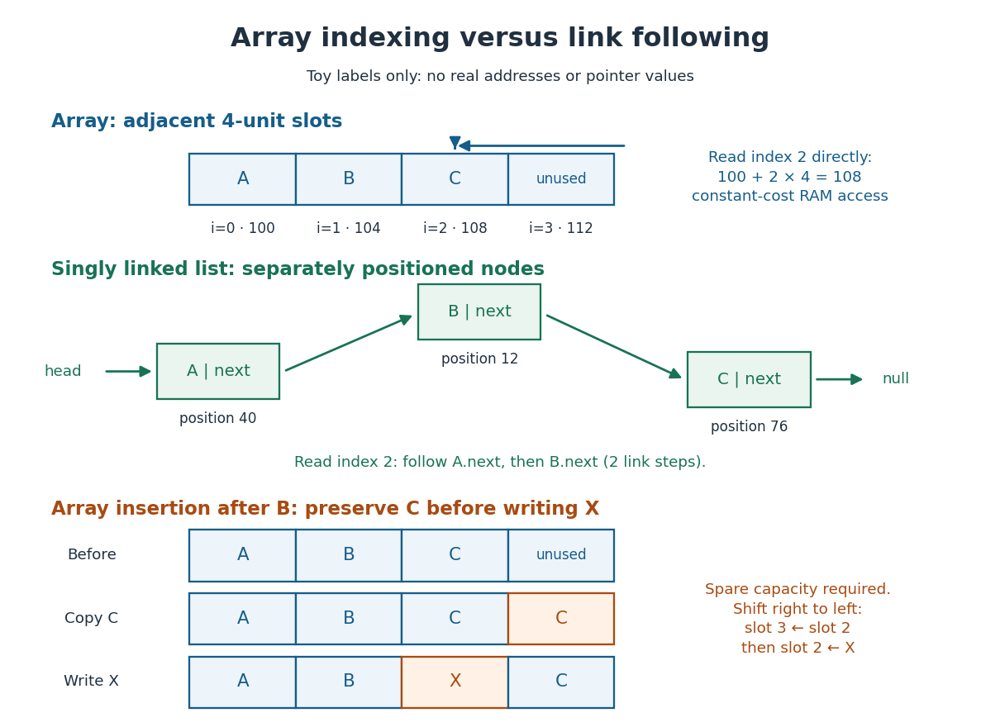

# Array (data structure)

↑ **Parent:** [Data structure](data-structure.md)

A [data structure](data-structure.md) storing entries at numbered positions, usually starting at index zero. The fixed-capacity representation considered here puts equal-sized slots consecutively in [computer memory](computer-memory.md). The number $n$ of occupied slots can be smaller than the capacity; unused slots provide room for later entries. An [array](array-data-structure.md) of references stores consecutive references, while the objects they identify can be elsewhere. [Pat Morin, Open Data Structures, chapter 2: array-based lists](https://opendatastructures.org/ods-java/2_Array_Based_Lists.html)

Let the first slot have abstract address $b$ and each slot occupy $s$ address units. Then indexed access computes

$$
\operatorname{address}(i)=b+i\,s,\qquad 0\leq i<n.
$$

For toy values $b=100$, $s=4$, the slots for $A,B,C$ start at $100,104,108$; index $2$ goes directly to $C$ through $100+2\cdot4=108$. These are illustrative slot addresses, not observed allocation addresses. Under the word-RAM (random-access machine) model for [time complexity](time-complexity.md), word-sized [arithmetic operations](arithmetic-operation.md) and any addressed [computer memory](computer-memory.md) access have constant cost, and the addresses and entries fit in words. Thus one [array](array-data-structure.md) access takes $O(1)$ time in [Big O notation](big-o-notation.md), independently of the index. This is the access assumption needed by [binary search](binary-search.md). [Pat Morin, Open Data Structures, section 1.4: the word-RAM model](https://opendatastructures.org/ods-java/1_4_Model_Computation.html)

**[Figure 55](#image-an-array-computes-a-slot-address-a-linked-list-follows-links). An array computes a slot address; a linked list follows links**.

Inserting $X$ after $B$ in an [array](array-data-structure.md) holding $A,B,C$ with one unused slot produces $A,B,X,C$: first copy $C$ from slot $2$ to slot $3$, then write $X$ into slot $2$. Writing $X$ first would lose $C$ unless it had been saved separately. More generally, insert at index $i$ by copying occupied slots from right to left, then fill the gap; with spare capacity this moves $n-i$ entries and takes $O(1+n-i)$ time in [Big O notation](big-o-notation.md), so insertion near the middle has $O(n)$ [time complexity](time-complexity.md). Removing an entry closes the gap by shifting later entries left. [Pat Morin, Open Data Structures, section 2.1.1: indexed access and shifts](https://opendatastructures.org/ods-java/2_1_ArrayStack_Fast_Stack_O.html)

A fixed-capacity [array](array-data-structure.md) cannot accept another entry when full. A resizable representation can allocate a larger [array](array-data-structure.md) and copy the entries. Doubling capacity when full gives $O(1)$ append cost by [amortized analysis](amortized-analysis.md) over a [sequence](sequence.md) starting empty, but a single append that copies $n$ entries still has $O(n)$ worst-case [time complexity](time-complexity.md). The outline is a [geometric series](geometric-series.md): copied capacities $1,2,4,\ldots,2^k$ sum to $2^{k+1}-1$, less than twice the number of appends that triggered the last copy. Middle insertion still pays for its shifts. [Pat Morin, Open Data Structures, sections 2.1.2–2.1.3: resizing and amortized costs](https://opendatastructures.org/ods-java/2_1_ArrayStack_Fast_Stack_O.html)

**Table of contents**

- [Row-major order](row-major-order.md)
- [Column-major order](column-major-order.md)
- [Sorted array](sorted-array.md)

## ↑ Ancestors (3)

1. [Data structure](data-structure.md)
2. [Computer science](computer-science-split.md)
3. [Codex Wiki](split.md)
