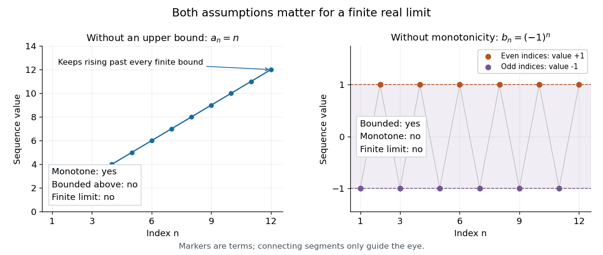

# Assumptions of the bounded monotone sequence theorem

↑ **Parent:** [Bounded monotone sequence theorem](bounded-monotone-sequence-theorem.md)

Dropping either condition destroys the implication. The increasing [sequence](sequence.md) $a_n=n$ has a [lower bound](lower-bound-in-a-partially-ordered-set.md) one but no [upper bound](upper-bound-in-a-partially-ordered-set.md), and no finite [limit of a sequence](limit-of-a-sequence.md). For any real threshold $T$, the [Archimedean property](archimedean-property.md) gives an index $N>T$, and monotonicity gives $a_n>T$ for all $n\geq N$. Its divergence to $+\infty$ in the [extended real number line](extended-real-number-line.md) is different from convergence to a [real number](real-number.md).

Conversely, $b_n=(-1)^n$ is a [bounded sequence](bounded-sequence.md), with $-1\leq b_n\leq1$, but is not a [monotone sequence](monotone-sequence.md) and has no [limit of a sequence](limit-of-a-sequence.md). Its [subsequence](subsequence.md) at [even integers](even-number.md) is constantly one, and its [subsequence](subsequence.md) at [odd integers](odd-integer.md) is constantly minus one. These two [subsequential limits](subsequential-limit.md) cannot both equal a single [limit of a sequence](limit-of-a-sequence.md). [§2.1, Example 2.1.5: divergence of the alternating sequence; §2.1.1, examples immediately after Definition 2.1.9: the increasing sequence n](basic-analysis-introduction-to-real-analysis-volume-i-by-jiri-lebl.md)

**[Figure 3](#image-neither-monotonicity-alone-nor-boundedness-alone-ensures-a-finite-limit-of-a-sequence). Neither monotonicity alone nor boundedness alone ensures a finite limit of a sequence**. Left: $a_n=n$ is increasing but unbounded above. Right: $b_n=(-1)^n$ stays in $[-1,1]$ but alternates between two distinct [subsequential limits](subsequential-limit.md). Both plots show finitely many terms; the formulas and the arguments establish the counterexamples for all indices.

The ambient [real numbers](real-number.md) also matter. An original example using the [floor function](floor-function.md) is

$$
q_n=\frac{\lfloor2^n\sqrt2\rfloor}{2^n},\qquad n\geq1.
$$

Every $q_n$ is a [rational number](rational-number.md), $q_n\leq q_{n+1}$ because $\lfloor2x\rfloor\geq2\lfloor x\rfloor$, and

$$
0<\sqrt2-q_n<2^{-n}.
$$

The strict lower inequality uses the [irrationality of the square root of two](irrationality-of-the-square-root-of-two.md). Hence this [bounded sequence](bounded-sequence.md) converges to $\sqrt2$ in the [real numbers](real-number.md), but has no [limit of a sequence](limit-of-a-sequence.md) in the [rational numbers](rational-number.md). Convergence to a rational candidate would also be convergence in the [real numbers](real-number.md), contradicting uniqueness of the [limit of a sequence](limit-of-a-sequence.md). The formulas give $q_1=1$, $q_2=5/4$, $q_3=11/8$, $q_4=11/8$: this counterexample even has a plateau. This illustrates why [completeness of the real numbers](completeness-of-the-real-numbers.md) matters: the [rational numbers](rational-number.md) lack the [least-upper-bound property](least-upper-bound-property.md) needed to contain the required [supremum](supremum.md). [§1.2.1, Theorem 1.2.1 and Example 1.2.3: least-upper-bound property and the irrational boundary at the square root of two](basic-analysis-introduction-to-real-analysis-volume-i-by-jiri-lebl.md)

## ↑ Ancestors (9)

1. [Bounded monotone sequence theorem](bounded-monotone-sequence-theorem.md)
2. [Monotone sequence](monotone-sequence.md)
3. [Sequence](sequence.md)
4. [Sequence and series](sequence-and-series-split.md)
5. [Real analysis](real-analysis-split.md)
6. [Analysis](analysis-split.md)
7. [Area of mathematics](area-of-mathematics.md)
8. [Mathematics](mathematics-split.md)
9. [Codex Wiki](split.md)
