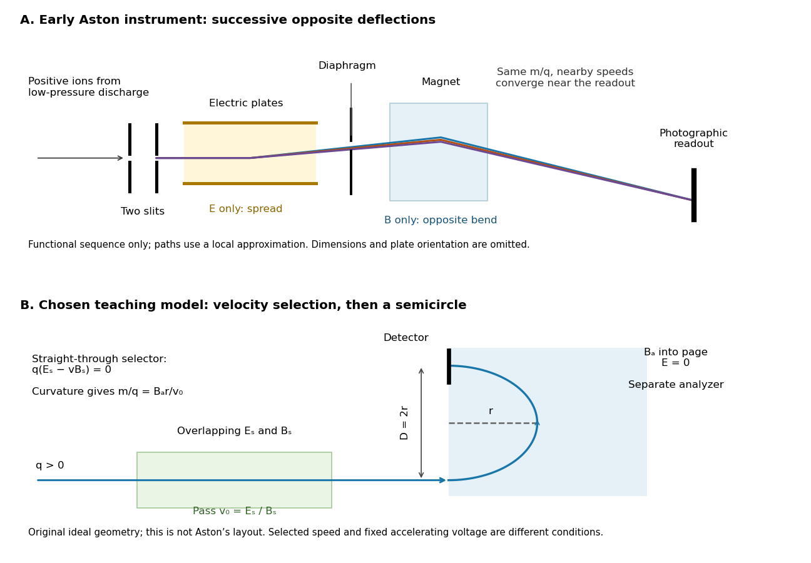

# Aston velocity focusing

↑ **Parent:** [Mass spectrograph](mass-spectrograph.md)

In [Mass spectra and isotopes by Francis William Aston](mass-spectra-and-isotopes-by-francis-william-aston.md), printed pp. 10–12, Fig. 1, [Francis William Aston](francis-william-aston.md) describes successive electric and magnetic deflections in one plane, with opposite senses. This geometry focuses a range of [ion](ion.md) [speeds](speed.md); it does not require the straight-through cancellation of a [velocity selector](velocity-selector.md).

The reason compensation is possible follows from the [Lorentz force](lorentz-force.md). In a short region of length $\ell_E$, a small electric deflection angle has magnitude $\theta_E\simeq qE\ell_E/(mv^2)$: the transverse [acceleration](acceleration.md) acts for a time $\ell_E/v$, and the deflection angle is the acquired transverse [velocity](velocity.md) divided by $v$. A short magnetic region of length $\ell_B$ gives $\theta_B\simeq qB\ell_B/(mv)$, since the magnetic [force](force-split.md) already contains one factor of [speed](speed.md). Slower [ions](ion.md) therefore receive a disproportionately larger electric deflection.

An original local approximation makes the focusing idea explicit. At fixed [mass-to-charge ratio](mass-to-charge-ratio.md), replace each region by a small angular kick and include the drift distances in two positive constants $a$ and $b$. With $t=v/v_0$, write the detector coordinate as

$$
X(t)=\frac{a}{t^2}-\frac{b}{t},\qquad
\left.\frac{dX}{dt}\right|_{t=1}=-2a+b.
$$

Choosing the geometry and fields so that $b=2a$ eliminates the first-order [speed](speed.md) sensitivity. Indeed,

$$
X(t)-X(1)=a\frac{(t-1)^2}{t^2}.
$$

A fractional [speed](speed.md) error $\varepsilon=t-1$ then contributes only at order $\varepsilon^2$ in this approximation. This is a local thin-kick explanation, not Aston's exact pole geometry, focal-plane equation, or a prediction of its measured [mass resolution](mass-resolution.md). Finite slit widths, initial directions, and field boundaries still matter. Unlike a [velocity selector](velocity-selector.md), focusing can collect nearby [speeds](speed.md) into a narrow image instead of discarding all but a narrow accepted range.

**[Figure 10](#image-aston-focusing-and-velocity-selector). Successive opposite deflections in an early mass spectrograph, compared with a chosen velocity selector and magnetic analyzer**. Top: functional schematic of the sequence described by [Francis William Aston](francis-william-aston.md); colored paths indicate one [mass-to-charge ratio](mass-to-charge-ratio.md) at nearby [speeds](speed.md). Paths use the local thin-kick illustration, and dimensions and plate orientation are not a reconstruction. Bottom: an independently chosen teaching geometry has overlapping selector fields followed by a separate semicircular magnetic path. Both diagrams show positive [ions](ion.md); the [Thomson charge-to-mass experiment](thomson-charge-to-mass-experiment.md) gives the corresponding negative-[electric charge](electric-charge-split.md) example.

## ↑ Ancestors (4)

1. [Mass spectrograph](mass-spectrograph.md)
2. [Mass spectrometry](mass-spectrometry.md)
3. [Chemistry](chemistry-split.md)
4. [Codex Wiki](split.md)

## ← Incoming links (1)

- [Mass spectrometry](mass-spectrometry.md)
