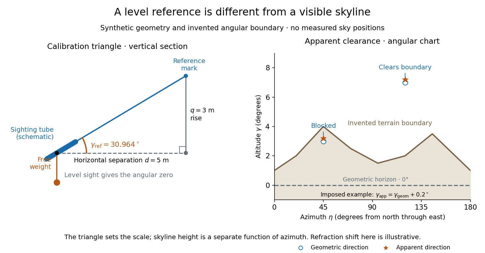

# Astronomical horizon

↑ **Parent:** [Horizontal coordinate system](horizontal-coordinate-system.md)

The [astronomical horizon](astronomical-horizon.md) is the [great circle](great-circle.md) where the horizontal [plane](plane.md) through the observer intersects the [celestial sphere](celestial-sphere.md). It is perpendicular to the local vertical, so every direction on the [astronomical horizon](astronomical-horizon.md) has [altitude](altitude.md) $0^\circ$ and [zenith distance](zenith-distance.md) $90^\circ$. In the local [horizontal coordinate system](horizontal-coordinate-system.md), it consists of the [unit vectors](unit-vector.md) satisfying $\mathbf n\cdot\mathbf e_U=0$. This geometric reference remains defined when buildings or mountains hide it; a visible skyline is not a calibration of zero [altitude](altitude.md).

Three boundaries must be distinguished. The [astronomical horizon](astronomical-horizon.md) fixes the angular reference. Terrain supplies a site-dependent boundary with apparent [altitude](altitude.md) $t(\eta)$ that changes with [azimuth](azimuth.md). [Atmospheric refraction](atmospheric-refraction.md) changes the apparent direction of incoming [light](light.md), and can also change the apparent distant boundary. A point source clears an opaque terrain boundary only if $\gamma_{\rm app}>t(\eta)$ when both are expressed in the same apparent [horizontal coordinate system](horizontal-coordinate-system.md); this clearance condition does not guarantee visibility through clouds or bright sky. In the synthetic diagram, a source with geometric [altitude](altitude.md) $3^\circ$ and an imposed illustrative upward correction $R=0.2^\circ$ remains behind a $4^\circ$ boundary. The chosen $R$ is an algebraic illustration, not a fitted atmospheric prediction.

**[Figure 5](#image-synthetic-calibration-triangle-and-invented-terrain-boundary-angular-zero-apparent-altitude-and-geometric-horizon-are-separate). Synthetic calibration triangle and invented terrain boundary; angular zero, apparent altitude and geometric horizon are separate**.

Even an unobstructed sea boundary need not coincide with the [astronomical horizon](astronomical-horizon.md). On a spherical [Earth](earth.md) of radius $r$, an observer at height $q$ sees the unrefracted tangent to the surface at a downward [angle](angle.md) $D$ satisfying $\cos D=r/(r+q)$. The right-angle tangent [triangle](triangle.md) supplies this relation; the visible boundary then has [altitude](altitude.md) $-D$. With illustrative $r=6371\,\mathrm{km}$ and $q=10\,\mathrm m$, $D\simeq0.1015^\circ$, before [atmospheric refraction](atmospheric-refraction.md). Raising the eye therefore changes the visible boundary without redefining the horizontal [plane](plane.md).

The US Naval Observatory's rise/set definitions explicitly distinguish the geometric reference from apparent contact with a visible disk: the standard [Sun](sun.md) calculation puts its centre $50'$ below the horizontal [plane](plane.md), combining an average $16'$ radius with $34'$ of [atmospheric refraction](atmospheric-refraction.md). An angular minute is $1'=1/60^\circ$ in the [minute and second of arc](minute-and-second-of-arc.md) convention. This is an operational average under stated conditions, rather than a universal zero of [altitude](altitude.md). The same source identifies weather, local topography and observer height as limits on predicted rise/set [time](time-in-physics.md). An observation log should therefore retain the level reference, site and eye height, terrain profile, observation [time](time-in-physics.md), and whether each reported [altitude](altitude.md) is geometric or apparent. [US Naval Observatory: Rise, set and twilight definitions, geometric horizon and observational limitations](https://aa.usno.navy.mil/faq/RST_defs).

## ↑ Ancestors (5)

1. [Horizontal coordinate system](horizontal-coordinate-system.md)
2. [Astrophysics](astrophysics-split.md)
3. [Branches of physics](branches-of-physics.md)
4. [Physics](physics-split.md)
5. [Codex Wiki](split.md)

## ← Incoming links (10)

- [Altitude](altitude.md)
- [Astronomical horizon](astronomical-horizon.md)
- [Azimuth](azimuth.md)
- [Declination](declination.md)
- [Equatorial coordinate system](equatorial-coordinate-system.md)
- [Horizontal coordinate system](horizontal-coordinate-system.md)
- [Meridian transit](meridian-transit.md)
- [Solution](past-exam-of-the-mathematics-course-of-the-university-of-cambridge/2017/iii/paper-338/1/a/i/solution.md)
- [Solution](past-exam-of-the-mathematics-course-of-the-university-of-cambridge/2017/iii/paper-338/1/b/ii/solution.md)
- [Zenith distance](zenith-distance.md)
