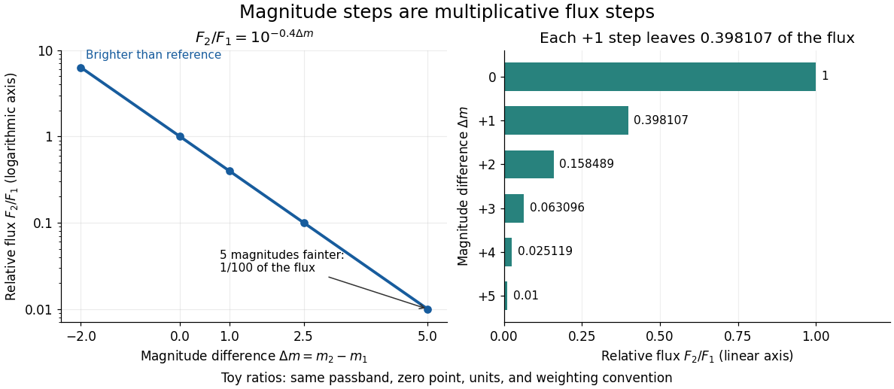

# Astronomical magnitude

↑ **Parent:** [Astrophysics](astrophysics-split.md)  
ⓦ [Wiki](https://en.wikipedia.org/wiki/Astronomical_magnitude)

Astronomical magnitude expresses brightness on a [logarithmic scale](logarithmic-scale.md): equal steps in [astronomical magnitude](astronomical-magnitude.md) represent equal ratios of received [radiative flux](radiative-flux.md). The scale runs backwards, so a brighter source has a smaller [astronomical magnitude](astronomical-magnitude.md). A difference of five magnitudes means exactly a factor of $100$ in flux; one magnitude means a factor of $100^{1/5}\simeq2.511886$, rather than exactly $2.5$. This compresses the enormous range of astronomical brightnesses into manageable numbers. [Fraknoi, Morrison and Wolff, Astronomy 2e, 17.1: The brightness of stars](https://openstax.org/books/astronomy-2e/pages/17-1-the-brightness-of-stars).

[Apparent magnitude](apparent-magnitude.md) describes received brightness, while [absolute magnitude](absolute-magnitude.md) compares sources at a shared reference distance. Both require a specified [photometric passband](photometric-passband.md) and [magnitude zero point](magnitude-zero-point.md). A [magnitude difference](magnitude-difference.md) turns a ratio of positive [radiative fluxes](radiative-flux.md) into a difference of numbers; it does not measure an additive change in emitted [luminosity](luminosity.md).

**[Figure 10](#image-equal-magnitude-steps-multiply-flux-ratios-toy-measurements-in-one-passband-with-one-zero-point). Equal magnitude steps multiply flux ratios; toy measurements in one passband with one zero point**.

**Table of contents**

- [Magnitude difference](magnitude-difference.md)
- [Apparent magnitude](apparent-magnitude.md)
  - [Magnitude zero point](magnitude-zero-point.md)
  - [Euclidean magnitude-limited source count](euclidean-magnitude-limited-source-count.md)
- [Photometric system](photometric-system.md)
  - [Color index](color-index.md)
  - [UBV photometric system](ubv-photometric-system.md)
  - [Photometric passband](photometric-passband.md)
    - [Infrared photometric band](infrared-photometric-band.md)
- [Absolute magnitude](absolute-magnitude.md)
  - [K correction](k-correction.md)
    - [Power-law spectral K correction](power-law-spectral-k-correction.md)
  - [Standard candle](standard-candle.md)
- [Distance modulus](distance-modulus.md)
  - [Extinction bias in photometric distance](extinction-bias-in-photometric-distance.md)

## ↑ Ancestors (4)

1. [Astrophysics](astrophysics-split.md)
2. [Branches of physics](branches-of-physics.md)
3. [Physics](physics-split.md)
4. [Codex Wiki](split.md)

## ← Incoming links (2)

- [Astronomical magnitude](astronomical-magnitude.md)
- [Solution](past-exam-of-the-mathematics-course-of-the-university-of-cambridge/2008/iii/paper-73/1/vii/solution.md)
