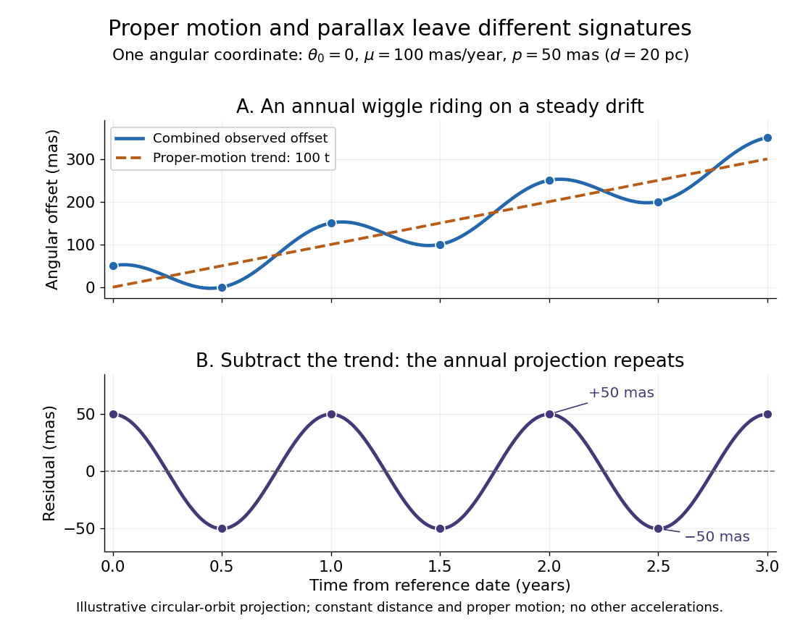
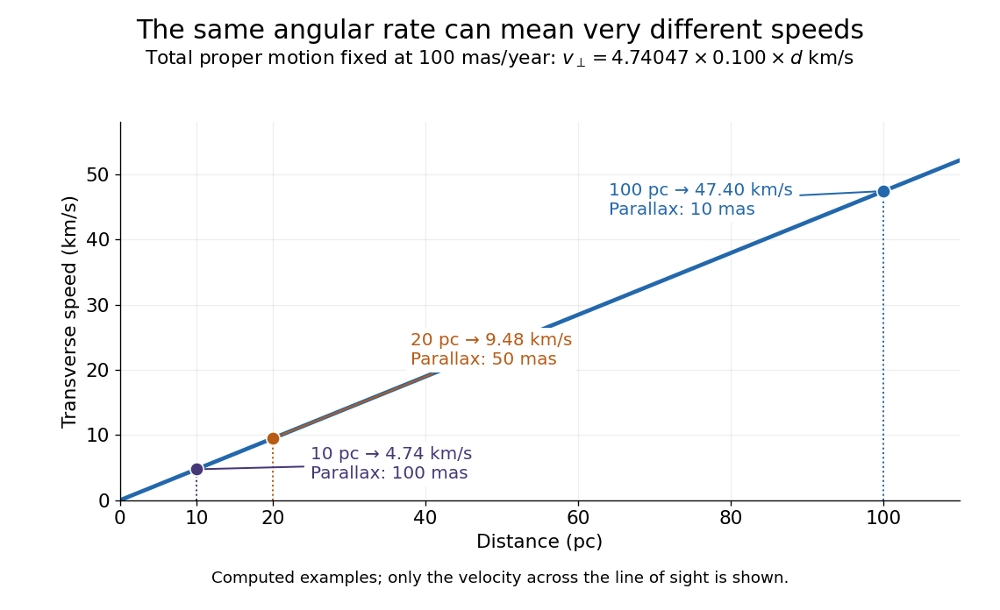

# Astronomy

↑ **Parent:** [Codex Wiki](README.md)  
ⓦ [Wiki](https://en.wikipedia.org/wiki/Astronomy)

Astronomy studies celestial objects and phenomena, including [stars](stellar-astrophysics.md#star), [planets](planetary-science.md#planet) and [galaxies](galaxy.md). [Astrometry](#astrometry) measures their [positions](classical-mechanics.md#position) and motion; [astrophysics](astrophysics.md) uses [physics](physics.md) to explain their properties and behaviour.

Much of [astronomy](astronomy.md) begins with incoming [light](optics.md#light). An image tells us which direction the [light](optics.md#light) arrived from, rather than directly providing the source's three-dimensional [position](classical-mechanics.md#position). Two [stars](stellar-astrophysics.md#star) close together on the sky may be very far apart in space. The [celestial sphere](astrophysics.md#celestial-sphere) organizes these viewing directions; locating an object on it is a different task from measuring how far away that object is. Repeated observations turn this limitation into an opportunity: the changing direction of [light](optics.md#light) contains evidence about both [Euclidean distance](topological-analysis.md#euclidean-distance) and motion.

The particularly satisfying combination is [stellar parallax](astrophysics.md#stellar-parallax) with [proper motion](#proper-motion). The first supplies a geometric [Euclidean distance](topological-analysis.md#euclidean-distance), while the second measures how rapidly the viewing direction changes after accounting for the observer's annual motion. Together they give a transverse [speed](classical-mechanics.md#speed), connecting tiny [angles](geometry-and-topology.md#angle) on an image to kilometres travelled each second. This bridge from a flat sky map to moving [stars](stellar-astrophysics.md#star) is one reason [astrometry](#astrometry) matters to the study of the [Milky Way](galaxy.md#milky-way).

**Table of contents**

- [Line-of-sight projection](#line-of-sight-projection)
- [Planck Collaboration](#planck-collaboration)
  - [Work by Planck Collaboration](#work-by-planck-collaboration)
- [Eclipse](#eclipse)
  - [Solar eclipse](#solar-eclipse)
- [Astronomer](#astronomer)
  - [Peter P. Eggleton](#peter-p-eggleton)
    - [Work by Peter P. Eggleton](#work-by-peter-p-eggleton)
  - [List of astronomers](#list-of-astronomers)
    - [Robert Crittenden](#robert-crittenden)
      - [Work by Robert Crittenden](#work-by-robert-crittenden)
    - [Stephen Boughn](#stephen-boughn)
      - [Work by Stephen Boughn](#work-by-stephen-boughn)
    - [George R. Blumenthal](#george-r-blumenthal)
      - [Work by George R. Blumenthal](#work-by-george-r-blumenthal)
    - [Jelle S. Kaastra](#jelle-s-kaastra)
      - [Work by Jelle S. Kaastra](#work-by-jelle-s-kaastra)
    - [D. R. Gies](#d-r-gies)
      - [Work by D. R. Gies](#work-by-d-r-gies)
    - [Edward Fomalont](#edward-fomalont)
      - [Work by Edward Fomalont](#work-by-edward-fomalont)
    - [Richard B. Larson](#richard-b-larson)
      - [Work by Richard B. Larson](#work-by-richard-b-larson)
    - [Mark G. Wolfire](#mark-g-wolfire)
      - [Work by Mark G. Wolfire](#work-by-mark-g-wolfire)
    - [Jeffrey E. McClintock](#jeffrey-e-mcclintock)
      - [Work by Jeffrey E. McClintock](#work-by-jeffrey-e-mcclintock)
    - [J. R. Herrnstein](#j-r-herrnstein)
      - [Work by J. R. Herrnstein](#work-by-j-r-herrnstein)
    - [G. Pietrzyński](#g-pietrzynski)
      - [Work by G. Pietrzyński](#work-by-g-pietrzynski)
    - [D. H. Kelker](#d-h-kelker)
      - [Work by D. H. Kelker](#work-by-d-h-kelker)
    - [T. E. Lutz](#t-e-lutz)
      - [Work by T. E. Lutz](#work-by-t-e-lutz)
    - [Timothy M. Heckman](#timothy-m-heckman)
      - [Work by Timothy M. Heckman](#work-by-timothy-m-heckman)
    - [Avishai Dekel](#avishai-dekel)
      - [Work by Avishai Dekel](#work-by-avishai-dekel)
    - [A. C. Fabian](#a-c-fabian)
      - [Work by A. C. Fabian](#work-by-a-c-fabian)
    - [Hagai Netzer](#hagai-netzer)
      - [Work by Hagai Netzer](#work-by-hagai-netzer)
    - [Frank H. Shu](#frank-h-shu)
      - [Work by Frank H. Shu](#work-by-frank-h-shu)
    - [Neal J. Evans II](#neal-j-evans-ii)
      - [Work by Neal J. Evans II](#work-by-neal-j-evans-ii)
    - [Robert C. Kennicutt Jr.](#robert-c-kennicutt-jr)
      - [Work by Robert C. Kennicutt Jr.](#work-by-robert-c-kennicutt-jr)
    - [Luis C. Ho](#luis-c-ho)
      - [Work by Luis C. Ho](#work-by-luis-c-ho)
    - [John Kormendy](#john-kormendy)
      - [Work by John Kormendy](#work-by-john-kormendy)
    - [Karen L. Masters](#karen-l-masters)
      - [Work by Karen L. Masters](#work-by-karen-l-masters)
    - [Jerry A. Sellwood](#jerry-a-sellwood)
      - [Work by Jerry A. Sellwood](#work-by-jerry-a-sellwood)
    - [Ralph S. Sutherland](#ralph-s-sutherland)
      - [Work by Ralph S. Sutherland](#work-by-ralph-s-sutherland)
    - [Michael A. Dopita](#michael-a-dopita)
      - [Work by Michael A. Dopita](#work-by-michael-a-dopita)
    - [David C. Nicholls](#david-c-nicholls)
      - [Work by David C. Nicholls](#work-by-david-c-nicholls)
    - [R. Paul Butler](#r-paul-butler)
      - [Work by R. Paul Butler](#work-by-r-paul-butler)
    - [Geoffrey W. Marcy](#geoffrey-w-marcy)
      - [Work by Geoffrey W. Marcy](#work-by-geoffrey-w-marcy)
    - [Dimitar Sasselov](#dimitar-sasselov)
      - [Work by Dimitar Sasselov](#work-by-dimitar-sasselov)
    - [Clément Baruteau](#clement-baruteau)
      - [Work by Clément Baruteau](#work-by-clement-baruteau)
    - [Charles F. Gammie](#charles-f-gammie)
      - [Work by Charles F. Gammie](#work-by-charles-f-gammie)
    - [James B. Pollack](#james-b-pollack)
      - [Work by James B. Pollack](#work-by-james-b-pollack)
    - [Gabriela Mallén-Ornelas](#gabriela-mallen-ornelas)
      - [Work by Gabriela Mallén-Ornelas](#work-by-gabriela-mallen-ornelas)
    - [Sara Seager](#sara-seager)
      - [Work by Sara Seager](#work-by-sara-seager)
    - [Martin J. Rees](#martin-j-rees)
      - [Work by Martin J. Rees](#work-by-martin-j-rees)
    - [Simon D. M. White](#simon-d-m-white)
      - [Work by Simon D. M. White](#work-by-simon-d-m-white)
    - [Juri Toomre](#juri-toomre)
      - [Work by Juri Toomre](#work-by-juri-toomre)
    - [Alar Toomre](#alar-toomre)
      - [Work by Alar Toomre](#work-by-alar-toomre)
    - [Daniel J. Mortlock](#daniel-j-mortlock)
      - [Work by Daniel J. Mortlock](#work-by-daniel-j-mortlock)
    - [Ian Czekala](#ian-czekala)
      - [Work by Ian Czekala](#work-by-ian-czekala)
    - [Scott M. Ransom](#scott-m-ransom)
      - [Work by Scott M. Ransom](#work-by-scott-m-ransom)
    - [James J. Condon](#james-j-condon)
      - [Work by James J. Condon](#work-by-james-j-condon)
    - [Joan Wrobel](#joan-wrobel)
      - [Work by Joan Wrobel](#work-by-joan-wrobel)
    - [Dale J. Fixsen](#dale-j-fixsen)
      - [Work by Dale J. Fixsen](#work-by-dale-j-fixsen)
    - [A. N. Lasenby](#a-n-lasenby)
      - [Work by A. N. Lasenby](#work-by-a-n-lasenby)
    - [A. D. Challinor](#a-d-challinor)
      - [Work by A. D. Challinor](#work-by-a-d-challinor)
    - [Shigeru Ida](#shigeru-ida)
      - [Work by Shigeru Ida](#work-by-shigeru-ida)
    - [Eiichiro Kokubo](#eiichiro-kokubo)
      - [Work by Eiichiro Kokubo](#work-by-eiichiro-kokubo)
    - [Erik A. Petigura](#erik-a-petigura)
      - [Work by Erik A. Petigura](#work-by-erik-a-petigura)
    - [François Fressin](#francois-fressin)
      - [Work by François Fressin](#work-by-francois-fressin)
    - [Philip J. Armitage](#philip-j-armitage)
      - [Work by Philip J. Armitage](#work-by-philip-j-armitage)
    - [Charles Rundle Davidson](#charles-rundle-davidson)
    - [George Biddell Airy](#george-biddell-airy)
    - [Arthur Eddington](#arthur-eddington)
      - [Work by Arthur Eddington](#work-by-arthur-eddington)
    - [Frank Watson Dyson](#frank-watson-dyson)
      - [Work by Frank Watson Dyson](#work-by-frank-watson-dyson)
    - [Farrokh Vakili](#farrokh-vakili)
      - [Work by Farrokh Vakili](#work-by-farrokh-vakili)
    - [Jean-Pierre Rivet](#jean-pierre-rivet)
      - [Work by Jean-Pierre Rivet](#work-by-jean-pierre-rivet)
    - [André Baranne](#andre-baranne)
      - [Work by André Baranne](#work-by-andre-baranne)
    - [Jayant Vishnu Narlikar](#jayant-vishnu-narlikar)
      - [Work by Jayant Vishnu Narlikar](#work-by-jayant-vishnu-narlikar)
    - [Dale Frail](#dale-frail)
      - [Work by Dale Frail](#work-by-dale-frail)
    - [Aleksander Wolszczan](#aleksander-wolszczan)
      - [Work by Aleksander Wolszczan](#work-by-aleksander-wolszczan)
    - [Rainer Schödel](#rainer-schodel)
      - [Work by Rainer Schödel](#work-by-rainer-schodel)
    - [Andrea M. Ghez](#andrea-m-ghez)
      - [Work by Andrea M. Ghez](#work-by-andrea-m-ghez)
    - [Reinhard Genzel](#reinhard-genzel)
      - [Work by Reinhard Genzel](#work-by-reinhard-genzel)
    - [Didier Queloz](#didier-queloz)
      - [Work by Didier Queloz](#work-by-didier-queloz)
    - [Michel Mayor](#michel-mayor)
      - [Work by Michel Mayor](#work-by-michel-mayor)
    - [Alexei V. Filippenko](#alexei-v-filippenko)
      - [Work by Alexei V. Filippenko](#work-by-alexei-v-filippenko)
    - [Adam Riess](#adam-riess)
      - [Work by Adam Riess](#work-by-adam-riess)
    - [Brian Schmidt](#brian-schmidt)
      - [Work by Brian Schmidt](#work-by-brian-schmidt)
    - [Saul Perlmutter](#saul-perlmutter)
      - [Work by Saul Perlmutter](#work-by-saul-perlmutter)
    - [Charles L. Bennett](#charles-l-bennett)
      - [Work by Charles L. Bennett](#work-by-charles-l-bennett)
    - [John C. Mather](#john-c-mather)
      - [Work by John C. Mather](#work-by-john-c-mather)
    - [Robert Hanbury Brown](#robert-hanbury-brown)
      - [Work by Robert Hanbury Brown](#work-by-robert-hanbury-brown)
    - [Herbert Gursky](#herbert-gursky)
      - [Work by Herbert Gursky](#work-by-herbert-gursky)
    - [Riccardo Giacconi](#riccardo-giacconi)
      - [Work by Riccardo Giacconi](#work-by-riccardo-giacconi)
    - [Joseph Hooton Taylor Jr.](#joseph-hooton-taylor-jr)
      - [Work by Joseph Hooton Taylor Jr.](#work-by-joseph-hooton-taylor-jr)
    - [Fred Hoyle](#fred-hoyle)
      - [Work by Fred Hoyle](#work-by-fred-hoyle)
    - [Subrahmanyan Chandrasekhar](#subrahmanyan-chandrasekhar)
      - [Work by Subrahmanyan Chandrasekhar](#work-by-subrahmanyan-chandrasekhar)
    - [Robert Woodrow Wilson](#robert-woodrow-wilson)
      - [Work by Robert Woodrow Wilson](#work-by-robert-woodrow-wilson)
    - [Antony Hewish](#antony-hewish)
      - [Work by Antony Hewish](#work-by-antony-hewish)
    - [Jocelyn Bell Burnell](#jocelyn-bell-burnell)
      - [Work by Jocelyn Bell Burnell](#work-by-jocelyn-bell-burnell)
    - [Bruce Elsmore](#bruce-elsmore)
      - [Work by Bruce Elsmore](#work-by-bruce-elsmore)
    - [Martin Ryle](#martin-ryle)
      - [Work by Martin Ryle](#work-by-martin-ryle)
    - [Carl Theodor Anger](#carl-theodor-anger)
      - [Work by Carl Theodor Anger](#work-by-carl-theodor-anger)
  - [Edmond Halley](#edmond-halley)
  - [Johannes Kepler](#johannes-kepler)
- [Astrometry](#astrometry)
  - [Orbital parallax](#orbital-parallax)
  - [Proper motion](#proper-motion)

## Line-of-sight projection

↑ **Parent:** [Astronomy](astronomy.md)

The map from a three-dimensional astronomical distribution to its observed sky position or integrated surface signal. For a scalar volume emissivity $j(\mathbf x)$ in simple transparent geometry, [surface brightness](astrophysics.md#surface-brightness) is proportional to $\int j\,dl$ along the ray. Reconstructing the spatial distribution requires additional geometry or symmetry assumptions; a projected surface distribution is not a unique three-dimensional [density](fluid-mechanics.md#density).

## Planck Collaboration

↑ **Parent:** [Astronomy](astronomy.md)

Scientific collaboration responsible for analysis of the Planck mission data.

### Work by Planck Collaboration

↑ **Parent:** [Planck Collaboration](#planck-collaboration)

## Eclipse

↑ **Parent:** [Astronomy](astronomy.md)  
ⓦ [Wiki](https://en.wikipedia.org/wiki/Eclipse)

### Solar eclipse

↑ **Parent:** [Eclipse](#eclipse)  
ⓦ [Wiki](https://en.wikipedia.org/wiki/Solar_eclipse)

A solar eclipse occurs when the [Moon](planetary-science.md#moon) obscures part or all of the [Sun](stellar-astrophysics.md#sun) as seen from a specified location. Totality allows observations of nearby background [stars](stellar-astrophysics.md#star) that ordinary daylight hides.

## Astronomer

↑ **Parent:** [Astronomy](astronomy.md)  
ⓦ [Wiki](https://en.wikipedia.org/wiki/Astronomer)

### Peter P. Eggleton

↑ **Parent:** [Astronomer](#astronomer)

#### Work by Peter P. Eggleton

↑ **Parent:** [Peter P. Eggleton](#peter-p-eggleton)

### List of astronomers

↑ **Parent:** [Astronomer](#astronomer)

#### Robert Crittenden

↑ **Parent:** [List of astronomers](#list-of-astronomers)

##### Work by Robert Crittenden

↑ **Parent:** [Robert Crittenden](#robert-crittenden)

#### Stephen Boughn

↑ **Parent:** [List of astronomers](#list-of-astronomers)

##### Work by Stephen Boughn

↑ **Parent:** [Stephen Boughn](#stephen-boughn)

#### George R. Blumenthal

↑ **Parent:** [List of astronomers](#list-of-astronomers)

Astronomer and first author of a 1984 cold-dark-matter galaxy-formation model.

##### Work by George R. Blumenthal

↑ **Parent:** [George R. Blumenthal](#george-r-blumenthal)

#### Jelle S. Kaastra

↑ **Parent:** [List of astronomers](#list-of-astronomers)

Astronomer and author of research on [X-ray](electromagnetic-radiation.md#x-ray) [plasma](physics.md#plasma-physics) spectroscopy.

##### Work by Jelle S. Kaastra

↑ **Parent:** [Jelle S. Kaastra](#jelle-s-kaastra)

#### D. R. Gies

↑ **Parent:** [List of astronomers](#list-of-astronomers)

##### Work by D. R. Gies

↑ **Parent:** [D. R. Gies](#d-r-gies)

#### Edward Fomalont

↑ **Parent:** [List of astronomers](#list-of-astronomers)

Radio astronomer and first author of a [Very Long Baseline Array](astrophysics.md#very-long-baseline-array) solar-deflection measurement published in 2009.

##### Work by Edward Fomalont

↑ **Parent:** [Edward Fomalont](#edward-fomalont)

#### Richard B. Larson

↑ **Parent:** [List of astronomers](#list-of-astronomers)

##### Work by Richard B. Larson

↑ **Parent:** [Richard B. Larson](#richard-b-larson)

#### Mark G. Wolfire

↑ **Parent:** [List of astronomers](#list-of-astronomers)

##### Work by Mark G. Wolfire

↑ **Parent:** [Mark G. Wolfire](#mark-g-wolfire)

#### Jeffrey E. McClintock

↑ **Parent:** [List of astronomers](#list-of-astronomers)

An astrophysicist studying stellar [black holes](black-hole.md) and X-ray binaries.

##### Work by Jeffrey E. McClintock

↑ **Parent:** [Jeffrey E. McClintock](#jeffrey-e-mcclintock)

#### J. R. Herrnstein

↑ **Parent:** [List of astronomers](#list-of-astronomers)

##### Work by J. R. Herrnstein

↑ **Parent:** [J. R. Herrnstein](#j-r-herrnstein)

<h4 id="g-pietrzynski">G. Pietrzyński</h4>

↑ **Parent:** [List of astronomers](#list-of-astronomers)

<h5 id="work-by-g-pietrzynski">Work by G. Pietrzyński</h5>

↑ **Parent:** [G. Pietrzyński](#g-pietrzynski)

#### D. H. Kelker

↑ **Parent:** [List of astronomers](#list-of-astronomers)

##### Work by D. H. Kelker

↑ **Parent:** [D. H. Kelker](#d-h-kelker)

#### T. E. Lutz

↑ **Parent:** [List of astronomers](#list-of-astronomers)

##### Work by T. E. Lutz

↑ **Parent:** [T. E. Lutz](#t-e-lutz)

#### Timothy M. Heckman

↑ **Parent:** [List of astronomers](#list-of-astronomers)

An astronomer studying star-forming galaxies, active galactic nuclei and [galactic outflows](galaxy.md#galactic-outflow).

##### Work by Timothy M. Heckman

↑ **Parent:** [Timothy M. Heckman](#timothy-m-heckman)

#### Avishai Dekel

↑ **Parent:** [List of astronomers](#list-of-astronomers)

An astrophysicist studying galaxy formation and cosmological gas [accretion](astrophysics.md#accretion).

##### Work by Avishai Dekel

↑ **Parent:** [Avishai Dekel](#avishai-dekel)

#### A. C. Fabian

↑ **Parent:** [List of astronomers](#list-of-astronomers)

##### Work by A. C. Fabian

↑ **Parent:** [A. C. Fabian](#a-c-fabian)

#### Hagai Netzer

↑ **Parent:** [List of astronomers](#list-of-astronomers)

##### Work by Hagai Netzer

↑ **Parent:** [Hagai Netzer](#hagai-netzer)

#### Frank H. Shu

↑ **Parent:** [List of astronomers](#list-of-astronomers)

##### Work by Frank H. Shu

↑ **Parent:** [Frank H. Shu](#frank-h-shu)

#### Neal J. Evans II

↑ **Parent:** [List of astronomers](#list-of-astronomers)

##### Work by Neal J. Evans II

↑ **Parent:** [Neal J. Evans II](#neal-j-evans-ii)

#### Robert C. Kennicutt Jr.

↑ **Parent:** [List of astronomers](#list-of-astronomers)

##### Work by Robert C. Kennicutt Jr.

↑ **Parent:** [Robert C. Kennicutt Jr.](#robert-c-kennicutt-jr)

#### Luis C. Ho

↑ **Parent:** [List of astronomers](#list-of-astronomers)

##### Work by Luis C. Ho

↑ **Parent:** [Luis C. Ho](#luis-c-ho)

#### John Kormendy

↑ **Parent:** [List of astronomers](#list-of-astronomers)

##### Work by John Kormendy

↑ **Parent:** [John Kormendy](#john-kormendy)

#### Karen L. Masters

↑ **Parent:** [List of astronomers](#list-of-astronomers)

##### Work by Karen L. Masters

↑ **Parent:** [Karen L. Masters](#karen-l-masters)

#### Jerry A. Sellwood

↑ **Parent:** [List of astronomers](#list-of-astronomers)

##### Work by Jerry A. Sellwood

↑ **Parent:** [Jerry A. Sellwood](#jerry-a-sellwood)

#### Ralph S. Sutherland

↑ **Parent:** [List of astronomers](#list-of-astronomers)

##### Work by Ralph S. Sutherland

↑ **Parent:** [Ralph S. Sutherland](#ralph-s-sutherland)

#### Michael A. Dopita

↑ **Parent:** [List of astronomers](#list-of-astronomers)

##### Work by Michael A. Dopita

↑ **Parent:** [Michael A. Dopita](#michael-a-dopita)

#### David C. Nicholls

↑ **Parent:** [List of astronomers](#list-of-astronomers)

##### Work by David C. Nicholls

↑ **Parent:** [David C. Nicholls](#david-c-nicholls)

#### R. Paul Butler

↑ **Parent:** [List of astronomers](#list-of-astronomers)

##### Work by R. Paul Butler

↑ **Parent:** [R. Paul Butler](#r-paul-butler)

#### Geoffrey W. Marcy

↑ **Parent:** [List of astronomers](#list-of-astronomers)

##### Work by Geoffrey W. Marcy

↑ **Parent:** [Geoffrey W. Marcy](#geoffrey-w-marcy)

#### Dimitar Sasselov

↑ **Parent:** [List of astronomers](#list-of-astronomers)

##### Work by Dimitar Sasselov

↑ **Parent:** [Dimitar Sasselov](#dimitar-sasselov)

<h4 id="clement-baruteau">Clément Baruteau</h4>

↑ **Parent:** [List of astronomers](#list-of-astronomers)

<h5 id="work-by-clement-baruteau">Work by Clément Baruteau</h5>

↑ **Parent:** [Clément Baruteau](#clement-baruteau)

#### Charles F. Gammie

↑ **Parent:** [List of astronomers](#list-of-astronomers)

##### Work by Charles F. Gammie

↑ **Parent:** [Charles F. Gammie](#charles-f-gammie)

#### James B. Pollack

↑ **Parent:** [List of astronomers](#list-of-astronomers)

##### Work by James B. Pollack

↑ **Parent:** [James B. Pollack](#james-b-pollack)

<h4 id="gabriela-mallen-ornelas">Gabriela Mallén-Ornelas</h4>

↑ **Parent:** [List of astronomers](#list-of-astronomers)

<h5 id="work-by-gabriela-mallen-ornelas">Work by Gabriela Mallén-Ornelas</h5>

↑ **Parent:** [Gabriela Mallén-Ornelas](#gabriela-mallen-ornelas)

#### Sara Seager

↑ **Parent:** [List of astronomers](#list-of-astronomers)

##### Work by Sara Seager

↑ **Parent:** [Sara Seager](#sara-seager)

#### Martin J. Rees

↑ **Parent:** [List of astronomers](#list-of-astronomers)

##### Work by Martin J. Rees

↑ **Parent:** [Martin J. Rees](#martin-j-rees)

#### Simon D. M. White

↑ **Parent:** [List of astronomers](#list-of-astronomers)

##### Work by Simon D. M. White

↑ **Parent:** [Simon D. M. White](#simon-d-m-white)

#### Juri Toomre

↑ **Parent:** [List of astronomers](#list-of-astronomers)

##### Work by Juri Toomre

↑ **Parent:** [Juri Toomre](#juri-toomre)

#### Alar Toomre

↑ **Parent:** [List of astronomers](#list-of-astronomers)

##### Work by Alar Toomre

↑ **Parent:** [Alar Toomre](#alar-toomre)

#### Daniel J. Mortlock

↑ **Parent:** [List of astronomers](#list-of-astronomers)

##### Work by Daniel J. Mortlock

↑ **Parent:** [Daniel J. Mortlock](#daniel-j-mortlock)

#### Ian Czekala

↑ **Parent:** [List of astronomers](#list-of-astronomers)

##### Work by Ian Czekala

↑ **Parent:** [Ian Czekala](#ian-czekala)

#### Scott M. Ransom

↑ **Parent:** [List of astronomers](#list-of-astronomers)

##### Work by Scott M. Ransom

↑ **Parent:** [Scott M. Ransom](#scott-m-ransom)

#### James J. Condon

↑ **Parent:** [List of astronomers](#list-of-astronomers)

##### Work by James J. Condon

↑ **Parent:** [James J. Condon](#james-j-condon)

#### Joan Wrobel

↑ **Parent:** [List of astronomers](#list-of-astronomers)

##### Work by Joan Wrobel

↑ **Parent:** [Joan Wrobel](#joan-wrobel)

#### Dale J. Fixsen

↑ **Parent:** [List of astronomers](#list-of-astronomers)

##### Work by Dale J. Fixsen

↑ **Parent:** [Dale J. Fixsen](#dale-j-fixsen)

#### A. N. Lasenby

↑ **Parent:** [List of astronomers](#list-of-astronomers)

##### Work by A. N. Lasenby

↑ **Parent:** [A. N. Lasenby](#a-n-lasenby)

#### A. D. Challinor

↑ **Parent:** [List of astronomers](#list-of-astronomers)

##### Work by A. D. Challinor

↑ **Parent:** [A. D. Challinor](#a-d-challinor)

#### Shigeru Ida

↑ **Parent:** [List of astronomers](#list-of-astronomers)

##### Work by Shigeru Ida

↑ **Parent:** [Shigeru Ida](#shigeru-ida)

#### Eiichiro Kokubo

↑ **Parent:** [List of astronomers](#list-of-astronomers)

##### Work by Eiichiro Kokubo

↑ **Parent:** [Eiichiro Kokubo](#eiichiro-kokubo)

#### Erik A. Petigura

↑ **Parent:** [List of astronomers](#list-of-astronomers)

##### Work by Erik A. Petigura

↑ **Parent:** [Erik A. Petigura](#erik-a-petigura)

<h4 id="francois-fressin">François Fressin</h4>

↑ **Parent:** [List of astronomers](#list-of-astronomers)

<h5 id="work-by-francois-fressin">Work by François Fressin</h5>

↑ **Parent:** [François Fressin](#francois-fressin)

#### Philip J. Armitage

↑ **Parent:** [List of astronomers](#list-of-astronomers)

Homepage: [https://philarmitage.github.io/](https://philarmitage.github.io/)

##### Work by Philip J. Armitage

↑ **Parent:** [Philip J. Armitage](#philip-j-armitage)

#### Charles Rundle Davidson

↑ **Parent:** [List of astronomers](#list-of-astronomers)

Astronomer at the Royal Observatory, Greenwich, and coauthor of the 1920 solar-deflection report with [Frank Watson Dyson](#frank-watson-dyson) and [Arthur Eddington](#arthur-eddington). His institutional name record is [Royal Society fellow record NA1855](https://catalogues.royalsociety.org/CalmView/Record.aspx?id=NA1855&src=CalmView.Persons)

#### George Biddell Airy

↑ **Parent:** [List of astronomers](#list-of-astronomers)  
ⓦ [Wiki](https://en.wikipedia.org/wiki/George_Biddell_Airy)

An [astronomer](#astronomer) whose name is attached to the [Airy functions](linear-ordinary-differential-equation.md#airy-function).

[Portraits of George Biddell Airy held in the MacTutor collection](https://mathshistory.st-andrews.ac.uk/Biographies/Airy/pictdisplay/).

#### Arthur Eddington

↑ **Parent:** [List of astronomers](#list-of-astronomers)  
ⓦ [Wiki](https://en.wikipedia.org/wiki/Arthur_Eddington)

##### Work by Arthur Eddington

↑ **Parent:** [Arthur Eddington](#arthur-eddington)

#### Frank Watson Dyson

↑ **Parent:** [List of astronomers](#list-of-astronomers)  
ⓦ [Wiki](https://en.wikipedia.org/wiki/Frank_Watson_Dyson)

##### Work by Frank Watson Dyson

↑ **Parent:** [Frank Watson Dyson](#frank-watson-dyson)

#### Farrokh Vakili

↑ **Parent:** [List of astronomers](#list-of-astronomers)

An [astronomer](#astronomer).[Photograph caption identifies Farrokh Vakili as astronome](physics-bibliography.md#plus-de-3000-visiteurs-pour-la-nuit-coupoles-ouvertes-2015)

##### Work by Farrokh Vakili

↑ **Parent:** [Farrokh Vakili](#farrokh-vakili)

#### Jean-Pierre Rivet

↑ **Parent:** [List of astronomers](#list-of-astronomers)

An [astronomer](#astronomer).[Jean-Pierre RIVET, CNRS/OCA/Lagrange researcher](physics-bibliography.md#l’equipe-du-c2pu)

##### Work by Jean-Pierre Rivet

↑ **Parent:** [Jean-Pierre Rivet](#jean-pierre-rivet)

<h4 id="andre-baranne">André Baranne</h4>

↑ **Parent:** [List of astronomers](#list-of-astronomers)

An [astronomer](#astronomer) who designed astronomical [spectrographs](optical-instrument.md#spectrograph), including ELODIE.[Independent professional identity](physics-bibliography.md#in-memoriam-of-andre-baranne-founder-of-the-group-by-gerard-lemaitre-and-marc-ferrari)

<h5 id="work-by-andre-baranne">Work by André Baranne</h5>

↑ **Parent:** [André Baranne](#andre-baranne)

#### Jayant Vishnu Narlikar

↑ **Parent:** [List of astronomers](#list-of-astronomers)

An [astronomer](#astronomer) researching [cosmology](cosmology.md), and founding director of IUCAA.[Independent professional identity](physics-bibliography.md#jayant-v-narlikar-tribute-by-r-srianand)

##### Work by Jayant Vishnu Narlikar

↑ **Parent:** [Jayant Vishnu Narlikar](#jayant-vishnu-narlikar)

#### Dale Frail

↑ **Parent:** [List of astronomers](#list-of-astronomers)

An [astronomer](#astronomer) researching [radio astronomy](astrophysics.md#radio-astronomy).[Independent professional identity](physics-bibliography.md#professional-profile-of-dale-frail-public-nrao-edu)

##### Work by Dale Frail

↑ **Parent:** [Dale Frail](#dale-frail)

#### Aleksander Wolszczan

↑ **Parent:** [List of astronomers](#list-of-astronomers)

An [astronomer](#astronomer) researching [exoplanets](exoplanet.md).[Independent professional identity](physics-bibliography.md#professional-profile-of-aleksander-wolszczan-science-psu-edu)

##### Work by Aleksander Wolszczan

↑ **Parent:** [Aleksander Wolszczan](#aleksander-wolszczan)

<h4 id="rainer-schodel">Rainer Schödel</h4>

↑ **Parent:** [List of astronomers](#list-of-astronomers)

An [astronomer](#astronomer) studying the [Milky Way](galaxy.md#milky-way) centre.[Independent professional identity](physics-bibliography.md#rainer-schodel-curriculum-vitae-by-rainer-schodel)

<h5 id="work-by-rainer-schodel">Work by Rainer Schödel</h5>

↑ **Parent:** [Rainer Schödel](#rainer-schodel)

#### Andrea M. Ghez

↑ **Parent:** [List of astronomers](#list-of-astronomers)

An [astronomer](#astronomer) studying the [Milky Way](galaxy.md#milky-way) centre.[Independent professional identity](physics-bibliography.md#andrea-ghez-by-university-of-california-los-angeles)

##### Work by Andrea M. Ghez

↑ **Parent:** [Andrea M. Ghez](#andrea-m-ghez)

#### Reinhard Genzel

↑ **Parent:** [List of astronomers](#list-of-astronomers)

An [astronomer](#astronomer) studying the [Milky Way](galaxy.md#milky-way) centre.[Independent professional identity](physics-bibliography.md#reinhard-genzel-by-university-of-california-berkeley)

##### Work by Reinhard Genzel

↑ **Parent:** [Reinhard Genzel](#reinhard-genzel)

#### Didier Queloz

↑ **Parent:** [List of astronomers](#list-of-astronomers)

An [astronomer](#astronomer) researching [exoplanets](exoplanet.md).[Independent professional identity](physics-bibliography.md#professional-profile-of-didier-queloz-phy-cam-ac-uk)

##### Work by Didier Queloz

↑ **Parent:** [Didier Queloz](#didier-queloz)

#### Michel Mayor

↑ **Parent:** [List of astronomers](#list-of-astronomers)

An [astronomer](#astronomer) researching [exoplanets](exoplanet.md).[Independent professional identity](physics-bibliography.md#professional-profile-of-michel-mayor-unige-ch)

##### Work by Michel Mayor

↑ **Parent:** [Michel Mayor](#michel-mayor)

#### Alexei V. Filippenko

↑ **Parent:** [List of astronomers](#list-of-astronomers)

An [astronomer](#astronomer) and professor of [astronomy](astronomy.md) at the University of California, Berkeley.[Independent professional identity](physics-bibliography.md#professional-profile-of-alexei-v-filippenko-w-astro-berkeley-edu)

##### Work by Alexei V. Filippenko

↑ **Parent:** [Alexei V. Filippenko](#alexei-v-filippenko)

#### Adam Riess

↑ **Parent:** [List of astronomers](#list-of-astronomers)

An [astronomer](#astronomer) researching [supernova](stellar-astrophysics.md#supernova) distances and the [accelerating expansion of the universe](cosmology.md#accelerating-expansion-of-the-universe).[Independent professional identity](physics-bibliography.md#professional-profile-of-adam-riess-physics-astronomy-jhu-edu)

##### Work by Adam Riess

↑ **Parent:** [Adam Riess](#adam-riess)

#### Brian Schmidt

↑ **Parent:** [List of astronomers](#list-of-astronomers)

An [astronomer](#astronomer) at the Australian National University studying [supernovae](stellar-astrophysics.md#supernova).[Independent professional identity](physics-bibliography.md#professional-profile-of-brian-schmidt-reporter-anu-edu-au)

##### Work by Brian Schmidt

↑ **Parent:** [Brian Schmidt](#brian-schmidt)

#### Saul Perlmutter

↑ **Parent:** [List of astronomers](#list-of-astronomers)

An [astronomer](#astronomer) who studies [supernovae](stellar-astrophysics.md#supernova) and the [accelerating expansion of the universe](cosmology.md#accelerating-expansion-of-the-universe).[Independent professional identity](physics-bibliography.md#professional-profile-of-saul-perlmutter-physics-berkeley-edu)

**[Figure 1](#image-portrait-of-saul-perlmutter). Portrait of Saul Perlmutter**.

##### Work by Saul Perlmutter

↑ **Parent:** [Saul Perlmutter](#saul-perlmutter)

#### Charles L. Bennett

↑ **Parent:** [List of astronomers](#list-of-astronomers)

An [astronomer](#astronomer) researching the [cosmic microwave background](cosmic-microwave-background.md).[Independent professional identity](physics-bibliography.md#professional-profile-of-charles-l-bennett)

**[Figure 2](#image-portrait-of-charles-l-bennett). Portrait of Charles L. Bennett**.

##### Work by Charles L. Bennett

↑ **Parent:** [Charles L. Bennett](#charles-l-bennett)

#### John C. Mather

↑ **Parent:** [List of astronomers](#list-of-astronomers)

An [astronomer](#astronomer) researching the [cosmic microwave background](cosmic-microwave-background.md).[Independent professional identity](physics-bibliography.md#john-c-mather-nasa-goddard-professional-profile)

**[Figure 3](#image-portrait-of-john-c-mather). Portrait of John C. Mather**. [Source](https://commons.wikimedia.org/wiki/File:John-C-Mather.jpg).

##### Work by John C. Mather

↑ **Parent:** [John C. Mather](#john-c-mather)

#### Robert Hanbury Brown

↑ **Parent:** [List of astronomers](#list-of-astronomers)

An [astronomer](#astronomer).[Independent professional identity](physics-bibliography.md#professional-profile-of-robert-hanbury-brown)

##### Work by Robert Hanbury Brown

↑ **Parent:** [Robert Hanbury Brown](#robert-hanbury-brown)

#### Herbert Gursky

↑ **Parent:** [List of astronomers](#list-of-astronomers)

An [astronomer](#astronomer).[Independent professional identity](physics-bibliography.md#professional-profile-of-herbert-gursky)

##### Work by Herbert Gursky

↑ **Parent:** [Herbert Gursky](#herbert-gursky)

#### Riccardo Giacconi

↑ **Parent:** [List of astronomers](#list-of-astronomers)

An [astronomer](#astronomer).[Independent professional identity](physics-bibliography.md#professional-profile-of-riccardo-giacconi)

**[Figure 4](#image-portrait-of-riccardo-giacconi). Portrait of Riccardo Giacconi**.

##### Work by Riccardo Giacconi

↑ **Parent:** [Riccardo Giacconi](#riccardo-giacconi)

#### Joseph Hooton Taylor Jr.

↑ **Parent:** [List of astronomers](#list-of-astronomers)

An [astronomer](#astronomer) whose Princeton group studies [pulsars](stellar-astrophysics.md#pulsar) through radio observations.[Independent professional identity](physics-bibliography.md#professional-profile-of-joseph-hooton-taylor-jr)

##### Work by Joseph Hooton Taylor Jr.

↑ **Parent:** [Joseph Hooton Taylor Jr.](#joseph-hooton-taylor-jr)

#### Fred Hoyle

↑ **Parent:** [List of astronomers](#list-of-astronomers)

An [astronomer](#astronomer).[Independent professional identity](physics-bibliography.md#professional-profile-of-fred-hoyle)

##### Work by Fred Hoyle

↑ **Parent:** [Fred Hoyle](#fred-hoyle)

#### Subrahmanyan Chandrasekhar

↑ **Parent:** [List of astronomers](#list-of-astronomers)

An [astronomer](#astronomer).[Independent professional identity](physics-bibliography.md#professional-profile-of-subrahmanyan-chandrasekhar)

##### Work by Subrahmanyan Chandrasekhar

↑ **Parent:** [Subrahmanyan Chandrasekhar](#subrahmanyan-chandrasekhar)

#### Robert Woodrow Wilson

↑ **Parent:** [List of astronomers](#list-of-astronomers)

An [astronomer](#astronomer).[Independent professional identity](https://www.cfa.harvard.edu/news/sizing-big-bang)

##### Work by Robert Woodrow Wilson

↑ **Parent:** [Robert Woodrow Wilson](#robert-woodrow-wilson)

#### Antony Hewish

↑ **Parent:** [List of astronomers](#list-of-astronomers)

An [astronomer](#astronomer).[Independent professional identity](physics-bibliography.md#professional-profile-of-antony-hewish)

##### Work by Antony Hewish

↑ **Parent:** [Antony Hewish](#antony-hewish)

#### Jocelyn Bell Burnell

↑ **Parent:** [List of astronomers](#list-of-astronomers)

An [astronomer](#astronomer).[Independent professional identity](physics-bibliography.md#professional-profile-of-jocelyn-bell-burnell)

##### Work by Jocelyn Bell Burnell

↑ **Parent:** [Jocelyn Bell Burnell](#jocelyn-bell-burnell)

#### Bruce Elsmore

↑ **Parent:** [List of astronomers](#list-of-astronomers)

An [astronomer](#astronomer).[Independent professional identity](physics-bibliography.md#professional-profile-of-bruce-elsmore)

##### Work by Bruce Elsmore

↑ **Parent:** [Bruce Elsmore](#bruce-elsmore)

#### Martin Ryle

↑ **Parent:** [List of astronomers](#list-of-astronomers)

An [astronomer](#astronomer).[Independent professional identity](physics-bibliography.md#professional-profile-of-martin-ryle)

##### Work by Martin Ryle

↑ **Parent:** [Martin Ryle](#martin-ryle)

#### Carl Theodor Anger

↑ **Parent:** [List of astronomers](#list-of-astronomers)  
ⓦ [Wiki](https://en.wikipedia.org/wiki/Carl_Theodor_Anger)

Homepage: [https://www.deutsche-biographie.de/116311282.html](https://www.deutsche-biographie.de/116311282.html)

##### Work by Carl Theodor Anger

↑ **Parent:** [Carl Theodor Anger](#carl-theodor-anger)

### Edmond Halley

↑ **Parent:** [Astronomer](#astronomer)  
ⓦ [Wiki](https://en.wikipedia.org/wiki/Edmond_Halley)

### Johannes Kepler

↑ **Parent:** [Astronomer](#astronomer)  
ⓦ [Wiki](https://en.wikipedia.org/wiki/Johannes_Kepler)

## Astrometry

↑ **Parent:** [Astronomy](astronomy.md)  
ⓦ [Wiki](https://en.wikipedia.org/wiki/Astrometry)

Astrometry measures the [positions](classical-mechanics.md#position) and motions of celestial objects. Repeated [position](classical-mechanics.md#position) measurements can distinguish [stellar parallax](astrophysics.md#stellar-parallax), caused by the observer's motion, from [proper motion](#proper-motion) of the source across the sky.

An [astrometry](#astrometry) measurement needs a date and a [reference frame](mathematical-physics.md#reference-frame), as well as an [angle](geometry-and-topology.md#angle). In an [equatorial coordinate system](astrophysics.md#equatorial-coordinate-system), [right ascension](astrophysics.md#right-ascension) and [declination](astrophysics.md#declination) label two viewing directions. A catalogue's reference date states when its quoted [position](classical-mechanics.md#position) applies; comparing entries at different dates without accounting for [proper motion](#proper-motion) can make the same [star](stellar-astrophysics.md#star) appear misplaced. The observational problem is to infer a consistent history from successive incoming [light](optics.md#light) directions, while accounting for the observer's changing [position](classical-mechanics.md#position) and [measurement error](probability-and-statistics.md#measurement-error).

To see the separation clearly, consider just one angular coordinate $\theta$, with $t$ the numerical elapsed [time](classical-mechanics.md#time-in-physics) in years. Assume a simplified [circular orbit](classical-mechanics.md#circular-orbit) of the [Earth](planetary-science.md#earth), a fixed source [Euclidean distance](topological-analysis.md#euclidean-distance), constant [proper motion](#proper-motion) in this coordinate and no other [accelerations](classical-mechanics.md#acceleration). Choose the direction and the starting date so that the annual [stellar parallax](astrophysics.md#stellar-parallax) projection is the [cosine](geometry-and-topology.md#cosine) term

$$
\theta(t)=\theta_0+\mu t+p\cos(2\pi t).
$$

Here $\theta_0$ is the coordinate without the annual [stellar parallax](astrophysics.md#stellar-parallax) offset at the reference date; the observed $\theta(0)$ is $\theta_0+p$. The [proper motion](#proper-motion) coefficient $\mu$ is quoted in [arcseconds](geometry-and-topology.md#arcsecond) per year, and $p$ is the annual [stellar parallax](astrophysics.md#stellar-parallax) in [arcseconds](geometry-and-topology.md#arcsecond). This is an illustrative choice of a full-[amplitude](wave.md#wave-amplitude) projection. General sky directions have different projected [amplitudes](wave.md#wave-amplitude) and [phases](wave.md#phase-waves) in their two coordinates; their apparent paths need not be [circles](topology.md#circle). Real [astrometry](#astrometry) uses the observer's calculated [position](classical-mechanics.md#position) rather than imposing this single [cosine](geometry-and-topology.md#cosine). [ESA Gaia DR3: Astrometric source model](https://gea.esac.esa.int/archive/documentation/GDR3/Data_processing/chap_cu3ast/sec_cu3ast_cali/ssec_cu3ast_cali_source.html).

Set $\theta_0=0$, $\mu=100\,\mathrm{mas\,yr^{-1}}$ and $p=50\,\mathrm{mas}$, where $1\,\mathrm{mas}$ is one thousandth of an [arcsecond](geometry-and-topology.md#arcsecond). The model gives $\theta(0)=50$, $\theta(0.5)=0$ and $\theta(1)=150\,\mathrm{mas}$. Same-season observations one year apart differ by $100\,\mathrm{mas}$ because the annual [stellar parallax](astrophysics.md#stellar-parallax) contribution repeats. Subtracting that fitted straight trend leaves an annual signal between $-50$ and $+50\,\mathrm{mas}$. The existing [stellar parallax](astrophysics.md#stellar-parallax) distance relation then gives $20$ [parsecs](astrophysics.md#parsec).

**[Figure 5](#image-separating-a-100-mas-per-year-proper-motion-trend-from-a-50-mas-annual-parallax-projection). Separating a 100-mas-per-year proper-motion trend from a 50-mas annual parallax projection**.

Observing only at the same annual [phase](wave.md#phase-waves) would recover the [proper motion](#proper-motion) trend but leave $p$ indistinguishable from a constant offset. Sampling several seasons as well as several years separates the repeating signal from the accumulating [displacement](classical-mechanics.md#displacement). The two signatures answer different questions using the same measurements.

### Orbital parallax

↑ **Parent:** [Astrometry](#astrometry)

Inferring distance by combining angular orbital motion with a physical orbital scale, for example from [Doppler spectroscopy](exoplanet.md#doppler-spectroscopy). The [mass-distance degeneracy of an angular stellar orbit](astrophysical-black-hole.md#mass-distance-degeneracy-of-an-angular-stellar-orbit) gives a worked example.

### Proper motion

↑ **Parent:** [Astrometry](#astrometry)  
ⓦ [Wiki](https://en.wikipedia.org/wiki/Proper_motion)

Proper motion describes the change in a celestial object's direction on the sky due to its motion relative to the observer. Its [angular velocity](rigid-body-dynamics.md#angular-velocity) differs from the annual [stellar parallax](astrophysics.md#stellar-parallax) signal caused by the observer's orbit.

Thus [proper motion](#proper-motion) is an [angular velocity](rigid-body-dynamics.md#angular-velocity), rather than a [speed](classical-mechanics.md#speed) in kilometres per second. It describes the relative transverse motion of source and observer in a specified [reference frame](mathematical-physics.md#reference-frame). A [star](stellar-astrophysics.md#star) moving towards us can have little [proper motion](#proper-motion), while a nearer [star](stellar-astrophysics.md#star) can show larger [proper motion](#proper-motion) than a faster but more distant one. In the example above, the observed coordinate actually decreases over the first half-year, although $\mu$ is positive: the annual [stellar parallax](astrophysics.md#stellar-parallax) excursion temporarily outweighs the steady drift. A short observed [displacement](classical-mechanics.md#displacement) alone therefore need not estimate [proper motion](#proper-motion) well.

Real catalogues give two [proper motion](#proper-motion) components. For [right ascension](astrophysics.md#right-ascension) $\alpha$ and [declination](astrophysics.md#declination) $\delta$, the [angular velocities](rigid-body-dynamics.md#angular-velocity) in perpendicular directions on the local sky are

$$
\mu_{\alpha *}=\cos\delta\,\frac{d\alpha}{dt},\qquad
\mu_\delta=\frac{d\delta}{dt},\qquad
\mu_{\rm tot}=\sqrt{\mu_{\alpha *}^2+\mu_\delta^2}.
$$

The [cosine](geometry-and-topology.md#cosine) factor accounts for the shorter east-west arc associated with a given [right ascension](astrophysics.md#right-ascension) increment away from the [celestial equator](astrophysics.md#celestial-equator). ESA's Gaia DR3 fields `pmra` and `pmdec` already contain these two components; `pm` is their total [proper motion](#proper-motion). Do not multiply `pmra` by another [cosine](geometry-and-topology.md#cosine). Components of $60$ and $80\,\mathrm{mas\,yr^{-1}}$, for example, give total [proper motion](#proper-motion) $100\,\mathrm{mas\,yr^{-1}}$. [ESA Gaia DR3: Proper-motion columns and conventions](https://gea.esac.esa.int/archive/documentation/GDR3/Gaia_archive/chap_datamodel/sec_dm_main_source_catalogue/ssec_dm_gaia_source.html).

For nearby [stars](stellar-astrophysics.md#star) in the ordinary nonrelativistic approximation, [Euclidean distance](topological-analysis.md#euclidean-distance) $d$ converts total [proper motion](#proper-motion) into transverse [speed](classical-mechanics.md#speed) $v_\perp$:

$$
\frac{v_\perp}{1\,\mathrm{km\,s^{-1}}}
=4.74047\,\frac{\mu_{\rm tot}}{1\,\mathrm{arcsec\,yr^{-1}}}\,\frac{d}{1\,\mathrm{pc}}.
$$

The [small-angle approximation](geometry-and-topology.md#small-angle-approximation) gives transverse [speed](classical-mechanics.md#speed) as [Euclidean distance](topological-analysis.md#euclidean-distance) times [angular velocity](rigid-body-dynamics.md#angular-velocity) in [radians](geometry-and-topology.md#radian) per unit [time](classical-mechanics.md#time-in-physics). With [arcseconds](geometry-and-topology.md#arcsecond) and [parsecs](astrophysics.md#parsec), the [parsec](astrophysics.md#parsec) convention turns their product into [astronomical units](planetary-science.md#astronomical-unit) per year. One [astronomical unit](planetary-science.md#astronomical-unit) per Julian year of $365.25$ days is approximately $4.74047\,\mathrm{km\,s^{-1}}$. The coefficient is a unit conversion, rather than a property of a particular [star](stellar-astrophysics.md#star).

Taking the model's $100\,\mathrm{mas\,yr^{-1}}=0.100\,\mathrm{arcsec\,yr^{-1}}$ as the total [proper motion](#proper-motion), with the other component zero, gives $v_\perp=4.74047\times0.100\times20\simeq9.48\,\mathrm{km\,s^{-1}}$. At the same total [proper motion](#proper-motion), [Euclidean distances](topological-analysis.md#euclidean-distance) of $10$, $20$ and $100$ [parsecs](astrophysics.md#parsec) instead give transverse [speeds](classical-mechanics.md#speed) of $4.74$, $9.48$ and $47.40\,\mathrm{km\,s^{-1}}$, respectively. Their [stellar parallax](astrophysics.md#stellar-parallax) values are $100$, $50$ and $10\,\mathrm{mas}$. The same annual angular [displacement](classical-mechanics.md#displacement) can therefore describe quite different journeys through space.

**[Figure 6](#image-the-same-100-mas-per-year-proper-motion-gives-larger-transverse-speed-at-greater-distance). The same 100-mas-per-year proper motion gives larger transverse speed at greater distance**.

The transverse [speed](classical-mechanics.md#speed) still omits the line-of-sight [velocity](classical-mechanics.md#velocity), which can be measured through the [Doppler effect](wave.md#doppler-effect) in [spectral lines](stellar-astrophysics.md#spectral-line). Combining these measurements permits a three-dimensional [velocity](classical-mechanics.md#velocity) estimate in a consistent [reference frame](mathematical-physics.md#reference-frame). [ESA: Combining proper motion, distance and radial velocity](https://www.esa.int/Science_Exploration/Space_Science/Gaia/How_does_Gaia_study_the_Milky_Way).

Historically, [Edmond Halley](#edmond-halley)'s 1718 paper compared contemporary and ancient stellar directions and argued that some supposedly fixed [stars](stellar-astrophysics.md#star) had moved. Its title, "Considerations on the change of the latitudes of some of the principal fixt stars", captures the conceptual surprise: long-separated measurements could reveal motion invisible in an ordinary night's watching. Modern [astrometry](#astrometry) retains that insight, using repeated precise measurements to turn the apparently static sky into a record of changing [positions](classical-mechanics.md#position). [Halley: Original Royal Society paper, pages 736-738](https://archive.org/details/paper-doi-10_1098_rstl_1717_0025). [ESA: Halley's 1718 comparison](https://www.esa.int/Science_Exploration/Space_Science/Gaia/How_does_Gaia_study_the_Milky_Way).

## ↑ Ancestors (1)

1. [Codex Wiki](README.md)

## ← Incoming links (4)

- [Alexei V. Filippenko](#alexei-v-filippenko)
- [Astronomy](astronomy.md)
- [Orbital observations behind the area law](momentum.md#orbital-observations-behind-the-area-law)
- [Spherical trigonometry](geometry-and-topology.md#spherical-trigonometry)
