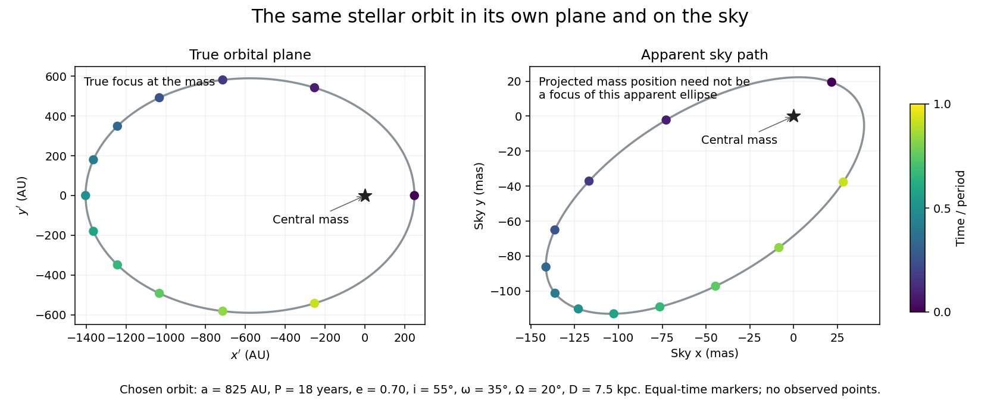
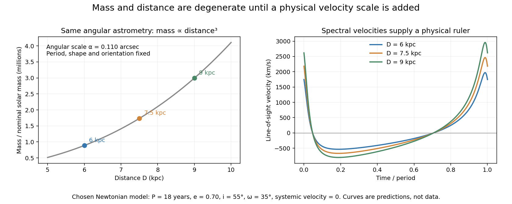

# Astrophysical black hole

↑ **Parent:** [Astrophysics](astrophysics.md)

An astrophysical black hole is a black hole studied through its formation, accretion, mergers, dynamical environment, and electromagnetic or gravitational-wave signatures.

**Table of contents**

- [Black-hole mass measurement](#black-hole-mass-measurement)
- [Binary black hole](#binary-black-hole)
- [Black-hole sphere of influence](#black-hole-sphere-of-influence)
- [Black-hole spin](#black-hole-spin)
  - [Black-hole spin measurement](#black-hole-spin-measurement)
    - [Black-hole reflection spectroscopy](#black-hole-reflection-spectroscopy)
    - [Black-hole continuum fitting](#black-hole-continuum-fitting)
  - [Black-hole spin-up by coherent accretion](#black-hole-spin-up-by-coherent-accretion)
    - [Thorne spin limit](#thorne-spin-limit)
- [Black-hole accretion](#black-hole-accretion)
  - [Quasi-periodic oscillation](#quasi-periodic-oscillation)
  - [Collisionless black-hole capture](#collisionless-black-hole-capture)
  - [Dynamical upper bound on black-hole fuelling](#dynamical-upper-bound-on-black-hole-fuelling)
  - [Inflow time](#inflow-time)
  - [Paczyński-Wiita potential](#paczynski-wiita-potential)
    - [Isothermal transonic accretion in the Paczyński-Wiita potential](#isothermal-transonic-accretion-in-the-paczynski-wiita-potential)
    - [Paczyński-Wiita circular orbit](#paczynski-wiita-circular-orbit)
      - [Paczyński-Wiita ballistic plunge](#paczynski-wiita-ballistic-plunge)
      - [Two-face dissipation of a Paczyński-Wiita disk](#two-face-dissipation-of-a-paczynski-wiita-disk)
  - [Radiative efficiency of black-hole accretion](#radiative-efficiency-of-black-hole-accretion)
    - [Maximal radiative efficiency of black-hole accretion](#maximal-radiative-efficiency-of-black-hole-accretion)
    - [Innermost stable circular orbit](#innermost-stable-circular-orbit)
      - [Kerr ISCO spin limits](#kerr-isco-spin-limits)
      - [Schwarzschild ISCO orbital frequency](#schwarzschild-isco-orbital-frequency)
      - [Kerr ISCO efficiency limits](#kerr-isco-efficiency-limits)
  - [Bondi accretion](#bondi-accretion)
    - [Bondi radius](#bondi-radius)
      - [Bondi-Hill crossover in a protoplanetary disk](#bondi-hill-crossover-in-a-protoplanetary-disk)
    - [Monatomic Bondi accretion](#monatomic-bondi-accretion)
    - [Relativistic spherical accretion](#relativistic-spherical-accretion)
    - [Bondi–Hoyle accretion](#bondi-hoyle-accretion)
      - [Quadratic accretion in a central Keplerian potential](#quadratic-accretion-in-a-central-keplerian-potential)
        - [Mass-spectrum transport under quadratic accretion](#mass-spectrum-transport-under-quadratic-accretion)
      - [Ballistic streamline focusing by a moving star](#ballistic-streamline-focusing-by-a-moving-star)
        - [Post-shock capture criterion in ballistic accretion](#post-shock-capture-criterion-in-ballistic-accretion)
      - [Bondi--Hoyle--Lyttleton accretion rate](#bondi-hoyle-lyttleton-accretion-rate)
    - [Isothermal Bondi accretion](#isothermal-bondi-accretion)
      - [Inner-boundary selection of isothermal Bondi flow](#inner-boundary-selection-of-isothermal-bondi-flow)
      - [Isothermal Bondi accretion rate](#isothermal-bondi-accretion-rate)
      - [Isothermal Bondi equation](#isothermal-bondi-equation)
        - [Integrated isothermal Bondi flow relation](#integrated-isothermal-bondi-flow-relation)
        - [Bondi sonic point](#bondi-sonic-point)
          - [Critical point of the isothermal Bondi equation](#critical-point-of-the-isothermal-bondi-equation)
    - [Mass accretion rate](#mass-accretion-rate)
      - [Spherical free-fall accretion rate](#spherical-free-fall-accretion-rate)
      - [Transonic accretion in a steep dark-matter cusp](#transonic-accretion-in-a-steep-dark-matter-cusp)
    - [Free-fall speed](#free-fall-speed)
    - [Critical Bondi accretion rate for gamma equals five thirds](#critical-bondi-accretion-rate-for-gamma-equals-five-thirds)
  - [Radiatively inefficient accretion flow](#radiatively-inefficient-accretion-flow)
    - [Advection-dominated accretion flow](#advection-dominated-accretion-flow)
      - [Two-temperature accretion flow](#two-temperature-accretion-flow)
        - [Electron--proton thermal equilibration time](#electron-proton-thermal-equilibration-time)
    - [Slim accretion disk](#slim-accretion-disk)
      - [Photon trapping in an accretion flow](#photon-trapping-in-an-accretion-flow)
        - [Photon-trapping radius](#photon-trapping-radius)
    - [Luminous hot accretion flow](#luminous-hot-accretion-flow)
    - [Accretion-flow advection balance](#accretion-flow-advection-balance)
  - [Eddington ratio](#eddington-ratio)
    - [Eddington accretion rate](#eddington-accretion-rate)
      - [Surface accretion Eddington rate](#surface-accretion-eddington-rate)
    - [Salpeter time](#salpeter-time)
      - [Efficiency upper bound from Eddington-limited growth](#efficiency-upper-bound-from-eddington-limited-growth)
      - [Eddington-limited doubling time](#eddington-limited-doubling-time)
- [Intermediate-mass black hole](#intermediate-mass-black-hole)
- [Supermassive black hole](#supermassive-black-hole)
  - [Sagittarius A\*](#sagittarius-a)
    - [Stellar orbits at the Galactic centre](#stellar-orbits-at-the-galactic-centre)
      - [Galactic-centre point-mass orbit model](#galactic-centre-point-mass-orbit-model)
        - [Sky projection of the Galactic-centre orbit model](#sky-projection-of-the-galactic-centre-orbit-model)
        - [Mass-distance degeneracy of an angular stellar orbit](#mass-distance-degeneracy-of-an-angular-stellar-orbit)
        - [A chosen stellar-orbit mass estimate](#a-chosen-stellar-orbit-mass-estimate)
        - [Projected mass lower bound for a bound point-mass orbit](#projected-mass-lower-bound-for-a-bound-point-mass-orbit)
      - [Galactic-centre stellar-orbit experiments](#galactic-centre-stellar-orbit-experiments)
      - [S2 (star)](#s2-star)
  - [M-sigma relation](#m-sigma-relation)
  - [Black-hole--bulge mass relation](#black-hole-bulge-mass-relation)
  - [Active galactic nucleus](#active-galactic-nucleus)
    - [Reverberation mapping](#reverberation-mapping)
    - [Blazar](#blazar)
      - [TXS 0506+056](#txs-0506-plus-056)
    - [Quasar](#quasar)
      - [Quasar light curve](#quasar-light-curve)
    - [Active-galactic-nucleus feedback](#active-galactic-nucleus-feedback)
      - [Relativistic radio-cavity enthalpy](#relativistic-radio-cavity-enthalpy)
      - [Accretion output relative to galactic binding energy](#accretion-output-relative-to-galactic-binding-energy)
      - [Thermal suppression of black-hole accretion](#thermal-suppression-of-black-hole-accretion)
      - [Active-galactic-nucleus wind bubble](#active-galactic-nucleus-wind-bubble)
        - [Momentum-driven outflow](#momentum-driven-outflow)
          - [Isothermal-galaxy momentum-balance shell threshold](#isothermal-galaxy-momentum-balance-shell-threshold)
        - [Energy-driven outflow](#energy-driven-outflow)
          - [Momentum boost](#momentum-boost)
      - [Dusty radiation-pressure-driven shell](#dusty-radiation-pressure-driven-shell)
        - [Terminal speed of a constant-mass dusty shell](#terminal-speed-of-a-constant-mass-dusty-shell)
        - [Critical luminosity of a dusty shell](#critical-luminosity-of-a-dusty-shell)
        - [Thin-shell momentum equation](#thin-shell-momentum-equation)
        - [Dust transparency radius](#dust-transparency-radius)
  - [Soltan argument](#soltan-argument)
- [Tidal disruption event](#tidal-disruption-event)
  - [Tidal disruption radius](#tidal-disruption-radius)
  - [Hills mass](#hills-mass)
- [Black-hole seed](#black-hole-seed)
  - [Seed-mass bound from Eddington-limited growth](#seed-mass-bound-from-eddington-limited-growth)
  - [Population III remnant black-hole seed](#population-iii-remnant-black-hole-seed)
  - [Runaway stellar-collision black-hole seed](#runaway-stellar-collision-black-hole-seed)
  - [Direct-collapse black-hole seed](#direct-collapse-black-hole-seed)

## Black-hole mass measurement

↑ **Parent:** [Astrophysical black hole](astrophysical-black-hole.md)

An inference of a compact object's gravitating [mass](classical-mechanics.md#mass) from specified tracers and a dynamical or [radiation](physics.md#radiation) model. Resolved stellar or gas orbits, [spectroscopic binary](exoplanet.md#spectroscopic-binary) dynamics, and [reverberation mapping](#reverberation-mapping) supply complementary approaches with different distance, geometry and equilibrium assumptions. A short variability timescale constrains size but is not a unique [mass](classical-mechanics.md#mass) measurement.

## Binary black hole

↑ **Parent:** [Astrophysical black hole](astrophysical-black-hole.md)

A [binary system](celestial-mechanics.md#binary-system) whose two components are [black holes](black-hole.md).

## Black-hole sphere of influence

↑ **Parent:** [Astrophysical black hole](astrophysical-black-hole.md)

The [black-hole sphere of influence](#black-hole-sphere-of-influence) is a characteristic radius where the central [black hole](black-hole.md) appreciably changes surrounding stellar dynamics. Equating its [Newtonian gravitational potential](newton-s-law-of-universal-gravitation.md#newtonian-gravitational-potential) scale $GM_\bullet/r$ to the ambient squared [velocity dispersion](galaxy.md#velocity-dispersion) gives $r_{\rm inf}\simeq GM_\bullet/\sigma^2$. Dynamical mass measurements depend on angular resolution $r_{\rm inf}/D$, tracer brightness, and degeneracies in the orbital distribution, not solely on [black hole](black-hole.md) mass.

## Black-hole spin

↑ **Parent:** [Astrophysical black hole](astrophysical-black-hole.md)

Black-hole spin is the angular momentum of a black hole, commonly expressed by the dimensionless Kerr parameter $a_*=cJ/(GM^2)$. It changes the [innermost stable circular orbit](#innermost-stable-circular-orbit), accretion efficiency, and relativistic frame dragging.

### Black-hole spin measurement

↑ **Parent:** [Black-hole spin](#black-hole-spin)

An inference of black-hole [angular momentum](momentum.md#angular-momentum), usually quoted through $a_*$. Accretion-based techniques use the dependence of the stable inner orbit and relativistic [radiation](physics.md#radiation) transfer on spin in the [Kerr black hole](black-hole.md#kerr-black-hole) model. Disk truncation, inclination, illumination and atmosphere assumptions can imitate a change of spin and must enter the uncertainty model.

#### Black-hole reflection spectroscopy

↑ **Parent:** [Black-hole spin measurement](#black-hole-spin-measurement)

An inference from [radiation](physics.md#radiation) reflected by an irradiated [accretion disc](astrophysical-disk.md#accretion-disk), including iron-line and continuum features. [Doppler effects](wave.md#doppler-effect), [gravitational redshift](general-relativity.md#gravitational-redshift) and ray propagation determine its profile. Associating the innermost reflecting [radius](topology.md#radius) with the [innermost stable circular orbit](#innermost-stable-circular-orbit) can constrain spin, conditional on illumination, ionization, abundance, inclination and disk structure.

#### Black-hole continuum fitting

↑ **Parent:** [Black-hole spin measurement](#black-hole-spin-measurement)

A fit of a thermal accretion-disk spectrum that infers the inner emitting [radius](topology.md#radius) and identifies it with the [innermost stable circular orbit](#innermost-stable-circular-orbit). A relativistic thin-disk model requires independently constrained [mass](classical-mechanics.md#mass), distance and inclination, together with spectral hardening and [absorption](radiometry.md#absorption-electromagnetic-radiation). Use of a suitable disk-dominated state is an essential physical check, not merely a statistical cut.

### Black-hole spin-up by coherent accretion

↑ **Parent:** [Black-hole spin](#black-hole-spin)

Coherent prograde gas accretion increases the [angular momentum](momentum.md#angular-momentum) of a [black hole](black-hole.md). For a zero-torque thin disc, the rest mass $dm_0$ entering from the [innermost stable circular orbit](#innermost-stable-circular-orbit) changes the hole by $dM=E_{\rm ISCO}dm_0$ and $dJ=\ell_{\rm ISCO}dm_0$. Its dimensionless spin obeys $da_*/d\log M=c\ell_{\rm ISCO}/(GME_{\rm ISCO})-2a_*$. Starting from zero spin and neglecting captured radiation, the formal extremal endpoint has $M_f=\sqrt6M_i$ and requires rest-mass supply approximately $1.8464M_i$. Photon capture leads instead to the [Thorne spin limit](#thorne-spin-limit).

#### Thorne spin limit

↑ **Parent:** [Black-hole spin-up by coherent accretion](#black-hole-spin-up-by-coherent-accretion)

The Thorne spin limit is the equilibrium spin produced by competition between coherent thin-disc matter accretion and capture of disc photons by a [Kerr black hole](black-hole.md#kerr-black-hole). Preferential capture of counterrotating photon angular momentum prevents the standard radiatively efficient model from reaching $a_*=1$. The commonly quoted limit is approximately $0.998$, with some dependence on emission and accretion assumptions. [Thorne's original calculation](https://articles.adsabs.harvard.edu/pdf/1974ApJ...191..507T) derives this result.

## Black-hole accretion

↑ **Parent:** [Astrophysical black hole](astrophysical-black-hole.md)  
ⓦ [Wiki](https://en.wikipedia.org/wiki/Black-hole_accretion)

Black-hole accretion converts gravitational binding energy of inflowing matter into heat, radiation, outflows, and growth of the black hole.

### Quasi-periodic oscillation

↑ **Parent:** [Black-hole accretion](#black-hole-accretion)

An oscillatory feature with finite width in a source's variability [power spectrum](probability-and-statistics.md#power-spectrum), rather than a perfectly periodic clock. Orbital, precession and disc-mode interpretations connect different [frequencies](wave.md#frequency) to the same compact object. Identifying an observed peak with an [innermost stable circular orbit](#innermost-stable-circular-orbit) orbital [frequency](wave.md#frequency) is therefore a model assumption, not a direct black-hole [mass](classical-mechanics.md#mass) or spin measurement.

### Collisionless black-hole capture

↑ **Parent:** [Black-hole accretion](#black-hole-accretion)

Collisionless matter approaching a [black hole](black-hole.md) generally cannot dissipate enough orbital energy to remain bound, so direct capture requires sufficiently small [angular momentum](momentum.md#angular-momentum). For nonrelativistic incident speed $v$, a [Schwarzschild black hole](schwarzschild-spacetime.md) has direct test-particle capture cross-section approximately $16\pi G^2M^2/(c^2v^2)$. A Newtonian pericentre estimate using the [Schwarzschild radius](schwarzschild-spacetime.md#schwarzschild-radius) instead gives $4\pi G^2M^2/(c^2v^2)$. Both show that capture at a given mass density is suppressed by order $(v/c)^2$ relative to supersonic [Bondi--Hoyle--Lyttleton accretion](#bondi-hoyle-accretion). [Tidal disruption events](#tidal-disruption-event) provide a distinct way to accrete some stellar debris.

### Dynamical upper bound on black-hole fuelling

↑ **Parent:** [Black-hole accretion](#black-hole-accretion)

For a [singular isothermal sphere](galaxy.md#singular-isothermal-sphere) of dispersion $\sigma$ and gas fraction $f_g$, placing all gas inside radius $R$ onto a hole in time $R/\sigma$ gives $\dot M_{\rm dyn}\sim2f_g\sigma^3/G$. This is an optimistic supply bound that omits [angular momentum](momentum.md#angular-momentum) transport, [star formation](stellar-astrophysics.md#star-formation), and [active-galactic-nucleus feedback](#active-galactic-nucleus-feedback). A numerical comparison with the [Eddington accretion rate](#eddington-accretion-rate) requires a gas fraction, reference radiative efficiency, opacity, and crossing-time convention.

### Inflow time

↑ **Parent:** [Black-hole accretion](#black-hole-accretion)

The inflow time is the characteristic time for accreting matter to move radially by its current radius, $t_{\rm in}\sim R/|u_R|$.

<h3 id="paczynski-wiita-potential">Paczyński-Wiita potential</h3>

↑ **Parent:** [Black-hole accretion](#black-hole-accretion)  
ⓦ [Wiki](https://en.wikipedia.org/wiki/Paczyński-Wiita_potential)

The Paczyński-Wiita potential is a Newtonian pseudo-potential that reproduces the Schwarzschild innermost stable circular orbit at $r=3r_S$.

<h4 id="isothermal-transonic-accretion-in-the-paczynski-wiita-potential">Isothermal transonic accretion in the Paczyński-Wiita potential</h4>

↑ **Parent:** [Paczyński-Wiita potential](#paczynski-wiita-potential)

For $\beta=16c_s^2/c^2$, the exterior [sonic point](compressible-flow.md#sonic-point) of the [barotropic spherical accretion equation](fluid-mechanics.md#barotropic-spherical-accretion-equation) lies outside $r_G=2GM/c^2$. Its [mass density](fluid-mechanics.md#density) is $\rho_c=\rho_\infty\exp[4/(1+\sqrt{1+\beta})-1/2]$. The selected smooth transonic accretion rate is $4\pi r_c^2\rho_cc_s$. Subsonic formal solutions are not assigned this rate without transonic selection.

<h4 id="paczynski-wiita-circular-orbit">Paczyński-Wiita circular orbit</h4>

↑ **Parent:** [Paczyński-Wiita potential](#paczynski-wiita-potential)

Let $r_S=2GM/c^2$. In the [Paczyński-Wiita potential](#paczynski-wiita-potential), [circular orbit](classical-mechanics.md#circular-orbit) balance and the [radial epicyclic frequency](astrophysical-disk.md#radial-epicyclic-frequency) formula give

$$
\Omega^2=\frac{GM}{r(r-r_S)^2},\quad
h=\frac{\sqrt{GM}\,r^{3/2}}{r-r_S},\quad
\kappa_r^2=\frac{GM(r-3r_S)}{r(r-r_S)^3}.
$$

Thus the [innermost stable circular orbit](#innermost-stable-circular-orbit) lies at $r=3r_S$. Its [specific orbital energy](celestial-mechanics.md#specific-orbital-energy) is $-c^2/16$, giving a zero-torque [radiative efficiency of black-hole accretion](#radiative-efficiency-of-black-hole-accretion) of $1/16$. The model reproduces the Schwarzschild inner orbit exactly but approximates its relativistic energy and frequency. [Abramowicz's derivation](https://arxiv.org/abs/0904.0913) explains the potential's relation to the Schwarzschild effective potential.

<h5 id="paczynski-wiita-ballistic-plunge">Paczyński-Wiita ballistic plunge</h5>

↑ **Parent:** [Paczyński-Wiita circular orbit](#paczynski-wiita-circular-orbit)

The limiting inward departure from the marginal [Paczyński-Wiita circular orbit](#paczynski-wiita-circular-orbit) at $r=3a$ conserves the displayed [specific angular momentum](celestial-mechanics.md#specific-angular-momentum) and [specific orbital energy](celestial-mechanics.md#specific-orbital-energy). In the [Paczyński-Wiita potential](#paczynski-wiita-potential), its inward speed satisfies $v_r^2=GM(3a-r)^3/[4ar^2(r-a)]$. The exactly marginal circular orbit does not depart without a perturbation; the formula describes the separatrix limit of inward releases.

<h5 id="two-face-dissipation-of-a-paczynski-wiita-disk">Two-face dissipation of a Paczyński-Wiita disk</h5>

↑ **Parent:** [Paczyński-Wiita circular orbit](#paczynski-wiita-circular-orbit)

For a [steady accretion disk with arbitrary rotation law](astrophysical-disk.md#steady-accretion-disk-with-arbitrary-rotation-law) and a [zero-torque inner boundary condition](astrophysical-disk.md#zero-torque-inner-boundary-condition) at $R=3R_S$, the outward [viscous torque in an accretion disk](astrophysical-disk.md#viscous-torque-in-an-accretion-disk) is $\mathcal G=\dot M(j-j_{\mathrm{in}})$. The dissipation per unit planar area summed over both disk faces is $D=-\mathcal G\Omega'/(2\pi R)=\nu\Sigma(R\Omega')^2$. Integrating $2\pi R D$ gives $L=\dot M GM/(8R_S)=\dot M c^2/16$ in the [Paczyński-Wiita potential](#paczynski-wiita-potential). The radiative flux from one face is $D/2$, preventing a factor-of-two error in the luminosity.

### Radiative efficiency of black-hole accretion

↑ **Parent:** [Black-hole accretion](#black-hole-accretion)

The radiative efficiency is $\eta=L/(\dot M c^2)$. For a zero-torque thin disk it is $1-E_{\rm ISCO}$, the binding energy per unit rest mass released before matter crosses the innermost stable circular orbit.

#### Maximal radiative efficiency of black-hole accretion

↑ **Parent:** [Radiative efficiency of black-hole accretion](#radiative-efficiency-of-black-hole-accretion)

The maximal radiative efficiency is the available binding energy per unit accreted rest-mass energy when all energy released outside the capture boundary escapes as radiation. A relativistic zero-torque disk has $\eta_{\max}=1-E_{\rm ISCO}$.

#### Innermost stable circular orbit

↑ **Parent:** [Radiative efficiency of black-hole accretion](#radiative-efficiency-of-black-hole-accretion)  
ⓦ [Wiki](https://en.wikipedia.org/wiki/Innermost_stable_circular_orbit)

The innermost stable circular orbit is the smallest stable circular timelike orbit around a black hole. Its radius and orbital energy depend on black-hole spin and on whether the orbit is prograde or retrograde.

##### Kerr ISCO spin limits

↑ **Parent:** [Innermost stable circular orbit](#innermost-stable-circular-orbit)

For equatorial test-particle circular orbits in the extremal-spin limit, the prograde [Kerr black hole](black-hole.md#kerr-black-hole) [innermost stable circular orbit](#innermost-stable-circular-orbit) has Boyer-Lindquist radius tending to $GM/c^2$ and specific [energy](energy.md) tending to $1/\sqrt3$. The retrograde limit has radius $9GM/c^2$ and specific [energy](energy.md) $5/(3\sqrt3)$. The prograde radius approaching the horizon coordinate does not make the massive limiting orbit identical to the null horizon generator.[§II, Eqs. 2.20–2.23, pp. 351–353](physics-bibliography.md#rotating-black-holes-locally-nonrotating-frames-energy-extraction-and-scalar-synchrotron-radiation-by-james-m-bardeen-and-others)

##### Schwarzschild ISCO orbital frequency

↑ **Parent:** [Innermost stable circular orbit](#innermost-stable-circular-orbit)

The Schwarzschild coordinate rotation [frequency](wave.md#frequency) at the marginally stable circular orbit, measured per unit time of a stationary clock at infinity. It scales inversely with black-hole [mass](classical-mechanics.md#mass). A finite-radius static clock adds a gravitational time-dilation factor; a quasi-periodic brightness signal need not directly equal this orbital [frequency](wave.md#frequency).

##### Kerr ISCO efficiency limits

↑ **Parent:** [Innermost stable circular orbit](#innermost-stable-circular-orbit)

For ideal zero-torque equatorial thin discs, efficiency is $1-E_{\rm ISCO}$. The formal extremal retrograde, Schwarzschild and extremal prograde limiting radii are respectively $9,6,1$ in units $GM/c^2$, giving efficiencies $1-\sqrt{25/27}$, $1-\sqrt{8/9}$ and $1-1/\sqrt3$. [Photon](quantum-mechanics.md#photon) capture and non-ideal accretion can change the realized efficiency.

### Bondi accretion

↑ **Parent:** [Black-hole accretion](#black-hole-accretion)  
ⓦ [Wiki](https://en.wikipedia.org/wiki/Bondi_accretion)

Bondi accretion is steady spherical accretion from a uniform gas reservoir onto a compact gravitating object. In its adiabatic form, compression raises internal energy without providing the irreversible shear heating of a radiatively efficient disk.

#### Bondi radius

↑ **Parent:** [Bondi accretion](#bondi-accretion)

The thermal sphere-of-influence scale $r_B=GM/c_s^2$ compares gravitational potential per unit [mass](classical-mechanics.md#mass) with the ambient [gas](thermodynamics.md#gas) sound-speed squared. A convention based on escape speed instead introduces a factor of two. The scale is not a capture cross-section or an accretion rate without a flow and dissipation model.

##### Bondi-Hill crossover in a protoplanetary disk

↑ **Parent:** [Bondi radius](#bondi-radius)

With [planet](planetary-science.md#planet)-to-[star](stellar-astrophysics.md#star) [mass](classical-mechanics.md#mass) ratio $q$ and [disk aspect ratio](astrophysical-disk.md#disk-aspect-ratio) $h$, $r_B/a=q/h^2$ and $r_H/a=(q/3)^{1/3}$. Equating the two gives $q=h^3/\sqrt3$. The thermally limited [radius](topology.md#radius) grows faster with [planet](planetary-science.md#planet) [mass](classical-mechanics.md#mass) than the tidally limited [radius](topology.md#radius); an envelope outer scale is often the smaller of the two.

#### Monatomic Bondi accretion

↑ **Parent:** [Bondi accretion](#bondi-accretion)

For isentropic spherical accretion with this [adiabatic index](ideal-gas.md#heat-capacity-ratio), define $\lambda=\dot M c_\infty^3/(4\pi G^2M^2\rho_\infty)$ and $x=rc_\infty^2/(GM)$. The steady-flow equation is $\sqrt\lambda[\mathcal M^{3/2}/2+3\mathcal M^{-1/2}/2]=1+3x/2$. The bracket has minimum two at Mach one. Reaching arbitrarily small positive radii therefore requires $\lambda\le1/4$. For smaller rates the outer-rest branch remains subsonic; at the maximal rate it approaches Mach one only as $r\to0$, not at a finite [sonic point](compressible-flow.md#sonic-point). Supersonic outer branches fail the specified resting finite-density condition, and larger rates terminate at a positive minimum radius. An additional inner boundary prescription is needed to select a unique rate among the globally defined subsonic solutions.

#### Relativistic spherical accretion

↑ **Parent:** [Bondi accretion](#bondi-accretion)

Relativistic spherical accretion is steady radial gas inflow in [Schwarzschild spacetime](schwarzschild-spacetime.md), with conserved rest-mass flux and relativistic [Bernoulli function](euler-equations-for-an-inviscid-fluid.md#bernoulli-function). A regular solution passes a finite [sonic point](compressible-flow.md#sonic-point) outside the [event horizon](black-hole.md#event-horizon). For an isentropic gas with $\gamma=5/3$ and cold asymptotic [sound speed](compressible-flow.md#speed-of-sound) $c_\infty\ll c$, the critical radius is approximately $3GM/(4cc_\infty)$ and the leading [mass accretion rate](#mass-accretion-rate) is $\pi G^2M^2\rho_\infty/c_\infty^3$. Relativistic corrections resolve the zero-radius critical point of the Newtonian $\gamma=5/3$ model without eliminating accretion.

<h4 id="bondi-hoyle-accretion">Bondi–Hoyle accretion</h4>

↑ **Parent:** [Bondi accretion](#bondi-accretion)  
ⓦ [Wiki](https://en.wikipedia.org/wiki/Bondi–Hoyle_accretion)

Bondi--Hoyle--Lyttleton accretion is gravitational capture by a compact object moving through a gas. In the pressureless supersonic limit, ballistic streamlines focus into a downstream wake.

##### Quadratic accretion in a central Keplerian potential

↑ **Parent:** [Bondi–Hoyle accretion](#bondi-hoyle-accretion)

In a fixed central [Newtonian gravitational potential](newton-s-law-of-universal-gravitation.md#newtonian-gravitational-potential), pressureless [free fall](newton-s-law-of-universal-gravitation.md#free-fall) has speed $u=aR^{-1/2}$, and randomly moving stars have typical gas-relative speed $V=bR^{-1/2}$. A steady, undepleted spherical [mass flux](mathematical-physics.md#mass-flux) $A$ gives $\rho=A R^{-3/2}/(4\pi a)$. The [Bondi--Hoyle--Lyttleton accretion rate](#bondi-hoyle-lyttleton-accretion-rate) therefore becomes $\dot M=\lambda M^2$ with $\lambda=G^2A/(ab^3)$, independent of radius. Integrating $d(1/M)/dt=-\lambda$ gives the displayed solution before $\lambda M_0t=1$. Its finite-time divergence signals failure of the fixed potential, undepleted gas supply and negligible feedback assumptions; it is not a physically unlimited mass supply.

###### Mass-spectrum transport under quadratic accretion

↑ **Parent:** [Quadratic accretion in a central Keplerian potential](#quadratic-accretion-in-a-central-keplerian-potential)

If stars are neither created nor lost and all follow [quadratic accretion in a central Keplerian potential](#quadratic-accretion-in-a-central-keplerian-potential), conservation of number gives $F(M,t)dM=F_0(M_0)dM_0$. Inverting the trajectory gives $M_0=M/(1+\lambda tM)$ and its [Jacobian determinant](multivariable-calculus.md#jacobian-determinant) is $(1+\lambda tM)^{-2}$. This proves the displayed mass-density-in-mass-space transformation. In a broad high-mass range with $\lambda tM\gg1$, whose inverse images remain in a narrow interval where $F_0$ varies little, the [power law](analysis.md#power-law) is $F\propto M^{-2}$. A strictly monochromatic initial population remains monochromatic. Finite initial support imposes a finite upper cutoff before the earliest formal blow-up, so the power law is an intermediate asymptotic subject to the accretion model's limits.

##### Ballistic streamline focusing by a moving star

↑ **Parent:** [Bondi–Hoyle accretion](#bondi-hoyle-accretion)

In a cold pressureless stream of asymptotic speed $v$, conservation of [specific angular momentum](celestial-mechanics.md#specific-angular-momentum) and the [eccentricity vector](celestial-mechanics.md#eccentricity-vector) makes a streamline at impact parameter $d$ cross the downstream axis at $b=d^2v^2/(2GM)$. Its axial velocity there remains $v$, while opposing transverse velocities collide in a shock.

###### Post-shock capture criterion in ballistic accretion

↑ **Parent:** [Ballistic streamline focusing by a moving star](#ballistic-streamline-focusing-by-a-moving-star)

If transverse [kinetic energy](energy.md#kinetic-energy) is dissipated at the downstream axis, the remaining [specific orbital energy](celestial-mechanics.md#specific-orbital-energy) is $v^2/2-GM/b$. Binding requires $b<2GM/v^2$, corresponding to incident impact parameter $d<2GM/v^2$. Integrating the captured [mass flux](mathematical-physics.md#mass-flux) gives the [Bondi--Hoyle--Lyttleton accretion rate](#bondi-hoyle-lyttleton-accretion-rate).

<h5 id="bondi-hoyle-lyttleton-accretion-rate">Bondi--Hoyle--Lyttleton accretion rate</h5>

↑ **Parent:** [Bondi–Hoyle accretion](#bondi-hoyle-accretion)

In the ballistic supersonic limit, streamline collisions bind gas with impact parameter $b<2GM/v_\infty^2$, giving

$$
\dot M_{\rm BHL}=\frac{4\pi G^2M^2\rho_\infty}{v_\infty^3}.
$$

#### Isothermal Bondi accretion

↑ **Parent:** [Bondi accretion](#bondi-accretion)

Isothermal Bondi accretion has $p=c_s^2\rho$ with constant sound speed. Its regular transonic solution crosses the [Bondi sonic point](#bondi-sonic-point) and approaches free fall near the accretor.

##### Inner-boundary selection of isothermal Bondi flow

↑ **Parent:** [Isothermal Bondi accretion](#isothermal-bondi-accretion)

For steady [Isothermal Bondi accretion](#isothermal-bondi-accretion) from gas at rest at infinity, define $\lambda=\dot M c_s^3/(4\pi G^2M^2\rho_\infty)$, $x=r/r_s$ and $y=u/c_s>0$, where $r_s=GM/(2c_s^2)$. The [Bernoulli function](euler-equations-for-an-inviscid-fluid.md#bernoulli-function) and [mass conservation](continuum-mechanics.md#mass-conservation) give $y^2/2-\ln y=2\ln x+2/x-\ln(4\lambda)$. The left side has minimum $1/2$ at $y=1$, and the radius-dependent part on the right has minimum two at $x=1$. Existence over all positive radii therefore requires the displayed bound. Equality permits the smooth accelerating-inward [transonic branch](compressible-flow.md#transonic-branch) and gives the usual [isothermal Bondi accretion rate](#isothermal-bondi-accretion-rate). Smaller positive rates have an everywhere-subsonic reservoir-connected branch, and zero rate gives a hydrostatic atmosphere. An absorbing inner boundary inside the sonic radius selects the critical inflow; steady isothermal equations and the outer density alone do not specify that inner condition.

##### Isothermal Bondi accretion rate

↑ **Parent:** [Isothermal Bondi accretion](#isothermal-bondi-accretion)

The regular spherical isothermal inflow from [mass density](fluid-mechanics.md#density) $\rho_\infty$ at rest at infinity has sonic [mass density](fluid-mechanics.md#density) $e^{3/2}\rho_\infty$. Combining it with the [Bondi sonic point](#bondi-sonic-point) and [mass conservation](continuum-mechanics.md#mass-conservation) gives $\dot M=\pi e^{3/2}G^2M^2\rho_\infty/c_s^3$.

##### Isothermal Bondi equation

↑ **Parent:** [Isothermal Bondi accretion](#isothermal-bondi-accretion)

For inward speed $u>0$, steady spherical mass conservation and radial momentum balance give

$$
\left(u-\frac{c_s^2}{u}\right)\frac{du}{dr}
=\frac{2c_s^2}{r}-\frac{GM}{r^2}.
$$

###### Integrated isothermal Bondi flow relation

↑ **Parent:** [Isothermal Bondi equation](#isothermal-bondi-equation)

With $x=r/r_s$ and $\mathcal M=|u_r|/c_s$, the radial isothermal equation integrates to $\mathcal M^2/2-\ln\mathcal M=2/x+2\ln x+C$. A regular [transonic branch](compressible-flow.md#transonic-branch) has $C=-3/2$, and the reservoir-fed accretion branch crosses $(x,\mathcal M)=(1,1)$ with slope $-1$.

###### Bondi sonic point

↑ **Parent:** [Isothermal Bondi equation](#isothermal-bondi-equation)

The isothermal Bondi sonic point is $r_s=GM/(2c_s^2)$, where the regular transonic solution has $u=c_s$.

###### Critical point of the isothermal Bondi equation

↑ **Parent:** [Bondi sonic point](#bondi-sonic-point)

At the critical point, both the coefficient of $du/dr$ and the remaining right-hand side of the [Isothermal Bondi equation](#isothermal-bondi-equation) vanish, allowing a finite derivative through the sonic transition.

#### Mass accretion rate

↑ **Parent:** [Bondi accretion](#bondi-accretion)

The mass accretion rate is the mass entering an accretor per unit time. In a steady spherical flow, $\dot M=4\pi r^2\rho u$ is independent of radius.

##### Spherical free-fall accretion rate

↑ **Parent:** [Mass accretion rate](#mass-accretion-rate)

A steady full-sphere radial inflow has mass flux $\dot M=4\pi r^2\rho|v_r|$ by [conservation of mass](continuum-mechanics.md#mass-conservation). With Newtonian [free-fall speed](#free-fall-speed) from rest at infinity, $|v_r|=\sqrt{2GM/r}$, this becomes the displayed expression. The assumed velocity then requires $\rho\propto r^{-3/2}$ along the steady flow. A local density and speed do not determine the total [mass accretion rate](#mass-accretion-rate) of a general nonspherical inflow, and this estimate does not impose the sonic boundary condition of [Bondi accretion](#bondi-accretion).

##### Transonic accretion in a steep dark-matter cusp

↑ **Parent:** [Mass accretion rate](#mass-accretion-rate)

For a background gravitating density $\rho_{\rm dm}=\Psi_0r^{-5/2}$, the potential is $\Phi=-16\pi G\Psi_0r^{-1/2}$. A steady polytropic inflow has a regular sonic point only for $1<\gamma<9/7$, and its accretion rate scales as $\dot M\propto\rho_0G^4\Psi_0^4c_0^{-7}$.

#### Free-fall speed

↑ **Parent:** [Bondi accretion](#bondi-accretion)

The Newtonian free-fall speed from rest at infinity toward a point mass is $v_{\rm ff}=\sqrt{2GM/r}$.

#### Critical Bondi accretion rate for gamma equals five thirds

↑ **Parent:** [Bondi accretion](#bondi-accretion)

For an adiabatic gas with $\gamma=5/3$, asymptotic density $\rho_0$, and sound speed $v_{s0}$ accreting onto a Newtonian point mass $M$, the largest globally subsonic steady rate is

$$
\dot M_{\rm crit}=\frac{\pi\rho_0(GM)^2}{v_{s0}^3}.
$$

### Radiatively inefficient accretion flow

↑ **Parent:** [Black-hole accretion](#black-hole-accretion)

A radiatively inefficient accretion flow carries a substantial fraction of locally generated energy with the gas instead of radiating it before accretion. It can occur at low density because emission is weak or at high optical depth because photons are trapped.

#### Advection-dominated accretion flow

↑ **Parent:** [Radiatively inefficient accretion flow](#radiatively-inefficient-accretion-flow)  
ⓦ [Wiki](https://en.wikipedia.org/wiki/Advection-dominated_accretion_flow)

An advection-dominated accretion flow is a hot, geometrically thick, radiatively inefficient flow in which most dissipated energy remains in the gas and is carried inward rather than radiated locally.

##### Two-temperature accretion flow

↑ **Parent:** [Advection-dominated accretion flow](#advection-dominated-accretion-flow)

A two-temperature accretion flow has ions and electrons at substantially different temperatures because their Coulomb equilibration time exceeds the inflow time. Ions can retain most viscous heat while electrons, which radiate more effectively, remain cooler.

<h6 id="electron-proton-thermal-equilibration-time">Electron--proton thermal equilibration time</h6>

↑ **Parent:** [Two-temperature accretion flow](#two-temperature-accretion-flow)

The electron--proton thermal equilibration time is the timescale on which Coulomb collisions exchange energy between electron and proton populations. Its inverse dependence on number density helps make dilute accretion flows two-temperature and radiatively inefficient.

#### Slim accretion disk

↑ **Parent:** [Radiatively inefficient accretion flow](#radiatively-inefficient-accretion-flow)

A slim accretion disk is an optically thick, moderately geometrically thick flow at a high accretion rate. Its inflow time can be shorter than its photon-diffusion time, so radial advection carries trapped radiation inward.

A slim [accretion disk](astrophysical-disk.md#accretion-disk) is optically thick and retains an important inward advective heat flux. It is distinct from the optically thin version of a [radiatively inefficient accretion flow](#radiatively-inefficient-accretion-flow).

##### Photon trapping in an accretion flow

↑ **Parent:** [Slim accretion disk](#slim-accretion-disk)

Photon trapping occurs when the radiative diffusion time across an optically thick flow exceeds its inward advection time. The trapped radiation is carried inward, reducing the emergent radiative efficiency.

###### Photon-trapping radius

↑ **Parent:** [Photon trapping in an accretion flow](#photon-trapping-in-an-accretion-flow)

The photon-trapping radius is where the outward [radiative diffusion](astrophysics.md#radiative-diffusion) time equals the inward [inflow time](#inflow-time). Radiation generated inside it is predominantly advected toward the accretor.

#### Luminous hot accretion flow

↑ **Parent:** [Radiatively inefficient accretion flow](#radiatively-inefficient-accretion-flow)

A luminous hot accretion flow has radiative cooling greater than local viscous heating, so compressive inward advection supplies the difference. In the convention $q_{\rm adv}=q^+-q^-$, it has $q_{\rm adv}<0$.

#### Accretion-flow advection balance

↑ **Parent:** [Radiatively inefficient accretion flow](#radiatively-inefficient-accretion-flow)

The accretion-flow advection balance compares local volumetric heating $q^+$, radiative cooling $q^-$, and energy transport with the gas. Positive $q_{\rm adv}$ means advection removes locally generated heat; zero gives local radiative balance; negative means advection supplies heat that is radiated locally.

### Eddington ratio

↑ **Parent:** [Black-hole accretion](#black-hole-accretion)  
ⓦ [Wiki](https://en.wikipedia.org/wiki/Eddington_ratio)

The Eddington ratio is the luminosity divided by the Eddington luminosity. At fixed radiative efficiency it also measures the accretion rate relative to the Eddington rate.

#### Eddington accretion rate

↑ **Parent:** [Eddington ratio](#eddington-ratio)

An Eddington accretion rate converts the [Eddington luminosity](stellar-structure.md#eddington-luminosity) into a mass supply rate using an adopted reference efficiency $\eta_0$: $\dot M_{\rm Edd}=L_{\rm Edd}/(\eta_0c^2)$. The common choice $\eta_0=0.1$ gives $\dot M_{\rm Edd}=10L_{\rm Edd}/c^2$.

##### Surface accretion Eddington rate

↑ **Parent:** [Eddington accretion rate](#eddington-accretion-rate)

For radiatively efficient release of Newtonian surface binding [energy](energy.md), $L\sim GM\dot M/R_*$ and $L_E=4\pi GMc/\kappa$ imply the displayed rate. Its efficiency is $\eta\sim GM/(R_*c^2)$, so at fixed [opacity](stellar-structure.md#opacity) the maximum rate scales with [stellar radius](stellar-astrophysics.md#stellar-radius). This differs from defining an Eddington supply rate with an arbitrarily fixed reference efficiency. Geometry, advection and [mass loss](stellar-astrophysics.md#mass-loss-astrophysics) can modify the simple limit.

#### Salpeter time

↑ **Parent:** [Eddington ratio](#eddington-ratio)  
ⓦ [Wiki](https://en.wikipedia.org/wiki/Salpeter_time)

The Salpeter time is the e-folding time for Eddington-limited black-hole growth. If $t_E=\sigma_Tc/(4\pi Gm_p)$, then $t_{\rm Sal}=\eta t_E/[(1-\eta)f_{\rm Edd}]$.

##### Efficiency upper bound from Eddington-limited growth

↑ **Parent:** [Salpeter time](#salpeter-time)

For fixed efficiency, growth from $M_i$ to $M_f$ within $\Delta t$ at no more than the [Eddington luminosity](stellar-structure.md#eddington-luminosity) requires $[\eta/(1-\eta)]t_E\log(M_f/M_i)\leq\Delta t$. Solving gives an upper bound, because greater radiative efficiency reduces retained [mass](classical-mechanics.md#mass) growth at a fixed [luminosity](astrophysics.md#luminosity). A duty cycle below unity tightens the requirement; mergers and super-Eddington episodes invalidate its stated premises.

##### Eddington-limited doubling time

↑ **Parent:** [Salpeter time](#salpeter-time)

At constant [radiative efficiency of black-hole accretion](#radiative-efficiency-of-black-hole-accretion) $\eta$ and the [Eddington luminosity](stellar-structure.md#eddington-luminosity), a [black hole](black-hole.md) grows exponentially with the [Salpeter time](#salpeter-time) $t_S=\eta t_E/(1-\eta)$, where $t_E=\sigma_Tc/(4\pi Gm_p)$. Its doubling time is $t_S\log2$. The factor $1-\eta$ accounts for the supplied [rest energy](special-relativity.md#rest-energy) that escapes as [radiation](physics.md#radiation) instead of increasing the hole's [mass](classical-mechanics.md#mass).

## Intermediate-mass black hole

↑ **Parent:** [Astrophysical black hole](astrophysical-black-hole.md)  
ⓦ [Wiki](https://en.wikipedia.org/wiki/Intermediate-mass_black_hole)

An intermediate-mass black hole has a mass between stellar remnants and supermassive black holes, approximately $10^2$--$10^5M_\odot$.

## Supermassive black hole

↑ **Parent:** [Astrophysical black hole](astrophysical-black-hole.md)  
ⓦ [Wiki](https://en.wikipedia.org/wiki/Supermassive_black_hole)

A supermassive black hole has a mass of roughly $10^6M_\odot$ or more and commonly occupies the nucleus of a massive galaxy.

### Sagittarius A\*

↑ **Parent:** [Supermassive black hole](#supermassive-black-hole)  
ⓦ [Wiki](https://en.wikipedia.org/wiki/Sagittarius_A*)

[Sagittarius A\*](#sagittarius-a) is the compact radio source at the centre of the [Milky Way](galaxy.md#milky-way). Nearby [infrared](optics.md#infrared) [stars](stellar-astrophysics.md#star) allow its central mass concentration to be studied through their [orbits](dynamical-systems.md#orbit-dynamical-system).[PDF pp.2–3, radio/infrared registration and stellar orbits](physics-bibliography.md#closest-star-seen-orbiting-the-supermassive-black-hole-at-the-centre-of-the-milky-way-by-rainer-schodel-and-others)

#### Stellar orbits at the Galactic centre

↑ **Parent:** [Sagittarius A\*](#sagittarius-a)

The useful idea is to weigh an unseen object through its effect on a visible tracer. A curved [stellar orbit](celestial-mechanics.md#stellar-orbit) carries more information than a single fast-moving [star](stellar-astrophysics.md#star): its changing position and [velocity](classical-mechanics.md#velocity) constrain a common centre, a length scale and a clock. The [Galactic-centre stellar-orbit experiments](#galactic-centre-stellar-orbit-experiments) combine [astrometry](astronomy.md#astrometry) with [Doppler spectroscopy](exoplanet.md#doppler-spectroscopy); the [Galactic-centre point-mass orbit model](#galactic-centre-point-mass-orbit-model) below shows how the two measurements complement one another.

##### Galactic-centre point-mass orbit model

↑ **Parent:** [Stellar orbits at the Galactic centre](#stellar-orbits-at-the-galactic-centre)

Consider a negligible-[mass](classical-mechanics.md#mass) [star](stellar-astrophysics.md#star) moving in the stationary [Newtonian gravitational potential](newton-s-law-of-universal-gravitation.md#newtonian-gravitational-potential) of a point mass. Let its [semi-major axis](celestial-mechanics.md#semi-major-axis) be $a$, [orbital eccentricity](celestial-mechanics.md#orbital-eccentricity) $0\le e<1$, and [orbital period](celestial-mechanics.md#orbital-period) $P$. Write $\mu=GM$ for the [gravitational parameter](newton-s-law-of-universal-gravitation.md#standard-gravitational-parameter). The [eccentric anomaly](celestial-mechanics.md#eccentric-anomaly) $E$ is determined by [Kepler's equation](celestial-mechanics.md#kepler-s-equation),

$$
E-e\sin E=\frac{2\pi(t-\tau)}P,
$$

where $\tau$ is the time of [periapsis](celestial-mechanics.md#periapsis). Coordinates in the orbital plane, with the point mass at the origin, are

$$
\mathbf r'(E)=a\begin{pmatrix}\cos E-e\\\sqrt{1-e^2}\sin E\\0\end{pmatrix},\qquad
\dot{\mathbf r}'(E)=\frac{2\pi a}{P(1-e\cos E)}\begin{pmatrix}-\sin E\\\sqrt{1-e^2}\cos E\\0\end{pmatrix}.
$$

The focus is the central mass; the ellipse's geometric centre is displaced by $-ae$ along the first coordinate. The varying denominator makes the [star](stellar-astrophysics.md#star) move faster near [periapsis](celestial-mechanics.md#periapsis), even though the [mean anomaly](celestial-mechanics.md#mean-anomaly) increases uniformly.

###### Sky projection of the Galactic-centre orbit model

↑ **Parent:** [Galactic-centre point-mass orbit model](#galactic-centre-point-mass-orbit-model)

Let $z$ increase away from the observer, with $x,y$ spanning the sky plane. A rotation $R=R_z(\Omega)R_x(i)R_z(\omega)$ sends the orbital-plane coordinates to $\mathbf r=R\mathbf r'$. Here $i$ is [orbital inclination](celestial-mechanics.md#orbital-inclination), $\Omega$ the [longitude of ascending node](celestial-mechanics.md#longitude-of-ascending-node), and $\omega$ the [argument of periapsis](celestial-mechanics.md#argument-of-periapsis). For distance $D\gg a$, the small-angle model gives [angular positions](geometry-and-topology.md#angular-position) $\theta_x=x/D$, $\theta_y=y/D$ in [radians](geometry-and-topology.md#radian). [Doppler spectroscopy](exoplanet.md#doppler-spectroscopy) instead supplies the line-of-sight [velocity](classical-mechanics.md#velocity) $v_{\rm los}=\dot z+v_{\rm sys}$, with a fitted systemic offset $v_{\rm sys}$.

Define $\alpha=a/D$, the angular scale of the **deprojected** fitted [orbit](dynamical-systems.md#orbit-dynamical-system). It is not generally the semi-major axis of the apparent ellipse on the sky. Projection also need not send a true focus to a focus of the apparent ellipse. Fitting the rotated orbit preserves that distinction; measuring a bounding ellipse alone loses it.

**[Figure 1](#image-a-true-stellar-orbit-and-its-apparent-path-on-the-sky). A true stellar orbit and its apparent path on the sky**. [Source](galactic-centre-stellar-orbit-projection.py). Original Newtonian orbit with chosen $a=825\,\mathrm{AU}$, $P=18$ years, $e=0.70$, $i=55$ degrees, $\omega=35$ degrees and $\Omega=20$ degrees, viewed from $D=7.5\,\mathrm{kpc}$. Markers are equally spaced in model time. This is not a reconstruction of S2 or historical astrometry.

###### Mass-distance degeneracy of an angular stellar orbit

↑ **Parent:** [Galactic-centre point-mass orbit model](#galactic-centre-point-mass-orbit-model)

Angular [astrometry](astronomy.md#astrometry) determines the combination displayed by substituting $a=D\alpha$ into [Kepler's third law](mathematical-physics.md#kepler-s-third-law). Keeping the fitted shape, orientation and [orbital period](celestial-mechanics.md#orbital-period) fixed, the rescaling

$$
D\mapsto\lambda D,\qquad a\mapsto\lambda a,\qquad \mu\mapsto\lambda^3\mu
$$

leaves the entire angular time series unchanged. A longer physical orbit around a larger mass can trace precisely the same angular path. More angular samples improve the fitted combination; by themselves they cannot break this scaling symmetry of the model.

The [radial-velocity semi-amplitude](celestial-mechanics.md#radial-velocity-semi-amplitude) is

$$
K=\frac{2\pi a\sin i}{P\sqrt{1-e^2}}.
$$

For $\sin i\ne0$, combining it with the angular fit gives the [orbital parallax](astronomy.md#orbital-parallax) distance

$$
D=\frac{KP\sqrt{1-e^2}}{2\pi\alpha\sin i}.
$$

The spectral [velocity](classical-mechanics.md#velocity) scale supplies the missing physical ruler. For a face-on orbit, $\sin i=0$, this radial signal vanishes and that method cannot supply a distance. In a partial or noisy data set, fitted orientation and systemic motion also correlate with the inferred scale.

**[Figure 2](#image-identical-angular-orbits-can-have-different-spectral-velocity-amplitudes). Identical angular orbits can have different spectral velocity amplitudes**. [Source](stellar-orbit-mass-distance-degeneracy.py). Original chosen-model family with fixed angular scale, period, eccentricity and orientation. Changing distance changes inferred mass cubically and the line-of-sight velocity amplitude linearly. The coloured velocity curves are predictions, not measured spectra or historical data.

###### A chosen stellar-orbit mass estimate

↑ **Parent:** [Galactic-centre point-mass orbit model](#galactic-centre-point-mass-orbit-model)

Choose $D=7.5\,\mathrm{kpc}$, $\alpha=0.110$ [arcseconds](geometry-and-topology.md#arcsecond), $P=18$ years, $e=0.70$ and $i=55$ degrees. The small-angle conversion gives **$a=825\,\mathrm{AU}$**. Taking one model year as $365.25$ [days](physics.md#day) gives $\mu\simeq2.30\times10^{26}\,\mathrm{m^3s^{-2}}$ and $K\simeq1566\,\mathrm{km/s}$.

Dividing by the [nominal solar mass parameter](stellar-astrophysics.md#nominal-solar-mass-parameter), $(GM)_\odot^{\rm N}=1.3271244\times10^{20}\,\mathrm{m^3s^{-2}}$, gives **$1.73\times10^6$ nominal solar masses**. The nominal parameter is an exact conversion convention, rather than an assertion that the [Sun](stellar-astrophysics.md#sun)'s measured [mass](classical-mechanics.md#mass) is exact.[PDF pp.2–3, exact nominal solar mass parameter and conversion recommendation](physics-bibliography.md#resolution-b3-on-recommended-nominal-conversion-constants-for-selected-solar-and-planetary-properties-by-international-astronomical-union)

The chosen [periapsis](celestial-mechanics.md#periapsis) radius is $r_p=a(1-e)=247.5\,\mathrm{AU}$. Its corresponding [Schwarzschild radius](schwarzschild-spacetime.md#schwarzschild-radius), $r_s=2\mu/c^2$, is about $0.0342\,\mathrm{AU}$. Thus this illustrative orbit remains roughly $7200$ Schwarzschild radii from the centre at closest approach. Inferring a very concentrated mass from such an orbit is different from directly resolving its [event horizon](black-hole.md#event-horizon). Every number here follows from the chosen orbit, not from a fit to the actual Galactic-centre measurements.

###### Projected mass lower bound for a bound point-mass orbit

↑ **Parent:** [Galactic-centre point-mass orbit model](#galactic-centre-point-mass-orbit-model)

For a bound [Kepler orbit](celestial-mechanics.md#kepler-orbit), specific [orbital energy](celestial-mechanics.md#orbital-energy) $v^2/2-\mu/r$ is negative. Therefore $\mu>v^2r/2$. A projected separation $R_\perp\le r$ and a systemic-motion-corrected line-of-sight speed $|v_{\rm los}|\le v$ give the displayed lower bound. One position and one spectral [velocity](classical-mechanics.md#velocity) already constrain the mass in this model; a fitted orbit gives much more. The bound assumes a bound orbit in a point-mass potential; it is not an unrestricted enclosed-mass formula for an arbitrary extended potential.

##### Galactic-centre stellar-orbit experiments

↑ **Parent:** [Stellar orbits at the Galactic centre](#stellar-orbits-at-the-galactic-centre)

[Rainer Schödel](astronomy.md#rainer-schodel), [Reinhard Genzel](astronomy.md#reinhard-genzel) and collaborators combined NTT imaging with VLT adaptive-optics [infrared](optics.md#infrared) observations. Silicon-monoxide [masers](maser.md) registered stellar images to the radio position of [Sagittarius A\*](#sagittarius-a). Their 2002 observations included [S2](#s2-star)'s closest approach; a fitted [Kepler orbit](celestial-mechanics.md#kepler-orbit) constrained a concentrated central mass. Rejecting a particular extended cluster also required its density and survival assumptions.[PDF pp.2–5, image registration, fitted orbit and extended-mass tests](physics-bibliography.md#closest-star-seen-orbiting-the-supermassive-black-hole-at-the-centre-of-the-milky-way-by-rainer-schodel-and-others)

[Andrea Ghez](astronomy.md#andrea-m-ghez) and collaborators combined Keck speckle imaging and laser-guide-star [adaptive optics](optical-instrument.md#adaptive-optics) with [infrared](optics.md#infrared) spectra. Image fitting supplied angular positions; spectral lines supplied [velocities](classical-mechanics.md#velocity). The 2008 analysis treated optical distortion, coordinate alignment and blended sources: a shifting photocentre can imitate motion. Joint angular and spectral fitting constrained both distance and mass, with assumptions about central radial motion affecting the result. Apparatus calibration and confusion tests are therefore part of the dynamical inference.[PDF §§2–4 and Appendices A–C: imaging, spectroscopy, source confusion and orbital fit](physics-bibliography.md#measuring-distance-and-properties-of-the-milky-way-s-central-supermassive-black-hole-with-stellar-orbits-by-andrea-m-ghez-and-others)

##### S2 (star)

↑ **Parent:** [Stellar orbits at the Galactic centre](#stellar-orbits-at-the-galactic-centre)  
ⓦ [Wiki](https://en.wikipedia.org/wiki/S2_(star))

A [star](stellar-astrophysics.md#star) used in the [Galactic-centre stellar-orbit experiments](#galactic-centre-stellar-orbit-experiments). The two designations refer to the same object in the SIMBAD catalogue.[Identifiers EG97 S2 and GKM98 S0-2](physics-bibliography.md#s2-in-simbad-by-centre-de-donnees-astronomiques-de-strasbourg)

### M-sigma relation

↑ **Parent:** [Supermassive black hole](#supermassive-black-hole)

The M-sigma relation is an empirical correlation between [supermassive black hole](#supermassive-black-hole) mass and the stellar [velocity dispersion](galaxy.md#velocity-dispersion) of its host's spheroidal component. A commonly used rough parametrization has exponent near four, but the normalization, exponent, scatter, and selection effects depend on the observed sample. It is distinct from the [black-hole--bulge mass relation](#black-hole-bulge-mass-relation).

<h3 id="black-hole-bulge-mass-relation">Black-hole--bulge mass relation</h3>

↑ **Parent:** [Supermassive black hole](#supermassive-black-hole)

The black-hole--bulge mass relation is the empirical correlation between a galaxy's central black-hole mass and the stellar mass of its spheroidal component. Locally, the black hole is typically of order $10^{-3}$--$10^{-2}$ of the bulge mass, with substantial scatter and possible redshift evolution.

### Active galactic nucleus

↑ **Parent:** [Supermassive black hole](#supermassive-black-hole)  
ⓦ [Wiki](https://en.wikipedia.org/wiki/Active_galactic_nucleus)

An active galactic nucleus is a compact luminous galactic nucleus powered primarily by accretion onto a supermassive black hole.

#### Reverberation mapping

↑ **Parent:** [Active galactic nucleus](#active-galactic-nucleus)

Time-dependent inference of an emitting region's response to a variable illuminating continuum. For an active nucleus, a broad-line delay estimates a light-travel scale and a line width estimates a velocity scale. A virial [mass](classical-mechanics.md#mass) estimate then requires a geometrical and kinematic factor $f_{\rm geom}$; the lag alone neither fixes the geometry nor establishes purely gravitational motion.

#### Blazar

↑ **Parent:** [Active galactic nucleus](#active-galactic-nucleus)  
ⓦ [Wiki](https://en.wikipedia.org/wiki/Blazar)

<h5 id="txs-0506-plus-056">TXS 0506+056</h5>

↑ **Parent:** [Blazar](#blazar)  
ⓦ [Wiki](https://en.wikipedia.org/wiki/TXS_0506+056)

#### Quasar

↑ **Parent:** [Active galactic nucleus](#active-galactic-nucleus)  
ⓦ [Wiki](https://en.wikipedia.org/wiki/Quasar)

A quasar is an extremely luminous active galactic nucleus whose compact central emission can be observed across cosmological distances.

##### Quasar light curve

↑ **Parent:** [Quasar](#quasar)

A quasar light curve records its measured brightness as a function of time. Intrinsic accretion variability, measurement noise, and gravitational lensing can all contribute structure.

#### Active-galactic-nucleus feedback

↑ **Parent:** [Active galactic nucleus](#active-galactic-nucleus)  
ⓦ [Wiki](https://en.wikipedia.org/wiki/Active-galactic-nucleus_feedback)

Active-galactic-nucleus feedback transfers radiative or mechanical energy and momentum from black-hole accretion to surrounding galactic gas.

##### Relativistic radio-cavity enthalpy

↑ **Parent:** [Active-galactic-nucleus feedback](#active-galactic-nucleus-feedback)

For an approximately pressure-balanced cavity containing relativistic fluid with $\gamma=4/3$, internal [energy](energy.md) plus displacement work is $4pV$. Dividing by an estimated inflation or buoyancy age gives a mechanical-power diagnostic. Projection, pressure [gradients](multivariable-calculus.md#gradient), the equation of state, age estimates and additional [shock](transport-equation.md#shock-wave) [energy](energy.md) affect the inference; cavity power is not identical to locally dissipated heat.

##### Accretion output relative to galactic binding energy

↑ **Parent:** [Active-galactic-nucleus feedback](#active-galactic-nucleus-feedback)

If a hole gains mass $\Delta M_{\rm BH}$ at constant radiative efficiency $\eta=L/(\dot M_{\rm in}c^2)$, the radiated energy is $\eta\Delta M_{\rm BH}c^2/(1-\eta)$. For negligible seed mass, final hole mass $\alpha M$, and total three-dimensional [galaxy](galaxy.md) dispersion $\sigma$, its ratio to $|W|\simeq M\sigma^2$ is $\eta\alpha(c/\sigma)^2/(1-\eta)$. The net virial unbinding energy is half $|W|$ when surface terms are negligible.

##### Thermal suppression of black-hole accretion

↑ **Parent:** [Active-galactic-nucleus feedback](#active-galactic-nucleus-feedback)

Heating a gas reservoir reduces its [Bondi accretion](#bondi-accretion) rate because $\dot M_B\propto\rho_\infty c_s^{-3}$. At fixed density, increasing the [sound speed](compressible-flow.md#speed-of-sound) by ten reduces the rate by about a thousand and the gravitational capture radius by a hundred. Expansion and density loss can strengthen this negative feedback. Neither the density nor the cold pre-heating accretion rate is determined by the temperature change alone.

##### Active-galactic-nucleus wind bubble

↑ **Parent:** [Active-galactic-nucleus feedback](#active-galactic-nucleus-feedback)

An active-galactic-nucleus wind bubble forms when a fast nuclear wind shocks against galactic gas. From inside outward it contains free wind, a reverse shock, shocked wind, a contact discontinuity, a swept-up shocked shell, a forward shock, and undisturbed interstellar gas.

###### Momentum-driven outflow

↑ **Parent:** [Active-galactic-nucleus wind bubble](#active-galactic-nucleus-wind-bubble)

An outflow is momentum driven when shocked driving material cools rapidly, so it cannot retain enough thermal energy to inflate a pressure-supported bubble. The swept shell then receives approximately the direct wind momentum flux, often of order $L/c$.

###### Isothermal-galaxy momentum-balance shell threshold

↑ **Parent:** [Momentum-driven outflow](#momentum-driven-outflow)

A swept gas shell of fraction $f$ at radius $R$ in a [galaxy](galaxy.md) of one-dimensional dispersion $\sigma$ has mass $2f\sigma^2R/G$. Interior non-gas gravity supplies weight $4f(1-f)\sigma^4/G$. Fully intercepted single-scattering Eddington [momentum](momentum.md) overcomes it when $M_{\rm BH}>f(1-f)\sigma^4\sigma_T/(\pi m_pG^2)$. This neglects shell [self-gravity](newton-s-law-of-universal-gravitation.md#self-gravity), central-hole gravity and stored outward [kinetic energy](energy.md#kinetic-energy); weaker coupling raises the required [luminosity](astrophysics.md#luminosity).

###### Energy-driven outflow

↑ **Parent:** [Active-galactic-nucleus wind bubble](#active-galactic-nucleus-wind-bubble)

An outflow is energy driven when cooling of the shocked wind is slow. Its hot bubble stores mechanical energy and expands by pressure work on the swept-up shell.

###### Momentum boost

↑ **Parent:** [Energy-driven outflow](#energy-driven-outflow)

A momentum boost is a shell momentum flux exceeding the direct input momentum flux. An energy-conserving wind of speed $v_w$ driving a shell of speed $v_s\ll v_w$ can give $\dot p_s/(L/c)$ of order $v_w/(2v_s)$.

##### Dusty radiation-pressure-driven shell

↑ **Parent:** [Active-galactic-nucleus feedback](#active-galactic-nucleus-feedback)

A dusty radiation-pressure-driven shell is swept up when ultraviolet radiation from an active nucleus is absorbed by dust and reradiated in the infrared. Single scattering supplies up to roughly $L/c$ of momentum flux, while trapped infrared photons can enhance it by the infrared optical depth.

###### Terminal speed of a constant-mass dusty shell

↑ **Parent:** [Dusty radiation-pressure-driven shell](#dusty-radiation-pressure-driven-shell)

A fixed-mass shell with ultraviolet opacity $\kappa_{\rm UV}$ has [dust transparency radius](#dust-transparency-radius) $R_{\rm UV}=\sqrt{\kappa_{\rm UV}M_{\rm sh}/(4\pi)}$. For an initially expanding shell driven by constant ultraviolet luminosity, a sharp opaque-to-transparent approximation gives

$$
v_\infty^2=v_0^2+\frac{2GM}{R_0}\left[\Gamma_{\rm ss}(2X-1)+\Gamma_{\rm IR}(1-X^{-1})-1\right],
\qquad X=R_{\rm UV}/R_0.
$$

Here $\Gamma_{\rm ss}=LR_0^2/(GM M_{\rm sh}c)$ is the initial single-scattering force ratio and $\Gamma_{\rm IR}=\kappa_{\rm IR}L/(4\pi GMc)$. The trajectory must actually reach $R_{\rm UV}$. Large initial ultraviolet [optical depth](astrophysics.md#optical-depth) enhances the radiative work at fixed initial single-scattering ratio; the same conclusion does not follow unconditionally at fixed electron-scattering luminosity.

###### Critical luminosity of a dusty shell

↑ **Parent:** [Dusty radiation-pressure-driven shell](#dusty-radiation-pressure-driven-shell)

The critical luminosity of a dusty shell is the luminosity at which radiation pressure balances gravity. For shell mass $M_s$, enclosed gravitating mass $M$, and ultraviolet and infrared optical depths,

$$
L_{\rm crit}=\frac{GcMM_s}{r^2(1+\tau_{\rm IR}-e^{-\tau_{\rm UV}})}.
$$

###### Thin-shell momentum equation

↑ **Parent:** [Dusty radiation-pressure-driven shell](#dusty-radiation-pressure-driven-shell)

For a spherical swept shell of mass $M_s(R)$, radial speed $\dot R$, driving force $F_d$, and enclosed gravitating mass $M(<R)$,

$$
\frac d{dt}[M_s(R)\dot R]=F_d-\frac{GM_s(R)M(<R)}{R^2}.
$$

The derivative includes momentum needed to accelerate newly swept ambient mass.

###### Dust transparency radius

↑ **Parent:** [Dusty radiation-pressure-driven shell](#dusty-radiation-pressure-driven-shell)

The dust transparency radius is where a swept shell's ultraviolet optical depth equals one. For a gas fraction $f_g$ in a singular isothermal sphere, $R_\tau=\kappa_{\rm UV}f_g\sigma^2/(2\pi G)$.

### Soltan argument

↑ **Parent:** [Supermassive black hole](#supermassive-black-hole)  
ⓦ [Wiki](https://en.wikipedia.org/wiki/Soltan_argument)

The Soltan argument compares the cosmological energy density radiated by active galactic nuclei with the present mass density in supermassive black holes. Their ratio constrains the mass-weighted mean radiative efficiency of black-hole growth.

## Tidal disruption event

↑ **Parent:** [Astrophysical black hole](astrophysical-black-hole.md)  
ⓦ [Wiki](https://en.wikipedia.org/wiki/Tidal_disruption_event)

A tidal disruption event occurs when a star passes close enough to a black hole that differential gravity tears it apart outside the capture boundary, producing returning debris and often a luminous flare.

### Tidal disruption radius

↑ **Parent:** [Tidal disruption event](#tidal-disruption-event)

For a star of mass $M_*$ and radius $R_*$ near a black hole of mass $M_{\rm BH}$, the Newtonian tidal disruption radius is $r_t\simeq R_*(2M_{\rm BH}/M_*)^{1/3}$ under a peak-to-center tidal-acceleration convention.

### Hills mass

↑ **Parent:** [Tidal disruption event](#tidal-disruption-event)  
ⓦ [Wiki](https://en.wikipedia.org/wiki/Hills_mass)

The Hills mass is the black-hole mass above which a given star crosses the capture boundary before being tidally disrupted. For a Schwarzschild capture radius $2GM_{\rm BH}/c^2$, it is $c^3R_*^{3/2}/(2G^{3/2}M_*^{1/2})$ with the corresponding tidal-radius convention.

## Black-hole seed

↑ **Parent:** [Astrophysical black hole](astrophysical-black-hole.md)  
ⓦ [Wiki](https://en.wikipedia.org/wiki/Black-hole_seed)

A black-hole seed is an early black hole from which a later massive black hole can grow by accretion and mergers.

### Seed-mass bound from Eddington-limited growth

↑ **Parent:** [Black-hole seed](#black-hole-seed)

For fixed radiative efficiency $\eta$, Eddington-limited [accretion](astrophysics.md#accretion) without mergers gives $M(t)=M_0e^{t/t_{\rm Sal}}$ with $t_{\rm Sal}=\eta\sigma_Tc/[(1-\eta)4\pi Gm_p]$. A specified final mass and growth interval therefore require $M_0\geq M_fe^{-\Delta t/t_{\rm Sal}}$. The retained factor $1-\eta$ distinguishes actual hole growth from rest-mass supply.

### Population III remnant black-hole seed

↑ **Parent:** [Black-hole seed](#black-hole-seed)

A Population III remnant seed forms when a massive metal-free star collapses, typically leaving a light seed of order $10$--$10^2M_\odot$ depending on stellar mass loss and pair-instability effects.

### Runaway stellar-collision black-hole seed

↑ **Parent:** [Black-hole seed](#black-hole-seed)

A runaway stellar-collision seed forms when mass segregation and repeated mergers in a dense young cluster create a very massive star that collapses to a black hole of roughly $10^2$--$10^4M_\odot$.

### Direct-collapse black-hole seed

↑ **Parent:** [Black-hole seed](#black-hole-seed)

A direct-collapse black-hole seed forms when rapidly inflowing primordial gas avoids fragmentation, builds a supermassive star or quasistar, and collapses to a seed of roughly $10^4$--$10^6M_\odot$.

## ↑ Ancestors (4)

1. [Astrophysics](astrophysics.md)
2. [Branches of physics](physics.md#branches-of-physics)
3. [Physics](physics.md)
4. [Codex Wiki](README.md)
