# Astrophysics

↑ **Parent:** [Branches of physics](physics.md#branches-of-physics)  
ⓦ [Wiki](https://en.wikipedia.org/wiki/Astrophysics)

Astrophysics uses [physics](physics.md) to explain [stars](stellar-astrophysics.md#star), [planets](planetary-science.md#planet), [galaxies](galaxy.md), and their [electromagnetic radiation](electromagnetic-radiation.md); [cosmology](cosmology.md) extends the questions to the universe as a whole. Much of its evidence arrives as [light](optics.md#light). The challenge is to infer the source's physical properties from what reaches an observer: a bright [star](stellar-astrophysics.md#star) might be nearby, unusually luminous, or both. [Stellar parallax](#stellar-parallax) and [observed radiative flux](#observed-radiative-flux) make this distinction quantitative.

This is an [inverse problem](inverse-problem.md). A [forward problem](inverse-problem.md#forward-problem) predicts observations from a source model and the intervening [radiative transfer](#radiative-transfer); the [inverse problem](inverse-problem.md) works backwards from observations to possible models. A [spectral line](stellar-astrophysics.md#spectral-line) can constrain [chemical elements](chemical-substance.md#chemical-element), [temperature](temperature.md), and motion through the [Doppler effect](wave.md#doppler-effect), but its strength also depends on the [stellar atmosphere](stellar-astrophysics.md#stellar-atmosphere). Combining different measurements is therefore more informative than interpreting brightness alone. The attraction is that a tiny change in the direction of [light](optics.md#light) can supply a distance, turning received [radiative flux](#radiative-flux) into intrinsic [luminosity](#luminosity). [ESA: Parallax, spectra, and physical properties](https://www.esa.int/Science_Exploration/Space_Science/Gaia/How_does_Gaia_study_the_Milky_Way).

**Table of contents**

- [Astrophysicist](astrophysicist.md)
  - [Hans-Thomas Janka](astrophysicist.md#hans-thomas-janka)
  - [John M. Blondin](astrophysicist.md#john-m-blondin)
  - [Roland Diehl](astrophysicist.md#roland-diehl)
  - [Arindam Mazumdar](astrophysicist.md#arindam-mazumdar)
    - [Work by Arindam Mazumdar](astrophysicist.md#work-by-arindam-mazumdar)
  - [Samuel M. Leach](astrophysicist.md#samuel-m-leach)
    - [Work by Samuel M. Leach](astrophysicist.md#work-by-samuel-m-leach)
  - [Andrew R. Liddle](astrophysicist.md#andrew-r-liddle)
    - [Work by Andrew R. Liddle](astrophysicist.md#work-by-andrew-r-liddle)
  - [Alexei Starobinsky](astrophysicist.md#alexei-starobinsky)
    - [Work by Alexei A. Starobinsky](astrophysicist.md#work-by-alexei-a-starobinsky)
  - [Andrei Linde](astrophysicist.md#andrei-linde)
    - [Work by Andrei Linde](astrophysicist.md#work-by-andrei-linde)
  - [Lev Kofman](astrophysicist.md#lev-kofman)
    - [Work by Lev Kofman](astrophysicist.md#work-by-lev-kofman)
  - [Alan Guth](astrophysicist.md#alan-guth)
    - [Work by Alan H. Guth](astrophysicist.md#work-by-alan-h-guth)
  - [Lijun Gou](astrophysicist.md#lijun-gou)
    - [Work by Lijun Gou](astrophysicist.md#work-by-lijun-gou)
  - [Michiel van der Klis](astrophysicist.md#michiel-van-der-klis)
    - [Work by Michiel van der Klis](astrophysicist.md#work-by-michiel-van-der-klis)
  - [Rudy Wijnands](astrophysicist.md#rudy-wijnands)
    - [Work by Rudy Wijnands](astrophysicist.md#work-by-rudy-wijnands)
  - [Brian Chaboyer](astrophysicist.md#brian-chaboyer)
    - [Work by Brian Chaboyer](astrophysicist.md#work-by-brian-chaboyer)
  - [Lawrence Krauss](astrophysicist.md#lawrence-krauss)
    - [Work by Lawrence M. Krauss](astrophysicist.md#work-by-lawrence-m-krauss)
  - [James Gunn (astronomer)](astrophysicist.md#james-gunn-astronomer)
    - [Work by James Edward Gunn](astrophysicist.md#work-by-james-edward-gunn)
  - [Scott Tremaine](astrophysicist.md#scott-tremaine)
    - [Work by Scott Tremaine](astrophysicist.md#work-by-scott-tremaine)
  - [Jacob Bekenstein](astrophysicist.md#jacob-bekenstein)
    - [Work by Jacob Bekenstein](astrophysicist.md#work-by-jacob-bekenstein)
  - [Mordehai Milgrom](astrophysicist.md#mordehai-milgrom)
    - [Work by Mordehai Milgrom](astrophysicist.md#work-by-mordehai-milgrom)
  - [Daniel Eisenstein](astrophysicist.md#daniel-eisenstein)
    - [Work by Daniel Eisenstein](astrophysicist.md#work-by-daniel-eisenstein)
  - [Douglas Clowe](astrophysicist.md#douglas-clowe)
    - [Work by Douglas Clowe](astrophysicist.md#work-by-douglas-clowe)
  - [Tobias Heinemann](astrophysicist.md#tobias-heinemann)
    - [Work by Tobias Heinemann](astrophysicist.md#work-by-tobias-heinemann)
  - [Chris Hamilton](astrophysicist.md#chris-hamilton)
    - [Work by Chris Hamilton](astrophysicist.md#work-by-chris-hamilton)
  - [Saul Teukolsky](astrophysicist.md#saul-teukolsky)
    - [Work by Saul A. Teukolsky](astrophysicist.md#work-by-saul-a-teukolsky)
  - [William H. Press](astrophysicist.md#william-h-press)
    - [Work by William H. Press](astrophysicist.md#work-by-william-h-press)
  - [James M. Bardeen](astrophysicist.md#james-m-bardeen)
    - [Work by James M. Bardeen](astrophysicist.md#work-by-james-m-bardeen)
  - [Anatoly Spitkovsky](astrophysicist.md#anatoly-spitkovsky)
    - [Work by Anatoly Spitkovsky](astrophysicist.md#work-by-anatoly-spitkovsky)
  - [Jerome A. Orosz](astrophysicist.md#jerome-a-orosz)
    - [Work by Jerome A. Orosz](astrophysicist.md#work-by-jerome-a-orosz)
  - [Sean M. Carroll](astrophysicist.md#sean-m-carroll)
    - [Work by Sean M. Carroll](astrophysicist.md#work-by-sean-m-carroll)
  - [Hartland Snyder](astrophysicist.md#hartland-snyder)
    - [Work by Hartland Snyder](astrophysicist.md#work-by-hartland-snyder)
  - [Gordon I. Ogilvie](astrophysicist.md#gordon-i-ogilvie)
    - [Work by Gordon I. Ogilvie](astrophysicist.md#work-by-gordon-i-ogilvie)
  - [Malvin Ruderman](astrophysicist.md#malvin-ruderman)
    - [Work by Malvin Ruderman](astrophysicist.md#work-by-malvin-ruderman)
  - [Jim Peebles](astrophysicist.md#jim-peebles)
    - [Work by P. James Peebles](astrophysicist.md#work-by-p-james-peebles)
  - [Kip Thorne](astrophysicist.md#kip-thorne)
    - [Work by Kip S. Thorne](astrophysicist.md#work-by-kip-s-thorne)
  - [Barry Barish](astrophysicist.md#barry-barish)
    - [Work by Barry C. Barish](astrophysicist.md#work-by-barry-c-barish)
  - [Rainer Weiss](astrophysicist.md#rainer-weiss)
    - [Work by Rainer Weiss](astrophysicist.md#work-by-rainer-weiss)
  - [George Smoot](astrophysicist.md#george-smoot)
    - [Work by George F. Smoot](astrophysicist.md#work-by-george-f-smoot)
  - [Manoj Kaplinghat](astrophysicist.md#manoj-kaplinghat)
    - [Work by Manoj Kaplinghat](astrophysicist.md#work-by-manoj-kaplinghat)
  - [Russell Alan Hulse](astrophysicist.md#russell-alan-hulse)
    - [Work by Russell Alan Hulse](astrophysicist.md#work-by-russell-alan-hulse)
  - [William Alfred Fowler](astrophysicist.md#william-alfred-fowler)
    - [Work by William Alfred Fowler](astrophysicist.md#work-by-william-alfred-fowler)
  - [Arno Allan Penzias](astrophysicist.md#arno-allan-penzias)
    - [Work by Arno Allan Penzias](astrophysicist.md#work-by-arno-allan-penzias)
  - [Sidney Kenderdine](astrophysicist.md#sidney-kenderdine)
    - [Work by Sidney Kenderdine](astrophysicist.md#work-by-sidney-kenderdine)
  - [Hannes Alfvén](astrophysicist.md#hannes-alfven)
    - [Work by Hannes Olof Gösta Alfvén](astrophysicist.md#work-by-hannes-olof-gosta-alfven)
  - [Bruno Rossi](astrophysicist.md#bruno-rossi)
    - [Work by Bruno Benedetto Rossi](astrophysicist.md#work-by-bruno-benedetto-rossi)
  - [Edward Victor Appleton](astrophysicist.md#edward-victor-appleton)
    - [Work by Edward Victor Appleton](astrophysicist.md#work-by-edward-victor-appleton)
  - [Paul Horowitz](astrophysicist.md#paul-horowitz)
    - [Work by Paul Horowitz](astrophysicist.md#work-by-paul-horowitz)
  - [Theodor Wulf](astrophysicist.md#theodor-wulf)
    - [Work by Theodor Wulf](astrophysicist.md#work-by-theodor-wulf)
  - [Domenico Pacini](astrophysicist.md#domenico-pacini)
    - [Work by Domenico Pacini](astrophysicist.md#work-by-domenico-pacini)
  - [Victor Hess](astrophysicist.md#victor-hess)
    - [Work by Victor Franz Hess](astrophysicist.md#work-by-victor-franz-hess)
  - [Alessandro De Angelis](astrophysicist.md#alessandro-de-angelis)
    - [Work by Alessandro De Angelis](astrophysicist.md#work-by-alessandro-de-angelis)
  - [Karl Bergwitz](astrophysicist.md#karl-bergwitz)
    - [Work by Karl Bergwitz](astrophysicist.md#work-by-karl-bergwitz)
- [Gamma-ray burst](#gamma-ray-burst)
- [Astrophysical jet](#astrophysical-jet)
  - [Relativistic jet](#relativistic-jet)
    - [Gamma-ray compactness problem](#gamma-ray-compactness-problem)
    - [Luminosity variability size bound](#luminosity-variability-size-bound)
    - [Apparent superluminal motion](#apparent-superluminal-motion)
- [Radiative mass loss at fixed luminosity](#radiative-mass-loss-at-fixed-luminosity)
- [Point-like astronomical source](#point-like-astronomical-source)
- [Stellar parallax](#stellar-parallax)
  - [Proper distance prior for parallax inference](#proper-distance-prior-for-parallax-inference)
  - [Lutz-Kelker bias](#lutz-kelker-bias)
    - [Top-hat parallax posterior under a uniform-volume prior](#top-hat-parallax-posterior-under-a-uniform-volume-prior)
  - [Parsec](#parsec)
- [Intergalactic medium](#intergalactic-medium)
  - [Temperature-density relation of photoionized intergalactic gas](#temperature-density-relation-of-photoionized-intergalactic-gas)
  - [Cosmic ionizing background](#cosmic-ionizing-background)
  - [Lyman-alpha forest](#lyman-alpha-forest)
    - [Lyman-alpha forest photoionization scaling](#lyman-alpha-forest-photoionization-scaling)
    - [Redshift evolution of the Lyman-alpha forest](#redshift-evolution-of-the-lyman-alpha-forest)
    - [Proximity effect (astrophysics)](#proximity-effect-astrophysics)
- [Photoevaporation](#photoevaporation)
  - [Photoevaporative gap opening](#photoevaporative-gap-opening)
  - [Steady photoevaporating-disk mass flux](#steady-photoevaporating-disk-mass-flux)
    - [Surface density of a steady photoevaporating disk](#surface-density-of-a-steady-photoevaporating-disk)
  - [Photoevaporative gravitational radius](#photoevaporative-gravitational-radius)
- [Gravitational collapse](#gravitational-collapse)
  - [Free fall in a fixed singular isothermal sphere](#free-fall-in-a-fixed-singular-isothermal-sphere)
  - [Inside-out collapse of a singular isothermal sphere](#inside-out-collapse-of-a-singular-isothermal-sphere)
    - [Expansion-wave mass budget](#expansion-wave-mass-budget)
    - [Expansion-front mass flux versus central accretion](#expansion-front-mass-flux-versus-central-accretion)
    - [Free-fall density profile around a growing point mass](#free-fall-density-profile-around-a-growing-point-mass)
  - [Distant view of gravitational collapse](#distant-view-of-gravitational-collapse)
  - [Pressureless homologous spherical collapse](#pressureless-homologous-spherical-collapse)
    - [Comoving perturbations of a homologously collapsing cloud](#comoving-perturbations-of-a-homologously-collapsing-cloud)
  - [Free-fall time of a uniform sphere](#free-fall-time-of-a-uniform-sphere)
- [Solar system](#solar-system)
  - [Solar wind](#solar-wind)
    - [Radial solar-wind magnetic flux](#radial-solar-wind-magnetic-flux)
  - [Mars](#mars)
    - [Hesperian](#hesperian)
    - [Noachian](#noachian)
  - [Uranus](#uranus)
  - [Saturn](#saturn)
    - [Hydrogen-to-helium ratio under helium depletion](#hydrogen-to-helium-ratio-under-helium-depletion)
- [Sidereal time](#sidereal-time)
  - [Sidereal day](#sidereal-day)
- [Horizontal coordinate system](#horizontal-coordinate-system)
  - [Geographical latitude](#geographical-latitude)
  - [Azimuth](#azimuth)
  - [Altitude](#altitude)
    - [Inclinometer](#inclinometer)
  - [Zenith](#zenith)
    - [Zenith distance](#zenith-distance)
  - [Astronomical horizon](#astronomical-horizon)
- [Celestial sphere](#celestial-sphere)
  - [Celestial meridian](#celestial-meridian)
  - [Celestial pole](#celestial-pole)
  - [Celestial equator](#celestial-equator)
- [Accretion](#accretion)
- [Equatorial coordinate system](#equatorial-coordinate-system)
  - [Hour angle](#hour-angle)
  - [Parallactic angle](#parallactic-angle)
  - [Declination](#declination)
  - [Right ascension](#right-ascension)
  - [Equinox (celestial coordinates)](#equinox-celestial-coordinates)
  - [Epoch (astronomy)](#epoch-astronomy)
  - [Hour circle](#hour-circle)
  - [Meridian transit](#meridian-transit)
- [Light curve](#light-curve)
  - [Aperture photometry](#aperture-photometry)
  - [Exposure-averaged light curve](#exposure-averaged-light-curve)
  - [Phase folding of a light curve](#phase-folding-of-a-light-curve)
- [Luminosity](#luminosity)
  - [Stellar luminosity](#stellar-luminosity)
  - [Bolometric magnitude](#bolometric-magnitude)
  - [Solar luminosity](#solar-luminosity)
  - [Bolometric correction](#bolometric-correction)
  - [Luminosity density](#luminosity-density)
    - [Comoving spectral emissivity](#comoving-spectral-emissivity)
  - [Spectral luminosity](#spectral-luminosity)
    - [Photon count spectral luminosity](#photon-count-spectral-luminosity)
- [Luminosity function (astronomy)](#luminosity-function-astronomy)
- [Astronomical magnitude](#astronomical-magnitude)
  - [Magnitude difference](#magnitude-difference)
  - [Apparent magnitude](#apparent-magnitude)
    - [Photometric magnitude uncertainty](#photometric-magnitude-uncertainty)
    - [Magnitude zero point](#magnitude-zero-point)
    - [Euclidean magnitude-limited source count](#euclidean-magnitude-limited-source-count)
  - [Photometric system](#photometric-system)
    - [Color index](#color-index)
    - [UBV photometric system](#ubv-photometric-system)
    - [Photometric passband](#photometric-passband)
  - [Absolute magnitude](#absolute-magnitude)
    - [K correction](#k-correction)
    - [Standard candle](#standard-candle)
  - [Distance modulus](#distance-modulus)
    - [Extinction bias in photometric distance](#extinction-bias-in-photometric-distance)
- [Exoplanet](exoplanet.md)
  - [Exoplanet occurrence rate](exoplanet.md#exoplanet-occurrence-rate)
  - [Methods of detecting exoplanets](exoplanet.md#methods-of-detecting-exoplanets)
  - [Super-Earth](exoplanet.md#super-earth)
  - [HD 149026 b](exoplanet.md#hd-149026-b)
  - [Hot Neptune](exoplanet.md#hot-neptune)
  - [Hot Jupiter](exoplanet.md#hot-jupiter)
    - [HD 209458 b](exoplanet.md#hd-209458-b)
    - [HD 189733 b](exoplanet.md#hd-189733-b)
  - [Circumbinary planet](exoplanet.md#circumbinary-planet)
    - [Equilibrium temperature of a circumbinary planet](exoplanet.md#equilibrium-temperature-of-a-circumbinary-planet)
  - [Exoplanet atmosphere](exoplanet.md#exoplanet-atmosphere)
    - [Secondary planetary atmosphere](exoplanet.md#secondary-planetary-atmosphere)
    - [Primary planetary atmosphere](exoplanet.md#primary-planetary-atmosphere)
    - [Atmospheric pressure-temperature profile](exoplanet.md#atmospheric-pressure-temperature-profile)
    - [Lapse rate (atmosphere)](exoplanet.md#lapse-rate-atmosphere)
    - [Irradiated planetary atmosphere](exoplanet.md#irradiated-planetary-atmosphere)
    - [Exoplanet secondary eclipse](exoplanet.md#exoplanet-secondary-eclipse)
    - [Transit spectroscopy](exoplanet.md#transit-spectroscopy)
    - [Exoplanet emission spectrum](exoplanet.md#exoplanet-emission-spectrum)
    - [Exoplanet cloud](exoplanet.md#exoplanet-cloud)
    - [Exoplanet atmospheric dynamics](exoplanet.md#exoplanet-atmospheric-dynamics)
    - [Disequilibrium chemistry in an exoplanet atmosphere](exoplanet.md#disequilibrium-chemistry-in-an-exoplanet-atmosphere)
    - [Atmospheric metallicity of a giant planet](exoplanet.md#atmospheric-metallicity-of-a-giant-planet)
    - [Exoplanet atmospheric observatory](exoplanet.md#exoplanet-atmospheric-observatory)
    - [Atmospheric escape](exoplanet.md#atmospheric-escape)
  - [Exoplanet habitability](exoplanet.md#exoplanet-habitability)
    - [Circumstellar habitable zone](exoplanet.md#circumstellar-habitable-zone)
    - [Hycean planet](exoplanet.md#hycean-planet)
    - [Exoplanet biosignature](exoplanet.md#exoplanet-biosignature)
    - [Atmospheric spectral-feature amplitude](exoplanet.md#atmospheric-spectral-feature-amplitude)
  - [Exoplanet interior](exoplanet.md#exoplanet-interior)
    - [Incompressible planetary interior](exoplanet.md#incompressible-planetary-interior)
    - [Hydrostatic lower bound on planetary central pressure](exoplanet.md#hydrostatic-lower-bound-on-planetary-central-pressure)
    - [Two-layer constant-density planet](exoplanet.md#two-layer-constant-density-planet)
    - [Exoplanet interior-composition degeneracy](exoplanet.md#exoplanet-interior-composition-degeneracy)
    - [Mass-radius relation](exoplanet.md#mass-radius-relation)
  - [Exoplanet bulk-composition ternary diagram](exoplanet.md#exoplanet-bulk-composition-ternary-diagram)
- [Radiative transfer](#radiative-transfer)
  - [Optical-depth rescaling at fixed temperature](#optical-depth-rescaling-at-fixed-temperature)
  - [Scattering phase function](#scattering-phase-function)
    - [Scattering asymmetry parameter](#scattering-asymmetry-parameter)
  - [Infrared absorber sensitivity kernel](#infrared-absorber-sensitivity-kernel)
  - [Two-stream approximation](#two-stream-approximation)
  - [Opacity-induced emission-height shift](#opacity-induced-emission-height-shift)
  - [Equivalent width](#equivalent-width)
    - [Curve of growth](#curve-of-growth)
  - [Emission coefficient](#emission-coefficient)
  - [Single-scattering forward-plus-isotropic flux partition](#single-scattering-forward-plus-isotropic-flux-partition)
  - [Conservative cloud scattering produces no material heating](#conservative-cloud-scattering-produces-no-material-heating)
    - [Radiative conservation versus single-scattering accuracy](#radiative-conservation-versus-single-scattering-accuracy)
  - [Constant flux in a plane-parallel radiative-equilibrium atmosphere](#constant-flux-in-a-plane-parallel-radiative-equilibrium-atmosphere)
  - [Planck function](#planck-function)
    - [Radiation constant](#radiation-constant)
    - [Rayleigh-Jeans law](#rayleigh-jeans-law)
    - [Wien approximation](#wien-approximation)
    - [Wien's displacement law](#wien-s-displacement-law)
  - [Blackbody](#blackbody)
    - [Absorptivity](#absorptivity)
    - [Luminosity of a spherical blackbody](#luminosity-of-a-spherical-blackbody)
  - [Thermal bremsstrahlung](#thermal-bremsstrahlung)
    - [Density-depth degeneracy of free-free radiation](#density-depth-degeneracy-of-free-free-radiation)
    - [Astrophysical volume filling factor](#astrophysical-volume-filling-factor)
    - [Emission measure](#emission-measure)
    - [Thermal free-free emissivity](#thermal-free-free-emissivity)
    - [Gaunt factor](#gaunt-factor)
  - [Optical depth](#optical-depth)
    - [Optically thick medium](#optically-thick-medium)
    - [Optically thin medium](#optically-thin-medium)
    - [Absorption coefficient](#absorption-coefficient)
    - [Dust optical depth](#dust-optical-depth)
  - [Radiative transfer equation](#radiative-transfer-equation)
    - [Schwarzschild equation](#schwarzschild-equation)
    - [Radiative transfer source function](#radiative-transfer-source-function)
    - [Radiative diffusion](#radiative-diffusion)
    - [Local thermodynamic equilibrium](#local-thermodynamic-equilibrium)
    - [Formal solution of the radiative transfer equation](#formal-solution-of-the-radiative-transfer-equation)
    - [Coherent isotropic scattering](#coherent-isotropic-scattering)
    - [Kirchhoff's law of thermal radiation](#kirchhoff-s-law-of-thermal-radiation)
  - [Radiation-field moment](#radiation-field-moment)
    - [Radiation quadrupole](#radiation-quadrupole)
    - [Mean intensity](#mean-intensity)
    - [Radiative flux](#radiative-flux)
    - [Eddington closure approximation](#eddington-closure-approximation)
  - [Grey atmosphere](#grey-atmosphere)
    - [Transparent-gas addition at fixed absorber mass](#transparent-gas-addition-at-fixed-absorber-mass)
    - [Effective emission pressure](#effective-emission-pressure)
    - [Pressure-linear grey opacity](#pressure-linear-grey-opacity)
    - [Obstruction to a single smooth exponential mode in conservative grey transfer](#obstruction-to-a-single-smooth-exponential-mode-in-conservative-grey-transfer)
    - [Hopf function of a grey atmosphere](#hopf-function-of-a-grey-atmosphere)
    - [Eddington surface boundary condition](#eddington-surface-boundary-condition)
    - [Plane-parallel atmosphere](#plane-parallel-atmosphere)
- [Line of sight](#line-of-sight)
  - [Plane of the sky](#plane-of-the-sky)
    - [Position angle](#position-angle)
    - [Projected separation](#projected-separation)
- [Planetary science](planetary-science.md)
  - [Planetary scientist](planetary-science.md#planetary-scientist)
    - [Martin Jutzi](planetary-science.md#martin-jutzi)
  - [True polar wander](planetary-science.md#true-polar-wander)
  - [Stagnant-lid planet](planetary-science.md#stagnant-lid-planet)
  - [Rotation period](planetary-science.md#rotation-period)
  - [Obliquity](planetary-science.md#obliquity)
  - [Habitability](planetary-science.md#habitability)
  - [Planetary luminosity](planetary-science.md#planetary-luminosity)
  - [Crater counting](planetary-science.md#crater-counting)
  - [Pluto](planetary-science.md#pluto)
  - [Atmosphere](planetary-science.md#atmosphere)
    - [Mass path](planetary-science.md#mass-path)
    - [Surface temperature](planetary-science.md#surface-temperature)
    - [Atmospheric column mass](planetary-science.md#atmospheric-column-mass)
  - [Magnetosphere](planetary-science.md#magnetosphere)
    - [Induced magnetosphere](planetary-science.md#induced-magnetosphere)
  - [Planetary magnetic field](planetary-science.md#planetary-magnetic-field)
    - [Planetary dynamo](planetary-science.md#planetary-dynamo)
  - [Asteroid](planetary-science.md#asteroid)
  - [Astronomical unit](planetary-science.md#astronomical-unit)
  - [Planet formation](planetary-science.md#planet-formation)
    - [Planetary differentiation](planetary-science.md#planetary-differentiation)
    - [Gravitational collapse of a settled particle layer](planetary-science.md#gravitational-collapse-of-a-settled-particle-layer)
    - [Planetary embryo](planetary-science.md#planetary-embryo)
    - [Protoplanetary dust coagulation](planetary-science.md#protoplanetary-dust-coagulation)
    - [Core accretion](planetary-science.md#core-accretion)
    - [Minimum-mass solar nebula](planetary-science.md#minimum-mass-solar-nebula)
    - [Hot and cold starts of a giant planet](planetary-science.md#hot-and-cold-starts-of-a-giant-planet)
  - [Comet](planetary-science.md#comet)
    - [Comet tail](planetary-science.md#comet-tail)
    - [Phase-mixed comet surface density](planetary-science.md#phase-mixed-comet-surface-density)
  - [Planet](planetary-science.md#planet)
    - [Mercury (planet)](planetary-science.md#mercury-planet)
    - [Terrestrial planet](planetary-science.md#terrestrial-planet)
    - [Ice giant](planetary-science.md#ice-giant)
    - [Gas giant](planetary-science.md#gas-giant)
    - [Venus](planetary-science.md#venus)
    - [Neptune](planetary-science.md#neptune)
    - [Earth](planetary-science.md#earth)
    - [Jupiter](planetary-science.md#jupiter)
    - [Rogue planet](planetary-science.md#rogue-planet)
  - [Natural satellite](planetary-science.md#natural-satellite)
    - [Moon](planetary-science.md#moon)
  - [Planetary system dynamics](planetary-science.md#planetary-system-dynamics)
    - [Apparent retrograde motion](planetary-science.md#apparent-retrograde-motion)
    - [Dynamical friction](planetary-science.md#dynamical-friction)
    - [Orbit crossing](planetary-science.md#orbit-crossing)
    - [Isotropic stellar mass loss](planetary-science.md#isotropic-stellar-mass-loss)
    - [Yarkovsky effect](planetary-science.md#yarkovsky-effect)
    - [Stellar flyby](planetary-science.md#stellar-flyby)
    - [Planetary migration](planetary-science.md#planetary-migration)
    - [Tidal locking](planetary-science.md#tidal-locking)
    - [Tidal heating](planetary-science.md#tidal-heating)
    - [Conjunction (astronomy)](planetary-science.md#conjunction-astronomy)
    - [Keplerian shear](planetary-science.md#keplerian-shear)
    - [Phase mixing](planetary-science.md#phase-mixing)
    - [Planetesimal](planetary-science.md#planetesimal)
    - [Tisserand parameter](planetary-science.md#tisserand-parameter)
    - [Disturbing function](planetary-science.md#disturbing-function)
    - [Planetary scattering](planetary-science.md#planetary-scattering)
  - [Debris disk](planetary-science.md#debris-disk)
    - [Eccentric debris ring](planetary-science.md#eccentric-debris-ring)
    - [Dust halo](planetary-science.md#dust-halo)
    - [Dust birth ring](planetary-science.md#dust-birth-ring)
    - [Fractional luminosity of a debris disk](planetary-science.md#fractional-luminosity-of-a-debris-disk)
    - [Dust clump](planetary-science.md#dust-clump)
    - [Collisional cascade](planetary-science.md#collisional-cascade)
  - [Interplanetary dust](planetary-science.md#interplanetary-dust)
    - [Dust tail](planetary-science.md#dust-tail)
    - [Radiation-pressure coefficient](planetary-science.md#radiation-pressure-coefficient)
    - [Finson–Probstein model](planetary-science.md#finson-probstein-model)
    - [Steady radial dust outflow](planetary-science.md#steady-radial-dust-outflow)
    - [Poynting–Robertson drag](planetary-science.md#poynting-robertson-drag)
    - [Stellar-wind drag](planetary-science.md#stellar-wind-drag)
    - [Resonant trapping of dust](planetary-science.md#resonant-trapping-of-dust)
- [Stellar astrophysics](stellar-astrophysics.md)
  - [Spectral classification](stellar-astrophysics.md#spectral-classification)
    - [Luminosity class](stellar-astrophysics.md#luminosity-class)
    - [Harvard spectral classification](stellar-astrophysics.md#harvard-spectral-classification)
  - [Colour-magnitude diagram](stellar-astrophysics.md#colour-magnitude-diagram)
  - [RR Lyrae star](stellar-astrophysics.md#rr-lyrae-star)
  - [Stellar activity](stellar-astrophysics.md#stellar-activity)
    - [Stellar noise](stellar-astrophysics.md#stellar-noise)
  - [Neutrino astronomy](stellar-astrophysics.md#neutrino-astronomy)
    - [Kamiokande](stellar-astrophysics.md#kamiokande)
  - [Stellar mass determination](stellar-astrophysics.md#stellar-mass-determination)
  - [Mass loss (astrophysics)](stellar-astrophysics.md#mass-loss-astrophysics)
  - [Stellar rotation](stellar-astrophysics.md#stellar-rotation)
    - [Gyroscopic pumping in a star](stellar-astrophysics.md#gyroscopic-pumping-in-a-star)
    - [Stellar thermal-wind balance](stellar-astrophysics.md#stellar-thermal-wind-balance)
  - [Stellar gravity](stellar-astrophysics.md#stellar-gravity)
  - [Stellar population](stellar-astrophysics.md#stellar-population)
    - [Delay-time distribution](stellar-astrophysics.md#delay-time-distribution)
    - [Population III star](stellar-astrophysics.md#population-iii-star)
    - [Population II star](stellar-astrophysics.md#population-ii-star)
    - [Age-metallicity degeneracy](stellar-astrophysics.md#age-metallicity-degeneracy)
    - [Evolutionary-state selection by stellar lifetimes](stellar-astrophysics.md#evolutionary-state-selection-by-stellar-lifetimes)
    - [Birth-age distribution under constant star formation](stellar-astrophysics.md#birth-age-distribution-under-constant-star-formation)
  - [Stellar atmosphere](stellar-astrophysics.md#stellar-atmosphere)
    - [Stellar spectrum](stellar-astrophysics.md#stellar-spectrum)
    - [Stellar chemical abundance](stellar-astrophysics.md#stellar-chemical-abundance)
    - [Non-LTE stellar atmosphere](stellar-astrophysics.md#non-lte-stellar-atmosphere)
    - [Chromosphere](stellar-astrophysics.md#chromosphere)
    - [Spectral line](stellar-astrophysics.md#spectral-line)
  - [Star](stellar-astrophysics.md#star)
    - [Supergiant](stellar-astrophysics.md#supergiant)
    - [Giant star](stellar-astrophysics.md#giant-star)
    - [Solar analog](stellar-astrophysics.md#solar-analog)
    - [Stellar radius](stellar-astrophysics.md#stellar-radius)
    - [Sirius](stellar-astrophysics.md#sirius)
    - [Low-mass main-sequence star](stellar-astrophysics.md#low-mass-main-sequence-star)
    - [Solar radius](stellar-astrophysics.md#solar-radius)
    - [Sun](stellar-astrophysics.md#sun)
  - [Stellar pulsation](stellar-astrophysics.md#stellar-pulsation)
    - [Kappa mechanism](stellar-astrophysics.md#kappa-mechanism)
  - [Solar mass](stellar-astrophysics.md#solar-mass)
    - [Nominal solar mass parameter](stellar-astrophysics.md#nominal-solar-mass-parameter)
  - [Cepheid variable](stellar-astrophysics.md#cepheid-variable)
    - [Cepheid period-luminosity relation](stellar-astrophysics.md#cepheid-period-luminosity-relation)
  - [Supernova](stellar-astrophysics.md#supernova)
    - [Spectral supernova type versus explosion mechanism](stellar-astrophysics.md#spectral-supernova-type-versus-explosion-mechanism)
    - [Type 1.5 supernova](stellar-astrophysics.md#type-1-5-supernova)
    - [Core-collapse supernova](stellar-astrophysics.md#core-collapse-supernova)
    - [Pair-instability supernova](stellar-astrophysics.md#pair-instability-supernova)
    - [Type Ia supernova](stellar-astrophysics.md#type-ia-supernova)
  - [Brown dwarf](stellar-astrophysics.md#brown-dwarf)
    - [CoRoT-3b](stellar-astrophysics.md#corot-3b)
    - [Deuterium-burning mass](stellar-astrophysics.md#deuterium-burning-mass)
    - [Hydrogen-burning minimum mass](stellar-astrophysics.md#hydrogen-burning-minimum-mass)
  - [Star formation](stellar-astrophysics.md#star-formation)
    - [Protostar](stellar-astrophysics.md#protostar)
    - [Gravitational fragmentation](stellar-astrophysics.md#gravitational-fragmentation)
    - [Kennicutt–Schmidt law](stellar-astrophysics.md#kennicutt-schmidt-law)
    - [Jeans mass](stellar-astrophysics.md#jeans-mass)
    - [Initial mass function](stellar-astrophysics.md#initial-mass-function)
  - [Stellar structure](stellar-structure.md)
    - [Constant-opacity gas-pressure stellar homology](stellar-structure.md#constant-opacity-gas-pressure-stellar-homology)
    - [Energy transport](stellar-structure.md#energy-transport)
    - [Central pressure](stellar-structure.md#central-pressure)
    - [Solar model](stellar-structure.md#solar-model)
    - [Central stellar temperature](stellar-structure.md#central-stellar-temperature)
    - [Stellar core](stellar-structure.md#stellar-core)
    - [Uniformly rotating stellar hydrostatic equilibrium](stellar-structure.md#uniformly-rotating-stellar-hydrostatic-equilibrium)
    - [Uniform-density stellar model](stellar-structure.md#uniform-density-stellar-model)
    - [Linear-density stellar model](stellar-structure.md#linear-density-stellar-model)
    - [Stellar energy balance equation](stellar-structure.md#stellar-energy-balance-equation)
    - [Stellar gas-pressure fraction](stellar-structure.md#stellar-gas-pressure-fraction)
    - [Stellar thermal equilibrium](stellar-structure.md#stellar-thermal-equilibrium)
    - [Stellar equation-of-state regime diagram](stellar-structure.md#stellar-equation-of-state-regime-diagram)
    - [Stellar composition profile](stellar-structure.md#stellar-composition-profile)
    - [Stellar structure equations](stellar-structure.md#stellar-structure-equations)
    - [Stellar adiabatic exponent](stellar-structure.md#stellar-adiabatic-exponent)
    - [Enclosed mass](stellar-structure.md#enclosed-mass)
    - [Hydrostatic pressure support equation](stellar-structure.md#hydrostatic-pressure-support-equation)
    - [Stellar polytrope](stellar-structure.md#stellar-polytrope)
    - [Stellar homology](stellar-structure.md#stellar-homology)
    - [Surface gravity of a star](stellar-structure.md#surface-gravity-of-a-star)
    - [Stellar surface boundary condition](stellar-structure.md#stellar-surface-boundary-condition)
    - [Stellar virial theorem](stellar-structure.md#stellar-virial-theorem)
    - [Stellar convective stability](stellar-structure.md#stellar-convective-stability)
    - [Radiative stellar structure](stellar-structure.md#radiative-stellar-structure)
    - [Effective temperature](stellar-structure.md#effective-temperature)
    - [Mass-luminosity relation](stellar-structure.md#mass-luminosity-relation)
  - [Stellar nuclear fusion](stellar-astrophysics.md#stellar-nuclear-fusion)
    - [Bethe stellar energy-production theory](stellar-astrophysics.md#bethe-stellar-energy-production-theory)
    - [Fowler nuclear astrophysics](stellar-astrophysics.md#fowler-nuclear-astrophysics)
    - [Thermonuclear runaway](stellar-astrophysics.md#thermonuclear-runaway)
    - [Thermonuclear reaction rate](stellar-astrophysics.md#thermonuclear-reaction-rate)
    - [Silicon burning](stellar-astrophysics.md#silicon-burning)
    - [Oxygen burning](stellar-astrophysics.md#oxygen-burning)
    - [Neon burning](stellar-astrophysics.md#neon-burning)
    - [Helium-burning shell](stellar-astrophysics.md#helium-burning-shell)
    - [Helium mass fraction](stellar-astrophysics.md#helium-mass-fraction)
    - [Stellar energy-generation rate](stellar-astrophysics.md#stellar-energy-generation-rate)
    - [Hydrogen mass fraction](stellar-astrophysics.md#hydrogen-mass-fraction)
    - [Hydrogen burning](stellar-astrophysics.md#hydrogen-burning)
    - [Triple-alpha process](stellar-astrophysics.md#triple-alpha-process)
    - [CNO mass fraction](stellar-astrophysics.md#cno-mass-fraction)
    - [Proton–proton chain](stellar-astrophysics.md#proton-proton-chain)
    - [CNO cycle](stellar-astrophysics.md#cno-cycle)
    - [Stellar thermostat](stellar-astrophysics.md#stellar-thermostat)
    - [Core helium burning](stellar-astrophysics.md#core-helium-burning)
    - [Carbon burning](stellar-astrophysics.md#carbon-burning)
    - [s-process](stellar-astrophysics.md#s-process)
  - [Main sequence](stellar-astrophysics.md#main-sequence)
    - [Main-sequence mass-radius relation](stellar-astrophysics.md#main-sequence-mass-radius-relation)
    - [Main-sequence lifetime](stellar-astrophysics.md#main-sequence-lifetime)
    - [Main-sequence star](stellar-astrophysics.md#main-sequence-star)
    - [Main-sequence turnoff](stellar-astrophysics.md#main-sequence-turnoff)
    - [Terminal-age main sequence](stellar-astrophysics.md#terminal-age-main-sequence)
    - [Lower main sequence](stellar-astrophysics.md#lower-main-sequence)
    - [Zero-age main sequence](stellar-astrophysics.md#zero-age-main-sequence)
  - [Hertzsprung-Russell diagram](stellar-astrophysics.md#hertzsprung-russell-diagram)
    - [Subgiant branch](stellar-astrophysics.md#subgiant-branch)
    - [Instability strip](stellar-astrophysics.md#instability-strip)
  - [Stellar evolution](stellar-astrophysics.md#stellar-evolution)
    - [Stellar core collapse](stellar-astrophysics.md#stellar-core-collapse)
    - [Evolution of a solar-mass star](stellar-astrophysics.md#evolution-of-a-solar-mass-star)
    - [Hot subdwarf](stellar-astrophysics.md#hot-subdwarf)
    - [Blue straggler](stellar-astrophysics.md#blue-straggler)
    - [Horizontal branch](stellar-astrophysics.md#horizontal-branch)
    - [Red giant branch](stellar-astrophysics.md#red-giant-branch)
    - [Post-asymptotic giant branch evolution](stellar-astrophysics.md#post-asymptotic-giant-branch-evolution)
    - [Stellar nuclear timescale](stellar-astrophysics.md#stellar-nuclear-timescale)
    - [Stellar remnant](stellar-astrophysics.md#stellar-remnant)
    - [Stellar age](stellar-astrophysics.md#stellar-age)
    - [Planetary nebula](stellar-astrophysics.md#planetary-nebula)
    - [Carbon-oxygen core](stellar-astrophysics.md#carbon-oxygen-core)
    - [Blue loop](stellar-astrophysics.md#blue-loop)
    - [Hertzsprung gap](stellar-astrophysics.md#hertzsprung-gap)
    - [Kelvin-Helmholtz mechanism](stellar-astrophysics.md#kelvin-helmholtz-mechanism)
    - [Pre-main-sequence star](stellar-astrophysics.md#pre-main-sequence-star)
    - [Subgiant](stellar-astrophysics.md#subgiant)
    - [Red giant](stellar-astrophysics.md#red-giant)
    - [Stellar rejuvenation](stellar-astrophysics.md#stellar-rejuvenation)
    - [Helium star](stellar-astrophysics.md#helium-star)
    - [Asymptotic giant branch](stellar-astrophysics.md#asymptotic-giant-branch)
    - [Stellar wind](stellar-astrophysics.md#stellar-wind)
    - [Neutron star](stellar-astrophysics.md#neutron-star)
    - [White dwarf](stellar-astrophysics.md#white-dwarf)
    - [Schönberg-Chandrasekhar limit](stellar-astrophysics.md#schonberg-chandrasekhar-limit)
  - [Binary star](stellar-astrophysics.md#binary-star)
    - [Binary mass transfer](stellar-astrophysics.md#binary-mass-transfer)
    - [X-ray binary](stellar-astrophysics.md#x-ray-binary)
    - [Neutron star merger](stellar-astrophysics.md#neutron-star-merger)
    - [Synchronous fission model for binary formation](stellar-astrophysics.md#synchronous-fission-model-for-binary-formation)
    - [Circular-binary orbital angular momentum](stellar-astrophysics.md#circular-binary-orbital-angular-momentum)
    - [Binary mass ratio](stellar-astrophysics.md#binary-mass-ratio)
    - [Detached binary](stellar-astrophysics.md#detached-binary)
    - [Coeval binary population](stellar-astrophysics.md#coeval-binary-population)
    - [Semidetached binary](stellar-astrophysics.md#semidetached-binary)
    - [Eclipsing binary](stellar-astrophysics.md#eclipsing-binary)
    - [Donor star](stellar-astrophysics.md#donor-star)
    - [Mass-gaining star](stellar-astrophysics.md#mass-gaining-star)
    - [Binary mass function](stellar-astrophysics.md#binary-mass-function)
    - [Recycled pulsar](stellar-astrophysics.md#recycled-pulsar)
    - [Wind mass transfer in a binary star](stellar-astrophysics.md#wind-mass-transfer-in-a-binary-star)
    - [Cataclysmic variable](stellar-astrophysics.md#cataclysmic-variable)
    - [Supernova kick in a binary star](stellar-astrophysics.md#supernova-kick-in-a-binary-star)
    - [Gravitational-wave emission from a binary system](stellar-astrophysics.md#gravitational-wave-emission-from-a-binary-system)
    - [Equipotential stellar-structure approximation](stellar-astrophysics.md#equipotential-stellar-structure-approximation)
    - [Roche lobe](stellar-astrophysics.md#roche-lobe)
- [Astrophysical disk](astrophysical-disk.md)
  - [Axisymmetric waves of a homogeneous incompressible disk](astrophysical-disk.md#axisymmetric-waves-of-a-homogeneous-incompressible-disk)
    - [Energy identity for free-surface disk waves](astrophysical-disk.md#energy-identity-for-free-surface-disk-waves)
    - [Inertial modes of an incompressible disk](astrophysical-disk.md#inertial-modes-of-an-incompressible-disk)
    - [Surface modes of an incompressible disk](astrophysical-disk.md#surface-modes-of-an-incompressible-disk)
    - [Free-surface pressure condition of an incompressible disk](astrophysical-disk.md#free-surface-pressure-condition-of-an-incompressible-disk)
  - [Kuzmin disk](astrophysical-disk.md#kuzmin-disk)
    - [Kuzmin reflection method](astrophysical-disk.md#kuzmin-reflection-method)
  - [Disk warp](astrophysical-disk.md#disk-warp)
    - [Inviscid warp equations of a nearly Keplerian disk](astrophysical-disk.md#inviscid-warp-equations-of-a-nearly-keplerian-disk)
  - [Hankel representation of thin-disk gravity](astrophysical-disk.md#hankel-representation-of-thin-disk-gravity)
  - [Angular-momentum-conserving self-gravitating disc radius](astrophysical-disk.md#angular-momentum-conserving-self-gravitating-disc-radius)
  - [Protoplanetary disk](astrophysical-disk.md#protoplanetary-disk)
    - [Protoplanetary disk dispersal](astrophysical-disk.md#protoplanetary-disk-dispersal)
    - [Snow line](astrophysical-disk.md#snow-line)
  - [Mestel disk](astrophysical-disk.md#mestel-disk)
    - [Rotating Mestel disk distribution function](astrophysical-disk.md#rotating-mestel-disk-distribution-function)
    - [Velocity moments of an isotropic Mestel disk](astrophysical-disk.md#velocity-moments-of-an-isotropic-mestel-disk)
    - [Mestel disk potential-density pair](astrophysical-disk.md#mestel-disk-potential-density-pair)
  - [Legendre expansion of thin-disk gravity](astrophysical-disk.md#legendre-expansion-of-thin-disk-gravity)
    - [Elliptic-integral circular-speed kernel of a thin disk](astrophysical-disk.md#elliptic-integral-circular-speed-kernel-of-a-thin-disk)
  - [Radiation-supported vertical disk](astrophysical-disk.md#radiation-supported-vertical-disk)
    - [Constant viscosity in radiation-supported vertical balance](astrophysical-disk.md#constant-viscosity-in-radiation-supported-vertical-balance)
  - [Keplerian disk](astrophysical-disk.md#keplerian-disk)
    - [Corotation radius](astrophysical-disk.md#corotation-radius)
  - [Thin disk](astrophysical-disk.md#thin-disk)
    - [Passive disk](astrophysical-disk.md#passive-disk)
    - [Mean projected area of a randomly oriented thin disc](astrophysical-disk.md#mean-projected-area-of-a-randomly-oriented-thin-disc)
    - [Thin-disk expansion of the stellar gravitational potential](astrophysical-disk.md#thin-disk-expansion-of-the-stellar-gravitational-potential)
    - [Razor-thin disk approximation](astrophysical-disk.md#razor-thin-disk-approximation)
    - [Surface density of a disk](astrophysical-disk.md#surface-density-of-a-disk)
    - [Vertical structure of an astrophysical disk](astrophysical-disk.md#vertical-structure-of-an-astrophysical-disk)
  - [Accretion disk](astrophysical-disk.md#accretion-disk)
    - [Accretion corona](astrophysical-disk.md#accretion-corona)
    - [Accretion-disk tests of strong-field gravity](astrophysical-disk.md#accretion-disk-tests-of-strong-field-gravity)
    - [Quadratic-polytrope disk with constant aspect ratio](astrophysical-disk.md#quadratic-polytrope-disk-with-constant-aspect-ratio)
    - [Thin-accretion-disk truncation error](astrophysical-disk.md#thin-accretion-disk-truncation-error)
    - [Wind-powered mass loss from a steady accretion disk](astrophysical-disk.md#wind-powered-mass-loss-from-a-steady-accretion-disk)
    - [Accretion-disk boundary layer](astrophysical-disk.md#accretion-disk-boundary-layer)
    - [Accretion flow](astrophysical-disk.md#accretion-flow)
    - [Accretion rate](astrophysical-disk.md#accretion-rate)
    - [Hyperaccreting black-hole disk](astrophysical-disk.md#hyperaccreting-black-hole-disk)
    - [Viscous evolution of an accretion disk](astrophysical-disk.md#viscous-evolution-of-an-accretion-disk)
    - [Alpha disk](astrophysical-disk.md#alpha-disk)
  - [Gravitational instability of an astrophysical disk](gravitational-instability-of-an-astrophysical-disk.md)
    - [Cooling-limited disk fragmentation](gravitational-instability-of-an-astrophysical-disk.md#cooling-limited-disk-fragmentation)
    - [Uniformly rotating gas-sheet dispersion relation](gravitational-instability-of-an-astrophysical-disk.md#uniformly-rotating-gas-sheet-dispersion-relation)
    - [Magnetic subcriticality of a razor-thin disk](gravitational-instability-of-an-astrophysical-disk.md#magnetic-subcriticality-of-a-razor-thin-disk)
    - [Secular gravitational instability of an astrophysical disk](gravitational-instability-of-an-astrophysical-disk.md#secular-gravitational-instability-of-an-astrophysical-disk)
    - [Toomre's stability criterion](gravitational-instability-of-an-astrophysical-disk.md#toomre-s-stability-criterion)
    - [Shearing sheet](gravitational-instability-of-an-astrophysical-disk.md#shearing-sheet)
  - [Radial epicyclic frequency](astrophysical-disk.md#radial-epicyclic-frequency)
    - [Radial stability of an axisymmetric circular orbit](astrophysical-disk.md#radial-stability-of-an-axisymmetric-circular-orbit)
    - [Rayleigh centrifugal stability criterion](astrophysical-disk.md#rayleigh-centrifugal-stability-criterion)
    - [Epicyclic frequency bounds for monotone spherical density](astrophysical-disk.md#epicyclic-frequency-bounds-for-monotone-spherical-density)
    - [Kepler-harmonic epicyclic precession](astrophysical-disk.md#kepler-harmonic-epicyclic-precession)
    - [Epicyclic motion](astrophysical-disk.md#epicyclic-motion)
  - [Plasma beta](astrophysical-disk.md#plasma-beta)
  - [Sub-Keplerian rotation](astrophysical-disk.md#sub-keplerian-rotation)
    - [Radial drift of solids in a gas disk](astrophysical-disk.md#radial-drift-of-solids-in-a-gas-disk)
    - [Pressure-gradient parameter of a protoplanetary disk](astrophysical-disk.md#pressure-gradient-parameter-of-a-protoplanetary-disk)
  - [Streaming instability](astrophysical-disk.md#streaming-instability)
    - [Streaming instability resonance](astrophysical-disk.md#streaming-instability-resonance)
- [Galaxy](galaxy.md)
  - [Tully-Fisher relation](galaxy.md#tully-fisher-relation)
  - [Galactic halo](galaxy.md#galactic-halo)
  - [Lenticular galaxy](galaxy.md#lenticular-galaxy)
  - [Effective radius](galaxy.md#effective-radius)
  - [Early-type galaxy](galaxy.md#early-type-galaxy)
  - [Large Magellanic Cloud](galaxy.md#large-magellanic-cloud)
  - [NGC 4258](galaxy.md#ngc-4258)
  - [Circumgalactic medium](galaxy.md#circumgalactic-medium)
  - [Galactic bulge](galaxy.md#galactic-bulge)
  - [Stellar halo](galaxy.md#stellar-halo)
    - [Intracluster light](galaxy.md#intracluster-light)
    - [Stellar stream](galaxy.md#stellar-stream)
  - [Star-forming galaxy](galaxy.md#star-forming-galaxy)
  - [Irregular galaxy](galaxy.md#irregular-galaxy)
  - [Spiral galaxy](galaxy.md#spiral-galaxy)
    - [Barred spiral galaxy](galaxy.md#barred-spiral-galaxy)
  - [Galactic disk](galaxy.md#galactic-disk)
    - [Thick disk](galaxy.md#thick-disk)
    - [Spiral arm](galaxy.md#spiral-arm)
    - [Spiral density wave](galaxy.md#spiral-density-wave)
    - [Thin galactic disk](galaxy.md#thin-galactic-disk)
    - [Galactic disk heating](galaxy.md#galactic-disk-heating)
    - [Galactic disk flaring](galaxy.md#galactic-disk-flaring)
    - [Self-gravitating isothermal slab](galaxy.md#self-gravitating-isothermal-slab)
  - [Galaxy stellar mass](galaxy.md#galaxy-stellar-mass)
    - [Mass-to-light ratio](galaxy.md#mass-to-light-ratio)
    - [Galaxy stellar mass function](galaxy.md#galaxy-stellar-mass-function)
    - [Schechter function](galaxy.md#schechter-function)
  - [Gas-to-stellar mass ratio](galaxy.md#gas-to-stellar-mass-ratio)
  - [Galaxy evolution](galaxy.md#galaxy-evolution)
    - [Galactic feedback](galaxy.md#galactic-feedback)
    - [Quiescent galaxy assembly](galaxy.md#quiescent-galaxy-assembly)
    - [Galactic gas regulator](galaxy.md#galactic-gas-regulator)
    - [Galaxy morphological evolution](galaxy.md#galaxy-morphological-evolution)
    - [Galaxy size evolution](galaxy.md#galaxy-size-evolution)
    - [Galaxy red sequence](galaxy.md#galaxy-red-sequence)
    - [Starburst galaxy](galaxy.md#starburst-galaxy)
    - [Galaxy merger](galaxy.md#galaxy-merger)
    - [Stellar feedback](galaxy.md#stellar-feedback)
    - [Galactic outflow](galaxy.md#galactic-outflow)
    - [Galactic gas inflow](galaxy.md#galactic-gas-inflow)
    - [Galactic chemical evolution](galaxy.md#galactic-chemical-evolution)
  - [Dwarf galaxy](galaxy.md#dwarf-galaxy)
    - [Dwarf spheroidal galaxy](galaxy.md#dwarf-spheroidal-galaxy)
    - [Dark-matter core](galaxy.md#dark-matter-core)
  - [Elliptical galaxy](galaxy.md#elliptical-galaxy)
    - [Fundamental plane (elliptical galaxies)](galaxy.md#fundamental-plane-elliptical-galaxies)
    - [Faber-Jackson relation](galaxy.md#faber-jackson-relation)
    - [Core and power-law elliptical galaxies](galaxy.md#core-and-power-law-elliptical-galaxies)
    - [Oblate isotropic rotator](galaxy.md#oblate-isotropic-rotator)
    - [Fast and slow rotator galaxy](galaxy.md#fast-and-slow-rotator-galaxy)
  - [Local Group](galaxy.md#local-group)
    - [Local Group timing argument](galaxy.md#local-group-timing-argument)
  - [Milky Way](galaxy.md#milky-way)
    - [Galactic foreground](galaxy.md#galactic-foreground)
    - [Galactic plane](galaxy.md#galactic-plane)
    - [Galactic Center](galaxy.md#galactic-center)
    - [Interstellar medium](galaxy.md#interstellar-medium)
    - [Galactic multiwavelength astronomy](galaxy.md#galactic-multiwavelength-astronomy)
    - [Galactic bar](galaxy.md#galactic-bar)
  - [Star formation rate](galaxy.md#star-formation-rate)
    - [Star formation history](galaxy.md#star-formation-history)
    - [Linear gas-consumption law](galaxy.md#linear-gas-consumption-law)
  - [Galaxy rotation curve](galaxy.md#galaxy-rotation-curve)
    - [Baryonic Tully-Fisher relation](galaxy.md#baryonic-tully-fisher-relation)
    - [Angular-momentum estimate of a self-gravitating galactic disk](galaxy.md#angular-momentum-estimate-of-a-self-gravitating-galactic-disk)
    - [Enclosed mass does not determine a disc rotation curve](galaxy.md#enclosed-mass-does-not-determine-a-disc-rotation-curve)
    - [Interior gravitational force of an exterior thin ring](galaxy.md#interior-gravitational-force-of-an-exterior-thin-ring)
    - [Circular speed](galaxy.md#circular-speed)
    - [Flat galaxy rotation curve](galaxy.md#flat-galaxy-rotation-curve)
    - [Exponential galactic disk](galaxy.md#exponential-galactic-disk)
    - [Disk--halo degeneracy](galaxy.md#disk-halo-degeneracy)
  - [Galaxy dynamics](galaxy.md#galaxy-dynamics)
    - [Stellar bar](galaxy.md#stellar-bar)
    - [Stellar asymmetric drift](galaxy.md#stellar-asymmetric-drift)
    - [Galactic dynamical time](galaxy.md#galactic-dynamical-time)
    - [Violent relaxation](galaxy.md#violent-relaxation)
    - [Oort constants](galaxy.md#oort-constants)
    - [Cusped logarithmic spherical galaxy model](galaxy.md#cusped-logarithmic-spherical-galaxy-model)
    - [Galactic tide](galaxy.md#galactic-tide)
    - [Impulse approximation](galaxy.md#impulse-approximation)
    - [Chandrasekhar dynamical friction](galaxy.md#chandrasekhar-dynamical-friction)
    - [Tidal radius](galaxy.md#tidal-radius)
    - [Stellar dynamics](galaxy.md#stellar-dynamics)
    - [Singular isothermal sphere](galaxy.md#singular-isothermal-sphere)
- [Astrophysical black hole](astrophysical-black-hole.md)
  - [Black-hole mass measurement](astrophysical-black-hole.md#black-hole-mass-measurement)
  - [Binary black hole](astrophysical-black-hole.md#binary-black-hole)
  - [Black-hole sphere of influence](astrophysical-black-hole.md#black-hole-sphere-of-influence)
  - [Black-hole spin](astrophysical-black-hole.md#black-hole-spin)
    - [Black-hole spin measurement](astrophysical-black-hole.md#black-hole-spin-measurement)
    - [Black-hole spin-up by coherent accretion](astrophysical-black-hole.md#black-hole-spin-up-by-coherent-accretion)
  - [Black-hole accretion](astrophysical-black-hole.md#black-hole-accretion)
    - [Quasi-periodic oscillation](astrophysical-black-hole.md#quasi-periodic-oscillation)
    - [Collisionless black-hole capture](astrophysical-black-hole.md#collisionless-black-hole-capture)
    - [Dynamical upper bound on black-hole fuelling](astrophysical-black-hole.md#dynamical-upper-bound-on-black-hole-fuelling)
    - [Inflow time](astrophysical-black-hole.md#inflow-time)
    - [Paczyński-Wiita potential](astrophysical-black-hole.md#paczynski-wiita-potential)
    - [Radiative efficiency of black-hole accretion](astrophysical-black-hole.md#radiative-efficiency-of-black-hole-accretion)
    - [Bondi accretion](astrophysical-black-hole.md#bondi-accretion)
    - [Radiatively inefficient accretion flow](astrophysical-black-hole.md#radiatively-inefficient-accretion-flow)
    - [Eddington ratio](astrophysical-black-hole.md#eddington-ratio)
  - [Intermediate-mass black hole](astrophysical-black-hole.md#intermediate-mass-black-hole)
  - [Supermassive black hole](astrophysical-black-hole.md#supermassive-black-hole)
    - [Sagittarius A\*](astrophysical-black-hole.md#sagittarius-a)
    - [M-sigma relation](astrophysical-black-hole.md#m-sigma-relation)
    - [Black-hole--bulge mass relation](astrophysical-black-hole.md#black-hole-bulge-mass-relation)
    - [Active galactic nucleus](astrophysical-black-hole.md#active-galactic-nucleus)
    - [Soltan argument](astrophysical-black-hole.md#soltan-argument)
  - [Tidal disruption event](astrophysical-black-hole.md#tidal-disruption-event)
    - [Tidal disruption radius](astrophysical-black-hole.md#tidal-disruption-radius)
    - [Hills mass](astrophysical-black-hole.md#hills-mass)
  - [Black-hole seed](astrophysical-black-hole.md#black-hole-seed)
    - [Seed-mass bound from Eddington-limited growth](astrophysical-black-hole.md#seed-mass-bound-from-eddington-limited-growth)
    - [Population III remnant black-hole seed](astrophysical-black-hole.md#population-iii-remnant-black-hole-seed)
    - [Runaway stellar-collision black-hole seed](astrophysical-black-hole.md#runaway-stellar-collision-black-hole-seed)
    - [Direct-collapse black-hole seed](astrophysical-black-hole.md#direct-collapse-black-hole-seed)
- [Observational astronomy](#observational-astronomy)
  - [Phases of Venus](#phases-of-venus)
  - [Astronomical selection function](#astronomical-selection-function)
    - [Selection-normalized astronomical likelihood](#selection-normalized-astronomical-likelihood)
    - [Survey completeness](#survey-completeness)
  - [Isophotal photometry](#isophotal-photometry)
  - [Lick Observatory](#lick-observatory)
  - [X-ray astronomy](#x-ray-astronomy)
    - [Cosmic X-ray source](#cosmic-x-ray-source)
    - [1962 rocket discovery of cosmic X-ray sources](#1962-rocket-discovery-of-cosmic-x-ray-sources)
    - [Diffuse X-ray background](#diffuse-x-ray-background)
    - [X-ray effective area](#x-ray-effective-area)
    - [Grazing-incidence X-ray optics](#grazing-incidence-x-ray-optics)
  - [Radio astronomy](#radio-astronomy)
    - [System temperature](#system-temperature)
    - [Radio telescope](#radio-telescope)
    - [Interplanetary scintillation](#interplanetary-scintillation)
    - [Aperture synthesis](#aperture-synthesis)
  - [Flux-limited galaxy selection](#flux-limited-galaxy-selection)
  - [Angular resolution](#angular-resolution)
    - [Retinal receptor pitch and angular sampling](#retinal-receptor-pitch-and-angular-sampling)
  - [Surface brightness](#surface-brightness)
    - [Telescope aperture and resolved surface brightness](#telescope-aperture-and-resolved-surface-brightness)
    - [Cosmological surface-brightness dimming](#cosmological-surface-brightness-dimming)
    - [Luminosity convergence of an outer surface-brightness profile](#luminosity-convergence-of-an-outer-surface-brightness-profile)
    - [Sérsic profile](#sersic-profile)
    - [Projection of a spherical power-law emissivity](#projection-of-a-spherical-power-law-emissivity)
  - [Isophote](#isophote)
    - [Boxy and disky isophotes](#boxy-and-disky-isophotes)
  - [Sky brightness](#sky-brightness)

## Astrophysicist

↑ **Parent:** [Astrophysics](astrophysics.md)

[This section is present in another page, follow this link to view it.](astrophysicist.md)

## Gamma-ray burst

↑ **Parent:** [Astrophysics](astrophysics.md)  
ⓦ [Wiki](https://en.wikipedia.org/wiki/Gamma-ray_burst)

A brief, intense transient of gamma-ray emission from an astrophysical source. Short bursts include events powered by compact-star mergers, while many long bursts are associated with massive-star collapse. Jet structure and viewing geometry affect observed luminosities. GW170817 connected one short burst directly to a neutron-star merger.

## Astrophysical jet

↑ **Parent:** [Astrophysics](astrophysics.md)

A collimated [plasma](physics.md#plasma-physics) outflow from an astrophysical engine, often associated with accretion. Magnetic stresses, rotation, pressure and interaction with an external medium shape its acceleration and confinement. [Jets](standard-model.md#jet-particle-physics) can carry particle [kinetic energy](energy.md#kinetic-energy), thermal energy and electromagnetic energy far beyond the compact launch region.

### Relativistic jet

↑ **Parent:** [Astrophysical jet](#astrophysical-jet)

A [jet](standard-model.md#jet-particle-physics) with bulk velocity sufficiently close to the speed of light that relativistic aberration, frequency shifts and arrival-time effects strongly affect its appearance. The moving emitting pattern need not track the speed of every [plasma](physics.md#plasma-physics) component.

#### Gamma-ray compactness problem

↑ **Parent:** [Relativistic jet](#relativistic-jet)

Rapidly varying high-energy sources can appear too dense in target [photons](quantum-mechanics.md#photon) to transmit their observed [gamma rays](quantum-mechanics.md#gamma-ray). For an approximately isotropic stationary region with target-band [luminosity](#luminosity) $L_2$, radius $R$ and target [photon](quantum-mechanics.md#photon) [energy](energy.md) $\epsilon_2$, the target [number density](statistical-physics.md#number-density) is $n\sim L_2/(4\pi R^2c\epsilon_2)$. [photon-photon pair production](perturbative-quantum-field-theory.md#photon-photon-pair-production) then gives [optical depth](#optical-depth) $\tau\sim n\sigma R$. A [luminosity variability size bound](#luminosity-variability-size-bound) can make this very large. [relativistic beaming](special-relativity.md#relativistic-beaming) both increases the inferred rest-frame size and reduces the inferred rest-frame [radiation](physics.md#radiation) density, allowing escape. This radiation-opacity argument is distinct from gravitational stellar compactness and topological compactness.

##### Beamed gamma-ray optical depth

↑ **Parent:** [Gamma-ray compactness problem](#gamma-ray-compactness-problem)

For an internally illuminated isotropic rest-frame blob with an unbroken [power-law spectrum](electromagnetic-radiation.md#power-law-spectrum), use $R'\sim Dc\Delta t_{\rm obs}$, a corresponding-bin [luminosity](#luminosity) boost $D^4$, and the [internal pair-production target energy in a relativistic blob](#internal-pair-production-target-energy-in-a-relativistic-blob). At fixed observed gamma-ray [energy](energy.md),

$$
\tau'(D)\sim\tau_0D^{-6}\frac{F_{\log}(D^2\epsilon_{20})}{F_{\log}(\epsilon_{20})}
=\tau_0D^{-(4+2\alpha)}.
$$

Here $F_{\log}=\nu F_\nu$ and $\epsilon_{20}$ is the target [energy](energy.md) at $D=1$. The frequently used $D^{-6}$ is the $\alpha=1$ case, not a universal law for every [spectral energy distribution](#spectral-energy-distribution). Geometry, spectral breaks and external illumination affect the result.

##### Internal pair-production target energy in a relativistic blob

↑ **Parent:** [Gamma-ray compactness problem](#gamma-ray-compactness-problem)

Let the relevant rest-frame [photon-photon pair production](perturbative-quantum-field-theory.md#photon-photon-pair-production) [energy](energy.md) product be $K=\epsilon'_1\epsilon'_2$ for a specified collision-angle prescription. For fixed observed high-energy [photon](quantum-mechanics.md#photon) [energy](energy.md), $\epsilon'_1=\epsilon_{1,\rm obs}/D$, so the target has $\epsilon'_2=DK/\epsilon_{1,\rm obs}$. Observing the same internally produced target population supplies a second [Doppler factor](special-relativity.md#doppler-factor), giving the displayed result. An external stationary [radiation](physics.md#radiation) field requires its own angular transformation instead.

#### Luminosity variability size bound

↑ **Parent:** [Relativistic jet](#relativistic-jet)

Coherent intrinsic [luminosity](#luminosity) variation on observed time $\Delta t_{\rm obs}$ bounds the characteristic emitting radius by a light-crossing argument. [relativistic beaming](special-relativity.md#relativistic-beaming) shortens the observed interval by [Doppler factor](special-relativity.md#doppler-factor) $D$, while [cosmological redshift](cosmology.md#cosmological-redshift) lengthens it by $1+z$. This bound assumes that the variation samples the emitting region causally; geometry, independent subregions and propagation-driven variation can change its interpretation.

#### Apparent superluminal motion

↑ **Parent:** [Relativistic jet](#relativistic-jet)

A moving feature can have inferred transverse speed $\beta_{\rm app}c$ greater than $c$ because its second signal starts closer to the observer. The light-travel delay gives $\beta_{\rm app}=\beta\sin\theta/(1-\beta\cos\theta)$, whose maximum is $\Gamma\beta$ at $\cos\theta=\beta$. No local material or signal speed exceeds $c$.

## Radiative mass loss at fixed luminosity

↑ **Parent:** [Astrophysics](astrophysics.md)

For [luminosity](#luminosity) $L$, [mass-energy equivalence](special-relativity.md#mass-energy-equivalence) gives $|\dot M|=L/c^2$. Holding $L$ constant gives a time $t=fMc^2/L$ to radiate a mass fraction $f$. A [blackbody](#blackbody) estimate uses the [Stefan–Boltzmann law](heat.md#stefan-boltzmann-law), $L=4\pi R^2\sigma T^4$. This is a radiative-energy estimate, not a model of a star's evolving nuclear fuel or mass loss in a wind.

## Point-like astronomical source

↑ **Parent:** [Astrophysics](astrophysics.md)

A point-like astronomical source has an angular extent negligible for the calculation or measurement being considered. The ideal mathematical limit concentrates its luminosity at one source-plane position. In [gravitational lensing](gravitational-lensing.md), this approximation permits divergent formal magnifications on a caustic; a finite source averages the magnification over its emitting area. An unresolved source need not have negligible size compared with the lens's caustic scale.

## Stellar parallax

↑ **Parent:** [Astrophysics](astrophysics.md)  
ⓦ [Wiki](https://en.wikipedia.org/wiki/Stellar_parallax)

Stellar parallax is the apparent change in a [star](stellar-astrophysics.md#star)'s viewing direction caused by the observer's changing position. Nearby [stars](stellar-astrophysics.md#star) shift more against a distant reference background. In an ideal circular [Earth](planetary-science.md#earth) orbit, the conventional annual [stellar parallax](#stellar-parallax) $p$ uses a baseline of one [astronomical unit](planetary-science.md#astronomical-unit), approximately the [Earth](planetary-science.md#earth)-[Sun](stellar-astrophysics.md#sun) distance. Two opposite observing positions, about six months apart, are separated by approximately two [astronomical units](planetary-science.md#astronomical-unit). Their maximum angular separation is $2p$, so $p$ is half that excursion, not the full January-to-July shift. The observed excursion depends on the projected baseline and observing dates. [ESA: Six-month parallax geometry](https://www.esa.int/ESA_Multimedia/Images/2013/06/Measuring_stellar_distances_by_parallax).

For the perpendicular baseline in the diagram, a [right triangle](euclidean-geometry.md#right-triangle) gives

$$
\tan p=\frac{1\,\mathrm{au}}{d},\qquad d=\frac{1\,\mathrm{au}}{\tan p}\simeq\frac{1\,\mathrm{au}}{p},
$$

where $p$ in the final expression is in [radians](geometry-and-topology.md#radian). Combining the [small-angle approximation](geometry-and-topology.md#small-angle-approximation) with the [parsec](#parsec) convention gives

$$
\frac{d}{1\,\mathrm{pc}}\simeq\frac{1}{p/(1\,\mathrm{arcsec})}.
$$

Thus $p=0.05$ [arcseconds](geometry-and-topology.md#arcsecond) implies $d\simeq20$ [parsecs](#parsec), while the ideal six-month excursion is $0.10$ [arcseconds](geometry-and-topology.md#arcsecond). Geometry supplies this distance without assuming a [luminosity](#luminosity) or a particular [stellar atmosphere](stellar-astrophysics.md#stellar-atmosphere).

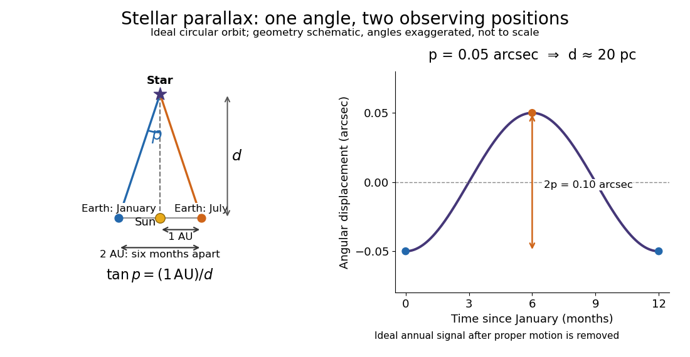

**[Figure 1](#image-one-au-parallax-angle-and-an-ideal-annual-signal-geometry-schematic-not-to-scale). One-AU parallax angle and an ideal annual signal; geometry schematic, not to scale**.

In practical [astrometry](astronomy.md#astrometry), many observations separate the annual [stellar parallax](#stellar-parallax) signal from [proper motion](astronomy.md#proper-motion), the [star](stellar-astrophysics.md#star)'s own changing sky position. The Gaia DR3 catalogue reports [stellar parallax](#stellar-parallax) and its uncertainty in milliarcseconds: $50\,\mathrm{mas}=0.05$ [arcseconds](geometry-and-topology.md#arcsecond). A catalogue angle is a fitted measurement with [measurement error](probability-and-statistics.md#measurement-error). [ESA Gaia DR3: Parallax, errors, and proper motion columns](https://gea.esac.esa.int/archive/documentation/GDR3/Gaia_archive/chap_datamodel/sec_dm_main_source_catalogue/ssec_dm_gaia_source.html).

For a positive [stellar parallax](#stellar-parallax) with small [standard deviation](variance.md#standard-deviation) $\sigma_p$, first-order propagation gives $\sigma_d/d\simeq\sigma_p/p$. Thus $p=50\,\mathrm{mas}$ with $\sigma_p=1\,\mathrm{mas}$ gives $d\simeq20$ [parsecs](#parsec) with $\sigma_d\simeq0.4$ [parsecs](#parsec), assuming systematic offsets are negligible. This linear estimate requires $\sigma_p\ll p$; a reciprocal is nonlinear and does not generally preserve symmetric uncertainty intervals.

### Proper distance prior for parallax inference

↑ **Parent:** [Stellar parallax](#stellar-parallax)

For a [Gaussian](probability-distribution.md#normal-distribution) measured [stellar parallax](#stellar-parallax), the [likelihood](maximum-likelihood-estimation.md#likelihood-function) at distance $r$ approaches a nonzero constant as $r\to\infty$. An unbounded spatial-volume [prior](bayesian-statistics.md#prior-probability) proportional to $r^2$ therefore gives an improper [posterior](bayesian-statistics.md#bayesian-posterior). A finite survey/population model or a decaying [density](fluid-mechanics.md#density) is needed. The illustrative proper [prior](bayesian-statistics.md#prior-probability) displayed has normalizing constant $1/(2L^3)$; its scale is a model choice requiring justification, not a new measured datum. [prior](bayesian-statistics.md#prior-probability) sensitivity is especially important at low parallax signal-to-noise.

### Lutz-Kelker bias

↑ **Parent:** [Stellar parallax](#stellar-parallax)

The classical parallax-calibration problem combines measurement errors with the greater volume available at larger distances. A locally uniform spatial population has $p(r)\propto r^2$, which transforms under $r=1/\varpi$ to $p(\varpi)\propto\varpi^{-4}$ on the valid distance interval. Parallax cuts and the nonlinear conversion to [luminosity](#luminosity) can bias [calibration](differential-geometry.md#calibration-differential-geometry) samples. A correction is not universal: the population model, selection information and inferential target must be specified. Distinguish the repeated-sampling bias of a selected sample from inference for a particular [star](stellar-astrophysics.md#star) using a justified [prior](bayesian-statistics.md#prior-probability).[PASP 85, 573–578; classical calibration model](physics-bibliography.md#on-the-use-of-trigonometric-parallaxes-for-the-calibration-of-luminosity-systems-theory-by-t-e-lutz-and-d-h-kelker)

#### Top-hat parallax posterior under a uniform-volume prior

↑ **Parent:** [Lutz-Kelker bias](#lutz-kelker-bias)

Let true parallax $p$ have prior density proportional to $p^{-4}$ on the valid finite population range, and let an observation supply a constant likelihood on $0<p_-\le p\le p_+$. The normalized posterior is $3p^{-4}/(p_-^{-3}-p_+^{-3})$. Integrating gives cumulative probability $(p_-^{-3}-p^{-3})/(p_-^{-3}-p_+^{-3})$, hence the displayed median. A fixed half-width equal to half the observed center gives $p_-=p_0/2$, $p_+=3p_0/2$ and $p_{\rm med}=p_0(27/112)^{1/3}$. Parameter-dependent error widths require their own normalized likelihood and support.

### Parsec

↑ **Parent:** [Stellar parallax](#stellar-parallax)  
ⓦ [Wiki](https://en.wikipedia.org/wiki/Parsec)

The parsec is a distance unit defined by the exact convention

$$
1\,\mathrm{pc}=\frac{648000}{\pi}\,\mathrm{au}\simeq3.085677581\times10^{16}\,\mathrm m.
$$

The [astronomical unit](planetary-science.md#astronomical-unit) is exactly $149597870700\,\mathrm m$; one [arcsecond](geometry-and-topology.md#arcsecond) is exactly $\pi/648000$ [radians](geometry-and-topology.md#radian). The IAU resolution explicitly records the [parsec](#parsec) convention. A megaparsec is one million [parsecs](#parsec). [IAU 2015 Resolution B2, note 4: Exact parsec convention](https://arxiv.org/pdf/1510.06262). [ESA: Astronomical-unit length](https://www.esa.int/ESA_Multimedia/Images/2013/06/Measuring_stellar_distances_by_parallax).

The familiar description "the distance giving one [arcsecond](geometry-and-topology.md#arcsecond) of [stellar parallax](#stellar-parallax)" uses the [small-angle approximation](geometry-and-topology.md#small-angle-approximation). Exact [right triangle](euclidean-geometry.md#right-triangle) geometry instead gives $\mathrm{au}/\tan(\pi/648000)$, slightly shorter than the conventional [parsec](#parsec). The relative difference is approximately $(\pi/648000)^2/3\simeq7.83\times10^{-12}$. This is negligible for the examples here, but distinguishing an exact unit convention from an approximate geometric interpretation prevents a misleading equality.

## Intergalactic medium

↑ **Parent:** [Astrophysics](astrophysics.md)

The intergalactic medium is the gas between [galaxies](galaxy.md). Its diffuse, ionized component contains much of the ordinary matter outside stars. [Lyman-alpha absorption](mathematical-physics.md#lyman-alpha-absorption) measures its small neutral-hydrogen fraction, while hotter phases require other tracers.

### Temperature-density relation of photoionized intergalactic gas

↑ **Parent:** [Intergalactic medium](#intergalactic-medium)

Diffuse gas in [photoionization equilibrium](galaxy.md#photoionization-equilibrium) is often approximately described by the displayed [temperature](temperature.md)-[density contrast](linear-cosmological-density-perturbation.md#density-contrast) relation. Photoheating and expansion cooling produce its thermal history. It is an empirical model for low-density gas, not the adiabatic equation of state of every intergalactic phase. [Lyman-alpha forest](#lyman-alpha-forest) line widths constrain both the temperature at a reference density and the slope through their lower envelope.

### Cosmic ionizing background

↑ **Parent:** [Intergalactic medium](#intergalactic-medium)

The cosmic ionizing background is the diffuse radiation field capable of [photoionization](atomic-physics.md#photoionization) of intergalactic gas. Its [specific intensity](radiometry.md#spectral-radiance) depends on source [luminosity functions](#luminosity-function-astronomy), [ionizing photon escape fractions](galaxy.md#ionizing-photon-escape-fraction), cosmological redshifting, and [radiative transfer](#radiative-transfer) through absorbers. [Quasars](astrophysical-black-hole.md#quasar) and [star formation](stellar-astrophysics.md#star-formation) supply major contributions with different spectral shapes and evolution.

### Lyman-alpha forest

↑ **Parent:** [Intergalactic medium](#intergalactic-medium)  
ⓦ [Wiki](https://en.wikipedia.org/wiki/Lyman-alpha_forest)

The [Lyman-alpha forest](#lyman-alpha-forest) is the multitude of foreground [Lyman-alpha absorption](mathematical-physics.md#lyman-alpha-absorption) features in a distant [quasar](astrophysical-black-hole.md#quasar)'s spectrum, at [wavelengths](wave-equation.md#wavelength) shorter than its own redshifted [Lyman-alpha emission](mathematical-physics.md#lyman-alpha-emission). The [quasar](astrophysical-black-hole.md#quasar) supplies a bright background; intervening neutral [hydrogen atoms](mathematical-physics.md#hydrogen-atom) remove [photons](quantum-mechanics.md#photon) near their local [Lyman-alpha line](mathematical-physics.md#lyman-alpha-line) resonance. Many dips can therefore come from one atomic transition encountered at different [redshifts](optics.md#redshift), rather than from many different [chemical elements](chemical-substance.md#chemical-element). Some features are instead transitions of other ions, so a dip alone does not identify [Lyman-alpha absorption](mathematical-physics.md#lyman-alpha-absorption). This makes faint foreground gas detectable through the [light](optics.md#light) it removes, even when its own emission would be difficult to see. [Rauch (1998), The Lyman Alpha Forest in the Spectra of QSOs, section 1](https://ned.ipac.caltech.edu/level5/Sept01/Rauch/Rauch1.html).

Ignoring [peculiar velocity](cosmology.md#peculiar-velocity) for the moment, an absorber at [cosmological redshift](cosmology.md#cosmological-redshift) $z_a$ puts its [Lyman-alpha line](mathematical-physics.md#lyman-alpha-line) at

$$
\lambda_{\mathrm{obs}}=\lambda_\alpha(1+z_a),\qquad z_a=\frac{\lambda_{\mathrm{obs}}}{\lambda_\alpha}-1,\qquad \lambda_\alpha=1215.67\,\text{Å}.
$$

The rest [wavelength](wave-equation.md#wavelength) is in the [ultraviolet](optics.md#ultraviolet); at $z_a=2$ it appears at $3647.01\,\text{Å}$ in the [optical spectrum](optics.md#optical-spectrum). In a toy sightline to a [quasar](astrophysical-black-hole.md#quasar) at $z_Q=3$, absorbers at $z_a=2,\ 2.35,\ 2.7$ appear at $3647.01,\ 4072.4945,\ 4497.979\,\text{Å}$, all shortward of the [quasar](astrophysical-black-hole.md#quasar)'s [Lyman-alpha emission](mathematical-physics.md#lyman-alpha-emission) position $4862.68\,\text{Å}$. The absorbing atoms see the selected [photons](quantum-mechanics.md#photon) at their own resonance; the observed dip's [redshift](optics.md#redshift) belongs to the foreground gas. [Peculiar velocity](cosmology.md#peculiar-velocity) adds a [Doppler shift](wave.md#doppler-effect), so the inferred $z_a$ is not a pure distance coordinate. The rest [wavelength](wave-equation.md#wavelength) and resonance interpretation are given in [Rauch (1998), section 1](https://ned.ipac.caltech.edu/level5/Sept01/Rauch/Rauch1.html).

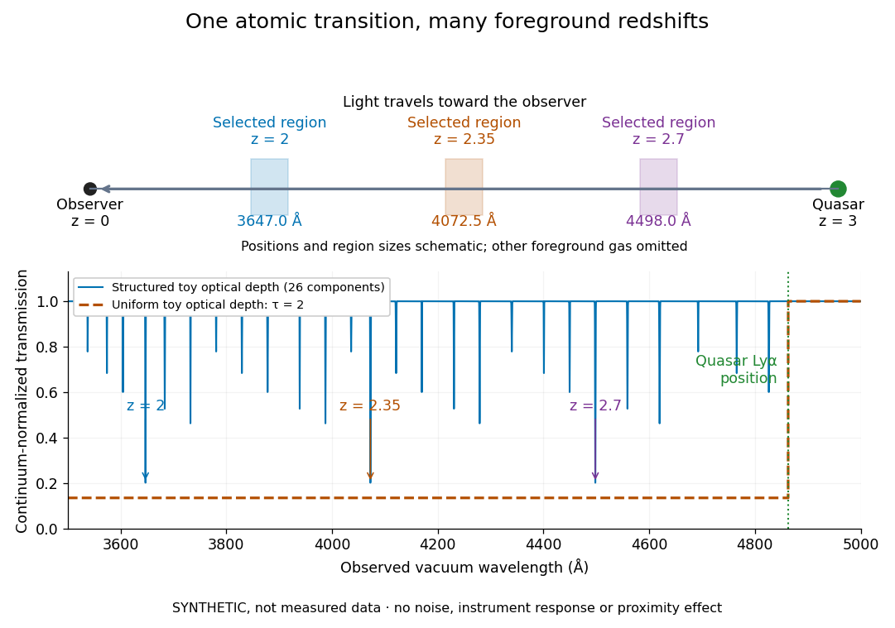

**[Figure 2](#lyman-alpha-forest-sightline). Synthetic foreground geometry and spectra: one Lyman-alpha transition at many redshifts**.

The diagram uses invented [optical depths](#optical-depth) and 26 Doppler cores; three selected foreground regions are marked. Their drawn positions and sizes are schematic. The dashed comparison imposes a uniform [optical depth](#optical-depth) $\tau=2$, giving transmission $e^{-2}\simeq0.135$ throughout the chosen foreground band. It is an idealized smooth-absorption model, not a measured spectrum or a prediction of the actual [intergalactic medium](#intergalactic-medium).

The smooth comparison explains the Gunn-Peterson effect: neutral [hydrogen](chemical-substance.md#hydrogen) distributed throughout an expanding [intergalactic medium](#intergalactic-medium) can absorb continuously over a [wavelength](wave-equation.md#wavelength) interval, because different parts of the path resonate with different observed [wavelengths](wave-equation.md#wavelength). The resolved [Lyman-alpha forest](#lyman-alpha-forest) instead has strong transmission fluctuations and distinguishable [absorption lines](stellar-astrophysics.md#absorption-line). These need not represent isolated compact clouds: diffuse sheets and filaments in the [cosmic web](large-scale-structure-of-the-universe.md#cosmic-web) can generate peaks in [optical depth](#optical-depth) along one [line of sight](#line-of-sight). A continuously varying gas distribution can look like a collection of lines. [Rauch (1998), section 1: smooth absorption](https://ned.ipac.caltech.edu/level5/Sept01/Rauch/Rauch1.html). [Rauch (1998), section 5.1: synthetic sightlines and extended structures](https://ned.ipac.caltech.edu/level5/Sept01/Rauch/Rauch5_1.html).

An early observation makes the identification concrete. Lynds's 1971 paper analyzed six spectrograms of the [quasar](astrophysical-black-hole.md#quasar) 4C 05.34, with emission [redshift](optics.md#redshift) $2.877$, taken in spring 1970 using an image-tube [spectrograph](optical-instrument.md#spectrograph) on Kitt Peak's 84-inch telescope. Five covered $3200$–$7500\,\text{Å}$ with approximately $10\,\text{Å}$ resolution; the most informative covered about $3500$–$6000\,\text{Å}$ at $5\,\text{Å}$ resolution. Its reproduced spectrogram shows the strong [Lyman-alpha emission](mathematical-physics.md#lyman-alpha-emission) flanked mostly on the short-[wavelength](wave-equation.md#wavelength) side by numerous [absorption lines](stellar-astrophysics.md#absorption-line). Lynds tabulated their [wavelengths](wave-equation.md#wavelength) and estimated strengths, identified five absorption [redshift](optics.md#redshift) systems, and proposed that many remaining unidentified lines were the same [Lyman-alpha line](mathematical-physics.md#lyman-alpha-line) at additional [redshifts](optics.md#redshift). He explicitly warned about blending, an incomplete census of weak lines, and [wavelength](wave-equation.md#wavelength) errors around $0.5$–$1\,\text{Å}$. The result established a striking spectral pattern; the paper's proposed interpretation did not measure a separate physical cloud for every dip. [Lynds (1971), The Absorption-Line Spectrum of 4C 05.34, Figure 1, Table 1 and discussion](https://adsabs.harvard.edu/pdf/1971ApJ...164L..73L).

A contrasting observation demonstrates smooth, very strong absorption. Becker and collaborators (2001) used the Echelle Spectrograph and Imager on Keck II to observe the [quasar](astrophysical-black-hole.md#quasar) SDSSp J103027.10+052455.0 at $z_Q=6.28$. Sky lines gave an instrumental full width at half maximum of about $1.8\,\text{Å}$ near $8500\,\text{Å}$, or [spectral resolving power](optical-instrument.md#spectral-resolving-power) $R\simeq4700$. After sky subtraction and flux calibration, the mean continuum-normalized transmission over $8450$–$8710\,\text{Å}$ was $0.0038\pm0.0026$, consistent with zero; this corresponds to absorption [redshifts](optics.md#redshift) approximately $5.95$–$6.16$. They identified a Gunn-Peterson trough. Crucially, resonant [Lyman-alpha absorption](mathematical-physics.md#lyman-alpha-absorption) is so sensitive that even a small neutral fraction can make transmission undetectable: the trough alone does not establish a mostly neutral [intergalactic medium](#intergalactic-medium) or uniquely date [reionization](cosmic-microwave-background.md#reionization). [Becker et al. (2001), sections 2–4: instrument response, transmitted flux and interpretation](https://arxiv.org/pdf/astro-ph/0108097).

What a spectrum constrains is a [radiative transfer](#radiative-transfer) problem. For an ideal foreground screen with negligible emission into the observed beam, the intrinsic continuum-normalized transmission is

$$
\mathcal T(\lambda)=\frac{F(\lambda)}{F_{\mathrm{cont}}(\lambda)}=e^{-\tau(\lambda)},\qquad N_{\mathrm{HI}}=\int n_{\mathrm{HI}}\,d\ell.
$$

Here $F$ is spectral [radiative flux](#radiative-flux), $F_{\mathrm{cont}}$ is its unabsorbed continuum, $\tau$ is [optical depth](#optical-depth), $n_{\mathrm{HI}}$ is neutral [hydrogen](chemical-substance.md#hydrogen) [number density](statistical-physics.md#number-density), and $N_{\mathrm{HI}}$ is neutral [hydrogen](chemical-substance.md#hydrogen) [column density](statistical-physics.md#column-density) along proper path length $\ell$. A [Voigt profile](stellar-astrophysics.md#voigt-profile) model constrains [redshift](optics.md#redshift), [column density](statistical-physics.md#column-density) and a velocity width together. A nearly black line has lost much of its sensitivity to further increases in [optical depth](#optical-depth); blending and an uncertain continuum can also admit different fitted components. Finite [spectral resolving power](optical-instrument.md#spectral-resolving-power) and noise limit which widths and weak features can be measured. [Rauch (1998), section 2: resolution, noise and profile analysis](https://ned.ipac.caltech.edu/level5/Sept01/Rauch/Rauch2.html). [Kim, Cristiani and D'Odorico (2001), section 3: fitted parameters and nonunique profile fits](https://arxiv.org/pdf/astro-ph/0101005).

For a purely thermal Doppler core, use the velocity convention $\tau(v)\propto\exp[-(v-v_0)^2/b^2]$. The [Maxwell-Boltzmann velocity distribution](quantum-ideal-gas-statistics.md#maxwell-boltzmann-velocity-distribution) then gives

$$
b_{\mathrm{th}}=\sqrt{\frac{2k_BT}{m_{\mathrm H}}}\simeq12.85\sqrt{\frac{T}{10^4\,\mathrm K}}\,\mathrm{km\,s^{-1}},
$$

where $k_B$ is the [Boltzmann constant](thermodynamics.md#boltzmann-constant), $T$ is [temperature](temperature.md) and $m_{\mathrm H}$ is a [hydrogen atom](mathematical-physics.md#hydrogen-atom)'s mass. This $b$ is $\sqrt2$ times the [Gaussian distribution](probability-distribution.md#normal-distribution)'s standard deviation. Higher [temperature](temperature.md) spreads the same [column density](statistical-physics.md#column-density) over more velocities. An instrument also broadens a line: locally, for a nearly flat continuum, the recorded transmission is approximately the [convolution](fourier-analysis.md#convolution) of $\mathcal T$ with the normalized instrumental response, not the exponential of a convolved [optical depth](#optical-depth). A Gaussian response with full width at half maximum $c/R$ has standard deviation $c/[R\sqrt{8\log2}]$, where $c$ is the [speed of light](special-relativity.md#speed-of-light) and $R$ the [spectral resolving power](optical-instrument.md#spectral-resolving-power).

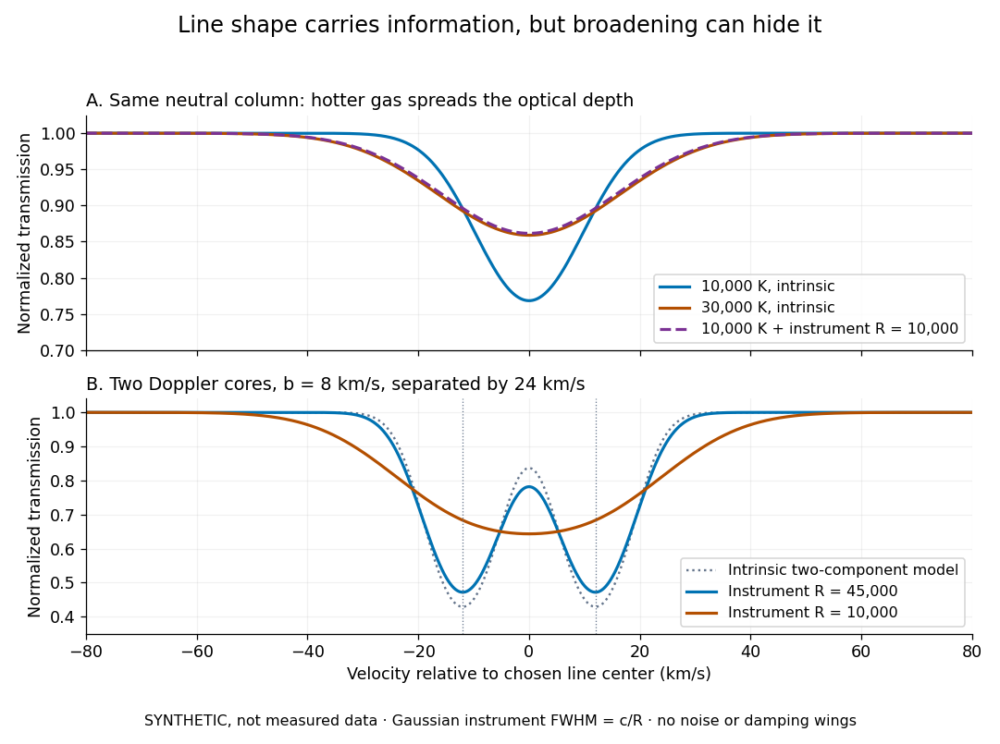

**[Figure 3](#lyman-alpha-forest-broadening). Synthetic absorption profiles: thermal broadening, instrumental smoothing and unresolved blends**.

The upper model fixes the integral $\int\tau(v)\,dv$, hence the neutral [hydrogen](chemical-substance.md#hydrogen) [column density](statistical-physics.md#column-density) for this transition, while changing [temperature](temperature.md). A cooler line blurred by an instrument resembles a warmer intrinsic line. The lower model has two equal Doppler cores separated by $24\,\mathrm{km\,s^{-1}}$: reducing [spectral resolving power](optical-instrument.md#spectral-resolving-power) merges them into one apparent feature. Both panels use invented profiles, Gaussian instrumental responses, and no noise or damping wings. They illustrate an [inverse problem](inverse-problem.md), rather than measurements of [temperature](temperature.md) or a universal relation between a dip and a cloud.

Better observations provide the inputs to that [inverse problem](inverse-problem.md). Kim, Cristiani and D'Odorico (2001) analyzed three [quasars](astrophysical-black-hole.md#quasar) with the VLT's UVES [spectrograph](optical-instrument.md#spectrograph). For HE2217–2818, Table 1 records $z_Q=2.413$ and $16200\,\mathrm s$ of exposure in the $3050$–$3860\,\text{Å}$ setup in October 1999. Isolated thorium-argon lamp lines measured $R\simeq45000$; the data were resampled into $0.05\,\text{Å}$ bins, with signal-to-noise ratios about $45$–$50$ per pixel over $3550$–$4050\,\text{Å}$. They fitted a local polynomial continuum, fitted [Voigt profiles](stellar-astrophysics.md#voigt-profile), and compared statistics of the transmitted flux. Their analysis excluded the region near the [quasar](astrophysical-black-hole.md#quasar) to avoid the [quasar proximity effect](#proximity-effect-astrophysics) and used the interval between its Lyman-beta and [Lyman-alpha emission](mathematical-physics.md#lyman-alpha-emission) to reduce confusion with other Lyman-series absorption. Features below $N_{\mathrm{HI}}=10^{12.5}\,\mathrm{cm^{-2}}$ became confused with noise, setting their adopted lower [column density](statistical-physics.md#column-density) limit. Figure 1 shows the measured spectrum, fitted profiles and residuals. This was a calibrated absorption measurement, with explicit selection limits. [Kim, Cristiani and D'Odorico (2001), UVES observations, sections 2–3, Table 1 and Figure 1](https://arxiv.org/pdf/astro-ph/0101005).

Even after instrumental correction, a width need not be purely [thermal Doppler broadening](quantum-ideal-gas-statistics.md#thermal-doppler-broadening). [Hubble flow](cosmology.md#hubble-flow) across extended gas, [peculiar velocity](cosmology.md#peculiar-velocity) structure and unresolved blends can contribute. If an isolated line's intrinsic width obeys $b^2=b_{\mathrm{th}}^2+b_{\mathrm{nt}}^2$ with an independent Gaussian nonthermal contribution $b_{\mathrm{nt}}^2\geq0$, then $T\leq m_{\mathrm H}b^2/(2k_B)$; $b=25\,\mathrm{km\,s^{-1}}$ gives a computed upper bound about $3.79\times10^4\,\mathrm K$. A complex blend need not satisfy this single-component model. Noise can also bias the fitted widths of weak lines. This is why the [thermal cutoff of Lyman-alpha line widths](quantum-ideal-gas-statistics.md#thermal-cutoff-of-lyman-alpha-line-widths), calibrated against gas models, is more informative than assigning a [temperature](temperature.md) to every dip. [Rauch (1998), section 3.3: width measurements, noise bias and bulk motions](https://ned.ipac.caltech.edu/level5/Sept01/Rauch/Rauch3_3.html).

Finally, neutral [hydrogen](chemical-substance.md#hydrogen) [column density](statistical-physics.md#column-density) is not total gas [mass density](fluid-mechanics.md#density). In a pure [hydrogen](chemical-substance.md#hydrogen) approximation, with gas optically thin to ionizing radiation and nearly fully ionized in [photoionization equilibrium](galaxy.md#photoionization-equilibrium), the [Lyman-alpha forest photoionization scaling](#lyman-alpha-forest-photoionization-scaling) gives

$$
n_{\mathrm{HI}}\simeq\frac{\alpha(T)n_{\mathrm H}^2}{\Gamma},\qquad x_{\mathrm{HI}}\simeq\frac{\alpha(T)n_{\mathrm H}}{\Gamma},
$$

where $n_{\mathrm H}$ counts all [hydrogen](chemical-substance.md#hydrogen) nuclei, $\Gamma$ is the [photoionization rate](atomic-physics.md#photoionization-rate), $\alpha(T)$ is the radiative recombination coefficient and $x_{\mathrm{HI}}=n_{\mathrm{HI}}/n_{\mathrm H}$ is the neutral fraction. At fixed [temperature](temperature.md) and $\Gamma$, doubling $n_{\mathrm H}$ quadruples $n_{\mathrm{HI}}$; doubling $\Gamma$ halves it. These computed examples explain both the sensitivity to [density contrast](linear-cosmological-density-perturbation.md#density-contrast) and the ambiguity: stronger absorption can mean denser gas, weaker ionizing radiation, a different [temperature](temperature.md), or more path length. The [Jeans-length ionization correction for the Lyman-alpha forest](#jeans-length-ionization-correction-for-the-lyman-alpha-forest) adds a size model rather than an independently measured depth. Optically thick [Lyman limit systems](mathematical-physics.md#lyman-limit-system) and [damped Lyman-alpha systems](mathematical-physics.md#damped-lyman-alpha-system) require different treatment. [Rauch (1998), section 5: neutral fraction and ionization correction](https://ned.ipac.caltech.edu/level5/Sept01/Rauch/Rauch5.html). [Schaye (2001), section 2 and Appendix equations A6–A7: ionization balance and the Jeans-length model](https://arxiv.org/pdf/astro-ph/0104272).

The beauty of the [Lyman-alpha forest](#lyman-alpha-forest) is that a spectrum converts otherwise faint foreground gas into a sequence of markers through cosmic time. With a model of [radiative transfer](#radiative-transfer), velocities, ionizing radiation and the [temperature-density relation of photoionized intergalactic gas](#temperature-density-relation-of-photoionized-intergalactic-gas), its transmission statistics probe the [cosmic web](large-scale-structure-of-the-universe.md#cosmic-web) and gas thermal history. A single [line of sight](#line-of-sight) remains one narrow sample, not a unique three-dimensional density map. [Rauch (1998), section 5.2: the forest as a record of fluctuations](https://ned.ipac.caltech.edu/level5/Sept01/Rauch/Rauch5_2.html).

#### Lyman-alpha forest photoionization scaling

↑ **Parent:** [Lyman-alpha forest](#lyman-alpha-forest)

In optically thin, almost fully ionized [hydrogen](chemical-substance.md#hydrogen) in [photoionization equilibrium](galaxy.md#photoionization-equilibrium), $n_{\rm HI}\Gamma=n_en_p\alpha(T)$ and $n_e\simeq n_p\simeq n_H$. Thus the neutral fraction is approximately $\alpha(T)n_H/\Gamma$, while the neutral density is proportional to $n_H^2$. At fixed overdensity, cosmic dilution gives $n_H\propto(1+z)^3$, hence $n_{\rm HI}\propto\alpha(T)(1+z)^6/\Gamma$. Gas density, temperature, ionizing radiation and path length are all required to infer a baryon density from [Lyman-alpha absorption](mathematical-physics.md#lyman-alpha-absorption).

##### Jeans-length ionization correction for the Lyman-alpha forest

↑ **Parent:** [Lyman-alpha forest photoionization scaling](#lyman-alpha-forest-photoionization-scaling)

Assume optically thin [photoionization equilibrium](galaxy.md#photoionization-equilibrium) and an absorber depth of order its local [Jeans length](linear-cosmological-density-perturbation.md#jeans-length), $L\propto(f_gT/n_H)^{1/2}$, where $f_g$ is the local gas fraction. Then $N_{\rm HI}\simeq\alpha(T)n_H^2L/\Gamma\propto[\alpha(T)/\Gamma](f_gT)^{1/2}n_H^{3/2}$. Solving for $n_H$ and substituting in $N_H=n_HL$ gives the displayed correction. Thus the ionized mass integral weights the [neutral-hydrogen column-density distribution](mathematical-physics.md#neutral-hydrogen-column-density-distribution) by $N_{\rm HI}^{1/3}$ rather than $N_{\rm HI}$. This model does not apply without modification to optically thick systems or arbitrary unconfined gas.

#### Redshift evolution of the Lyman-alpha forest

↑ **Parent:** [Lyman-alpha forest](#lyman-alpha-forest)

The [Lyman-alpha forest](#lyman-alpha-forest) becomes denser and more opaque towards higher [cosmological redshift](cosmology.md#cosmological-redshift), for a fixed absorption selection over the ordinary post-reionization range. The incidence is often parametrized as $d\mathcal N/dz=A(1+z)^\gamma$, with the index depending on the [column density](statistical-physics.md#column-density) threshold and epoch. The evolution flattens at low redshift as the declining [cosmic ionizing background](#cosmic-ionizing-background) partly offsets dilution of the [intergalactic medium](#intergalactic-medium). For optically thin gas at fixed overdensity, [photoionization equilibrium](galaxy.md#photoionization-equilibrium) gives approximately $n_{\rm HI}\propto\alpha(T)(1+z)^6/\Gamma$, illustrating why density, temperature and ionizing radiation all matter.

#### Proximity effect (astrophysics)

↑ **Parent:** [Lyman-alpha forest](#lyman-alpha-forest)

The quasar proximity effect is a reduction of nearby [Lyman-alpha forest](#lyman-alpha-forest) absorption caused by extra [photoionization](atomic-physics.md#photoionization) from the [quasar](astrophysical-black-hole.md#quasar). At fixed density and temperature in [photoionization equilibrium](galaxy.md#photoionization-equilibrium), an added rate $\Gamma_Q$ changes the neutral fraction by the factor $\Gamma_{\rm bg}/(\Gamma_{\rm bg}+\Gamma_Q)$. A host environment with positive [density contrast](linear-cosmological-density-perturbation.md#density-contrast) can mask this reduction, and a variable or anisotropic source complicates its interpretation.

##### Proximity-effect estimator of the ionizing background

↑ **Parent:** [Proximity effect (astrophysics)](#proximity-effect-astrophysics)

In [photoionization equilibrium](galaxy.md#photoionization-equilibrium) at fixed gas density and temperature, the extra [quasar](astrophysical-black-hole.md#quasar) [photoionization rate](atomic-physics.md#photoionization-rate) reduces neutral-hydrogen [column density](statistical-physics.md#column-density) by the displayed factor. Its local rate is calculated from the quasar flux, while the isotropic background rate is $\Gamma_{\rm bg}=4\pi\int J_\nu\sigma_{\rm HI}(\nu)/(h\nu)\,d\nu$. Fitting the absorption suppression versus proper distance constrains the [cosmic ionizing background](#cosmic-ionizing-background). For an unperturbed column-density distribution proportional to $N^{-p}$ with $p>1$, the line abundance above a fixed threshold is reduced by $(1+\omega)^{1-p}$. Density enhancement, quasar age, anisotropy and redshift errors must be distinguished from this ionization effect.

## Photoevaporation

↑ **Parent:** [Astrophysics](astrophysics.md)  
ⓦ [Wiki](https://en.wikipedia.org/wiki/Photoevaporation)

Radiation heats gas sufficiently to drive an escaping thermal outflow. It can remove material from [protoplanetary disks](astrophysical-disk.md#protoplanetary-disk), planetary atmospheres and irradiated clouds. In a heated [Keplerian disk](astrophysical-disk.md#keplerian-disk), the [photoevaporative gravitational radius](#photoevaporative-gravitational-radius) compares the [sound speed](compressible-flow.md#speed-of-sound) with the orbital speed. The mass-loss rate depends on the heating, density and wind geometry rather than radiation pressure alone.

### Photoevaporative gap opening

↑ **Parent:** [Photoevaporation](#photoevaporation)

When a [protoplanetary disk](astrophysical-disk.md#protoplanetary-disk)'s inward viscous supply approaches its wind-loss rate, [photoevaporation](#photoevaporation) can prevent replenishment of the inner disk. That region drains on a [viscous timescale](astrophysical-disk.md#viscous-timescale), leaving a gap or hole. A negative density in a formal [steady state](dynamical-systems.md#steady-state) calculation signals the breakdown of that approximation, not a physical continuation. An exposed outer edge can subsequently disperse rapidly.

### Steady photoevaporating-disk mass flux

↑ **Parent:** [Photoevaporation](#photoevaporation)

For a sink $W=W_0(r/r_g)^{-5/2}$ outside $r_g$, [mass conservation](continuum-mechanics.md#mass-conservation) gives $dF_{\mathrm{acc}}/dr=2\pi rW$ in [steady state](dynamical-systems.md#steady-state). Remote feeding gives $F_{\mathrm{acc}}=\dot M_d-\dot M_w$ inside $r_g$, and $\dot M_d-\dot M_w\sqrt{r_g/r}$ outside, where $\dot M_w=4\pi W_0r_g^2$. The inward flux decreases towards the star because mass is diverted into the wind. A finite feeding radius or outer truncation supplies an additional boundary condition.

#### Surface density of a steady photoevaporating disk

↑ **Parent:** [Steady photoevaporating-disk mass flux](#steady-photoevaporating-disk-mass-flux)

With constant [kinematic viscosity](dynamic-viscosity.md#kinematic-viscosity) and zero inner [viscous torque in an accretion disk](astrophysical-disk.md#viscous-torque-in-an-accretion-disk), $\nu\Sigma\sqrt r=(6\pi)^{-1}\int_0^rF_{\mathrm{acc}}(r')/\sqrt{r'}\,dr'$. For the [steady photoevaporating-disk mass flux](#steady-photoevaporating-disk-mass-flux), the density is $(\dot M_d-\dot M_w)/(3\pi\nu)$ inside $r_g$ and the displayed logarithmic profile outside. At equal feeding and wind rates the inner density vanishes, and the outer normalized profile rises from zero with zero slope and tends to one. Its near-edge expansion is $(r/r_g-1)^2/8$.

### Photoevaporative gravitational radius

↑ **Parent:** [Photoevaporation](#photoevaporation)

The thermal binding scale defined by equating heated gas [sound speed](compressible-flow.md#speed-of-sound) to circular [Keplerian orbit](celestial-mechanics.md#kepler-orbit) speed. It is $r_g=GM/c_s^2$. The circular-orbit binding energy is $GM/(2r)$ per unit mass, while the gas [specific enthalpy](enthalpy.md#specific-enthalpy) is of order $c_s^2$. A heated disk surface at radii comparable to or larger than $r_g$ can therefore drive [photoevaporation](#photoevaporation). The actual launching radius can differ by a factor of order unity; $c_s$ is not the ballistic escape speed.

## Gravitational collapse

↑ **Parent:** [Astrophysics](astrophysics.md)  
ⓦ [Wiki](https://en.wikipedia.org/wiki/Gravitational_collapse)

[Gravitational collapse](#gravitational-collapse) is contraction driven by a system's own gravitational attraction or an enclosing potential. Pressure, angular momentum and other stresses can oppose it. A free-fall timescale measures the dynamical contraction rate when pressure support is removed; gas cooling determines whether thermal support can be removed fast enough.

### Free fall in a fixed singular isothermal sphere

↑ **Parent:** [Gravitational collapse](#gravitational-collapse)

A test particle released from rest at $r_0$ in a fixed spherical [mass density](fluid-mechanics.md#density) $\rho(r)=\rho_0(r_0/r)^2$ obeys $\ddot r=-4\pi G\rho_0r_0^2/r$. Integrating once gives $\dot r^2=8\pi G\rho_0r_0^2\ln(r_0/r)$. The substitution $u=\sqrt{\ln(r_0/r)}$ then gives $t(r)=(8G\rho_0)^{-1/2}\operatorname{erf}(u)$, and the arrival time at the centre is $(8G\rho_0)^{-1/2}$. This is [free fall](newton-s-law-of-universal-gravitation.md#free-fall) in a frozen [singular isothermal sphere](galaxy.md#singular-isothermal-sphere), not the self-consistent pressureless collapse of the background. An initially resting material shell with the same initial enclosed [mass](classical-mechanics.md#mass) instead arrives after $\sqrt{\pi/(32G\rho_0)}$, because its enclosed [mass](classical-mechanics.md#mass) stays fixed while the cloud contracts.

### Inside-out collapse of a singular isothermal sphere

↑ **Parent:** [Gravitational collapse](#gravitational-collapse)

A collapse front propagates out through an initially singular isothermal envelope at $r_f=a_Tt$. The only steady accretion scale is $\dot M\propto a_T^3/G\propto T^{3/2}$ for fixed mean particle [mass](classical-mechanics.md#mass). The front sweeps original [mass](classical-mechanics.md#mass) at $2a_T^3/G$, but the exact central accretion coefficient requires the dynamical similarity solution and cannot be identified with front sweeping alone.

#### Expansion-wave mass budget

↑ **Parent:** [Inside-out collapse of a singular isothermal sphere](#inside-out-collapse-of-a-singular-isothermal-sphere)

For a [singular isothermal sphere](galaxy.md#singular-isothermal-sphere) with $\rho=a_s^2/(2\pi Gr^2)$, the initial [mass](classical-mechanics.md#mass) inside the outward front $r_{\rm ew}=a_st$ is $M_{\rm ew}=2a_s^3t/G$. This is not all immediately accreted by the central object. The [inside-out collapse of a singular isothermal sphere](#inside-out-collapse-of-a-singular-isothermal-sphere) instead has $\dot M_*=m_0a_s^3/G$, with $m_0$ fixed by its dynamical similarity solution; the remainder can stay in the infalling envelope. Equating front sweeping with central [accretion](#accretion) loses that [mass](classical-mechanics.md#mass) budget.

#### Expansion-front mass flux versus central accretion

↑ **Parent:** [Inside-out collapse of a singular isothermal sphere](#inside-out-collapse-of-a-singular-isothermal-sphere)

#### Free-fall density profile around a growing point mass

↑ **Parent:** [Inside-out collapse of a singular isothermal sphere](#inside-out-collapse-of-a-singular-isothermal-sphere)

Where a central [mass](classical-mechanics.md#mass) dominates and radial infall is locally steady, $|v_r|\simeq\sqrt{2GM_\star/r}$. A conserved [mass](classical-mechanics.md#mass) flux $\dot M=4\pi r^2\rho|v_r|$ then gives $\rho\simeq\dot M[4\pi\sqrt{2GM_\star}]^{-1}r^{-3/2}$. Constant accretion gives $M_\star\propto t$ and an inner normalization proportional to $t^{-1/2}$.

### Distant view of gravitational collapse

↑ **Parent:** [Gravitational collapse](#gravitational-collapse)

In a spherical collapse model a freely falling surface can cross its [event horizon](black-hole.md#event-horizon) after finite [proper time](special-relativity.md#proper-time), while outgoing signals received far away have increasing delay and redshift. Schwarzschild-coordinate freezing does not mean collapse physically stops or leaves a permanently bright surface at the horizon.

### Pressureless homologous spherical collapse

↑ **Parent:** [Gravitational collapse](#gravitational-collapse)

A uniform spherical cloud with negligible [pressure](pressure.md) and [velocity](classical-mechanics.md#velocity) $\mathbf u=(\dot R/R)\mathbf r$ remains uniform: the [continuity equation](mathematical-physics.md#continuity-equation) gives $\rho R^3=\rho_{00}R_0^3$. The [shell theorem](mathematical-physics.md#spherical-shell-theorem) gives interior [gravitational acceleration](newton-s-law-of-universal-gravitation.md#gravitational-acceleration) $-(4\pi G\rho/3)\mathbf r$, so its outer radius satisfies the displayed equation, with fixed mass $M=4\pi\rho_{00}R_0^3/3$. Collapse from rest has $\dot R^2=2GM(1/R-1/R_0)$. Writing $C^2=2GM/R_0$, its [cycloid](topology.md#cycloid) parametrization is $R=R_0(1+\cos\phi)/2$ and $Ct=R_0(\phi+\sin\phi)/2$, for $0\le\phi\le\pi$. Complete collapse occurs after $\sqrt{3\pi/(32G\rho_{00})}$. This Newtonian dust solution ceases to be a regular fluid configuration at zero radius.

#### Comoving perturbations of a homologously collapsing cloud

↑ **Parent:** [Pressureless homologous spherical collapse](#pressureless-homologous-spherical-collapse)

A [Fourier mode](fourier-analysis.md#fourier-mode) advected with a [homologous spherical flow](fluid-mechanics.md#homologous-spherical-flow) has phase $\mathbf q\cdot\mathbf r/R(t)$. Its [material derivative](continuum-mechanics.md#material-derivative) in the background vanishes because $\dot{\mathbf k}=-(\dot R/R)\mathbf k$. Thus contraction shortens its physical wavelength while preserving its phase on each fluid element. Linearizing the [continuity equation](mathematical-physics.md#continuity-equation) and pressureless [momentum](momentum.md) equation gives $\dot\delta=-i\mathbf k\cdot\mathbf u_1$ and $\dot{\mathbf u}_1+(\dot R/R)\mathbf u_1=-i\mathbf k\Phi_1$. Combining these with the [Poisson equation for Newtonian gravity](newton-s-law-of-universal-gravitation.md#poisson-equation-for-newtonian-gravity) yields $\ddot\delta+2(\dot R/R)\dot\delta-4\pi G\rho\delta=0$ for nonzero compressive [wavenumber](wave-equation.md#wavenumber). It is a local bulk calculation, without the moving cloud-boundary conditions.

##### Density modes of a collapsing pressureless sphere

↑ **Parent:** [Comoving perturbations of a homologously collapsing cloud](#comoving-perturbations-of-a-homologously-collapsing-cloud)

For [pressureless homologous spherical collapse](#pressureless-homologous-spherical-collapse), let $\phi$ be its [cycloid](topology.md#cycloid) parameter. The [density contrast](linear-cosmological-density-perturbation.md#density-contrast) equation becomes $\delta_{\phi\phi}-\tan(\phi/2)\delta_\phi-3\delta/(1+\cos\phi)=0$. One solution is $\delta_g=\sin\phi/(1+\cos\phi)^2$. [Reduction of order](linear-ordinary-differential-equation.md#reduction-of-order) gives an independent solution that decays at collapse,

$$
\delta_d=\delta_g\int_\phi^\pi\frac{(1+\cos s)^3}{\sin^2s}\,ds
=\delta_g\left[4\cot(\phi/2)+\sin\phi-3(\pi-\phi)\right].
$$

For $\epsilon=\pi-\phi$, the integral is $\epsilon^5/40+O(\epsilon^7)$, while $\delta_g\sim4\epsilon^{-3}$. Therefore $\delta_d\sim\epsilon^2/10$. Since $R\sim R_0\epsilon^2/4$, the displayed powers follow. The growing branch is unique up to scale and addition of the decaying branch; many mixed solutions grow, so it is not literally the only function with growth. Finite perturbations eventually leave the linear regime.

### Free-fall time of a uniform sphere

↑ **Parent:** [Gravitational collapse](#gravitational-collapse)

A pressureless uniform sphere initially at rest collapses under Newtonian gravity in a time depending only on its initial mass density. Solving the radial shell equation gives $\sqrt{3\pi/(32G\rho)}$. It is commonly used as a dynamical-time benchmark for cooling and [star formation](stellar-astrophysics.md#star-formation), with the gravitating density rather than gas density alone when other matter supplies gravity.

## Solar system

↑ **Parent:** [Astrophysics](astrophysics.md)  
ⓦ [Wiki](https://en.wikipedia.org/wiki/Solar_system)

### Solar wind

↑ **Parent:** [Solar system](#solar-system)  
ⓦ [Wiki](https://en.wikipedia.org/wiki/Solar_wind)

The solar wind is the outward plasma flow from the Sun, carrying an interplanetary [magnetic field](magnetic-field.md). Its pressure and field compress intrinsic planetary [magnetospheres](planetary-science.md#magnetosphere), form magnetotails, and can drive an [induced magnetosphere](planetary-science.md#induced-magnetosphere) around a planet with no appreciable intrinsic field.

#### Radial solar-wind magnetic flux

↑ **Parent:** [Solar wind](#solar-wind)

[Magnetic flux freezing](ideal-magnetohydrodynamics.md#magnetic-flux-freezing) in a highly conducting [solar wind](#solar-wind) can carry open [magnetic field lines](magnetic-field.md#magnetic-field-line) outward. A nearly radial [flux tube](magnetic-field.md#flux-tube) occupying fixed solid angle has area proportional to $r^2$, so constant [magnetic flux](magnetic-field.md#magnetic-flux) gives $B_r\propto r^{-2}$. If a field is approximately dipolar inside an opening radius $r_o$ and radial beyond it, its radial component at $r\gg r_o$ is enhanced by order $r/r_o$ compared with continued dipolar $r^{-3}$ decay. Opposite polarities preserve zero net flux through a closed surface; this approximation does not introduce a magnetic monopole.

### Mars

↑ **Parent:** [Solar system](#solar-system)  
ⓦ [Wiki](https://en.wikipedia.org/wiki/Mars)

A [terrestrial planet](planetary-science.md#terrestrial-planet) with a thin present atmosphere and evidence of a different past volatile and climate history.

#### Hesperian

↑ **Parent:** [Mars](#mars)

A Martian geological interval between the [Noachian](#noachian) and Amazonian, with extensive volcanic and aqueous activity. Numerical boundary ages depend on the crater chronology model.

#### Noachian

↑ **Parent:** [Mars](#mars)

An early interval of Martian geological history, identified by ancient cratered terrains and extensive records of aqueous alteration.

### Uranus

↑ **Parent:** [Solar system](#solar-system)  
ⓦ [Wiki](https://en.wikipedia.org/wiki/Uranus)

An [ice giant](planetary-science.md#ice-giant) with substantial heavy material beneath its H/He envelope. Its low intrinsic luminosity makes efficient, fully mixed cooling an imperfect universal assumption.

### Saturn

↑ **Parent:** [Solar system](#solar-system)  
ⓦ [Wiki](https://en.wikipedia.org/wiki/Saturn)

A [gas giant](planetary-science.md#gas-giant) with a substantial H/He envelope. Intrinsic cooling, contraction and helium differentiation contribute to its thermal evolution.

#### Hydrogen-to-helium ratio under helium depletion

↑ **Parent:** [Saturn](#saturn)

Removing [helium](chemical-substance.md#helium) from a hydrogen-rich envelope lowers He/H and raises its reciprocal H/He. A helium-rain explanation of atmospheric depletion must keep those two ratio conventions distinct. Settling helium-rich material can release [gravitational energy](energy.md#gravitational-energy) while changing atmospheric composition; excess [luminosity](#luminosity) alone does not uniquely determine the interior process.

## Sidereal time

↑ **Parent:** [Astrophysics](astrophysics.md)  
ⓦ [Wiki](https://en.wikipedia.org/wiki/Sidereal_time)

Local [sidereal time](#sidereal-time) is the [right ascension](#right-ascension) on the upper [celestial meridian](#celestial-meridian). A sidereal day is approximately $1436.07$ minutes; its angular rate is $2\pi/T_{\rm sid}$. Mean and apparent [sidereal time](#sidereal-time) must be paired with corresponding [equatorial coordinate systems](#equatorial-coordinate-system).

### Sidereal day

↑ **Parent:** [Sidereal time](#sidereal-time)

The period associated with one full cycle of [sidereal time](#sidereal-time).

## Horizontal coordinate system

↑ **Parent:** [Astrophysics](astrophysics.md)  
ⓦ [Wiki](https://en.wikipedia.org/wiki/Horizontal_coordinate_system)

A [horizontal coordinate system](#horizontal-coordinate-system) describes a viewing direction using [altitude](#altitude) $\gamma$ above the observer's [astronomical horizon](#astronomical-horizon) and [azimuth](#azimuth) $\eta$ around it. Here [azimuth](#azimuth) starts at true north and increases through east: north is $0^\circ$, east $90^\circ$, south $180^\circ$, and west $270^\circ$, with $0\leq\eta<360^\circ$. True north is the northward intersection of the [celestial meridian](#celestial-meridian) with the [astronomical horizon](#astronomical-horizon), rather than an uncorrected magnetic-compass reading. Other origins and directions are legitimate, but their formulae must be converted consistently. [Jeremy Tatum: Celestial mechanics, section 6.2, altazimuth coordinates and azimuth conventions](https://www.astro.uvic.ca/~tatum/celmechs/celm6.pdf).

Construct a local [orthonormal basis](inner-product.md#orthonormal-basis) of east $\mathbf e_E$, north $\mathbf e_N$, and upward $\mathbf e_U$, with $\mathbf e_E\times\mathbf e_N=\mathbf e_U$. The upward [unit vector](vector-space.md#unit-vector) points to the [zenith](#zenith); the horizontal [plane](geometry-and-topology.md#plane) is perpendicular to it. For a ground instrument, a freely hanging weight establishes the local vertical through [gravity](physics.md#gravity). In an elementary spherical-[Earth](planetary-science.md#earth) model, this vertical is radial; precision work distinguishes it from the normal to a reference surface. With the observer as origin, write a direction's [unit vector](vector-space.md#unit-vector) as

$$
\mathbf n=\cos\gamma\sin\eta\,\mathbf e_E+\cos\gamma\cos\eta\,\mathbf e_N+\sin\gamma\,\mathbf e_U.
$$

Its local components $(E,N,U)$ obey $E^2+N^2+U^2=1$. Conversely, $\gamma=\arcsin U$ and $\eta=\operatorname{atan2}(E,N)$ modulo one turn, except where $E=N=0$. The quadrant-aware [arctangent](geometry-and-topology.md#inverse-tangent) takes east as its first argument and north as its second. A synthetic direction with $\eta=60^\circ$ and $\gamma=30^\circ$ has $(E,N,U)=(3/4,\sqrt3/4,1/2)$. Thus its horizontal component has [norm](normed-vector-space.md#norm) $\sqrt3/2$; its [altitude](#altitude) is not the [angle](geometry-and-topology.md#angle) of the projected arrow in the horizontal [plane](geometry-and-topology.md#plane).

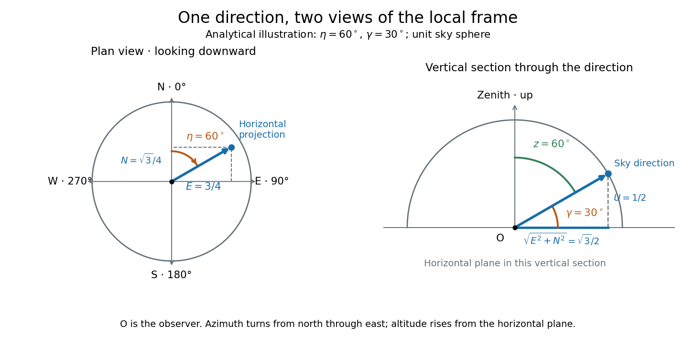

**[Figure 4](#image-analytical-illustration-of-north-through-east-azimuth-and-altitude-in-a-local-orthogonal-frame-synthetic-direction). Analytical illustration of north-through-east azimuth and altitude in a local orthogonal frame; synthetic direction**.

A [horizontal coordinate system](#horizontal-coordinate-system) depends on the observer's site and the observation [time](classical-mechanics.md#time-in-physics). The [Earth](planetary-science.md#earth)'s [rotation](riemannian-geometry.md#rotation-mathematics) changes the local axes relative to a fixed distant direction, while changing the site changes the [zenith](#zenith) and the [astronomical horizon](#astronomical-horizon). This makes the [horizontal coordinate system](#horizontal-coordinate-system) directly useful for pointing an [optical telescope](optical-instrument.md#optical-telescope) and checking whether terrain blocks a target. A pair of [angles](geometry-and-topology.md#angle) without a site, [time](classical-mechanics.md#time-in-physics), [azimuth](#azimuth) convention, and geometric or refracted interpretation is an incomplete pointing instruction.

For a check against an [equatorial coordinate system](#equatorial-coordinate-system), let $\theta$ be the observer's [geographical latitude](#geographical-latitude), $\delta$ the direction's [declination](#declination), and $h$ its west-positive [hour angle](#hour-angle), obtained from local [sidereal time](#sidereal-time) minus [right ascension](#right-ascension). In the spherical-[Earth](planetary-science.md#earth), unrefracted fixed-direction model, projection onto the local [orthonormal basis](inner-product.md#orthonormal-basis) gives

$$
E=-\cos\delta\sin h,\qquad N=\cos\theta\sin\delta-\sin\theta\cos\delta\cos h,\qquad U=\sin\theta\sin\delta+\cos\theta\cos\delta\cos h.
$$

Taking the [dot product](inner-product.md#dot-product) with the upward [unit vector](vector-space.md#unit-vector) gives the last formula; the other two follow by the same projection. Recover [altitude](#altitude) and [azimuth](#azimuth) from $(E,N,U)$ as above, using [radians](geometry-and-topology.md#radian) inside software [trigonometric functions](geometry-and-topology.md#trigonometric-function). The minus sign in $E$ is essential: a negative [hour angle](#hour-angle) puts this synthetic direction east of the [celestial meridian](#celestial-meridian). [US Naval Observatory: Computing altitude and azimuth, local hour angle and quadrant-aware conversion](https://aa.usno.navy.mil/faq/alt_az).

For illustrative [geographical latitude](#geographical-latitude) $\theta=45^\circ$ and invented [declination](#declination) $\delta=15^\circ$, [hour angle](#hour-angle) $h=-60^\circ$ gives $\gamma\simeq31.636^\circ$ and $\eta\simeq100.729^\circ$. At $h=+60^\circ$, the same [altitude](#altitude) accompanies $\eta\simeq259.271^\circ$: the direction is now westward. At $h=0$, it is due south with [altitude](#altitude) $60^\circ$, agreeing with $90^\circ-|\theta-\delta|$ at upper [meridian transit](#meridian-transit). These are analytical checks, not present positions of any [star](stellar-astrophysics.md#star). For nearby objects, the direction must also be referred to the observer; simply rotating a geocentric direction omits the change of viewing position. Catalogue-to-observation refinements are described under [equatorial coordinate system](#equatorial-coordinate-system).

### Geographical latitude

↑ **Parent:** [Horizontal coordinate system](#horizontal-coordinate-system)

For a spherical Earth, geographical latitude is the [angle](geometry-and-topology.md#angle) of the local vertical above the equatorial plane. It equals the [altitude](#altitude) of the north [celestial pole](#celestial-pole) in the northern hemisphere. Precision astrometry distinguishes geodetic and astronomical latitude.

### Azimuth

↑ **Parent:** [Horizontal coordinate system](#horizontal-coordinate-system)  
ⓦ [Wiki](https://en.wikipedia.org/wiki/Azimuth)

[Azimuth](#azimuth) is the [angle](geometry-and-topology.md#angle) about the local vertical measured in the [astronomical horizon](#astronomical-horizon). A common convention increases eastward from north; some astronomical formulae use westward from north. The convention changes the sign in the [hour angle](#hour-angle) transformation.

### Altitude

↑ **Parent:** [Horizontal coordinate system](#horizontal-coordinate-system)

[Altitude](#altitude) $\gamma$, also called [elevation angle](#altitude), is the signed [angle](geometry-and-topology.md#angle) from the [astronomical horizon](#astronomical-horizon) to a viewing direction, measured in the vertical [plane](geometry-and-topology.md#plane) containing that direction and the [zenith](#zenith). Its range is $-90^\circ\leq\gamma\leq90^\circ$: positive [altitude](#altitude) is above the horizontal [plane](geometry-and-topology.md#plane), zero [altitude](#altitude) lies on the [astronomical horizon](#astronomical-horizon), and $90^\circ$ points to the [zenith](#zenith). [Altitude](#altitude) measures direction, rather than a [Euclidean distance](topological-analysis.md#euclidean-distance) or a height in metres. In the local [horizontal coordinate system](#horizontal-coordinate-system), $\sin\gamma=\mathbf n\cdot\mathbf e_U$; the [dot product](inner-product.md#dot-product) makes the sign unambiguous even for directions below the [astronomical horizon](#astronomical-horizon).

A concrete motivating observation is the Exploratorium Teacher Institute's Height Sight activity. Its [inclinometer](#inclinometer) uses a sighting tube fixed to a card and an angular scale, with a string and small weight hanging from the scale's pivot. A partner reads where the freely hanging string meets the scale. Sighting a level target should give a readout near zero; sighting a taller target gives an angular height. The activity asks the observer to move closer and farther: the closer position gives the larger [angle](geometry-and-topology.md#angle). The interpretation is that the readout measures the tube's tilt relative to the [gravity](physics.md#gravity) reference, while converting that [angle](geometry-and-topology.md#angle) to a physical height also requires distance and eye height. The activity also extends the [inclinometer](#inclinometer) to sky observations. [Exploratorium Teacher Institute: Height Sight, construction, level check and distance-dependent angular observations](https://www.exploratorium.edu/snacks/height-sight).

The following calibration and sky sequence is a proposed extension, with no claimed observing dataset. First establish two reference marks at the same height with a water level, rather than assuming that a sloping floor or distant ridge is horizontal. Keep the [inclinometer](#inclinometer) in a vertical [plane](geometry-and-topology.md#plane), sight between the marks, wait for the weight to settle, and read the zero several times. Next sight a mark whose independently measured rise $q$ above the tube and horizontal separation $d$ are known; a [right triangle](euclidean-geometry.md#right-triangle) predicts $\gamma_{\rm ref}=\arctan(q/d)$. A synthetic $q=3\,\mathrm m$, $d=5\,\mathrm m$ gives $\gamma_{\rm ref}=30.964^\circ$. Checking both zero and this nonzero [angle](geometry-and-topology.md#angle) can reveal a wrongly attached tube or a scale read from the wrong end. Use level separation, not distance along inclined ground.

If the scale's indicated [altitude](#altitude) is $m=\gamma_{\rm app}+b$, estimate its additive zero $b$ from the level sight, then obtain apparent [altitude](#altitude) $\gamma_{\rm app}=m-b$. For synthetic readings $b=1.0^\circ$ and $m=32.0^\circ$, the corrected [altitude](#altitude) is $31.0^\circ$, close to the $30.964^\circ$ calibration prediction. Declaring illustrative readout bounds of $0.5^\circ$ for each reading gives a conservative combined bound of $1.0^\circ$ on $m-b$; these bounds are assumptions, not measured performance. Repeatability tests the variation between readings, whereas a persistent zero offset remains a systematic [measurement error](probability-and-statistics.md#measurement-error). Include uncertainty in the reference rise and separation before judging agreement.

At a fixed site, sight a recognizable [star](stellar-astrophysics.md#star), record the observation [time](classical-mechanics.md#time-in-physics), corrected [altitude](#altitude) and north-through-east [azimuth](#azimuth), and repeat over a short interval. Record the terrain boundary at the same [azimuth](#azimuth) separately from the gravity-defined zero. The fixed-direction model in [horizontal coordinate system](#horizontal-coordinate-system) predicts changing angular readouts as the [Earth](planetary-science.md#earth) rotates; this is a prospective test, rather than a fabricated measurement curve. Keep the tube aligned, the string free of contact and shielded from wind, the eye at the same reference position, and repeat the level check afterward. Timestamp each sight so genuine sky motion is not mistaken for poor repeatability. An [optical telescope](optical-instrument.md#optical-telescope) with an angular readout can replace the sighting tube, but its mounting still needs an independently established level and angular zero.

The corrected instrument reads apparent [altitude](#altitude), including [atmospheric refraction](optics.md#atmospheric-refraction). Under ordinary conditions [atmospheric refraction](optics.md#atmospheric-refraction) raises a low direction, so if $R$ is the upward angular correction, $\gamma_{\rm app}=\gamma_{\rm geom}+R$. Subtracting the instrument zero does not subtract $R$. Record site height, [temperature](temperature.md) and [pressure](pressure.md) if applying a [refraction](optics.md#refraction) model: these are explicit observer inputs in the US Naval Observatory's NOVAS software. A coarse [inclinometer](#inclinometer) may be unable to resolve the correction, and a local weather reading alone does not determine every atmospheric layer. [US Naval Observatory: NOVAS C3.0 user's guide, observer inputs and equ2hor refraction options](https://aa.usno.navy.mil/downloads/Circular_180C_C.pdf).

#### Inclinometer

↑ **Parent:** [Altitude](#altitude)  
ⓦ [Wiki](https://en.wikipedia.org/wiki/Inclinometer)

An [inclinometer](#inclinometer) measures tilt relative to the vertical established by [gravity](physics.md#gravity), usually reporting an [angle](geometry-and-topology.md#angle) from the perpendicular horizontal [plane](geometry-and-topology.md#plane). A weighted-string [inclinometer](#inclinometer) compares a sighting tube with a freely hanging reference; its scale must be oriented so a level sight gives zero [altitude](#altitude). A raw protractor may instead indicate the complementary [angle](geometry-and-topology.md#angle), so check the markings rather than assuming that every instrument has the same scale. [Exploratorium Teacher Institute: Height Sight, gravity reference and angular readout](https://www.exploratorium.edu/snacks/height-sight).

### Zenith

↑ **Parent:** [Horizontal coordinate system](#horizontal-coordinate-system)  
ⓦ [Wiki](https://en.wikipedia.org/wiki/Zenith)

The [zenith](#zenith) is the point on the [celestial sphere](#celestial-sphere) in the direction of the observer's local upward vertical. In the [horizontal coordinate system](#horizontal-coordinate-system), its [unit vector](vector-space.md#unit-vector) is $\mathbf e_U$ and its [altitude](#altitude) is $90^\circ$. The [zenith](#zenith) belongs to the observer's site; it is not generally the north [celestial pole](#celestial-pole), whose [altitude](#altitude) depends on [geographical latitude](#geographical-latitude). A direction's [zenith distance](#zenith-distance) is its nonnegative [angle](geometry-and-topology.md#angle) from the [zenith](#zenith), so $z=90^\circ-\gamma$. A direction of [altitude](#altitude) $30^\circ$ therefore has [zenith distance](#zenith-distance) $60^\circ$. [Jeremy Tatum: Celestial mechanics, section 6.2, zenith and complementary zenith distance](https://www.astro.uvic.ca/~tatum/celmechs/celm6.pdf).

At the [zenith](#zenith), every value of [azimuth](#azimuth) produces $(E,N,U)=(0,0,1)$. There is no horizontal component to identify a bearing: $\operatorname{atan2}(0,0)$ cannot provide a geometrically meaningful [azimuth](#azimuth), even if software returns a number. This [coordinate singularity](general-relativity.md#coordinate-singularity) is a defect of the angular description; the viewing direction itself remains regular. The same ambiguity occurs at the opposite downward vertical. Near the [zenith](#zenith), two directions at fixed [altitude](#altitude) separated by a small [azimuth](#azimuth) increment $d\eta$ have separation $\cos\gamma\,|d\eta|$ to first order, with [angles](geometry-and-topology.md#angle) in [radians](geometry-and-topology.md#radian). At [altitude](#altitude) $89^\circ$, a $1^\circ$ [azimuth](#azimuth) increment spans only about $0.01745^\circ$ on that small arc. An [optical telescope](optical-instrument.md#optical-telescope) can consequently require a large bearing change for a small change of pointing near the [zenith](#zenith); working with [unit vectors](vector-space.md#unit-vector) avoids inventing a preferred bearing at the singular point.

#### Zenith distance

↑ **Parent:** [Zenith](#zenith)

[Zenith distance](#zenith-distance) is the [angle](geometry-and-topology.md#angle) from the [zenith](#zenith) to a viewing direction: $z=\arccos(\mathbf n\cdot\mathbf e_U)=90^\circ-\gamma$, where $\gamma$ is [altitude](#altitude) and $0\leq z\leq180^\circ$. The [astronomical horizon](#astronomical-horizon) has $z=90^\circ$, while the [zenith](#zenith) has $z=0$. This unsigned separation supplies no [azimuth](#azimuth) and is distinct from the signed north/south angular readout used under [declination](#declination).

### Astronomical horizon

↑ **Parent:** [Horizontal coordinate system](#horizontal-coordinate-system)

The [astronomical horizon](#astronomical-horizon) is the [great circle](euclidean-geometry.md#great-circle) where the horizontal [plane](geometry-and-topology.md#plane) through the observer intersects the [celestial sphere](#celestial-sphere). It is perpendicular to the local vertical, so every direction on the [astronomical horizon](#astronomical-horizon) has [altitude](#altitude) $0^\circ$ and [zenith distance](#zenith-distance) $90^\circ$. In the local [horizontal coordinate system](#horizontal-coordinate-system), it consists of the [unit vectors](vector-space.md#unit-vector) satisfying $\mathbf n\cdot\mathbf e_U=0$. This geometric reference remains defined when buildings or mountains hide it; a visible skyline is not a calibration of zero [altitude](#altitude).

Three boundaries must be distinguished. The [astronomical horizon](#astronomical-horizon) fixes the angular reference. Terrain supplies a site-dependent boundary with apparent [altitude](#altitude) $t(\eta)$ that changes with [azimuth](#azimuth). [Atmospheric refraction](optics.md#atmospheric-refraction) changes the apparent direction of incoming [light](optics.md#light), and can also change the apparent distant boundary. A point source clears an opaque terrain boundary only if $\gamma_{\rm app}>t(\eta)$ when both are expressed in the same apparent [horizontal coordinate system](#horizontal-coordinate-system); this clearance condition does not guarantee visibility through clouds or bright sky. In the synthetic diagram, a source with geometric [altitude](#altitude) $3^\circ$ and an imposed illustrative upward correction $R=0.2^\circ$ remains behind a $4^\circ$ boundary. The chosen $R$ is an algebraic illustration, not a fitted atmospheric prediction.

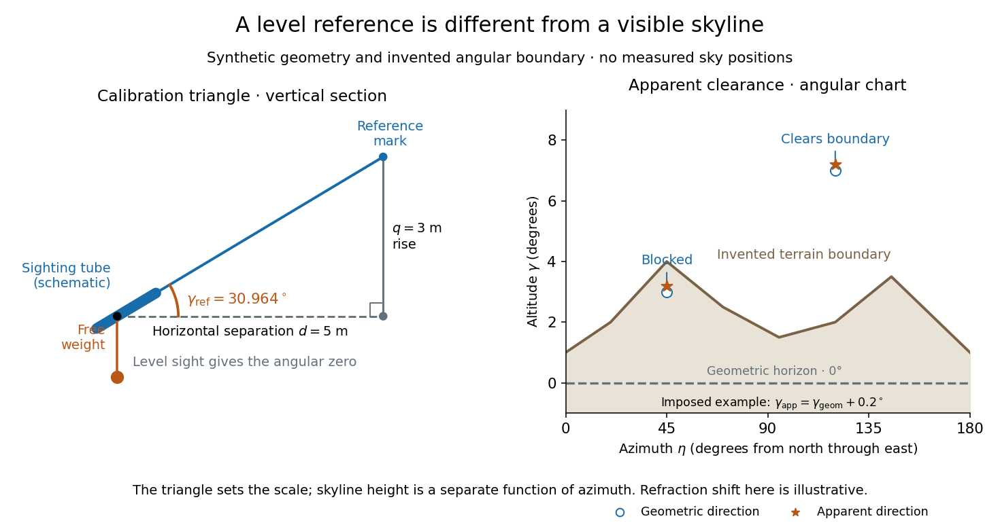

**[Figure 5](#image-synthetic-calibration-triangle-and-invented-terrain-boundary-angular-zero-apparent-altitude-and-geometric-horizon-are-separate). Synthetic calibration triangle and invented terrain boundary; angular zero, apparent altitude and geometric horizon are separate**.

Even an unobstructed sea boundary need not coincide with the [astronomical horizon](#astronomical-horizon). On a spherical [Earth](planetary-science.md#earth) of radius $r$, an observer at height $q$ sees the unrefracted tangent to the surface at a downward [angle](geometry-and-topology.md#angle) $D$ satisfying $\cos D=r/(r+q)$. The right-angle tangent [triangle](euclidean-geometry.md#triangle) supplies this relation; the visible boundary then has [altitude](#altitude) $-D$. With illustrative $r=6371\,\mathrm{km}$ and $q=10\,\mathrm m$, $D\simeq0.1015^\circ$, before [atmospheric refraction](optics.md#atmospheric-refraction). Raising the eye therefore changes the visible boundary without redefining the horizontal [plane](geometry-and-topology.md#plane).

The US Naval Observatory's rise/set definitions explicitly distinguish the geometric reference from apparent contact with a visible disk: the standard [Sun](stellar-astrophysics.md#sun) calculation puts its centre $50'$ below the horizontal [plane](geometry-and-topology.md#plane), combining an average $16'$ radius with $34'$ of [atmospheric refraction](optics.md#atmospheric-refraction). An angular minute is $1'=1/60^\circ$ in the [minute and second of arc](geometry-and-topology.md#minute-and-second-of-arc) convention. This is an operational average under stated conditions, rather than a universal zero of [altitude](#altitude). The same source identifies weather, local topography and observer height as limits on predicted rise/set [time](classical-mechanics.md#time-in-physics). An observation log should therefore retain the level reference, site and eye height, terrain profile, observation [time](classical-mechanics.md#time-in-physics), and whether each reported [altitude](#altitude) is geometric or apparent. [US Naval Observatory: Rise, set and twilight definitions, geometric horizon and observational limitations](https://aa.usno.navy.mil/faq/RST_defs).

## Celestial sphere

↑ **Parent:** [Astrophysics](astrophysics.md)  
ⓦ [Wiki](https://en.wikipedia.org/wiki/Celestial_sphere)

The [celestial sphere](#celestial-sphere) is the [sphere](euclidean-geometry.md#sphere) of viewing directions around an observer; distances to objects are suppressed. [Great circles](euclidean-geometry.md#great-circle) define coordinate reference planes.

### Celestial meridian

↑ **Parent:** [Celestial sphere](#celestial-sphere)

An observer’s [celestial meridian](#celestial-meridian) is the [great circle](euclidean-geometry.md#great-circle) containing the [zenith](#zenith) and the [celestial poles](#celestial-pole). Its upper half passes through the local north and south directions.

### Celestial pole

↑ **Parent:** [Celestial sphere](#celestial-sphere)  
ⓦ [Wiki](https://en.wikipedia.org/wiki/Celestial_pole)

The [celestial poles](#celestial-pole) are the two intersections of the rotation axis of Earth with the [celestial sphere](#celestial-sphere). The northern pole has [declination](#declination) $+90^\circ$.

### Celestial equator

↑ **Parent:** [Celestial sphere](#celestial-sphere)  
ⓦ [Wiki](https://en.wikipedia.org/wiki/Celestial_equator)

The [celestial equator](#celestial-equator) is the [great circle](euclidean-geometry.md#great-circle) perpendicular to the rotation axis of Earth; [declination](#declination) measures angular displacement from it.

## Accretion

↑ **Parent:** [Astrophysics](astrophysics.md)

Growth of an astronomical object's [mass](classical-mechanics.md#mass) by capture of surrounding matter. During [planetary scattering](planetary-science.md#planetary-scattering), a collision can lead to [accretion](#accretion) if material is retained by the [planet](planetary-science.md#planet); not every collision retains all material. An [accretion disk](astrophysical-disk.md#accretion-disk) is one particular geometry supplying material.

## Equatorial coordinate system

↑ **Parent:** [Astrophysics](astrophysics.md)  
ⓦ [Wiki](https://en.wikipedia.org/wiki/Equatorial_coordinate_system)

An [equatorial coordinate system](#equatorial-coordinate-system) labels a viewing direction on the [celestial sphere](#celestial-sphere) by [right ascension](#right-ascension) $\alpha$, increasing eastward around the reference [celestial equator](#celestial-equator), and [declination](#declination) $\delta$, increasing northward from that [celestial equator](#celestial-equator). These two [angles](geometry-and-topology.md#angle) locate a direction, without specifying the object's [Euclidean distance](topological-analysis.md#euclidean-distance). In the traditional convention, zero [right ascension](#right-ascension) points toward the [reference equinox](#equinox-celestial-coordinates), the northward crossing of the [Sun](stellar-astrophysics.md#sun)'s annual path through the [celestial equator](#celestial-equator). An [hour circle](#hour-circle) through the direction supplies the north-south arc on which [declination](#declination) is measured. [Jeremy Tatum: Celestial mechanics, chapter 6, the celestial sphere](https://www.astro.uvic.ca/~tatum/celmechs/celm6.pdf).

For a concrete construction, choose [Cartesian coordinates](linear-algebra.md#cartesian-coordinate-system) with $x$ pointing toward the [reference equinox](#equinox-celestial-coordinates), $z$ toward the north reference [celestial pole](#celestial-pole), and positive $y$ given by the [cross product](vector-space.md#cross-product) of the positive $z$ and $x$ directions. The direction's [unit vector](vector-space.md#unit-vector) is

$$
\mathbf n=(\cos\delta\cos\alpha,\ \cos\delta\sin\alpha,\ \sin\delta).
$$

This is a [spherical coordinate system](multivariable-calculus.md#spherical-coordinate-system) with polar [angle](geometry-and-topology.md#angle) $\pi/2-\delta$ and no radial coordinate. The [trigonometric functions](geometry-and-topology.md#trigonometric-function) require consistent angular units: convert [right ascension](#right-ascension) in hours to [radians](geometry-and-topology.md#radian) before evaluating them. The synthetic direction $\alpha=4^{\rm h}=60^\circ$, $\delta=30^\circ$ gives $\mathbf n=(\sqrt3/4,3/4,1/2)$; its squared [norm](normed-vector-space.md#norm) is $3/16+9/16+1/4=1$. A change of reference axes applies a [rotation](riemannian-geometry.md#rotation-mathematics) to this [unit vector](vector-space.md#unit-vector) before recovering the two [angles](geometry-and-topology.md#angle). Away from the [celestial poles](#celestial-pole), recover [right ascension](#right-ascension) using the quadrant-aware $\operatorname{atan2}(n_y,n_x)$ reduced modulo $2\pi$, and [declination](#declination) using $\arcsin n_z$; a plain [arctangent](geometry-and-topology.md#inverse-tangent) of $n_y/n_x$ loses the quadrant. Adding a common offset to every [right ascension](#right-ascension) describes only the special case of a [rotation](riemannian-geometry.md#rotation-mathematics) about the same polar axis.

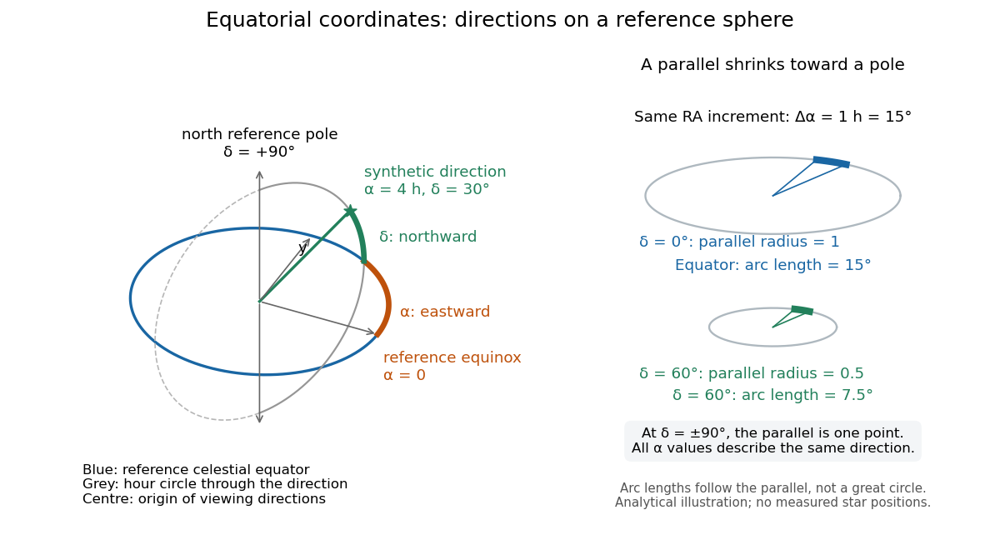

**[Figure 6](#image-analytical-geometry-of-right-ascension-declination-and-the-shrinking-east-west-arc-toward-a-celestial-pole). Analytical geometry of right ascension, declination and the shrinking east-west arc toward a celestial pole**.

The reference specification matters. For an [equatorial coordinate system](#equatorial-coordinate-system) tied to the [Earth](planetary-science.md#earth), [precession](rigid-body-dynamics.md#precession) changes the reference [celestial equator](#celestial-equator) and [reference equinox](#equinox-celestial-coordinates), and [nutation](rigid-body-dynamics.md#nutation) distinguishes their mean and true versions. The date specifying those axes is distinct from the [astronomical epoch](#epoch-astronomy) at which a catalogue's source directions apply: advancing a [star](stellar-astrophysics.md#star)'s [proper motion](astronomy.md#proper-motion) and changing reference axes are separate operations. A modern catalogue may instead use fixed [reference frame](mathematical-physics.md#reference-frame) axes, aligned approximately with the traditional J2000.0 axes, without a moving [reference equinox](#equinox-celestial-coordinates). Thus a pair of numbers labelled merely "J2000" does not settle every convention. State the [reference frame](mathematical-physics.md#reference-frame), the [astronomical epoch](#epoch-astronomy), and whether a direction is catalogued or apparent. [US Naval Observatory: Reference systems, catalogue epochs and fixed celestial axes](https://aa.usno.navy.mil/faq/ICRS_doc).

During one night's elementary fixed-direction approximation, a [star](stellar-astrophysics.md#star)'s [right ascension](#right-ascension) and [declination](#declination) remain constant while its [altitude](#altitude), [azimuth](#azimuth) and [hour angle](#hour-angle) change because the [Earth](planetary-science.md#earth) turns. In angular units, with $\Theta$ the local [sidereal time](#sidereal-time), west-positive [hour angle](#hour-angle) $H$ obeys

$$
H=\Theta-\alpha\pmod{2\pi}.
$$

At upper [meridian transit](#meridian-transit), $H=0$ and the local [sidereal time](#sidereal-time) equals the transiting direction's [right ascension](#right-ascension). Pair apparent [sidereal time](#sidereal-time) with apparent [right ascension](#right-ascension) referred to the true [celestial equator](#celestial-equator) and [reference equinox](#equinox-celestial-coordinates) of date; mean [sidereal time](#sidereal-time) refers to the mean [reference equinox](#equinox-celestial-coordinates). Raw fixed-frame catalogue coordinates require conversion before precision pointing. [US Naval Observatory: Mean and apparent sidereal time and the local longitude correction](https://aa.usno.navy.mil/faq/GAST).

This separation makes the [equatorial coordinate system](#equatorial-coordinate-system) useful: a catalogue can identify a target independently of the observer's current [astronomical horizon](#astronomical-horizon), while local [sidereal time](#sidereal-time) tells the observer which [hour circle](#hour-circle) is on the [celestial meridian](#celestial-meridian). Precision observations also account for [proper motion](astronomy.md#proper-motion), [stellar parallax](#stellar-parallax), [aberration of light](mathematical-physics.md#relativistic-aberration) and [atmospheric refraction](optics.md#atmospheric-refraction); the fixed-direction construction above omits those effects. A reference-axis [rotation](riemannian-geometry.md#rotation-mathematics) preserves [angles](geometry-and-topology.md#angle) between directions, whereas changing the observer or correcting [atmospheric refraction](optics.md#atmospheric-refraction) is a different operation. [US Naval Observatory: Transforming catalogue directions into observable directions](https://aa.usno.navy.mil/faq/ICRS_doc).

### Hour angle

↑ **Parent:** [Equatorial coordinate system](#equatorial-coordinate-system)  
ⓦ [Wiki](https://en.wikipedia.org/wiki/Hour_angle)

The [hour angle](#hour-angle) of a direction is the westward [angle](geometry-and-topology.md#angle) from the upper [celestial meridian](#celestial-meridian) to its hour circle. In a consistent equinox convention, $h=\mathrm{LST}-\alpha$ modulo one turn, where $\alpha$ is [right ascension](#right-ascension) and LST is local [sidereal time](#sidereal-time).

### Parallactic angle

↑ **Parent:** [Equatorial coordinate system](#equatorial-coordinate-system)  
ⓦ [Wiki](https://en.wikipedia.org/wiki/Parallactic_angle)

The parallactic angle is the angle between the great circles from an observed direction toward the celestial pole and toward the zenith. Its change gives sky rotation in pupil-stabilized observations.

### Declination

↑ **Parent:** [Equatorial coordinate system](#equatorial-coordinate-system)  
ⓦ [Wiki](https://en.wikipedia.org/wiki/Declination)

[Declination](#declination) $\delta$ is the signed [angle](geometry-and-topology.md#angle) from the reference [celestial equator](#celestial-equator) to a direction, measured along its [hour circle](#hour-circle): $-90^\circ\leq\delta\leq+90^\circ$. Positive [declination](#declination) means celestial north, rather than necessarily north of the observer's [zenith](#zenith). A direction with $\delta=0$ lies on the [celestial equator](#celestial-equator); $\delta=+90^\circ$ is the north reference [celestial pole](#celestial-pole). [Declination](#declination) is an [angle](geometry-and-topology.md#angle), not a height or a measure of [Euclidean distance](topological-analysis.md#euclidean-distance). [US Naval Observatory: Astronomical Almanac glossary, declination and culmination](https://aa.usno.navy.mil/faq/asa_glossary).

The connection to an observation follows from a [dot product](inner-product.md#dot-product). In the elementary spherical-[Earth](planetary-science.md#earth), unrefracted model, an observer at [geographical latitude](#geographical-latitude) $\phi$ has [zenith](#zenith) direction $\mathbf z=(\cos\phi\cos\Theta,\cos\phi\sin\Theta,\sin\phi)$ in the same reference axes. Since $\mathbf n\cdot\mathbf z=\sin a$ for [altitude](#altitude) $a$, the [cosine addition formula](geometry-and-topology.md#cosine-addition-formula) gives

$$
\sin a=\sin\phi\sin\delta+\cos\phi\cos\delta\cos H.
$$

At upper [meridian transit](#meridian-transit), $H=0$, so $a_{\rm upper}=90^\circ-|\phi-\delta|$. For the synthetic site $\phi=52^\circ$ and synthetic direction $\delta=20^\circ$, this yields $a_{\rm upper}=58^\circ$. A direction with $\delta=70^\circ$ instead reaches $72^\circ$, north of the [zenith](#zenith); positive [declination](#declination) does not imply a crossing on the southern half of the [celestial meridian](#celestial-meridian). A negative computed upper [altitude](#altitude) means the direction never rises above the geometric [astronomical horizon](#astronomical-horizon) at that site.

For an angular readout, define signed zenith distance $z_s$ on the upper [celestial meridian](#celestial-meridian), positive toward the south and negative toward the north. Then $\delta=\phi-z_s$. A synthetic southward readout $z_s=32^\circ$ at $\phi=52^\circ$ recovers $\delta=20^\circ$. An unsigned distance $|z_s|$ alone would leave two possibilities, $\phi\pm|z_s|$, when both are in range. A calibrated [optical telescope](optical-instrument.md#optical-telescope) must therefore record which side of the [zenith](#zenith) it points toward. In this linear relation, a $1'$ error in the assumed [geographical latitude](#geographical-latitude) produces a $1'$ error in inferred [declination](#declination); averaging repeated readings cannot remove that shared offset. Near the [astronomical horizon](#astronomical-horizon), uncorrected [atmospheric refraction](optics.md#atmospheric-refraction) also invalidates the geometric readout.

The [unit vector](vector-space.md#unit-vector) construction explains a subtle feature of sky maps. At fixed [declination](#declination), changing [right ascension](#right-ascension) traces a parallel whose radius on the unit [sphere](euclidean-geometry.md#sphere) is $\cos\delta$. Its arc [length](physics.md#length) is $\cos\delta\,|d\alpha|$, with [angles](geometry-and-topology.md#angle) in [radians](geometry-and-topology.md#radian); at $\delta=60^\circ$, a $15^\circ$ [right ascension](#right-ascension) increment spans a $7.5^\circ$ arc along that parallel. This arc is not generally the shortest [great circle](euclidean-geometry.md#great-circle) separation. At either [celestial pole](#celestial-pole), all [right ascension](#right-ascension) values represent the same direction: the [coordinate singularity](general-relativity.md#coordinate-singularity) belongs to the coordinate grid. The [unit vector](vector-space.md#unit-vector) remains regular there.

### Right ascension

↑ **Parent:** [Equatorial coordinate system](#equatorial-coordinate-system)  
ⓦ [Wiki](https://en.wikipedia.org/wiki/Right_ascension)

[Right ascension](#right-ascension) $\alpha$ is the eastward [angle](geometry-and-topology.md#angle) along the reference [celestial equator](#celestial-equator) from the [reference equinox](#equinox-celestial-coordinates) to a direction's [hour circle](#hour-circle), conventionally reduced to $0\leq\alpha<24^{\rm h}$. Its hours label [angles](geometry-and-topology.md#angle): $24^{\rm h}=360^\circ$, $1^{\rm h}=15^\circ$, $1^{\rm m}=15'$ and $1^{\rm s}=15''$. Thus $6^{\rm h}30^{\rm m}=97.5^\circ=13\pi/24$ [radians](geometry-and-topology.md#radian). A minute of [right ascension](#right-ascension) differs from a minute of arc, and the actual arc on a fixed-[declination](#declination) parallel also contains the [cosine](geometry-and-topology.md#cosine) factor described under [declination](#declination).

The hours become useful through [sidereal time](#sidereal-time). At local [sidereal time](#sidereal-time) $8^{\rm h}$, a synthetic direction of [right ascension](#right-ascension) $6^{\rm h}30^{\rm m}$ has west-positive [hour angle](#hour-angle) $1^{\rm h}30^{\rm m}=22.5^\circ$ and has passed its upper [meridian transit](#meridian-transit). Conversely, at $5^{\rm h}30^{\rm m}$ it has [hour angle](#hour-angle) $-1^{\rm h}$ and has yet to cross. Interpret these intervals in sidereal hours; ordinary civil hours are not interchangeable with them. The [right ascension](#right-ascension) of the upper [celestial meridian](#celestial-meridian) advances as the [Earth](planetary-science.md#earth) turns, while the synthetic fixed target's [right ascension](#right-ascension) stays unchanged.

An instrument makes this geometry tangible. DePauw University's description of McKim Observatory documents a meridian [optical telescope](optical-instrument.md#optical-telescope) with an angular circle, astronomical clocks and a chronograph. The circle measures zenith distance, and the crossing [time](classical-mechanics.md#time-in-physics) supplies [right ascension](#right-ascension). Clock pulses and the observer's electrical key mark a rotating paper record, so crossing [time](classical-mechanics.md#time-in-physics) is read relative to the clock marks. One clock kept [sidereal time](#sidereal-time) and another solar [time](classical-mechanics.md#time-in-physics). This apparatus separates two measured quantities: when a [star](stellar-astrophysics.md#star) crosses the [celestial meridian](#celestial-meridian), and at what [angle](geometry-and-topology.md#angle) from the [zenith](#zenith). [DePauw University: McKim's meridian telescope, angular circle, clocks and chronograph](https://www.depauw.edu/about/campus/mckim-observatory/observatory-instruments/).

A teaching reconstruction would fix an [optical telescope](optical-instrument.md#optical-telescope) to sweep the [celestial meridian](#celestial-meridian), align its central sighting line, and observe a recognizable reference [star](stellar-astrophysics.md#star) followed by a target. Record each central-line crossing against a clock or timestamped camera, and read the angular circle at upper [meridian transit](#meridian-transit). A short sequence shows the image moving across the stationary sighting line; the central crossing supplies a repeatable event. In the ideal model, successive upper crossings of a fixed direction recur once per sidereal day, and directions with increasing [right ascension](#right-ascension) cross later in the same cycle. These are predictions for the reconstruction, rather than reported McKim measurements. Tatum derives the equality between local [sidereal time](#sidereal-time) and [right ascension](#right-ascension) at upper [meridian transit](#meridian-transit). [Jeremy Tatum: Section 6.3, timing upper meridian transit](https://www.astro.uvic.ca/~tatum/celmechs/celm6.pdf).

Calibrate the clock's zero by comparing its reference crossing readout $C_r$ with the reference [star](stellar-astrophysics.md#star)'s predicted apparent [right ascension](#right-ascension) $\alpha_r$ in the same date convention: the additive correction is $b=\alpha_r-C_r$, modulo $24^{\rm h}$. Then infer target [right ascension](#right-ascension) $\alpha_t=C_t+b$ if the clock rate is correct between crossings. In a purely synthetic example, $\alpha_r=6^{\rm h}00^{\rm m}00^{\rm s}$ and $C_r=6^{\rm h}00^{\rm m}20^{\rm s}$ imply $b=-20^{\rm s}$. A target readout $C_t=6^{\rm h}30^{\rm m}20^{\rm s}$ therefore gives $\alpha_t=6^{\rm h}30^{\rm m}00^{\rm s}=97.5^\circ$. The $20^{\rm s}$ clock offset is $300''$ in [right ascension](#right-ascension), while its local east-west angular effect at [declination](#declination) $60^\circ$ is approximately $150''$. The reference and target in this calculation are invented directions, with no claim about any current [star](stellar-astrophysics.md#star)'s coordinates.

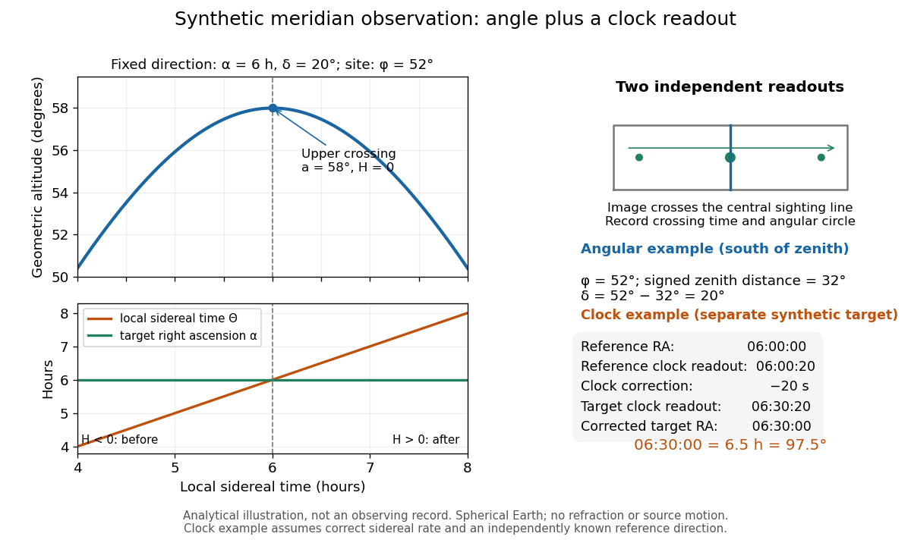

**[Figure 7](#image-synthetic-meridian-observation-changing-altitude-fixed-right-ascension-and-a-calibrated-sidereal-clock-readout). Synthetic meridian observation: changing altitude, fixed right ascension, and a calibrated sidereal-clock readout**.

Controls give the inference its meaning. Use independently established [geographical latitude](#geographical-latitude) and an angular-circle zero for [declination](#declination); check sighting-line alignment against several reference [stars](stellar-astrophysics.md#star), and bracket the target in [time](classical-mechanics.md#time-in-physics) with references to reveal clock drift. Record north or south of the [zenith](#zenith), distinguish upper from lower [meridian transit](#meridian-transit), and account for [atmospheric refraction](optics.md#atmospheric-refraction). Convert the observing timestamp to local [sidereal time](#sidereal-time) using the site's east-positive longitude correction, rather than a time-zone offset; precise conversion uses the [Earth](planetary-science.md#earth)'s measured rotation [time](classical-mechanics.md#time-in-physics). A reference [star](stellar-astrophysics.md#star) calibrates a zero only after its catalogue direction has been converted to the observation convention. Repeated crossings reduce random [measurement error](probability-and-statistics.md#measurement-error), while an incorrect clock rate, axis alignment or catalogue convention remains a systematic limitation. [US Naval Observatory: Local sidereal time, longitude convention and rotation-time input](https://aa.usno.navy.mil/faq/GAST). These controls are requirements inferred from the geometric and clock model, not a claimed historical observing log.

### Equinox (celestial coordinates)

↑ **Parent:** [Equatorial coordinate system](#equatorial-coordinate-system)  
ⓦ [Wiki](https://en.wikipedia.org/wiki/Equinox_(celestial_coordinates))

The [reference equinox](#equinox-celestial-coordinates) is the direction conventionally used as the origin of [right ascension](#right-ascension): the northward intersection of the [Sun](stellar-astrophysics.md#sun)'s annual path with the reference [celestial equator](#celestial-equator). Its mean or true convention and reference date specify which direction is intended. Here the [reference equinox](#equinox-celestial-coordinates) is a direction on the [celestial sphere](#celestial-sphere), rather than the instant of a seasonal crossing. [US Naval Observatory: Equinox and mean versus true reference directions](https://aa.usno.navy.mil/faq/asa_glossary).

### Epoch (astronomy)

↑ **Parent:** [Equatorial coordinate system](#equatorial-coordinate-system)  
ⓦ [Wiki](https://en.wikipedia.org/wiki/Epoch_(astronomy))

An [astronomical epoch](#epoch-astronomy) is a reference instant for astronomical data. A catalogue's position [astronomical epoch](#epoch-astronomy) says when the listed source direction applies; [proper motion](astronomy.md#proper-motion) advances that direction to another instant. The reference date for an [equatorial coordinate system](#equatorial-coordinate-system)'s axes need not equal the position [astronomical epoch](#epoch-astronomy). ESA's Gaia documentation explicitly associates both [right ascension](#right-ascension) and [declination](#declination) with its reference-epoch field. [ESA Gaia DR3: Reference epoch and its associated coordinate and proper-motion fields](https://gea.esac.esa.int/archive/documentation/GDR3/Gaia_archive/chap_datamodel/sec_dm_main_source_catalogue/ssec_dm_gaia_source.html).

### Hour circle

↑ **Parent:** [Equatorial coordinate system](#equatorial-coordinate-system)  
ⓦ [Wiki](https://en.wikipedia.org/wiki/Hour_circle)

An [hour circle](#hour-circle) is a [great circle](euclidean-geometry.md#great-circle) through both reference [celestial poles](#celestial-pole) and a chosen direction. Its two halves have [right ascensions](#right-ascension) differing by $12^{\rm h}$; choose the half containing the direction when measuring [declination](#declination). The observer's [celestial meridian](#celestial-meridian) is the particular [hour circle](#hour-circle) through the [zenith](#zenith). [Jeremy Tatum: Section 6.3, hour circles and declination circles](https://www.astro.uvic.ca/~tatum/celmechs/celm6.pdf).

### Meridian transit

↑ **Parent:** [Equatorial coordinate system](#equatorial-coordinate-system)

A [meridian transit](#meridian-transit) is a direction's crossing of the observer's [celestial meridian](#celestial-meridian). Upper [meridian transit](#meridian-transit) occurs at [hour angle](#hour-angle) $0$ and gives the greatest geometric [altitude](#altitude) in the fixed-direction model; lower [meridian transit](#meridian-transit) occurs at [hour angle](#hour-angle) $12^{\rm h}$ and gives the least. Either crossing can lie below the [astronomical horizon](#astronomical-horizon). [US Naval Observatory: Upper and lower culmination](https://aa.usno.navy.mil/faq/asa_glossary).

## Light curve

↑ **Parent:** [Astrophysics](astrophysics.md)

A [light curve](#light-curve) records an astronomical source's received brightness against [time](classical-mechanics.md#time-in-physics), in a specified [photometric passband](#photometric-passband). Its measured form is a [time series](time-series.md) of timestamps, brightness estimates, and uncertainties; a smooth $F(t)$ is a model of that record. Brightness can be reported as calibrated [observed radiative flux](#observed-radiative-flux), a detector count rate, a dimensionless ratio to a reference level, or [apparent magnitude](#apparent-magnitude). These quantities require different units and calibration conventions. A [light curve](#light-curve) concerns what reaches the observer: a dip during an [exoplanet transit](exoplanet.md#exoplanet-transit) does not imply that the [star](stellar-astrophysics.md#star)'s emitted [luminosity](#luminosity) fell.

The appeal of a [light curve](#light-curve) is that an unresolved point of [light](optics.md#light) can reveal motion and structure. In [exoplanet transit photometry](exoplanet.md#exoplanet-transit-photometry), repeated dips constrain the [orbital period](celestial-mechanics.md#orbital-period); under the uniform-disc, dark-[planet](planetary-science.md#planet), full-overlap assumptions, the [exoplanet transit depth](exoplanet.md#exoplanet-transit-depth) is the blocked [area](differential-geometry.md#surface-area) fraction $(R_p/R_\star)^2$. A toy one-percent dip therefore corresponds to a [radius](topology.md#radius) ratio of $0.10$. Its duration and shape add information about the crossing geometry, with [limb darkening](radiometry.md#limb-darkening), [transit impact parameter](exoplanet.md#transit-impact-parameter), and [transit dilution](exoplanet.md#transit-dilution) affecting the interpretation. See [exoplanet transit photometry](exoplanet.md#exoplanet-transit-photometry) for the geometry. The first figure instead follows the measurement: an instrumental trend and sky contribution can obscure a small physical dip.

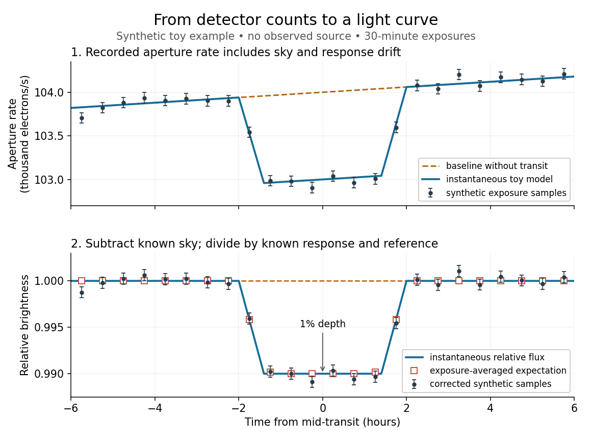

**[Figure 8](#image-toy-light-curve-a-one-percent-transit-recovered-from-a-known-sky-contribution-and-gain-drift-synthetic-data-not-observations). Toy light curve: a one-percent transit recovered from a known sky contribution and gain drift; synthetic data, not observations**.

An instructive real observation is the early Kepler record of the already known [exoplanet](exoplanet.md) HAT-P-7b. Welsh and colleagues analysed 33.5 days from 13 May to 15 June 2009, containing 15 complete [exoplanet transits](exoplanet.md#exoplanet-transit) at an [orbital period](celestial-mechanics.md#orbital-period) of about $2.20473$ days. The [CCDs](optical-instrument.md#charge-coupled-device) were read roughly every six seconds and coadded to approximately one-minute samples: each point measures accumulated signal over a finite interval, not instantaneous brightness. After removing 21 positive outliers attributed to [cosmic rays](galaxy.md#cosmic-ray), 49,023 samples remained. The authors estimated a scatter of about $150$ parts per million per one-minute sample. A gradual $0.13\%$ count decrease, suspected to arise from focus drift with a fixed extraction aperture, was removed with a cubic [polynomial](polynomial.md) fitted while masking the [exoplanet transits](exoplanet.md#exoplanet-transit). They normalized brightness at mid-[exoplanet secondary eclipse](exoplanet.md#exoplanet-secondary-eclipse), when the [planet](planetary-science.md#planet) was hidden and only starlight remained. [Welsh et al. (2010), observations, section 2](https://www.ucolick.org/~jfortney/papers/Welsh10.pdf).

What does the instrument actually measure? A [CCD](optical-instrument.md#charge-coupled-device) collects photoelectrons from incoming [photons](quantum-mechanics.md#photon); pixel values first need electronic-offset, [dark current](optical-instrument.md#dark-current-physics), readout-smear, and sensitivity corrections. [Kepler Guest Observer Program, pixel calibration; edited by Martin Still](https://nexsci.caltech.edu/workshop/2012/keplergo/PipelineCAL.shtml). [Aperture photometry](#aperture-photometry) then sums a chosen group of pixels around the [star](stellar-astrophysics.md#star), with [background subtraction](optical-instrument.md#background-subtraction) removing the estimated [sky brightness](#sky-brightness). A count rate is a response-weighted brightness measurement, not automatically a bolometric [observed radiative flux](#observed-radiative-flux). Calibration must respect the [photometric passband](#photometric-passband) and, for [apparent magnitude](#apparent-magnitude), its [magnitude zero point](#magnitude-zero-point). Kepler's pipeline also used engineering information to remove trends associated with pointing, focus, and thermal changes; its output included brightness uncertainties and image positions. [Jenkins et al. (2010), pipeline overview, sections 2–5](https://arxiv.org/pdf/1001.0258).

Calibration and interpretation need separate checks. A blended [eclipsing binary](stellar-astrophysics.md#eclipsing-binary) can mimic an [exoplanet transit](exoplanet.md#exoplanet-transit), with [transit dilution](exoplanet.md#transit-dilution) making a deep stellar eclipse appear shallow. The Kepler pipeline paper describes comparing odd and even dip depths and examining changes in the image [centroid](euclidean-geometry.md#centroid): an off-target fading source can move the combined image position. These tests help reject false positives but do not by themselves establish a companion's [mass](classical-mechanics.md#mass); complementary [Doppler spectroscopy](exoplanet.md#doppler-spectroscopy) and host-[star](stellar-astrophysics.md#star) constraints remain valuable. [Jenkins et al. (2010), data validation, section 6](https://arxiv.org/pdf/1001.0258).

Even a real [exoplanet](exoplanet.md)'s signal can have several contributors. Welsh and colleagues found brightness modulation from the [star](stellar-astrophysics.md#star) distorted by [tidal forces](newton-s-law-of-universal-gravitation.md#tidal-force) as well as the [planet](planetary-science.md#planet); assigning all orbital brightness changes to planetary emission would misinterpret this [light curve](#light-curve). [Welsh et al. (2010), interpretation, section 4](https://www.ucolick.org/~jfortney/papers/Welsh10.pdf). [Starspots](exoplanet.md#starspot), [limb darkening](radiometry.md#limb-darkening), and [transit dilution](exoplanet.md#transit-dilution) likewise belong in the relevant physical model. A flexible trend fitted through a dip could absorb that dip; the masked fit in the real example illustrates why the fitting procedure is part of the measurement. [Exposure-averaged light curves](#exposure-averaged-light-curve) and [phase folding of a light curve](#phase-folding-of-a-light-curve) make two further limitations explicit.

### Aperture photometry

↑ **Parent:** [Light curve](#light-curve)

[Aperture photometry](#aperture-photometry) estimates brightness by summing calibrated detector pixels in an extraction region and subtracting the estimated background in that region. For $n$ equally weighted pixels, let $S$ be their total accumulated signal in [electrons](physics.md#electron), $b$ the estimated background [electrons](physics.md#electron) per pixel over the same exposure, and $\Delta t$ the exposure duration. Then $\widehat r=(S-nb)/\Delta t$ is a background-subtracted electron rate. Kepler applied [aperture photometry](#aperture-photometry) to calibrated pixels with a fitted sky background. [Jenkins et al. (2010), photometric analysis, section 3](https://arxiv.org/pdf/1001.0258).

This measurement trades source collection against background: enlarging the extraction region can retain more starlight but includes more [sky brightness](#sky-brightness) and neighbouring sources. [Photon shot noise](optical-instrument.md#photon-shot-noise), [read noise](optical-instrument.md#read-noise), and uncertainty in [background subtraction](optical-instrument.md#background-subtraction) contribute to its uncertainty. Dividing $\widehat r$ by a consistently measured reference rate gives a dimensionless [light curve](#light-curve); it does not supply an absolute [observed radiative flux](#observed-radiative-flux). If contaminating light remains, the reference includes it and the inferred [exoplanet transit depth](exoplanet.md#exoplanet-transit-depth) suffers [transit dilution](exoplanet.md#transit-dilution).

In the first toy figure, the source's reference rate is $100{,}000$ electrons per second, the summed sky contribution is $4{,}000$ electrons per second, and a known multiplicative response is $g(t)=1+0.0003t$ with $t$ in hours from mid-transit. The artificial [exoplanet transit depth](exoplanet.md#exoplanet-transit-depth) is $0.010$, its total duration four hours, and its flat-bottom duration $2.8$ hours; the straight ingress and egress are a toy approximation, not an exact [exoplanet transit photometry](exoplanet.md#exoplanet-transit-photometry) model. Each synthetic sample averages a $0.5$-hour exposure and adds seeded [normal distribution](probability-distribution.md#normal-distribution) noise with relative [standard deviation](variance.md#standard-deviation) $0.0006$. Subtracting the known sky rate and dividing by the known response and reference rate recovers the dip. Real observations require estimating those corrections and carrying their uncertainty.

### Exposure-averaged light curve

↑ **Parent:** [Light curve](#light-curve)

An [exposure-averaged light curve](#exposure-averaged-light-curve) models what a finite exposure measures. For a constant response during an exposure of duration $\Delta t_i>0$, centred at $t_i$, the expected mean brightness is

$$
\overline F_i=\frac{1}{\Delta t_i}\int_{t_i-\Delta t_i/2}^{t_i+\Delta t_i/2}F(t)\,dt.
$$

The [integral](integral.md) has units of brightness times [time](classical-mechanics.md#time-in-physics); division restores the units of $F$. Observed points fluctuate around this mean. A response that changes during the exposure must instead be included inside the [integral](integral.md), as in the first figure's known drift. Exposure duration and the interval between samples are distinct: there may be dead time or missing exposures.

A short dip can be blurred even with perfectly noiseless measurements. For a toy rectangular dip of fractional depth $\delta$ and duration $T<\Delta t$, an exposure containing the whole dip has fractional depth $\delta T/\Delta t$: averaging hides part of its depth. A $1\%$ dip lasting ten minutes therefore appears only $0.333\%$ deep in a thirty-minute exposure. No [interpolation](interpolation.md) recovers its shape from that single number without additional assumptions. Forward modelling should average the predicted [light curve](#light-curve) over each exposure before comparing it with the measurements. Kipping's analysis of [exoplanet transit photometry](exoplanet.md#exoplanet-transit-photometry) demonstrates how ignoring this averaging biases inferred system parameters. [Kipping (2010), Binning is sinning](https://arxiv.org/abs/1004.3741).

### Phase folding of a light curve

↑ **Parent:** [Light curve](#light-curve)

[Phase folding of a light curve](#phase-folding-of-a-light-curve) maps timestamps onto a trial cycle of duration $P>0$. Given a reference time $t_0$, define the phase in cycles by

$$
\phi_i=\operatorname{frac}\left(\frac{t_i-t_0}{P}\right),\qquad 0\le\phi_i<1,
$$

where $\operatorname{frac}(x)=x-\lfloor x\rfloor$ is the [fractional part](calculus.md#fractional-part), using the [floor function](calculus.md#floor-function) also for negative $x$. Plot brightness against $\phi_i$ rather than $t_i$; measurements separated by an integer multiple of $P$ occupy the same phase. For a [periodic function](function.md#periodic-function) $F(t+P)=F(t)$, this reveals the shared shape of many cycles. Folding changes coordinates; it neither averages samples nor chooses the correct $P$ by itself. Welsh et al.'s folded Kepler plot separates the [exoplanet transit](exoplanet.md#exoplanet-transit) and orbital brightness modulation. [Welsh et al. (2010), figure 1](https://www.ucolick.org/~jfortney/papers/Welsh10.pdf).

The second figure uses a completely synthetic trapezoidal dip: $P=3$ days, $t_0=1$ day, and the same $1\%$ depth and four-hour duration as the first figure. Different colours identify four successive cycles. Correct folding superimposes the dips; a wrong trial [orbital period](celestial-mechanics.md#orbital-period) spreads them out. If $P'=P+\epsilon$, the centre of the $n$th repeated event shifts by approximately $-n\epsilon/P$ cycles when folded on $P'$, for $|\epsilon|\ll P$. With $P'=3.03$ days, the fourth plotted event is displaced by $-3(0.03)/3.03\simeq-0.0297$ cycles. [Transit-timing variations](exoplanet.md#transit-timing-variation) can also smear a constant-period fold, so retain the original timestamps and inspect individual events.

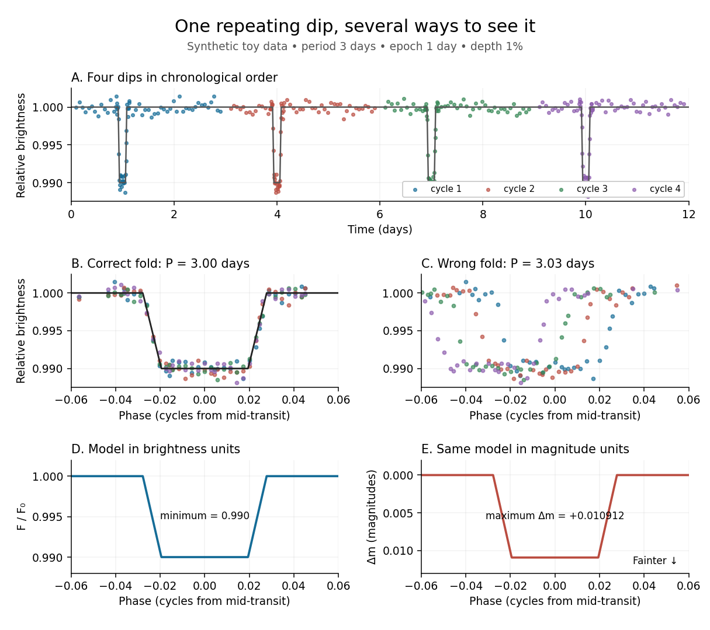

**[Figure 9](#image-toy-phase-folding-repeated-synthetic-dips-align-at-the-correct-period-a-flux-dip-becomes-a-positive-magnitude-change). Toy phase folding: repeated synthetic dips align at the correct period; a flux dip becomes a positive magnitude change**.

One may combine nearby phases with a [weighted mean](arithmetic.md#weighted-arithmetic-mean), but the uncertainty reduction requires assumptions. For $N$ independent measurements with common [standard deviation](variance.md#standard-deviation) $\sigma$ and effectively the same expected brightness within the bin, their [arithmetic mean](arithmetic.md#arithmetic-mean) has [standard deviation](variance.md#standard-deviation) $\sigma/\sqrt N$. Thus sixteen independent $0.0006$-precision samples give $0.00015$ precision on that phase-bin mean. Shared calibration errors, changing [starspots](exoplanet.md#starspot), and bins wide enough to mix ingress with out-of-transit brightness violate these assumptions. A folded plot can conceal changes between cycles. [Gaussian process](gaussian-process.md) models can represent correlated variability and interpolate irregular samples, but their predictions and uncertainties depend on their assumed [covariance function](stochastic-process.md#covariance-function).

The bottom panels show the same model as relative brightness $f=F/F_0$ and as [magnitude difference](#magnitude-difference) in one fixed [photometric passband](#photometric-passband) with a fixed [magnitude zero point](#magnitude-zero-point):

$$
\Delta m(t)=-2.5\log_{10}f(t),\qquad f(t)>0.
$$

A dip to $f=0.99$ gives $\Delta m\simeq+0.010912$ magnitudes: fainter means a larger [apparent magnitude](#apparent-magnitude). The figure places larger [magnitude differences](#magnitude-difference) lower on the page so the two dip shapes are easy to compare; reversing that plotting convention does not change the formula. For $f=1-\delta$ and small $\delta$, expansion of the [logarithm](calculus.md#logarithm) gives $\Delta m\simeq(2.5/\ln10)\delta\simeq1.085736\delta$. The exact transform is nonlinear: transforming an exposure's mean brightness is generally different from averaging its instantaneous [apparent magnitudes](#apparent-magnitude). The ordinary [logarithm](calculus.md#logarithm) cannot be applied to a nonpositive background-subtracted measurement; keep such measurements and their uncertainties in brightness units for an appropriate statistical model.

## Luminosity

↑ **Parent:** [Astrophysics](astrophysics.md)  
ⓦ [Wiki](https://en.wikipedia.org/wiki/Luminosity)

Luminosity is emitted radiative [power](energy.md#power): the [energy](energy.md) carried away by [electromagnetic radiation](electromagnetic-radiation.md) per unit time, measured in watts. [Bolometric luminosity](#luminosity) includes all [wavelengths](wave-equation.md#wavelength); a measurement through one [photometric passband](#photometric-passband) captures only part of it. [Spectral luminosity](#spectral-luminosity) records how that [power](energy.md#power) is distributed over [frequency](wave.md#frequency). Received [observed radiative flux](#observed-radiative-flux) has different units, watts per square metre, because it measures what crosses an observer's collecting area. [IAU 2015 Resolution B2: Radiative luminosity and irradiance](https://arxiv.org/pdf/1510.06262).

For example, an ideal source with [luminosity](#luminosity) $10^{26}\,\mathrm W$ emits $10^{26}\,\mathrm J$ each second regardless of whether it is viewed from $20$ or $40$ [parsecs](#parsec). Its [observed radiative flux](#observed-radiative-flux) changes with distance, while its [luminosity](#luminosity) remains fixed. Combining [stellar parallax](#stellar-parallax) with [observed radiative flux](#observed-radiative-flux) therefore lets us compare the actual outputs of [stars](stellar-astrophysics.md#star) rather than their apparent brightnesses.

### Stellar luminosity

↑ **Parent:** [Luminosity](#luminosity)

The bolometric luminosity of a [star](stellar-astrophysics.md#star) is its total radiated [power](energy.md#power) integrated over all [wavelengths](wave-equation.md#wavelength). A band or spectral [luminosity](#luminosity) instead specifies a restricted spectral range. The [Hertzsprung-Russell diagram](stellar-astrophysics.md#hertzsprung-russell-diagram) compares total luminosity with [effective temperature](stellar-structure.md#effective-temperature).

### Bolometric magnitude

↑ **Parent:** [Luminosity](#luminosity)

A logarithmic [luminosity](#luminosity) or measured [radiative flux](#radiative-flux) scale using radiation integrated over all wavelengths, in contrast to a measurement in one observing band. [Absolute magnitude](#absolute-magnitude) uses the flux the object would have at ten [parsecs](#parsec); [apparent magnitude](#apparent-magnitude) uses its measured flux. Neglecting extinction, $m_{\rm bol}-M_{\rm bol}=5\log_{10}(d/10\,\mathrm{pc})$.

### Solar luminosity

↑ **Parent:** [Luminosity](#luminosity)

The radiant power emitted by the Sun. A reaction-rate estimate must use the energy deposited in visible radiation per reaction, excluding energy lost in escaping [neutrinos](standard-model.md#neutrino).

### Bolometric correction

↑ **Parent:** [Luminosity](#luminosity)  
ⓦ [Wiki](https://en.wikipedia.org/wiki/Bolometric_correction)

The adjustment from an astronomical magnitude in a particular observational band to the bolometric magnitude, accounting for energy outside that band. It depends on the [stellar spectrum](stellar-astrophysics.md#stellar-spectrum), hence on [effective temperature](stellar-structure.md#effective-temperature), composition and surface gravity. A ratio of observed single-band [luminosities](#luminosity) should not be inserted into the [Stefan–Boltzmann law](heat.md#stefan-boltzmann-law) as a bolometric ratio without allowing for different corrections.

### Luminosity density

↑ **Parent:** [Luminosity](#luminosity)

The [luminosity](#luminosity) per unit spatial [volume](geometry-and-topology.md#volume). For a spherical source, its enclosed [luminosity](#luminosity) is $L(r)=4\pi\int_0^r\lambda(s)s^2\,ds$, and its projected [surface brightness](#surface-brightness) is $\mu(R)=2\int_R^\infty\lambda(r)r\,dr/\sqrt{r^2-R^2}$.

#### Comoving spectral emissivity

↑ **Parent:** [Luminosity density](#luminosity-density)

[Comoving spectral emissivity](#comoving-spectral-emissivity) is emitted [spectral luminosity](#spectral-luminosity) per [comoving volume](cosmology.md#comoving-volume), measured using source-rest-frame time and [frequency](wave.md#frequency). For identical sources with [comoving number density](cosmology.md#comoving-number-density) $n_c$, it is $\epsilon_\nu=n_cL_\nu$. For a population with a [luminosity function](#luminosity-function-astronomy), integrate its rest-frame [spectral luminosity](#spectral-luminosity) over that distribution. Multiplying a proper-volume emissivity by $a^3$ gives this comoving convention for dimensionless [scale factor](cosmology.md#scale-factor-cosmology) $a$.

### Spectral luminosity

↑ **Parent:** [Luminosity](#luminosity)

Spectral luminosity is energy radiated per unit time per unit frequency. Its frequency integral is the total [luminosity](#luminosity). For an isotropic source at small distance $r$, neglecting attenuation and cosmological effects, the [spectral flux density](#spectral-flux-density) is $L_\nu/(4\pi r^2)$.

#### Photon count spectral luminosity

↑ **Parent:** [Spectral luminosity](#spectral-luminosity)

For [photon](quantum-mechanics.md#photon) [energy](energy.md) $\varepsilon=h\nu$, equating radiated [energy](energy.md) in corresponding spectral intervals gives $L_\nu\,d\nu=\varepsilon L_\varepsilon^N\,d\varepsilon$. Thus $L_\varepsilon^N=L_\nu/(h\varepsilon)$. A quoted rate per joule must be multiplied by the number of joules per [electronvolt](electronegativity.md#electronvolt) or per $\mathrm{keV}$ to express it in that spectral unit. For homogeneous [optically thin](#optically-thin-medium) emission, $L_\nu=4\pi Vj_\nu$ if $j_\nu$ is defined per [solid angle](euclidean-geometry.md#solid-angle).

## Luminosity function (astronomy)

↑ **Parent:** [Astrophysics](astrophysics.md)  
ⓦ [Wiki](https://en.wikipedia.org/wiki/Luminosity_function_(astronomy))

An astronomical luminosity function gives the number density of objects per luminosity interval, often also per comoving volume. Integrating luminosity times the function gives their luminosity density.

## Astronomical magnitude

↑ **Parent:** [Astrophysics](astrophysics.md)  
ⓦ [Wiki](https://en.wikipedia.org/wiki/Astronomical_magnitude)

Astronomical magnitude expresses brightness on a [logarithmic scale](calculus.md#logarithmic-scale): equal steps in [astronomical magnitude](#astronomical-magnitude) represent equal ratios of received [radiative flux](#radiative-flux). The scale runs backwards, so a brighter source has a smaller [astronomical magnitude](#astronomical-magnitude). A difference of five magnitudes means exactly a factor of $100$ in flux; one magnitude means a factor of $100^{1/5}\simeq2.511886$, rather than exactly $2.5$. This compresses the enormous range of astronomical brightnesses into manageable numbers. [Fraknoi, Morrison and Wolff, Astronomy 2e, 17.1: The brightness of stars](https://openstax.org/books/astronomy-2e/pages/17-1-the-brightness-of-stars).

[Apparent magnitude](#apparent-magnitude) describes received brightness, while [absolute magnitude](#absolute-magnitude) compares sources at a shared reference distance. Both require a specified [photometric passband](#photometric-passband) and [magnitude zero point](#magnitude-zero-point). A [magnitude difference](#magnitude-difference) turns a ratio of positive [radiative fluxes](#radiative-flux) into a difference of numbers; it does not measure an additive change in emitted [luminosity](#luminosity).

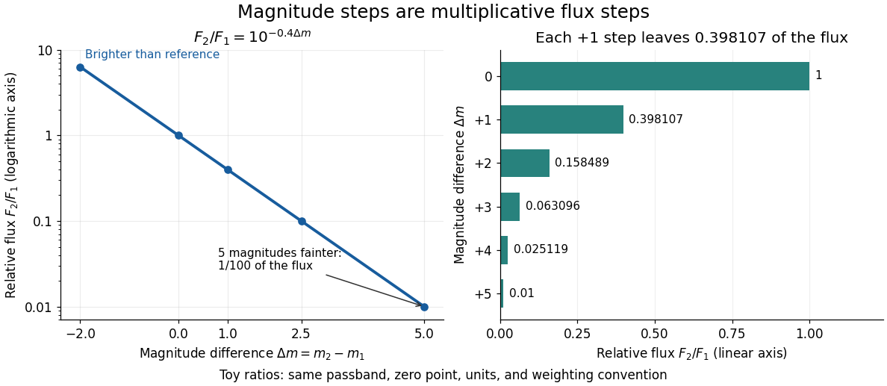

**[Figure 10](#image-equal-magnitude-steps-multiply-flux-ratios-toy-measurements-in-one-passband-with-one-zero-point). Equal magnitude steps multiply flux ratios; toy measurements in one passband with one zero point**.

### Magnitude difference

↑ **Parent:** [Astronomical magnitude](#astronomical-magnitude)

For two positive measurements $F_1,F_2$ in the same [photometric passband](#photometric-passband), using the same [magnitude zero point](#magnitude-zero-point), units, and weighting convention, their [apparent magnitudes](#apparent-magnitude) obey

$$
\Delta m=m_2-m_1=-2.5\log_{10}\left(\frac{F_2}{F_1}\right),\qquad \frac{F_2}{F_1}=10^{-0.4\Delta m}.
$$

The [logarithm](calculus.md#logarithm) takes a dimensionless ratio. An [energy](energy.md)-weighted measurement must be compared with another [energy](energy.md)-weighted measurement, and a [photon](quantum-mechanics.md#photon)-counting measurement with another consistently calibrated [photon](quantum-mechanics.md#photon)-counting measurement. Changing [photometric passband](#photometric-passband) or [magnitude zero point](#magnitude-zero-point) requires the corresponding calibration, as in a [colour index](#color-index). [IAU 2015 Resolution B2: Energy-flux magnitude convention](https://arxiv.org/pdf/1510.06262). [ESA XMM-Newton: Filter-specific count-rate calibration](https://xmm-tools.cosmos.esa.int/external/xmm_calibration/calib/documentation/CALHB/node597.html).

For example, $F_2=100F_1$ gives $\Delta m=-5$: source 2 is brighter. Conversely, $\Delta m=+5$ gives $F_2/F_1=0.01$, and $\Delta m=+1$ gives $F_2/F_1\simeq0.398107$. Even fractional steps work: $\Delta m=+0.1$ gives $F_2/F_1\simeq0.912011$, an approximately $8.80\%$ decrease. These are illustrative ratios, independent of any particular [star](stellar-astrophysics.md#star) catalogue.

### Apparent magnitude

↑ **Parent:** [Astronomical magnitude](#astronomical-magnitude)  
ⓦ [Wiki](https://en.wikipedia.org/wiki/Apparent_magnitude)

Apparent magnitude $m$ is a calibrated description of the [observed radiative flux](#observed-radiative-flux) received from an astronomical source. It answers how bright the source appears in a specified [photometric passband](#photometric-passband), rather than how much [luminosity](#luminosity) the source emits. Define $F_{\mathrm{ref}}>0$ as the measurement assigned zero [apparent magnitude](#apparent-magnitude) by the chosen [magnitude zero point](#magnitude-zero-point). Then

$$
m=-2.5\log_{10}\left(\frac{F}{F_{\mathrm{ref}}}\right).
$$

Here $F$ is the positive passband measurement, with the same units and response convention as $F_{\mathrm{ref}}$. For an [energy](energy.md)-weighted detector this measures received [radiative flux](#radiative-flux) through its response; for a [photon](quantum-mechanics.md#photon)-counting detector use the corresponding calibrated count rate for both quantities. Actual [photometric passbands](#photometric-passband) include the instrument's response across [wavelength](wave-equation.md#wavelength), so naming the [photometric system](#photometric-system) is part of reporting an [apparent magnitude](#apparent-magnitude). [ESA/Gaia/DPAC: Passbands and zero points](https://www.cosmos.esa.int/web/gaia/edr3-passbands). [ESA XMM-Newton calibration handbook: Count rate to magnitude](https://xmm-tools.cosmos.esa.int/external/xmm_calibration/calib/documentation/CALHB/node597.html).

As toy examples in one [photometric passband](#photometric-passband), $F=F_{\mathrm{ref}}$ gives $m=0$, $F=100F_{\mathrm{ref}}$ gives $m=-5$, and $F=0.01F_{\mathrm{ref}}$ gives $m=+5$. A negative [apparent magnitude](#apparent-magnitude) therefore means more received [radiative flux](#radiative-flux) than the reference; it is physically allowed. Zero [apparent magnitude](#apparent-magnitude) does not mean zero [radiative flux](#radiative-flux). The ordinary [logarithm](calculus.md#logarithm) formula requires $F>0$.

A small [apparent magnitude](#apparent-magnitude) alone cannot distinguish a nearby faint source from a distant source with large [luminosity](#luminosity): this is the [flux-distance degeneracy](#flux-distance-degeneracy). [Stellar parallax](#stellar-parallax) supplies independent distance information, while a calibrated [standard candle](#standard-candle) supplies intrinsic brightness. [Interstellar extinction](galaxy.md#interstellar-extinction) also changes the received [radiative flux](#radiative-flux) and hence the measured [apparent magnitude](#apparent-magnitude).

#### Photometric magnitude uncertainty

↑ **Parent:** [Apparent magnitude](#apparent-magnitude)

For a fixed [magnitude zero point](#magnitude-zero-point), the derivative of $m=-2.5\log_{10}(f/f_0)$ gives the small-error [propagation of uncertainty](wave-equation.md#propagation-of-uncertainty) formula $\sigma_m=(2.5/\ln10)\sigma_f/f$. A fractional [observed radiative flux](#observed-radiative-flux) uncertainty of $0.1$ gives about $0.109$ mag of absolute uncertainty. A fractional magnitude uncertainty additionally needs the value of $m$, is undefined at $m=0$, and depends on the adopted [magnitude zero point](#magnitude-zero-point).

#### Magnitude zero point

↑ **Parent:** [Apparent magnitude](#apparent-magnitude)

A magnitude zero point fixes the reference measurement $I_0$ in a specified [photometric passband](#photometric-passband). Relative to a zero-magnitude reference, the [apparent magnitude](#apparent-magnitude) is $m=-2.5\log_{10}(I/I_0)$. Both measurements must use the same passband and calibration convention.

#### Euclidean magnitude-limited source count

↑ **Parent:** [Apparent magnitude](#apparent-magnitude)

For identical [luminosities](#luminosity), uniform spatial density, and no extinction, the [inverse-square law](physics.md#inverse-square-law) gives limiting distance $r\propto F_{\min}^{-1/2}$. The number in the enclosed volume is therefore $N\propto F_{\min}^{-3/2}\propto10^{0.6m_{\lim}}$. Increasing the sample by a factor $b$ needs a magnitude-limit increase $(5/3)\log_{10}b$. This relation need not hold with evolving source populations, dust, or cosmological distance effects.

### Photometric system

↑ **Parent:** [Astronomical magnitude](#astronomical-magnitude)  
ⓦ [Wiki](https://en.wikipedia.org/wiki/Photometric_system)

A photometric system specifies [photometric passbands](#photometric-passband) and [magnitude zero points](#magnitude-zero-point), allowing calibrated brightness comparisons.

#### Color index

↑ **Parent:** [Photometric system](#photometric-system)  
ⓦ [Wiki](https://en.wikipedia.org/wiki/Color_index)

A [colour index](#color-index) is the difference of an object's measured [apparent magnitudes](#apparent-magnitude) in two [photometric passbands](#photometric-passband), such as $B-V$. Since magnitude is logarithmic, this difference measures a flux ratio after the respective [magnitude zero points](#magnitude-zero-point) are accounted for. It describes spectral shape rather than the object's overall brightness, and changes with both intrinsic radiation properties and [interstellar extinction](galaxy.md#interstellar-extinction).

#### UBV photometric system

↑ **Parent:** [Photometric system](#photometric-system)  
ⓦ [Wiki](https://en.wikipedia.org/wiki/UBV_photometric_system)

#### Photometric passband

↑ **Parent:** [Photometric system](#photometric-system)

A photometric passband is the wavelength-dependent response used for a brightness measurement. An energy-weighted measurement is $I=\int\eta_\lambda F_\lambda\,d\lambda$, with [spectral flux density](#spectral-flux-density) $F_\lambda$. Photon-counting conventions can instead include a factor $\lambda/(hc)$; the calibration must use the same convention as the measurement.

##### Infrared photometric band

↑ **Parent:** [Photometric passband](#photometric-passband)

The traditional near- and thermal-infrared photometric bands in the 1–5 micrometre region are $J,H,K,L,M$, with approximate centers $1.25,1.65,2.2,3.5,4.8$ micrometres. Variants such as $K_s$, $L'$ and $M'$ have different detailed responses. They largely follow [atmospheric windows](optics.md#atmospheric-window); transmission, [sky brightness](#sky-brightness), and detector response determine practical band edges. The [ISAAC filter documentation](https://www.eso.org/instruments/isaac/doc/VLT-MAN-ESO-14100-0841_v76.pdf) records instrument-specific variants, including an $L$ filter closer to $L'$ near 3.8 micrometres.

### Absolute magnitude

↑ **Parent:** [Astronomical magnitude](#astronomical-magnitude)  
ⓦ [Wiki](https://en.wikipedia.org/wiki/Absolute_magnitude)

Absolute magnitude $M$, in the stellar convention used here, is the [apparent magnitude](#apparent-magnitude) a source would have at $10$ [parsecs](#parsec), with [interstellar extinction](galaxy.md#interstellar-extinction) removed. The hypothetical observation uses the specified [photometric passband](#photometric-passband) and [magnitude zero point](#magnitude-zero-point), preserving the source's emitted spectrum and [luminosity](#luminosity). Moving every source to this common distance lets us compare intrinsic brightness without confusing it with distance. [Caltech Ay 20, Lecture 3: Apparent versus absolute magnitudes](https://sites.astro.caltech.edu/~george/ay20/Ay20-Lec3x.pdf).

For a fixed source with [isotropy](continuum-mechanics.md#isotropy) of emission, in transparent space with negligible relativistic and cosmological effects, the [inverse-square law](physics.md#inverse-square-law) gives the hypothetical measurement $F_{10}$ and [absolute magnitude](#absolute-magnitude)

$$
F_{10}=F(d)\left(\frac{d}{10\,\mathrm{pc}}\right)^2,\qquad M=-2.5\log_{10}\left(\frac{F_{10}}{F_{\mathrm{ref}}}\right).
$$

The factor applies in the same [photometric passband](#photometric-passband), with unchanged emitted spectrum. Thus [absolute magnitude](#absolute-magnitude) compares [luminosity](#luminosity) in that response, rather than automatically the total [bolometric luminosity](#luminosity) over all [wavelengths](wave-equation.md#wavelength).

Consider a toy source with $M=0$. Its [apparent magnitude](#apparent-magnitude) is $m=0$ at $10$ [parsecs](#parsec), $m=5$ at $100$ [parsecs](#parsec), and $m=10$ at $1000$ [parsecs](#parsec), neglecting [interstellar extinction](galaxy.md#interstellar-extinction). Its [absolute magnitude](#absolute-magnitude) remains $M=0$ throughout: moving the observer changes received [radiative flux](#radiative-flux), not emitted [luminosity](#luminosity). Another toy source with $M=-5$ has $100$ times its passband output under the same [isotropy](continuum-mechanics.md#isotropy) and calibration assumptions. Negative [absolute magnitudes](#absolute-magnitude) are allowed too; "absolute" names the reference-distance convention, not an [absolute value](real-analysis.md#absolute-value).

A calibrated [standard candle](#standard-candle) reverses this reasoning: its known [absolute magnitude](#absolute-magnitude) and measured [apparent magnitude](#apparent-magnitude) give a [distance modulus](#distance-modulus). This is why estimating intrinsic brightness is so useful for measuring astronomical distances. [Fraknoi, Morrison and Wolff, Astronomy 2e, 19.3: Intrinsic brightness and distance](https://openstax.org/books/astronomy-2e/pages/19-3-variable-stars-one-key-to-cosmic-distances).

#### K correction

↑ **Parent:** [Absolute magnitude](#absolute-magnitude)  
ⓦ [Wiki](https://en.wikipedia.org/wiki/K_correction)

The K-correction converts an observed [photometric passband](#photometric-passband) to a specified emitted [photometric passband](#photometric-passband), accounting for [cosmological redshift](cosmology.md#cosmological-redshift) and the source spectrum. For a narrow same-band measurement, $K_R=-2.5\log_{10}[(1+z)L_\nu((1+z)\nu_R)/L_\nu(\nu_R)]$. Thus its sign depends on the spectrum, not on [redshift](optics.md#redshift) alone. For $L_\nu\propto\nu^\alpha$, it is $-2.5(1+\alpha)\log_{10}(1+z)$. Finite-band corrections use the actual detector response and [magnitude zero point](#magnitude-zero-point).

##### Power-law spectral K correction

↑ **Parent:** [K correction](#k-correction)

For emitted spectral power per steradian $P_\nu\propto\nu^{-\alpha}$, the [luminosity distance](cosmology.md#luminosity-distance) gives $S_{\nu_o}=(1+z)P_{(1+z)\nu_o}/d_L^2$. Photon energy and arrival-rate redshifts supply two factors of $1+z$, while the observed frequency interval is reduced by one. Substitution of the power-law spectrum gives the displayed [K correction](#k-correction). This convention uses spectral flux per unit frequency and power per steradian; using per unit wavelength or total spectral luminosity changes the corresponding factors.

#### Standard candle

↑ **Parent:** [Absolute magnitude](#absolute-magnitude)

A standard candle is an astronomical source whose calibrated [absolute magnitude](#absolute-magnitude) or [luminosity](#luminosity) allows its [apparent magnitude](#apparent-magnitude) or flux to determine a distance. A population with unknown common absolute magnitude only determines relative distances without an external luminosity calibration. [Type Ia supernova cosmology](cosmology.md#type-ia-supernova-cosmology) models this distinction explicitly.

##### Standardizable candle

↑ **Parent:** [Standard candle](#standard-candle)

A [standardizable candle](#standardizable-candle) has a predictable [absolute magnitude](#absolute-magnitude) after correcting measured source properties, rather than identical intrinsic brightness for every object. [Type Ia supernova cosmology](cosmology.md#type-ia-supernova-cosmology) uses [light curve](#light-curve) shape and colour for this purpose.

##### Malmquist bias

↑ **Parent:** [Standard candle](#standard-candle)  
ⓦ [Wiki](https://en.wikipedia.org/wiki/Malmquist_bias)

A flux-limited sample preferentially includes intrinsically brighter objects at a given distance. Calibrating [standard candles](#standard-candle) from that selected sample can bias inferred distances.

###### Gaussian absolute-magnitude Malmquist shift

↑ **Parent:** [Malmquist bias](#malmquist-bias)

For a uniform Euclidean population, a complete flux-limited sample weights [luminosity](#luminosity) by accessible volume $L^{3/2}$. Since $L\propto10^{-0.4M}$, an intrinsic [Gaussian](probability-distribution.md#normal-distribution) magnitude distribution is multiplied by $e^{-0.6\ln(10)M}$. Completing the square shifts its [mean](expected-value.md) by the displayed amount without changing its [variance](variance.md). Extra distance bounds, [extinction](ecology.md#extinction), evolution and other selection cuts alter this simple result.

###### Flux-limited selection for identical standard candles

↑ **Parent:** [Malmquist bias](#malmquist-bias)

A noise-free flux threshold truncates the distance distribution of objects with exactly identical relevant-band luminosity. It cannot preferentially select intrinsically brighter members when no luminosity scatter exists. A luminosity distribution introduces the accessible-volume weighting $L^{3/2}$ in homogeneous Euclidean space. Measurement scatter across the flux threshold and nonuniform completeness introduce additional selection effects even for identical intrinsic luminosities.

###### Euclidean accessible-volume luminosity weighting

↑ **Parent:** [Malmquist bias](#malmquist-bias)

For a [flux](mathematical-physics.md#flux) threshold $f_{\min}$ and isotropic point-source [luminosity](#luminosity) $L$, the detection radius is $r_{\max}=\sqrt{L/(4\pi f_{\min})}$. In a homogeneous Euclidean population the accessible volume is proportional to $L^{3/2}$, so the selected [luminosity](#luminosity) distribution is proportional to $\varphi(L)L^{3/2}$. This assumes [flux](mathematical-physics.md#flux) selection and inverse-square propagation, not an arbitrary surface-brightness-selected diffuse field.

### Distance modulus

↑ **Parent:** [Astronomical magnitude](#astronomical-magnitude)  
ⓦ [Wiki](https://en.wikipedia.org/wiki/Distance_modulus)

The distance modulus compares received brightness with intrinsic brightness through $\mu=m-M$, the difference between [apparent magnitude](#apparent-magnitude) and [absolute magnitude](#absolute-magnitude) in the same [photometric passband](#photometric-passband) and [magnitude zero point](#magnitude-zero-point). With no [interstellar extinction](galaxy.md#interstellar-extinction), fixed emitted spectrum and [luminosity](#luminosity), [isotropy](continuum-mechanics.md#isotropy) of emission, and the local [inverse-square law](physics.md#inverse-square-law), it determines [Euclidean distance](topological-analysis.md#euclidean-distance):

$$
\mu=m-M=5\log_{10}\left(\frac{d}{10\,\mathrm{pc}}\right),\qquad d=10\,\mathrm{pc}\;10^{\mu/5}.
$$

The ratio inside the [logarithm](calculus.md#logarithm) is dimensionless. To see the factor $5$, use the [inverse-square law](physics.md#inverse-square-law) in the [magnitude difference](#magnitude-difference) formula:

$$
\frac{F(d)}{F_{10}}=\left(\frac{10\,\mathrm{pc}}{d}\right)^2,\qquad m-M=-2.5\log_{10}\left[\left(\frac{10\,\mathrm{pc}}{d}\right)^2\right].
$$

For example, $m=5$ and $M=0$ give $\mu=5$, hence $d=10\,\mathrm{pc}\times10=100\,\mathrm{pc}$. A tenfold increase in distance adds five magnitudes; an increase of one magnitude multiplies distance by $10^{1/5}\simeq1.584893$. The [distance modulus](#distance-modulus) is a [logarithmic scale](calculus.md#logarithmic-scale) for distance, not a distance in length units. [Las Cumbres Observatory: What is distance modulus?](https://lco.global/spacebook/distance/what-is-distance-modulus/).

At $10$ [parsecs](#parsec), $\mu=0$ and $m=M$. Within $10$ [parsecs](#parsec), the [distance modulus](#distance-modulus) is negative; for example, $\mu=-5$ gives the positive distance $d=1\,\mathrm{pc}$. A negative [distance modulus](#distance-modulus) does not imply negative distance. At cosmological distances, the inference needs [luminosity distance](cosmology.md#luminosity-distance) and a [K correction](#k-correction); the simple local formula must not silently absorb these effects.

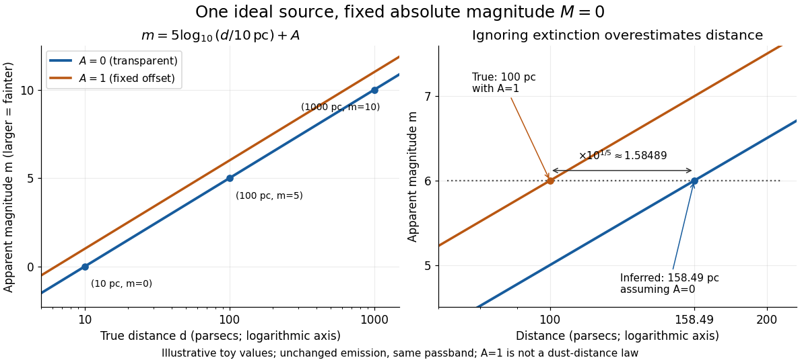

**[Figure 11](#image-toy-source-with-absolute-magnitude-zero-inverse-square-distance-steps-and-the-distance-overestimate-from-ignoring-one-magnitude-of-extinction). Toy source with absolute magnitude zero: inverse-square distance steps and the distance overestimate from ignoring one magnitude of extinction**.

[Interstellar extinction](galaxy.md#interstellar-extinction) increases [apparent magnitude](#apparent-magnitude). The observed [distance modulus](#distance-modulus) then includes both geometric dimming and attenuation; [extinction bias in photometric distance](#extinction-bias-in-photometric-distance) explains how to separate them.

#### Extinction bias in photometric distance

↑ **Parent:** [Distance modulus](#distance-modulus)

Let $A\geq0$ be the [interstellar extinction](galaxy.md#interstellar-extinction) in magnitudes in the specified [photometric passband](#photometric-passband). Compared with the same unobscured source at the same distance, its [radiative flux](#radiative-flux) is multiplied by $10^{-0.4A}$, so its [apparent magnitude](#apparent-magnitude) increases by $A$. Consequently,

$$
m-M=5\log_{10}\left(\frac{d}{10\,\mathrm{pc}}\right)+A,\qquad \mu_0=m-M-A.
$$

Here $\mu_0$ is the extinction-corrected [distance modulus](#distance-modulus). The correction subtracts $A$ before using the distance formula. Caltech's NED distance-method documentation explicitly distinguishes an apparent [distance modulus](#distance-modulus) from an extinction-corrected [distance modulus](#distance-modulus). [NASA/IPAC NED: Cepheid apparent and reddening-corrected distances](https://ned.ipac.caltech.edu/Library/Distances/distintro.html).

Ignoring positive [interstellar extinction](galaxy.md#interstellar-extinction) attributes too much dimming to distance, producing an overestimate:

$$
\frac{d_{\mathrm{inferred}}}{d}=10^{A/5}.
$$

As an illustrative toy, put the source with $M=0$ at $100$ [parsecs](#parsec) behind $A=1$ magnitude of [interstellar extinction](galaxy.md#interstellar-extinction). The measured [apparent magnitude](#apparent-magnitude) is $m=6$. Setting $A=0$ incorrectly gives $d_{\mathrm{inferred}}=10\,\mathrm{pc}\times10^{6/5}\simeq158.489\,\mathrm{pc}$, a factor $1.584893$ too large. Subtracting the known $A=1$ recovers $100$ [parsecs](#parsec). The diagram's fixed $A=1$ offset is a controlled illustration, not a model of how actual [interstellar extinction](galaxy.md#interstellar-extinction) grows with distance, and none of its values are [star](stellar-astrophysics.md#star) catalogue measurements.

## Exoplanet

↑ **Parent:** [Astrophysics](astrophysics.md)

[This section is present in another page, follow this link to view it.](exoplanet.md)

## Radiative transfer

↑ **Parent:** [Astrophysics](astrophysics.md)  
ⓦ [Wiki](https://en.wikipedia.org/wiki/Radiative_transfer)

Radiative transfer describes emission, absorption, and scattering of radiation through matter.

### Optical-depth rescaling at fixed temperature

↑ **Parent:** [Radiative transfer](#radiative-transfer)

Multiplying an absorber abundance by $a$ with fixed cross sections and physical [temperature](temperature.md) profile multiplies [optical depth](#optical-depth) by $a$. The [Planck function](#planck-function) as a function of the new coordinate must therefore be composed with division by $a$. A term proportional to $\tau^n$ acquires coefficient $a^{-n}$. Holding its old optical-depth coefficient fixed would instead change the physical temperature profile. This is the immediate radiative comparison before thermal adjustment.

### Scattering phase function

↑ **Parent:** [Radiative transfer](#radiative-transfer)

A [scattering phase function](#scattering-phase-function) describes the angular distribution of single-scattered power. One common convention is $\int P\,d\Omega=4\pi$, so that $P/(4\pi)$ is a probability density over outgoing [solid angle](euclidean-geometry.md#solid-angle). For unpolarized [Rayleigh scattering](electromagnetic-radiation.md#rayleigh-scattering), $P=3(1+\cos^2\Theta)/4$. It is distinct from the oscillatory-integral meaning of phase function.

#### Scattering asymmetry parameter

↑ **Parent:** [Scattering phase function](#scattering-phase-function)

The [scattering asymmetry parameter](#scattering-asymmetry-parameter) is the mean scattering-angle cosine, $g=(4\pi)^{-1}\int P\cos\Theta\,d\Omega$ in the $4\pi$ normalization. Forward/backward symmetry gives $g=0$; positive $g$ indicates a net forward preference. In a two-stream transport approximation, the reduced scattering [optical depth](#optical-depth) is $(1-g)\tau$.

### Infrared absorber sensitivity kernel

↑ **Parent:** [Radiative transfer](#radiative-transfer)

The derivative of outgoing spectral [radiance](radiometry.md#radiance) with respect to a pressure-resolved absorber abundance defines a kernel once the vertical measure is fixed. In an optically thin column with $k\propto p$ and $B/B_0=p/p_0$, $K_p=[k_0B_0/(p_0gM)]p(p/p_0-1)$. It is negative inside the atmosphere and zero at both endpoints. Its largest magnitude lies at $p_0/2$, whereas the logarithmic-pressure kernel $pK_p$ peaks in magnitude at $2p_0/3$. A uniformly perturbed abundance instead has one integrated derivative, not a pressure location.

### Two-stream approximation

↑ **Parent:** [Radiative transfer](#radiative-transfer)

A two-stream approximation replaces the angular distribution of radiation by upward and downward representative intensities or hemispheric fluxes, with a specified angular closure. Angular path factors can be absorbed into an effective [optical depth](#optical-depth), producing exponential attenuation in that coordinate. Different closures change numerical emission depths and diffusivity factors. Fluxes and directional radiances must remain distinguished, and a prescribed effective optical depth need not equal literal vertical absorption optical depth.

### Opacity-induced emission-height shift

↑ **Parent:** [Radiative transfer](#radiative-transfer)

If optical depth is $\tau(z)=\tau_se^{-z/H}$, multiplying opacity by $a$ raises any fixed-optical-depth surface by $H\ln a$. In a constant lapse-rate layer this changes its temperature by $-\Gamma H\ln a$.

### Equivalent width

↑ **Parent:** [Radiative transfer](#radiative-transfer)  
ⓦ [Wiki](https://en.wikipedia.org/wiki/Equivalent_width)

An absorption [equivalent width](#equivalent-width) is $W_\lambda=\int[1-I_\lambda/I_\lambda^0]d\lambda$, the [wavelength](wave-equation.md#wavelength) width of a completely black interval that removes the same continuum-normalized area. For a narrow [spectral line profile](atomic-physics.md#spectral-line-profile), small [optical depth](#optical-depth) and negligible [stimulated emission](laser.md#stimulated-emission), the energy-density convention for [Einstein coefficients](atomic-physics.md#einstein-coefficients) gives $W_\lambda=hB_{12}N_1/\nu_{12}$. This follows by replacing $1-e^{-\tau_\nu}$ by $\tau_\nu$ and using $|d\lambda/d\nu|=c/\nu^2$. At [redshift](optics.md#redshift) $z$, the observed and rest-frame values satisfy $W_{\rm obs}=(1+z)W_{\rm rest}$.

#### Curve of growth

↑ **Parent:** [Equivalent width](#equivalent-width)

A curve of growth describes the [equivalent width](#equivalent-width) $E(m)=\int(1-e^{-m\kappa_\nu})d\nu$ as a function of absorber [mass path](planetary-science.md#mass-path) or [column density](statistical-physics.md#column-density). Its weak-line limit is $E\simeq mS$. Saturation makes growth sublinear: a pure Gaussian core gives $E\sim2\Delta_D\sqrt{\log\tau_0}$, while saturated [Lorentzian line shape](stellar-astrophysics.md#lorentzian-line-shape) wings give $E\sim2\sqrt{mS\Delta_L}$. The spectral coordinate and coefficient convention must be consistent.

### Emission coefficient

↑ **Parent:** [Radiative transfer](#radiative-transfer)

The [emission coefficient](#emission-coefficient) $j_\nu$ measures emitted [energy](energy.md) per unit volume, time, [solid angle](euclidean-geometry.md#solid-angle) and [frequency](wave.md#frequency). Its SI units are $\mathrm{W\,m^{-3}\,sr^{-1}\,Hz^{-1}}$. Along a ray it contributes $j_\nu ds$ to [specific intensity](radiometry.md#spectral-radiance). For an [isotropic](continuum-mechanics.md#isotropy) [spontaneous emission](atomic-physics.md#spontaneous-emission) transition with a normalized [spectral line profile](atomic-physics.md#spectral-line-profile), $j_\nu=h\nu_{21}n_2A_{21}\varphi(\nu)/(4\pi)$; integration over [solid angle](euclidean-geometry.md#solid-angle) removes the $4\pi$ denominator.

### Single-scattering forward-plus-isotropic flux partition

↑ **Parent:** [Radiative transfer](#radiative-transfer)

If fraction $a$ of scattered energy is exactly forward and the rest isotropic, a single-escape slab has upward fraction $(1-a)(1-t)/2$ and downward fraction $t+[a+(1-a)/2](1-t)$. They sum to one for conservative scattering; this approximation need not be accurate for a thick cloud.

### Conservative cloud scattering produces no material heating

↑ **Parent:** [Radiative transfer](#radiative-transfer)

If scattering is elastic and there is no absorption or thermal emission in the band, the integrated outgoing energy equals incoming energy. Consequently net radiative-flux convergence and matter heating vanish even when the direct beam is almost extinguished.

#### Radiative conservation versus single-scattering accuracy

↑ **Parent:** [Conservative cloud scattering produces no material heating](#conservative-cloud-scattering-produces-no-material-heating)

### Constant flux in a plane-parallel radiative-equilibrium atmosphere

↑ **Parent:** [Radiative transfer](#radiative-transfer)

Taking the first angular moment of the radiative-transfer equation gives $dF_\nu/dz=4\pi\alpha_\nu(S_\nu-J_\nu)$. Radiative equilibrium sets the frequency integral of the right-hand side to zero, so the bolometric flux is constant with depth.

### Planck function

↑ **Parent:** [Radiative transfer](#radiative-transfer)

The [Planck function](#planck-function) is the equilibrium spectral specific intensity of a [blackbody](#blackbody), given by [Planck's law](statistical-physics.md#planck-s-law). Per unit wavelength it is

$$
B_\lambda(T)=\frac{2hc^2}{\lambda^5}\frac1{e^{hc/(\lambda k_BT)}-1}.
$$

It can also be written per unit frequency, with $B_\nu\,d\nu=-B_\lambda\,d\lambda$ under the corresponding change of variable.

#### Radiation constant

↑ **Parent:** [Planck function](#planck-function)  
ⓦ [Wiki](https://en.wikipedia.org/wiki/Radiation_constant)

The radiation constant relates equilibrium radiation energy density to temperature by $u=a_{\rm rad}T^4$. It satisfies $a_{\rm rad}=4\sigma/c$ in terms of the Stefan-Boltzmann constant.

#### Rayleigh-Jeans law

↑ **Parent:** [Planck function](#planck-function)  
ⓦ [Wiki](https://en.wikipedia.org/wiki/Rayleigh-Jeans_law)

The Rayleigh-Jeans law is the long-wavelength, low-frequency limit of [Planck law](statistical-physics.md#planck-s-law). When $hc/(\lambda k_BT)\ll1$,

$$
B_\lambda(T)\simeq\frac{2ck_BT}{\lambda^4}.
$$

##### Ultraviolet catastrophe

↑ **Parent:** [Rayleigh-Jeans law](#rayleigh-jeans-law)

The ultraviolet catastrophe is the divergent total thermal radiation energy predicted by classical [equipartition theorem](canonical-ensemble.md#equipartition-theorem) applied to the [electromagnetic mode density in a box](statistical-physics.md#electromagnetic-mode-density-in-a-box). Each mode has mean energy $k_BT$, while the number of modes per volume per frequency is $8\pi\nu^2/c^3$. The [Rayleigh-Jeans law](#rayleigh-jeans-law) therefore gives $u_\nu=8\pi k_BT\nu^2/c^3$, whose integral over all positive frequencies diverges at every $T>0$.

[Planck's law](statistical-physics.md#planck-s-law) replaces the classical mode energy by $h\nu/(e^{h\nu/(k_BT)}-1)$. It agrees with equipartition when $h\nu\ll k_BT$ but suppresses high-frequency excitations exponentially. The resulting spectral energy density is integrable and yields the finite [Stefan–Boltzmann law](heat.md#stefan-boltzmann-law). The failure concerns the classical equilibrium distribution of energy among modes, not the existence of electromagnetic wave propagation itself.

#### Wien approximation

↑ **Parent:** [Planck function](#planck-function)  
ⓦ [Wiki](https://en.wikipedia.org/wiki/Wien_approximation)

The Wien approximation is the short-wavelength limit of the Planck law:

$$
B_\lambda(T)\simeq\frac{2hc^2}{\lambda^5}
e^{-hc/(\lambda k_BT)}.
$$

<h4 id="wien-s-displacement-law">Wien's displacement law</h4>

↑ **Parent:** [Planck function](#planck-function)  
ⓦ [Wiki](https://en.wikipedia.org/wiki/Wien's_displacement_law)

[Wien's displacement law](#wien-s-displacement-law) says that the [wavelength](wave-equation.md#wavelength) maximizing the [Planck function](#planck-function) per unit [wavelength](wave-equation.md#wavelength), $B_\lambda(T)$, moves inversely with absolute [temperature](temperature.md):

$$
\lambda_{\max}T=b,\qquad b\simeq2.897771955\times10^{-3}\,\mathrm{m\,K}.
$$

Here $b$ is the [Wien displacement constant](#wien-displacement-constant). Heating an ideal [blackbody](#blackbody) therefore shifts this peak toward shorter [wavelengths](wave-equation.md#wavelength), while also increasing its emission at every fixed [wavelength](wave-equation.md#wavelength). The peak identifies where equal narrow [wavelength](wave-equation.md#wavelength) intervals carry the most [power](energy.md#power); it is not a single emitted [wavelength](wave-equation.md#wavelength). [Planck's law](statistical-physics.md#planck-s-law) supplies the full curve, and the [Stefan–Boltzmann law](heat.md#stefan-boltzmann-law) supplies its integral.

Specify the spectral coordinate before finding a peak. The [frequency form of Wien's displacement law](#frequency-form-of-wien-s-displacement-law) maximizes $B_\nu$, which is [spectral radiance](radiometry.md#spectral-radiance) per unit [frequency](wave.md#frequency). Its maximum is not $c/\lambda_{\max}$. The [frequency and wavelength spectral radiance conversion](radiometry.md#frequency-and-wavelength-spectral-radiance-conversion) changes the density as well as the horizontal coordinate; the existing [frequency and wavelength peaks of Planck's law](statistical-physics.md#frequency-and-wavelength-peaks-of-planck-s-law) give a complementary numerical comparison.

In his 11 December 1911 Nobel lecture, [Wilhelm Wien](physicist.md#wilhelm-wien) explained the displacement principle through a [thought experiment](physics.md#thought-experiment): compress [black-body radiation](statistical-physics.md#black-body-radiation) between reflecting moving walls. Work against [radiation pressure](pressure.md#radiation-pressure) raises the [energy density](statistical-physics.md#energy-density), while reflection changes each [frequency](wave.md#frequency) by the [Doppler effect](wave.md#doppler-effect). The [Second law of thermodynamics](second-law-of-thermodynamics.md) connects the resulting spectrum to one at a higher [temperature](temperature.md). This determines how the spectrum scales between [temperatures](temperature.md), without determining its complete shape. The [Wien approximation](#wien-approximation) is a separate, restricted spectral formula.[Nobel Lectures, Physics 1901–1921; Wilhelm Wien, On the laws of thermal radiation, Nobel Lecture, 11 December 1911, printed pp.276–280: cavity, compression argument, displacement and distinction from the spectral-distribution problem](physics-bibliography.md#nobel-lectures-physics-1901-1921/on-the-laws-of-thermal-radiation-by-wilhelm-wien)

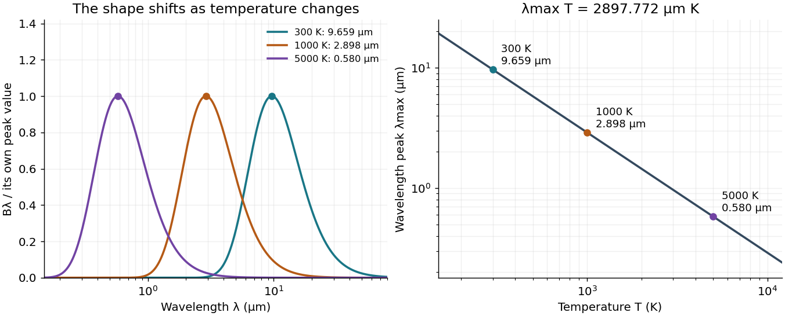

**[Figure 12](#image-wien-s-displacement-law-spectral-peaks-and-inverse-temperature-scaling). Wien's displacement law: spectral peaks and inverse temperature scaling**. Left: [Planck function](#planck-function) curves divided by their own maxima, for three stipulated [temperatures](temperature.md). This normalization hides the increase in absolute [spectral radiance](radiometry.md#spectral-radiance). Right: the peak [wavelength](wave-equation.md#wavelength) follows $b/T$; a tenfold rise in [temperature](temperature.md) divides the peak [wavelength](wave-equation.md#wavelength) by ten. The curves are computed ideal [blackbody](#blackbody) predictions.

<h5 id="derivation-of-wien-s-displacement-law">Derivation of Wien's displacement law</h5>

↑ **Parent:** [Wien's displacement law](#wien-s-displacement-law)

At fixed $T>0$, substitute $x=hc/(\lambda k_BT)>0$ into the [Planck function](#planck-function):

$$
B_\lambda(T)=\frac{2k_B^5T^5}{h^4c^3}\frac{x^5}{e^x-1}.
$$

Here $h$ is the [Planck constant](quantum-mechanics.md#planck-constant), $k_B$ the [Boltzmann constant](thermodynamics.md#boltzmann-constant), and $c$ the [speed of light](special-relativity.md#speed-of-light). Since $dx/d\lambda=-x/\lambda\ne0$, an interior maximum in [wavelength](wave-equation.md#wavelength) is also a stationary point in $x$. A [logarithmic derivative](analytic-number-theory.md#logarithmic-derivative) gives

$$
\frac{d}{dx}\log\frac{x^5}{e^x-1}=\frac5x-\frac1{1-e^{-x}}=0,
\qquad x=5(1-e^{-x}).
$$

The required positive root is $x_\lambda=4.9651142317\ldots$. The rearranged equation also has $x=0$, but that endpoint is not a peak. For $g(x)=5(1-e^{-x})-x$, $g'(x)=5e^{-x}-1$ changes sign once, at $x=\log5$. Thus $g$ first increases and then decreases to negative values, crossing zero exactly once for $x>0$. Since $x^5/(e^x-1)$ tends to zero at both endpoints, this stationary point is the unique global maximum. Solving the definition of $x$ for [wavelength](wave-equation.md#wavelength) gives

$$
\lambda_{\max}=\frac{hc}{k_BTx_\lambda},\qquad b=\frac{hc}{k_Bx_\lambda}.
$$

The inverse-[temperature](temperature.md) dependence follows before any numerical root-finding. More generally $B_\lambda(T)=T^5F(\lambda T)$ for one fixed function $F$, so spectra at all [temperatures](temperature.md) have the same rescaled shape. This is stronger than a relation between two peak positions. Replacing the denominator by $e^x$ in the [Wien approximation](#wien-approximation) would instead give $x=5$ and a peak [wavelength](wave-equation.md#wavelength) about $0.70\%$ too short.

<h5 id="frequency-form-of-wien-s-displacement-law">Frequency form of Wien's displacement law</h5>

↑ **Parent:** [Wien's displacement law](#wien-s-displacement-law)

For [Planck's law](statistical-physics.md#planck-s-law) per unit [frequency](wave.md#frequency), setting $x=h\nu/(k_BT)$ leaves a positive constant times $x^3/(e^x-1)$. Its [logarithmic derivative](analytic-number-theory.md#logarithmic-derivative) gives

$$
x_\nu=3(1-e^{-x_\nu}),\qquad x_\nu=2.8214393721\ldots,\qquad
\frac{\nu_{\max}}T=\frac{k_Bx_\nu}{h}\simeq5.878925758\times10^{10}\,\mathrm{Hz\,K^{-1}}.
$$

The same uniqueness argument as in the [Derivation of Wien's displacement law](#derivation-of-wien-s-displacement-law), with $5$ replaced by $3$, selects the positive root. The maxima differ because corresponding positive spectral intervals obey

$$
B_\lambda\,d\lambda=B_\nu\,|d\nu|,\qquad
B_\lambda(\lambda)=B_\nu(c/\lambda)\frac{c}{\lambda^2}.
$$

The nonconstant [Jacobian determinant](multivariable-calculus.md#jacobian-determinant) $c/\lambda^2$ changes density heights. Consequently $c/\nu_{\max}=(x_\lambda/x_\nu)\lambda_{\max}\simeq1.75978\lambda_{\max}$. A peak is a property of a specified density, rather than an invariant point of the spectrum. For equal logarithmic intervals, the corresponding densities satisfy $\lambda B_\lambda=\nu B_\nu$ and have matching converted peak positions; this is a third convention, distinct from either linear-interval density.

##### Wien displacement constant

↑ **Parent:** [Wien's displacement law](#wien-s-displacement-law)  
ⓦ [Wiki](https://en.wikipedia.org/wiki/Wien_displacement_constant)

The [Wien displacement constant](#wien-displacement-constant) is the [constant of proportionality](mathematics.md#constant-of-proportionality) $b$ in $\lambda_{\max}T=b$. From the exact [International System of Units](physics.md#international-system-of-units) values of the [Planck constant](quantum-mechanics.md#planck-constant), [speed of light](special-relativity.md#speed-of-light) and [Boltzmann constant](thermodynamics.md#boltzmann-constant),

$$
b=\frac{(6.62607015\times10^{-34})(299792458)}{(1.380649\times10^{-23})(4.9651142317\ldots)}\,\mathrm{m\,K}
\simeq2.897771955\times10^{-3}\,\mathrm{m\,K}.
$$

The units follow from $hc/k_B$: $(\mathrm{J\,s})(\mathrm{m\,s^{-1}})/(\mathrm{J\,K^{-1}})=\mathrm{m\,K}$. The defining constants are exact; the displayed decimal is rounded. [Wien wavelength displacement law constant and Wien frequency displacement law constant](chemistry-bibliography.md#fundamental-physical-constants-complete-listing-by-national-institute-of-standards-and-technology-and-others)

##### Blackbody peak and detector response

↑ **Parent:** [Wien's displacement law](#wien-s-displacement-law)

Consider a hypothetical [star](stellar-astrophysics.md#star) whose emitted [specific intensity](radiometry.md#spectral-radiance) is exactly that of a uniform $5000\,\mathrm K$ [blackbody](#blackbody). Assume transparent propagation with negligible [Doppler shift](wave.md#doppler-effect) and [interstellar extinction](galaxy.md#interstellar-extinction), so geometric dilution multiplies every spectral interval by the same factor. The stipulated [temperature](temperature.md) gives

$$
\lambda_{\max}=0.579554391\,\mu\mathrm m,\qquad
\nu_{\max}=293.946288\,\mathrm{THz},\qquad
c/\nu_{\max}=1.01988857\,\mu\mathrm m.
$$

Using the converted [frequency](wave.md#frequency) peak as though it maximized $B_\lambda$ would return $b/(c/\nu_{\max})\simeq2841.26\,\mathrm K$, a substantial error caused solely by mixing spectral conventions.

Now stipulate a [photodetector](optical-instrument.md#photodetector) with constant [quantum efficiency](optical-instrument.md#quantum-efficiency) $\eta$ over the relevant [wavelengths](wave-equation.md#wavelength), collecting equal narrow [wavelength](wave-equation.md#wavelength) bins. For fixed accepted [projected area](radiometry.md#projected-area) times [solid angle](euclidean-geometry.md#solid-angle) $G$, with dilution included in $G$, its expected [photon](quantum-mechanics.md#photon) count rate density is

$$
\frac{d\dot N}{d\lambda}=\eta G\frac{\lambda B_\lambda}{hc}.
$$

This follows by dividing the received [power](energy.md#power) by the [photon](quantum-mechanics.md#photon) [energy](energy.md) $hc/\lambda$. It peaks where $x=4(1-e^{-x})$, at $x=3.9206903949\ldots$, giving $0.73394057\,\mu\mathrm m$ for the same model [star](stellar-astrophysics.md#star). Constant [quantum efficiency](optical-instrument.md#quantum-efficiency) is not constant energy [spectral responsivity](optical-instrument.md#spectral-responsivity): the latter includes the [wavelength](wave-equation.md#wavelength)-dependent [photon](quantum-mechanics.md#photon) [energy](energy.md) conversion. For example, $G=10^{-12}\,\mathrm{m^2\,sr}$, $\eta=0.5$ and a $1\,\mathrm{nm}$ bin centered at $0.600\,\mu\mathrm m$ give approximately $1.93\times10^{10}$ detected [photons](quantum-mechanics.md#photon) per second in the narrow-bin approximation. These are calculated model values, not observations of a named [star](stellar-astrophysics.md#star).

A more general linear detector channel has output

$$
S_i-S_{i,0}=G\int_0^\infty R_i(\lambda)B_\lambda(T)\,d\lambda,
$$

where $S_{i,0}$ is the background reading and $R_i$ includes spectral selection, optical transmission and detector [spectral responsivity](optical-instrument.md#spectral-responsivity). A raw channel maximum need not locate either [Planck function](#planck-function) maximum. Recovering a [temperature](temperature.md) requires an appropriate calibrated response and an emission model. For a real [stellar atmosphere](stellar-astrophysics.md#stellar-atmosphere), [opacity](stellar-structure.md#opacity) and [radiative transfer](#radiative-transfer) can reshape the spectrum; [interstellar extinction](galaxy.md#interstellar-extinction) can reshape it again. A single peak does not establish a unique physical [temperature](temperature.md) without those assumptions.

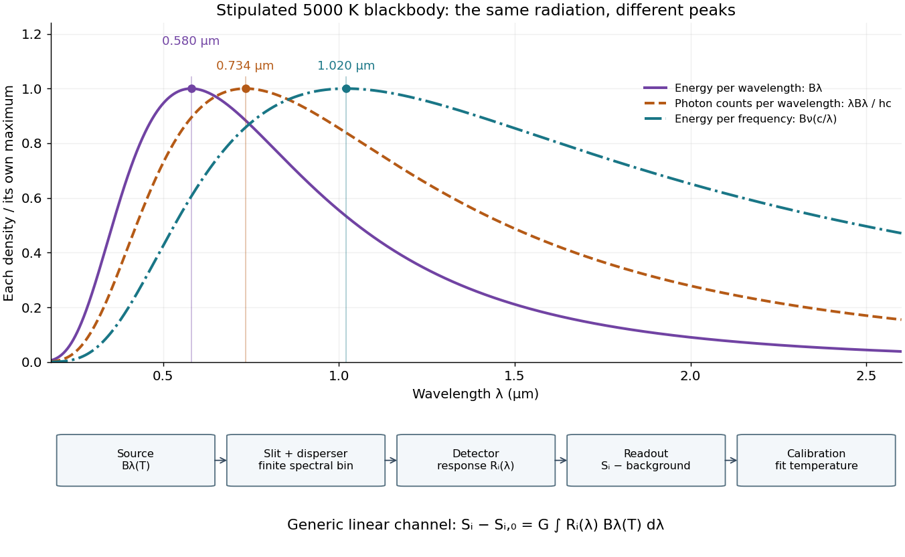

**[Figure 13](#image-one-model-star-three-peak-conventions-and-a-spectral-measurement-chain). One model star, three peak conventions, and a spectral measurement chain**. All curves use the same $5000\,\mathrm K$ [Planck function](#planck-function) and are normalized separately. The $B_\nu(c/\lambda)$ curve retains density per [frequency](wave.md#frequency) while displaying converted [wavelength](wave-equation.md#wavelength). The photon curve assumes constant [quantum efficiency](optical-instrument.md#quantum-efficiency) in equal narrow [wavelength](wave-equation.md#wavelength) bins. The lower diagram shows a generic measurement sequence, not a reconstruction of a particular historical apparatus.

<h5 id="coblentz-s-cavity-radiation-spectrum-measurement">Coblentz's cavity-radiation spectrum measurement</h5>

↑ **Parent:** [Wien's displacement law](#wien-s-displacement-law)

[William Weber Coblentz](optical-physicist.md#william-coblentz)'s primary report describes an electrically heated porcelain cavity wound with platinum ribbon. Mirrors imaged its central radiating diaphragm onto a $0.6\,\mathrm{mm}$ [optical slit](optical-instrument.md#optical-slit); a fluorite [optical prism](geometrical-optics.md#prism-optics) dispersed the beam onto a vacuum [bolometer](optical-instrument.md#bolometer). [Galvanometer](electric-charge.md#galvanometer) deflections read the detector response. A resistance standard checked electrical sensitivity, while repeated readings checked stability. [Sodium](chemical-substance.md#sodium) lines fixed the angular zero; a [refractive index](electromagnetic-wave.md#refractive-index) curve supplied [wavelengths](wave-equation.md#wavelength) and slit-bandwidth corrections. [Thermocouples](thermoelectric-effect.md#thermocouple) were standardized at freezing points of zinc, antimony and copper. Drying the optical path reduced atmospheric absorption; prism scattering and [temperature](temperature.md) calibration remained limitations. These were Coblentz's measurements. His extraction of radiation constants assumed the [Planck law](statistical-physics.md#planck-s-law), so it was not a model-independent proof of the spectral formula.[W. W. Coblentz, Constants of spectral radiation of a uniformly heated inclosure or so-called black body, I: printed pp.15–27, 35, 42–47 and 73–77; apparatus, sensitivity checks, temperature scale, wavelength calibration and model-dependent constants](physics-bibliography.md#constants-of-spectral-radiation-of-a-uniformly-heated-inclosure-or-so-called-black-body-i-by-william-weber-coblentz)

The inference to test is whether corrected spectra taken at independently determined [temperatures](temperature.md) have their $B_\lambda$ maxima at a constant product $\lambda_{\max}T$. Comparing raw [galvanometer](electric-charge.md#galvanometer) deflections at different [optical prism](geometrical-optics.md#prism-optics) settings would also compare different [wavelength](wave-equation.md#wavelength) widths and optical losses. The response integral in [blackbody peak and detector response](#blackbody-peak-and-detector-response) explains why those corrections belong to the physical inference rather than merely to presentation.

### Blackbody

↑ **Parent:** [Radiative transfer](#radiative-transfer)  
ⓦ [Wiki](https://en.wikipedia.org/wiki/Blackbody)

A [blackbody](#blackbody) absorbs all incident [electromagnetic radiation](electromagnetic-radiation.md). In [thermal equilibrium](thermal-equilibrium.md) it emits the universal [Planck law](statistical-physics.md#planck-s-law) spectrum determined solely by its [temperature](temperature.md).

#### Absorptivity

↑ **Parent:** [Blackbody](#blackbody)

The fraction of incident radiant [power](energy.md#power) absorbed under stated spectral and angular conditions. At thermal [equilibrium](dynamical-systems.md#equilibrium-point-of-a-dynamical-system), [Kirchhoff's law of thermal radiation](#kirchhoff-s-law-of-thermal-radiation) equates matching directional spectral absorptivity and [emissivity](heat.md#emissivity). A [blackbody](#blackbody) has both equal to one.

#### Luminosity of a spherical blackbody

↑ **Parent:** [Blackbody](#blackbody)

An isotropic blackbody surface has outward flux $F=\pi\int B_\nu\,d\nu=\sigma T^4$. A sphere of radius $R$ therefore has luminosity

$$
L=4\pi R^2\sigma T^4.
$$

### Thermal bremsstrahlung

↑ **Parent:** [Radiative transfer](#radiative-transfer)

Thermal bremsstrahlung is free-free electromagnetic radiation from the acceleration of charged particles during Coulomb encounters in a thermal plasma. Its frequency-integrated emissivity in a fully ionized, nonrelativistic plasma scales approximately as $n_en_iT^{1/2}$.

#### Density-depth degeneracy of free-free radiation

↑ **Parent:** [Thermal bremsstrahlung](#thermal-bremsstrahlung)

For a uniform ionized hydrogen column with known [temperature](temperature.md) and fixed projected angular area, free-free brightness and [optical depth](#optical-depth) depend on $\mathrm{EM}=n_e^2L$. The displayed rescaling leaves the whole ideal spectrum unchanged. [density](fluid-mechanics.md#density) and path length cannot be separated without additional information. A known geometry/distance, or a distinct column diagnostic proportional to $n_eL$, can break the degeneracy; [gas clumping factor](fluid-mechanics.md#gas-clumping-factor) and [temperature](temperature.md) structure complicate that inference.

#### Astrophysical volume filling factor

↑ **Parent:** [Thermal bremsstrahlung](#thermal-bremsstrahlung)

The fraction $f_V$ of a geometric volume occupied by a specified emitting gas phase is its volume filling factor. For approximately uniform [density](fluid-mechanics.md#density) within that phase, a density-squared [luminosity](#luminosity) scales as $n_e^2f_VV$. Without knowledge of $f_V$, emission gives an rms-density combination rather than a unique mean gas [density](fluid-mechanics.md#density). This filling factor is distinct from the fraction of a [telescope](physics.md#telescope) beam occupied on the sky.

#### Emission measure

↑ **Parent:** [Thermal bremsstrahlung](#thermal-bremsstrahlung)

For a hydrogen-dominated fully ionized [plasma](physics.md#plasma-physics), the line-of-sight [emission measure](#emission-measure) is $\mathrm{EM}=\int n_e^2\,dl$. Its units distinguish it from a volume-integrated [emission measure](#emission-measure) $\int n_e^2dV$. Thermal free-free [optical depth](#optical-depth) is proportional to $\mathrm{EM}\,T^{-3/2}\nu^{-2}\bar g_{\rm ff}$ in the radio limit. Inferring [density](fluid-mechanics.md#density) also requires depth, ionization and clumping assumptions.[chapter 4, equations (4.57)–(4.58)](physics-bibliography.md#essential-radio-astronomy-by-james-j-condon-and-scott-m-ransom)

#### Thermal free-free emissivity

↑ **Parent:** [Thermal bremsstrahlung](#thermal-bremsstrahlung)

The emission coefficient per volume, [frequency](wave.md#frequency) and [solid angle](euclidean-geometry.md#solid-angle) of a Maxwellian [plasma](physics.md#plasma-physics) has $j_\nu\propto n_e\sum_i Z_i^2 n_i\,T^{-1/2}e^{-h\nu/(k_BT)}\bar g_{\rm ff}$. Define the angular convention before supplying a numerical coefficient. The high-frequency cutoff measures [temperature](temperature.md), while the normalization measures a density-squared emission integral. The radio spectrum is almost flat when optically thin and rises as $\nu^2$ when optically thick at fixed projected area.

##### Hydrogen-helium free-free composition factor

↑ **Parent:** [Thermal free-free emissivity](#thermal-free-free-emissivity)

For fully ionized [hydrogen](chemical-substance.md#hydrogen) and [helium](chemical-substance.md#helium) with hydrogen [mass fraction](mixture.md#mass-fraction) $x_H$, $n_e=(1+x_H)\rho/(2m_p)$ and $\sum_i Z_i^2n_i=\rho/m_p$. With the same unit [Gaunt factor](#gaunt-factor) for both species, [thermal bremsstrahlung](#thermal-bremsstrahlung) at fixed [electron](physics.md#electron) [number density](statistical-physics.md#number-density) is multiplied by $2/(1+x_H)$ relative to pure ionized [hydrogen](chemical-substance.md#hydrogen). The factor is one for pure [hydrogen](chemical-substance.md#hydrogen) and two for pure [helium](chemical-substance.md#helium).

#### Gaunt factor

↑ **Parent:** [Thermal bremsstrahlung](#thermal-bremsstrahlung)  
ⓦ [Wiki](https://en.wikipedia.org/wiki/Gaunt_factor)

The [Gaunt factor](#gaunt-factor) is the dimensionless quantum correction to a classical free-free radiation calculation. Its weak temperature and frequency dependence modifies the approximate [thermal bremsstrahlung](#thermal-bremsstrahlung) scaling; a frequency-averaged value appears in the bolometric cooling coefficient.

### Optical depth

↑ **Parent:** [Radiative transfer](#radiative-transfer)  
ⓦ [Wiki](https://en.wikipedia.org/wiki/Optical_depth)

Optical depth satisfies $d\tau_\nu=\alpha_\nu ds$ along a path and measures attenuation through $I_\nu\propto e^{-\tau_\nu}$ in the absence of emission.

#### Optically thick medium

↑ **Parent:** [Optical depth](#optical-depth)

An optically thick medium has [optical depth](#optical-depth) $\tau\gg1$ along the relevant path. Photons undergo many interactions before escaping. [Radiative diffusion](#radiative-diffusion) applies under suitable near-isotropy conditions, but a large scattering depth alone does not guarantee thermalization when true absorption is weak.

#### Optically thin medium

↑ **Parent:** [Optical depth](#optical-depth)

An optically thin medium has $\tau\ll1$, so attenuation and emission may be expanded to first order in optical depth.

##### Optically thin atomic line intensity

↑ **Parent:** [Optically thin medium](#optically-thin-medium)

For isotropic emission without significant absorption, integrating the spontaneous photon-production rate along the sightline gives the displayed energy intensity per solid angle. Photon intensity omits the factor $h\nu$. Summing unresolved transitions is necessary before comparing with an observed blended spectral feature.

#### Absorption coefficient

↑ **Parent:** [Optical depth](#optical-depth)  
ⓦ [Wiki](https://en.wikipedia.org/wiki/Absorption_coefficient)

The absorption coefficient is the fractional reduction of beam intensity per unit path length: $dI_\nu/ds=-\alpha_\nu I_\nu$ when emission and scattering are absent.

##### Collision-induced absorption and emission

↑ **Parent:** [Absorption coefficient](#absorption-coefficient)  
ⓦ [Wiki](https://en.wikipedia.org/wiki/Collision-induced_absorption_and_emission)

A collision or transient molecular pair can possess a dipole even when the isolated molecules do not. The resulting [opacity](stellar-structure.md#opacity) can be important in a dense [molecular hydrogen](chemical-substance.md#molecular-hydrogen) atmosphere. Pair absorption per unit length scales approximately as the product of the two partner number densities, so its [mass absorption coefficient](#mass-absorption-coefficient) is generally density-dependent. It supplies continuum absorption between ordinary spectral lines.

#### Dust optical depth

↑ **Parent:** [Optical depth](#optical-depth)

For dust-grain number density $n_d$ and absorption cross-section $\sigma_d$, the dust optical depth along a path is $\tau_d=\int n_d\sigma_d\,ds$.

##### Mass absorption coefficient

↑ **Parent:** [Dust optical depth](#dust-optical-depth)  
ⓦ [Wiki](https://en.wikipedia.org/wiki/Mass_absorption_coefficient)

The mass absorption coefficient is absorbing cross-section per unit mass. For identical spherical dust grains of radius $a$, mass $m_d$, and absorption efficiency $Q_\nu$, it is $\kappa_\nu=\pi a^2Q_\nu/m_d$.

###### Optically thin dust-mass estimator

↑ **Parent:** [Mass absorption coefficient](#mass-absorption-coefficient)

For isothermal [optically thin](#optically-thin-medium) dust at distance $D$, its measured spectral flux density determines its mass through $M_d=F_\nu D^2/[\kappa_\nu B_\nu(T)]$. Temperature and opacity uncertainty commonly dominate the inferred mass uncertainty.

### Radiative transfer equation

↑ **Parent:** [Radiative transfer](#radiative-transfer)  
ⓦ [Wiki](https://en.wikipedia.org/wiki/Radiative_transfer_equation)

In plane-parallel optical-depth coordinates without scattering,

$$
\mu\frac{dI_\nu}{d\tau_\nu}=I_\nu-S_\nu,
$$

with source function $S_\nu$.

#### Schwarzschild equation

↑ **Parent:** [Radiative transfer equation](#radiative-transfer-equation)

The absorption-and-emission transfer equation without scattering, often expressed along a ray as $dI_\lambda/ds=-\alpha_\lambda I_\lambda+\alpha_\lambda B_\lambda(T)$ in local thermal equilibrium. Its formal solution weights thermal emission by intervening transmission.

#### Radiative transfer source function

↑ **Parent:** [Radiative transfer equation](#radiative-transfer-equation)

The [radiative transfer](#radiative-transfer) [source function](#radiative-transfer-source-function) is emission per unit extinction. If $j_\nu$ is emission per unit path length and $\rho\kappa_\nu$ is extinction per unit path length, $S_\nu=j_\nu/(\rho\kappa_\nu)$ and the transfer equation is $\mu\partial_{\tau_\nu}I_\nu=I_\nu-S_\nu$. Under thermal absorption in [local thermodynamic equilibrium](#local-thermodynamic-equilibrium) it is the [Planck function](#planck-function); for conservative [coherent isotropic scattering](#coherent-isotropic-scattering) it is the [mean intensity](#mean-intensity).

#### Radiative diffusion

↑ **Parent:** [Radiative transfer equation](#radiative-transfer-equation)

In an optically thick medium whose radiation field is nearly isotropic and thermal, the first angular correction to the Planck function produces the diffusive flux

$$
F=-\frac{16\sigma T^3}{3\kappa_R\rho}\nabla T,
$$

where $\kappa_R$ is the Rosseland mean opacity.

##### Rosseland mean opacity

↑ **Parent:** [Radiative diffusion](#radiative-diffusion)

The Rosseland mean opacity is the harmonic frequency average weighted by $\partial B_\nu/\partial T$. It controls radiative diffusion because flux preferentially travels through low-opacity frequencies.

It is a frequency-averaged [opacity](stellar-structure.md#opacity) appropriate to the radiative-diffusion limit, not the general opacity concept itself.

#### Local thermodynamic equilibrium

↑ **Parent:** [Radiative transfer equation](#radiative-transfer-equation)  
ⓦ [Wiki](https://en.wikipedia.org/wiki/Local_thermodynamic_equilibrium)

In local thermodynamic equilibrium, matter populations are thermal at the local temperature and the source function is the Planck function, $S_\nu=B_\nu(T)$.

#### Formal solution of the radiative transfer equation

↑ **Parent:** [Radiative transfer equation](#radiative-transfer-equation)

For an outward ray through a nonscattering atmosphere,

$$
I_\nu(0,\mu)=I_\nu(\tau_b,\mu)e^{-\tau_b/\mu}
+\int_0^{\tau_b}B_\nu[T(t)]e^{-t/\mu}\frac{dt}{\mu}.
$$

##### Constant source transfer through a thin layer

↑ **Parent:** [Formal solution of the radiative transfer equation](#formal-solution-of-the-radiative-transfer-equation)

Along a radial ray through a layer with constant [source function](#radiative-transfer-source-function), the incident [specific intensity](radiometry.md#spectral-radiance) is attenuated by $e^{-\tau}$ and the layer adds $S(1-e^{-\tau})$. At small [optical depth](#optical-depth), $I_{\rm out}=I_{\rm in}+(S-I_{\rm in})\tau+O(\tau^2)$. Whether the source exceeds the incident [specific intensity](radiometry.md#spectral-radiance) determines the first-order emission or absorption contrast.

##### Polynomial source function moments for emergent intensity

↑ **Parent:** [Formal solution of the radiative transfer equation](#formal-solution-of-the-radiative-transfer-equation)

For a semi-infinite plane-parallel atmosphere with polynomial [source function](#radiative-transfer-source-function) $S(\tau)=\sum a_j\tau^j$, the outward [specific intensity](radiometry.md#spectral-radiance) is $\int_0^\infty S(\tau)e^{-\tau/\mu}\,d\tau/\mu$. Substitution $u=\tau/\mu$ gives coefficients $A_j=j!a_j$ in the surface polynomial in $\mu$. The deep boundary term must vanish. A local truncated Taylor series instead gives this contribution plus a remainder, so its surface polynomial is not automatically exact.

##### Blackbody limit of an isothermal atmosphere

↑ **Parent:** [Formal solution of the radiative transfer equation](#formal-solution-of-the-radiative-transfer-equation)

For a thermalized [radiative transfer source function](#radiative-transfer-source-function) $S_\lambda=B_\lambda(T)$ constant along a ray, the [specific intensity](radiometry.md#spectral-radiance) after optical-depth interval $\Delta\tau$ is $I_\lambda=B_\lambda+(I_{\rm in}-B_\lambda)e^{-\Delta\tau/\mu}$ for $\mu>0$. As $\Delta\tau\to\infty$, it tends to the [Planck function](#planck-function), independently of a bounded boundary input. A temperature gradient is unnecessary for [blackbody](#blackbody) emission. In a scattering medium, [local thermodynamic equilibrium](#local-thermodynamic-equilibrium) alone does not guarantee $S_\lambda=B_\lambda$; thermalization must be justified.

##### One-layer spectral contrast

↑ **Parent:** [Formal solution of the radiative transfer equation](#formal-solution-of-the-radiative-transfer-equation)

A non-scattering isothermal atmospheric layer in [local thermodynamic equilibrium](#local-thermodynamic-equilibrium), of [temperature](temperature.md) $T_a$ and slant [optical depth](#optical-depth) $t_\lambda$, lies above a [blackbody](#blackbody) background at $T_b$. The [specific intensity](radiometry.md#spectral-radiance) is

$$
I_\lambda=B_\lambda(T_b)e^{-t_\lambda}+B_\lambda(T_a)(1-e^{-t_\lambda}).
$$

Thus an increase in [opacity](stellar-structure.md#opacity) shifts the [specific intensity](radiometry.md#spectral-radiance) toward the layer's [Planck function](#planck-function). If a line is more opaque than its continuum, it appears in absorption for $T_a<T_b$, in emission for $T_a>T_b$, and has no contrast for $T_a=T_b$. This is a local explanation, not a claim that all features diagnose one uniform layer.

##### Eddington-Barbier relation

↑ **Parent:** [Formal solution of the radiative transfer equation](#formal-solution-of-the-radiative-transfer-equation)

When the source function varies approximately linearly with optical depth, the emergent intensity obeys $I_\nu(0,\mu)\simeq S_\nu(\tau_\nu=\mu)$.

The relation is an approximation within [radiative transfer](#radiative-transfer), not the entire transfer theory.

#### Coherent isotropic scattering

↑ **Parent:** [Radiative transfer equation](#radiative-transfer-equation)

Coherent isotropic scattering preserves photon frequency and redistributes direction uniformly. Its source function is the mean intensity $J_\nu$, so conservative scattering removes light from a pencil beam while preserving luminosity integrated over all escaping directions.

##### Single-scattering albedo

↑ **Parent:** [Coherent isotropic scattering](#coherent-isotropic-scattering)  
ⓦ [Wiki](https://en.wikipedia.org/wiki/Single-scattering_albedo)

The single-scattering albedo is the fraction of total extinction due to scattering, $\omega_\nu=\alpha_{\nu,\rm sca}/\alpha_{\nu,\rm ext}$. Its complement is the absorptive fraction.

<h4 id="kirchhoff-s-law-of-thermal-radiation">Kirchhoff's law of thermal radiation</h4>

↑ **Parent:** [Radiative transfer equation](#radiative-transfer-equation)  
ⓦ [Wiki](https://en.wikipedia.org/wiki/Kirchhoff's_law_of_thermal_radiation)

Kirchhoff's law of thermal radiation states that a body in thermal equilibrium has equal absorptivity and emissivity at each frequency and direction. A layer with infrared absorptivity $\epsilon$ therefore emits $\epsilon B_\nu(T)$.

### Radiation-field moment

↑ **Parent:** [Radiative transfer](#radiative-transfer)

For plane-parallel intensity, the standard moments are

$$
J_\nu=\frac12\int_{-1}^1I_\nu d\mu,
\quad
H_\nu=\frac12\int_{-1}^1\mu I_\nu d\mu,
\quad
K_\nu=\frac12\int_{-1}^1\mu^2I_\nu d\mu,
$$

and the radiative flux is $F_\nu=4\pi H_\nu$.

#### Radiation quadrupole

↑ **Parent:** [Radiation-field moment](#radiation-field-moment)

The angular multipole of order two in a local [radiation](physics.md#radiation) intensity distribution. A monopole is isotropic and a dipole has one directional axis; a quadrupole has a second-order angular pattern. [Thomson scattering](cosmic-microwave-background-anisotropy.md#thomson-scattering) of an incident [radiation quadrupole](#radiation-quadrupole) can generate [linear polarization](electromagnetic-wave.md#linear-polarization), which is central to [Cosmic microwave background polarization](cosmic-microwave-background-anisotropy.md#cosmic-microwave-background-polarization).

#### Mean intensity

↑ **Parent:** [Radiation-field moment](#radiation-field-moment)

The mean intensity is the angular average $J_\nu=(4\pi)^{-1}\int I_\nu d\Omega$ of the [specific intensity](radiometry.md#spectral-radiance).

#### Radiative flux

↑ **Parent:** [Radiation-field moment](#radiation-field-moment)

Radiative flux is the first angular moment $F_\nu=\int I_\nu\cos\theta\,d\Omega$ of [specific intensity](radiometry.md#spectral-radiance) and measures net radiant [power](energy.md#power) crossing unit area. Integrating over [frequency](wave.md#frequency) gives bolometric [radiative flux](#radiative-flux). The receiving surface's orientation matters through $\cos\theta$; [observed radiative flux](#observed-radiative-flux) from a compact distant source conventionally refers to an area perpendicular to its [line of sight](#line-of-sight).

##### Outgoing longwave radiation

↑ **Parent:** [Radiative flux](#radiative-flux)  
ⓦ [Wiki](https://en.wikipedia.org/wiki/Outgoing_longwave_radiation)

[Outgoing longwave radiation](#outgoing-longwave-radiation) is the outward thermal [radiative flux](#radiative-flux) at the top of the atmosphere, integrated over the specified thermal spectrum and outward directions. It differs from a directional spectral [radiance](radiometry.md#radiance).

##### Observed radiative flux

↑ **Parent:** [Radiative flux](#radiative-flux)

For a steady [point-like astronomical source](#point-like-astronomical-source) with [isotropy](continuum-mechanics.md#isotropy) of emission, in transparent space with negligible relativistic or cosmological effects, [conservation of energy](mathematical-physics.md#conservation-of-energy) spreads its [luminosity](#luminosity) over a [sphere](euclidean-geometry.md#sphere) of [surface area](differential-geometry.md#surface-area) $4\pi d^2$. Its bolometric observed radiative flux is

$$
F=\frac{L}{4\pi d^2},\qquad L=4\pi d^2F.
$$

This [inverse-square law](physics.md#inverse-square-law) reflects geometric dilution: the same emitted [power](energy.md#power) crosses increasingly large [spheres](euclidean-geometry.md#sphere). It does not require [light](optics.md#light) to lose [energy](energy.md) on the journey. For a fixed [luminosity](#luminosity), doubling [Euclidean distance](topological-analysis.md#euclidean-distance) quarters the [observed radiative flux](#observed-radiative-flux). [NASA: Inverse-square propagation](https://science.nasa.gov/learn/basics-of-space-flight/chapter6-1/).

With $L_0=10^{26}\,\mathrm W$ and $d_0=20$ [parsecs](#parsec), the result is $F_0\simeq2.09\times10^{-11}\,\mathrm{W\,m^{-2}}$. At $40$ [parsecs](#parsec), the same source gives $F_0/4\simeq5.22\times10^{-12}\,\mathrm{W\,m^{-2}}$. An ideal collecting area of $1\,\mathrm{m^2}$ at $20$ [parsecs](#parsec) intercepts approximately $2.09\times10^{-11}\,\mathrm W$, before detector losses.

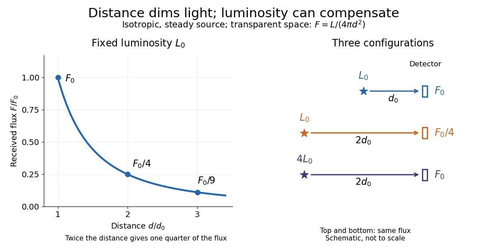

**[Figure 14](#image-fixed-luminosity-gives-inverse-square-dimming-different-luminosities-can-give-equal-observed-flux-configuration-diagram-schematic-not-to-scale). Fixed luminosity gives inverse-square dimming; different luminosities can give equal observed flux; configuration diagram schematic, not to scale**.

###### Spectral energy distribution

↑ **Parent:** [Observed radiative flux](#observed-radiative-flux)

The distribution of received [radiative flux](#radiative-flux) or emitted [luminosity](#luminosity) across [frequency](wave.md#frequency) or [photon](quantum-mechanics.md#photon) [energy](energy.md). Plotting $\nu F_\nu$ against $\log\nu$ makes the area equal to the integrated [radiative flux](#radiative-flux), since $F_\nu\,d\nu=\nu F_\nu\,d\log\nu$. A convention such as $F_\nu$, $\nu F_\nu$ or $F_\lambda$ must be specified before comparing spectral slopes.

###### Flux-distance degeneracy

↑ **Parent:** [Observed radiative flux](#observed-radiative-flux)

One [observed radiative flux](#observed-radiative-flux) cannot determine both [luminosity](#luminosity) and [Euclidean distance](topological-analysis.md#euclidean-distance): for every $k>0$, replacing $(L,d)$ by $(k^2L,kd)$ leaves $F$ unchanged. In particular, $4\times10^{26}\,\mathrm W$ at $40$ [parsecs](#parsec) produces the same [observed radiative flux](#observed-radiative-flux) as $10^{26}\,\mathrm W$ at $20$ [parsecs](#parsec). This is a concrete failure of [identifiability](statistical-model.md#identifiability) in an [inverse problem](inverse-problem.md).

An independent [stellar parallax](#stellar-parallax) fixes the distance and breaks this degeneracy; alternatively, a calibrated [standard candle](#standard-candle) supplies the [luminosity](#luminosity). [Interstellar extinction](galaxy.md#interstellar-extinction) can further reduce the [observed radiative flux](#observed-radiative-flux), and a [photometric passband](#photometric-passband) measures only a selected spectral range. At cosmological distances, use [luminosity distance](cosmology.md#luminosity-distance) in the bolometric relation. Each inference must specify which [radiative flux](#radiative-flux) was measured and what propagation assumptions connect it to [luminosity](#luminosity).

##### Observed flux of an unresolved spherical emitter

↑ **Parent:** [Radiative flux](#radiative-flux)

For a uniformly emitting spherical body of [radius](topology.md#radius) $R$ at [Euclidean distance](topological-analysis.md#euclidean-distance) $d\gg R$, integration of its [specific intensity](radiometry.md#spectral-radiance) over the apparent [solid angle](euclidean-geometry.md#solid-angle) gives $f_\lambda=\pi I_\lambda(R/d)^2$. For a [blackbody](#blackbody), $I_\lambda=B_\lambda(T)$ and the bolometric result is $f=\sigma_{\rm SB}T^4(R/d)^2=L/(4\pi d^2)$. A grey [emissivity](heat.md#emissivity) factor multiplies this expression; isothermality alone does not imply blackbody emission.

##### Spectral flux density

↑ **Parent:** [Radiative flux](#radiative-flux)

Spectral flux density is radiant power received per unit area and per unit wavelength or frequency. The two conventions satisfy $F_\lambda\,d\lambda=-F_\nu\,d\nu$ under $\nu=c/\lambda$, hence $F_\lambda=(c/\lambda^2)F_\nu$ when the arguments refer to the same photons. Integrating over a [photometric passband](#photometric-passband) gives its measured flux.

#### Eddington closure approximation

↑ **Parent:** [Radiation-field moment](#radiation-field-moment)

The Eddington closure approximation sets the second angular moment to one third of the zeroth, so the radiation pressure and mean intensity satisfy $cP_r=4\pi J/3$.

##### Positivity limitation of a linear Eddington intensity

↑ **Parent:** [Eddington closure approximation](#eddington-closure-approximation)

For the affine angular ansatz $I=A+C\cos\theta$, the [radiative flux](#radiative-flux) is $F=4\pi C/3$. Setting the inward hemispheric flux to zero gives $A(0)=2C/3$, but then the formal intensity at $\cos\theta=-1$ is negative when $F>0$. Exact no-incoming radiation and nonnegative intensity cannot both be represented by a nonzero affine polynomial on all directions. The [Eddington surface boundary condition](#eddington-surface-boundary-condition) therefore specifies approximate moments, rather than an exact emergent angular radiation field.

### Grey atmosphere

↑ **Parent:** [Radiative transfer](#radiative-transfer)  
ⓦ [Wiki](https://en.wikipedia.org/wiki/Grey_atmosphere)

A grey atmosphere has frequency-independent opacity. In plane-parallel radiative equilibrium under the Eddington closure, its temperature obeys

$$
T^4=\frac34T_{\rm eff}^4\left(\tau+\frac23\right).
$$

#### Transparent-gas addition at fixed absorber mass

↑ **Parent:** [Grey atmosphere](#grey-atmosphere)

In a well-mixed convective column with fixed absorber mass and constant mass opacity, adding a perfectly transparent gas leaves total [optical depth](#optical-depth) $D$ unchanged. The absolute [effective emission pressure](#effective-emission-pressure) scales with total surface pressure, but their ratio remains $D$. In the thick-column emitting-level model, $T_s=T_eD^{R_a/c_{pa}}$; added gas warms the surface only if its specific-gas-constant to heat-capacity ratio exceeds that of the original gas. Pressure broadening would violate the fixed-opacity assumption and must be treated separately.

#### Effective emission pressure

↑ **Parent:** [Grey atmosphere](#grey-atmosphere)

For a source linear in downward effective [optical depth](#optical-depth) $t\in[0,D]$, [two-stream approximation](#two-stream-approximation) weighting $e^{-t}$ has normalized mean $t_{\rm eff}=1-D/(e^D-1)$. Constant mass opacity gives $p_{\rm rad}=p_s t_{\rm eff}/D$, tending to $p_s/2$ for small $D$ and $p_s/D$ for large $D$. The atmospheric flux is $(1-e^{-D})S(t_{\rm eff})$, separate from transmitted ground radiation. Exact angular transfer with literal vertical optical depth instead has weight $2E_2(t)$ and thick-limit mean $2/3$; the convention matters.

#### Pressure-linear grey opacity

↑ **Parent:** [Grey atmosphere](#grey-atmosphere)

A [grey atmosphere](#grey-atmosphere) model with [mass absorption coefficient](#mass-absorption-coefficient) proportional to [pressure](pressure.md). Under [hydrostatic balance](fluid-mechanics.md#hydrostatic-balance), $\kappa=\kappa_sp/p_s$ gives downward [optical depth](#optical-depth) $t=\kappa_sp^2/(2gp_s)$. For $T=T_s(p/p_s)^a$, a non-scattering optically thick column emits hemispheric [radiant flux](radiometry.md#radiant-flux) $F\sim\sigma T_s^4t_s^{-2a}\Gamma(2a+1)/(a+1)$. The angular factor follows from integrating ray attenuation over the upward hemisphere; a vertical-ray approximation omits it. The extension of the emitting-depth [integral](integral.md) to infinity requires fixed $a$ as $t_s\to\infty$.

#### Obstruction to a single smooth exponential mode in conservative grey transfer

↑ **Parent:** [Grey atmosphere](#grey-atmosphere)

Consider $I=\alpha[\beta+\tau+\mu+\gamma e^{-\delta\tau}/(1+\epsilon\mu)]$ with real $|\epsilon|<1$, $\alpha\gamma\ne0$, and $\delta>0$. Its angular mean includes $A_0=\operatorname{atanh}\epsilon/\epsilon$. Substitution into $\mu I_\tau=I-J$ requires $1-A_0+(\delta-A_0\epsilon)\mu=0$. Thus $A_0=1$ and $\delta=\epsilon$. For real $\epsilon$, $A_0=1$ only at zero, giving $\delta=0$, a contradiction. Independently, its flux contains a varying term proportional to $A_1=(1-A_0)/\epsilon$, which is nonzero for nonzero real $\epsilon$. Exact conservative transfer therefore needs a more general angular/depth structure than this one smooth exponential correction.

#### Hopf function of a grey atmosphere

↑ **Parent:** [Grey atmosphere](#grey-atmosphere)

The Hopf function encodes the departure of a plane-parallel [grey atmosphere](#grey-atmosphere) from a purely linear source profile. With physical bolometric [radiative flux](#radiative-flux) $F$ and standard [mean intensity](#mean-intensity) $J$, it is defined by $J=3F[\tau+q(\tau)]/(4\pi)$. In thermal [radiative equilibrium](heat.md#radiative-equilibrium), $T^4=3T_{\rm eff}^4[\tau+q(\tau)]/4$. The [Eddington closure approximation](#eddington-closure-approximation) with its approximate surface condition gives constant $q=2/3$; exact angular transfer generally gives a depth-dependent function.

#### Eddington surface boundary condition

↑ **Parent:** [Grey atmosphere](#grey-atmosphere)

For no incident radiation and outward intensity approximated as direction independent, the surface angular moments are $F=\pi I_0$ and $P_{\rm rad}(0)=2\pi I_0/(3c)$. Integrating the radiation momentum equation with the [Eddington closure approximation](#eddington-closure-approximation) yields the [grey atmosphere](#grey-atmosphere) law $T^4=3T_{\rm eff}^4(\tau+2/3)/4$. This is an approximate angular boundary condition, not isotropy across both hemispheres.

#### Plane-parallel atmosphere

↑ **Parent:** [Grey atmosphere](#grey-atmosphere)

A plane-parallel atmosphere neglects curvature over its vertical thickness, so thermodynamic variables depend on one Cartesian height coordinate.

##### Plane-parallel validity from pressure scale height

↑ **Parent:** [Plane-parallel atmosphere](#plane-parallel-atmosphere)

A [plane-parallel atmosphere](#plane-parallel-atmosphere) is geometrically accurate only if the relevant line-forming region is thin relative to the stellar radius. An isothermal estimate gives $H=k_BT/(\mu m_ug_{\rm eff})$. Radiative acceleration reduces the effective gravity and increases extension. A small photospheric $H/R$ does not justify a plane-parallel description of wind lines formed far above that photosphere.

## Line of sight

↑ **Parent:** [Astrophysics](astrophysics.md)

The line of sight is the ray from an observer toward an astronomical source.

### Plane of the sky

↑ **Parent:** [Line of sight](#line-of-sight)

The plane of the sky is the plane through a source perpendicular to the observer's line of sight.

#### Position angle

↑ **Parent:** [Plane of the sky](#plane-of-the-sky)  
ⓦ [Wiki](https://en.wikipedia.org/wiki/Position_angle)

Position angle specifies a projected direction on the sky, conventionally measured from North toward East.

#### Projected separation

↑ **Parent:** [Plane of the sky](#plane-of-the-sky)

Projected separation is the distance between two objects after their relative displacement is projected onto the plane of the sky.

## Planetary science

↑ **Parent:** [Astrophysics](astrophysics.md)

[This section is present in another page, follow this link to view it.](planetary-science.md)

## Stellar astrophysics

↑ **Parent:** [Astrophysics](astrophysics.md)

[This section is present in another page, follow this link to view it.](stellar-astrophysics.md)

## Astrophysical disk

↑ **Parent:** [Astrophysics](astrophysics.md)

[This section is present in another page, follow this link to view it.](astrophysical-disk.md)

## Galaxy

↑ **Parent:** [Astrophysics](astrophysics.md)

[This section is present in another page, follow this link to view it.](galaxy.md)

## Astrophysical black hole

↑ **Parent:** [Astrophysics](astrophysics.md)

[This section is present in another page, follow this link to view it.](astrophysical-black-hole.md)

## Observational astronomy

↑ **Parent:** [Astrophysics](astrophysics.md)  
ⓦ [Wiki](https://en.wikipedia.org/wiki/Observational_astronomy)

### Phases of Venus

↑ **Parent:** [Observational astronomy](#observational-astronomy)  
ⓦ [Wiki](https://en.wikipedia.org/wiki/Phases_of_Venus)

The changing illuminated fraction of [Venus](planetary-science.md#venus) seen from the [Earth](planetary-science.md#earth). A full sequence including gibbous phases excludes the classical near-side Ptolemaic arrangement but is compatible with both a [heliocentric model](astronomy.md#heliocentric-model) and a [Tychonic system](astronomy.md#tychonic-system).

### Astronomical selection function

↑ **Parent:** [Observational astronomy](#observational-astronomy)

An [astronomical selection function](#astronomical-selection-function) specifies the probability that an object or its measured data enter a catalogue. It can depend on sky position, flux, colour, angular extent, time sampling and follow-up success. A generative calculation combines the parent population, instrument response, measurement noise and inclusion rule. A selection cut on latent properties must be propagated through the measurement [likelihood](maximum-likelihood-estimation.md#likelihood-function) rather than substituted for a cut on observed quantities.

#### Selection-normalized astronomical likelihood

↑ **Parent:** [Astronomical selection function](#astronomical-selection-function)

For population parameters $\eta$ and an inclusion region $S$ in measured-data space, a selected datum has [density](fluid-mechanics.md#density) $\mathbf1_S(d)p(d\mid\eta)/P(S\mid\eta)$. The normalization integrates the noisy measurement model and population over the actual selection region. Inference must also specify what is conditioned on: deterministic selection information already contained in the conditioned data must not be counted twice.

#### Survey completeness

↑ **Parent:** [Astronomical selection function](#astronomical-selection-function)

[survey completeness](#survey-completeness) is the fraction of a specified true source population recovered by a survey, conditional on properties such as flux, size and sky position. Injecting simulated sources into realistic data and applying the actual detection pipeline measures recovery probability. Completeness differs from purity: recovered objects can include false detections or incorrectly identified sources.

### Isophotal photometry

↑ **Parent:** [Observational astronomy](#observational-astronomy)

[isophotal photometry](#isophotal-photometry) measures an extended source's [radiative flux](#radiative-flux) inside a contour of fixed [surface brightness](#surface-brightness). It misses light outside that contour. The fraction lost depends on the intrinsic brightness profile, convolution with the [point spread function](point-spread-function.md), [sky background](#sky-brightness) estimation and the chosen threshold. A per-pixel threshold is not a fundamental limit on fitting or averaging many faint pixels together.

### Lick Observatory

↑ **Parent:** [Observational astronomy](#observational-astronomy)

### X-ray astronomy

↑ **Parent:** [Observational astronomy](#observational-astronomy)  
ⓦ [Wiki](https://en.wikipedia.org/wiki/X-ray_astronomy)

[X-ray astronomy](#x-ray-astronomy) infers the properties of celestial sources from their [X-rays](electromagnetic-radiation.md#x-ray). It requires instruments above the strongly absorbing layers of [Earth](planetary-science.md#earth)'s [terrestrial atmosphere](planetary-science.md#terrestrial-atmosphere). [Riccardo Giacconi](astronomy.md#riccardo-giacconi)'s 2002 Nobel lecture connects the early rocket detections to later [grazing-incidence X-ray optics](#grazing-incidence-x-ray-optics), which collect [photons](quantum-mechanics.md#photon) over a large entrance area onto a small detector.[The Dawn of X-Ray Astronomy, introduction and section 4, pp. 123–124](physics-bibliography.md#the-dawn-of-x-ray-astronomy-by-riccardo-giacconi)

The measurement is an [inverse problem](inverse-problem.md): a count rate mixes incident [photon](quantum-mechanics.md#photon) arrival rate, detector response, and background. A [point-like astronomical source](#point-like-astronomical-source) produces a direction-dependent excess as the instrument scans; [diffuse X-ray background](#diffuse-x-ray-background) contributes over many directions. Neither a count excess nor a narrow feature by itself determines the emission mechanism. The useful progression is from detecting an excess, to locating it, to measuring its [spectrum](linear-operator-theory.md#spectrum-functional-analysis) and [light curve](#light-curve).

#### Cosmic X-ray source

↑ **Parent:** [X-ray astronomy](#x-ray-astronomy)

#### 1962 rocket discovery of cosmic X-ray sources

↑ **Parent:** [X-ray astronomy](#x-ray-astronomy)

In 1962, [Riccardo Giacconi](astronomy.md#riccardo-giacconi) and colleagues flew three [Geiger counters](particle-detection.md#geiger-counter) to search for lunar [X-ray fluorescence](electromagnetic-radiation.md#x-ray-fluorescence). Different [mica](chemical-substance.md#mica) thicknesses tested penetration; lampblack blocked [ultraviolet](optics.md#ultraviolet). Each counter sat in an [anticoincidence detector](particle-detection.md#anticoincidence-detector) using a [scintillation counter](particle-detection.md#scintillation-counter) to reject [cosmic rays](galaxy.md#cosmic-ray). There was no mechanical [collimator](optical-instrument.md#collimator). Rotation scanned the sky; optical sensors supplied orientation.[pp. 439–440, apparatus and readout](physics-bibliography.md#evidence-for-x-rays-from-sources-outside-the-solar-system-by-riccardo-giacconi-and-others)

Counts were sorted by [azimuth](#azimuth); a faulty counter and tumbling descent data were excluded. A directional peak lay above a diffuse component. Window, altitude and angular responses tested [X-rays](electromagnetic-radiation.md#x-ray) against [charged particles](electric-charge.md#charged-particle); the [Moon](planetary-science.md#moon)'s nondetection checked optical leakage. The authors argued for an origin outside the [Solar system](#solar-system), while residual [cosmic ray](galaxy.md#cosmic-ray) background was not directly measured and source size, position and [spectrum](linear-operator-theory.md#spectrum-functional-analysis) remained assumption-dependent.[pp. 440–443, Figs. 1–4 and concluding limitations](physics-bibliography.md#evidence-for-x-rays-from-sources-outside-the-solar-system-by-riccardo-giacconi-and-others)

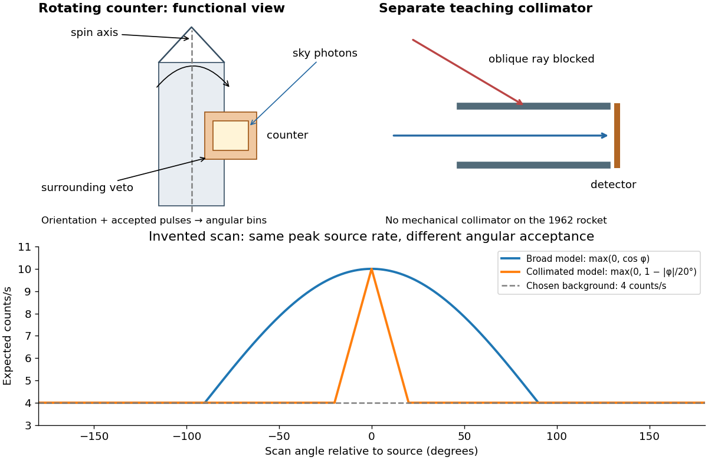

**[Figure 15](#image-rotation-encodes-direction-a-teaching-collimator-narrows-an-angular-response). Rotation encodes direction; a teaching collimator narrows an angular response**. Functional schematic and invented response curves. The 1962 rocket had no mechanical collimator; the separate collimator panel illustrates a possible angular filter. Curves are model expectations, not flight data.

A simple original [forward problem](inverse-problem.md#forward-problem) makes the distinction precise. Let $\phi$ be the scan [azimuth](#azimuth), let $g(\phi)$ be a dimensionless directional response with maximum one, let $F$ be a source's band-integrated [photon](quantum-mechanics.md#photon) arrival rate per unit area, let $A_0$ be its on-axis [X-ray effective area](#x-ray-effective-area), and let $b$ be a constant accepted background rate. The expected rate is

$$
r(\phi)=F A_0 g(\phi)+b.
$$

For a broad illustrative response $g(\phi)=\max(0,\cos\phi)$, the full width at half maximum is $120^\circ$: $\cos\phi=1/2$ at $\phi=\pm60^\circ$. For a one-dimensional ideal [collimator](optical-instrument.md#collimator) model $g(\phi)=\max(0,1-|\phi|/\theta_c)$, the full width at half maximum is $\theta_c$. Choosing $\theta_c=20^\circ$ narrows the response sixfold without focusing any additional [photons](quantum-mechanics.md#photon). These are teaching response functions, not reconstructions of the rocket's window transmission or geometry. A narrower scan peak can reflect the instrument response even when the source is unresolved.

##### Scorpius X-1

↑ **Parent:** [1962 rocket discovery of cosmic X-ray sources](#1962-rocket-discovery-of-cosmic-x-ray-sources)  
ⓦ [Wiki](https://en.wikipedia.org/wiki/Scorpius_X-1)

[Scorpius X-1](#scorpius-x-1) is the celestial [X-ray](electromagnetic-radiation.md#x-ray) source associated with the 1962 discovery, subsequently located more precisely. The discovery scan did not supply a resolved image of this [X-ray binary](stellar-astrophysics.md#x-ray-binary).[Tracing a Bright Path: discovery scan and identification](physics-bibliography.md#tracing-a-bright-path-by-nasa-heasarc)

#### Diffuse X-ray background

↑ **Parent:** [X-ray astronomy](#x-ray-astronomy)

[Diffuse X-ray background](#diffuse-x-ray-background) is [X-ray](electromagnetic-radiation.md#x-ray) emission spread over the instrument's observed sky rather than assigned to a single resolved source. Diffuse appearance at finite [angular resolution](#angular-resolution) does not prove emission by a continuous medium: many unresolved [point-like astronomical sources](#point-like-astronomical-source) can also give a smooth signal. Instrumental background is a separate contribution, even though both enter measured counts.

#### X-ray effective area

↑ **Parent:** [X-ray astronomy](#x-ray-astronomy)

[X-ray effective area](#x-ray-effective-area) is the area that converts an incident [photon](quantum-mechanics.md#photon) arrival rate per unit area into an accepted count rate. For a fixed direction and a sufficiently narrow [energy](energy.md) interval, write

$$
A_{\mathrm{eff}}=A_{\mathrm{geom}}T\eta\epsilon_s,\qquad N_s=F A_{\mathrm{eff}}t.
$$

Here $A_{\mathrm{geom}}$ is projected geometric area, $T$ is [transmittance](radiometry.md#transmittance) through windows or optics, $\eta$ is [quantum efficiency](optical-instrument.md#quantum-efficiency), $\epsilon_s$ is the probability that a detected source event passes event selection, and $t$ is live observing time. $N_s$ is an [expected value](expected-value.md), not a guarantee of an integer count. Multiplication follows by counting incident [photons](quantum-mechanics.md#photon) over area and time, then applying the successive conditional acceptance probabilities. Live time already excludes intervals when the instrument cannot record events; multiplying by a live-time fraction again would count the same loss twice.

For an invented narrow-band example, choose $A_{\mathrm{geom}}=40\,\mathrm{cm^2}$, $T=0.8$, $\eta=0.75$, and $\epsilon_s=5/6$. Then $A_{\mathrm{eff}}=20\,\mathrm{cm^2}$. A source with $F=0.30\,\mathrm{photons\,cm^{-2}\,s^{-1}}$ observed for $t=100\,\mathrm{s}$ gives $N_s=600$. $F$ here counts [photons](quantum-mechanics.md#photon); converting it into [observed radiative flux](#observed-radiative-flux) requires their [energies](energy.md). If all have [energy](energy.md) $E_0$, the corresponding [radiative flux](#radiative-flux) is $E_0F$.

A broad [spectrum](linear-operator-theory.md#spectrum-functional-analysis) instead requires

$$
N_s=t\int F_E(E)A_{\mathrm{eff}}(E)\,\mathrm{d}E,
$$

where $F_E$ is the differential [photon](quantum-mechanics.md#photon) arrival rate per area and [energy](energy.md). A single band-averaged [X-ray effective area](#x-ray-effective-area) depends on the assumed [spectrum](linear-operator-theory.md#spectrum-functional-analysis). This is why a count rate alone cannot give an assumption-free [radiative flux](#radiative-flux).

##### On-off X-ray photon counting

↑ **Parent:** [X-ray effective area](#x-ray-effective-area)

[Background subtraction](optical-instrument.md#background-subtraction) must account for uncertainty in the background measurement itself. In an original idealized experiment, an on-source exposure contains source and background, while an independent off-source exposure contains background alone. Assume stationary rates and identical background acceptance per unit live time. With $\alpha=t_{\mathrm{on}}/t_{\mathrm{off}}$, let independent counts obey [Poisson distributions](discrete-probability-distribution.md#poisson-distribution):

$$
N_{\mathrm{on}}\sim\operatorname{Poisson}(S+B),\qquad N_{\mathrm{off}}\sim\operatorname{Poisson}(B/\alpha).
$$

Then [linearity of expectation](expected-value.md#linearity-of-expectation) and addition of [variances](variance.md) for independent [random variables](random-variable.md) give

$$
\widehat S=N_{\mathrm{on}}-\alpha N_{\mathrm{off}},\qquad \mathbb E\widehat S=S,\qquad \operatorname{Var}(\widehat S)=S+(1+\alpha)B.
$$

The result concerns accepted source counts $S$, after all efficiencies. For large counts the [normal approximation](convergence-of-random-variables.md#normal-approximation) gives the descriptive [signal-to-noise ratio in photon counting](optical-instrument.md#signal-to-noise-ratio-in-photon-counting)

$$
Z_{\mathrm{approx}}=\frac{\widehat S}{\sqrt{N_{\mathrm{on}}+\alpha^2N_{\mathrm{off}}}}.
$$

This plug-in ratio is not an exact null-hypothesis significance. Small counts require the discrete [Poisson](discrete-probability-distribution.md#poisson-distribution) model; searching many sky directions also changes a detection claim's [p-value](statistical-hypothesis-test.md#p-value).

Choose $t_{\mathrm{on}}=100\,\mathrm{s}$ and $t_{\mathrm{off}}=200\,\mathrm{s}$, with observed counts $N_{\mathrm{on}}=1000$ and $N_{\mathrm{off}}=800$. Thus $\alpha=1/2$, $\widehat S=600$, and the estimated [standard deviation](variance.md#standard-deviation) is $\sqrt{1200}=34.64$ counts. The inferred $F=\widehat S/(A_{\mathrm{eff}}t_{\mathrm{on}})=0.300\pm0.0173\,\mathrm{photons\,cm^{-2}\,s^{-1}}$ uses the preceding $A_{\mathrm{eff}}=20\,\mathrm{cm^2}$ and includes counting uncertainty only. The descriptive ratio is $17.32$. Treating the scaled off-source background as exact would omit 200 counts squared from the estimated [variance](variance.md).

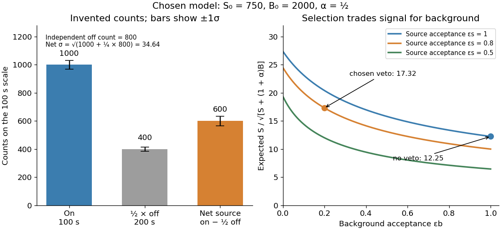

**[Figure 16](#image-invented-on-off-counts-and-the-effect-of-background-rejection). Invented on-off counts and the effect of background rejection**. All numbers are chosen teaching values, not historical measurements. Independent off-source counts contribute uncertainty. The rejection curves hold the source acceptance fixed within each labelled case.

For a selection-design comparison, suppose before a veto the expected source contribution is $S_0=750$, the on-source background is $B_0=2000$, and $\alpha=1/2$. Let source acceptance be $\epsilon_s=0.8$ and background acceptance be $\epsilon_b=0.2$. Then $S=600$, $B=400$, and $S/\sqrt{S+(1+\alpha)B}=17.32$, whereas omitting the veto gives $750/\sqrt{750+3000}=12.25$. Rejection helps because the background is reduced enough to compensate for lost source events. A different veto can make matters worse; source efficiency and background rejection are separate probabilities. This comparison is an independent teaching example, not the efficiency calibration used above.

If both exposure times grow with fixed $\alpha$ and stationary rates, $S=s t_{\mathrm{on}}$ and $B=b t_{\mathrm{on}}$ imply $Z\simeq s\sqrt{t_{\mathrm{on}}}/\sqrt{s+(1+\alpha)b}$. Four times the live time doubles this ideal ratio. Misestimated background rates, uncertain [X-ray effective area](#x-ray-effective-area), and source variability can defeat that scaling; longer exposure does not remove [systematic error](physics.md#systematic-error).

#### Grazing-incidence X-ray optics

↑ **Parent:** [X-ray astronomy](#x-ray-astronomy)

[Grazing-incidence X-ray optics](#grazing-incidence-x-ray-optics) redirect [X-rays](electromagnetic-radiation.md#x-ray) by shallow [specular reflections](optics.md#specular-reflection) along mirror surfaces. [Riccardo Giacconi](astronomy.md#riccardo-giacconi)'s lecture describes coaxial paraboloidal and hyperboloidal mirrors using two reflections, and the later Einstein observatory's imaging capability. Focusing separates collecting area from detector area: the collected source signal can remain large while the detector background is drawn from a smaller region.[sections 3.2–4, pp. 123–124, Fig. 13](physics-bibliography.md#the-dawn-of-x-ray-astronomy-by-riccardo-giacconi)

An ideal lossless [geometrical optics](geometrical-optics.md) calculation explains the shallow angle. Take vacuum [refractive index](electromagnetic-wave.md#refractive-index) one and a material with real [refractive index](electromagnetic-wave.md#refractive-index) $n=1-\delta$, where $0<\delta\ll1$. Let $\theta$ be the grazing angle measured from the surface. [Snell's law](partial-differential-equation.md#snell-s-law) written for angles from the normal requires $\cos\theta=n\sin\theta_t$. A propagating transmitted ray exists only if $\cos\theta\leq n$. Thus the ideal threshold is

$$
\theta_c=\arccos(1-\delta)\simeq\sqrt{2\delta}.
$$

The last step uses the [Taylor series](calculus.md#taylor-series) $\cos\theta=1-\theta^2/2+O(\theta^4)$. For a chosen $\delta=2\times10^{-5}$, $\theta_c\simeq0.006325$ [radians](geometry-and-topology.md#radian), or $0.3624^\circ$. Absorption makes the [refractive index](electromagnetic-wave.md#refractive-index) complex and softens this ideal threshold; surface roughness and alignment errors also reduce throughput or worsen the [point spread function](point-spread-function.md). These are reasons to calibrate [X-ray effective area](#x-ray-effective-area) and [angular resolution](#angular-resolution), rather than assume that reflection is perfect.

The benefit can be quantified without specifying a historical telescope. Suppose a source retains fraction $f$ of its counts inside an extraction region, while a uniform detector background contributes $q a t$ counts over detector area $a$. In the background-dominated limit of the same independent on-off model,

$$
Z\simeq\frac{f F A_{\mathrm{eff}}\sqrt t}{\sqrt{(1+\alpha)q a}}.
$$

Reducing $a$ by a factor of 100 at fixed $f$ and [X-ray effective area](#x-ray-effective-area) improves this ideal ratio tenfold. A [collimator](optical-instrument.md#collimator) restricts admitted directions; focusing optics bring selected rays together. An image also separates nearby sources and identifies clean background regions, connecting optical design directly to a better constrained [inverse problem](inverse-problem.md).

### Radio astronomy

↑ **Parent:** [Observational astronomy](#observational-astronomy)  
ⓦ [Wiki](https://en.wikipedia.org/wiki/Radio_astronomy)

Radio astronomy studies celestial sources through their [radio waves](electromagnetic-radiation.md#radio-wave). The long [wavelengths](wave-equation.md#wavelength) make [angular resolution](#angular-resolution) expensive: a filled telescope of diameter $D$ has a characteristic [diffraction](quantum-scattering.md#diffraction) scale of order $\lambda/D$. [Aperture synthesis](#aperture-synthesis) instead combines measurements from separated [antennas](electrical-engineering.md#antenna-radio), using their separations to measure fine structure while their individual collecting areas determine how much radiation they receive. A kilometre-wide arrangement of small [antennas](electrical-engineering.md#antenna-radio) does not collect the power intercepted by a filled kilometre-wide dish.

#### System temperature

↑ **Parent:** [Radio astronomy](#radio-astronomy)

The equivalent input noise [temperature](temperature.md) of the antenna-plus-receiver system is defined by available noise [power](energy.md#power) $P_n=k_BT_{\rm sys}\Delta\nu$ in one matched [polarization of waves](wave.md#polarization-waves) mode. It includes receiver noise and the appropriate sky and instrumental contributions. It is not generally the physical [temperature](temperature.md) of a single component.

##### System-equivalent flux density

↑ **Parent:** [System temperature](#system-temperature)

The [system-equivalent flux density](#system-equivalent-flux-density) is the unpolarized [spectral flux density](#spectral-flux-density) that would produce an [antenna](electrical-engineering.md#antenna-radio) [temperature](temperature.md) equal to $T_{\rm sys}$. With effective collecting area $A_e$, $\mathrm{SEFD}=2k_BT_{\rm sys}/A_e$. The factor two follows from one [polarization of waves](wave.md#polarization-waves) measurement of an unpolarized source. State effective area and [polarization of waves](wave.md#polarization-waves) conventions when comparing sensitivities.[slides 5–7, antenna performance and SEFD](physics-bibliography.md#sensitivity-by-joan-wrobel)

#### Radio telescope

↑ **Parent:** [Radio astronomy](#radio-astronomy)  
ⓦ [Wiki](https://en.wikipedia.org/wiki/Radio_telescope)

A radio telescope is an astronomical instrument that receives [radio waves](electromagnetic-radiation.md#radio-wave) using an [antenna](electrical-engineering.md#antenna-radio) and associated receivers. A single dish measures radiation over its directional sensitivity pattern; separated elements can supply [complex visibilities](#complex-visibility) for [aperture synthesis](#aperture-synthesis).

#### Interplanetary scintillation

↑ **Parent:** [Radio astronomy](#radio-astronomy)  
ⓦ [Wiki](https://en.wikipedia.org/wiki/Interplanetary_scintillation)

Interplanetary scintillation is rapid variation in the received strength of a compact astronomical radio source, produced by propagation through fluctuating [electron](physics.md#electron) density in the [solar wind](#solar-wind). Its dependence on source angular size can help distinguish compact sources. It is a propagation effect, distinct from intrinsic periodic emission by a [pulsar](stellar-astrophysics.md#pulsar).

#### Aperture synthesis

↑ **Parent:** [Radio astronomy](#radio-astronomy)  
ⓦ [Wiki](https://en.wikipedia.org/wiki/Aperture_synthesis)

Aperture synthesis reconstructs the sky's brightness from [complex visibilities](#complex-visibility) measured at different [interferometric baselines](#interferometric-baseline). Each measurement constrains a [Fourier transform](fourier-transform.md) component of the brightness, rather than supplying a little photograph. Combining many such components can distinguish sources that each individual [antenna](electrical-engineering.md#antenna-radio) leaves unresolved. The remarkable economy is that changing separations and the rotation of [Earth](planetary-science.md#earth) can provide many measurements with only a few physical [antennas](electrical-engineering.md#antenna-radio).

[Martin Ryle](astronomy.md#martin-ryle)'s Cambridge group made [aperture synthesis](#aperture-synthesis) a practical method of astronomical imaging at the Mullard Radio Astronomy Observatory. Cambridge's institutional history connects that work with the [One-Mile Telescope](#one-mile-telescope) and its larger successors.[Cavendish Laboratory, Mullard Radio Astronomy Observatory at Lord’s Bridge, sections Foundation and early development and A centre for radio interferometry](physics-bibliography.md#mullard-radio-astronomy-observatory-at-lord’s-bridge-by-cavendish-laboratory-university-of-cambridge)

In his 1974 lecture Radio Telescopes of Large Resolving Power, [Martin Ryle](astronomy.md#martin-ryle) recalled the problem of distinguishing weak extragalactic sources and resolving their structure. He explained sequential wavefront sampling using one simultaneously observed element as a [wave phase](wave.md#phase-waves) reference, and the saving obtained by letting [Earth](planetary-science.md#earth) rotate the apparent baseline.[Ryle (1974), Radio Telescopes of Large Resolving Power, pp. 187–192, Figures 1 and 4](physics-bibliography.md#radio-telescopes-of-large-resolving-power-by-martin-ryle)

The 1974 [Nobel Prize in Physics](nobel-prize-in-physics.md) distinguished [Martin Ryle](astronomy.md#martin-ryle)'s observations and inventions, especially [aperture synthesis](#aperture-synthesis), from [Antony Hewish](astronomy.md#antony-hewish)'s role in discovering [pulsars](stellar-astrophysics.md#pulsar). The latter is a separate astronomical discovery, with its own observational history.[Nobel Prize in Physics 1974, award explanation and equal prize shares](physics-bibliography.md#the-nobel-prize-in-physics-1974-by-nobel-prize-outreach)

##### Synthesized beam

↑ **Parent:** [Aperture synthesis](#aperture-synthesis)

The [synthesized beam](#synthesized-beam) is the angular response produced by the sampled and weighted [complex visibilities](#complex-visibility). Its characteristic width is set by the longest well-weighted projected [interferometric baselines](#interferometric-baseline), of order $\lambda/b_{\max}$, while sidelobes reflect incomplete Fourier coverage. It differs from the individual [antenna](electrical-engineering.md#antenna-radio) [primary beam](#primary-beam), which limits the field of view.

##### Radio interferometry

↑ **Parent:** [Aperture synthesis](#aperture-synthesis)

Radio interferometry measures the [spatial coherence](physical-optics.md#spatial-optical-coherence) of received [radio waves](electromagnetic-radiation.md#radio-wave). At two [antennas](electrical-engineering.md#antenna-radio), a receiver preserves the relative [wave phase](wave.md#phase-waves), compensates the geometric delay for a chosen [phase centre](#phase-centre), and averages a product of one signal with the [complex conjugate](complex-analysis.md#complex-conjugate) of the other. In a complex-signal description this correlation is $\langle E_1E_2^*\rangle$. Its real and imaginary parts carry two complementary components of the [complex visibility](#complex-visibility); measuring only the received powers discards the relative [wave phase](wave.md#phase-waves) needed for general imaging.

A finite frequency band makes delay compensation essential. If the residual delay is $\Delta\tau$, the residual [wave phase](wave.md#phase-waves) varies by $2\pi\Delta\nu\Delta\tau$ across a band of width $\Delta\nu$. Averaging these differently oriented complex contributions reduces the correlation. For an ideal rectangular band the multiplicative factor is $\sin(\pi\Delta\nu\Delta\tau)/(\pi\Delta\nu\Delta\tau)$. A phase correction at just the central [frequency](wave.md#frequency) cannot remove this variation across the band. Long time averages can likewise smear a changing signal.

###### Very Long Baseline Array

↑ **Parent:** [Radio interferometry](#radio-interferometry)

The [Very Long Baseline Array](#very-long-baseline-array) is a radio-telescope array used for [very-long-baseline interferometry](#very-long-baseline-interferometry). In a solar-deflection experiment, differential [astrometry](astronomy.md#astrometry) of nearby compact sources compares their apparent directions as their angular separation from the [Sun](stellar-astrophysics.md#sun) changes. Measurements at several frequencies can distinguish dispersive [refraction](optics.md#refraction) in the [solar corona](stellar-astrophysics.md#solar-corona) from achromatic gravitational deflection.[2009, §§II–III](physics-bibliography.md#progress-in-measurements-of-the-gravitational-bending-of-radio-waves-using-the-vlba-by-edward-fomalont-and-others)

###### Very-long-baseline interferometry

↑ **Parent:** [Radio interferometry](#radio-interferometry)

[very-long-baseline interferometry](#very-long-baseline-interferometry) correlates accurately time-referenced radio signals recorded at widely separated collectors, giving [angular resolution](#angular-resolution) of order [wavelength](wave-equation.md#wavelength) divided by projected baseline. Geometric delays, [frequency](wave.md#frequency) standards, atmospheric propagation and source structure enter the [calibration](differential-geometry.md#calibration-differential-geometry). Compact [maser](maser.md) positions and motions are one application.

###### Delay quantization and bandwidth decorrelation

↑ **Parent:** [Radio interferometry](#radio-interferometry)

A residual delay $\delta\tau$ in a rectangular band of width $\Delta\nu$ attenuates the correlated amplitude by $\operatorname{sinc}(\pi\Delta\nu\delta\tau)$. Coarse delay quantization must keep this factor near one; the relevant path scale is $c/\Delta\nu$. Separately, an untracked carrier phase has error $2\pi\delta\ell/\lambda$. Fine phase rotation can remove that central-frequency phase while leaving the band-dependent decorrelation, so delay-step specifications must state both [bandwidth](electrical-engineering.md#bandwidth-signal-processing) and compensation architecture.

###### Natural visibility weighting

↑ **Parent:** [Radio interferometry](#radio-interferometry)

Independent visibility samples are combined with weights proportional to inverse noise [variance](variance.md). This maximizes the point-source sensitivity for correctly calibrated samples. Dense regions of the sampled Fourier plane receive more total weight; tapering the long baselines can further emphasize extended structure at the cost of [angular resolution](#angular-resolution). A source-template filter instead also weights by predicted source response.

###### Interferometric radiometer equation

↑ **Parent:** [Radio interferometry](#radio-interferometry)

For $N$ equal [antennas](electrical-engineering.md#antenna-radio), weak-source independent receiver noise, natural weighting and total on-source time $t$, the point-source rms in one [polarization of waves](wave.md#polarization-waves) is the displayed value. There are $N(N-1)/2$ independent cross-correlation baselines, each with real-component error $\mathrm{SEFD}/\sqrt{2\Delta\nu t}$. Combining $n_{\rm pol}$ independent [polarization of waves](wave.md#polarization-waves) estimates reduces the rms by $\sqrt{n_{\rm pol}}$. Correlation losses divide the sensitivity by an efficiency factor; weighting, flagging and an extended source change the effective sensitivity.[slides 7–12 and 20, baseline and image sensitivity](physics-bibliography.md#sensitivity-by-joan-wrobel)

###### Phase centre

↑ **Parent:** [Radio interferometry](#radio-interferometry)

The phase centre is the reference sky direction for removing geometric delay and its associated [wave phase](wave.md#phase-waves). An unresolved source exactly there ideally has constant [complex visibility](#complex-visibility) after calibration; a displaced source has a baseline-dependent [wave phase](wave.md#phase-waves).

###### Interferometric baseline

↑ **Parent:** [Radio interferometry](#radio-interferometry)

An interferometric baseline is the displacement $\mathbf b=\mathbf r_2-\mathbf r_1$ between two [antennas](electrical-engineering.md#antenna-radio). For a unit [line of sight](#line-of-sight) $\mathbf s_0$ toward the [phase centre](#phase-centre), its projection onto the [plane of the sky](#plane-of-the-sky) is

$$
\mathbf b_\perp=\mathbf b-(\mathbf b\cdot\mathbf s_0)\mathbf s_0,\qquad
|\tau_g|=\frac{|\mathbf b\cdot\mathbf s_0|}{c}.
$$

Here $c$ is the [speed of light](special-relativity.md#speed-of-light). The signed delay depends on which receiver is delayed; the geometric path difference's magnitude does not. If $\mathbf e_\theta$ is a unit tangent in the direction being imaged, the dimensionless coordinate $u=\mathbf b\cdot\mathbf e_\theta/\lambda$ is a [spatial frequency](fourier-analysis.md#spatial-frequency), measured in cycles per [radian](geometry-and-topology.md#radian) of small sky offset. A single pair gives fringes of angular period $1/|u|$ along that tangent. This period specifies one measured oscillation; it does not specify a whole image's [angular resolution](#angular-resolution) or eliminate ambiguous source arrangements.

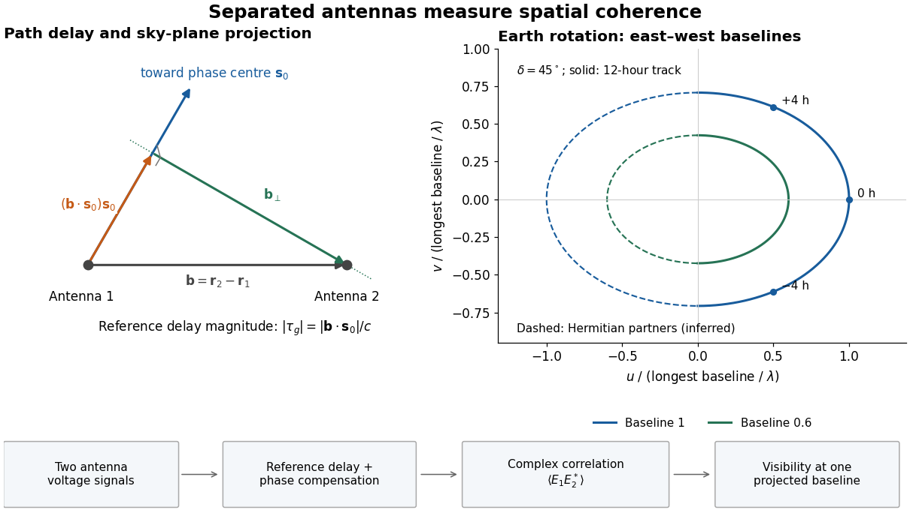

**[Figure 17](#image-geometric-delay-projected-baseline-and-a-schematic-earth-rotation-track-original-geometry-not-telescope-data). Geometric delay, projected baseline, and a schematic Earth-rotation track; original geometry, not telescope data**.

The left panel separates the component producing the reference delay from the component measuring angular structure. The right panel shows a possible [Earth-rotation aperture synthesis](#earth-rotation-aperture-synthesis) track, with its opposite [complex conjugate](complex-analysis.md#complex-conjugate) track. Those opposite samples provide the symmetry required by a real brightness distribution; they are not independent extra observations.

###### Shortest-baseline angular scale

↑ **Parent:** [Interferometric baseline](#interferometric-baseline)

The shortest useful projected baseline sets the lowest sampled [spatial frequency](fourier-analysis.md#spatial-frequency), of order $b_{\min}/\lambda$, and hence an angular scale $\lambda/b_{\min}$. Operational maximum recoverable source sizes also depend on source shape, coverage, weighting and [primary beam](#primary-beam). The longest baseline sets a different scale, the synthesized [angular resolution](#angular-resolution). The number of [antennas](electrical-engineering.md#antenna-radio) alone does not fix either limiting baseline or supply zero-spacing total power.

###### Geometric delay

↑ **Parent:** [Interferometric baseline](#interferometric-baseline)

The difference in plane-wave propagation time between two [antennas](electrical-engineering.md#antenna-radio) is the projected baseline along the source direction divided by the [speed of light](special-relativity.md#speed-of-light). Its sign depends on the ordering of the receivers. A monochromatic signal acquires relative phase $2\pi\nu\tau_g$; its change with Earth rotation is compensated by [fringe stopping](#fringe-stopping) for the chosen reference direction.

###### Residual phase of a tracked east-west interferometer

↑ **Parent:** [Geometric delay](#geometric-delay)

For an east-west baseline $b$ and phase-centre zenith angle $\theta$ in its vertical plane, path compensation subtracts $b\sin\theta$. An offset $\alpha$ leaves $\delta\ell=b[\sin(\theta+\alpha)-\sin\theta]\simeq b\alpha\cos\theta$. The complex correlation therefore has phase $2\pi b\alpha\cos\theta/\lambda$, up to receiver-order convention. Equal cable lengths do not remove this sky-dependent path difference.

###### Earth-rotation aperture synthesis

↑ **Parent:** [Interferometric baseline](#interferometric-baseline)

Earth-rotation aperture synthesis uses [Earth](planetary-science.md#earth)'s changing orientation to vary a fixed ground baseline's projection onto the [plane of the sky](#plane-of-the-sky). In two dimensions, $u$ and $v$ are the components of $\mathbf b_\perp/\lambda$ along two perpendicular sky tangents. Tracking one field traces a curve in this $(u,v)$ plane; changing the physical baseline supplies other curves. A track samples [Fourier transform](fourier-transform.md) coordinates, rather than the brightness along a track across the sky.

For a horizontal east–west baseline of length $B$, choose the sky-axis signs so that

$$
u=\frac{B}{\lambda}\cos H,\qquad v=\frac{B}{\lambda}\sin\delta\sin H,
$$

where $H$ is [hour angle](#hour-angle) and $\delta$ is [declination](#declination). The ellipse follows by projecting the rotating baseline onto sky tangents. At a [celestial pole](#celestial-pole) it is a circle; near the [celestial equator](#celestial-equator) its minor axis collapses. Thus the same ground layout constrains different sky directions unequally. Rotation improves coverage, but does not fill every [spatial frequency](fourier-analysis.md#spatial-frequency), and synthesis across many hours assumes that the source changes negligibly during that interval.

###### Radio interferometer calibration

↑ **Parent:** [Radio interferometry](#radio-interferometry)

Radio interferometer calibration estimates instrumental and propagation effects that alter a [complex visibility](#complex-visibility). A simple narrow-field model is

$$
V_{12}^{\rm obs}=g_1g_2^*V_{12}^{\rm sky}+n_{12},
$$

where $g_1,g_2$ are complex receiver gains and $n_{12}$ represents additive [noise](electrical-engineering.md#noise-signal-processing). A [point-like astronomical source](#point-like-astronomical-source) of known position and stable strength constrains these gains: its expected [complex visibility](#complex-visibility) has a known [wave phase](wave.md#phase-waves) and amplitude. A resolved or variable reference source requires a better source model. Errors in the reference model can be transferred into the inferred sky.

In a proposed extension, [Martin Ryle](astronomy.md#martin-ryle) described simultaneous observation of a nearby reference point source to correct atmospheric [wave phase](wave.md#phase-waves) errors, using an additional dish at each element. He presented this as a possible extension, rather than the standard [One-Mile Telescope](#one-mile-telescope) arrangement.[Ryle (1974), p. 202: proposed reference-source correction](physics-bibliography.md#radio-telescopes-of-large-resolving-power-by-martin-ryle)

###### Complex visibility

↑ **Parent:** [Radio interferometry](#radio-interferometry)

A complex visibility is a calibrated complex correlation of the signals received at a particular [interferometric baseline](#interferometric-baseline). In a narrow field, with scalar radiation, the [far-field approximation for an outgoing source](inverse-problem.md#far-field-approximation-for-an-outgoing-source), a narrow frequency channel, negligible noncoplanar phase curvature and a steady sky of mutually incoherent emitters,

$$
V(u,v)=\iint A(l,m)I(l,m)e^{-2\pi i(ul+vm)}\,dl\,dm.
$$

Here $l,m$ are small dimensionless sky-direction offsets, $I$ is brightness in the chosen channel, and $A$ is the [primary beam](#primary-beam). This is the [Fourier transform](fourier-transform.md) of beam-weighted brightness. The two-dimensional formula requires those approximations: a wide field generally needs the third baseline coordinate and curved sky geometry.

For an explicit one-dimensional derivation, set the [primary beam](#primary-beam) to one over the small field, and place independent emitters at angular offsets $\theta_j$. Choose a [wave phase](wave.md#phase-waves) convention in which, after removing the [phase centre](#phase-centre)'s delay, their received [complex amplitudes](wave.md#complex-amplitude) are

$$
E_1(t)=\sum_j a_j(t),\qquad
E_2(t)=\sum_j a_j(t)e^{2\pi i u\theta_j},\qquad
\langle a_j a_k^*\rangle=I_j\delta_{jk}.
$$

Here $\delta_{jk}$ is the [Kronecker delta](multilinear-algebra.md#kronecker-delta) and angle brackets denote an [expected value](expected-value.md) estimated by time averaging a steady signal. The last equality states mutual incoherence: different emitters have zero averaged cross term, although each emitter's two received copies remain correlated. Multiplying and averaging gives

$$
V(u)=\langle E_1E_2^*\rangle
=\sum_{j,k}\langle a_j a_k^*\rangle e^{-2\pi i u\theta_k}
=\sum_j I_j e^{-2\pi i u\theta_j}.
$$

For continuous brightness this becomes $V(u)=\int I(\theta)e^{-2\pi i u\theta}\,d\theta$. Real brightness implies the [Hermitian symmetry](fourier-transform.md#hermitian-symmetry) $V(-u)=V(u)^*$; it does not require brightness to be even. In particular, an asymmetric real source usually has a nonzero imaginary [complex visibility](#complex-visibility). At zero baseline, $V(0)=\sum_j I_j$ is the total beam-weighted source strength. Ordinary separated-element correlations need not measure that zero-baseline value.

###### Visibility of a one-dimensional uniform source

↑ **Parent:** [Complex visibility](#complex-visibility)

A centred uniform source of angular width $\Delta\alpha$ has normalized visibility $V/V(0)=\operatorname{sinc}(\pi b_p\Delta\alpha/\lambda)$, with $b_p$ the projected baseline along that angular coordinate and $\operatorname{sinc}x=\sin x/x$. The result is the integral of the point-source complex phase over source brightness. Its first null occurs at width $\lambda/|b_p|$; negative values are phase reversals rather than negative brightness.

###### Visibility of a uniform rectangular source

↑ **Parent:** [Complex visibility](#complex-visibility)

With constant [surface brightness](#surface-brightness) over a centred angular rectangle of widths $\Theta_x,\Theta_y$, and a nearly uniform [primary beam](#primary-beam) over that rectangle, the [Fourier transform](fourier-transform.md) separates into two one-dimensional integrals. The result is $V(u,v)=S_\nu\operatorname{sinc}(\pi\Theta_xu)\operatorname{sinc}(\pi\Theta_yv)$, where $\operatorname{sinc}x=\sin x/x$. The zero-spacing value is the integrated [spectral flux density](#spectral-flux-density), while the first axial null is at $|u|=1/\Theta_x$. Long baselines therefore do not measure the total flux of a resolved rectangle.

###### Fringe stopping

↑ **Parent:** [Complex visibility](#complex-visibility)

Electronic compensation of the time-dependent reference [geometric delay](#geometric-delay) multiplies each [complex visibility](#complex-visibility) by an opposite reference phase. A stationary [point source](fluid-mechanics.md#point-source) at the [phase centre](#phase-centre) then has constant corrected phase despite Earth rotation. [antenna](electrical-engineering.md#antenna-radio) pointing alone does not perform this correction. Off-axis sources retain the relative fringe evolution that encodes their angular offsets.

###### Field-dependent averaging losses in radio interferometry

↑ **Parent:** [Fringe stopping](#fringe-stopping)

After delay tracking and fringe stopping at a phase center, an off-axis direction retains delay of order $B\theta/c$ and rotation-induced fringe-rate offset of order $\Omega_EB\theta/\lambda$. Averaging across a wide channel or long integration then decorrelates that direction. The displayed inequalities give order-of-magnitude small-smearing conditions; exact coefficients depend on baseline geometry, averaging window and allowed loss. A larger field or longer baseline therefore demands finer frequency and time sampling.

###### Bandwidth decorrelation of a point source

↑ **Parent:** [Field-dependent averaging losses in radio interferometry](#field-dependent-averaging-losses-in-radio-interferometry)

A [point source](fluid-mechanics.md#point-source) away from the tracked direction has residual [geometric delay](#geometric-delay) $\tau$. Averaging its frequency-dependent phase over a top-hat band gives the displayed sinc attenuation times its central-frequency complex phase. The first [bandwidth](electrical-engineering.md#bandwidth-signal-processing) null is complete cancellation, not a small-loss operating limit. Fine [frequency](wave.md#frequency) channels preserve the information needed for later frequency-aware imaging.

###### Primary beam

↑ **Parent:** [Complex visibility](#complex-visibility)

The primary beam is the individual [antenna](electrical-engineering.md#antenna-radio) pair's directional sensitivity envelope in the [complex visibility](#complex-visibility) equation. For identical, identically pointed elements it is the individual element's power pattern. Its angular width sets the useful field of view; the much longer [interferometric baselines](#interferometric-baseline) set finer measured scales. The [primary beam](#primary-beam) and the [dirty beam](#dirty-beam) describe different responses.

##### One-Mile Telescope

↑ **Parent:** [Aperture synthesis](#aperture-synthesis)  
ⓦ [Wiki](https://en.wikipedia.org/wiki/One-Mile_Telescope)

The One-Mile Telescope used three steerable 60-foot dishes: two fixed, one rail-mounted. The movable–fixed pairs supplied two baselines simultaneously. Twelve-hour tracks at successive rail positions sampled projected spacings. Phase-switching receivers measured in-phase and quadrature correlations; adjustable delay and phase rotation compensated tracking.[Elsmore et al. (1966), sections 1–2, pp. 87–92, Figures 1–2](physics-bibliography.md#the-operation-of-the-cambridge-one-mile-diameter-radio-telescope-by-bruce-elsmore-and-others)

The readout was correlation versus time. Reference-phase subtraction should leave constant point-source phase; position offsets produce predictable variation. A source near the field's declination supplies a collimation check. Structure, instrumental error and sampling artefacts need separating.[Elsmore et al. (1966), section 4(a), p. 93; Appendix, p. 95](physics-bibliography.md#the-operation-of-the-cambridge-one-mile-diameter-radio-telescope-by-bruce-elsmore-and-others)

##### Dirty beam

↑ **Parent:** [Aperture synthesis](#aperture-synthesis)

The dirty beam is the [point spread function](point-spread-function.md) obtained by directly inverting the weighted sampled [complex visibilities](#complex-visibility). For sampling positions $u_k$ and nonnegative weights $w_k$ with $W=\sum_k w_k>0$, choose

$$
B(\theta)=\frac{1}{W}\sum_k w_ke^{2\pi i u_k\theta},\qquad B(0)=1.
$$

Include each $u_k$ with $-u_k$ and the same weight so that $B$ is real. Its unit peak convention means that an isolated unit point source contributes a shifted unit-height response. It is not a unit-integral convention. Sparse sampling can leave substantial subsidiary peaks, even when the longest [interferometric baseline](#interferometric-baseline) is large.

###### Dirty image

↑ **Parent:** [Dirty beam](#dirty-beam)

The dirty image is the direct weighted inverse [Fourier transform](fourier-transform.md) of the measured [complex visibilities](#complex-visibility):

$$
I_D(\theta)=\frac{1}{W}\sum_k w_k V(u_k)e^{2\pi i u_k\theta}
=\sum_j I_jB(\theta-\theta_j).
$$

The final equality follows by substituting the point-source [complex visibility](#complex-visibility) and exchanging the finite sums. For continuous brightness it is a [convolution](fourier-analysis.md#convolution) with the [dirty beam](#dirty-beam), with the [primary beam](#primary-beam) included in the brightness when necessary. Negative values and subsidiary peaks can arise from that response even when every true source has positive strength.

###### Two-point-source aperture synthesis

↑ **Parent:** [Dirty image](#dirty-image)

Choose two [point-like astronomical sources](#point-like-astronomical-source) with $(\theta_1,I_1)=(-0.00625,1)$ and $(\theta_2,I_2)=(0.009375,0.65)$, where the angles are in [radians](geometry-and-topology.md#radian) and strengths use arbitrary common units. Their separation is $\Delta\theta=0.015625$ [radians](geometry-and-topology.md#radian). These are invented model parameters, not historical measurements. Their [complex visibility](#complex-visibility) follows immediately from the preceding derivation, and its squared magnitude is

$$
|V(u)|^2=1+0.65^2+1.30\cos(2\pi u\Delta\theta).
$$

At $u=0$, $V=1.65$; at $u=400$, $V=-1+0.65i$; at $u=800$, $V=0.35$. The unequal strengths prevent the [complex visibility](#complex-visibility) magnitude from reaching zero. Its modulation contains the source separation, while a common displacement of both sources changes [wave phase](wave.md#phase-waves) without changing this magnitude. Amplitude alone loses that location information.

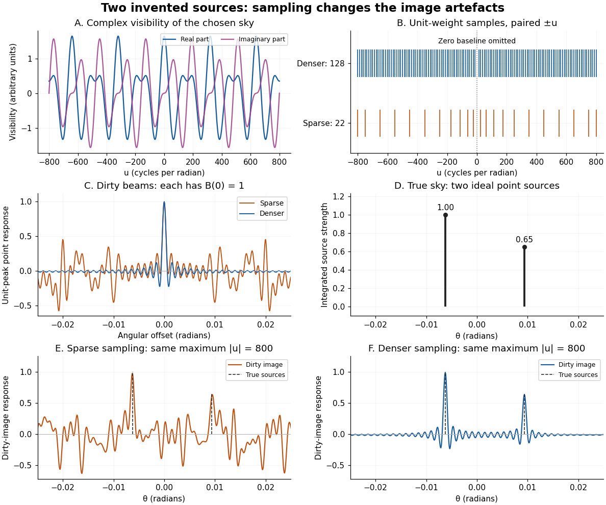

**[Figure 18](#image-an-original-two-source-model-complex-visibility-sampling-gaps-unit-peak-dirty-beams-and-dirty-images). An original two-source model: complex visibility, sampling gaps, unit-peak dirty beams, and dirty images**.

The sparse case samples $u=\pm12.5k$ for $k\in\{2,5,9,14,20,28,36,44,52,60,64\}$; the denser case samples every $k=1,\ldots,64$, also with both signs. All weights are one. Both reach $|u|=800$, so their shortest fringe period is the same $0.00125$ [radians](geometry-and-topology.md#radian). Their [dirty beams](#dirty-beam) and false subsidiary features differ because the intermediate [spatial frequencies](fourier-analysis.md#spatial-frequency) differ. Neither case includes $u=0$ or frequencies above that maximum. The figure uses a periodic angular interval of length $0.08$ [radians](geometry-and-topology.md#radian); this artificial boundary makes a discrete [Fourier transform](fourier-transform.md) calculation exact for the chosen grid, rather than modelling an all-sky observation.

The plotted [dirty image](#dirty-image) is the sum of two shifted [dirty beams](#dirty-beam), not a fitted or deconvolved estimate of the source. Adding samples in this example reduces prominent spurious peaks; it does not establish a universal monotonic improvement for every weighting or sky. A missing zero baseline leaves the periodic [dirty image](#dirty-image) with zero mean, so it cannot by itself recover the total positive brightness. Missing short spacings also weaken constraints on extended smooth emission.

Reconstruction is an [inverse problem](inverse-problem.md). A perturbation whose [Fourier transform](fourier-transform.md) vanishes at every sampled coordinate can be added without changing the measurements: incomplete coverage leaves a [null space](kernel-of-a-linear-map.md). Nonnegative brightness, a restricted source region, or a model with a small number of components can reduce ambiguity, but each is additional information. Removing [dirty beam](#dirty-beam) artefacts means estimating a sky consistent with both data and such assumptions; a narrow central peak alone does not certify a unique image. [Measurement error](probability-and-statistics.md#measurement-error), uncertain calibration and source variability add further limitations.

### Flux-limited galaxy selection

↑ **Parent:** [Observational astronomy](#observational-astronomy)

For a nearby Euclidean survey with limiting [flux](mathematical-physics.md#flux) $f_{\min}$, a [galaxy](galaxy.md) of [luminosity](#luminosity) $L$ is detectable out to $d_{\max}=\sqrt{L/(4\pi f_{\min})}$. Its accessible volume is therefore proportional to $L^{3/2}$. With a [Schechter function](galaxy.md#schechter-function) $\phi(L)\propto L^\alpha e^{-L/L_*}$, counts per logarithmic interval are proportional to $L^{\alpha+5/2}e^{-L/L_*}$ and peak at $(\alpha+5/2)L_*$ when $\alpha>-5/2$. This selection suppresses faint objects relative to a volume-limited census; finite survey boundaries and cosmological evolution modify the simple law.

### Angular resolution

↑ **Parent:** [Observational astronomy](#observational-astronomy)  
ⓦ [Wiki](https://en.wikipedia.org/wiki/Angular_resolution)

[Angular resolution](#angular-resolution) describes the smallest angular separation or structure an observation can distinguish. A physical scale $r$ at distance $D$ subtends approximately $r/D$ radians when $r\ll D$. Resolving a [black-hole sphere of influence](astrophysical-black-hole.md#black-hole-sphere-of-influence) therefore involves distance as well as its physical radius, and useful kinematics also require adequate [surface brightness](#surface-brightness).

#### Retinal receptor pitch and angular sampling

↑ **Parent:** [Angular resolution](#angular-resolution)

For a roughly square array of retinal receptors with surface density $n$ and image distance $f$, the pitch is $s\simeq n^{-1/2}$ and its angular scale is $s/f$. Reconstructing a periodic spatial pattern requires at least two samples per period under the [Nyquist–Shannon sampling theorem](fourier-analysis.md#nyquist-shannon-sampling-theorem). Receptor density alone does not specify lattice geometry, contrast sensitivity or a unique point-source resolution criterion.

### Surface brightness

↑ **Parent:** [Observational astronomy](#observational-astronomy)  
ⓦ [Wiki](https://en.wikipedia.org/wiki/Surface_brightness)

[Surface brightness](#surface-brightness) is received flux per unit solid angle on the sky. It describes the brightness of an extended source independently of a particular aperture's area. An [isophote](#isophote) is a contour of constant [surface brightness](#surface-brightness); central [surface brightness](#surface-brightness) sets the available photons for resolved galaxy spectroscopy.

#### Telescope aperture and resolved surface brightness

↑ **Parent:** [Surface brightness](#surface-brightness)

For a diffraction-limited [telescope](physics.md#telescope), collecting area scales as $D^2$ while a native [angular resolution](#angular-resolution) element scales as $(\lambda/D)^2$. Counts from a smooth resolved source per native resolution element therefore do not increase with aperture, at fixed radiance, exposure and throughput. Counts in a fixed angular bin instead grow as $D^2$, and the photon-noise-limited [signal-to-noise ratio](electrical-engineering.md#signal-to-noise-ratio) grows as $D\sqrt{t}$. [Conservation of etendue](geometrical-optics.md#conservation-of-etendue) and [cosmological surface-brightness dimming](#cosmological-surface-brightness-dimming) do not forbid this latter gain.

#### Cosmological surface-brightness dimming

↑ **Parent:** [Surface brightness](#surface-brightness)

For freely propagating radiation with the usual [distance duality relation](cosmology.md#distance-duality-relation), a fixed emitted bolometric [surface brightness](#surface-brightness) is observed smaller by $(1+z)^4$. One factor each comes from [photon energy](quantum-mechanics.md#photon-energy) and arrival rate, and two from the relation of projected angular area to [luminosity distance](cosmology.md#luminosity-distance). In a fixed observed [photometric passband](#photometric-passband), spectral shifts add a band-dependent correction; the bolometric power is not automatically the monochromatic one. A distortion created by scattering the local [cosmic microwave background](cosmic-microwave-background.md) has a different redshift comparison, as in the [thermal Sunyaev-Zeldovich effect](cosmic-microwave-background.md#thermal-sunyaev-zeldovich-effect).

#### Luminosity convergence of an outer surface-brightness profile

↑ **Parent:** [Surface brightness](#surface-brightness)

For a circular projected profile with a positive power-law tail, an annulus contributes $dF=2\pi I(R)R\,dR$. Thus the outer integral converges only when $p>2$; $p=2$ diverges logarithmically and $p<2$ as $R^{2-p}$. A shallower tail measured over a finite range must steepen or terminate before an infinite-radius extrapolation is physical. This projected criterion already includes line-of-sight integration and must not be replaced by a three-dimensional $r^2dr$ volume factor.

<h4 id="sersic-profile">Sérsic profile</h4>

↑ **Parent:** [Surface brightness](#surface-brightness)  
ⓦ [Wiki](https://en.wikipedia.org/wiki/Sérsic_profile)

A [Sérsic profile](#sersic-profile) models projected galactic light, with index $n$ controlling curvature and $b_n$ chosen so that $R_e$ encloses half the [luminosity](#luminosity). Its logarithmic slope is $d\ln I/d\ln R=-(b_n/n)(R/R_e)^{1/n}$. The $n=1$ case is exponential; $n=4$ gives the traditional de Vaucouleurs form. Unlike a fixed power law, its slope steepens outward.

<h5 id="de-vaucouleurs-s-law">de Vaucouleurs's law</h5>

↑ **Parent:** [Sérsic profile](#sersic-profile)

The $n=4$ case of the Sérsic surface-brightness profile, approximately useful for many bright [elliptical galaxies](galaxy.md#elliptical-galaxy): $I(R)=I_e\exp[-7.67((R/R_e)^{1/4}-1)]$. Real [galaxies](galaxy.md) can have other Sérsic indices.

#### Projection of a spherical power-law emissivity

↑ **Parent:** [Surface brightness](#surface-brightness)

An optically thin spherical source with volume emissivity $j(r)=j_0r^{-p}$ has [surface brightness](#surface-brightness)

$$
I(R)=\frac{j_0}{4\pi}R^{1-p}\sqrt\pi\,\frac{\Gamma((p-1)/2)}{\Gamma(p/2)},\qquad p>1.
$$

Substitute $z=Ru$ in the line-of-sight [integral](integral.md) and evaluate $\int_{-\infty}^\infty(1+u^2)^{-p/2}du$ using the [beta function](complex-analysis.md#beta-function). The condition $p>1$ is convergence at large distance. A core or finite outer boundary changes the projection near that boundary; the stated scaling applies between those scales.

### Isophote

↑ **Parent:** [Observational astronomy](#observational-astronomy)  
ⓦ [Wiki](https://en.wikipedia.org/wiki/Isophote)

An [isophote](#isophote) is a contour of equal surface brightness in an astronomical image. Deviations from fitted ellipses encode additional information about a [galaxy](galaxy.md)'s projected stellar structure.

#### Boxy and disky isophotes

↑ **Parent:** [Isophote](#isophote)

Writing an [isophote](#isophote)'s radial residual about its fitted ellipse as $\delta r=a_4\cos4\theta+\cdots$, positive $a_4$ extends the major and minor axes and gives a pointed, disky shape; negative $a_4$ extends diagonal directions and gives a boxy shape. The sign stated here is for radial residuals, not an unconverted brightness residual. Massive slowly rotating [elliptical galaxies](galaxy.md#elliptical-galaxy) commonly have boxy [isophotes](#isophote), while embedded rotating disks commonly make lower-mass [elliptical galaxies](galaxy.md#elliptical-galaxy) disky.

### Sky brightness

↑ **Parent:** [Observational astronomy](#observational-astronomy)  
ⓦ [Wiki](https://en.wikipedia.org/wiki/Sky_brightness)

Sky brightness is the diffuse radiance received away from an astronomical target. Ground-based observations include atmospheric airglow, scattered light, and [thermal radiation](electromagnetic-radiation.md#thermal-radiation); extraterrestrial diffuse light also contributes. Its photon fluctuations contribute to the [signal-to-noise ratio in photon counting](optical-instrument.md#signal-to-noise-ratio-in-photon-counting).

## ↑ Ancestors (3)

1. [Branches of physics](physics.md#branches-of-physics)
2. [Physics](physics.md)
3. [Codex Wiki](README.md)

## ← Incoming links (5)

- [Arthur B. McDonald](particle-physicist.md#arthur-b-mcdonald)
- [Astronomy](astronomy.md)
- [Francis Halzen](particle-physicist.md#francis-halzen)
- [Nobel Prize in Physics in 1974](nobel-prize-in-physics.md#nobel-prize-in-physics-in-1974)
- [Nobel Prize in Physics in 2002](nobel-prize-in-physics.md#nobel-prize-in-physics-in-2002)
