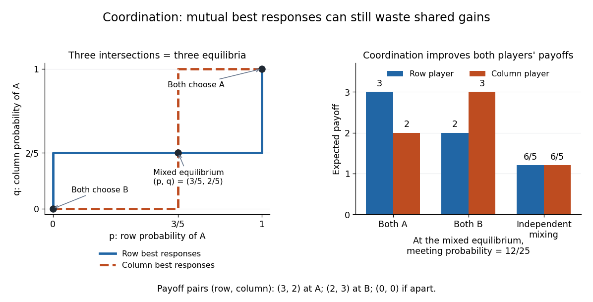

# Asymmetric coordination example

↑ **Parent:** [Coordination game](coordination-game.md)

Two players independently choose venues $A$ or $B$. Meeting at $A$ gives the ordered [payoff](payoff.md) pair $(3,2)$; meeting at $B$ gives $(2,3)$; choosing different venues gives $(0,0)$. As throughout this article, the row player's [payoff](payoff.md) comes first:

| Row choice / column choice | $A$ | $B$ |
| --- | --- | --- |
| $A$ | $(3,2)$ | $(0,0)$ |
| $B$ | $(0,0)$ | $(2,3)$ |

Against a column player choosing $A$, the row player gets $3$ from $A$ and $0$ from $B$, so $A$ is the unique [best response](best-response.md). Against $B$, the row player gets $0$ from $A$ and $2$ from $B$, so $B$ is the unique [best response](best-response.md). The column player likewise prefers to match the row choice. Thus $(A,A)$ and $(B,B)$ are [pure strategy](pure-strategy.md) [Nash equilibria](nash-equilibrium.md), while each mismatched [strategy profile](strategy-profile.md) has a profitable [unilateral deviation](unilateral-deviation.md).

For [mixed strategies](mixed-strategy.md), let $p$ and $q$ be the row and column [probabilities](probability.md) of choosing $A$. The pure-choice [expected payoffs](expected-payoff.md) are

$$
U_1(A,q)=3q,\quad U_1(B,q)=2(1-q),\qquad
U_2(p,A)=2p,\quad U_2(p,B)=3(1-p).
$$

The row player is indifferent when $3q=2(1-q)$, giving $q=2/5$. The column player is indifferent when $2p=3(1-p)$, giving $p=3/5$. The [best responses](best-response.md) are therefore

$$
\operatorname{BR}_1(q)=\begin{cases}\{0\}&q<2/5,\\ {[0,1]}&q=2/5,\\\{1\}&q>2/5,\end{cases}
\qquad
\operatorname{BR}_2(p)=\begin{cases}\{0\}&p<3/5,\\ {[0,1]}&p=3/5,\\\{1\}&p>3/5.\end{cases}
$$

These give exactly three [Nash equilibria](nash-equilibrium.md): $(p,q)=(0,0),(1,1),(3/5,2/5)$. If either player uses both choices, their indifference condition places the other player's [probability](probability.md) strictly between zero and one, so both conditions must hold; otherwise both choices are pure and must match. Notice whose equation determines whose [probability](probability.md): the row player's indifference fixes the column player's $q$, and the column player's indifference fixes the row player's $p$.

At the mixed [Nash equilibrium](nash-equilibrium.md), [independence](independent-random-variables.md) gives

$$
\Pr(A,A)=\frac6{25},\quad \Pr(A,B)=\frac9{25},\quad
\Pr(B,A)=\frac4{25},\quad \Pr(B,B)=\frac6{25}.
$$

Thus they meet with [probability](probability.md) $12/25$, and each receives [expected payoff](expected-payoff.md) $3(6/25)+2(6/25)=6/5$. Holding $q=2/5$ fixed, every row deviation $p'$ gives $p'(6/5)+(1-p')(6/5)=6/5$; holding $p=3/5$ fixed, every column deviation $q'$ gives $q'(6/5)+(1-q')(6/5)=6/5$. This directly verifies the [Nash equilibrium](nash-equilibrium.md) inequalities.

Both coordinated [pure strategy](pure-strategy.md) outcomes strictly improve both players' [expected payoffs](expected-payoff.md) over $(6/5,6/5)$: $(3,2)$ and $(2,3)$ each do so. The mixed [Nash equilibrium](nash-equilibrium.md) therefore fails [Pareto efficiency](pareto-efficiency.md), even though no [unilateral deviation](unilateral-deviation.md) helps. Switching together can help when switching alone cannot. Neither coordinated outcome improves both players over the other, and both are [Pareto efficient](pareto-efficiency.md), even when a [lottery over joint action profiles](lottery-over-joint-action-profiles.md) is allowed: any positive weight on another outcome reduces the [payoff](payoff.md) of the player receiving $3$.

**[Figure 6](#image-asymmetric-coordination-three-best-response-intersections-and-the-cost-of-independent-mixing). Asymmetric coordination: three best-response intersections and the cost of independent mixing**.

## ↑ Ancestors (7)

1. [Coordination game](coordination-game.md)
2. [Bimatrix game](bimatrix-game.md)
3. [Game theory](game-theory-split.md)
4. [Mathematical optimization](mathematical-optimization-split.md)
5. [Area of mathematics](area-of-mathematics.md)
6. [Mathematics](mathematics-split.md)
7. [Codex Wiki](split.md)

## ← Incoming links (3)

- [Best response](best-response.md)
- [Nash equilibrium](nash-equilibrium.md)
- [Zero-sum game](zero-sum-game.md)
