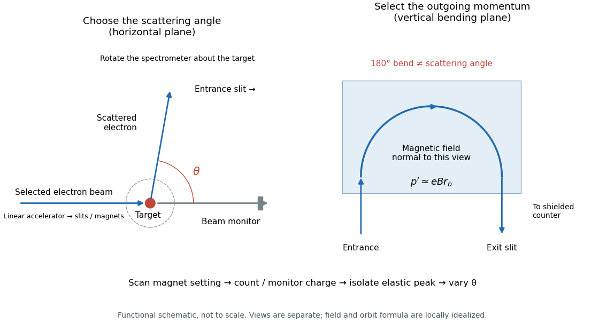
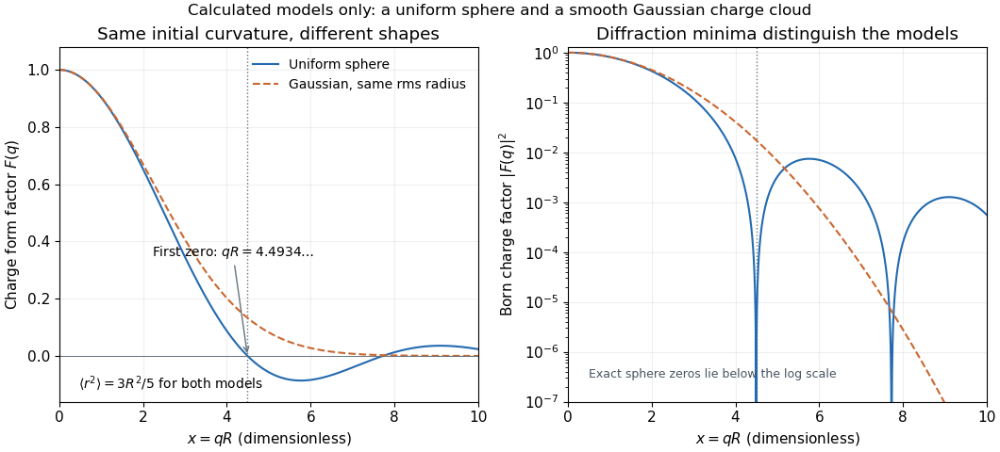
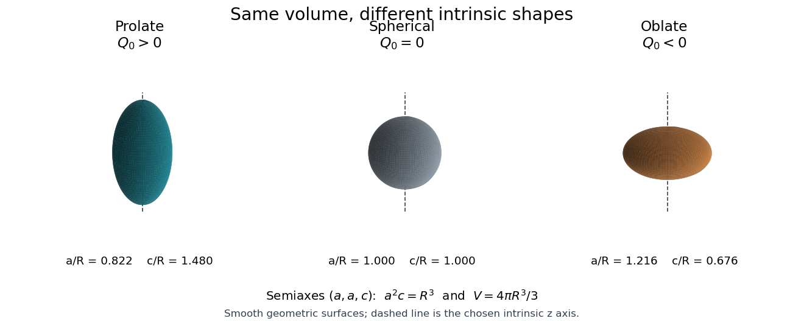
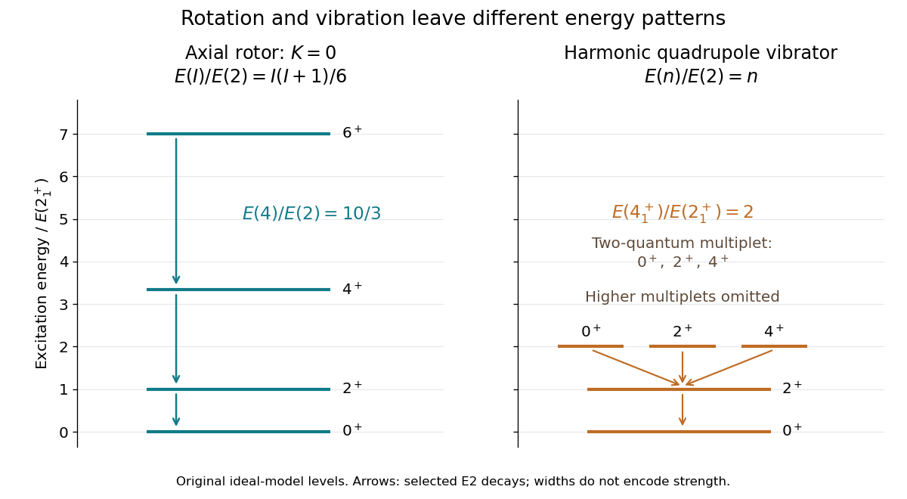

# Atomic nucleus

↑ **Parent:** [Nuclear physics](physics.md#nuclear-physics)  
ⓦ [Wiki](https://en.wikipedia.org/wiki/Atomic_nucleus)

The central system of [protons](physics.md#proton) and [neutrons](neutron.md) in an atom. Its mass number $A$ is its [baryon number](standard-model.md#baryon-number) in ordinary nuclear states; $Z$ is the proton number and $N$ the neutron number.

The [nucleus](atomic-nucleus.md) contains almost all of an atom's [mass](classical-mechanics.md#mass) and carries positive [electric charge](electric-charge.md) $Ze$, where $e$ is the [elementary charge](electric-charge.md#elementary-charge). The [atomic number](chemical-substance.md#atomic-number) $Z$ identifies the [chemical element](chemical-substance.md#chemical-element); changing $N$ at fixed $Z$ gives another [isotope](chemical-substance.md#isotope). The [mass number](chemical-substance.md#mass-number) $A=Z+N$ counts [nucleons](physics.md#nucleon), rather than specifying the exact nuclear [mass](classical-mechanics.md#mass): [nuclear binding energy](#nuclear-binding-energy) lowers the [mass](classical-mechanics.md#mass) of a bound system relative to its separated constituents. The simplest [nucleus](atomic-nucleus.md) is a single [proton](physics.md#proton); other [atomic nuclei](atomic-nucleus.md) can contain many [protons](physics.md#proton) and [neutrons](neutron.md) bound by the [nuclear force](nuclear-force.md).

A nuclear [quantum state](quantum-system.md#quantum-state) has properties such as [spin](angular-momentum-operator.md#spin) and a spatial [nuclear charge distribution](#nuclear-charge-distribution). These are different questions from merely counting [nucleons](physics.md#nucleon). A small-angle [elastic scattering](quantum-scattering.md#elastic-scattering) measurement can reveal a [nuclear charge radius](#nuclear-charge-radius), while a wider range of [momentum transfer](quantum-scattering.md#momentum-transfer) tests the distribution's shape. The [Hofstadter nuclear electron scattering experiment](#hofstadter-nuclear-electron-scattering-experiment) made this connection between scattering patterns and nuclear structure experimentally concrete.

**Table of contents**

- [Nuclear matrix element](#nuclear-matrix-element)
- [Nuclear radius scaling](#nuclear-radius-scaling)
- [Nuclear excited state](#nuclear-excited-state)
  - [Nuclear isomer](#nuclear-isomer)
- [Odd-odd nucleus](#odd-odd-nucleus)
- [Isobar (nuclide)](#isobar-nuclide)
- [Nuclear spin](#nuclear-spin)
- [Nuclear structure](#nuclear-structure)
  - [Nuclear level scheme](#nuclear-level-scheme)
    - [Nuclear level population balance](#nuclear-level-population-balance)
  - [Nuclear de-excitation](#nuclear-de-excitation)
    - [Internal conversion](#internal-conversion)
    - [Gamma decay](#gamma-decay)
      - [Weisskopf single-particle estimate](#weisskopf-single-particle-estimate)
      - [Gamma-cascade intensity balance](#gamma-cascade-intensity-balance)
        - [Nuclear level reconstruction from energy differences](#nuclear-level-reconstruction-from-energy-differences)
      - [Nuclear gamma-ray multipole selection rules](#nuclear-gamma-ray-multipole-selection-rules)
        - [Missing gamma lines and matrix-element hindrance](#missing-gamma-lines-and-matrix-element-hindrance)
          - [Spin-reflection ambiguity in a gamma cascade](#spin-reflection-ambiguity-in-a-gamma-cascade)
- [Nuclear recoil](#nuclear-recoil)
  - [Nuclear-recoil quenching factor](#nuclear-recoil-quenching-factor)
  - [Nuclear-recoil kinematics of WIMP scattering](#nuclear-recoil-kinematics-of-wimp-scattering)
  - [Nuclear elastic electron scattering kinematics](#nuclear-elastic-electron-scattering-kinematics)
- [Alpha particle](#alpha-particle)
- [Deuteron](#deuteron)
  - [Deuteron D-state admixture](#deuteron-d-state-admixture)
- [Nuclear binding energy](#nuclear-binding-energy)
  - [Liquid-drop model of the nucleus](#liquid-drop-model-of-the-nucleus)
  - [Mass defect](#mass-defect)
  - [Binding energy per nucleon](#binding-energy-per-nucleon)
  - [Semi-empirical mass formula](#semi-empirical-mass-formula)
    - [Semi-empirical mass errors can change beta-decay thresholds](#semi-empirical-mass-errors-can-change-beta-decay-thresholds)
    - [Nuclear Coulomb energy](#nuclear-coulomb-energy)
      - [Uniform-sphere Coulomb displacement energy](#uniform-sphere-coulomb-displacement-energy)
    - [Nuclear mass parabola](#nuclear-mass-parabola)
- [Nuclear charge distribution](#nuclear-charge-distribution)
  - [Two-parameter Fermi nuclear charge distribution](#two-parameter-fermi-nuclear-charge-distribution)
  - [Hofstadter nuclear electron scattering experiment](#hofstadter-nuclear-electron-scattering-experiment)
  - [Nuclear charge radius](#nuclear-charge-radius)
  - [Nuclear charge form factor](#nuclear-charge-form-factor)
    - [Uniform-sphere nuclear charge form factor](#uniform-sphere-nuclear-charge-form-factor)
    - [Nuclear elastic electron scattering cross-section](#nuclear-elastic-electron-scattering-cross-section)
- [Nuclear shell model](#nuclear-shell-model)
  - [Nuclear particle-hole excitation](#nuclear-particle-hole-excitation)
  - [Proton hole](#proton-hole)
  - [Nuclear residual interaction](#nuclear-residual-interaction)
  - [Single-particle nuclear magnetic moment](#single-particle-nuclear-magnetic-moment)
  - [Nuclear shell](#nuclear-shell)
  - [Nuclear mean field](#nuclear-mean-field)
  - [Magic number](#magic-number)
    - [Nuclear shell closure](#nuclear-shell-closure)
  - [Nuclear spin-orbit splitting](#nuclear-spin-orbit-splitting)
  - [Nuclear separation energy](#nuclear-separation-energy)
    - [Proton separation energy](#proton-separation-energy)
    - [Nuclear drip line](#nuclear-drip-line)
      - [Neutron drip line](#neutron-drip-line)
      - [Proton drip line](#proton-drip-line)
    - [Neutron separation energy](#neutron-separation-energy)
  - [Nuclear pairing](#nuclear-pairing)
  - [Empirical evidence for nuclear shells](#empirical-evidence-for-nuclear-shells)
    - [Neutron-rich magnesium shell-closure test](#neutron-rich-magnesium-shell-closure-test)
  - [Goeppert Mayer and Jensen nuclear shell model history](#goeppert-mayer-and-jensen-nuclear-shell-model-history)
- [Collective nuclear model](#collective-nuclear-model)
  - [Nuclear quadrupole vibration](#nuclear-quadrupole-vibration)
    - [Three-quadrupole-phonon multiplet](#three-quadrupole-phonon-multiplet)
  - [Coulomb excitation](#coulomb-excitation)
    - [Electric-dipole excitation by a passing ion](#electric-dipole-excitation-by-a-passing-ion)
- [Even-even nucleus](#even-even-nucleus)
- [Nuclear deformation](#nuclear-deformation)
  - [Intrinsic nuclear quadrupole moment](#intrinsic-nuclear-quadrupole-moment)
  - [Spectroscopic nuclear quadrupole moment](#spectroscopic-nuclear-quadrupole-moment)
- [Nuclear rotational band](#nuclear-rotational-band)
  - [Nuclear rotational inertia relative to a rigid sphere](#nuclear-rotational-inertia-relative-to-a-rigid-sphere)
  - [Nuclear rotational spectroscopy evidence](#nuclear-rotational-spectroscopy-evidence)

## Nuclear matrix element

↑ **Parent:** [Atomic nucleus](atomic-nucleus.md)

A transition-operator [matrix element](vector-space.md#matrix-element) between specified nuclear states. It combines their many-nucleon wavefunctions with the relevant interaction operator. In [double beta decay](physics.md#double-beta-decay), different assumed mechanisms and nuclear-structure calculations give different [matrix elements](vector-space.md#matrix-element), so converting a half-life bound to a neutrino-mass bound requires that input. A measured [energy](energy.md) endpoint alone does not determine it.

## Nuclear radius scaling

↑ **Parent:** [Atomic nucleus](atomic-nucleus.md)

The approximate mass-number dependence of a sharp equivalent nuclear radius. Near-constant interior [nucleon](physics.md#nucleon) number density gives $A\simeq(4\pi/3)n_0R^3$, hence $R\propto A^{1/3}$. A conventional matter-radius scale is $r_0\simeq1.2\,\mathrm{fm}$, with isotope and definition dependence. A charge-weighted root-mean-square radius is a different observable: for a uniform sphere it is $\sqrt{3/5}R$. Diffuse surfaces and [neutron](neutron.md) skins prevent interpreting the scaling as a universal hard boundary.

## Nuclear excited state

↑ **Parent:** [Atomic nucleus](atomic-nucleus.md)

A [nuclear excited state](#nuclear-excited-state) lies above the same [nucleus](atomic-nucleus.md)'s [ground state](quantum-mechanics.md#ground-state) in internal [energy](energy.md). [spin](angular-momentum-operator.md#spin), [parity](quantum-mechanics.md#parity) and approximate [isospin](standard-model.md#isospin) help classify it. Single-particle rearrangements, broken pairs and collective deformation/vibration give different excitation patterns and can mix. Below particle-emission thresholds, [gamma decay](#gamma-decay) and [internal conversion](#internal-conversion) are important de-excitation routes; an [excitation energy](quantum-mechanics.md#excitation-energy) is not necessarily the [energy](energy.md) of every emitted [gamma ray](quantum-mechanics.md#gamma-ray) in a cascade.

### Nuclear isomer

↑ **Parent:** [Nuclear excited state](#nuclear-excited-state)

A [nuclear isomer](#nuclear-isomer) is a relatively long-lived metastable nuclear state. Gamma de-excitation can be hindered by a large angular-momentum change, high electromagnetic multipolarity or small overlap with lower states. Its lifetime and decay channels depend on the actual level structure; metastability is not an absolute prohibition on decay.

## Odd-odd nucleus

↑ **Parent:** [Atomic nucleus](atomic-nucleus.md)

An [atomic nucleus](atomic-nucleus.md) with odd [proton](physics.md#proton) number and odd [neutron](neutron.md) number. Both unpaired species can contribute to the total [nuclear spin](#nuclear-spin); [addition of angular momentum](angular-momentum-operator.md#addition-of-angular-momentum) gives possible couplings, while the [nuclear residual interaction](#nuclear-residual-interaction) determines their ordering.

## Isobar (nuclide)

↑ **Parent:** [Atomic nucleus](atomic-nucleus.md)  
ⓦ [Wiki](https://en.wikipedia.org/wiki/Isobar_(nuclide))

[Nuclear isobars](#isobar-nuclide) are different [nuclides](chemical-substance.md#nuclide) with the same [mass number](chemical-substance.md#mass-number) $A$ and different [atomic numbers](chemical-substance.md#atomic-number) $Z$. They differ from [isotopes](chemical-substance.md#isotope), which have fixed $Z$. [Beta decay](physics.md#beta-decay) connects neighboring [nuclear isobars](#isobar-nuclide).

## Nuclear spin

↑ **Parent:** [Atomic nucleus](atomic-nucleus.md)

The total [angular momentum](momentum.md#angular-momentum) of an [atomic nucleus](atomic-nucleus.md), including the orbital and intrinsic [spin](angular-momentum-operator.md#spin) contributions of its constituent [nucleons](physics.md#nucleon).

## Nuclear structure

↑ **Parent:** [Atomic nucleus](atomic-nucleus.md)

### Nuclear level scheme

↑ **Parent:** [Nuclear structure](#nuclear-structure)

A [nuclear level scheme](#nuclear-level-scheme) represents nuclear [energy levels](quantum-mechanics.md#energy-level) and transitions among them. [Gamma ray](quantum-mechanics.md#gamma-ray) [energies](energy.md) constrain pairwise differences; emission counts and coincidence measurements help resolve different schemes having the same difference multiset.

#### Nuclear level population balance

↑ **Parent:** [Nuclear level scheme](#nuclear-level-scheme)

For a complete ensemble of downward [nuclear de-excitation](#nuclear-de-excitation) cascades, let $F_i$ be the direct population of excited level $i$ and $C_{i\to j}$ the total number of transitions from $i$ to $j$. Conservation of population gives the displayed outward-minus-inward formula. A negative $F_i$ rules out a proposed scheme under the assumed complete transition inventory. [Gamma ray](quantum-mechanics.md#gamma-ray) counts equal transition counts only when unreported [internal conversion](#internal-conversion) and other competing paths can be neglected or corrected. Summing over all excited levels cancels internal transitions and leaves the transitions into the [ground state](quantum-mechanics.md#ground-state).

### Nuclear de-excitation

↑ **Parent:** [Nuclear structure](#nuclear-structure)

[Nuclear de-excitation](#nuclear-de-excitation) is a transition from a higher to a lower [nuclear energy level](quantum-mechanics.md#nuclear-energy-level). It can transfer energy to an emitted [gamma ray](quantum-mechanics.md#gamma-ray) or to an atomic [electron](physics.md#electron) through [internal conversion](#internal-conversion), among other channels when thresholds permit.

#### Internal conversion

↑ **Parent:** [Nuclear de-excitation](#nuclear-de-excitation)  
ⓦ [Wiki](https://en.wikipedia.org/wiki/Internal_conversion)

[Internal conversion](#internal-conversion) transfers nuclear [excitation energy](quantum-mechanics.md#excitation-energy) directly to a bound atomic [electron](physics.md#electron), which is emitted, rather than to a real [gamma ray](quantum-mechanics.md#gamma-ray). Photon counts alone then underestimate the number of nuclear transitions unless the conversion contribution is included.

#### Gamma decay

↑ **Parent:** [Nuclear de-excitation](#nuclear-de-excitation)

[Gamma decay](#gamma-decay) is electromagnetic [nuclear de-excitation](#nuclear-de-excitation) by [photon](quantum-mechanics.md#photon) emission. It preserves [mass number](chemical-substance.md#mass-number) and [atomic number](chemical-substance.md#atomic-number), while changing the nuclear state. [Angular momentum](momentum.md#angular-momentum) and [parity](quantum-mechanics.md#parity) constrain the allowed radiation multipoles. The [gamma ray](quantum-mechanics.md#gamma-ray) topic is broader than this nuclear process.

##### Weisskopf single-particle estimate

↑ **Parent:** [Gamma decay](#gamma-decay)

Named for [Victor Weisskopf](physicist.md#victor-weisskopf), a Weisskopf estimate is a benchmark electromagnetic nuclear transition strength based on a simple single-particle size model. It supplies a scale against which enhancement or hindrance is measured, rather than a universal rate. The partial rate contains both the photon-energy power $E_\gamma^{2L+1}$ and the actual reduced nuclear strength. Electric and magnetic multipoles at different energies cannot be universally ranked by order alone.[Appendix C, printed pp.60–67](physics-bibliography.md#guidelines-for-nuclear-structure-evaluators-by-murray-j-martin)

##### Gamma-cascade intensity balance

↑ **Parent:** [Gamma decay](#gamma-decay)

For a prompt nuclear level fed in a steady decay cascade, incoming and outgoing transition populations balance. Quoted [photon](quantum-mechanics.md#photon) [intensities](wave.md#intensity-physics) must represent efficiency-corrected emission counts; [internal conversion](#internal-conversion), alternative [particle decays](physics.md#particle-decay) and unobserved feeds must either be included or explicitly excluded. Equal [photon](quantum-mechanics.md#photon) counts suggest a serial cascade, while a feed [intensity](wave.md#intensity-physics) equal to the sum of two branches suggests splitting. [intensities](wave.md#intensity-physics) alone do not determine the chronological order of equal-count lines.

###### Nuclear level reconstruction from energy differences

↑ **Parent:** [Gamma-cascade intensity balance](#gamma-cascade-intensity-balance)

Reconstructing a nuclear gamma scheme amounts to assigning measured [photon](quantum-mechanics.md#photon) energies to differences between ordered level energies. Cascade [energy](energy.md) sums constrain the graph, while population-flow balances constrain its orientation and feeding. Experimental central energies need not close exactly; a weighted least-squares energy-network fit uses their uncertainties consistently. Multiple graphs can satisfy the same spectrum when coincidence or lifetime information is absent.

##### Nuclear gamma-ray multipole selection rules

↑ **Parent:** [Gamma decay](#gamma-decay)

A real [photon](quantum-mechanics.md#photon) emitted in [gamma decay](#gamma-decay) carries a radiation multipole of integer [angular momentum](momentum.md#angular-momentum) $L\geq1$. The triangle rule gives the displayed range. An electric multipole $EL$ requires $\pi_f/\pi_i=(-1)^L$, while a magnetic multipole $ML$ requires $\pi_f/\pi_i=(-1)^{L+1}$. There is no real single-photon $E0$ decay; an electric monopole transition can instead proceed through [internal conversion](#internal-conversion) or, above threshold, pair creation. In the long-wavelength regime $kR\ll1$, increasing $L$ usually strongly suppresses the rate, but nuclear transition matrix elements and collective enhancement can make an allowed lower multipole weaker than a higher one.

###### Missing gamma lines and matrix-element hindrance

↑ **Parent:** [Nuclear gamma-ray multipole selection rules](#nuclear-gamma-ray-multipole-selection-rules)

An absent otherwise-fast gamma transition can support a [spin](angular-momentum-operator.md#spin) assignment that forbids it. It is not an absolute [selection rule](atomic-physics.md#selection-rule): a nuclear [reduced matrix element](representation-theory.md#reduced-matrix-element) may be small even when [angular momentum](momentum.md#angular-momentum) and [parity](quantum-mechanics.md#parity) allow the mode. Meaningful limits require detection thresholds, branching normalization and competing-channel information. Assuming ordinary unhindered strengths can yield a useful conventional assignment, but that assumption must be distinguished from strict observed-line constraints.

###### Spin-reflection ambiguity in a gamma cascade

↑ **Parent:** [Missing gamma lines and matrix-element hindrance](#missing-gamma-lines-and-matrix-element-hindrance)

If a cascade determines only absolute [spin](angular-momentum-operator.md#spin) differences relative to a known reference [spin](angular-momentum-operator.md#spin), reflection of all inferred [spins](angular-momentum-operator.md#spin) around that reference can preserve the same multipole pattern. Nonnegative-spin constraints, independently known [spins](angular-momentum-operator.md#spin), angular correlations or [polarization](wave.md#polarization-waves) measurements may break the ambiguity. A set of line energies and lowest-multipole labels need not do so.

## Nuclear recoil

↑ **Parent:** [Atomic nucleus](atomic-nucleus.md)

Movement of an [atomic nucleus](atomic-nucleus.md) after it receives [momentum](momentum.md), for example in a collision. A finite nuclear [mass](classical-mechanics.md#mass) requires sharing [kinetic energy](energy.md#kinetic-energy) as well as [momentum](momentum.md); the fixed-target approximation neglects this motion.

### Nuclear-recoil quenching factor

↑ **Parent:** [Nuclear recoil](#nuclear-recoil)

The relative light or charge yield of a [nuclear recoil](#nuclear-recoil) compared with an [electron recoil](particle-detection.md#electron-recoil) at the same deposited [energy](energy.md) in a specified material and field configuration. It connects an electron-equivalent [calibration](differential-geometry.md#calibration-differential-geometry) scale with a recoil-energy scale. It can depend on [energy](energy.md) and measurement conditions; assuming a constant or extrapolating below [calibration](differential-geometry.md#calibration-differential-geometry) changes light-WIMP interpretations. It does not mean [energy](energy.md) conservation fails: [energy](energy.md) can enter channels not measured by that readout.

### Nuclear-recoil kinematics of WIMP scattering

↑ **Parent:** [Nuclear recoil](#nuclear-recoil)

For nonrelativistic [elastic scattering](quantum-scattering.md#elastic-scattering) of a [WIMP](cosmology.md#weakly-interacting-massive-particle) of [mass](classical-mechanics.md#mass) $m_\chi$ from a stationary nucleus of [mass](classical-mechanics.md#mass) $m_N$, the [reduced mass](classical-mechanics.md#reduced-mass) is $\mu_{\chi N}=m_\chi m_N/(m_\chi+m_N)$. In the centre-of-momentum description, a [scattering angle](quantum-scattering.md#scattering-angle) $\vartheta$ gives [momentum](momentum.md) transfer squared $q^2=2\mu_{\chi N}^2v^2(1-\cos\vartheta)$. The target [kinetic energy](energy.md#kinetic-energy) is $E_R=q^2/(2m_N)$, giving the displayed maximum at backscattering. In SI units, using [masses](classical-mechanics.md#mass) in kilograms and [velocity](classical-mechanics.md#velocity) in metres per second gives joules. Low recoil [energy](energy.md) and a falling recoil spectrum make threshold and response [calibration](differential-geometry.md#calibration-differential-geometry) important for [dark-matter direct detection](cosmology.md#dark-matter-direct-detection).

### Nuclear elastic electron scattering kinematics

↑ **Parent:** [Nuclear recoil](#nuclear-recoil)

An [elastic scattering](quantum-scattering.md#elastic-scattering) event leaves the nuclear internal [quantum state](quantum-system.md#quantum-state) unchanged while transferring [energy](energy.md) to its motion. Let a target of [mass](classical-mechanics.md#mass) $M$ initially be at rest. Neglect the [electron](physics.md#electron) rest [mass](classical-mechanics.md#mass), but retain relativistic target recoil. [Conservation of momentum](momentum.md#momentum-conservation) and [conservation of relativistic energy](special-relativity.md#conservation-of-relativistic-energy) give

$$
\hbar^2c^2q^2=E^2+E'^2-2EE'\cos\theta,
\qquad
(Mc^2+E-E')^2=M^2c^4+\hbar^2c^2q^2.
$$

Eliminating $q$ yields $Mc^2(E-E')=EE'(1-\cos\theta)$ and hence

$$
E'=\frac{E}{1+\dfrac{2E}{Mc^2}\sin^2(\theta/2)},\qquad
T_R=E-E'.
$$

The static relation $q=2E\sin(\theta/2)/(\hbar c)$ follows only when $E/(Mc^2)$ is negligible. For small recoil, $T_R\simeq\hbar^2q^2/(2M)$; this last approximation is nonrelativistic for the recoiling [nucleus](atomic-nucleus.md), not for the incident [electron](physics.md#electron). The invariant spacelike transfer, expressed in energy-squared units, is

$$
Q^2=\hbar^2c^2q^2-(E-E')^2=4EE'\sin^2(\theta/2),
$$

so $Q/(\hbar c)$ and the spatial inverse length $q$ coincide only in the static limit. Recoil kinematics alone does not correct the static [differential scattering cross-section](quantum-scattering.md#differential-scattering-cross-section): a finite-mass target also changes its kinematic prefactor and the appropriate current matrix elements.

## Alpha particle

↑ **Parent:** [Atomic nucleus](atomic-nucleus.md)  
ⓦ [Wiki](https://en.wikipedia.org/wiki/Alpha_particle)

The helium-four [atomic nucleus](atomic-nucleus.md), containing two [protons](physics.md#proton) and two [neutrons](neutron.md). Its ground-state [spin](angular-momentum-operator.md#spin) and [isospin](standard-model.md#isospin) are zero. A quantized [cubic four-Skyrmion](classical-field-theory-soliton.md#cubic-four-skyrmion) supplies a corresponding nuclear state in the soliton description.

## Deuteron

↑ **Parent:** [Atomic nucleus](atomic-nucleus.md)

The bound [atomic nucleus](atomic-nucleus.md) containing one [proton](physics.md#proton) and one [neutron](neutron.md). Its ground-state [spin](angular-momentum-operator.md#spin) is one and its isospin is zero. The appropriately quantized [toroidal two-Skyrmion](classical-field-theory-soliton.md#toroidal-two-skyrmion) models these quantum numbers.

### Deuteron D-state admixture

↑ **Parent:** [Deuteron](#deuteron)

The [deuteron](#deuteron) has a dominant $\,{}^3S_1$ component and a smaller $\,{}^3D_1$ component coupled by the [nuclear tensor force](nuclear-force.md#nuclear-tensor-force). The [electric quadrupole moment](electrostatics.md#electric-quadrupole-moment) rules out a purely isotropic [S wave](quantum-scattering.md#s-wave-quantum-scattering) spatial state. A D-state probability depends on the chosen nuclear Hamiltonian and current approximation; it is not an independently model-free observable.

## Nuclear binding energy

↑ **Parent:** [Atomic nucleus](atomic-nucleus.md)  
ⓦ [Wiki](https://en.wikipedia.org/wiki/Nuclear_binding_energy)

The positive energy needed to separate a bound [atomic nucleus](atomic-nucleus.md) into its constituent [protons](physics.md#proton) and [neutrons](neutron.md). It is the mass defect times $c^2$. In a [Skyrmion model of a nucleus](classical-field-theory-soliton.md#skyrmion-model-of-a-nucleus), both separated nucleon masses and the multi-soliton state require a consistent quantization and calibration.

### Liquid-drop model of the nucleus

↑ **Parent:** [Nuclear binding energy](#nuclear-binding-energy)

A collective nuclear model that treats the nucleus as a nearly uniform fluid drop with short-range cohesive binding, surface energy and electrostatic self-energy. The [semi-empirical mass formula](#semi-empirical-mass-formula) incorporates these contributions, together with asymmetry and pairing terms, to describe broad binding trends. Discrete [nuclear shell](#nuclear-shell) structure requires additional physics.

### Mass defect

↑ **Parent:** [Nuclear binding energy](#nuclear-binding-energy)

A difference between the mass of a bound system and an appropriate sum of reference constituent masses. For a nuclear transformation, the initial-minus-final mass difference gives the available [Q value](energy.md#q-value) after multiplication by $c^2$, with atomic electrons counted consistently when using neutral-atom masses.

### Binding energy per nucleon

↑ **Parent:** [Nuclear binding energy](#nuclear-binding-energy)

[Binding energy per nucleon](#binding-energy-per-nucleon) divides conventional positive [nuclear binding energy](#nuclear-binding-energy) by [mass number](chemical-substance.md#mass-number). Typical well-bound nuclei have values of order $8\,\mathrm{MeV}$, and the broad maximum lies near iron-group nuclei. A mass correction added to free-nucleon masses instead has the opposite sign, $E_{\mathrm{corr}}/A=-B/A$.

### Semi-empirical mass formula

↑ **Parent:** [Nuclear binding energy](#nuclear-binding-energy)  
ⓦ [Wiki](https://en.wikipedia.org/wiki/Semi-empirical_mass_formula)

The [semi-empirical mass formula](#semi-empirical-mass-formula) approximates [nuclear binding energy](#nuclear-binding-energy) using volume, surface, electrostatic, neutron-proton asymmetry, and [nuclear pairing](#nuclear-pairing) contributions. At fixed [mass number](chemical-substance.md#mass-number), its quadratic dependence on [atomic number](chemical-substance.md#atomic-number) gives a [nuclear mass parabola](#nuclear-mass-parabola). It describes broad trends and does not resolve individual [nuclear shell](#nuclear-shell) effects.

#### Semi-empirical mass errors can change beta-decay thresholds

↑ **Parent:** [Semi-empirical mass formula](#semi-empirical-mass-formula)

[Beta decay](physics.md#beta-decay) [Q values](energy.md#q-value) depend on small differences between much larger atomic [masses](classical-mechanics.md#mass). A smooth [semi-empirical mass formula](#semi-empirical-mass-formula) can therefore approximate absolute masses reasonably while predicting the wrong sign for a MeV-scale decay threshold. [Nuclear pairing](#nuclear-pairing) explains offset even-even and odd-odd mass branches, but does not guarantee that every specific even-even neighbor lies below the intervening odd-odd nucleus. Measured masses or additional [nuclear shell](#nuclear-shell) corrections are needed for quantitative threshold tests near a model's residual error scale.

#### Nuclear Coulomb energy

↑ **Parent:** [Semi-empirical mass formula](#semi-empirical-mass-formula)

[Nuclear Coulomb energy](#nuclear-coulomb-energy) is the positive electrostatic mass-energy contribution from proton repulsion in a [nucleus](atomic-nucleus.md). A uniform-charge model gives scaling $Z^2/R$, and approximately constant nuclear density gives $R\propto A^{1/3}$. It reduces conventional positive [nuclear binding energy](#nuclear-binding-energy).

##### Uniform-sphere Coulomb displacement energy

↑ **Parent:** [Nuclear Coulomb energy](#nuclear-coulomb-energy)

The electrostatic self-energy of a uniformly charged sphere of sharp radius $R$ is $3Z^2\alpha\hbar c/(5R)$. For mirror nuclei, subtract the changed neutron/proton rest-mass contribution from their nuclear mass difference before identifying the residual with a [nuclear Coulomb energy](#nuclear-coulomb-energy) difference. The inferred $R$ is a sharp-sphere radius; the corresponding [nuclear charge radius](#nuclear-charge-radius) defined as an rms radius is $\sqrt{3/5}R$. Replacing $Z^2$ by $Z(Z-1)$ removes a proton self-interaction approximation and shifts the estimate.

#### Nuclear mass parabola

↑ **Parent:** [Semi-empirical mass formula](#semi-empirical-mass-formula)

At fixed [mass number](chemical-substance.md#mass-number) $A$, the smooth [semi-empirical mass formula](#semi-empirical-mass-formula) makes the atomic [mass](classical-mechanics.md#mass) approximately quadratic and convex in [atomic number](chemical-substance.md#atomic-number) $Z$. Neighboring [nuclear isobars](#isobar-nuclide) undergo energetically allowed [beta decay](physics.md#beta-decay) toward a discrete local minimum, subject to the electron-mass threshold for [beta-plus decay](physics.md#beta-plus-decay). For odd $A$ there is one smooth branch; for even $A$, [nuclear pairing](#nuclear-pairing) splits the even-even and odd-odd branches. A local minimum against a single change of $Z$ need not be stable against [double beta decay](physics.md#double-beta-decay).

## Nuclear charge distribution

↑ **Parent:** [Atomic nucleus](atomic-nucleus.md)

A spatial [charge density](electric-charge.md#charge-density) describing the [electric charge](electric-charge.md) inside an [atomic nucleus](atomic-nucleus.md). In a static description centered on the [nucleus](atomic-nucleus.md), normalize it by

$$
\int_{\mathbb R^3}\rho_{\mathrm{ch}}(\mathbf r)\,d^3r=Ze,
$$

where $Z$ is the [atomic number](chemical-substance.md#atomic-number) and $e>0$ the [elementary charge](electric-charge.md#elementary-charge). A [nuclear charge distribution](#nuclear-charge-distribution) is an average over a nuclear [quantum state](quantum-system.md#quantum-state), rather than a photograph of immobile [protons](physics.md#proton). Even when the average has [spherical symmetry](geometry-and-topology.md#spherical-symmetry), individual [nucleons](physics.md#nucleon) need not sit on spherical shells. The [proton charge radius](physics.md#proton-charge-radius) and the internal [charge density](electric-charge.md#charge-density) of the [neutron](neutron.md) also contribute: a distribution of pointlike proton centers is an approximation to a [nuclear charge distribution](#nuclear-charge-distribution), not its definition.

The experimental attraction is that an [electron](physics.md#electron) probes [electric charge](electric-charge.md) through the [electromagnetic interaction](electromagnetism.md#electromagnetic-interaction), without itself feeling the [nuclear force](nuclear-force.md). Varying its [momentum transfer](quantum-scattering.md#momentum-transfer) changes the spatial scale tested. Long wavelengths mainly constrain a [nuclear charge radius](#nuclear-charge-radius); shorter wavelengths can distinguish a diffuse edge from a sharper one through [diffraction](quantum-scattering.md#diffraction). Recovering the entire [nuclear charge distribution](#nuclear-charge-distribution) from a finite range of noisy scattering data remains an [inverse problem](inverse-problem.md).

### Two-parameter Fermi nuclear charge distribution

↑ **Parent:** [Nuclear charge distribution](#nuclear-charge-distribution)

A common spherical model of a heavy [nuclear charge distribution](#nuclear-charge-distribution) uses a half-density radius $c$ and surface diffuseness $a>0$. The normalization $\rho_0$ is fixed by $4\pi\int_0^\infty r^2\rho(r)\,dr=Ze$. The 90%-to-10% surface thickness is $t=4a\ln3$: solve $\rho/\rho_0=0.9$ and $0.1$ and subtract the two radii. Typical fits have an approximately constant surface thickness and a radius scaling roughly as the cube root of [mass number](chemical-substance.md#mass-number). This is a spatial density model, not an assertion of a thermal [Fermi-Dirac distribution](quantum-ideal-gas-statistics.md#fermi-dirac-distribution) for nuclear positions.

### Hofstadter nuclear electron scattering experiment

↑ **Parent:** [Nuclear charge distribution](#nuclear-charge-distribution)

[Robert Hofstadter](physicist.md#robert-hofstadter)'s Stanford installation selected [electrons](physics.md#electron) up to $190\,\mathrm{MeV}$. [Magnetic spectrometer](optical-instrument.md#magnetic-spectrometer) scans counted shielded Lucite [Cherenkov radiation](electromagnetic-wave.md#cherenkov-radiation) pulses per monitor charge. [Carbon-12](chemical-substance.md#carbon-12) at $187\,\mathrm{MeV}$ and $80^\circ$ resolved $185.1\,\mathrm{MeV}$ [elastic scattering](quantum-scattering.md#elastic-scattering) and $180.7\,\mathrm{MeV}$ [inelastic scattering](quantum-scattering.md#inelastic-scattering) ($4.43\,\mathrm{MeV}$ excitation). Calibration used forward-beam energy, [hydrogen](chemical-substance.md#hydrogen) [nuclear recoil](#nuclear-recoil) and [carbon-12](chemical-substance.md#carbon-12) [energy levels](quantum-mechanics.md#energy-level). Closed entrance slits checked background.[§III(b)(1), pp. 222–223, Fig. 11; §IV(a), pp. 227–231, Figs. 14–17](physics-bibliography.md#electron-scattering-and-nuclear-structure-by-robert-hofstadter)

**[Figure 1](#image-selecting-a-scattering-angle-and-an-outgoing-electron-momentum). Selecting a scattering angle and an outgoing electron momentum**. Original functional schematic: separate scattering and bending planes.

The key distinction is between an [electron](physics.md#electron) counter and an [energy](energy.md) measurement. Here the counter registers particles admitted by the [magnetic spectrometer](optical-instrument.md#magnetic-spectrometer); changing its [magnetic field](magnetic-field.md) selects another outgoing [momentum](momentum.md). A peak is therefore reconstructed from a scan, rather than read as one pulse whose height equals the scattered [electron](physics.md#electron) [energy](energy.md). Dividing counts by monitored incident [electric charge](electric-charge.md) compensates for changes in beam intensity. A peak's height alone is insufficient: its area and the instrument's accepted [momentum](momentum.md) interval determine the selected yield.

An [inelastic scattering](quantum-scattering.md#inelastic-scattering) peak corresponds to a different final nuclear [quantum state](quantum-system.md#quantum-state), so including it in the [elastic scattering](quantum-scattering.md#elastic-scattering) yield would answer a different structural question. Conversely, finite [energy](energy.md) resolution can hide sufficiently nearby excitations beneath an apparent [elastic scattering](quantum-scattering.md#elastic-scattering) peak. Background subtraction, target-loss corrections, angular acceptance and counter efficiency all enter before counts become a [differential scattering cross-section](quantum-scattering.md#differential-scattering-cross-section). A dip in uncorrected counts is therefore not automatically a zero of a [nuclear charge form factor](#nuclear-charge-form-factor).

### Nuclear charge radius

↑ **Parent:** [Nuclear charge distribution](#nuclear-charge-distribution)

The [root mean square](analysis.md#root-mean-square) radius of a [nuclear charge distribution](#nuclear-charge-distribution), referred to its center. Define its charge-weighted second moment by

$$
\langle r^2\rangle_{\mathrm{ch}}=\frac1{Ze}\int r^2\rho_{\mathrm{ch}}(\mathbf r)\,d^3r.
$$

For a spherical [charge density](electric-charge.md#charge-density) with finite fourth moment, insert the [Taylor series](calculus.md#taylor-series) $\sin u/u=1-u^2/6+O(u^4)$ into the [nuclear charge form factor](#nuclear-charge-form-factor):

$$
F(q)=1-\frac{q^2}{6}\langle r^2\rangle_{\mathrm{ch}}+O(q^4),
\qquad
\langle r^2\rangle_{\mathrm{ch}}=-6\left.\frac{dF}{d(q^2)}\right|_{q=0}.
$$

Thus a radius is a low-[momentum transfer](quantum-scattering.md#momentum-transfer) slope, not necessarily the position of a sharp edge. In this real static model,

$$
|F(q)|^2=1-\frac{q^2}{3}\langle r^2\rangle_{\mathrm{ch}}+O(q^4).
$$

The factor of two between the slopes of $F$ and $|F|^2$ matters when interpreting a [differential scattering cross-section](quantum-scattering.md#differential-scattering-cross-section). A [proton charge radius](physics.md#proton-charge-radius) is the corresponding size concept for the [proton](physics.md#proton); the spatial arrangement of many [nucleons](physics.md#nucleon) introduces an additional scale in a heavier [atomic nucleus](atomic-nucleus.md).

### Nuclear charge form factor

↑ **Parent:** [Nuclear charge distribution](#nuclear-charge-distribution)

In the static [charge density](electric-charge.md#charge-density) model, define the normalized [Fourier transform](fourier-transform.md)

$$
F(\mathbf q)=\frac1{Ze}\int\rho_{\mathrm{ch}}(\mathbf r)e^{i\mathbf q\cdot\mathbf r}\,d^3r,
\qquad F(\mathbf 0)=1.
$$

Here $\mathbf q=(\mathbf p-\mathbf p')/\hbar$ is the spatial [momentum transfer](quantum-scattering.md#momentum-transfer) divided by the reduced [Planck constant](quantum-mechanics.md#planck-constant): $q=|\mathbf q|$ has units of inverse length. Physical [momentum transfer](quantum-scattering.md#momentum-transfer) is $\hbar\mathbf q$. We keep $\hbar$ and the [speed of light](special-relativity.md#speed-of-light) $c$ explicit; compute $q=|\mathbf p-\mathbf p'|c/(\hbar c)$, expressing the numerator in $\mathrm{MeV}$ and $\hbar c$ in $\mathrm{MeV}\,\mathrm{fm}$, to obtain $q$ in inverse [femtometres](physics.md#femtometre). The spatial $q$ is distinct from the invariant [four-momentum](special-relativity.md#four-momentum) transfer used in [relativistic scattering cross-sections](quantum-scattering.md#relativistic-scattering-cross-section).

For [spherical symmetry](geometry-and-topology.md#spherical-symmetry), take the polar axis along $\mathbf q$ and use [spherical coordinates](multivariable-calculus.md#spherical-coordinate-system). With $\mu$ the cosine of the polar angle,

$$
\int_{-1}^{1}e^{iqr\mu}\,d\mu=2\frac{\sin(qr)}{qr},
\qquad
F(q)=\frac{4\pi}{Ze}\int_0^\infty r^2\rho_{\mathrm{ch}}(r)\frac{\sin(qr)}{qr}\,dr.
$$

Every radial shell contributes an amplitude. At $q=0$ all shells add with the same sign; at larger $q$ their contributions can cancel. This cancellation is the origin of a [diffraction](quantum-scattering.md#diffraction) minimum in the [nuclear charge form factor](#nuclear-charge-form-factor), rather than an absence of [electric charge](electric-charge.md) in the [nucleus](atomic-nucleus.md).

The static [Fourier transform](fourier-transform.md) interpretation is appropriate for the nuclear model and kinematic regime specified here. A fully relativistic composite system requires frame and current conventions; its electric form factor is not universally the transform of a frame-independent three-dimensional [charge density](electric-charge.md#charge-density).

#### Uniform-sphere nuclear charge form factor

↑ **Parent:** [Nuclear charge form factor](#nuclear-charge-form-factor)

Consider an ideal [nuclear charge distribution](#nuclear-charge-distribution) that is constant inside a ball of radius $R>0$ and zero outside:

$$
\rho_{\mathrm{ch}}(r)=\begin{cases}3Ze/(4\pi R^3),&0\le r\le R,\\0,&r>R.\end{cases}
$$

This is a deliberately sharp-edged model. Substitution into the spherical [nuclear charge form factor](#nuclear-charge-form-factor) gives, for $q\ne0$,

$$
F(q)=\frac3{R^3}\int_0^R r^2\frac{\sin(qr)}{qr}\,dr
=\frac3{qR^3}\left[-\frac{r\cos(qr)}q+\frac{\sin(qr)}{q^2}\right]_0^R
=3\frac{\sin(qR)-qR\cos(qR)}{(qR)^3}.
$$

At $q=0$ take the continuous limit $F(0)=1$. Direct radial integration gives $\langle r^2\rangle_{\mathrm{ch}}=3R^2/5$, and the [Taylor series](calculus.md#taylor-series) provides an independent check:

$$
F(q)=1-\frac{(qR)^2}{10}+\frac{(qR)^4}{280}+O((qR)^6).
$$

The first positive zero solves $\sin x-x\cos x=0$, equivalently $\tan x=x$, with $x=qR\simeq4.49340946$. Consequently the first [diffraction](quantum-scattering.md#diffraction) minimum moves toward smaller [momentum transfer](quantum-scattering.md#momentum-transfer) as $R$ increases.

For comparison, a smooth [Gaussian function](calculus.md#gaussian-function) [charge density](electric-charge.md#charge-density) with the same [nuclear charge radius](#nuclear-charge-radius) is

$$
\rho_G(r)=\frac{Ze}{(2\pi\sigma^2)^{3/2}}e^{-r^2/(2\sigma^2)},\qquad
\sigma^2=R^2/5,\qquad F_G(q)=e^{-q^2R^2/10}.
$$

The [Fourier transform of a Gaussian](fourier-analysis.md#fourier-transform-of-a-gaussian) stays positive and has no zero. Both models have the same leading low-$q$ curvature, but they disagree at higher [momentum transfer](quantum-scattering.md#momentum-transfer): at $qR=2$, the sphere gives $F\simeq0.653097$ and the [Gaussian function](calculus.md#gaussian-function) gives $F_G\simeq0.670320$. Measuring only a [nuclear charge radius](#nuclear-charge-radius) cannot distinguish these two [nuclear charge distributions](#nuclear-charge-distribution).

**[Figure 2](#image-equal-radius-charge-distributions-can-have-very-different-diffraction-patterns). Equal-radius charge distributions can have very different diffraction patterns**. Original calculated model comparison; no experimental points or fitted nuclear parameters. Left: the signed [nuclear charge form factor](#nuclear-charge-form-factor). Right: its squared magnitude, the charge factor in the stated [Born approximation](quantum-theory.md#born-approximation). The models share $\langle r^2\rangle=3R^2/5$; the sharp sphere has zeros while the smooth [Gaussian function](calculus.md#gaussian-function) does not.

As a chosen scale illustration, take $R=3.00\,\mathrm{fm}$. The predicted first zero is $q=1.49780\,\mathrm{fm}^{-1}$, or $\hbar cq\simeq295.557\,\mathrm{MeV}$ using $\hbar c\simeq197.327\,\mathrm{MeV}\,\mathrm{fm}$. With a $200\,\mathrm{MeV}$ ultrarelativistic [electron](physics.md#electron) beam and negligible [nuclear recoil](#nuclear-recoil), it occurs at $\theta\simeq95.27^\circ$. These are consequences of chosen model parameters, not measured properties of carbon or a claim that all [atomic nuclei](atomic-nucleus.md) are uniform balls.

#### Nuclear elastic electron scattering cross-section

↑ **Parent:** [Nuclear charge form factor](#nuclear-charge-form-factor)

For an ultrarelativistic [electron](physics.md#electron) scattered elastically by a static, spherical, spin-zero [atomic nucleus](atomic-nucleus.md), a plane-wave [Born approximation](quantum-theory.md#born-approximation) retains a single electromagnetic interaction. The [Fourier transform](fourier-transform.md) of its [Coulomb potential](electrostatics.md#coulomb-potential-energy) is proportional to $ZeF(q)/q^2$. Relative to the same point charge, the scattering amplitude is therefore multiplied by $F(q)$ and the [differential scattering cross-section](quantum-scattering.md#differential-scattering-cross-section) by $|F(q)|^2$:

$$
\frac{d\sigma}{d\Omega}\simeq
\left(\frac{Z\alpha\hbar c}{2E}\right)^2
\frac{\cos^2(\theta/2)}{\sin^4(\theta/2)}|F(q)|^2,
\qquad q\simeq\frac{2E}{\hbar c}\sin\frac\theta2.
$$

Here $E\gg m_ec^2$ is the incident total [electron](physics.md#electron) [energy](energy.md), $\theta$ the [scattering angle](quantum-scattering.md#scattering-angle), $d\Omega$ a [solid angle](euclidean-geometry.md#solid-angle) element, and $\alpha$ the [fine-structure constant](perturbative-quantum-field-theory.md#fine-structure-constant). The cosine factor already accounts for the projectile's [spin](angular-momentum-operator.md#spin); a spinless projectile would give a different point-charge factor. The formula neglects [nuclear recoil](#nuclear-recoil), electron rest-mass corrections, [radiative corrections](perturbative-quantum-field-theory.md#radiative-correction) and [Coulomb distortion in electron scattering](quantum-scattering.md#coulomb-distortion-in-electron-scattering). The latter can be substantial at large $Z\alpha$: electron waves then require treatment in the target's [Coulomb potential](electrostatics.md#coulomb-potential-energy), rather than undistorted plane waves.

Nonzero target [spin](angular-momentum-operator.md#spin) can introduce magnetic and additional electric contributions, so division by this point-charge expression does not generally isolate one charge form factor for a [proton](physics.md#proton) or [deuteron](#deuteron). Even for spin zero, finite [energy](energy.md) resolution, recoil and [Coulomb distortion in electron scattering](quantum-scattering.md#coulomb-distortion-in-electron-scattering) can change a measured minimum. A zero of the uniform-sphere model is a clear illustration of amplitude cancellation, not a universal prediction of a zero experimental counting rate.

## Nuclear shell model

↑ **Parent:** [Atomic nucleus](atomic-nucleus.md)  
ⓦ [Wiki](https://en.wikipedia.org/wiki/Nuclear_shell_model)

Why should adding one [neutron](neutron.md) be easy for one [atomic nucleus](atomic-nucleus.md) and much less favorable for its neighbor? In the [nuclear shell model](#nuclear-shell-model), [nucleons](physics.md#nucleon) occupy discrete [energy levels](quantum-mechanics.md#energy-level) in a [nuclear mean field](#nuclear-mean-field). Filling all available states below a sufficiently large gap produces a [nuclear shell closure](#nuclear-shell-closure). This connects [nuclear separation energies](#nuclear-separation-energy) with the counting of [quantum states](quantum-system.md#quantum-state), and connects the [spin](angular-momentum-operator.md#spin) of an odd [atomic nucleus](atomic-nucleus.md) with its last unpaired [nucleon](physics.md#nucleon).

The starting point is an approximate [Hamiltonian operator](quantum-system.md#hamiltonian-quantum-mechanics)

$$
H=\sum_{i=1}^{A}\left[\frac{\mathbf p_i^2}{2m_i}+U_i(r_i)-a_i(r_i)\frac{\mathbf L_i\cdot\mathbf S_i}{\hbar^2}\right]+V_{\mathrm{res}},
$$

where $U_i$ is a confining [potential energy](energy.md#potential-energy), $a_i$ specifies [nuclear spin-orbit splitting](#nuclear-spin-orbit-splitting), and $V_{\mathrm{res}}$ contains interactions left out of the [nuclear mean field](#nuclear-mean-field). This is an effective organization of the nuclear [many-body problem](physics.md#many-body-problem), rather than a derivation of the [nuclear force](nuclear-force.md). In a spherical approximation, [addition of angular momentum](angular-momentum-operator.md#addition-of-angular-momentum) combines the [orbital angular momentum](quantum-mechanics.md#orbital-angular-momentum) $l$ with [spin](angular-momentum-operator.md#spin) $s=1/2$ to give $j=l\pm1/2$; for $l=0$, only $j=1/2$ exists.

A level labelled $nlj$ has $2j+1$ magnetic substates $m_j=-j,-j+1,\ldots,j$. The [Pauli exclusion principle](tensor-product-of-quantum-systems.md#pauli-exclusion-principle) permits one [neutron](neutron.md) in each such state and, separately, one [proton](physics.md#proton). Thus a $j=7/2$ level holds eight [neutrons](neutron.md), or eight [protons](physics.md#proton); it does not hold sixteen identical [neutrons](neutron.md). Here $n=1,2,\ldots$ counts radial levels of the same $l$, starting with the lowest; it is not the hydrogenic principal [quantum number](quantum-system.md#quantum-number). The letters $s,p,d,f,g,h,i$ mean $l=0,1,2,3,4,5,6$.

### Nuclear particle-hole excitation

↑ **Parent:** [Nuclear shell model](#nuclear-shell-model)

Promoting a nucleon from an occupied orbital to an unoccupied orbital creates a particle-hole configuration. Its possible angular momenta come from coupling the particle and hole, and its [parity](quantum-mechanics.md#parity) relative to the reference configuration is the product of their orbital [parities](quantum-mechanics.md#parity). Residual interactions split and mix configurations; a measured nuclear [excitation energy](quantum-mechanics.md#excitation-energy) is not generally just an uncorrected independent-orbital spacing.

### Proton hole

↑ **Parent:** [Nuclear shell model](#nuclear-shell-model)

A missing [proton](physics.md#proton) relative to a filled [nuclear shell](#nuclear-shell). In a closed-core approximation a single hole in a $j$ orbital has the same total [angular momentum](momentum.md#angular-momentum) $j$ and orbital [parity](quantum-mechanics.md#parity) as the removed particle. For example, removing a $p_{1/2}$ [proton](physics.md#proton) from a spin-zero closed core gives $J^P=1/2^-$.

### Nuclear residual interaction

↑ **Parent:** [Nuclear shell model](#nuclear-shell-model)

The interaction remaining after a chosen [nuclear mean field](#nuclear-mean-field) is subtracted from the nuclear [Hamiltonian operator](quantum-system.md#hamiltonian-quantum-mechanics). It can split configurations having the same occupied one-particle levels but different coupled [angular momentum](momentum.md#angular-momentum). Thus the ordering of nuclear orbitals alone does not determine every [odd-odd nucleus](#odd-odd-nucleus) ground-state [spin](angular-momentum-operator.md#spin).

### Single-particle nuclear magnetic moment

↑ **Parent:** [Nuclear shell model](#nuclear-shell-model)

In the simplest [nuclear shell model](#nuclear-shell-model) of an odd-[mass number](chemical-substance.md#mass-number) [nucleus](atomic-nucleus.md), paired [nucleons](physics.md#nucleon) contribute zero total [angular momentum](momentum.md#angular-momentum) and [magnetic dipole moment](electromagnetism.md#magnetic-dipole-moment). The last unpaired [nucleon](physics.md#nucleon) supplies the nuclear [spin](angular-momentum-operator.md#spin) $j$ and the stretched-state moment $\mu=g_jj\mu_N$, where $g_j$ is the [Landé g-factor](atomic-physics.md#lande-g-factor) and $\mu_N$ the [nuclear magneton](electromagnetism.md#nuclear-magneton).

Using [addition of angular momentum](angular-momentum-operator.md#addition-of-angular-momentum) with $s=1/2$ gives

$$
g_j=g_\ell+(g_s-g_\ell)\frac{j(j+1)-\ell(\ell+1)+3/4}{2j(j+1)}.
$$

For $j=\ell+1/2$, this reduces to $\mu/\mu_N=g_\ell\ell+g_s/2$. For $j=\ell-1/2$, it gives

$$
\frac\mu{\mu_N}=\frac{2\ell-1}{2\ell+1}\left[g_\ell(\ell+1)-\frac{g_s}{2}\right].
$$

The free-nucleon orbital factors are $g_\ell=1$ for a [proton](physics.md#proton) and $0$ for a [neutron](neutron.md). Residual nuclear interactions and configuration mixing can shift measured moments away from this ideal prediction. A single hole in an otherwise closed $j$ shell has the same stretched-state moment as a particle in that shell: removing the $m_j=-j$ particle leaves total $J_z=j$ and moment $g_jj\mu_N$.

### Nuclear shell

↑ **Parent:** [Nuclear shell model](#nuclear-shell-model)

A nuclear shell groups single-particle [energy levels](quantum-mechanics.md#energy-level) for [protons](physics.md#proton) or [neutrons](neutron.md) in a [nuclear mean field](#nuclear-mean-field). Filling all states below a sufficiently large gap gives a [nuclear shell closure](#nuclear-shell-closure). These shells describe quantum-state occupation rather than thin spatial layers. Their discrete filling effects explain departures from the smooth [semi-empirical mass formula](#semi-empirical-mass-formula).

### Nuclear mean field

↑ **Parent:** [Nuclear shell model](#nuclear-shell-model)

An effective one-[nucleon](physics.md#nucleon) [potential energy](energy.md#potential-energy) representing the average influence of the other [nucleons](physics.md#nucleon). The [nuclear shell model](#nuclear-shell-model) treats motion in this field first, then includes residual interactions. The field experienced by a [proton](physics.md#proton) also includes the repulsive [Coulomb potential](electrostatics.md#coulomb-potential-energy); [proton](physics.md#proton) and [neutron](neutron.md) [energy levels](quantum-mechanics.md#energy-level) need not have identical spacings.

### Magic number

↑ **Parent:** [Nuclear shell model](#nuclear-shell-model)  
ⓦ [Wiki](https://en.wikipedia.org/wiki/Magic_number_(physics))

A [proton](physics.md#proton) number $Z$ or [neutron](neutron.md) number $N$ associated with a pronounced [nuclear shell closure](#nuclear-shell-closure). The traditional sequence is

$$
2,\quad8,\quad20,\quad28,\quad50,\quad82,\quad126.
$$

These count either species separately, rather than their sum $A=Z+N$. Calling a number magic summarizes a structural pattern; it does not promise that every [isotope](chemical-substance.md#isotope) at that number is equally stable.

**[Figure 3](#image-counting-states-between-traditional-nuclear-shell-closures). Counting states between traditional nuclear shell closures**. Original capacity diagram for a chosen spherical level scheme. Each orbital contributes $2j+1$ states for one species. Rows show groups and cumulative totals, not measured energies or a universal ordering within each group.

For example, in the chosen scheme the $20$-particle core plus the eight substates of $1f_{7/2}$ gives $28$. The next group contributes $4+6+2+10=22$, giving $50$. The following two groups contribute $8+6+4+2+12=32$ and $10+8+6+4+2+14=44$, giving $82$ and $126$. Counting verifies the capacities once the grouping has been chosen; it does not establish the physical [energy](energy.md) gaps that justify that grouping.

#### Nuclear shell closure

↑ **Parent:** [Magic number](#magic-number)

Filling the accessible one-species [nuclear shell model](#nuclear-shell-model) states below a substantial [energy](energy.md) gap. A closed spherical $j$ level has all $m_j$ values occupied, so their sum is zero. In the independent-particle picture, a closed core therefore contributes zero total [angular momentum](momentum.md#angular-momentum); a single particle outside it, or a single missing particle inside it, supplies the leading [spin](angular-momentum-operator.md#spin) assignment. Residual interactions can change this simple picture.

The [three-dimensional isotropic harmonic oscillator](quantum-mechanics.md#three-dimensional-isotropic-harmonic-oscillator) alone has one-species shell capacities $(q+1)(q+2)$ for oscillator index $q=0,1,\ldots$, including [spin](angular-momentum-operator.md#spin). Summing gives closures $2,8,20,40,70,112,\ldots$, rather than the complete traditional [magic number](#magic-number) sequence. Strong [nuclear spin-orbit splitting](#nuclear-spin-orbit-splitting) can separate a high-$j$ level from its former neighbors. Realistic radial [potential energies](energy.md#potential-energy) and residual interactions also matter: a chosen oscillator plus an arbitrary single constant is not a demonstrated explanation of every real nuclear gap.

Traditional [nuclear shell closures](#nuclear-shell-closure) can weaken along [isotope](chemical-substance.md#isotope) chains far from stability, as in neutron-rich [magnesium](chemical-substance.md#magnesium).[20 November 2013, magnesium shell weakening](physics-bibliography.md#magic-numbers-disappear-and-expand-area-of-nuclear-deformation-by-riken)

The relevant test is the actual [energy](energy.md) gap and the correlated nuclear [quantum states](quantum-system.md#quantum-state), rather than membership in an immutable numerical list.

### Nuclear spin-orbit splitting

↑ **Parent:** [Nuclear shell model](#nuclear-shell-model)

The splitting of one-[nucleon](physics.md#nucleon) [energy levels](quantum-mechanics.md#energy-level) by their [spin-orbit interaction](atomic-physics.md#spin-orbit-interaction). With $\mathbf J=\mathbf L+\mathbf S$, the identity $2\mathbf L\cdot\mathbf S=\mathbf J^2-\mathbf L^2-\mathbf S^2$ gives, in a state of definite $l,s=1/2,j$,

$$
\langle\mathbf L\cdot\mathbf S\rangle
=\frac{\hbar^2}{2}\left[j(j+1)-l(l+1)-\frac34\right]
=\begin{cases}
\hbar^2l/2,&j=l+1/2,\\
-\hbar^2(l+1)/2,&j=l-1/2.
\end{cases}
$$

The second branch requires $l\ge1$. For the illustrative [Hamiltonian operator](quantum-system.md#hamiltonian-quantum-mechanics) $H_{\mathrm{so}}=-a\mathbf L\cdot\mathbf S/\hbar^2$ with $a>0$, the shifts are $-al/2$ and $+a(l+1)/2$. Thus the strong negative coefficient lowers the aligned $j=l+1/2$ branch. Its capacity is $2l+2$; the raised partner holds $2l$. Together they still hold $4l+2=2(2l+1)$ identical [nucleons](physics.md#nucleon): the interaction rearranges states rather than creating them.

**[Figure 4](#image-a-negative-spin-orbit-term-lowers-the-larger-j-nuclear-level). A negative spin-orbit term lowers the larger-j nuclear level**. Original isolated $d$-doublet example with $l=2$, $a>0$, and seven identical nucleons. Six occupy $d_{5/2}$ and one occupies $d_{3/2}$. The circles count magnetic substates; they do not represent spatial particle positions. Energies are chosen model shifts in units of $a$.

In this example the $d_{5/2}$ and $d_{3/2}$ shifts are $-a$ and $3a/2$, respectively, so the gap is $5a/2$. The capacity-weighted mean shift vanishes:

$$
6(-a)+4(3a/2)=0.
$$

This is a useful check on both the sign and state counting. A seventh identical particle cannot occupy another substate of the already full lower level. In a real [atomic nucleus](atomic-nucleus.md), other radial and [orbital angular momentum](quantum-mechanics.md#orbital-angular-momentum) levels can interleave with this doublet, and a radial coupling need not give the same effective $a$ for every orbital.

### Nuclear separation energy

↑ **Parent:** [Nuclear shell model](#nuclear-shell-model)

The [energy](energy.md) needed to remove specified [nucleons](physics.md#nucleon) from a bound [atomic nucleus](atomic-nucleus.md) in its [ground state](quantum-mechanics.md#ground-state). It compares neighboring nuclear [masses](classical-mechanics.md#mass), and so can reveal a [nuclear shell closure](#nuclear-shell-closure) more clearly than a smoothly varying total [nuclear binding energy](#nuclear-binding-energy).

#### Proton separation energy

↑ **Parent:** [Nuclear separation energy](#nuclear-separation-energy)

With bare nuclear [masses](classical-mechanics.md#mass), the [proton separation energy](#proton-separation-energy) is the energy needed to remove a [proton](physics.md#proton). A negative value means the daughter plus proton has lower rest [energy](energy.md). Proton emission can still have a finite lifetime because of a Coulomb or centrifugal barrier.

#### Nuclear drip line

↑ **Parent:** [Nuclear separation energy](#nuclear-separation-energy)  
ⓦ [Wiki](https://en.wikipedia.org/wiki/Nuclear_drip_line)

A [nuclear drip line](#nuclear-drip-line) marks a boundary beyond which one- or few-nucleon emission becomes energetically allowed. One- and two-particle [nuclear separation energies](#nuclear-separation-energy) can give distinct boundaries because of [nuclear pairing](#nuclear-pairing).

##### Neutron drip line

↑ **Parent:** [Nuclear drip line](#nuclear-drip-line)

The [neutron drip line](#neutron-drip-line) is the neutron-rich boundary at which one- or two-neutron emission becomes energetically possible. [Neutrons](neutron.md) beyond that boundary are not stably bound; the absence of a Coulomb barrier often makes their emission prompt, subject to angular-momentum barriers.

##### Proton drip line

↑ **Parent:** [Nuclear drip line](#nuclear-drip-line)

The [proton drip line](#proton-drip-line) is the proton-rich boundary at which one- or two-proton emission becomes energetically possible. It is governed by [proton separation energies](#proton-separation-energy), rather than the energetics of [beta decay](physics.md#beta-decay) alone.

#### Neutron separation energy

↑ **Parent:** [Nuclear separation energy](#nuclear-separation-energy)

Writing positive [nuclear binding energy](#nuclear-binding-energy) as $B(Z,N)$ and nuclear [mass](classical-mechanics.md#mass) as $M(Z,N)$,

$$
S_n(Z,N)=\left[M(Z,N-1)+m_n-M(Z,N)\right]c^2
=B(Z,N)-B(Z,N-1).
$$

The two-[neutron](neutron.md) [nuclear separation energy](#nuclear-separation-energy) is $S_{2n}(Z,N)=B(Z,N)-B(Z,N-2)$. In an independent-particle example, let the last occupied [energy level](quantum-mechanics.md#energy-level) have $\epsilon_-=-8u$ and the next empty level $\epsilon_+=-3u$, for a chosen positive [energy](energy.md) unit $u$. With an unchanged core and no residual interactions, removal from the filled level costs $8u$, whereas removing the first particle added above it costs $3u$: the drop $5u$ equals the one-particle gap. These are invented model inputs, not measured nuclear values. [Nuclear pairing](#nuclear-pairing), rearrangement of the [nuclear mean field](#nuclear-mean-field), and correlations complicate that identification in real [masses](classical-mechanics.md#mass); a finite difference of [nuclear binding energies](#nuclear-binding-energy) is not automatically a bare one-particle gap.

### Nuclear pairing

↑ **Parent:** [Nuclear shell model](#nuclear-shell-model)

Correlations that favor pairs of like [nucleons](physics.md#nucleon) coupled to zero total [angular momentum](momentum.md#angular-momentum) in the simplest spherical picture. They help explain why an unpaired [nucleon](physics.md#nucleon) often dominates an odd nucleus's [spin](angular-momentum-operator.md#spin), and why neighboring [nuclear separation energies](#nuclear-separation-energy) show an odd-even staggering. [Nuclear pairing](#nuclear-pairing) belongs to the residual-interaction physics beyond merely filling independent [energy levels](quantum-mechanics.md#energy-level). Mixing different occupations and deformation can also be necessary; the closed-core picture is most useful near suitable [nuclear shell closures](#nuclear-shell-closure).

### Empirical evidence for nuclear shells

↑ **Parent:** [Nuclear shell model](#nuclear-shell-model)

[Isotope](chemical-substance.md#isotope) abundance, [nuclear separation energies](#nuclear-separation-energy), [spin](angular-momentum-operator.md#spin) and [nuclear magnetic moments](electromagnetism.md#nuclear-magnetic-moment) supply complementary tests: abundance concerns which [atomic nuclei](atomic-nucleus.md) survive and accumulate, removal [energy](energy.md) concerns binding, and magnetic properties test the [angular momentum](momentum.md#angular-momentum) assignments. Agreement across these observables is more informative than fitting one list of numbers.

In her 1963 lecture, [Maria Goeppert Mayer](physicist.md#maria-goeppert-mayer) recalled excess abundances at $N=50$ and $82$. She contrasted the strong binding of the last [neutron](neutron.md) in [oxygen](chemical-substance.md#oxygen) [isotope](chemical-substance.md#isotope) ${}^{16}\mathrm O$ with the weaker extra [neutron](neutron.md) in [oxygen](chemical-substance.md#oxygen) [isotope](chemical-substance.md#isotope) ${}^{17}\mathrm O$, and displayed [beta decay](physics.md#beta-decay) [energies](energy.md) near $N=20$ and $50$. These are compiled empirical patterns, rather than readings from an apparatus she built.[§2, p. 21; Figs. 2–3, p. 23](physics-bibliography.md#the-shell-model-by-maria-goeppert-mayer)

Her 1949 letter compared observed [spins](angular-momentum-operator.md#spin) and [nuclear magnetic moments](electromagnetism.md#nuclear-magnetic-moment) with orbital assignments. For example, [lead](chemical-substance.md#lead) [isotope](chemical-substance.md#isotope) ${}^{207}\mathrm{Pb}$ was assigned a $p_{1/2}$ neutron hole near $N=126$, whereas [bismuth](chemical-substance.md#bismuth)'s odd [proton](physics.md#proton) began the next shell as $h_{9/2}$. The moments tested orbital character as well as [spin](angular-momentum-operator.md#spin).[p. 1970, discussion and Table II](physics-bibliography.md#on-closed-shells-in-nuclei-ii-by-maria-goeppert-mayer)

A useful comparison holds $Z$ fixed when comparing neighboring [isotopes](chemical-substance.md#isotope), and examines odd-even staggering separately from a shell discontinuity. Abundance additionally depends on production and decay history. Neither the abundance pattern nor a successful [spin](angular-momentum-operator.md#spin) assignment directly images orbiting particles; neither fixes a unique [nuclear mean field](#nuclear-mean-field). The experimental techniques themselves include [mass spectrometry](chemistry.md#mass-spectrometry) and [nuclear magnetic resonance](nuclear-magnetic-resonance.md), whose preparation and readout differ. The [Hofstadter nuclear electron scattering experiment](#hofstadter-nuclear-electron-scattering-experiment) separately constrains nuclear size and [nuclear charge distributions](#nuclear-charge-distribution), rather than measuring these occupancies.

#### Neutron-rich magnesium shell-closure test

↑ **Parent:** [Empirical evidence for nuclear shells](#empirical-evidence-for-nuclear-shells)

A 2013 [RIKEN](physics-author.md#riken) experiment used a fast [calcium](chemical-substance.md#calcium) beam on [beryllium](chemical-substance.md#beryllium), selected radioactive [aluminium](chemical-substance.md#aluminium) and [silicon](chemical-substance.md#silicon) fragments, then struck [carbon](chemical-substance.md#carbon) to produce [magnesium](chemical-substance.md#magnesium) [isotopes](chemical-substance.md#isotope) with $N=22,24,26$. Emitted [gamma rays](quantum-mechanics.md#gamma-ray) supplied excitation [energies](energy.md); comparison across these [isotopes](chemical-substance.md#isotope) supported deformation extending beyond the $N=20$ region toward $28$. This tests the limits of traditional [magic numbers](#magic-number), not merely their arithmetic. The inferred shape depends on nuclear-structure interpretation of the [energy levels](quantum-mechanics.md#energy-level), rather than direct imaging.[20 November 2013, beam preparation, gamma-ray readout and deformation inference](physics-bibliography.md#magic-numbers-disappear-and-expand-area-of-nuclear-deformation-by-riken)

### Goeppert Mayer and Jensen nuclear shell model history

↑ **Parent:** [Nuclear shell model](#nuclear-shell-model)

The 1948 empirical synthesis preceded the 1949 strong [spin-orbit interaction](atomic-physics.md#spin-orbit-interaction) proposals. [Johannes Hans Daniel Jensen](physicist.md#johannes-hans-daniel-jensen) recalled developing that idea in a discussion with colleagues, independently of [Maria Goeppert Mayer](physicist.md#maria-goeppert-mayer)'s work; their shared problem was to account for the observed [magic numbers](#magic-number) and [spins](angular-momentum-operator.md#spin).[pp. 46–48, empirical evidence and strong spin-orbit proposal](physics-bibliography.md#glimpses-at-the-history-of-the-nuclear-structure-theory-by-johannes-hans-daniel-jensen)

[Johannes Hans Daniel Jensen](physicist.md#johannes-hans-daniel-jensen) emphasized that even nuclear [ground states](quantum-mechanics.md#ground-state) retain correlations and that independent-particle motion becomes less adequate at higher excitation. This helps explain why the [nuclear shell model](#nuclear-shell-model) needs residual interactions and complementary collective descriptions.[pp. 48–49, correlations and configuration mixing](physics-bibliography.md#glimpses-at-the-history-of-the-nuclear-structure-theory-by-johannes-hans-daniel-jensen)

The 1963 [Nobel Prize in Physics](nobel-prize-in-physics.md) recognized [Maria Goeppert Mayer](physicist.md#maria-goeppert-mayer) and [Johannes Hans Daniel Jensen](physicist.md#johannes-hans-daniel-jensen) for nuclear shell structure. [Eugene Paul Wigner](physicist.md#eugene-paul-wigner)'s share recognized his contributions to nuclear and elementary-particle theory, especially fundamental [symmetry](physics.md#symmetry-physics) principles, a distinct award motivation.[1963 Physics: separate motivations for Wigner and for Goeppert Mayer and Jensen](physics-bibliography.md#all-nobel-prizes-by-nobel-prize-outreach)

## Collective nuclear model

↑ **Parent:** [Atomic nucleus](atomic-nucleus.md)

A description of an [atomic nucleus](atomic-nucleus.md) in terms of coordinated motion of many [nucleons](physics.md#nucleon), especially changes in shape and orientation. The [nuclear shell model](#nuclear-shell-model) organizes individual [nucleon](physics.md#nucleon) states in a [nuclear mean field](#nuclear-mean-field); the [collective nuclear model](#collective-nuclear-model) organizes low-lying [energy levels](quantum-mechanics.md#energy-level) by [nuclear deformation](#nuclear-deformation), [nuclear rotational bands](#nuclear-rotational-band) and [nuclear quadrupole vibrations](#nuclear-quadrupole-vibration). These are complementary organizations of the same nuclear [many-body problem](physics.md#many-body-problem). A deformed [nuclear mean field](#nuclear-mean-field) can support individual-particle states while its orientation supplies a slow collective coordinate.

In his 1975 lecture, [Ben Roy Mottelson](physicist.md#ben-roy-mottelson) described coupling individual-particle motion to nuclear shape coordinates, and distinguished observed rotational spectra from vibrations about spherical equilibrium. This connects the two descriptions without treating the collective coordinates as extra constituent particles.[pp. 236–237, coupled Hamiltonian and interpretation of low-energy excitation spectra](physics-bibliography.md#elementary-modes-of-excitation-in-the-nucleus-by-ben-roy-mottelson)

[James Rainwater](physicist.md#james-rainwater)'s 1975 account identifies unexpectedly large [electric quadrupole moments](electrostatics.md#electric-quadrupole-moment) as a motivation for a deformable [nuclear mean field](#nuclear-mean-field). The challenge concerned their magnitude, even where spherical-shell trends had the correct sign.[p. 264, Fig. 3 and discussion of the 1949 quadrupole compilation](physics-bibliography.md#background-for-the-spheroidal-nuclear-model-proposal-by-james-rainwater)

A simple original [potential energy](energy.md#potential-energy) example makes the coupling tangible. Let $q$ be a dimensionless signed shape coordinate for a chosen intrinsic configuration, $C>0$ its restoring stiffness, and $f$ a configuration-dependent coupling, both with units of [energy](energy.md). Suppose

$$
V(q)=\frac12Cq^2-fq
=\frac C2\left(q-\frac fC\right)^2-\frac{f^2}{2C}.
$$

The minimum is $q_*=f/C$, with [energy](energy.md) gain $f^2/(2C)$. For chosen values $C=20u$ and $f=4u$, where $u$ is an arbitrary positive [energy](energy.md) unit, $q_*=0.20$ and the gain is $0.40u$. This illustrates how a configuration can favor deformation when the core can respond. It is not a fitted nuclear surface or a claim that every configuration chooses the same shape; competing configurations and [nuclear pairing](#nuclear-pairing) can favor a spherical minimum.

The predictive attraction is economy: one collective scale relates several [energy levels](quantum-mechanics.md#energy-level), while [electric quadrupole transitions](quantum-mechanics.md#electric-quadrupole-transition) independently test their common structure. Agreement in both is much more restrictive than assigning a separate free parameter to every level. [Nuclear magnetic moments](electromagnetism.md#nuclear-magnetic-moment) test magnetic structure and [angular momentum](momentum.md#angular-momentum) assignments; they are distinct observables from the [electric quadrupole moments](electrostatics.md#electric-quadrupole-moment) used to infer charge deformation.

### Nuclear quadrupole vibration

↑ **Parent:** [Collective nuclear model](#collective-nuclear-model)

A collective oscillation of the quadrupole shape coordinates of an [atomic nucleus](atomic-nucleus.md). Near spherical equilibrium, the ideal harmonic description has five components, corresponding to the five magnetic substates of [angular momentum](momentum.md#angular-momentum) two. Each quantum carries $I^\pi=2^+$; it is an excitation of the many-[nucleon](physics.md#nucleon) system rather than an extra constituent. Its frequency is $\omega$, and its [energy](energy.md) spacing $\hbar\omega$ follows the [quantum harmonic oscillator](quantum-harmonic-oscillator.md).

One quantum produces a $2^+$ level at $\hbar\omega$. Two identical quadrupole quanta can couple to $I=0,2,4$ in a symmetric state, giving a degenerate $0^+,2^+,4^+$ multiplet at $2\hbar\omega$ in the ideal model. Odd total $I$ would be antisymmetric under their exchange. Thus the first $4^+$ to first $2^+$ excitation ratio is $2$, rather than the [nuclear rotational band](#nuclear-rotational-band) value $10/3$. Real [nuclear quadrupole vibrations](#nuclear-quadrupole-vibration) can be anharmonic and their multiplets split: the ratio is a diagnostic of a limiting model, not a universal classification rule.

There is a useful state-counting check. Two identical quanta distributed among five substates span $5(5+1)/2=15$ symmetric states. The proposed multiplet contains $(2\cdot0+1)+(2\cdot2+1)+(2\cdot4+1)=1+5+9=15$. This verifies the angular-state bookkeeping independently of the chosen [energy](energy.md) scale.

#### Three-quadrupole-phonon multiplet

↑ **Parent:** [Nuclear quadrupole vibration](#nuclear-quadrupole-vibration)

Three identical quadrupole quanta occupy the third [symmetric power](multilinear-algebra.md#symmetric-power) of the five-dimensional spin-two space. Its dimension is $\binom73=35$, and its [irreducible representations](representation-theory.md#irreducible-representation) have $J=0,2,3,4,6$, each once. All have positive [parity](quantum-mechanics.md#parity). This counts allowed angular states in the ideal harmonic [nuclear quadrupole vibration](#nuclear-quadrupole-vibration); anharmonic interactions can split their energies.

### Coulomb excitation

↑ **Parent:** [Collective nuclear model](#collective-nuclear-model)  
ⓦ [Wiki](https://en.wikipedia.org/wiki/Coulomb_excitation)

Excitation of an [atomic nucleus](atomic-nucleus.md) by the [electric field](electric-field.md) of a passing charged projectile. For suitable collision [energies](energy.md) and separations, the [electromagnetic interaction](electromagnetism.md#electromagnetic-interaction) can populate collective states without requiring contact through the [nuclear force](nuclear-force.md). [Electric quadrupole transition](quantum-mechanics.md#electric-quadrupole-transition) strengths connect excitation yields with collective charge motion; inferring a shape additionally assumes a nuclear model. Contributions from the [nuclear force](nuclear-force.md), competing transitions and the collision kinematics must be controlled before identifying a yield with a single quadrupole strength.

#### Electric-dipole excitation by a passing ion

↑ **Parent:** [Coulomb excitation](#coulomb-excitation)

In the straight-trajectory dipole model, retain the Coulomb-coupling convention of $V(t)=Ze^2(bx+vty)/(b^2+v^2t^2)^{3/2}$. In SI units the coupling denoted $e^2$ here is $e^2/(4\pi\epsilon_0)$. First-order [time-dependent perturbation theory](quantum-mechanics.md#time-dependent-perturbation-theory) expresses a transition through the [Fourier transform](fourier-transform.md) of this pulse at the transition angular frequency.

For positive $\omega$ put $\beta=\omega b/v$. The two Cartesian pulse transforms are

$$
I_x=\int_{-\infty}^{\infty}\frac{b e^{i\omega t}}{(b^2+v^2t^2)^{3/2}}dt=\frac{2\beta K_1(\beta)}{bv},\qquad
I_y=\int_{-\infty}^{\infty}\frac{vt e^{i\omega t}}{(b^2+v^2t^2)^{3/2}}dt=\frac{2i\beta K_0(\beta)}{bv},
$$

where $K_\nu$ is a [Modified Bessel function of the second kind](bessel-function.md#modified-bessel-function-of-the-second-kind). One may derive these from the Fourier transform of $(1+s^2)^{-1/2}$, differentiating in its scale and integrating its spatial derivative by parts. For $\beta\ll1$, $\beta K_1(\beta)\to1$ while $\beta K_0(\beta)\to0$, so the transverse impulse gives the probability in the title. If the $x$ [matrix element](vector-space.md#matrix-element) vanishes, the smaller longitudinal term can be the leading nonzero contribution.

The conditions include $b$ large compared with the atomic extent for the [electric-dipole approximation](quantum-mechanics.md#electric-dipole-approximation), a small total transition [probability](probability-theory.md#probability) for first-order theory, and a collision time $b/v$ short compared with $1/|\omega|$. Large $\beta$ instead gives exponentially suppressed excitation in this model through the large-argument behavior of $K_\nu$.

## Even-even nucleus

↑ **Parent:** [Atomic nucleus](atomic-nucleus.md)

An [atomic nucleus](atomic-nucleus.md) with even [proton](physics.md#proton) number $Z$ and even [neutron](neutron.md) number $N$. The simple [nuclear pairing](#nuclear-pairing) picture couples the constituent pairs to zero [angular momentum](momentum.md#angular-momentum). The collective examples below concern a $0^+$ [ground state](quantum-mechanics.md#ground-state), where the superscript denotes positive [parity](quantum-mechanics.md#parity), and its associated low-lying excitations; even $A=Z+N$ alone would also allow odd $Z$ and odd $N$.

## Nuclear deformation

↑ **Parent:** [Atomic nucleus](atomic-nucleus.md)

Departure of an intrinsic nuclear shape from [spherical symmetry](geometry-and-topology.md#spherical-symmetry). Here intrinsic means referred to axes attached to a model [nuclear charge distribution](#nuclear-charge-distribution). A nuclear [quantum state](quantum-system.md#quantum-state) with definite [spin](angular-momentum-operator.md#spin) need not have the same laboratory [charge density](electric-charge.md#charge-density) as that intrinsic distribution. In particular, the [ground state](quantum-mechanics.md#ground-state) of a deformed [even-even nucleus](#even-even-nucleus) can have $I=0$, a spherical laboratory [expectation value](quantum-system.md#expectation-value), and a nonzero [intrinsic nuclear quadrupole moment](#intrinsic-nuclear-quadrupole-moment).

For an illustrative uniform [charge density](electric-charge.md#charge-density) inside a [spheroid](euclidean-geometry.md#spheroid), let the semiaxes be $(a,a,c)$ and keep its [volume](geometry-and-topology.md#volume) equal to that of a sphere of radius $R$:

$$
a^2c=R^3,\qquad a=R\eta^{-1/3},\qquad c=R\eta^{2/3},\qquad\eta=\frac ca>0.
$$

Thus $\eta>1$ gives a [prolate spheroid](euclidean-geometry.md#prolate-spheroid), $\eta=1$ a sphere, and $\eta<1$ an [oblate spheroid](galaxy.md#oblate-spheroid). These are three-dimensional equal-[volume](geometry-and-topology.md#volume) shapes: equal areas of their drawn cross-sections would be a different constraint. Real [nuclear charge distributions](#nuclear-charge-distribution) have diffuse surfaces and need not be uniform, axially symmetric or confined to one shape.

**[Figure 5](#image-equal-volume-prolate-spherical-and-oblate-intrinsic-shapes). Equal-volume prolate, spherical and oblate intrinsic shapes**. Original [spheroid](euclidean-geometry.md#spheroid) geometry with chosen axis ratios $\eta=1.8,1,1/1.8$. Each has $a^2c=R^3$. The surfaces illustrate shape coordinates, rather than literal arrangements or photographs of [nucleons](physics.md#nucleon). The indicated signs refer to the [intrinsic nuclear quadrupole moment](#intrinsic-nuclear-quadrupole-moment) of positive uniform [charge density](electric-charge.md#charge-density).

### Intrinsic nuclear quadrupole moment

↑ **Parent:** [Nuclear deformation](#nuclear-deformation)

The axial [electric quadrupole moment](electrostatics.md#electric-quadrupole-moment) of an intrinsic [nuclear charge distribution](#nuclear-charge-distribution), with the origin at its center and the $z$ axis along its symmetry axis:

$$
Q_0=\int \rho_{\mathrm{ch}}(\mathbf r)(2z^2-x^2-y^2)\,d^3r.
$$

This convention includes [electric charge](electric-charge.md) in $Q_0$; a tabulated moment divided by the [elementary charge](electric-charge.md#elementary-charge) $e$ instead has units of area. For the uniform [spheroid](euclidean-geometry.md#spheroid), mapping a uniform unit ball to $(ax,ay,cz)$ gives $\langle x^2\rangle=a^2/5$ and $\langle z^2\rangle=c^2/5$, so

$$
Q_0=\frac25Ze(c^2-a^2),\qquad
\frac{Q_0}{ZeR^2}=\frac25\left(\eta^{4/3}-\eta^{-2/3}\right).
$$

The formula explains the signs in the figure. It measures an anisotropy of the [nuclear charge distribution](#nuclear-charge-distribution), rather than counting individual [nucleons](physics.md#nucleon) on a surface. An illustrative choice $\eta=\sqrt8$ gives $a=R/\sqrt2$, $c=2R$ and $Q_0=7ZeR^2/5$, while preserving $a^2c=R^3$ exactly.

[James Rainwater](physicist.md#james-rainwater)'s lecture contrasts measured laboratory [electric quadrupole moments](electrostatics.md#electric-quadrupole-moment) with intrinsic moments inferred through [Coulomb excitation](#coulomb-excitation), including [even-even nuclei](#even-even-nucleus). Extracting intrinsic shape therefore uses a nuclear model, rather than equating every measured moment to $Q_0$.[p. 266, Fig. 4 and preceding Coulomb-excitation discussion](physics-bibliography.md#background-for-the-spheroidal-nuclear-model-proposal-by-james-rainwater)

### Spectroscopic nuclear quadrupole moment

↑ **Parent:** [Nuclear deformation](#nuclear-deformation)

The laboratory [expectation value](quantum-system.md#expectation-value) of the axial [electric quadrupole moment](electrostatics.md#electric-quadrupole-moment) in the stretched nuclear [quantum state](quantum-system.md#quantum-state) $|I,M=I\rangle$; $M\hbar$ is the laboratory $z$ component of total [angular momentum](momentum.md#angular-momentum). It differs from the [intrinsic nuclear quadrupole moment](#intrinsic-nuclear-quadrupole-moment) $Q_0$. In an axial [nuclear rotational band](#nuclear-rotational-band) with $K=0$, projection onto definite [angular momentum](momentum.md#angular-momentum) gives

$$
Q_s(I)=-\frac{I}{2I+3}Q_0,\qquad Q_s(0)=0,\qquad Q_s(2)=-\frac27Q_0.
$$

Here $K\hbar$ denotes the component of total [angular momentum](momentum.md#angular-momentum) along the intrinsic symmetry axis. Consequently a positive $Q_0$ for a [prolate spheroid](euclidean-geometry.md#prolate-spheroid) corresponds to a negative $Q_s(2)$ in this model. The sign of the laboratory moment alone must be interpreted together with the band assignment.

The $I=0$ result has a short [symmetry](physics.md#symmetry-physics) explanation. A spin-zero state has no preferred spatial direction. Its second charge moments satisfy $\langle x^2\rangle=\langle y^2\rangle=\langle z^2\rangle$, so $\langle2z^2-x^2-y^2\rangle=0$. Equivalently, averaging an intrinsic axis uniformly over directions gives $\langle P_2(\cos\theta)\rangle=0$, where $P_2(u)=(3u^2-1)/2$ is a [Legendre polynomial](linear-ordinary-differential-equation.md#legendre-polynomial). This is a statement about a quantum [expectation value](quantum-system.md#expectation-value), not a classical picture of a spinning object sweeping through orientations.

For an independent check of the $I=2$ sign, the $K=0$, $M=2$ rotor orientation probability is proportional to $|Y_2^2|^2\propto\sin^4\theta$, using a [spherical harmonic](analysis.md#spherical-harmonic). With $u=\cos\theta$,

$$
\frac{Q_s(2)}{Q_0}
=\frac{\int_{-1}^{1}P_2(u)(1-u^2)^2\,du}{\int_{-1}^{1}(1-u^2)^2\,du}
=\frac{-32/105}{16/15}=-\frac27.
$$

A zero static laboratory moment does not make every quadrupole observable zero. With electric multipole operator $\mathcal M_{2\mu}=\int\rho_{\mathrm{ch}}r^2Y_2^\mu\,d^3r$, define the reduced transition strength using a [reduced matrix element](representation-theory.md#reduced-matrix-element):

$$
B(E2;I_i\to I_f)=\frac{|\langle I_f\Vert\mathcal M_2\Vert I_i\rangle|^2}{2I_i+1}.
$$

In the axial $K=0$ rotor, angular projection gives $B(E2;0^+\to2^+)=5Q_0^2/(16\pi)$ and $B(E2;2^+\to0^+)=Q_0^2/(16\pi)$. The factor of five is the ratio of the numbers of magnetic substates. Thus an [electric quadrupole transition](quantum-mechanics.md#electric-quadrupole-transition) can reveal collective deformation even when $Q_s(0)=0$. These strengths determine $|Q_0|$ within the model; their squares alone cannot distinguish its sign.

## Nuclear rotational band

↑ **Parent:** [Atomic nucleus](atomic-nucleus.md)

A sequence of nuclear [energy levels](quantum-mechanics.md#energy-level) interpreted as different total [angular momenta](momentum.md#angular-momentum) built on approximately the same intrinsic structure. For an axially symmetric, positive-[parity](quantum-mechanics.md#parity), $K=0$ [ground state](quantum-mechanics.md#ground-state) band of an [even-even nucleus](#even-even-nucleus), the allowed sequence is $I=0,2,4,\ldots$. The simple constant-inertia rotor has

$$
H_{\mathrm{rot}}=\frac{\widehat{\mathbf I}^{\,2}}{2\mathcal J},\qquad
\widehat{\mathbf I}^{\,2}|IM\rangle=\hbar^2I(I+1)|IM\rangle,\qquad
E_I-E_0=\frac{\hbar^2}{2\mathcal J}I(I+1).
$$

Here $\mathcal J$ is an effective [moment of inertia](rigid-body-dynamics.md#moment-of-inertia), and $\hbar$ the reduced [Planck constant](quantum-mechanics.md#planck-constant). The even-$I$ restriction belongs to this particular intrinsic [symmetry](physics.md#symmetry-physics) and band, rather than to all nuclear excitations. The [angular momentum operator](angular-momentum-operator.md) eigenvalue supplies $I(I+1)$, rather than the classical replacement $I^2$.

Set $\epsilon=E_2-E_0$. Since $2(2+1)=6$, the model predicts

$$
\frac{E_4-E_0}{\epsilon}=\frac{20}{6}=\frac{10}{3},\qquad
\frac{E_6-E_0}{\epsilon}=\frac{42}{6}=7.
$$

For a chosen model scale $\epsilon=90\,\mathrm{keV}$, the excitation [energies](energy.md) are $0,90,300,630\,\mathrm{keV}$. The corresponding successive [gamma ray](quantum-mechanics.md#gamma-ray) [energies](energy.md) are approximately $90,210,330\,\mathrm{keV}$, neglecting [nuclear recoil](#nuclear-recoil). Level [energies](energy.md) and emitted line [energies](energy.md) are different lists. These numbers illustrate the formula and are not a measured [isotope](chemical-substance.md#isotope) spectrum.

**[Figure 6](#image-an-ideal-rotor-and-an-ideal-quadrupole-vibrator-have-different-level-ratios). An ideal rotor and an ideal quadrupole vibrator have different level ratios**. Original chosen limiting models, both normalized to the same first $2^+$ excitation. The [nuclear rotational band](#nuclear-rotational-band) has $E(4)/E(2)=10/3$; the harmonic [nuclear quadrupole vibration](#nuclear-quadrupole-vibration) has a two-quantum $0^+,2^+,4^+$ multiplet at twice the one-quantum [energy](energy.md). Arrows show selected [electric quadrupole transitions](quantum-mechanics.md#electric-quadrupole-transition); their widths do not represent measured strengths. Higher vibrational multiplets are omitted.

The fitted $\mathcal J=3\hbar^2/\epsilon$ is a response parameter, not automatically the [moment of inertia](rigid-body-dynamics.md#moment-of-inertia) of a classical rigid charge distribution. [Nuclear pairing](#nuclear-pairing) changes this response; [Ben Roy Mottelson](physicist.md#ben-roy-mottelson) connected observed inertias with correlations beyond independent-particle motion.[continuation after p. 237, pairing correlations and Fig. 1 potential-energy surfaces](physics-bibliography.md#elementary-modes-of-excitation-in-the-nucleus-by-ben-roy-mottelson)

At larger [angular momentum](momentum.md#angular-momentum), changing intrinsic structure or [nuclear pairing](#nuclear-pairing) can invalidate a single constant $\mathcal J$. A useful diagnostic is to compare $(E_I-E_0)/[I(I+1)]$ across several levels: constancy tests the simple formula, while a drift identifies the need for additional physics. A successful ratio alone neither specifies every microscopic motion nor measures a literal solid-body rotation.

### Nuclear rotational inertia relative to a rigid sphere

↑ **Parent:** [Nuclear rotational band](#nuclear-rotational-band)

The excitation [energy](energy.md) in an ideal $K=0$ [nuclear rotational band](#nuclear-rotational-band) determines an effective [moment of inertia](rigid-body-dynamics.md#moment-of-inertia) through the displayed equation. Comparing it with $2MR^2/5$ tests the rigid-sphere scale. A sequence of approximately constant $E_J/[J(J+1)]$ supports the rotational interpretation; systematic variation indicates that the effective inertia changes along the band. Collective rotation need not have a rigid-body inertia, notably when [nuclear pairing](#nuclear-pairing) is important.

### Nuclear rotational spectroscopy evidence

↑ **Parent:** [Nuclear rotational band](#nuclear-rotational-band)

[Aage Niels Bohr](physicist.md#aage-niels-bohr)'s 1975 lecture presents a [plutonium](chemical-substance.md#plutonium) ${}^{238}\mathrm{Pu}$ spectrum deduced from the fine structure of [alpha decay](physics.md#alpha-decay) of [curium](chemical-substance.md#curium) ${}^{242}\mathrm{Cm}$. The readout was decay-line [energy](energy.md); the comparison fixed the rotor scale from the first excitation and tested the remaining levels against $I(I+1)$. The lecture reports spectroscopy, rather than a laboratory setup operated by its author.[p. 217, Fig. 3 caption, plutonium spectrum and one-scale comparison](physics-bibliography.md#rotational-motion-in-nuclei-by-aage-niels-bohr)

His measured [erbium](chemical-substance.md#erbium) ${}^{166}\mathrm{Er}$ $K=0$ band has excitation [energies](energy.md) $0$, $80.56$, $265.0$, $545.4$ and $911.2\,\mathrm{keV}$ for $I=0,2,4,6,8$. The same lecture analyzes interband [electric quadrupole transitions](quantum-mechanics.md#electric-quadrupole-transition), adding tests beyond level positions.[p. 225, Fig. 9 measured levels and following discussion of Fig. 10 transition matrix elements](physics-bibliography.md#rotational-motion-in-nuclei-by-aage-niels-bohr)

Using those first two excitations gives $265.0/80.56\simeq3.28947$, close to the ideal $10/3$, and distinct from the ideal harmonic value $2$. Fixing the rotor scale with $80.56\,\mathrm{keV}$ predicts $268.53\,\mathrm{keV}$ at $I=4$ and $563.92\,\mathrm{keV}$ at $I=6$. The measured values lie about $1.32\%$ and $3.28\%$ below these predictions. This is a useful limit of the simple model: the pattern supports a rotational interpretation while revealing departures from constant inertia. It does not by itself determine a unique [nuclear charge distribution](#nuclear-charge-distribution). Reconstructing a level scheme also requires assigning which transitions connect which states; raw peak positions alone do not provide all [spins](angular-momentum-operator.md#spin), [parities](quantum-mechanics.md#parity) or transition strengths.

## 🏷️ Tagged (2)

- [Rutherford model](atomic-physics.md#rutherford-model)
- [Rutherford scattering](atomic-physics.md#rutherford-scattering)

## ↑ Ancestors (3)

1. [Nuclear physics](physics.md#nuclear-physics)
2. [Physics](physics.md)
3. [Codex Wiki](README.md)

## ← Incoming links (114)

- [Alpha decay](physics.md#alpha-decay)
- [Alpha particle](#alpha-particle)
- [Atomic mass](chemical-substance.md#atomic-mass)
- [Atomic nucleus](atomic-nucleus.md)
- [Atomic number](chemical-substance.md#atomic-number)
- [Baryon asymmetry](cosmology.md#baryon-asymmetry)
- [Bent molecular geometry](molecule.md#bent-molecular-geometry)
- [Bond angle](molecule.md#bond-angle)
- [Bond dipole](electronegativity.md#bond-dipole)
- [Bond length](chemical-bond.md#bond-length)
- [Bond potential-well depth](chemical-bond.md#bond-potential-well-depth)
- [Born-Oppenheimer approximation](quantum-mechanics.md#born-oppenheimer-approximation)
- [Centrifugal distortion](molecule.md#centrifugal-distortion)
- [Chemical bond](chemical-bond.md)
- [Chemical element](chemical-substance.md#chemical-element)
- [Chemical equation](chemical-reaction.md#chemical-equation)
- [Circular-orbit derivation of the Bohr model](mathematical-physics.md#circular-orbit-derivation-of-the-bohr-model)
- [Collective nuclear model](#collective-nuclear-model)
- [Compound nucleus](physics.md#compound-nucleus)
- [Conductor in electrostatic equilibrium](electrostatics.md#conductor-in-electrostatic-equilibrium)
- [Cosmic ray](galaxy.md#cosmic-ray)
- [Coulomb excitation](#coulomb-excitation)
- [Covalent bond](covalent-bond.md)
- [Deuteron](#deuteron)
- [Diatomic bond stretch](molecule.md#diatomic-bond-stretch)
- [Diproton](nuclear-force.md#diproton)
- [DPPH electron spin resonance experiment](chemistry.md#dpph-electron-spin-resonance-experiment)
- [Electric dipole moment](electrostatics.md#electric-dipole-moment)
- [Electric quadrupole transition](quantum-mechanics.md#electric-quadrupole-transition)
- [Electrochemistry](electrochemistry.md)
- [Empirical evidence for nuclear shells](#empirical-evidence-for-nuclear-shells)
- [Even-even nucleus](#even-even-nucleus)
- [Fermi motion](quantum-ideal-gas-statistics.md#fermi-motion)
- [Finite-population radioactive decay](physics.md#finite-population-radioactive-decay)
- [Fixed-target antiproton production threshold](relativistic-quantum-field.md#fixed-target-antiproton-production-threshold)
- [Gas electron diffraction](molecule.md#gas-electron-diffraction)
- [Harmonic vibrational energy levels](molecule.md#harmonic-vibrational-energy-levels)
- [Hydrogen bubble chamber](particle-detection.md#hydrogen-bubble-chamber)
- [Ion](chemistry.md#ion)
- [Isotope](chemical-substance.md#isotope)
- [Lamb-Mössbauer factor](mossbauer-effect.md#lamb-mossbauer-factor)
- [Linear molecule](molecule.md#linear-molecule)
- [Magnetic neutron diffraction](electromagnetism.md#magnetic-neutron-diffraction)
- [Mass number](chemical-substance.md#mass-number)
- [Molecular dipole cancellation](electronegativity.md#molecular-dipole-cancellation)
- [Molecular geometry](molecule.md#molecular-geometry)
- [Molecular orbital](chemistry.md#molecular-orbital)
- [Molecular orbital theory](chemistry.md#molecular-orbital-theory)
- [Molecular vibration](molecule.md#molecular-vibration)
- [Mössbauer effect](mossbauer-effect.md)
- [Muonic atom](physics.md#muonic-atom)
- [Neutron](neutron.md)
- [Neutron activation](neutron.md#neutron-activation)
- [Neutron activation buildup and decay](neutron.md#neutron-activation-buildup-and-decay)
- [Neutron capture resonance](neutron.md#neutron-capture-resonance)
- [Neutron detection by proton recoil](neutron.md#neutron-detection-by-proton-recoil)
- [Neutron flux](neutron.md#neutron-flux)
- [Neutron number](chemical-substance.md#neutron-number)
- [Neutron scattering](neutron.md#neutron-scattering)
- [Nobel Prize in Physics in 1944](nobel-prize-in-physics.md#nobel-prize-in-physics-in-1944)
- [Nobel Prize in Physics in 1951](nobel-prize-in-physics.md#nobel-prize-in-physics-in-1951)
- [Nobel Prize in Physics in 1961](nobel-prize-in-physics.md#nobel-prize-in-physics-in-1961)
- [Nobel Prize in Physics in 1963](nobel-prize-in-physics.md#nobel-prize-in-physics-in-1963)
- [Nobel Prize in Physics in 1975](nobel-prize-in-physics.md#nobel-prize-in-physics-in-1975)
- [Nuclear binding energy](#nuclear-binding-energy)
- [Nuclear charge distribution](#nuclear-charge-distribution)
- [Nuclear charge radius](#nuclear-charge-radius)
- [Nuclear decay constant](physics.md#nuclear-decay-constant)
- [Nuclear elastic electron scattering cross-section](#nuclear-elastic-electron-scattering-cross-section)
- [Nuclear energy level](quantum-mechanics.md#nuclear-energy-level)
- [Nuclear force](nuclear-force.md)
- [Nuclear magnetic moment](electromagnetism.md#nuclear-magnetic-moment)
- [Nuclear magnetic resonance](nuclear-magnetic-resonance.md)
- [Nuclear mass defect](chemical-substance.md#nuclear-mass-defect)
- [Nuclear neutron scattering length](neutron.md#nuclear-neutron-scattering-length)
- [Nuclear physics](physics.md#nuclear-physics)
- [Nuclear quadrupole vibration](#nuclear-quadrupole-vibration)
- [Nuclear reaction](physics.md#nuclear-reaction)
- [Nuclear recoil](#nuclear-recoil)
- [Nuclear separation energy](#nuclear-separation-energy)
- [Nuclear shell model](#nuclear-shell-model)
- [Nuclear spin](#nuclear-spin)
- [Nuclear spin-orbit splitting](#nuclear-spin-orbit-splitting)
- [Nucleosynthesis](physics.md#nucleosynthesis)
- [Odd-odd nucleus](#odd-odd-nucleus)
- [P orbital](chemistry.md#p-orbital)
- [Parity violation](standard-model.md#parity-violation)
- [Solution](past-exam-of-the-chemistry-a-course-of-the-university-of-cambridge/2022/paper-1.md#a2/c/i/solution)
- [Solution](past-exam-of-the-chemistry-a-course-of-the-university-of-cambridge/2023/paper-1.md#a1/c/solution)
- [Solution](past-exam-of-the-chemistry-course-of-the-year-1-of-the-natural-sciences-course-of-the-university-of-cambridge/2025.md#2/a/i/solution)
- [Solution](past-exam-of-the-chemistry-course-of-the-year-1-of-the-natural-sciences-course-of-the-university-of-cambridge/2025.md#2/b/i/solution)
- [Solution](past-exam-of-the-chemistry-course-of-the-year-1-of-the-natural-sciences-course-of-the-university-of-cambridge/2025.md#2/b/ii/solution)
- [Solution](past-exam-of-the-mathematics-course-of-the-university-of-cambridge/2003/iii/paper-55.md#3/solution)
- [Solution](past-exam-of-the-particle-and-nuclear-physics-course-of-the-university-of-cambridge/2017.md#2/a/solution)
- [Solution](past-exam-of-the-particle-astrophysics-course-of-the-university-of-cambridge/2013/paper-1.md#1/solution)
- [Polarized beta-decay angular distribution](standard-model.md#polarized-beta-decay-angular-distribution)
- [Radioactive activity](physics.md#radioactive-activity)
- [Radioactive decay](physics.md#radioactive-decay)
- [Radionuclide](physics.md#radionuclide)
- [Recoil-free nuclear transition](mossbauer-effect.md#recoil-free-nuclear-transition)
- [Redox electron balance](chemical-reaction.md#redox-electron-balance)
- [Resonance structure](covalent-bond.md#resonance-structure)
- [Rutherford model](atomic-physics.md#rutherford-model)
- [Rutherford scattering](atomic-physics.md#rutherford-scattering)
- [Screening effect](physics.md#screening-effect)
- [Skyrmion model of a nucleus](classical-field-theory-soliton.md#skyrmion-model-of-a-nucleus)
- [Solution mass and volume bookkeeping](mixture.md#solution-mass-and-volume-bookkeeping)
- [Spontaneous fission](physics.md#spontaneous-fission)
- [Stern-Gerlach historical and modern interpretations](angular-momentum-operator.md#stern-gerlach-historical-and-modern-interpretations)
- [Tetrahedral molecular geometry](molecule.md#tetrahedral-molecular-geometry)
- [Trigonal pyramidal molecular geometry](molecule.md#trigonal-pyramidal-molecular-geometry)
- [Uniform-sphere nuclear charge form factor](#uniform-sphere-nuclear-charge-form-factor)
- [Vibrational infrared activity](molecule.md#vibrational-infrared-activity)
- [Wu experiment](standard-model.md#wu-experiment)
